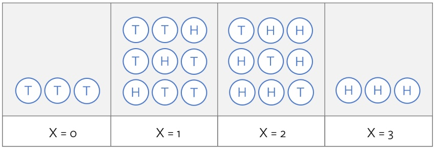
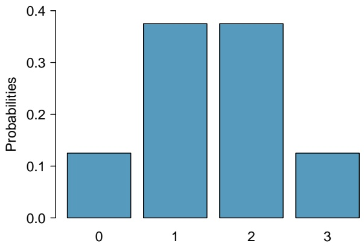
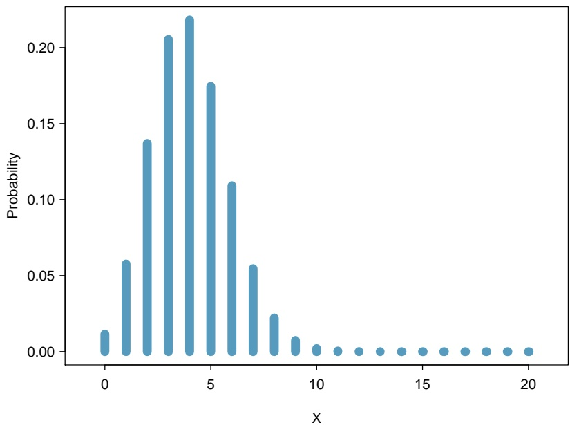

**2.8 School absences.** Data collected at elementary schools in DeKalb County, GA suggest that each year roughly 25% of students miss exactly one day of school, 15% miss 2 days, and 28% miss 3 or more days due to sickness.41

(a) What is the probability that a student chosen at random doesn’t miss any days of school due to sickness this year?
(b) What is the probability that a student chosen at random misses no more than one day?
(c) What is the probability that a student chosen at random misses at least one day?
(d) If a parent has two kids at a DeKalb County elementary school, what is the probability that neither kid will miss any school? Note any assumptions made and evaluate how reasonable they are.
(e) If a parent has two kids at a DeKalb County elementary school, what is the probability that both kids will miss some school, i.e. at least one day? Note any assumptions made and evaluate how reasonable they are.

**2.9 Disjoint vs. independent.** In parts (a) and (b), identify whether the events are disjoint, independent, or neither (events cannot be both disjoint and independent).

(a) You and a randomly selected student from your class both earn A’s in this course.
(b) You and your class study partner both earn A’s in this course.
(c) If two events can occur at the same time, must they be dependent?

**2.10 Health coverage, frequencies.** The Behavioral Risk Factor Surveillance System (BRFSS) is an annual telephone survey designed to identify risk factors in the adult population and report emerging health trends. The following table summarizes two variables for the respondents: health status and health coverage, which describes whether each respondent had health insurance.42

Health Status

<table><tr><td colspan="2"></td><td>Excellent</td><td>Very good</td><td>Good</td><td>Fair</td><td>Poor</td><td>Total</td></tr><tr><td rowspan="3">Health Coverage</td><td>No</td><td>459</td><td>727</td><td>854</td><td>385</td><td>99</td><td>2,524</td></tr><tr><td>Yes</td><td>4,198</td><td>6,245</td><td>4,821</td><td>1,634</td><td>578</td><td>17,476</td></tr><tr><td>Total</td><td>4,657</td><td>6,972</td><td>5,675</td><td>2,019</td><td>677</td><td>20,000</td></tr></table>

(a) If one individual is drawn at random, what is the probability that the respondent has excellent health and doesn’t have health coverage?
(b) If one individual is drawn at random, what is the probability that the respondent has excellent health or doesn’t have health coverage?

<small>41S.S. Mizan et al. “[Absence, Extended Absence, and Repeat Tardiness Related to Asthma Status among Elementary School Children](http://www.openintro.org/redirect.php?go=textbook-tardiness_asthma_2011&referrer=biostat1_pdf)”. In: Journal of Asthma 48.3 (2011), pp. 228–234.</small>

<small>42Office of Surveillance, Epidemiology, and Laboratory Services Behavioral Risk Factor Surveillance System, [BRFSS 2010 Survey Data](http://www.openintro.org/redirect.php?go=textbook-BRFSS_2010&referrer=biostat1_pdf).</small>

## 2.5.2 Conditional probability

**2.11 Global warming.** A Pew Research poll asked 1,306 Americans “From what you’ve read and heard, is there solid evidence that the average temperature on earth has been getting warmer over the past few decades, or not?". The table below shows the distribution of responses by party and ideology, where the counts have been replaced with relative frequencies.43

<table><tr><td rowspan="2" colspan="2"></td><td colspan="3">Response</td><td rowspan="2">Total</td></tr><tr><td>Earth is warming</td><td>Not warming</td><td>Don&#x27;t Know Refuse</td></tr><tr><td rowspan="5">Party and Ideology</td><td>Conservative Republican</td><td>0.11</td><td>0.20</td><td>0.02</td><td>0.33</td></tr><tr><td>Mod/Lib Republican</td><td>0.06</td><td>0.06</td><td>0.01</td><td>0.13</td></tr><tr><td>Mod/Cons Democrat</td><td>0.25</td><td>0.07</td><td>0.02</td><td>0.34</td></tr><tr><td>Liberal Democrat</td><td>0.18</td><td>0.01</td><td>0.01</td><td>0.20</td></tr><tr><td>Total</td><td>0.60</td><td>0.34</td><td>0.06</td><td>1.00</td></tr></table>

(a) Are believing that the earth is warming and being a liberal Democrat mutually exclusive?
(b) What is the probability that a randomly chosen respondent believes the earth is warming or is a liberal Democrat?
(c) What is the probability that a randomly chosen respondent believes the earth is warming given that he is a liberal Democrat?
(d) What is the probability that a randomly chosen respondent believes the earth is warming given that he is a conservative Republican?
(e) Does it appear that whether or not a respondent believes the earth is warming is independent of their party and ideology? Explain your reasoning.
(f) What is the probability that a randomly chosen respondent is a moderate/liberal Republican given that he does not believe that the earth is warming?

**2.12 ABO blood groups.** The ABO blood group system consists of four different blood groups, which describe whether an individual’s red blood cells carry the A antigen, B antigen, both, or neither. The ABO gene has three alleles: $I ^ { A } ,   I ^ { B } ,$ , and i. The i allele is recessive to both $I ^ { A }$ and $I ^ { B } ,$ , while the $I ^ { A }$ and $I ^ { B }$ allels are codominant. Individuals homozygous for the i allele are known as blood group O, with neither A nor B antigens.

| Alleles inherited | Blood type |
| --- | --- |
| $I^{A}$ and $I^{A}$ | A |
| $I^{A}$ and $I^{B}$ | AB |
| $I^{A}$ and $i$ | A |
| $I^{B}$ and $I^{B}$ | B |
| $I^{B}$ and $i$ | B |
| $i$ and $i$ | O |

Blood group follows the rules of Mendelian single-gene inheritance – alleles are inherited independently from either parent, with probability 0.5.

(a) Suppose that both members of a couple have Group AB blood. What is the probability that a child of this couple will have Group A blood?
(b) Suppose that one member of a couple is genotype $I ^ { B } i$ and the other is $I ^ { A } i$ . What is the probability that their first child has Type O blood and the next two do not?
(c) Suppose that one member of a couple is genotype $I ^ { B } i$ and the other is $I ^ { A } i .$ Given that one child has Type O blood and two do not, what is the probability of the first child having Type O blood?

<small>43Pew Research Center, [Majority of Republicans No Longer See Evidence of Global Warming](http://www.openintro.org/redirect.php?go=textbook-republicans_global_warming_2010&referrer=biostat1_pdf), data collected on October 27, 2010.</small>

**2.13 Seat belts.** Seat belt use is the most effective way to save lives and reduce injuries in motor vehicle crashes. In a 2014 survey, respondents were asked, "How often do you use seat belts when you drive or ride in a car?". The following table shows the distribution of seat belt usage by sex.

Seat Belt Usage

<table><tr><td rowspan="4">Sex</td><td></td><td>Always</td><td>Nearly always</td><td>Sometimes</td><td>Seldom</td><td>Never</td><td>Total</td></tr><tr><td>Male</td><td>146,018</td><td>19,492</td><td>7,614</td><td>3,145</td><td>4,719</td><td>180,988</td></tr><tr><td>Female</td><td>229,246</td><td>16,695</td><td>5,549</td><td>1,815</td><td>2,675</td><td>255,980</td></tr><tr><td>Total</td><td>375,264</td><td>36,187</td><td>13,163</td><td>4,960</td><td>7,394</td><td>436,968</td></tr></table>

(a) Calculate the marginal probability that a randomly chosen individual always wears seatbelts.
(b) What is the probability that a randomly chosen female always wears seatbelts?
(c) What is the conditional probability of a randomly chosen individual always wearing seatbelts, given that they are female?
(d) What is the conditional probability of a randomly chosen individual always wearing seatbelts, given that they are male?
(e) Calculate the probability that an individual who never wears seatbelts is male.
(f) Does gender seem independent of seat belt usage?

**2.14 Health coverage, relative frequencies.** The Behavioral Risk Factor Surveillance System (BRFSS) is an annual telephone survey designed to identify risk factors in the adult population and report emerging health trends. The following table displays the distribution of health status of respondents to this survey (excellent, very good, good, fair, poor) conditional on whether or not they have health insurance.

Health Status

<table><tr><td colspan="2"></td><td>Excellent</td><td>Very good</td><td>Good</td><td>Fair</td><td>Poor</td><td>Total</td></tr><tr><td rowspan="3">Health Coverage</td><td>No</td><td>0.0230</td><td>0.0364</td><td>0.0427</td><td>0.0192</td><td>0.0050</td><td>0.1262</td></tr><tr><td>Yes</td><td>0.2099</td><td>0.3123</td><td>0.2410</td><td>0.0817</td><td>0.0289</td><td>0.8738</td></tr><tr><td>Total</td><td>0.2329</td><td>0.3486</td><td>0.2838</td><td>0.1009</td><td>0.0338</td><td>1.0000</td></tr></table>

(a) Are being in excellent health and having health coverage mutually exclusive?
(b) What is the probability that a randomly chosen individual has excellent health?
(c) What is the probability that a randomly chosen individual has excellent health given that he has health coverage?
(d) What is the probability that a randomly chosen individual has excellent health given that he doesn’t have health coverage?
(e) Do having excellent health and having health coverage appear to be independent?

**2.15 HIV in Swaziland.** Swaziland has the highest HIV prevalence in the world: 25.9% of this country’s population is infected with HIV.44 The ELISA test is one of the first and most accurate tests for HIV. For those who carry HIV, the ELISA test is 99.7% accurate. For those who do not carry HIV, the test is 92.6% accurate. Calculate the PPV and NPV of the test.

**2.16 Assortative mating.** Assortative mating is a nonrandom mating pattern where individuals with similar genotypes and/or phenotypes mate with one another more frequently than what would be expected under a random mating pattern. Researchers studying this topic collected data on eye colors of 204 Scandinavian men and their female partners. The table below summarizes the results. For simplicity, we only include heterosexual relationships in this exercise.45

<table><tr><td rowspan="2" colspan="2"></td><td colspan="3">Partner (female)</td><td rowspan="2">Total</td></tr><tr><td>Blue</td><td>Brown</td><td>Green</td></tr><tr><td rowspan="4">Self (male)</td><td>Blue</td><td>78</td><td>23</td><td>13</td><td>114</td></tr><tr><td>Brown</td><td>19</td><td>23</td><td>12</td><td>54</td></tr><tr><td>Green</td><td>11</td><td>9</td><td>16</td><td>36</td></tr><tr><td>Total</td><td>108</td><td>55</td><td>41</td><td>204</td></tr></table>

(a) What is the probability that a randomly chosen male respondent or his partner has blue eyes?
(b) What is the probability that a randomly chosen male respondent with blue eyes has a partner with blue eyes?
(c) What is the probability that a randomly chosen male respondent with brown eyes has a partner with blue eyes? What about the probability of a randomly chosen male respondent with green eyes having a partner with blue eyes?
(d) Does it appear that the eye colors of male respondents and their partners are independent? Explain your reasoning.

**2.17 It’s never lupus.** Lupus is a medical phenomenon where antibodies that are supposed to attack foreign cells to prevent infections instead see plasma proteins as foreign bodies, leading to a high risk of blood clotting. It is believed that 2% of the population suffer from this disease. The test is 98% accurate if a person actually has the disease. The test is 74% accurate if a person does not have the disease. There is a line from the Fox television show House that is often used after a patient tests positive for lupus: “It’s never lupus." Do you think there is truth to this statement? Use appropriate probabilities to support your answer.

**2.18 Predisposition for thrombosis.** A genetic test is used to determine if people have a predisposition for thrombosis, which is the formation of a blood clot inside a blood vessel that obstructs the flow of blood through the circulatory system. It is believed that 3% of people actually have this predisposition. The genetic test is 99% accurate if a person actually has the predisposition, meaning that the probability of a positive test result when a person actually has the predisposition is 0.99. The test is 98% accurate if a person does not have the predisposition.

(a) What is the probability that a randomly selected person who tests positive for the predisposition by the test actually has the predisposition?
(b) What is the probability that a randomly selected person who tests negative for the predisposition by the test actually does not have the predisposition?

<small>45B. Laeng et al. “[Why do blue-eyed men prefer women with the same eye color?](http://www.openintro.org/redirect.php?go=textbook-eye_color_pref_2010&referrer=biostat1_pdf)” In: Behavioral Ecology and Sociobiology 61.3 (2007), pp. 371–384.</small>

**2.19 Views on evolution.** A 2013 analysis conducted by the Pew Research Center found that 60% of survey respondents agree with the statement "humans and other living things have evolved over time" while 33% say that "humans and other living things have existed in their present form since the beginning of time" (7% responded "don’t know"). They also found that there are differences among partisan groups in beliefs about evolution. While roughly two-thirds of Democrats (67%) and independents (65%) say that humans and other living things have evolved over time, 48% of Republicans reject the idea of evolution. Suppose that 45% of respondents identified as Democrats, 40% identified as Republicans, and 15% identified as political independents. The survey was conducted among a national sample of 1,983 adults.

(a) Suppose that a person is randomly selected from the population and found to identify as a Democrat. What is the probability that this person does not agree with the idea of evolution?
(b) Suppose that a political independent is randomly selected from the population. What is the probability that this person does not agree with the idea of evolution?
(c) Suppose that a person is randomly selected from the population and found to identify as a Republican. What is the probability that this person agrees with the idea of evolution?
(d) Suppose that a person is randomly selected from the population and found to support the idea of evolution. What is the probability that this person identifies as a Republican?

**2.20 Cystic fibrosis testing.** The prevalence of cystic fibrosis in the United States is approximately 1 in 3,500 births. Various screening strategies for CF exist. One strategy uses dried blood samples to check the levels of immunoreactive trypsogen (IRT); IRT levels are commonly elevated in newborns with CF. The sensitivity of the IRT screen is 87% and the specificity is 99%.

(a) In a hypothetical population of 100,000, how many individuals would be expected to test positive? Of those who test positive, how many would be true positives? Calculate the PPV of IRT.
(b) In order to account for lab error or physiological fluctuations in IRT levels, infants who tested positive on the initial IRT screen are asked to return for another IRT screen at a later time, usually two weeks after the first test. This is referred to as an IRT/IRT screening strategy. Calculate the PPV of IRT/IRT.

**2.21 Mumps.** Mumps is a highly contagious viral infection that most often occurs in children, but can affect adults, particularly if they are living in shared living spaces such as college dormitories. It is most recognizable by the swelling of salivary glands at the side of the face under the ears, but earlier symptoms include headaches, fever, and joint pain. Suppose a college student at a university presents to a physician with symptoms of headaches, fever, and joint pain. Let A = {headaches, fever, and joint pain}, and suppose that the possible disease state of the patient can be partitioned into: B1 = normal, $B _ { 2 } =$ common cold, $B _ { 3 } = \mathrm { \tt m u m p s } .$ From clinical experience, the physician estimates $P ( A | \bar { B } _ { i } ) ;$ $P ( A | B _ { 1 } ) = 0 . 0 0 1 ,   P ( A | B _ { 2 } ) = 0 . 7 0 ,   P ( A | B _ { 3 } ) = 0 . 9 5 .$ The physician, aware that some students have contracted the mumps, then estimates that for students at this university, $P ( B _ { 1 } ) = 0 . 9 5 ,   P ( B _ { 2 } ) = 0 . 0 2 5$ , and $P ( B _ { 3 } ) = 0 . 0 2 5$ . Given the previous symptoms, which of the disease states is most likely?

**2.22 Twins.** About 30% of human twins are identical, and the rest are fraternal. Identical twins are necessarily the same sex – half are males and the other half are females. One-quarter of fraternal twins are both male, one-quarter both female, and one-half are mixes: one male, one female. You have just become a parent of twins and are told they are both girls. Given this information, what is the probability that they are identical?

**2.23 IQ testing.** A psychologist conducts a study on intelligence in which participants are asked to take an IQ test consisting of n questions, each with m choices.

(a) One thing the psychologist must be careful about when analyzing the results is accounting for lucky guesses. Suppose that for a given question a particular participant either knows the answer or guesses. The participant knows the correct answer with probability p, and does not know the answer (and therefore will have to guess) with probability 1 − p. The participant guesses completely randomly. What is the conditional probability that the participant knew the answer to a question, given that they answered it correctly?
(b) About 1 in 1,100 people have IQs over 150. If a subject receives a score of greater than some specified amount, they are considered by the psychologist to have an IQ over 150. But the psychologist’s test is not perfect. Although all individuals with IQ over 150 will definitely receive such a score, individuals with IQs less than 150 can also receive such scores about 0.1% of the time due to lucky guessing. Given that a subject in the study is labeled as having an IQ over 150, what is the probability that they actually have an IQ below 150?

**2.24 Breast cancer and age.** The strongest risk factor for breast cancer is age; as a woman gets older, her risk of developing breast cancer increases. The following table shows the average percentage of American women in each age group who develop breast cancer, according to statistics from the National Cancer Institute. For example, approximately 3.56% of women in their 60’s get breast cancer.

| Age Group | Prevalence |
| --- | --- |
| 30 - 40 | 0.0044 |
| 40 - 50 | 0.0147 |
| 50 - 60 | 0.0238 |
| 60 - 70 | 0.0356 |
| 70 - 80 | 0.0382 |

A mammogram typically identifies a breast cancer about 85% of the time, and is correct 95% of the time when a woman does not have breast cancer.

(a) Calculate the PPV for each age group. Describe any trend(s) you see in the PPV values as prevalence changes. Explain the reason for the trend(s) in language that someone who has not taken a statistics course would understand.
(b) Suppose that two new mammogram imaging technologies have been developed which can improve the PPV associated with mammograms; one improves sensitivity to 99% (but specificity remains at 95%), while the other improves specificity to 99% (while sensitivity remains at 85%). Which technology offers a higher increase in PPV? Explain why.

**2.25 Prostate-specific antigen.** Prostate-specific antigen (PSA) is a protein produced by the cells of the prostate gland. Blood PSA level is often elevated in men with prostate cancer, but a number of benign (not cancerous) conditions can also cause a man’s PSA level to rise. The PSA test for prostate cancer is a laboratory test that measures PSA levels from a blood sample. The test measures the amount of PSA in ng/ml (nanograms per milliliter of blood).

The sensitivity and specificity of the PSA test depend on the cutoff value used to label a PSA level as abnormally high. In the last decade, 4.0 ng/ml has been considered the upper limit of normal, and values 4.1 and higher were used to classify a PSA test as positive. Using this value, the sensitivity of the PSA test is 20% and the specificity is 94%.

The likelihood that a man has undetected prostate cancer depends on his age. This likelihood is also called the prevalence of undetected cancer in the male population. The following table shows the prevalence of undetected prostate cancer by age group.

| Age Group | Prevalence | PPV | NPV |
| --- | --- | --- | --- |
| &lt; 50 years | 0.001 |  |  |
| 50 - 60 years | 0.020 |  |  |
| 61 - 70 years | 0.060 |  |  |
| 71 - 80 years | 0.100 |  |  |

(a) Calculate the missing PPV and NPV values.
(b) Describe any trends you see in the PPV and NPV values.
(c) Explain the reason for the trends in part b), in language that someone who has not taken a statistics course would understand.
(d) The cutoff for a positive test is somewhat controversial. Explain, in your own words, how lowering the cutoff for a positive test from 4.1 ng/ml to 2.5 ng/ml would affect sensitivity and specificity.

## 2.5.3 Extended example

**2.26 Eye color.** One of the earliest models for the genetics of eye color was developed in 1907, and proposed a single-gene inheritance model, for which brown eye color is always dominant over blue eye color. Suppose that in the population, 25% of individuals are homozygous dominant (BB), 50% are heterozygous (Bb), and 25% are homozygous recessive (bb).

(a) Suppose that two parents have brown eyes. What is the probability that their first child has blue eyes?
(b) Does the probability change if it is now known that the paternal grandfather had blue eyes? Justify your answer.
(c) Given that their first child has brown eyes, what is the probability that their second child has blue eyes? Ignore the condition given in part (b).

**2.27 Colorblindness.** The most common form of colorblindness is a recessive, sex-linked hereditary condition caused by a defect on the X chromosome. Females are XX, while males are XY. Individuals inherit one chromosome from each parent, with equal probability; for example, an individual has a 50% chance of inheriting their father’s X chromosome, and a 50% chance of inheriting their father’s Y chromosome. If a male has an X chromosome with the defect, he is colorblind. However, a female with only one defective X chromosome will not be colorblind. Thus, colorblindness is more common in males than females; 7% of males are colorblind but only 0.5% of females are colorblind.

(a) Assume that the X chromosome with the wild-type allele is $X ^ { + }$ and the one with the disease allele is $X ^ { - }$ What is the expected frequency of each possible female genotype: $X ^ { + } X ^ { + } , X ^ { + } X ^ { - }$ , and $X ^ { - } X ^ { - } ?$ What is the expected frequency of each possible male genotype: $X ^ { + } Y$ and $X ^ { - } Y _ { * } ^ { 2 }$
(b) Suppose that two parents are not colorblind. What is the probability that they have a colorblind child?

**2.28 Rapid feathering.** Sex linkage refers to the inheritance pattern that results from a mutation occurring on a gene located on a sex chromosome. A classic example of a sex-linked trait in humans is red-green color blindness; females can only be red-green colorblind if they have two copies of the mutation (one on each X chromosome), while a single copy of the mutation is sufficient to confer colorblindness in males (since males only have one X chromosome).

In birds, females are the heterogametic sex (with sex chromosomes ZW) and males are the homogametic sex (with sex chromosomes ZZ). A commonly known sex-linked trait in domestic chickens is the rapid feath ering trait, which is carried on the Z chromosome. Chickens with the rapid feathering trait grow feathers at a faster rate; this difference is especially pronounced within the first few days from hatching. The wild-type allele $K ^ { - }$ is dominant to the mutant alelle $K ^ { + } ;$ presence of the $K ^ { - }$ allele produces slow feathering. Females can be either genotype $Z ^ { K ^ { + } }$ W or $Z ^ { K ^ { - } } W$ . Males can be either heterozygous $( Z ^ { K ^ { + } } Z ^ { K ^ { - } } )$ , homozygous for slow feathering $( Z ^ { \tilde { K } ^ { - } } Z ^ { K ^ { \dot { - } } } )$ , or homozygous for rapid feathering $( Z ^ { K ^ { + } } Z ^ { K ^ { + } } )$ .

In a population of chickens, 9% of males are rapid feathering and 16% of females are rapid feathering. Suppose that slow feathering chickens are mated. What is the probability that out of their 12 offspring, at least two are rapid feathering?

**2.29 Genetics of Australian cattle dogs.** Australian cattle dogs are known to have a high prevalence of congenital deafness. Deafness in both ears is referred to as bilateral deafness, while deafness in one ear is referred to as unilateral deafness.

Deafness in dogs is associated with the white spotting gene $S$ that controls the expression of coat and eye pigmentation. The dominant allele S produces solid color, while the three recessive alleles contribute to increasing amounts of white in coat pigmentation: Irish spotting $\left( s ^ { i } \right) _ { i }$ , piebald $\left( s ^ { p } \right)$ , and extreme white piebald $\left( s ^ { w } \right)$ . The $s ^ { p }$ and $s ^ { w }$ alleles are responsible for the distinctive Australian cattle dog coat pattern of white hair evenly speckled throughout either a predominantly red or black coat. The dogs are born with white coats, and the speckled pattern develops as they $a \mathbf { g } \mathbf { e }$

While all Australian cattle dogs have some combination of the $s ^ { p }$ and $s ^ { w }$ alleles, the gene displays incomplete penetrance such that individuals show some variation in phenotype despite having the same genotype. Individuals with low penetrance of the alleles tend to have additional patterns on their coat, such as a dark "mask" around one or both eyes (in other words, a unilateral mask or a bilateral mask). High penetrance of the piebald alleles is associated with deafness.

Suppose that 40% of Australian cattle dogs have black coats; these individuals are commonly referred to as "Blue Heelers" as opposed to "Red Heelers". Among Blue Heelers, 35% of individuals have bilateral masks and 25% have unilateral masks. About 50% of Red Heelers exhibit no eye masking and 10% have bilateral masks.

Let M represent the event that an Australian cattle dog has a facial mask, where $M _ { 2 }$ represents a bilateral mask, $M _ { 1 }$ represents a unilateral mask, and $M _ { 0 }$ indicates lack of a mask.

(a) Calculate the probability an Australian cattle dog has a facial mask and a black coat.
(b) Calculate the prevalence of bilateral masks in Australian cattle dogs.
(c) Among Australian cattle dogs with bilateral facial masks, what is the probability of being a Red Heeler?
(d) Unilateral deafness occurs in Red Heelers with probability 0.15, in both dogs that either lack facial mask ing or exhibit a unilateral mask; for both unmasked and unilaterally masked Red Heelers, 60% of dogs are not deaf. The overall prevalence of bilaterally masked Australian cattle dogs with bilateral deafness and red coats is 1.2% and the overall prevalence of bilaterally masked Australian cattle dogs with unilat eral deafness and red coats is 4.5%; these prevalences are the same for Australian cattle dogs with black coats. Among Blue Heelers with either no facial masking or a unilateral mask, the probability of unilateral deafness is 0.05 and the probability of bilateral deafness is 0.01.
Let D represent the event that an Australian cattle dog is deaf $( \mathbf { i . e . } ,$ deaf in at least one ear), where $D _ { 2 }$ represents bilateral deafness and $D _ { 1 }$ represents unilateral deafness.
i. What is the probability that an Australian cattle dog has a bilateral mask, no hearing deficits, and a red coat?
ii. Calculate the proportion of bilaterally masked Blue Heelers without hearing deficits.
iii. Compare the prevalence of deafness between Red Heelers and Blue Heelers.
iv. If a dog is known to have no hearing deficits, what is the probability it is a Blue Heeler?

# Chapter 3

# Distributions of random variables

**3.1 Random variables**
**3.2 Binomial distribution**
**3.3 Normal distribution**
**3.4 Poisson distribution**
**3.5 Distributions related to Bernoulli trials**
**3.6 Distributions for pairs of random variables**
**3.7 Notes**
**3.8 Exercises**

When planning clinical research studies, investigators try to anticipate the results they might see under certain hypotheses. The treatments for some forms of can cer, such as advanced lung cancer, are only effective in a small percentage of patients: typically 20% or less. Suppose that a study testing a new treatment will be conducted on 20 participants, where the working assumption is that 20% of the patients will respond to the treatment. How might the possible outcomes of the study be represented, along with their probabilities? It is possible to express various outcomes using the probability notation in the previous chapter, e.g. if A were the event that one patient responds to treatment, but this would quickly become unwieldy.

Instead, the anticipated outcome in the study can be represented as a **random variable**, which numerically summarizes the possible outcomes of a random experiment. For example, let X represent the number of patients who respond to treatment; a numerical value x can be assigned to each possible outcome, and the probabilities of 1,2,..., x patients having a good response can be expressed as $P(X = 1), P(X = 2), \cdots, P(X = x)$ . The distribution of a random variable specifies the probability of each possible outcome associated with the random variable.

This chapter will begin by outlining general properties of random variables and their distributions. The rest of the chapter discusses specific named distributions that are commonly used throughout probability and statistics.

For labs, slides, and other resources, please visit

[**www.openintro.org/book/biostat**](http://www.openintro.org/redirect.php?go=biostat&referrer=biostat1_pdf)

## 3.1 Random variables

## 3.1.1 Distributions of random variables

Formally, a random variable assigns numerical values to the outcome of a random phenomenon, and is usually written with a capital letter such as X, Y , or Z.

If a coin is tossed three times, the outcome is the sequence of observed heads and tails. One such outcome might be TTH: tails on the first two tosses, heads on the third. If the random variable X is the number of heads for the three tosses, $X = 1 ;$ if Y is the number of tails, then $Y = 2$ . For the sequence THT, only the order has changed, but the values of X and Y remain the same. For the sequence HHH, however, $X = 3$ and $Y = 0 .$ Even in this simple setting, is possible to define other random variables; for example, if Z is the toss when the first H occurs, then $Z = 3$ for the first set of tosses (TTH) and 1 for the third set (HHH).

text_image

T T T
X = 0
T T H
T H T
H T T
X = 1
T H H
H T H
H H T
X = 2
H H H
X = 3

Figure 3.1: Possible outcomes for number of heads in three tosses of a coin.

If probabilities can be assigned to the outcomes in a random phenomenon or study, then those can be used to assign probabilities to values of a random variable. Using independence, $P( HHH ) = (1/2)^3 = 1/8$ . Since X in the above example can only be three if the three tosses are all heads, $P ( X = 3 ) = 1 / 8$ . The distribution of a random variable is the collection of probabilities for all of the variable’s unique values. Figure 3.1 shows the eight possible outcomes when a coin is cossed three times: TTT, HTT, THT, TTH, HHT, HTH, THH, HHH. For the first set of tosses, $X = 0 ;$ for the next three, X = 1, then X = 2 for the following three tosses and $X = 3$ for the last set (HHH).

Using independence again, each of the 8 outcomes have probability 1/8, so $P(X = 0) = P(X =$ $3 ) = 1 / 8$ and $P ( X   =   1 )   =   P ( X   =   2 )   =   3 / 8$ Figure 3.2 shows the probability distribution for X. Probability distributions for random variables follow the rules for probability; for instance, the sum of the probabilities must be 1.00. The possible outcomes of X are labeled with a corresponding lower case letter x and subscripts. The values of X are $x _ { 1 } = 0 ,   x _ { 2 } = 1 ,   x _ { 3 } = 2 ,$ , and $x _ { 4 } = 3 ;$ these occur with probabilities 1/8, 3/8, 3/8 and 1/8.

| i | 1 | 2 | 3 | 4 | Total |
| --- | --- | --- | --- | --- | --- |
| $x_{i}$ | 0 | 1 | 2 | 3 | - |
| $P(X = x_{i})$ | 1/8 | 3/8 | 3/8 | 1/8 | 8/8 = 1.00 |

Figure 3.2: Tabular form for the distribution of the number of heads in three coin tosses.

bar

| Category | Probabilities |
| --- | --- |
| 0 | ~0.125 |
| 1 | ~0.375 |
| 2 | ~0.375 |
| 3 | ~0.125 |

Figure 3.3: Bar plot of the distribution of the number of heads in three coin tosses.

Bar graphs can be used to show the distribution of a random variable. Figure 3.3 is a bar graph of the distribution of X in the coin tossing example. When bar graphs are used to show the distribution of a dataset, the heights of the bars show the frequency of observations; in contrast, bar heights for a probability distribution show the probabilities of possible values of a random variable.

X is an example of a **discrete random variable** since it takes on a finite number of values.1 A **continuous random variable** can take on any real value in an interval.

In the hypothetical clinical study described at the beginning of this section, how unlikely would it be for 12 or more patients to respond to the treatment, given that only 20% of patients are expected to respond? Suppose X is a random variable that will denote the possible number of responding patients, out of a total of 20. X will have the same probability distribution as the number of heads in a 20 tosses of a weighted coin, where the probability of landing heads is 0.20. The graph of the probability distribution for X in Figure 3.4 can be used to approximate this probability. The event of 12 or more consists of nine values (12, 13, . . . , 20); the graph shows that the probabilities for each value is extremely small, so the chance of 12 or more responses must be less than 0.01.2

histogram

| X | Probability |
| --- | --- |
| 0 | ~0.015 |
| 1 | ~0.06 |
| 2 | ~0.14 |
| 3 | ~0.21 |
| 4 | ~0.22 |
| 5 | ~0.175 |
| 6 | ~0.11 |
| 7 | ~0.055 |
| 8 | ~0.025 |
| 9 | ~0.01 |
| 10 | ~0.005 |
| 11 | ~0.002 |
| 12 | ~0.001 |
| 13 | ~0.001 |
| 14 | ~0.001 |
| 15 | ~0.001 |
| 16 | ~0.001 |
| 17 | ~0.001 |
| 18 | ~0.001 |
| 19 | ~0.001 |
| 20 | ~0.001 |

Figure 3.4: Bar plot of the distribution of the number of responses in a study with 20 participants and response probability 0.20

<small>1Some discrete random variables have an infinite number of possible values, such as all the non-negative integers.</small>

<small>2Formulas in Section 3.2 can be used to show that the exact probability is slightly larger than 0.0001.</small>

## 3.1.2 Expectation

Just like distributions of data, distributions of random variables also have means, variances, standard deviations, medians, etc.; these characteristics are computed a bit differently for random variables. The mean of a random variable is called its **expected value** and written $E ( X )$ . To calculate the mean of a random variable, multiply each possible value by its corresponding probability and add these products.

## EXPECTED VALUE OF A DISCRETE RANDOM VARIABLE

If X takes on outcomes $x _ { 1 } , . . . , x _ { k }$ with probabilities $P ( X = x _ { 1 } ) ,   . . . ,   P ( X = x _ { k } )$ , the expected value of X is the sum of each outcome multiplied by its corresponding probability:

$$
\begin{array}{l} E (X) = x _ {1} P (X = x _ {1}) + \dots + x _ {k} P (X = x _ {k}) \\ = \sum_ {i = 1} ^ {k} x _ {i} P (X = x _ {i}). \tag {3.1} \\ \end{array}
$$

The Greek letter $\mu$ may be used in place of the notation $E ( X )$ .

## EXAMPLE 3.2

Calculate the expected value of X, where X represents the number of heads in three tosses of a fair coin.

X can take on values 0, 1, 2, and 3. The probability of each $x _ { k }$ is given in Figure 3.2.

E(X)

Expected Value of X

$$
\begin{array}{l} E (X) = x _ {1} P (X = x _ {1}) + \dots + x _ {k} P (X = x _ {k}) \\ = (0) (P (X = 0)) + (1) (P (X = 1)) + (2) (P (X = 2)) + (3) (P (X = 3)) \\ = (0) (1 / 8) + (1) (3 / 8) + (2) (3 / 8) + (3) (1 / 8) = 1 2 / 8 \\ = 1. 5. \\ \end{array}
$$

The expected value of X is 1.5.

The expected value for a random variable represents the average outcome. For example, $E ( X ) = 1 . 5$ represents the average number of heads in three tosses of a coin, if the three tosses were repeated many times.3It often happens with discrete random variables that the expected value is not precisely one of the possible outcomes of the variable.

## GUIDED PRACTICE 3.3

Calculate the expected value of Y , where Y represents the number of heads in three tosses of an unfair coin, where the probability of heads is 0.70.4

<small>3The expected value E(X) can also be expressed as µ, e.g. µ = 1.5</small>

<small>4First, calculate the probability distribution. P (Y = 0) = (1 − 0.70)3 = 0.027 and P (Y = 3) = (0.70)3 = 0.343. Note that there are three ways to obtain 1 head (HTT, THT, TTH), thus, P (Y = 1) = (3)(0.70)(1 − 0.70)2 = 0.189. By the same logic, P (Y = 2) = (3)(0.70)2(1−0.70) = 0.441. Thus, E(Y ) = (0)(0.027)+ (1)(0.189)+ (2)(0.441)+ (3)(0.343) = 2.1. The expected value of Y is 2.1.</small>

## 3.1.3 Variability of random variables

The variability of a random variable can be described with variance and standard deviation. For data, the variance is computed by squaring deviations from the mean $( x _ { i } - \mu )$ and then averaging over the number of values in the dataset (Section 1.4.2).

In the case of a random variable, the squared deviations from the mean of the random variable are used instead, and their sum is weighted by the corresponding probabilities. This weighted sum of squared deviations equals the variance; the standard deviation is the square root of the variance.

## VARIANCE OF A DISCRETE RANDOM VARIABLE

If X takes on outcomes $x _ { 1 } , . . . , x _ { k }$ with probabilities $P(X = x_1), \cdots, P(X = x_k)$ and expected value $\mu = E ( X )$ , then the variance of X, denoted by $\operatorname { V a r } ( X )$ or $\sigma ^ { 2 }$ , is

$$
\begin{array}{l} V a r (X) = (x _ {1} - \mu) ^ {2} P (X = x _ {1}) + \dots + (x _ {k} - \mu) ^ {2} P (X = x _ {k}) \\ = \sum_ {i = 1} ^ {k} (x _ {i} - \mu) ^ {2} P (X = x _ {i}). \tag {3.4} \\ \end{array}
$$

The standard deviation of X, labeled SD(X) or σ, is the square root of the variance.

Var(X) Variance of X

The variance of a random variable can be interpreted as the expectation of the terms $( x _ { i } - \mu ) ^ { 2 } ;$ i.e., $\sigma ^ { 2 } = E ( X - \mu ) ^ { 2 }$ . While this compact form is not useful for direct computation, it can be helpful for understanding the concept of variability in the context of a random variable; variance is simply the average of the deviations from the mean.

## EXAMPLE 3.5

Compute the variance and standard deviation of X, the number of heads in three tosses of a fair coin.

In the formula for the variance, $k = 4$ and $\mu _ { X } = E { \bigl ( } X { \bigr ) } = 1 . 5$

$$
\begin{array}{l} \sigma_ {X} ^ {2} = (x _ {1} - \mu_ {X}) ^ {2} P (X = x _ {1}) + \dots + (x _ {4} - \mu) ^ {2} P (X = x _ {4}) \\ = (0 - 1. 5) ^ {2} (1 / 8) + (1 - 1. 5) ^ {2} (3 / 8) + (2 - 1. 5) ^ {2} (3 / 8) + (3 - 1. 5) ^ {2} (1 / 8) \\ = 3 / 4. \\ \end{array}
$$

The variance is $3 / 4 = 0 . 7 5$ and the standard deviation is ${ \sqrt { 3 / 4 } } = 0 . 8 6 6 .$

The coin tossing scenario provides a simple illustration of the mean and variance of a random variable. For the rest of this section, a more realistic example will be discussed—calculating expected health care costs.

In most typical health insurance plans in the United States, members of the plan pay annually in three categories: a monthly premium, a deductible amount that members pay each year before the insurance covers service, and “out-of-pocket” costs which include co-payments for each physician visit or prescription.5 Picking a new health plan involves estimating costs for the next year based on a person’s best guess at the type and number of services that will be needed.

<small>5The deductible also includes care and supplies that are not covered by insurance.</small>

In 2015, Harvard University offered several alternative plans to its employees. In the Health Maintenance Organization (HMO) plan for employees earning less than \$70,000 per year, the monthly premium was $\S 7 9 ,$ and the co-payment for each office visit or physical therapy session was \$20. After a new employee examined her health records for the last 10 years, she noticed that in three of the 10 years, she visited the office of her primary care physician only once, for one annual physical. In four of the 10 years, she visited her physician three times: once for a physical, and twice for cases of the flu. In two of the years, she had four visits. In one of the 10 years, she experienced a knee injury that required 3 office visits and 5 physical therapy sessions.

## EXAMPLE 3.6

Ignoring the cost of prescription drugs, over-the-counter medications, and the annual deductible amount, calculate the expectation and the standard deviation of the expected annual health care cost for this employee.

Let the random variable X denote annual health care costs, where $x _ { i }$ represents the costs in a year for i number of visits. If the last ten years are an accurate picture of annual costs for this employee, X will have four possible values.

The total cost of the monthly premiums in a single year is $1 2 \times \S 7 9 = \S 9 4 8 .$ . The cost of each visit is \$20, so the total visit cost for a year is \$20 times the number of visits.

For example, the first column in the table contains information about the years in which the employee had one office visit. Adding the \$948 for the annual premium and \$20 for one visit results in $x _ { 1 } = \S 9 6 8 ;   P ( X = x _ { i } ) = 3 / 1 0 = 0 . 3 0$

| i | 1 | 2 | 3 | 4 | Sum |
| --- | --- | --- | --- | --- | --- |
| Number of visits | 1 | 3 | 4 | 8 |  |
| $x_i$ | 968 | 1008 | 1028 | 1108 |  |
| $P(X = x_i)$ | 0.30 | 0.40 | 0.20 | 0.10 | 1.00 |
| $x_iP(X = x_i)$ | 290.40 | 403.20 | 205.60 | 110.80 | 1010.00 |

The expected cost of health care for a year, $\begin{array} { r } { \sum _ { i } x _ { i } P ( X = x _ { i } ) , } \end{array}$ is $\mu = \S 1 0 1 0 . 0 0 .$

| i | 1 | 2 | 3 | 4 | Sum |
| --- | --- | --- | --- | --- | --- |
| Number of visits | 1 | 3 | 4 | 8 |  |
| $x_i$ | 968 | 1008 | 1028 | 1108 |  |
| $P(X = x_i)$ | 0.30 | 0.40 | 0.20 | 0.10 | 1.00 |
| $(x_i)P(X = x_i)$ | 290.40 | 403.20 | 205.60 | 110.80 | 1010.00 |
| $x_i - \mu$ | -42.00 | -2.00 | 18.00 | 98.00 |  |
| $(x_i - \mu)^2$ | 1764.00 | 4.00 | 324.00 | 9604 |  |
| $(x_i - \mu)^2P(X = x_i)$ | 529.20 | 1.60 | 64.80 | 960.40 | 1556.00 |

The variance of X, $\textstyle \sum _ { i } ( x _ { i }   -   \mu ) ^ { 2 } P ( X = x _ { i } )$ , is $\sigma ^ { 2 } = 1 5 5 6 . 0 0 ,$ , and the standard deviation is $\sigma = \S 3 9 . 4 5 . ^ { 6 }$