## 3.3.6 Normal approximation to the binomial distribution

The normal distribution can be used to approximate other distributions, such as the binomial distribution. The binomial formula is cumbersome when sample size is large, particularly when calculating probabilities for a large number of observations. Under certain conditions, the normal distribution can be used to approximate binomial probabilities. This method was widely used when calculating binomial probabilities by hand was the only option. Nowadays, modern statistical software is capable of calculating exact binomial probabilities even for very large n. The normal approximation to the binomial is discussed here since it is an important result that will be revisited in later chapters.

Consider the binomial model when probability of success is $p = 0 . 1 0$ . Figure 3.12 shows four hollow histograms for simulated samples from the binomial distribution using four different sample sizes: $n = 1 0 , 3 0 , 1 0 0 , 3 0 0$ . As the sample size increases from $n = 10   to   n = 300$ , the distribution is transformed from a blocky and skewed distribution into one resembling the normal curve.

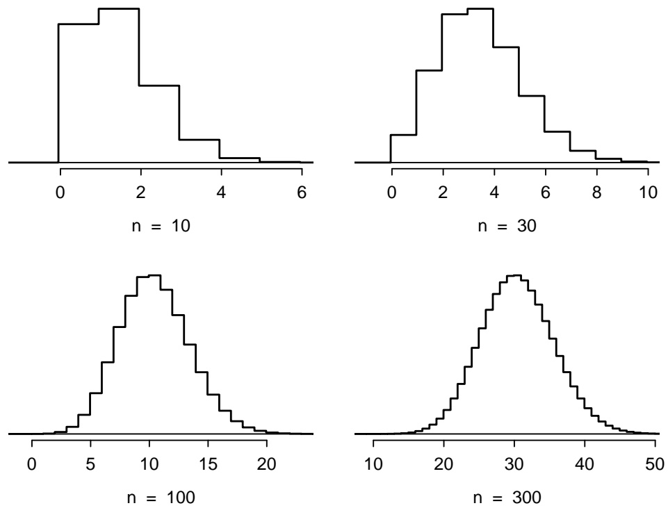

Figure 3.12: Hollow histograms of samples from the binomial model when $p =$ 0.10. The sample sizes for the four plots are $n = 1 0 ,$ , 30, 100, and 300, respectively.

## NORMAL APPROXIMATION OF THE BINOMIAL DISTRIBUTION

The binomial distribution with probability of success p is nearly normal when the sample size n is sufficiently large such that np and $n ( 1 - p )$ are both at least 10. The approximate normal distribution has parameters corresponding to the mean and standard deviation of the binomial distribution:

$$
\mu = n p
$$

$$
\sigma = \sqrt {n p (1 - p)}
$$

## EXAMPLE 3.29

Approximately 20% of the US population smokes cigarettes. A local government commissioned a survey of 400 randomly selected individuals to investigate whether their community might have a lower smoker rate than 20%. The survey found that 59 of the 400 participants smoke cigarettes. If the true proportion of smokers in the community is 20%, what is the probability of observing 59 or fewer smokers in a sample of 400 people?

The desired probability is equivalent to the sum of the individual probabilities of observing $k = 0 ,$ $1 , . . . , 5 8 ,$ or 59 smokers in a sample of $n = 4 0 0 \colon P { \bigl ( } X \leq 5 9 { \bigr ) }$ . Confirm that the normal approximation is valid: $np = 400 \times 0.20 = 80,   n(1 - p) = 400 \times 0.8 = 320$ . To use the normal approximation, calculate the mean and standard deviation from the binomial model:

$$
\mu = n p = 8 0 \quad \sigma = \sqrt {n p (1 - p)} = 8.
$$

Convert 59 to a Z-score: $\left[ Z = \frac{59 - 80}{8} = - 2.63 \right.$ . Use the normal probability table to identify the left tail area, which is 0.0043.

This estimate is very close to the answer derived from the exact binomial calculation:

$$
P (k = 0 \text {or} k = 1 \text {or} \dots \text {or} k = 5 9) = P (k = 0) + P (k = 1) + \dots + P (k = 5 9) = 0. 0 0 4 1.
$$

However, even when the conditions for using the approximation are met, the normal approximation to the binomial tends to perform poorly when estimating the probability of a small range of counts. Suppose the normal approximation is used to compute the probability of observing 69, 70, or 71 smokers in 400 when $p = 0 . 2 0$ . In this setting, the exact binomial and normal approximation result in notably different answers: the approximation gives 0.0476, while the binomial returns 0.0703.

The cause of this discrepancy is illustrated in Figure 3.13, which shows the areas representing the binomial probability (outlined) and normal approximation (shaded). Notice that the width of the area under the normal distribution is 0.5 units too slim on both sides of the interval.

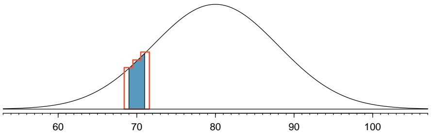

histogram

| Bin Range | Frequency |
| --- | --- |
| ~68 ~70 | ~1.5 |
| ~70 ~72 | ~2.5 |

Figure 3.13: A normal curve with the area between 69 and 71 shaded. The outlined area represents the exact binomial probability.

The normal approximation can be improved if the cutoff values for the range of observations is modified slightly: the lower value should be reduced by 0.5 and the upper value increased by 0.5. The normal approximation with continuity correction gives 0.0687 for the probability of observing 69, 70, or 71 smokers in 400 when $p = 0 . 2 0$ , which is closer to the exact binomial result of 0.0703.

This adjustment method is known as a continuity correction, which allows for increased accuracy when a continuous distribution is used to approximate a discrete one. The modification is typically not necessary when computing a tail area, since the total interval in that case tends to be quite wide.

## 3.3.7 Evaluating the normal approximation

The normal model can also be used to approximate data distributions. While using a normal model can be convenient, it is important to remember that normality is always an approximation. Testing the appropriateness of the normal assumption is a key step in many data analyses.

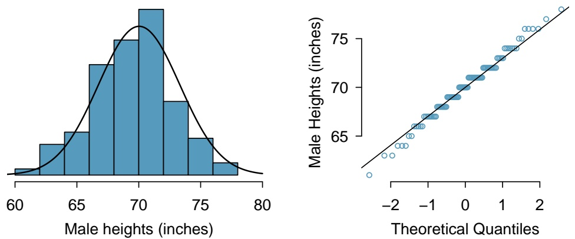

Figure 3.14: A sample of 100 male heights. Since the observations are rounded to the nearest whole inch, the points in the normal probability plot appear to jump in increments.

Example 3.27 suggests the distribution of heights of US males is well approximated by the normal model. There are two visual methods used to assess the assumption of normality. The first is a simple histogram with the best fitting normal curve overlaid on the plot, as shown in the left panel of Figure 3.14. The sample mean x¯ and standard deviation s are used as the parameters of the best fitting normal curve. The closer this curve fits the histogram, the more reasonable the normal model assumption. More commonly, a **normal probability plot** is used, such as the one shown in the right panel of Figure 3.14.19 If the points fall on or near the line, the data closely follow the normal model.

## EXAMPLE 3.30

Three datasets were simulated from a normal distribution, with sample sizes $n = 4 0 ,   n = 1 0 0 ,$ and $n = 4 0 0 ;$ ; the histograms and normal probability plots of the datasets are shown in Figure 3.15. What happens as sample size increases?

As sample size increases, the data more closely follows the normal distribution; the histograms become more smooth, and the points on the Q-Q plots show fewer deviations from the line.

It is important to remember that when evaluating normality in a small dataset, apparent deviations from normality may simply be due to small sample size. Remember that all three of these simulated datasets are drawn from a normal distribution.

When assessing the normal approximation in real data, it will be rare to observe a Q-Q plot as clean as the one shown for $n = 4 0 0 .$ . Typically, the normal approximation is reasonable even if there are some small observed departures from normality in the tails, such as in the plot for $n = 1 0 0$

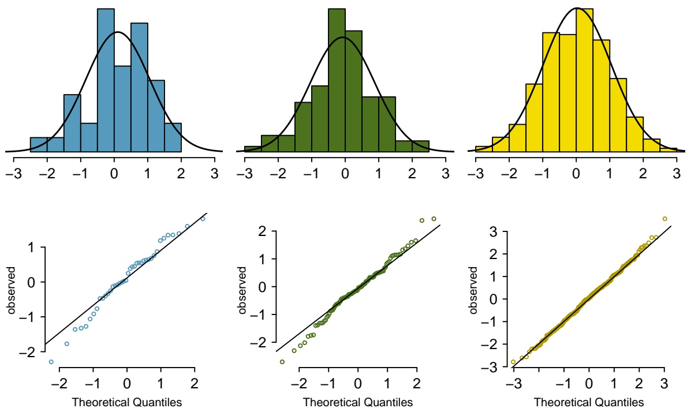

Figure 3.15: Histograms and normal probability plots for three simulated normal data sets; n = 40 (left), $n = 1 0 0$ (middle), $n = 4 0 0$ (right).

## EXAMPLE 3.31

Would it be reasonable to use the normal distribution to accurately calculate percentiles of heights of NBA players? Consider all 435 NBA players from the 2008-9 season presented in Figure 3.16.20

The histogram in the left panel is slightly left skewed, and the points in the normal probability plot do not closely follow a straight line, particularly in the upper quantiles. The normal model is not an accurate approximation of NBA player heights.

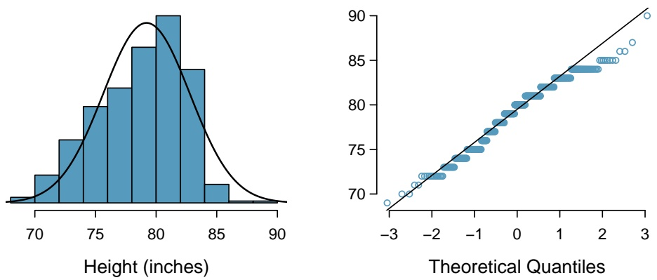

Figure 3.16: Histogram and normal probability plot for the NBA heights from the 2008-9 season.

## EXAMPLE 3.32

Consider the poker winnings of an individual over 50 days. A histogram and normal probability plot of these data are shown in Figure 3.17 Evaluate whether a normal approximation is appropriate.

The data are very strongly right skewed in the histogram, which corresponds to the very strong deviations on the upper right component of the normal probability plot. These data show very strong deviations from the normal model; the normal approximation should not be applied to these data.

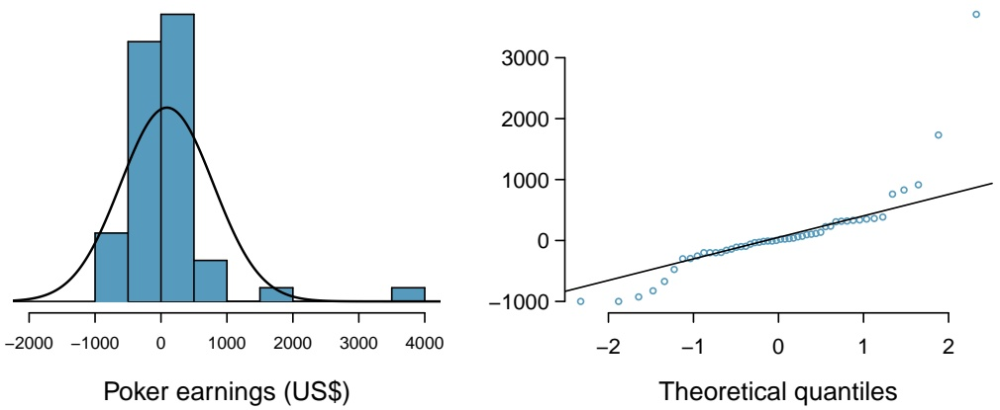

Figure 3.17: A histogram of poker data with the best fitting normal plot and a normal probability plot.

<small>20These data were collected from [www.nba.com](http://www.openintro.org/redirect.php?go=textbook-nba_com&referrer=biostat1_pdf).</small>

## GUIDED PRACTICE 3.33

Determine which data sets represented in Figure 3.18 plausibly come from a nearly normal distribution.21

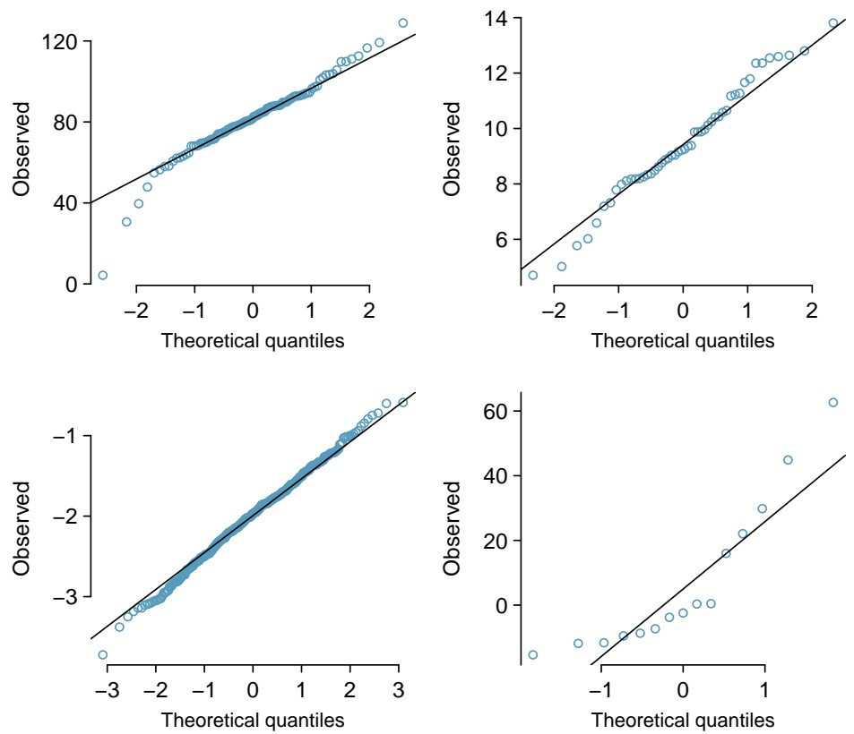

Figure 3.18: Four normal probability plots for Guided Practice 3.33.

<small>21Answers may vary. The top-left plot shows some deviations in the smallest values in the dataset; specifically, the left tail shows some large outliers. The top-right and bottom-left plots do not show any obvious or extreme deviations from the lines for their respective sample sizes, so a normal model would be reasonable. The bottom-right plot has a consistent curvature that suggests it is not from the normal distribution. From examining the vertical coordinates of the observations, most of the data are between -20 and 0, then there are about five observations scattered between 0 and 70; this distribution has strong right skew.</small>

When observations spike downwards on the left side of a normal probability plot, this indicates that the data have more outliers in the left tail expected under a normal distribution. When observations spike upwards on the right side, the data have more outliers in the right tail than expected under the normal distribution.

## GUIDED PRACTICE 3.34

Figure 3.19 shows normal probability plots for two distributions that are skewed. One distribution is skewed to the low end (left skewed) and the other to the high end (right skewed). Which is which?22

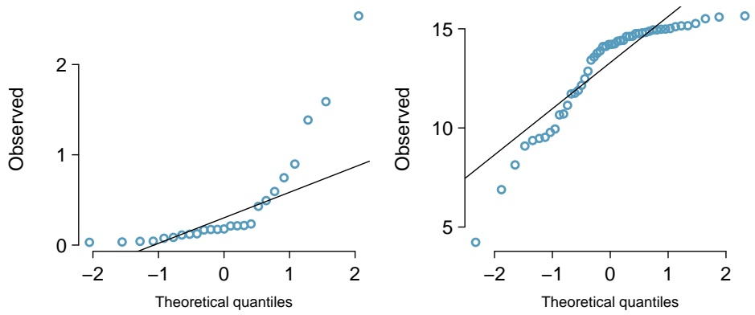

Figure 3.19: Normal probability plots for Guided Practice 3.34.

<small>22Examine where the points fall along the vertical axis. In the first plot, most points are near the low end with fewer observations scattered along the high end; this describes a distribution that is skewed to the high end. The second plot shows the opposite features, and this distribution is skewed to the low end.</small>

## 3.4 Poisson distribution

The **Poisson distribution** is a discrete distribution used to calculate probabilities for the number of occurrences of a rare event. In technical terms, it is used as a model for count data. For example, historical records of hospitalizations in New York City indicate that among a population of approximately 8 million people, 4.4 people are hospitalized each day for an acute myocardial infarction (AMI), on average. A histogram of showing the distribution of the number of AMIs per day on 365 days for NYC is shown in Figure 3.20.23

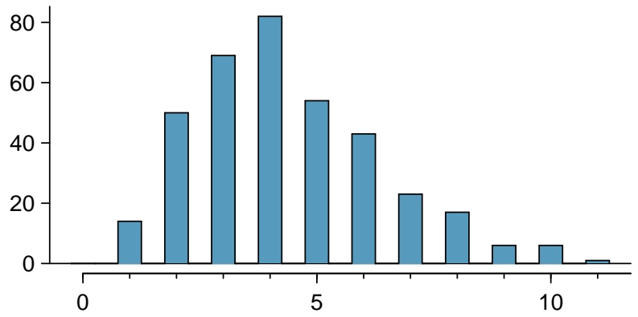

histogram

| X | Y |
| --- | --- |
| 1 | ~14 |
| 2 | ~50 |
| 3 | ~69 |
| 4 | ~82 |
| 5 | ~54 |
| 6 | ~43 |
| 7 | ~23 |
| 8 | ~17 |
| 9 | ~6 |
| 10 | ~6 |
| 11 | ~1 |

Figure 3.20: A histogram of the number of people hospitalized for an AMI on 365 days for NYC, as simulated from a Poisson distribution with mean 4.4.

Pois(λ) Poisson dist. with rate λ

λ Rate for the Poisson dist.

## POISSON DISTRIBUTION

The Poisson distribution is a probability model for the number of events that occur in a population. The probability that exactly k events occur is given by

$$
P (X = k) = \frac {e ^ {- \lambda} (\lambda) ^ {k}}{k !},
$$

where k may take a value 0, 1, 2, . . . The mean and standard deviation of this distribution are λ and $\sqrt { \lambda } ,$ respectively. A Poisson random variable X can be expressed as $X \sim \operatorname { P o i s } ( \lambda )$

When events accumulate over time in such a way that the probability an event occurs in an interval is proportional to the length of an interval and that the number of events in non-overlapping intervals are independent, the parameter λ (the Greek letter lambda) represents the average number of events per unit time; i.e., the rate per unit time.

In this setting, the number of events in t units of time has probability

$$
P (X = k) = \frac {e ^ {- \lambda t} (\lambda t) ^ {k}}{k !},
$$

where k takes on values 0, 1, 2, . . . . When used this way, the mean and standard deviation are λt and ${ \sqrt { \lambda t } } ,$ respectively. The rate parameter λ represents the expected number of events per unit time, while the quantity λt represents the expected number events over a time period of t units.

The histogram in Figure 3.20 approximates a Poisson distribution with rate equal to 4.4 events per day, for a population of 8 million.

<small>23These data are simulated. In practice, it would be important to check for an association between successive days.</small>

## EXAMPLE 3.35

In New York City, what is the probability that 2 individuals are hospitalized for AMI in seven days, if the rate is known to be 4.4 deaths per day?

From the given information, $\lambda = 4 . 4 ,   k = 2 ,$ and $t = 7 .$

$$
P (X = k) = \frac {e ^ {- \lambda t} (\lambda t) ^ {k}}{k !}
$$

$$
P (X = 2) = \frac {e ^ {- 4 . 4 \times 7} (4 . 4 \times 7) ^ {2}}{2 !} = 1. 9 9 \times 1 0 ^ {- 1 1}.
$$

## GUIDED PRACTICE 3.36

In New York City, what is the probability that (a) at most 2 individuals are hospitalized for AMI in seven days, (b) at least 3 individuals are hospitalized for AMI in seven days?24

A rigorous set of conditions for the Poisson distribution is not discussed here. Generally, the Poisson distribution is used to calculate probabilities for rare events that accumulate over time, such as the occurrence of a disease in a population.

## EXAMPLE 3.37

For children ages 0 - 14, the incidence rate of acute lymphocytic leukemia (ALL) was approximately 30 diagnosed cases per million children per year in 2010. Approximately 20% of the US population of 319,055,000 are in this age range. What is the expected number of cases of ALL in the US over five years?

The incidence rate for one year can be expressed as $30/1,000,000=0.00003;$ for five years, the rate is $(5)(0.00003) \; = \; 0.00015.$ The number of children age 0-14 in the population is (0.20)(319,055,000) ≈ 63,811,000.

$$
\begin{array}{l} \lambda = (\text {relevant population size}) (\text {rate per child}) \\ = 6 3, 8 1 1, 0 0 0 \times 0. 0 0 0 1 5 \\ = 9, 5 7 1. 5 \\ \end{array}
$$

The expected number of cases over five years is 9,571.5 cases.

<small>24(a) P (X ≤ 2) = P (X = 0) + P (X = 1) + P (X = 2) = −4.4×7(4.4×7)00! + e−4.4×7(4.4×7)11! + e−4.4×7(4.4×7)22! = 2.12 × 10−11 (b) P (X ≥ 3) = 1 − P (X < 3) = 1 − P (X ≤ 2) = 1 − 2.12 × 10−11 ≈ 1</small>

## 3.5 Distributions related to Bernoulli trials

The binomial distribution is not the only distribution that can be built from a series of repeated Bernoulli trials. This section discusses the geometric, negative binomial, and hypergeometric distributions.

## 3.5.1 Geometric distribution

The geometric distribution describes the waiting time until one success for a series of independent Bernoulli random variables, in which the probability of success p remains constant.

## EXAMPLE 3.38

Recall that in the Milgram shock experiments, the probability of a person refusing to give the most severe shock is $p = 0 . 3 5$ . Suppose that participants are tested one at a time until one person refuses; i.e., until the first occurrence of a successful trial. What are the chances that the first occurrence happens with the first trial? The second trial? The third?

The probability that the first trial is successful is simply $p = 0 . 3 5$

If the second trial is the first successful one, then the first one must have been unsuccessful. Thus, the probability is given by $( 0 . 6 5 ) ( 0 . 3 5 ) = 0 . 2 2 8$

Similarly, the probability that the first success is the third trial: (0.65)(0.65)(0.35) = 0.148.

This can be stated generally. If the first success is on the $n ^ { t h }$ trial, then there are n − 1 failures and finally 1 success, which corresponds to the probability $( 0 . 6 5 ) ^ { n - 1 } ( 0 . 3 5 )$

The geometric distribution from Example 3.38 is shown in Figure 3.21. In general, the probabilities for a geometric distribution decrease **exponentially**.

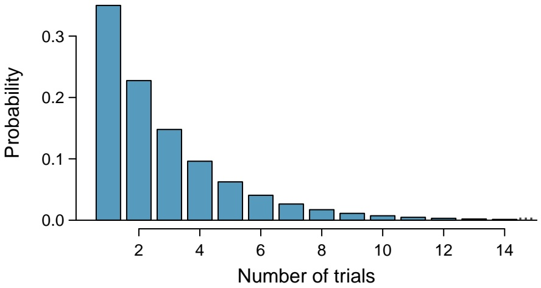

bar

| Number of trials | Probability |
| --- | --- |
| 1 | ~0.36 |
| 2 | ~0.23 |
| 3 | ~0.15 |
| 4 | ~0.10 |
| 5 | ~0.06 |
| 6 | ~0.04 |
| 7 | ~0.03 |
| 8 | ~0.02 |
| 9 | ~0.01 |
| 10 | ~0.01 |
| 11 | ~0.005 |
| 12 | ~0.005 |
| 13 | ~0.002 |
| 14 | ~0.002 |

Figure 3.21: The geometric distribution when the probability of success is $p = 0 . 3 5 .$

## GEOMETRIC DISTRIBUTION

If the probability of a success in one trial is $p$ and the probability of a failure is $1 - p ,$ then the probability of finding the first success in the $k ^ { t h }$ trial is given by

$$
P (X = k) = (1 - p) ^ {k - 1} p.
$$

The mean (i.e. expected value), variance, and standard deviation of this wait time are given by

$$
\mu = \frac {1}{p}
$$

$$
\sigma^ {2} = \frac {1 - p}{p ^ {2}}
$$

$$
\sigma = \sqrt {\frac {1 - p}{p ^ {2}}}
$$

A geometric random variable X can be expressed as $X \sim \operatorname { G e o m } ( p )$ .

Geom(p)

Geometric dist. with p prob. of success

## GUIDED PRACTICE 3.39

If individuals were examined until one did not administer the most severe shock, how many might need to be tested before the first success?25

## EXAMPLE 3.40

What is the probability of the first success occurring within the first 4 people?

This is the probability it is the first $( k = 1 )$ , second $( k = 2 )$ , third $( k = 3 )$ , or fourth (k = 4) trial that is the first success, which represent four disjoint outcomes. Compute the probability of each case and add the separate results:

$$
\begin{array}{l} P (X = 1, 2, 3, \text {or} 4) \\ = P (X = 1) + P (X = 2) + P (X = 3) + P (X = 4) \\ = (0. 6 5) ^ {1 - 1} (0. 3 5) + (0. 6 5) ^ {2 - 1} (0. 3 5) + (0. 6 5) ^ {3 - 1} (0. 3 5) + (0. 6 5) ^ {4 - 1} (0. 3 5) \\ = 0. 8 2. \\ \end{array}
$$

Alternatively, find the complement of $\mathrm { P } ( \mathrm { X } = 0 )$ , since the described event is the complement of no success in 4 trials: $1 - ( 0 . 6 5 ) ^ { 4 } ( 0 . 3 5 ) ^ { 0 } = 0 . 8 2$

There is a 0.82 probability that the first success occurs within 4 trials.

Note that there are differing conventions for defining the geometric distribution; while this text uses the definition that the distribution describes the total number of trials including the success, others define the distribution as the number of trials required before the success is obtained. In $\mathsf { R } ,$ the latter definition is used.

<small>25About 1/p = 1/0.35 = 2.86 individuals.</small>

## 3.5.2 Negative binomial distribution

The geometric distribution describes the probability of observing the first success on the $k ^ { t h }$ trial. The **negative binomial distribution** is more general: it describes the probability of observing the $r ^ { t h }$ success on the $k ^ { t h }$ trial.

Suppose a research assistant needs to successfully extract RNA from four plant samples before leaving the lab for the day. Yesterday, it took 6 attempts to attain the fourth successful extraction. The last extraction must have been a success; that leaves three successful extractions and two unsuccessful ones that make up the first five attempts. There are ten possible sequences, which are shown in 3.22.

<table><tr><td rowspan="2"></td><td colspan="6">Extraction Attempt</td></tr><tr><td>1</td><td>2</td><td>3</td><td>4</td><td>5</td><td>6</td></tr><tr><td>1</td><td> $F$ </td><td> $F$ </td><td> $^{1}S$ </td><td> $^{2}S$ </td><td> $^{3}S$ </td><td> $^{4}S$ </td></tr><tr><td>2</td><td> $F$ </td><td> $^{1}S$ </td><td> $F$ </td><td> $^{2}S$ </td><td> $^{3}S$ </td><td> $^{4}S$ </td></tr><tr><td>3</td><td> $F$ </td><td> $^{1}S$ </td><td> $^{2}S$ </td><td> $F$ </td><td> $^{3}S$ </td><td> $^{4}S$ </td></tr><tr><td>4</td><td> $F$ </td><td> $^{1}S$ </td><td> $^{2}S$ </td><td> $^{3}S$ </td><td> $F$ </td><td> $^{4}S$ </td></tr><tr><td>5</td><td> $^{1}S$ </td><td> $F$ </td><td> $F$ </td><td> $^{2}S$ </td><td> $^{3}S$ </td><td> $^{4}S$ </td></tr><tr><td>6</td><td> $^{1}S$ </td><td> $F$ </td><td> $^{2}S$ </td><td> $F$ </td><td> $^{3}S$ </td><td> $^{4}S$ </td></tr><tr><td>7</td><td> $^{1}S$ </td><td> $F$ </td><td> $^{2}S$ </td><td> $^{3}S$ </td><td> $F$ </td><td> $^{4}S$ </td></tr><tr><td>8</td><td> $^{1}S$ </td><td> $^{2}S$ </td><td> $F$ </td><td> $F$ </td><td> $^{3}S$ </td><td> $^{4}S$ </td></tr><tr><td>9</td><td> $^{1}S$ </td><td> $^{2}S$ </td><td> $F$ </td><td> $^{3}S$ </td><td> $F$ </td><td> $^{4}S$ </td></tr><tr><td>10</td><td> $^{1}S$ </td><td> $^{2}S$ </td><td> $^{3}S$ </td><td> $F$ </td><td> $F$ </td><td> $^{4}S$ </td></tr></table>

Figure 3.22: The ten possible sequences when the fourth successful extraction is on the sixth attempt.

## GUIDED PRACTICE 3.41

Each sequence in Figure 3.22 has exactly two failures and four successes with the last attempt always being a success. If the probability of a success is $p = 0 . 8 ,$ , find the probability of the first sequence.26

If the probability of a successful extraction is $p = 0 . 8 ,$ , what is the probability that it takes exactly six attempts to reach the fourth successful extraction? As expressed by 3.41, there are 10 different ways that this event can occur. The probability of the first sequence was identified in Guided Practice 3.41 as 0.0164, and each of the other sequences have the same probability. Thus, the total probability is $( 1 0 ) ( 0 . 0 1 6 4 ) = 0 . 1 6 4$

A general formula for computing a negative binomial probability can be generated using similar logic as for binomial probability. The probability is comprised of two pieces: the probability of a single sequence of events, and then the number of possible sequences. The probability of observing r successes out of k attempts can be expressed as $( 1 - p ) ^ { k - r } p ^ { r }$ . Next, identify the number of possible sequences. In the above example, 10 sequences were identified by fixing the last observation as a success and looking for ways to arrange the other observations. In other words, the goal is to arrange $r - 1$ successes in $k - 1$ trials. This can be expressed as:

$$
\binom {k - 1} {r - 1} = \frac {(k - 1) !}{(r - 1) ! ((k - 1) - (r - 1)) !} = \frac {(k - 1) !}{(r - 1) ! (k - r) !}.
$$

## NEGATIVE BINOMIAL DISTRIBUTION

The negative binomial distribution describes the probability of observing the $r ^ { t h }$ success on the $k ^ { t h }$ trial, for independent trials:

$$
P (X = k) = \binom {k - 1} {r - 1} p ^ {r} (1 - p) ^ {k - r}, \tag {3.42}
$$

where $p$ is the probability an individual trial is a success.

The mean and variance are given by

$$
\mu = \frac {r}{p} \quad \sigma^ {2} = \frac {r (1 - p)}{p ^ {2}}
$$

A negative binomial random variable X can be expressed as $X \sim \mathrm { N B } ( r , p )$

## IS IT NEGATIVE BINOMIAL? FOUR CONDITIONS TO CHECK.

(1) The trials are independent.
(2) Each trial outcome can be classified as a success or failure.
(3) The probability of a success $( p )$ is the same for each trial.
(4) The last trial must be a success.

## EXAMPLE 3.43

Calculate the probability of a fourth successful extraction on the fifth attempt.

The probability of a single success is $p = 0 . 8 ,$ , the number of successes is $r = 4 ,$ and the number of necessary attempts under this scenario is $k = 5$

$$
\binom {k - 1} {r - 1} p ^ {r} (1 - p) ^ {k - r} = \frac {4 !}{3 ! 1 !} (0. 8) ^ {4} (0. 2) = 4 \times 0. 0 8 1 9 2 = 0. 3 2 8.
$$

## GUIDED PRACTICE 3.44

Assume that each extraction attempt is independent. What is the probability that the fourth success occurs within 5 attempts?27

## BINOMIAL VERSUS NEGATIVE BINOMIAL

The binomial distribution is used when considering the number of successes for a fixed number of trials. For negative binomial problems, there is a fixed number of successes and the goal is to identify the number of trials necessary for a certain number of successes (note that the last observation must be a success).

## GUIDED PRACTICE 3.45

On 70% of days, a hospital admits at least one heart attack patient. On 30% of the days, no heart attack patients are admitted. Identify each case below as a binomial or negative binomial case, and compute the probability. (a) What is the probability the hospital will admit a heart attack patient on exactly three days this week? (b) What is the probability the second day with a heart attack patient will be the fourth day of the week? (c) What is the probability the fifth day of next month will be the first day with a heart attack patient?28

In R, the negative binomial distribution is defined as the number of failures that occur before a target number of successes is reached; i.e., k − r. In this text, the distribution is defined in terms of the total number of trials required to observe r successes, where the last trial is necessarily a success.

<small>27If the fourth success (r = 4) is within five attempts, it either took four or five tries (k = 4 or k = 5):</small>

<small>P (k = 4 OR k = 5) = P (k = 4) + P (k = 5)</small>

<small>= 4 − 1!0.84 + 5 − 1!(0.8)4(1 − 0.8) = 1 × 0.41 + 4 × 0.082 = 0.41 + 0.33 = 0.74. 4 − 1 4 − 1</small>

<small>28In each part, p = 0.7. (a) The number of days is fixed, so this is binomial. The parameters are k = 3 and n = 7: 0.097. (b) The last "success" (admitting a patient) is fixed to the last day, so apply the negative binomial distribution. The parameters are r = 2, k = 4: 0.132. (c) This problem is negative binomial with r = 1 and k = 5: 0.006. Note that the negative binomial case when r = 1 is the same as using the geometric distribution.</small>

## 3.5.3 Hypergeometric distribution

Suppose that a large number of deer live in a forest. Researchers are interested in using the capture-recapture method to estimate total population size. A number of deer are captured in an initial sample and marked, then released; at a later time, another sample of deer are captured, and the number of marked and unmarked deer are recorded.29 An estimate of the total population can be calculated based on the assumption that the proportion of marked deer in the second sample should equal the proportion of marked deer in the entire population. For example, if 50 deer were initially captured and marked, and then 5 out of 40 deer (12.5%) in a second sample are found to be marked, then the population estimate is 400 deer, since 50 out of 400 is 12.5%.

The capture-recapture method sets up an interesting scenario that requires a new probability distribution. Let N represent the total number of deer in the forest, m the number of marked deer captured in the original sample, and n the number of deer in the second sample. What are the probabilities of obtaining $0 , 1 , . . . , m$ marked deer in the second sample, if N and m are known?

It is helpful to think in terms of a series of Bernoulli trials, where each capture in the second sample represents a trial; consider the trial a success if a marked deer is captured, and a failure if an unmarked deer is captured. If the deer were sampled with replacement, such that one deer was sampled, checked if it were marked versus unmarked, then released before another deer was sampled, then the probability of obtaining some number of marked deer in the second sample would be binomially distributed with probability of success m/N (out of n trials). The trials are independent, and the probability of success remains constant across trials.

However, in capture-recapture, the goal is to collect a representative sample such that the proportion of marked deer in the sample can be used to estimate the total population—the sampling is done without replacement. Once a trial occurs and a deer is sampled, it is not returned to the population before the next trial. The probability of success is not constant from trial to trial; i.e., these trials are dependent. For example, if a marked deer has just been sampled, then the probability of sampling a marked deer in the next trial decreases, since there is one fewer marked deer available.

Suppose that out of 9 deer, 4 are marked. What is the probability of observing 1 marked deer in a sample of size $^ { 3 , }$ if the deer are sampled without replacement? First, consider the total number of ways to draw 3 deer from the population; As shown in Figure 3.23, samples may consist of 3, 2, 1, or 0 marked deer. There are $\textstyle { \binom { 4 } { 3 } }$ ways to obtain a sample consisting of 3 marked deer out of the 4 total marked deer. By independence, there are $( _ { 2 } ^ { 4 } ) ( _ { 1 } ^ { 5 } )$ ways to obtain a sample consisting of exactly 2 marked deer and 1 unmarked deer. In total, there are 84 possible combinations; this quantity is equivalent to $\textstyle { \binom { 9 } { 3 } }$ . Only ${ \binom { 4 } { 1 } } { \binom { 5 } { 2 } } = 4 0$ of those combinations represent the desired event of exactly 1 marked deer. Thus, the probability of observing 1 marked deer in a sample of size 3, under sampling without replacement, equals $4 0 / 8 4 = 0 . 4 7 6$

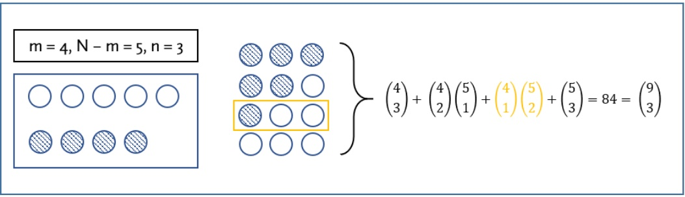

text_image

m = 4, N - m = 5, n = 3
    ○ ○ ○ ○ ○
        ● ● ●
            ● ● ○
                ● ○ ○
                    ○ ○ ○
        \n    (4/3) + (4/2)(5/1) + (4/1)(5/2) + (5/3) = 84 = (9/3)

Figure 3.23: Possible samples of marked and unmarked deer in a sample $n = 3 ,$ where $m = 4$ and $N - m = 5$ . Striped circles represent marked deer, and empty circles represent unmarked deer.

<small>29It is assumed that enough time has passed so that the marked deer redistribute themselves in the population, and that marked and unmarked deer have equal probability of being captured in the second sample.</small>

## GUIDED PRACTICE 3.46

Suppose that out of 9 deer, 4 are marked. What is the probability of observing 1 marked deer in a sample of size 3, if the deer are sampled with replacement?30

## HYPERGEOMETRIC DISTRIBUTION

The hypergeometric distribution describes the probability of observing k successes in a sample of size n, from a population of size N, where there are m successes, and individuals are sampled without replacement:

$$
P (X = k) = \frac {\binom {m} {k} \binom {N - m} {n - k}}{\binom {N} {n}}.
$$

Let $p = m / N$ , the probability of success. The mean and variance are given by

$$
\mu = n p \quad \sigma^ {2} = n p (1 - p) \frac {N - n}{N - 1}
$$

A hypergeometric random variable X can be written as $X \sim \operatorname { H G e o m } ( m , N - m , n )$

## IS IT HYPERGEOMETRIC? THREE CONDITIONS TO CHECK.

(1) The trials are dependent.
(2) Each trial outcome can be classified as a success or failure.
(3) The probability of a success is different for each trial.

## GUIDED PRACTICE 3.47

A small clinic would like to draw a random sample of 10 individuals from their patient list of 120, of which 30 patients are smokers. (a) What is the probability of 6 individuals in the sample being smokers? (b) What is the probability that at least 2 individuals in the sample smoke?31

<small>30Let X represent the number of marked deer in the sample of size 3. If the deer are sampled with replacement, X ∼ Bin(3, 4/9), and P (X = 1) = 3(4/9)1(5/9)2 = 0.412. (1八</small>

<small>30 90 31(a) Let X represent the number of smokers in the sample. P (X = 6) = 6412010  = 0.013. (b) P (X ≥ 2) = 1 − P (X ≤ 1) =</small>

<small>3090 3090 1 − P (X = 0) − P (X = 1) = 1 − 0 1 9 = 0.768. 120 120  10   10 </small>