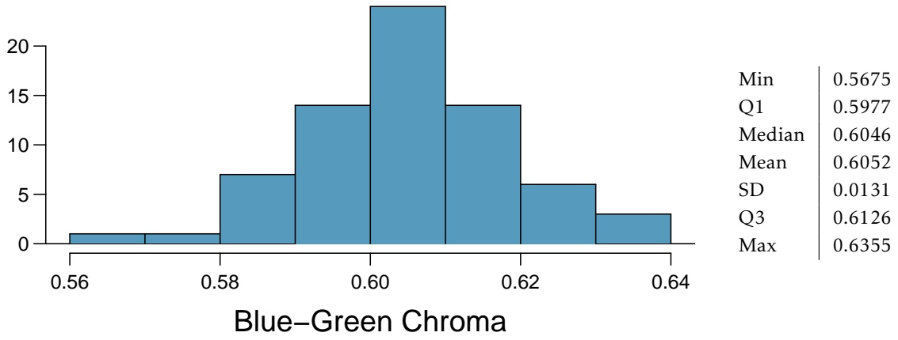
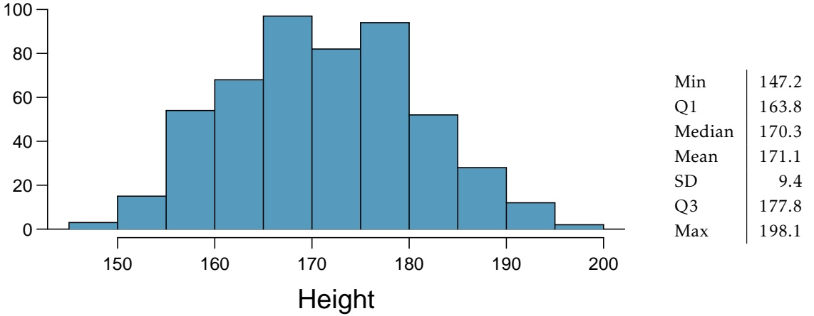
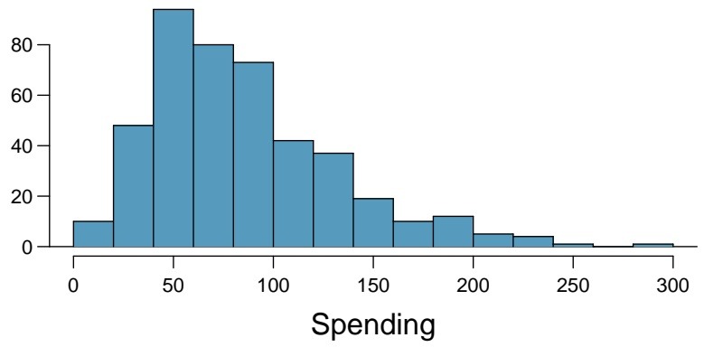
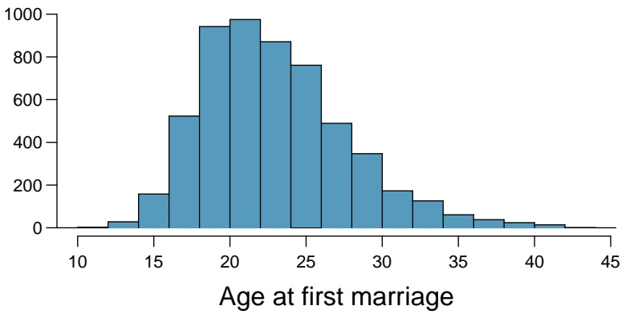
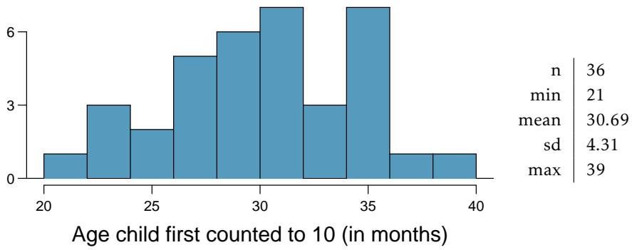
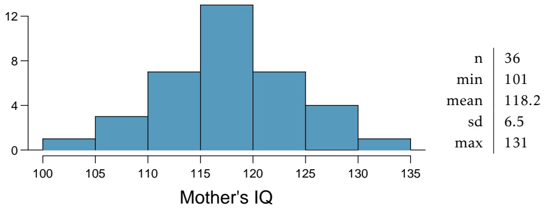
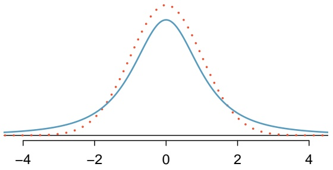
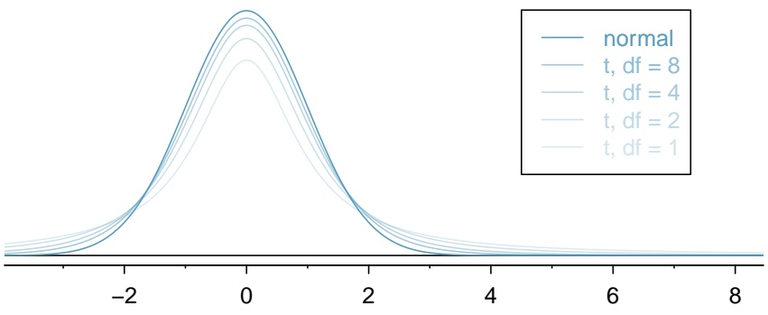
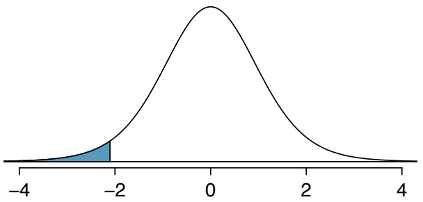
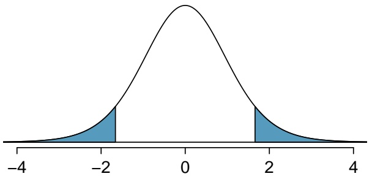

## 4.4 Notes

Confidence intervals and hypothesis testing are two of the central concepts in inference for a population based on a sample. The confidence interval shows a range of population parameter values consistent with the observed sample, and is often used to design additional studies. Hypoth esis testing is a useful tool for evaluating the strength of the evidence against a working hypothesis according to a pre-specified standard for accepting or rejecting hypotheses.

The calculation of p-values and confidence intervals is relatively straightforward; given the necessary summary statistics, α, and confidence coefficients, finding any p-value or confidence interval simply involves a set of formulaic steps. However, the more difficult parts of any inference problem are the steps that do not involve any calculations. Specifying appropriate null and alternative hypotheses for a test relies on an understanding of the problem context and the scientific setting of the investigation. Similarly, a choice about a confidence coefficient for an interval relies on judgment as to balancing precision against the chance of possible error. It is also not necessarily obvious when a significance level other than $\alpha = 0 . 0 5$ should be applied. These choices represent the largest distinction between a true statistics problem as compared to a purely mathematical exercise.

Furthermore, in order to rely on the conclusions drawn from making inferences, it is necessary to consider factors such as study design, measurement quality, and the validity of any assumptions made. For example, is it valid to use the normal approximation to calculate p-values? In small to moderate sample sizes $\left( 3 0 \leq n \leq 5 0 \right)$ , it may not be clear that the normal model is accurate. It is even necessary to be cautious about the use and interpretation of the p-value. For example, an article published in Nature about the mis-use of p-values references a published study that showed people who meet their spouses online are more likely to have marital satisfaction, with p-value less than 0.001. However, statistical significance does not measure the importance or practical relevance of a result; in this case, the change in happiness moved from 5.48 to 5.64 on a 7-point scale. A p-value reported without context or other evidence is uninformative and potentially deceptive.

These nuanced issues cannot be adequately covered in any introduction to statistics. It is unrealistic to encourage students to use their own judgment with aspects of inference that even experienced investigators find challenging. At the same time, it would also be misleading to suggest that the choices are always clear-cut in practice. It seems best to offer some practical guidance for getting started:

– The default choice of α is 0.05; similarly, the default confidence coefficient for a confidence interval is 95%.
– Unless it is clear from the context of a problem that change in only one direction from the null hypothesis is of interest, the alternative hypothesis should be two-sided.
The use of a standard normal distribution to calculate p-values is reasonable for sample sizes of 30 or more if the distribution of data are not strongly skewed and there are no large outliers. If there is skew or a few large outliers, sample sizes of 50 or more are usually sufficient.
– Pay attention to the context of a problem, particularly when formulating hypotheses and drawing conclusions.

The next chapters will discuss methods of inference in specific settings, such as comparing two groups. These settings expand on the concepts discussed in this chapter and offer additional opportunities to practice calculating tests and intervals, reading problems for context, and checking underlying assumptions behind methods of inference.

The labs for the chapter reinforce conceptual understanding of confidence intervals and hy pothesis tests, and their link to sampling variability using the data from the YRBSS and NHANES. Both datasets are large enough to be viewed in an instructional setting as populations from which repeated samples can be drawn. They are useful platforms for illustrating the conceptual role of hypothetical repeated sampling in the properties of tests and intervals, a topic which many students find difficult. Students may find the last lab for this chapter (Lab 4) particularly helpful for understanding conceptual details of inference, such as the distinction between the significance level α and the p-value, and the definition of α as the Type I error rate.

## 4.5 Exercises

## 4.5.1 Variability in estimates

**4.1 Egg coloration.** The evolutionary role of variation in bird egg coloration remains mysterious to biologists. One hypothesis suggests that egg color may play a role in sexual selection. For example, perhaps healthier females are able to deposit more blue-green pigment into eggshells instead of using it themselves as an antioxidant. Researchers measured the blue-green chroma (BGC) of 70 different collared flycatcher nests in an area of the Czech Republic.

histogram

| Statistic | Value |
| --- | --- |
| Min | 0.5675 |
| Q1 | 0.5977 |
| Median | 0.6046 |
| Mean | 0.6052 |
| SD | 0.0131 |
| Q3 | 0.6126 |
| Max | 0.6355 |

(a) What is the point estimate for the average BGC of nests?

(b) What is the point estimate for the standard deviation of the BGC of eggs across nests?

(c) Would a nest with average BGC of 0.63 be considered unusually high? Explain your reasoning.

(d) Compute the standard error of the sample mean using the summary statistics.

**4.2 Heights of adults.** Researchers studying anthropometry collected body girth measurements and skeletal diameter measurements, as well as age, weight, height and gender, for 507 physically active individuals. The histogram below shows the sample distribution of heights in centimeters.22

histogram

| Metric | Value |
| --- | --- |
| Min | 147.2 |
| Q1 | 163.8 |
| Median | 170.3 |
| Mean | 171.1 |
| SD | 9.4 |
| Q3 | 177.8 |
| Max | 198.1 |

(a) What is the point estimate for the average height of active individuals?
(b) What is the point estimate for the standard deviation of the heights of active individuals? What about the IQR?
(c) Is a person who is 1m 80cm (180 cm) tall considered unusually tall? And is a person who is 1m 55cm (155cm) considered unusually short? Explain your reasoning.
(d) The researchers take another random sample of physically active individuals. Would you expect the mean and the standard deviation of this new sample to be the ones given above? Explain your reasoning.
(e) The sample means obtained are point estimates for the mean height of all active individuals, if the sample of individuals is equivalent to a simple random sample. What measure is used to quantify the variability of such an estimate? Compute this quantity using the data from the original sample under the condition that the data are a simple random sample.

**4.3 Hen eggs.** The distribution of the number of eggs laid by a certain species of hen during their breeding period is on average, 35 eggs, with a standard deviation of 18.2. Suppose a group of researchers randomly samples 45 hens of this species, counts the number of eggs laid during their breeding period, and records the sample mean. They repeat this 1,000 times, and build a distribution of sample means.

(a) What is this distribution called?
(b) Would you expect the shape of this distribution to be symmetric, right skewed, or left skewed? Explain your reasoning.
(c) Calculate the variability of this distribution and state the appropriate term used to refer to this value.
(d) Suppose the researchers’ budget is reduced and they are only able to collect random samples of 10 hens. The sample mean of the number of eggs is recorded, and we repeat this 1,000 times, and build a new distribution of sample means. How will the variability of this new distribution compare to the variability of the original distribution?

## 4.5.2 Confidence intervals

**4.4 Mental health, Part I.** The 2010 General Social Survey asked the question: “For how many days during the past 30 days was your mental health, which includes stress, depression, and problems with emotions, not good?" Based on responses from 1,151 US residents, the survey reported a 95% confidence interval of 3.40 to 4.24 days in 2010.

(a) Interpret this interval in context of the data.
(b) What does “95% confident" mean? Explain in the context of the application.
(c) If a new survey were to be done with 500 Americans, would the standard error of the estimate be larger, smaller, or about the same? Assume the standard deviation has remained constant since 2010.

**4.5 Relaxing after work, Part I.** The 2010 General Social Survey asked the question: “After an average work day, about how many hours do you have to relax or pursue activities that you enjoy?" to a random sample of 1,155 Americans.23 A 95% confidence interval for the mean number of hours spent relaxing or pursuing activities they enjoy is (1.38, 1.92).

(a) Interpret this interval in context of the data.
(b) Suppose another set of researchers reported a confidence interval with a larger margin of error based on the same sample of 1,155 Americans. How does their confidence level compare to the confidence level of the interval stated above?
(c) Suppose next year a new survey asking the same question is conducted, and this time the sample size is 2,500. Assuming that the population characteristics, with respect to how much time people spend relaxing after work, have not changed much within a year. How will the margin of error of the new 95% confidence interval compare to the margin of error of the interval stated above?
(d) Suppose the researchers think that 90% confidence interval would be more appropriate. Will this new interval be smaller or larger than the original 95% confidence interval? Justify your answer. (Assume that the standard deviation remains constant).

**4.6 Thanksgiving spending, Part I.** The 2009 holiday retail season, which kicked off on November 27, 2009 (the day after Thanksgiving), had been marked by somewhat lower self-reported consumer spending than was seen during the comparable period in 2008. To get an estimate of consumer spending, 436 randomly sampled American adults were surveyed. Daily consumer spending for the six-day period after Thanksgiving, spanning the Black Friday weekend and Cyber Monday, averaged \$84.71. A 95% confidence interval based on this sample is (\$80.31, \$89.11). Determine whether the following statements are true or false, and explain your reasoning.

histogram

| Spending (Bin) | Frequency |
| --- | --- |
| 0~25 | ~10 |
| 25~50 | ~48 |
| 50~75 | ~95 |
| 75~100 | ~80 |
| 100~125 | ~73 |
| 125~150 | ~42 |
| 150~175 | ~37 |
| 175~200 | ~19 |
| 200~225 | ~10 |
| 225~250 | ~12 |
| 250~275 | ~5 |
| 275~300 | ~4 |
| 300~325 | ~1 |
| 325~350 | ~1 |

(a) We are 95% confident that the average spending of these 436 American adults is between \$80.31 and \$89.11.
(b) This confidence interval is not valid since the distribution of spending in the sample is right skewed.
(c) 95% of random samples have a sample mean between \$80.31 and \$89.11.
(d) We are 95% confident that the average spending of all American adults is between \$80.31 and \$89.11.
(e) A 90% confidence interval would be narrower than the 95% confidence interval.
(f) The margin of error is 4.4.

**4.7 Waiting at an ER, Part I.** A hospital administrator hoping to improve wait times decides to estimate the average emergency room waiting time at her hospital. She collects a simple random sample of 64 patients and determines the time (in minutes) between when they checked in to the ER until they were first seen by a doctor. A 95% confidence interval based on this sample is (128 minutes, 147 minutes), which is based on the normal model for the mean. Determine whether the following statements are true or false, and explain your reasoning.

(a) This confidence interval is not valid since we do not know if the population distribution of the ER wait times is nearly Normal.
(b) We are 95% confident that the average waiting time of these 64 emergency room patients is between 128 and 147 minutes.
(c) We are 95% confident that the average waiting time of all patients at this hospital’s emergency room is between 128 and 147 minutes.
(d) 95% of random samples have a sample mean between 128 and 147 minutes.
(e) A 99% confidence interval would be narrower than the 95% confidence interval since we need to be more sure of our estimate.
(f) The margin of error is 9.5 and the sample mean is 137.5.
(g) Halving the margin of error of a 95% confidence interval requires doubling the sample size.

**4.8 Age at first marriage, Part I.** The National Survey of Family Growth conducted by the Centers for Disease Control gathers information on family life, marriage and divorce, pregnancy, infertility, use of contraception, and men’s and women’s health. One of the variables collected on this survey is the age at first marriage. The histogram below shows the distribution of ages at first marriage of 5,534 randomly sampled women between 2006 and 2010. The average age at first marriage among these women is 23.44 with a standard deviation of 4.72.24

histogram

| Age Range | Frequency |
| --- | --- |
| 10~11 | ~5 |
| 11~12 | ~30 |
| 12~13 | ~160 |
| 13~14 | ~520 |
| 14~15 | ~940 |
| 15~16 | ~980 |
| 16~17 | ~870 |
| 17~18 | ~760 |
| 18~19 | ~490 |
| 19~20 | ~350 |
| 20~21 | ~180 |
| 21~22 | ~130 |
| 22~23 | ~60 |
| 23~24 | ~40 |
| 24~25 | ~25 |
| 25~26 | ~15 |
| 26~27 | ~5 |

Estimate the average age at first marriage of women using a 95% confidence interval, and interpret this interval in context. Discuss any relevant assumptions.

**4.9 Mental health, Part II.** The General Social Survey (GSS) is a sociological survey used to collect data on demographic characteristics and attitudes of residents of the United States. The 2010 General Social Survey asked the question, "For how many days during the past 30 days was your mental health not good?" Based on responses from 1,151 US adults, the survey reported a 95% confidence interval of (3.40, 4.24) days. Assume that the sampled US adults are representative of all US adults.

(a) Identify each of the following statements as true or false. Justify your answers.

i. The confidence interval of (3.40, 4.24) contains the mean days out of the past 30 days that U.S. adults experienced poor mental health.
ii. There is a 95% chance that the mean days out of the past 30 days that U.S. adults experienced poor mental health is within the confidence interval (3.40, 4.24).
iii. If we repeated this survey 1,000 times and constructed a 95% confidence interval each time, then approximately 950 of those intervals would contain the true mean days out of the past 30 days that U.S. adults experienced poor mental health.
iv. The survey provides statistically significant evidence at the α = 0.05 significance level that the mean days out of the past 30 days that U.S. adults experienced poor mental health is not 4.5 days.
v. We can be 95% confident that the mean days out of the past 30 days that U.S. adults experienced poor mental health is 3.82 days.
vi. We can be 95% confident that the interval (3.40, 4.24) days contains the mean days out of the past 30 days that the sampled adults experienced poor mental health.

(b) Would you expect the 90% confidence interval to be larger or smaller than the 95% confidence interval? Explain your reasoning.

(c) Calculate the 90% confidence interval.

**4.10 Leisure time, Part III.** In 2010, the General Social Survey collected responses from 1,154 US residents. The survey is conducted face-to-face with an in-person interview of a randomly selected sample of adults. One of the questions on the survey is "After an average workday, about how many hours do you have to relax or pursue activities that you enjoy?" A 95% confidence interval from the 2010 GSS survey for the collected answers is 3.53 to 3.83 hours. Identify each of the following statements as true or false. Explain your answers.

(a) If the researchers wanted to report a confidence interval with a smaller margin of error based on the same sample of 1,154 Americans, the confidence interval would be larger.
(b) We can be 95% confident that the interval (3.53, 3.83) hours contains the mean hours that the sampled adults have for leisure time after an average workday.
(c) The confidence interval of (3.53, 3.83) hours contains the mean hours that U.S. adults have for leisure time after an average workday.
(d) The survey provides statistically significant evidence at the α = 0.05 significance level that the mean hours U.S. adults have for leisure time after the average workday is 3.6 hours.
(e) There is a 5% chance that the interval (3.53, 3.83) hours does not contain the mean hours that U.S. adults have for leisure time after an average workday.
(f) The interval (3.53, 3.83) hours provides evidence at the α = 0.05 significance level that U.S. adults, on average, have fewer than 3.9 hours of leisure time after a typical workday.

## 4.5.3 Hypothesis testing

**4.11 Identify hypotheses, Part I.** Write the null and alternative hypotheses in words and then symbols for each of the following situations.

(a) New York is known as “the city that never sleeps". A random sample of 25 New Yorkers were asked how much sleep they get per night. Do these data provide convincing evidence that New Yorkers on average sleep less than 8 hours a night?
(b) Employers at a firm are worried about the effect of March Madness, a basketball championship held each spring in the US, on employee productivity. They estimate that on a regular business day employees spend on average 15 minutes of company time checking personal email, making personal phone calls, etc. They also collect data on how much company time employees spend on such non- business activities during March Madness. They want to determine if these data provide convincing evidence that employee productivity decreases during March Madness.

**4.12 Identify hypotheses, Part II.** Write the null and alternative hypotheses in words and using symbols for each of the following situations.

(a) Since 2008, chain restaurants in California have been required to display calorie counts of each menu item. Prior to menus displaying calorie counts, the average calorie intake of diners at a restaurant was 1100 calories. After calorie counts started to be displayed on menus, a nutritionist collected data on the number of calories consumed at this restaurant from a random sample of diners. Do these data provide convincing evidence of a difference in the average calorie intake of a diners at this restaurant?
(b) Based on the performance of those who took the GRE exam between July 1, 2004 and June 30, 2007, the average Verbal Reasoning score was calculated to be 462. In 2011 the average verbal score was slightly higher. Do these data provide convincing evidence that the average GRE Verbal Reasoning score has changed since 2004?

**4.13 Online communication.** A study suggests that the average college student spends 10 hours per week communicating with others online. You believe that this is an underestimate and decide to collect your own sample for a hypothesis test. You randomly sample 60 students from your dorm and find that on average they spent 13.5 hours a week communicating with others online. A friend of yours, who offers to help you with the hypothesis test, comes up with the following set of hypotheses. Indicate any errors you see.

$$
H _ {0}: \bar {x} <   1 0 \text {   hours }
$$

$$
H _ {A}: \bar {x} > 1 3. 5 \text {   hours }
$$

**4.14 Age at first marriage, Part II.** Exercise 4.8 presents the results of a 2006 - 2010 survey showing that the average age of women at first marriage is 23.44. Suppose a social scientist believes that this value has increased in 2012, but she would also be interested if she found a decrease. Below is how she set up her hypotheses. Indicate any errors you see.

$$
H _ {0}: \bar {x} = 2 3. 4 4 \text {years}
$$

$$
H _ {A}: \bar {x} > 2 3. 4 4 \text {years}
$$

**4.15 Waiting at an ER, Part II.** Exercise 4.7 provides a 95% confidence interval for the mean waiting time at an emergency room (ER) of (128 minutes, 147 minutes). Answer the following questions based on this interval.

(a) A local newspaper claims that the average waiting time at this ER exceeds 3 hours. Is this claim supported by the confidence interval? Explain your reasoning.
(b) The Dean of Medicine at this hospital claims the average wait time is 2.2 hours. Is this claim supported by the confidence interval? Explain your reasoning.
(c) Without actually calculating the interval, determine if the claim of the Dean from part (b) would be supported based on a 99% confidence interval?

**4.16 Gifted children, Part I.** Researchers investigating characteristics of gifted children collected data from schools in a large city on a random sample of thirty-six children who were identified as gifted children soon after they reached the age of four. The following histogram shows the distribution of the ages (in months) at which these children first counted to 10 successfully. Also provided are some sample statistics.25

histogram

| Age (months) | Frequency |
| --- | --- |
| 20~22 | 1 |
| 22~24 | 3 |
| 24~26 | 2 |
| 26~28 | 5 |
| 28~30 | 6 |
| 30~32 | 7 |
| 32~34 | 3 |
| 34~36 | 7 |
| 36~38 | 1 |
| 38~40 | 1 |

(a) Are conditions for inference satisfied?
(b) Suppose an online survey reports that children first count to 10 successfully when they are 32 months old, on average. Perform a hypothesis test to evaluate if these data provide convincing evidence that the average age at which gifted children first count to 10 successfully is less than the general average of 32 months. Use a significance level of 0.10.
(c) Interpret the p-value in context of the hypothesis test and the data.
(d) Calculate a 90% confidence interval for the average age at which gifted children first count to 10 successfully.
(e) Do your results from the hypothesis test and the confidence interval agree? Explain.

<small>25F.A. Graybill and H.K. Iyer. Regression Analysis: Concepts and Applications. Duxbury Press, 1994, pp. 511–516.</small>

**4.17 Nutrition labels.** The nutrition label on a bag of potato chips says that a one ounce (28 gram) serving of potato chips has 130 calories and contains ten grams of fat, with three grams of saturated fat. A random sample of 35 bags yielded a sample mean of 134 calories with a standard deviation of 17 calories. Is there evidence that the nutrition label does not provide an accurate measure of calories in the bags of potato chips? We have verified the independence, sample size, and skew conditions are satisfied.
**4.18 Waiting at an ER, Part III.** The hospital administrator mentioned in Exercise 4.7 randomly selected 64 patients and measured the time (in minutes) between when they checked in to the ER and the time they were first seen by a doctor. The average time is 137.5 minutes and the standard deviation is 39 minutes. She is getting grief from her supervisor on the basis that the wait times in the ER has increased greatly from last year’s average of 127 minutes. However, she claims that the increase is probably just due to chance.

(a) Calculate a 95% confidence interval. Is the change in wait times statistically significant at the $\alpha = 0 . 0 5$ level?
(b) Would the conclusion in part (a) change if the significance level were changed to $\alpha = 0 . 0 1 ?$
(c) Is the supervisor justified in criticizing the hospital administrator regarding the change in ER wait times? How might you present an argument in favor of the administrator?

**4.19 Birth weights.** Suppose an investigator takes a random sample of n = 50 birth weights from several teaching hospitals located in an inner-city neighborhood. In her random sample, the sample mean x is 3,150 grams and the standard deviation is 250 grams.

(a) Calculate a 95% confidence interval for the population mean birth weight in these hospitals.
(b) The typical weight of a baby at birth for the US population is 3,250 grams. The investigator suspects that the birth weights of babies in these teaching hospitals is different than 3,250 grams, but she is not sure if it is smaller (from malnutrition) or larger (because of obesity prevalence in mothers giving birth at these hospitals). Carry out the hypothesis test that she would conduct.

**4.20 Gifted children, Part II.** Exercise 4.16 describes a study on gifted children. In this study, along with variables on the children, the researchers also collected data on the mother’s and father’s IQ of the 36 randomly sampled gifted children. The histogram below shows the distribution of mother’s IQ. Also provided are some sample statistics.

histogram

| Bin (Mother's IQ) | Frequency |
| --- | --- |
| 100~105 | ~1 |
| 105~110 | ~3 |
| 110~115 | ~7 |
| 115~120 | ~13 |
| 120~125 | ~7 |
| 125~130 | ~4 |
| 130~135 | ~1 |

(a) Perform a hypothesis test to evaluate if these data provide convincing evidence that the average IQ of mothers of gifted children is different than the average IQ for the population at large, which is 100. Use a significance level of 0.10.
(b) Calculate a 90% confidence interval for the average IQ of mothers of gifted children.
(c) Do your results from the hypothesis test and the confidence interval agree? Explain.

**4.21 Testing for fibromyalgia.** A patient named Diana was diagnosed with fibromyalgia, a long-term syndrome of body pain, and was prescribed anti-depressants. Being the skeptic that she is, Diana didn’t initially believe that anti-depressants would help her symptoms. However after a couple months of being on the medication she decides that the anti-depressants are working, because she feels like her symptoms are in fact getting better.

(a) Write the hypotheses in words for Diana’s skeptical position when she started taking the anti-depressants.
(b) What is a Type 1 Error in this context?
(c) What is a Type 2 Error in this context?

**4.22 Testing for food safety.** A food safety inspector is called upon to investigate a restaurant with a few customer reports of poor sanitation practices. The food safety inspector uses a hypothesis testing framework to evaluate whether regulations are not being met. If he decides the restaurant is in gross violation, its license to serve food will be revoked.

(a) Write the hypotheses in words.
(b) What is a Type 1 Error in this context?
(c) What is a Type 2 Error in this context?
(d) Which error is more problematic for the restaurant owner? Why?
(e) Which error is more problematic for the diners? Why?

(f) As a diner, would you prefer that the food safety inspector requires strong evidence or very strong evidence of health concerns before revoking a restaurant’s license? Explain your reasoning.

**4.23 Which is higher?** In each part below, there is a value of interest and two scenarios (I and II). For each part, report if the value of interest is larger under scenario I, scenario II, or whether the value is equal under the scenarios.

(a) The standard error of x¯ when s = 120 and (I) n = 25 or (II) n = 125.
(b) The margin of error of a confidence interval when the confidence level is (I) 90% or (II) 80%.
(c) The p-value for a Z-statistic of 2.5 when (I) n = 500 or (II) n = 1000.
(d) The probability of making a Type 2 Error when the alternative hypothesis is true and the significance level is (I) 0.05 or (II) 0.10.

**4.24 True or false.** Determine if the following statements are true or false, and explain your reasoning. If false, state how it could be corrected.

(a) If a given value (for example, the null hypothesized value of a parameter) is within a 95% confidence interval, it will also be within a 99% confidence interval.
(b) Decreasing the significance level (α) will increase the probability of making a Type 1 Error.
(c) Suppose the null hypothesis is $\mu = 5$ and we fail to reject $H _ { 0 }$ . Under this scenario, the true population mean is 5.
(d) If the alternative hypothesis is true, then the probability of making a Type 2 Error and the power of a test add up to 1.
(e) With large sample sizes, even small differences between the null value and the true value of the parameter, a difference often called the effect size , will be identified as statistically significant.

# Chapter 5

## Inference for numerical data

**5.1 Single-sample inference with the** t**-distribution**
**5.2 Two-sample test for paired data**
**5.3 Two-sample test for independent data**
**5.4 Power calculations for a difference of means**
**5.5 Comparing means with ANOVA**
**5.6 Notes**
**5.7 Exercises**

Chapter 4 introduced some primary tools of statistical inference—point estimates, interval estimates, and hypothesis tests. This chapter discusses settings where these tools are often used, including the analysis of paired observations and the comparison of two or more independent groups. The chapter also covers the important topic of estimating an appropriate sample size when a study is being de signed. The chapter starts with introducing a new distribution, the t-distribution, which can be used for small sample sizes.

For labs, slides, and other resources, please visit

[**www.openintro.org/book/biostat**](http://www.openintro.org/redirect.php?go=biostat&referrer=biostat1_pdf)

## 5.1 Single-sample inference with the t-distribution

The tools studied in Chapter 4 all made use of the t-statistic from a sample mean,

$$
t = \frac {\overline {{x}} - \mu}{s / \sqrt {n}},
$$

where the parameter $\mu$ is a population mean, x and s are the sample mean and standard deviation, and n is the sample size. Tests and confidence intervals were restricted to samples of at least 30 independent observations from a population where there was no evidence of strong skewness. This allowed for the Central Limit Theorem to be applied, justifying use of the normal distribution to calculate probabilities associated with the t-statistic.

In sample sizes smaller than 30, if the data are approximately symmetric and there are no large outliers, the t-statistic has what is called a t-distribution. When the normal distribution is used as the sampling distribution of the t-statistic, s is essentially being treated as a good replacement for the unknown population standard deviation σ. However, the sample standard deviation $S ,$ as an estimate of $\sigma ,$ has its own inherent variability like x. The t density function adjusts for the variability in s by having more probability in the left and right tails than the normal distribution.

## 5.1.1 The t-distribution

Figure 5.1 shows a t-distribution and normal distribution. Like the standard normal distribution, the t-distribution is unimodal and symmetric about zero. However, the tails of a t-distribution are thicker than for the normal, so observations are more likely to fall beyond two standard deviations from the mean than under the normal distribution.1 While the estimate of the standard error will be less accurate with smaller sample sizes, the thick tails of the t-distribution correct for the variability in s.

violin

| X | Solid Line (Density) | Dotted Line (Density) |
| --- | --- | --- |
| -4 | ~0.05 | ~0.01 |
| -2 | ~0.35 | ~0.45 |
| 0 | ~0.95 | ~1.05 |
| 2 | ~0.35 | ~0.45 |
| 4 | ~0.05 | ~0.01 |

Figure 5.1: Comparison of a t-distribution (solid line) and a normal distribution (dotted line).

The t-distribution can be described as a family of symmetric distributions with a single parameter: degrees of freedom, which equals n − 1. Several t-distributions are shown in Figure 5.2. When there are more degrees of freedom, the t-distribution looks very much like the standard normal distribution. With degrees of freedom of 30 or more, the t-distribution is nearly indistinguishable from the normal distribution. Since the t-statistics in Chapter 4 were associated with sample sizes of at least 30, the degrees of freedom for the corresponding t-distributions were large enough to justify use of the normal distribution to calculate probabilities.

<small>1The standard deviation of the t-distribution is actually a little more than 1. However, it is useful to think of the t-distribution as having a standard deviation of 1 in the context of using it to conduct inference.</small>

violin

| X | normal | t, df = 8 | t, df = 4 | t, df = 2 | t, df = 1 |
| --- | --- | --- | --- | --- | --- |
| -2 | ~0.05 | ~0.06 | ~0.07 | ~0.08 | ~0.09 |
| 0 | ~0.95 | ~0.92 | ~0.88 | ~0.83 | ~0.78 |
| 2 | ~0.05 | ~0.06 | ~0.07 | ~0.08 | ~0.09 |
| 4 | ~0.01 | ~0.02 | ~0.03 | ~0.04 | ~0.05 |
| 6 | ~0.005 | ~0.01 | ~0.015 | ~0.02 | ~0.025 |
| 8 | ~0.002 | ~0.005 | ~0.01 | ~0.015 | ~0.02 |

Figure 5.2: The larger the degrees of freedom, the more closely the t-distribution resembles the standard normal model.

## DEGREES OF FREEDOM (DF)

The degrees of freedom characterize the shape of the t-distribution. The larger the degrees of freedom, the more closely the distribution approximates the normal model.

Probabilities for the t-distribution can be calculated either by using distribution tables or using statistical software. The use of software has become the preferred method because it is more accurate, allows for complete flexibility in the choice of t-values on the horizontal axis, and is not limited to a small range of degrees of freedom. The remainder of this section illustrates the use of a **t-table**, partially shown in Figure 5.3, in place of the normal probability table. A larger t-table is in Appendix B.2 on page 466. The R labs illustrate the use of software to calculate probabilities for the t-distribution. Readers intending to use software can skip to the next section.

<table><tr><td colspan="2">one tail</td><td>0.100</td><td>0.050</td><td>0.025</td><td>0.010</td><td>0.005</td></tr><tr><td colspan="2">two tails</td><td>0.200</td><td>0.100</td><td>0.050</td><td>0.020</td><td>0.010</td></tr><tr><td rowspan="12">df</td><td>1</td><td>3.08</td><td>6.31</td><td>12.71</td><td>31.82</td><td>63.66</td></tr><tr><td>2</td><td>1.89</td><td>2.92</td><td>4.30</td><td>6.96</td><td>9.92</td></tr><tr><td>3</td><td>1.64</td><td>2.35</td><td>3.18</td><td>4.54</td><td>5.84</td></tr><tr><td> $\vdots$ </td><td> $\vdots$ </td><td> $\vdots$ </td><td> $\vdots$ </td><td> $\vdots$ </td><td></td></tr><tr><td>17</td><td>1.33</td><td>1.74</td><td>2.11</td><td>2.57</td><td>2.90</td></tr><tr><td>18</td><td>1.33</td><td>1.73</td><td>2.10</td><td>2.55</td><td>2.88</td></tr><tr><td>19</td><td>1.33</td><td>1.73</td><td>2.09</td><td>2.54</td><td>2.86</td></tr><tr><td>20</td><td>1.33</td><td>1.72</td><td>2.09</td><td>2.53</td><td>2.85</td></tr><tr><td> $\vdots$ </td><td> $\vdots$ </td><td> $\vdots$ </td><td> $\vdots$ </td><td> $\vdots$ </td><td></td></tr><tr><td>400</td><td>1.28</td><td>1.65</td><td>1.97</td><td>2.34</td><td>2.59</td></tr><tr><td>500</td><td>1.28</td><td>1.65</td><td>1.96</td><td>2.33</td><td>2.59</td></tr><tr><td>∞</td><td>1.28</td><td>1.64</td><td>1.96</td><td>2.33</td><td>2.58</td></tr></table>

Figure 5.3: An abbreviated look at the t-table. Each row represents a different t-distribution. The columns describe the cutoffs for specific tail areas. The row with df = 18 has been highlighted.

Each row in the t-table represents a t-distribution with different degrees of freedom. The columns correspond to tail probabilities. For instance, for a t-distribution with df = 18, row 18 is used (highlighted in Figure 5.3). The value in this row that identifies the cutoff for an upper tail of 5% is found in the column where one tail is 0.050. This cutoff is 1.73. The cutoff for the lower 5% is -1.73; just like the normal distribution, all t-distributions are symmetric. If the area in each tail is 5%, then the area in two tails is 10%; thus, this column can also be described as the column where two tails is 0.100.

## EXAMPLE 5.1

What proportion of the t-distribution with 18 degrees of freedom falls below -2.10?

Just like for a normal probability problem, it is advisable to start by drawing the distribution and shading the area below -2.10, as shown in Figure 5.4. From the table, identify the column containing the absolute value of -2.10; it is the third column. Since this is just the probability in one tail, examine the top line of the table; a one tail area for a value in the third column corresponds to 0.025. About 2.5% of the distribution falls below -2.10.

area

| X | Y |
| --- | --- |
| -4 | ~0.05 |
| -2 | ~0.35 |
| 0 | ~1.0 |
| 2 | ~0.35 |
| 4 | ~0.05 |

Figure 5.4: The t-distribution with 18 degrees of freedom. The area below -2.10 has been shaded.

## EXAMPLE 5.2

A t-distribution with 20 degrees of freedom is shown in the left panel of Figure 5.5. Estimate the proportion of the distribution falling above 1.65 and below -1.65.

Identify the row in the t-table using the degrees of freedom: df − 20. Then, look for 1.65; the value is not listed, and falls between the first and second columns. Since these values bound 1.65, their tail areas will bound the tail area corresponding to 1.65. The two tail area of the first and second columns is between 0.100 and 0.200. Thus, between 10% and 20% of the distribution is more than 1.65 standard deviations from the mean. The precise area can be calculated using statistical software: 0.1146.

area

| X | Y |
| --- | --- |
| -4 | ~0.01 |
| -2 | ~0.05 |
| 0 | ~0.98 |
| 2 | ~0.05 |
| 4 | ~0.01 |

Figure 5.5: The t-distribution with 20 degrees of freedom, with the area further than 1.65 away from 0 shaded.