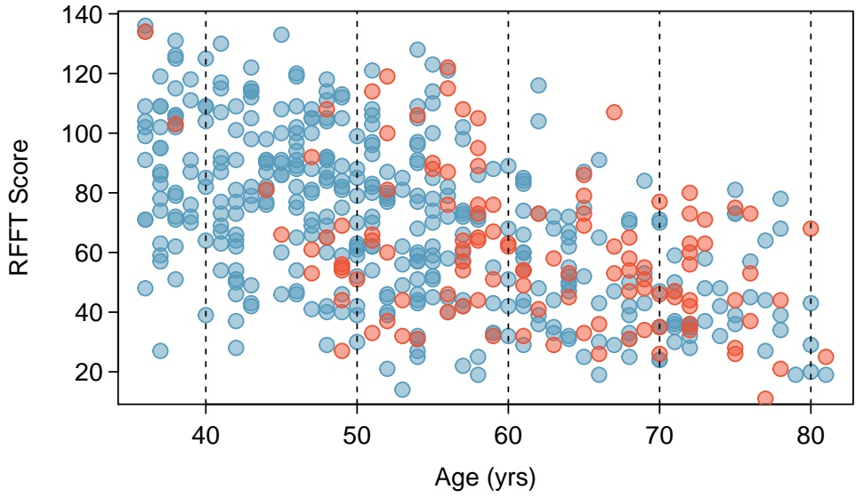
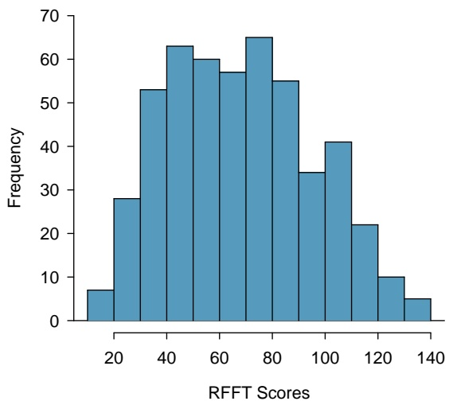
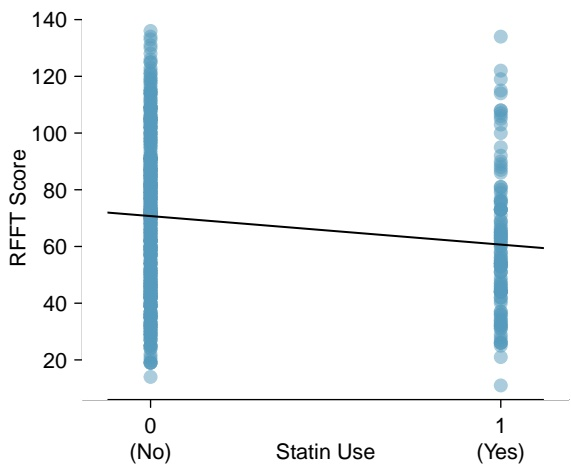
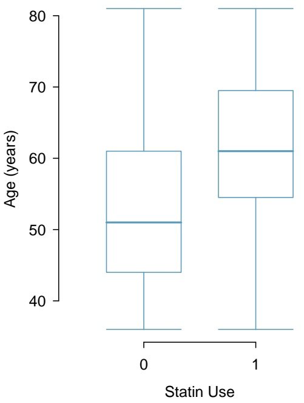

## 6.7.3 Interpreting a linear model

**6.11 Visualize the residuals.** The scatterplots shown below each have a superimposed regression line. If we were to construct a residual plot (residuals versus x) for each, describe what those plots would look like.

scatter

| X (range) | Y (range) |
| --- | --- |
| 0~100 | 0~100 |

(a)

scatter

| X (range) | Y (range) |
| --- | --- |
| 0~100 | 0~100 |

(b)

**6.12 Trends in the residuals.** Shown below are two plots of residuals remaining after fitting a linear model to two different sets of data. Describe important features and determine if a linear model would be appropriate for these data. Explain your reasoning.

scatter

| Series | X (range) | Y (range) |
| --- | --- | --- |
| Data Points | 0~100 | -5~10 |

(a)

scatter

| Series | X (range) | Y (range) |
| --- | --- | --- |
| Data Points | 0~100 | -5~8 |

(b)

**6.13 Guppies, Part II.** Exercise 6.10 showed a plot of length versus height for 147 male guppies with a least squares regression line.

(a) Identify two points that have relatively high leverage and discuss whether these points seem to be particularly influential.
(b) Based on the plot, comment on whether it is appropriate to use $R ^ { 2 }$ as a metric for describing the strength of the model fit.
(c) The $R ^ { 2 }$ for this model is 0.718. Interpret this value in the context of the data.

**6.14 Nutrition at Starbucks, Part I.** The scatterplot below shows the relationship between the number of calories and amount of carbohydrates (in grams) Starbucks food menu items contain.29 Since Starbucks only lists the number of calories on the display items, we are interested in predicting the amount of carbs a menu item has based on its calorie content.

(a) Describe the relationship between number of calories and amount of carbohydrates (in grams) that Starbucks food menu items contain.
(b) In this scenario, what are the explanatory and response variables?
(c) Why might we want to fit a regression line to these data?
(d) Do these data meet the conditions required for fitting a least squares line?

**6.15 Nutrition at Starbucks, Part II.** Exercise 6.14 introduced a data set on nutrition information on Starbucks food menu items. Based on the scatterplot and the residual plot provided, describe the relationship between the protein content and calories of these menu items, and determine if a simple linear model is appropriate to predict amount of protein from the number of calories.

scatter

| X | Protein (grams) |
| --- | --- |
| ~80 | 0 |
| ~130 | 0 |
| ~140 | 5 |
| ~160 | 2 |
| ~170 | 2 |
| ~180 | 2 |
| ~190 | 0 |
| ~210 | 0 |
| ~270 | 16 |
| ~280 | 10 |
| ~290 | 19 |
| ~300 | 15 |
| ~300 | 14 |
| ~300 | 12 |
| ~300 | 8 |
| ~300 | 5 |
| ~310 | 6 |
| ~320 | 18 |
| ~340 | 4 |
| ~350 | 20 |
| ~350 | 17 |
| ~350 | 15 |
| ~350 | 13 |
| ~350 | 7 |
| ~350 | 6 |
| ~360 | 28 |
| ~360 | 17 |
| ~360 | 17 |
| ~360 | 13 |
| ~360 | 7 |
| ~360 | 4 |
| ~370 | 23 |
| ~370 | 15 |
| ~380 | 34 |
| ~380 | 26 |
| ~380 | 26 |
| ~390 | 13 |
| ~400 | 6 |
| ~410 | 6 |
| ~420 | 7 |
| ~420 | 5 |
| ~420 | 4 |
| ~430 | 8 |
| ~440 | 7 |
| ~460 | 22 |
| ~480 | 18 |
| ~490 | 8 |
| ~490 | 8 |
| ~490 | 7 |
| ~490 | 5 |
| ~500 | 19 |

Calories

scatter

| X (range) | Y (range) |
| --- | --- |
| ~0 ~35 | ~-8 ~24 |

**6.16 Body measurements, Part III.** Exercise 6.3 introduces data on shoulder girth and height of a group of individuals. The mean shoulder girth is 107.20 cm with a standard deviation of 10.37 cm. The mean height is 171.14 cm with a standard deviation of 9.41 cm. The correlation between height and shoulder girth is 0.67.

(a) Write the equation of the regression line for predicting height.
(b) Interpret the slope and the intercept in this context.
(c) Calculate $R ^ { 2 }$ of the regression line for predicting height from shoulder girth, and interpret it in the context of the application.
(d) A randomly selected student from your class has a shoulder girth of 100 cm. Predict the height of this student using the model.
(e) The student from part (d) is 160 cm tall. Calculate the residual, and explain what this residual means.
(f) A one year old has a shoulder girth of 56 cm. Would it be appropriate to use this linear model to predict the height of this child?

**6.17 Outliers, Part I.** Identify the outliers in the scatterplots shown below, and determine what type of outliers they are. Explain your reasoning.

scatter

| X (range) | Y (range) |
| --- | --- |
| 0~100 | 0~100 |

(a)

scatter

| X (range) | Y (range) |
| --- | --- |
| 0~100 | 0~100 |

(b)

scatter

| X (range) | Y (range) |
| --- | --- |
| 0~100 | 0~100 |

(c)

**6.18 Outliers, Part II.** Identify the outliers in the scatterplots shown below and determine what type of outliers they are. Explain your reasoning.

scatter

| X (range) | Y (range) |
| --- | --- |
| 0~100 | 0~100 |

(a)

scatter

| X (range) | Y (range) |
| --- | --- |
| ~0.1 ~0.95 | ~0.1 ~0.95 |

(b)

scatter

| X (range) | Y (range) |
| --- | --- |
| 0~100 | 0~100 |

(c)

**6.19 Guppies, Part III.** The residual plots below are for the linear model fit in Exercise 6.10 predicting length from height for 147 male guppies.

(a) From a plot of residual values versus predicted values, are the assumptions of linearity and constant variability satisfied? Explain your answer.
(b) Is it reasonable to assume that the observations were independent, based on the description of the study? Explain your answer.
(c) Are the residuals approximately normally distributed? Explain your answer.

**6.20 Guppies, Part IV.** Multilocus heterozygosity (MLH) is reflective of genetic quality; according to sexual selection research, it is thought that sexual ornamentation functions as a visual indicator of fitness. By selecting males with features such as bright coloration, females can improve the chances of reproductive success.

Male guppies are covered in a mixture of colored spots; orange coloration is consistently preferred by females. Heterozygosity was assessed by genotyping 9 loci and calculating the proportion of loci that are heterozygous. The research question of interest is whether MLH and orange color are linearly associated.

(a) Based on the plot of MLH versus relative orange area, describe the nature of the association in language accessible to a general audience.
(b) Comment on whether the assumptions of linearity and constant variability are reasonably met.
(c) Comment on whether the residuals are approximately normally distributed.

**6.21 Diamond prices, Part II.** Exercise 5.24 introduced data on the price of diamonds based on whether a diamond is 0.99 carats or 1 carat. Based on the summary statistics, write an estimated model equation pre-dicting price from a binary indicator of carat weight. Be sure to clearly define the variables used in the model.

|  | 0.99 carats | 1 carat |
| --- | --- | --- |
| Mean | $ 44.51 | $ 56.81 |
| SD | $ 13.32 | $ 16.13 |
| n | 23 | 23 |

**6.22 Avian influenza, Part II.** Exercise 5.28 introduced data from an analysis investigating whether hatch weights between transgenic and non-transgenic chicks differ.

|  | transgenic chicks (g) | non-transgenic chicks (g) |
| --- | --- | --- |
| $\bar{x}$ | 45.14 | 44.99 |
| s | 3.32 | 4.57 |
| n | 54 | 54 |

(a) Write an estimated least squares regression line for a model predicting hatch weight from chick type, where non-transgenic chicks are the reference group; i.e., the group for which the binary predictor takes on value 0.
(b) Write an estimated least squares regression line for a model predicting hatch weight from chick type, where transgenic chicks are the reference group.

## 6.7.4 Statistical inference with regression

**6.23 Body measurements, Part IV.** The scatterplot and least squares summary below show the relationship between weight measured in kilograms and height measured in centimeters of 507 physically active individ uals.

scatter

| Height (cm) (range) | Weight (kg) (range) |
| --- | --- |
| 145~200 | 40~115 |

|  | Estimate | Std. Error | t value | Pr(>\|t\|) |
| --- | --- | --- | --- | --- |
| (Intercept) | -105.0113 | 7.5394 | -13.93 | 0.0000 |
| height | 1.0176 | 0.0440 | 23.13 | 0.0000 |

(a) Describe the relationship between height and weight.
(b) Write the equation of the regression line. Interpret the slope and intercept in context.
(c) Do the data provide strong evidence that an increase in height is associated with an increase in weight? State the null and alternative hypotheses, report the p-value, and state your conclusion.
(d) The correlation coefficient for height and weight is 0.72. Calculate $R ^ { 2 }$ and interpret it in context.

**6.24 Beer and blood alcohol content.** Many people believe that gender, weight, drinking habits, and many other factors are much more important in predicting blood alcohol content (BAC) than simply considering the number of drinks a person consumed. Here we examine data from sixteen student volunteers at Ohio State University who each drank a randomly assigned number of cans of beer. These students were evenly divided between men and women, and they differed in weight and drinking habits. Thirty minutes later, a police officer measured their blood alcohol content (BAC) in grams of alcohol per deciliter of blood.30 The scatterplot and regression table summarize the findings.

scatter

| Cans of beer | BAC (grams / deciliter) |
| --- | --- |
| 1 | ~0.015 |
| 2 | ~0.03 |
| 3 | ~0.02 |
| 3 | ~0.04 |
| 3 | ~0.07 |
| 4 | ~0.05 |
| 4 | ~0.07 |
| 5 | ~0.05 |
| 5 | ~0.06 |
| 5 | ~0.085 |
| 5 | ~0.10 |
| 6 | ~0.10 |
| 7 | ~0.09 |
| 7 | ~0.095 |
| 8 | ~0.12 |
| 9 | ~0.19 |

|  | Estimate | Std. Error | t value | Pr(>\|t\|) |
| --- | --- | --- | --- | --- |
| (Intercept) | -0.0127 | 0.0126 | -1.00 | 0.3320 |
| beers | 0.0180 | 0.0024 | 7.48 | 0.0000 |

(a) Describe the relationship between the number of cans of beer and BAC.
(b) Write the equation of the regression line. Interpret the slope and intercept in context.
(c) Do the data provide strong evidence that drinking more cans of beer is associated with an increase in blood alcohol? State the null and alternative hypotheses, report the p-value, and state your conclusion.
(d) The correlation coefficient for number of cans of beer and BAC is 0.89. Calculate $R ^ { 2 }$ and interpret it in context.
(e) Suppose we visit a bar, ask people how many drinks they have had, and also take their BAC. Do you think the relationship between number of drinks and BAC would be as strong as the relationship found in the Ohio State study?

<small>30J. Malkevitch and L.M. Lesser. For All Practical Purposes: Mathematical Literacy in Today’s World. WH Freeman & Co, 2008.</small>

**6.25 Husbands and wives, Part I.** The scatterplot below summarizes husbands’ and wives’ heights in a random sample of 170 married couples in Britain, where both partners’ ages are below 65 years. Summary output of the least squares fit for predicting wife’s height from husband’s height is also provided in the table.

scatter

| Husband's height (inches) | Wife's height (inches) |
| --- | --- |
| ~61.5 | ~62.3 |
| ~62.0 | ~64.7 |
| ~62.5 | ~60.3 |
| ~62.8 | ~61.9 |
| ~63.0 | ~59.5 |
| ~63.5 | ~56.0 |
| ~64.0 | ~65.0 |
| ~64.2 | ~64.2 |
| ~64.5 | ~62.2 |
| ~64.8 | ~60.0 |
| ~65.0 | ~66.7 |
| ~65.2 | ~63.8 |
| ~65.5 | ~69.4 |
| ~65.8 | ~63.8 |
| ~66.0 | ~63.5 |
| ~66.2 | ~63.8 |
| ~66.5 | ~63.8 |
| ~66.8 | ~63.8 |
| ~67.0 | ~63.8 |
| ~67.2 | ~63.8 |
| ~67.5 | ~63.8 |
| ~67.8 | ~63.8 |
| ~68.0 | ~63.8 |
| ~68.2 | ~63.8 |
| ~68.5 | ~63.8 |
| ~68.8 | ~63.8 |
| ~69.0 | ~63.8 |
| ~69.2 | ~63.8 |
| ~69.5 | ~63.8 |
| ~69.8 | ~63.8 |
| ~70.0 | ~63.8 |
| ~70.2 | ~63.8 |
| ~70.5 | ~63.8 |
| ~70.8 | ~63.8 |
| ~71.0 | ~63.8 |
| ~71.2 | ~63.8 |
| ~71.5 | ~63.8 |
| ~71.8 | ~63.8 |
| ~72.0 | ~63.8 |
| ~72.2 | ~63.8 |
| ~72.5 | ~63.8 |
| ~72.8 | ~63.8 |
| ~73.0 | ~63.8 |
| ~73.2 | ~63.8 |
| ~73.5 | ~63.8 |
| ~73.8 | ~63.8 |
| ~74.0 | ~63.8 |
| ~74.2 | ~63.8 |
| ~74.5 | ~63.8 |
| ~74.8 | ~63.8 |
| ~75.0 | ~63.8 |

|  | Estimate | Std. Error | t value | Pr(>\|t\|) |
| --- | --- | --- | --- | --- |
| (Intercept) | 43.5755 | 4.6842 | 9.30 | 0.0000 |
| height_husband | 0.2863 | 0.0686 | 4.17 | 0.0000 |

(a) Is there strong evidence that taller men marry taller women? State the hypotheses and include any information used to conduct the test.
(b) Write the equation of the regression line for predicting wife’s height from husband’s height.
(c) Interpret the slope and intercept in the context of the application.
(d) Given that $R ^ { 2 } = 0 . 0 9$ , what is the correlation of heights in this data set?
(e) You meet a married man from Britain who is $5 ^ { \prime } 9 ^ { \prime \prime }$ (69 inches). What would you predict his wife’s height to be? How reliable is this prediction?
(f) You meet another married man from Britain who is $6 ^ { \prime } 7 ^ { \prime \prime }$ (79 inches). Would it be wise to use the same linear model to predict his wife’s height? Why or why not?
(g) Is there statistically significant evidence of an association between husband height and wife height based on these data? Explain your answer.
(h) Would you expect a 95% confidence interval for husband height to contain 0? Explain your answer.

**6.26 Helmets and lunches.** The scatterplot shows the relationship between socioeconomic status measured as the percentage of children in a neighborhood receiving reduced-fee lunches at school (lunch) and the percentage of bike riders in the neighborhood wearing helmets (helmet). The average percentage of children receiving reduced-fee lunches is 30.8% with a standard deviation of 26.7% and the average percentage of bike riders wearing helmets is 38.8% with a standard deviation of 16.9%.

(a) If the $R ^ { 2 }$ for the least-squares regression line for these data is 72%, what is the correlation between lunch and helmet?
(b) Calculate the slope and intercept for the least-squares regression line for these data.
(c) Interpret the intercept of the least-squares regression line in the context of the application.
(d) Interpret the slope of the least-squares regression line in the context of the application.
(e) What would the value of the residual be for a neighborhood where 40% of the children receive reduced-fee lunches and 40% of the bike riders wear helmets? Interpret the meaning of this residual in the context of the application.

scatter

| Rate of Receiving a Reduced-Fee Lunch (%) | Rate of Wearing a Helmet (%) |
| --- | --- |
| ~2 | ~58 |
| ~3 | ~34 |
| ~12 | ~55 |
| ~12 | ~36 |
| ~20 | ~23 |
| ~20 | ~33 |
| ~26 | ~39 |
| ~26 | ~43 |
| ~50 | ~22 |
| ~51 | ~21 |
| ~73 | ~6 |
| ~82 | ~4 |

**6.27 Husbands and wives, Part II.** Exercise 6.25 presents a scatterplot displaying the relationship between husbands’ and wives’ ages in a random sample of 170 married couples in Britain, where both partners’ ages are below 65 years. Given below is summary output of the least squares fit for predicting wife’s age from husband’s age.

scatter

| Husband's age (in years) | Wife's age (in years) |
| --- | --- |
| ~20 | ~18 |
| ~20 | ~22 |
| ~21 | ~21 |
| ~23 | ~24 |
| ~24 | ~25 |
| ~25 | ~26 |
| ~26 | ~27 |
| ~27 | ~28 |
| ~28 | ~29 |
| ~29 | ~30 |
| ~30 | ~31 |
| ~31 | ~32 |
| ~32 | ~33 |
| ~33 | ~34 |
| ~34 | ~35 |
| ~35 | ~36 |
| ~36 | ~37 |
| ~37 | ~38 |
| ~38 | ~39 |
| ~39 | ~40 |
| ~40 | ~41 |
| ~41 | ~42 |
| ~42 | ~43 |
| ~43 | ~44 |
| ~44 | ~45 |
| ~45 | ~46 |
| ~46 | ~47 |
| ~47 | ~48 |
| ~48 | ~49 |
| ~49 | ~50 |
| ~50 | ~51 |
| ~51 | ~52 |
| ~52 | ~53 |
| ~53 | ~54 |
| ~54 | ~55 |
| ~55 | ~56 |
| ~56 | ~57 |
| ~57 | ~58 |
| ~58 | ~59 |
| ~59 | ~60 |
| ~60 | ~61 |
| ~61 | ~62 |
| ~62 | ~63 |
| ~63 | ~64 |
| ~64 | ~65 |

<table><tr><td></td><td>Estimate</td><td>Std. Error</td><td>t value</td><td>Pr(&gt;|t|)</td></tr><tr><td>(Intercept)</td><td>1.5740</td><td>1.1501</td><td>1.37</td><td>0.1730</td></tr><tr><td>age_husband</td><td>0.9112</td><td>0.0259</td><td>35.25</td><td>0.0000</td></tr><tr><td colspan="4"></td><td> $df = 168$ </td></tr></table>

(a) We might wonder, is the age difference between husbands and wives consistent across ages? If this were the case, then the slope parameter would be $\beta _ { 1 } = 1$ . Use the information above to evaluate if there is strong evidence that the difference in husband and wife ages differs for different ages.
(b) Write the equation of the regression line for predicting wife’s age from husband’s age.
(c) Interpret the slope and intercept in context.
(d) Given that $R ^ { 2 } = 0 . 8 8 ,$ , what is the correlation of ages in this data set?
(e) You meet a married man from Britain who is 55 years old. What would you predict his wife’s age to be? How reliable is this prediction?
(f) You meet another married man from Britain who is 85 years old. Would it be wise to use the same linear model to predict his wife’s age? Explain.

**6.28 Guppies, Part V.** Exercise 6.20 introduced a linear model for predicting relative orange area from proportion of loci that are heterozygous (MLH). Relative orange area refers to the percentage of the body that is orange (rather than a different color).

<table><tr><td></td><td>Estimate</td><td>Std. Error</td><td>t value</td><td>Pr(&gt;|t|)</td></tr><tr><td>(Intercept)</td><td>0.037</td><td>0.010</td><td>3.68</td><td>0.0033</td></tr><tr><td>MLH</td><td>0.051</td><td>0.018</td><td>2.77</td><td>0.0063</td></tr><tr><td colspan="5"> $df = 145$ </td></tr></table>

(a) Write the estimated model equation.
(b) What is the predicted mean relative orange area for a guppy that is heterozygous at 8 out of 9 loci?
(c) Based on the linear model, how much does mean relative orange area differ between a guppy that is heterozygous at 2 loci versus 4 loci (out of 9 total)?
(d) Conduct a hypothesis test to determine whether relative orange area is significantly associated with MLH. Do the results suggest that more elaborate sexual ornaments are associated with increased heterozygosity? Explain.
(e) Compute and interpret a 95% confidence interval for the slope parameter $\beta _ { 1 }$

**6.29 Age and RFFT score, Part II.** The following regression output is for predicting RFFT score of 500 randomly sampled individuals from the PREVEND data based on age (years).

<table><tr><td></td><td>Estimate</td><td>Std. Error</td><td>t value</td><td>Pr(&gt;|t|)</td></tr><tr><td>(Intercept)</td><td>137.55</td><td>5.02</td><td>27.42</td><td>0.000</td></tr><tr><td>Age</td><td>-1.26</td><td>0.09</td><td>-14.09</td><td>0.000</td></tr><tr><td colspan="5"> $df = 498$ </td></tr></table>

(a) Do these data provide statistically significant evidence at the $\alpha = 0 . 0 1$ significance level that age is associated with RFFT score? State the null and alternative hypotheses, report the relevant p-value, and state your conclusion.
(b) Compute and interpret a 99% confidence interval for the population slope.

**6.30 Avian influenza, Part III.** Exercise 5.28 introduced data from an analysis investigating whether hatch weights between transgenic and non-transgenic chicks differ. Based on the results from conducting the twogroup test, explain whether the 95% confidence interval for the $\beta _ { 1 }$ parameter in a model predicting hatch weight from a group indicator would contain 0.

## 6.7.5 Interval estimates with regression

**6.31 Husbands and wives, Part III.** Exercise 6.27 introduces data from a random sample of 170 married couples in Britain, where both partners’ ages are below 65 years, and fits a model predicting wife’s age from husband’s age. Wife’s age has a mean of 40.68 years, with standard deviation 11.41 years. Husband’s age has a mean of 42.92 years, with standard deviation 11.76 years. From software, the residual standard error is $s = 3 . 9 5 .$

(a) Use the summary statistics to calculate a 95% confidence interval for the average age of wives whose husbands are 55 years old.
(b) You meet a married man from Britain who is 55 years old. Predict his wife’s age and give a 95% prediction interval for her age.
(c) Repeat parts (a) and (b) using the approximate formulas for the appropriate standard errors.

**6.32 Guppies, Part VI.** The relationship between length and height for 147 male guppies was introduced in Exercise 6.10, which used the summary statistics to calculate the equation of the least squares line for length as a function of height and estimate the mean length of an adult male guppy with height 180 cm. The estimated residual standard error from this model is s = 50.93.

(a) Use the summary statistics given in Exercise 6.10 to construct a 95% confidence interval for the estimated mean length when height is 180 cm.
(b) Use a prediction interval based on the summary statistics to estimate the lengths for a new 180 cm guppy that would be more than two standard deviations above and below the estimated mean.
(c) Use the approximate formulas for the standard error for a mean and for a prediction to recalculate the intervals in parts (a) and (b).

# Chapter 7

## Multiple linear regression

**7.1 Introduction to multiple linear regression**
**7.2 Simple versus multiple regression**
**7.3 Evaluating the fit of a multiple regression model**
**7.4 The general multiple linear regression model**
**7.5 Categorical predictors with several levels**
**7.6 Reanalyzing the PREVEND data**
**7.7 Interaction in regression**
**7.8 Model selection for explanatory models**
**7.9 The connection between ANOVA and regression**
**7.10 Notes**
**7.11 Exercises**

In most practical settings, more than one explanatory variable is likely to be associated with a response. This chapter discusses how the ideas behind simple linear regression can be extended to a model with multiple predictor variables.

There are several applications of multiple regression. One of the most common applications in a clinical setting is estimating an association between a re sponse variable and primary predictor of interest while adjusting for possible confounding variables. Sections 7.1 and 7.2 introduce the multiple regression model by examining the possible association between cognitive function and the use of statins after adjusting for potential confounders. Section 7.8 discusses another application of multiple regression—constructing a model that effectively explains the observed variation in the response variable.

The other sections in the chapter outline general principles of multiple re gression, including the statistical model, methods for assessing quality of model fit, categorical predictors with more than two levels, interaction, and the connection between ANOVA and regression. The methods used to conduct hypothesis tests and construct confidence intervals for regression coefficients extend natu rally from simple to multiple linear regression, so the section on the statistical model for multiple regression can be treated as optional.

## 7.1 Introduction to multiple linear regression

Statins are a class of drugs widely used to lower cholesterol. There are two main types of cholesterol: low density lipoprotein (LDL) and high density lipoprotein (HDL).1 Research suggests that adults with elevated LDL may be at risk for adverse cardiovascular events such as a heart attack or stroke. In 2013, a panel of experts commissioned by the American College of Cardiology and the American Heart Association recommended that statin therapy be considered in individuals who either have any form of atherosclerotic cardiovascular disease2 or have LDL cholesterol levels ≥ 190 mg/dL, individuals with Type II diabetes ages 40 to 75 with LDL between 70 to 189 mg/dL, and non-diabetic individuals ages of 40 to 75 with a predicted probability of future clogged arteries of at least 0.075.3

Health policy analysts have estimated that if the new guidelines were to be followed, almost half of Americans ages 40 to 75 and nearly all men over 60 would be prescribed a statin. However, some physicians have raised the question of whether treatment with a statin might be associated with an increased risk of cognitive decline.4, 5 Older adults are at increased risk for cardiovascular disease, but also for cognitive decline. A study by Joosten, et al. examined the association of statin use and other variables with cognitive ability in an observational cohort of 4,095 participants from the Netherlands who were part of the larger PREVEND study introduced in Section 6.1.6 The analyses presented in this chapter are based on a random sample of 500 participants from the cohort.7

The investigators behind the Joosten study anticipated an issue in the analysis—statins are used more often in older adults than younger adults, and older adults suffer a natural cognitive decline. Age is a potential **confounder** in this setting. If age is not accounted for in the analysis, it may seem that cognitive decline is more common among individuals prescribed statins, simply because those prescribed statins are simply older and more likely to have reduced cognitive ability than those not prescribed statins.

1Total cholesterol level is the sum of LDL and HDL levels.
2i.e., arteries thickening and hardening with plaque
3Stone NJ, et al. 2013 ACC/AHA Guideline on the Treatment of Blood Cholesterol to Reduce Atherosclerotic Cardiovascular Risk in Adults Circulation. 2014;129:S1-S45. DOI: 10.1161/01.cir.0000437738.63853.7a
4Muldoon, Matthew F., et al. Randomized trial of the effects of simvastatin on cognitive functioning in hypercholesterolemic adults. The American journal of medicine 117.11 (2004): 823-829.
5King, Deborah S., et al. Cognitive impairment associated with atorvastatin and simvastatin. Pharmacotherapy: The Journal of Human Pharmacology and Drug Therapy 23.12 (2003): 1663-1667.
6Joosten H, Visser ST, van Eersel ME, Gansevoort RT, Bilo HJG, et al. (2014) Statin Use and Cognitive Function: Population-Based Observational Study with Long-Term Follow- Up. PLoS ONE 9(12): e115755. doi:10.1371/ journal.pone.0115755
7The random sample is accessible as prevend.samp in the oibiostat R package.

scatter

| Series | Age (yrs) (range) | RFFT Score (range) |
| --- | --- | --- |
| Blue | 35~82 | 10~135 |
| Red | 40~82 | 10~135 |

Figure 7.1: A scatterplot showing age vs. RFFT in prevend.samp. Statin users are represented with red points; participants not using statins are shown as blue points.

Figure 7.1 visually demonstrates why age is a potential confounder for the association between statin use and cognitive function, where cognitive function is measured via the Ruff Figural Fluency Test (RFFT). Scores range from 0 (worst) to 175 (best). The blue points indicate individuals not using statins, while red points indicate statin users. First, it is clear that age and statin use are associated, with statin use becoming more common as age increases; the red points are more prevalent on the right side of the plot. Second, it is also clear that age is associated with lower RFFT scores; ignoring the colors, the point cloud drifts down and to the right. However, a close inspection of the plot suggests that for ages in relatively small ranges (e.g., ages 50-60), statin use may not be strongly associated with RFFT score—there are approximately as many red dots with low RFFT scores as with high RFFT scores in a given age range. In other words, for subsets of participants with approximately similar ages, statin use may not be associated with RFFT. Multiple regression provides a way to estimate the association of statin use with RFFT while adjusting for age; i.e., accounting for the underlying relationship between age and statin use.

## 7.2 Simple versus multiple regression

A simple linear regression model can be fit for an initial examination of the association between statin use and RFFT score,

$$
E (\mathrm{RFFT}) = \beta_ {0} + \beta_ {\mathrm{Statin}} (\mathrm{Statin}).
$$

RFFT scores in prevend.samp are approximately normally distributed, ranging between approximately 10 and 140, with no obvious outliers (Figure 7.2(a)). The least squares regression line shown in Figure 7.2(b) has a negative slope, which suggests a possible negative association.

histogram

| RFFT Scores (Bin) | Frequency |
| --- | --- |
| 10~20 | ~7 |
| 20~30 | ~28 |
| 30~40 | ~53 |
| 40~50 | ~63 |
| 50~60 | ~60 |
| 60~70 | ~57 |
| 70~80 | ~65 |
| 80~90 | ~55 |
| 90~100 | ~34 |
| 100~110 | ~41 |
| 110~120 | ~22 |
| 120~130 | ~10 |
| 130~140 | ~5 |

(a)

scatter

| Statin Use | RFFT Score (range) |
| --- | --- |
| 0 (No) | ~15 ~138 |
| 1 (Yes) | ~12 ~135 |

(b)

Figure 7.2: (a) Histogram of RFFT scores. (b) Scatterplot of RFFT score versus statin use in prevend.samp. The variable Statin is coded 1 for statin users, and 0 otherwise.

Figure 7.3 gives the parameter estimates of the least squares line, and indicates that the association between RFFT score and statin use is highly significant. On average, statin users score approximately 10 points lower on the RFFT. However, even though the association is statistically significant, it is potentially misleading since the model does not account for the underlying relationship between age and statin use. The association between age and statin use visible from Figure 7.1 is even more apparent in Figure 7.4, which shows that the median age of statin users is about 10 years higher than the median age of individuals not using statins.

|  | Estimate | Std. Error | t value | Pr(>\|t\|) |
| --- | --- | --- | --- | --- |
| (Intercept) | 70.7143 | 1.3808 | 51.21 | 0.0000 |
| Statin | -10.0534 | 2.8792 | -3.49 | 0.0005 |

Figure 7.3: R summary output for the simple regression model of RFFT versus statin use in prevend.samp.

boxplot

| Statin Use | Q1 | Q2 (Median) | Q3 | Min | Max |
| --- | --- | --- | --- | --- | --- |
| 0 | ~44 | ~51 | ~61 | ~36 | ~81 |
| 1 | ~54.5 | ~61 | ~69.5 | ~36 | ~81 |

Figure 7.4: Boxplot of age by statin use in prevend.samp. The variable Statin is coded 1 for statin users, and 0 otherwise.

Multiple regression allows for a model that incorporates both statin use and age,

$$
E (\mathrm{RFFT}) = \beta_ {0} + \beta_ {\text {Statin}} (\text {Statin}) + \beta_ {\text {Age}} (\text {Age}).
$$

In statistical terms, the association between RFFT and Statin is being estimated after adjusting for Age. This is an example of one of the more important applications of multiple regression: estimating an association between a response variable and primary predictor of interest while adjusting for possible confounders. In this setting, statin use is the primary predictor of interest.

The principles and assumptions behind the multiple regression model are introduced more formally in Section 7.4, along with the method used to estimate the coefficients. Figure 7.5 shows the parameter estimates for the model from R.

|  | Estimate | Std. Error | t value | Pr(>\|t\|) |
| --- | --- | --- | --- | --- |
| (Intercept) | 137.8822 | 5.1221 | 26.92 | 0.0000 |
| Statin | 0.8509 | 2.5957 | 0.33 | 0.7432 |
| Age | -1.2710 | 0.0943 | -13.48 | 0.0000 |

Figure 7.5: R summary output for the multiple regression model of RFFT versus statin use and age in prevend.samp.

## EXAMPLE 7.1

Using the parameter estimates in Figure 7.5, write the prediction equation for the linear model. How does the predicted RFFT score for a 67-year-old not using statins compare to that of an individual of the same age who does use statins?

The equation of the linear model is

$$
\widehat {\mathrm{RFFT}} = 1 3 7. 8 8 2 2 + 0. 8 5 0 9 (\text {Statin}) - 1. 2 7 1 0 (\text {Age}).
$$

The predicted RFFT score for a 67-year-old not using statins (Statin = 0) is

$$
\widehat {\mathrm{RFFT}} = 1 3 7. 8 8 2 2 + (0. 8 5 0 9) (0) - (1. 2 7 1 0) (6 7) = 5 2. 7 2 5 2.
$$

The predicted RFFT score for a 67-year-old using statins (Statin = 1) is

$$
\widehat {\mathrm{RFFT}} = 1 3 7. 8 8 2 2 + (0. 8 5 0 9) (1) - (1. 2 7 1 0) (6 7) = 5 3. 5 7 6 1.
$$

The two calculations differ only by the value of the coefficient $\beta _ { \mathrm { S t a t i n } } ,   0 . 8 5 0 9 . ^ { 8 }$ Thus, for two individuals who are the same age, the model predicts that RFFT score will be 0.8509 higher in the individual taking statins; statin use is associated with a small increase in RFFT score.

## EXAMPLE 7.2

Suppose two individuals are both taking statins; one individual is 50 years of age, while the other is 60 years of age. Compare their predicted RFFT scores.

From the model equation, the coefficient of age $\beta _ { \mathrm { A g e } }$ is -1.2710; an increase in one unit of age (i.e., one year) is associated with a decrease in RFFT score of -1.2710, when statin use is the same. Thus, the individual who is 60 years of age is predicted to have an RFFT score that is about 13 points lower $( ( - 1 . 2 7 1 0 ) ( 1 0 ) = - 1 2 . 7 1 0 )$ than the individual who is 50 years of age.

This can be confirmed numerically:

The predicted RFFT score for a 50-year-old using statins is

$$
\widehat {\mathrm{RFFT}} = 1 3 7. 8 8 2 2 + (0. 8 5 0 9) (1) - (1. 2 7 1 0) (5 0) = 7 5. 1 8 3 1.
$$

The predicted RFFT score for a 60-year-old using statins is

$$
\widehat {\mathrm{RFFT}} = 1 3 7. 8 8 2 2 + (0. 8 5 0 9) (1) - (1. 2 7 1 0) (6 0) = 6 2. 4 7 3 1.
$$

The scores differ by 62.4731 − 75.1831 = −12.710.

<small>8In most cases, predictions do not need to be calculated to so many significant digits, since the coefficients are only estimates. This example uses the additional precision to illustrate the role of the coefficients.</small>