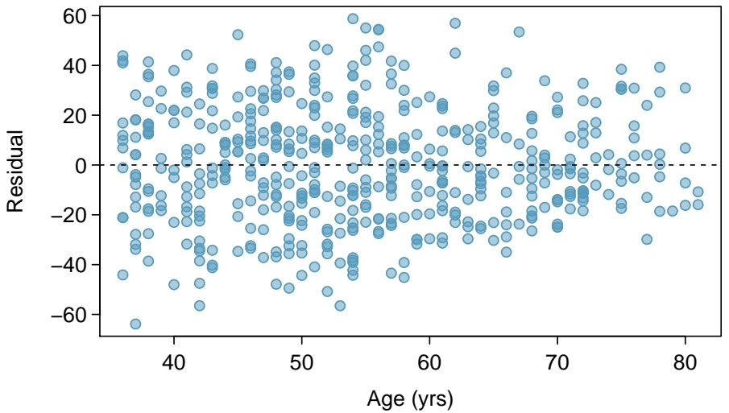
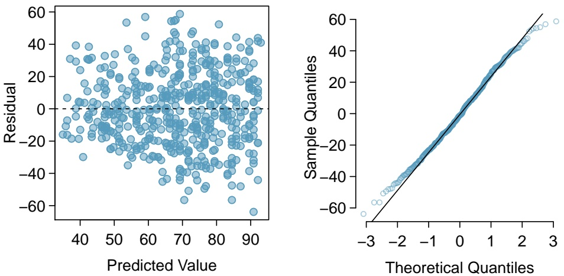
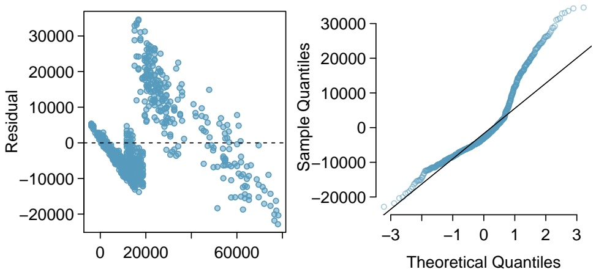
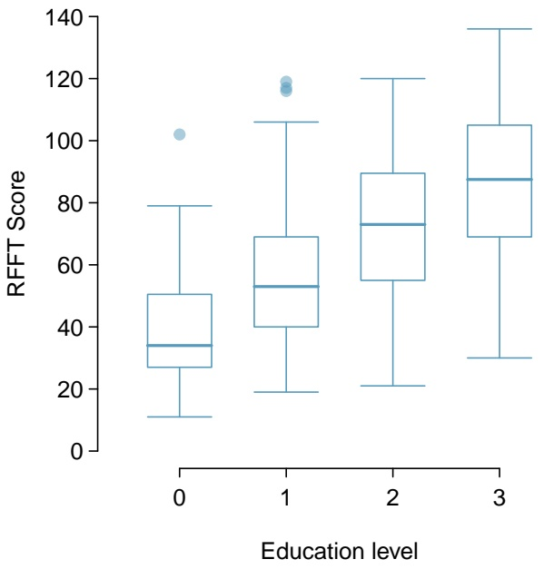
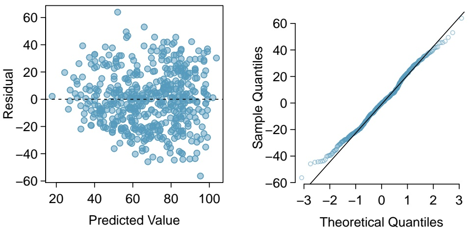

## GUIDED PRACTICE 7.3

What does the intercept represent in this model? Does the intercept have interpretive value?9

As in simple linear regression, t-statistics can be used to test hypotheses about the slope coefficients; for this model, the two null hypotheses are $H _ { 0 } : \beta _ { \mathrm { S t a t i n } } = 0$ and $H _ { 0 } : \beta _ { \mathrm { A g e } } = 0 .$ . The p-values for the tests indicate that at significance level $\alpha = 0 . 0 5$ , the association between RFFT score and statin use is not statistically significant, but the association between RFFT score and age is significant.

In a clinical setting, the interpretive focus lies on reporting the nature of the association between the primary predictor and the response and specifying which confounders have been adjusted for. The results of the analysis might be summarized as follows—

Although the use of statins appeared to be associated with lower RFFT scores when no adjustment was made for possible confounders, statin use is not significantly associated with RFFT score in a regression model that adjusts for age.

The results shown in Figure 7.5 do not provide information about either the quality of the model fit or its value as a prediction model. The next section describes the residual plots that can be used to check model assumptions and the use of $R ^ { 2 }$ to estimate how much of the variability in the response variable is explained by the model.

There is an important aspect of these data that should not be overlooked. The data do not come from a study in which participants were followed as they aged; i.e., a longitudinal study. Instead, this study was a cross-sectional study, in which patient age, statin use, and RFFT score were recorded for all participants during a short time interval. While the results of the study support the conclusion that older patients tend to have lower RFFT scores, they cannot be used to conclude that scores decline with age in individuals; there were no repeated measurements of RFFT taken as individual participants aged. Older patients come from an earlier birth cohort, and it is possible, for instance, that younger participants have more post-secondary school education or better health practices generally; such a cohort effect may have some explanatory effect on the observed association. The details of how a study is designed and how data are collected should always be taken into account when interpreting study results.

<small>9The intercept represents an individual with value 0 for both Statin and Age; i.e., an individual not using statins with age of 0 years. It is not reasonable to predict RFFT score for a newborn, or to assess statin use; the intercept is meaningless and has no interpretive value.</small>

## 7.3 Evaluating the fit of a multiple regression model

## 7.3.1 Using residuals to check model assumptions

The assumptions behind multiple regression are essentially the same as the four assumptions listed in Section 6.1 for simple linear regression. The assumption of linearity is extended to multi-ple regression by assuming that when only one predictor variable changes, it is linearly related to the change in the response variable. Assumption 2 becomes the slightly more general assumption that the residuals have approximately constant variance. Assumptions 3 and 4 do not change; it is assumed that the observations on each case are independent and the residuals are approximately normally distributed.

Since it is not possible to make a scatterplot of a response variable against several simultaneous predictors, residual plots become even more essential as tools for checking modeling assumptions.

To assess the linearity assumption, examine plots of residuals against each of the predictors. These plots might show an nonlinear trend that could be corrected with a transformation. The scatterplot of residual values versus age in Figure 7.6 shows no apparent nonlinear trends. It is not necessary to assess linearity against a categorical predictor, since a line drawn through two points (i.e., the means of the two groups) is necessarily linear.

scatter

| Age (yrs) | Residual |
| --- | --- |
| ~36 | ~42 |
| ~36 | ~45 |
| ~37 | ~-64 |
| ~38 | ~-30 |
| ~39 | ~-15 |
| ~40 | ~-48 |
| ~41 | ~-35 |
| ~42 | ~-56 |
| ~43 | ~-35 |
| ~44 | ~-35 |
| ~45 | ~-35 |
| ~46 | ~-35 |
| ~47 | ~-35 |
| ~48 | ~-35 |
| ~49 | ~-35 |
| ~50 | ~-35 |
| ~51 | ~-35 |
| ~52 | ~-35 |
| ~53 | ~-35 |
| ~54 | ~-35 |
| ~55 | ~-35 |
| ~56 | ~-35 |
| ~57 | ~-35 |
| ~58 | ~-35 |
| ~59 | ~-35 |
| ~60 | ~-35 |
| ~61 | ~-35 |
| ~62 | ~-35 |
| ~63 | ~-35 |
| ~64 | ~-35 |
| ~65 | ~-35 |
| ~66 | ~-35 |
| ~67 | ~-35 |
| ~68 | ~-35 |
| ~69 | ~-35 |
| ~70 | ~-35 |
| ~71 | ~-35 |
| ~72 | ~-35 |
| ~73 | ~-35 |
| ~74 | ~-35 |
| ~75 | ~-35 |
| ~76 | ~-35 |
| ~77 | ~-35 |
| ~78 | ~-35 |
| ~79 | ~-35 |
| ~80 | ~-35 |

Figure 7.6: Residuals versus age in the model for RFFT vs statins and age in the PREVEND data.

Since each case has one predicted value and one residual, regardless of the number of pre dictors, residuals can still be plotted against predicted values to assess the constant variance as sumption. The scatterplot in the left panel of Figure 7.7 shows that the variance of the residuals is slightly smaller for lower predicted values of RFFT, but is otherwise approximately constant.

Just as in simple regression, normal probability plots can be used to check the normality assumption of the residuals. The normal probability plot in the right panel of Figure 7.7 shows that the residuals from the model are reasonably normally distributed, with only slight departures from normality in the tails.

Figure 7.7: Residual plots from the linear model for RFFT versus statin use and age in prevend.samp.

## EXAMPLE 7.4

Section 1.7 featured a case study examining the evidence for ethnic discrimination in the amount of financial support offered by the State of California to individuals with developmental disabilities. Although an initial look at the data suggested an association between expenditures and ethnicity, further analysis suggested that age is a confounding variable for the relationship.

A multiple regression model can be fit to these data to model the association between expenditures, age, and ethnicity in a subset that only includes data from Hispanics and White non-Hispanics. Two residual plots from the model fit for

$$
E (\text {expenditures}) = \beta_ {0} + \beta_ {\text {ethnicity}} (\text {ethnicity}) + \beta_ {\text {age}} (\text {age})
$$

are shown in Figure 7.8. From these plots, assess whether a linear regression model is appropriate for these data.

The model assumptions are clearly violated. The residual versus fitted plot shows obvious patterns; the residuals do not scatter randomly about the $y = 0$ line. Additionally, the variance of the residuals is not constant around the $y = 0$ y = 0 line. As shown in the normal probability plot, the residuals show marked departures from normality, particularly in the upper tail; although this skewing may be partially resolved with a log transformation, the patterns in the residual versus fitted plot are more problematic.

Recall that a residual is the difference between an observed value and expected value; for an observation $i ,$ the residual equals $y _ { i }   -   \hat { y } _ { i }$ . Positive residuals occur when a model’s predictions are smaller that the observed values, and vice versa for negative residuals. In the residual versus fitted plot, it can be seen that in the middle range of predicted values, the model consistently under-predicts expenditures; on the upper and lower ends, the model over-predicts. This is a particularly serious issue with the model fit.

A single linear regression model is not appropriate for these data. For a more detailed examination of the model residuals, refer to Chapter 7, Lab 2. With some subsetting according to age cohort, it can be reasonable to use linear regression for modeling these data.

Figure 7.8: Residual versus fitted values plot and residual normal probability plot from the linear model for expenditures versus ethnicity and age for a subset of dds.discr.

## 7.3.2 Using $R ^ { 2 }$ and adjusted $R ^ { 2 }$ with multiple regression

Section 6.3.2 provided two definitions of the $R ^ { 2 }$ statistic—it is the square of the correlation coefficient r between a response and the single predictor in simple linear regression, and equivalently, it is the proportion of the variation in the response variable explained by the model. In statistical terms, the second definition can be written as

$$
R ^ {2} = \frac {\mathrm{Var} (y _ {i}) - \mathrm{Var} (e _ {i})}{\mathrm{Var} (y _ {i})} = 1 - \frac {\mathrm{Var} (e _ {i})}{\mathrm{Var} (y _ {i})},
$$

where $y _ { i }$ and $e _ { i }$ denote the response and residual values for the $i ^ { \mathrm { t h } }$ case.

The first definition cannot be used in multiple regression, since there is a correlation coefficient between each predictor and the response variable. However, since there is a single set of residuals, the second definition remains applicable.

Although $R ^ { 2 }$ can be calculated directly from the equation, it is rarely calculated by hand since statistical software includes $R ^ { 2 }$ as a standard part of the summary output for a regression model.10 In the model with response RFFT and predictors Statin and Age, $R ^ { 2 } = 0 . 2 8 5 2$ . The model explains almost 29% of the variability in RFFT scores, a considerable improvement over the model with Statin alone $( R ^ { 2 } = 0 . 0 2 3 9 )$

Adding a variable to a regression model always increases the value of $R ^ { 2 }$ . Sometimes that increase is large and clearly important, such as when age is added to the model for RFFT scores. In other cases, the increase is small, and may not be worth the added complexity of including another variable. The **adjusted R-squared** is often used to balance predictive ability with complexity in a multiple regression model. Like $R ^ { 2 } ,$ , the adjusted $R ^ { 2 }$ is routinely provided in software output.

## ADJUSTED $\mathbb { R } ^ { 2 }$ AS A TOOL FOR MODEL ASSESSMENT

The adjusted $\mathbf { R } ^ { 2 }$ is computed as

$$
R _ {a d j} ^ {2} = 1 - \frac {\operatorname{Var} (e _ {i}) / (n - p - 1)}{\operatorname{Var} (y _ {i}) / (n - 1)} = 1 - \frac {\operatorname{Var} (e _ {i})}{\operatorname{Var} (y _ {i})} \times \frac {n - 1}{n - p - 1},
$$

where n is the number of cases used to fit the model and $p$ is the number of predictor variables in the model.

Essentially, the adjusted $R ^ { 2 }$ imposes a penalty for including additional predictors that do not contribute much towards explaining the observed variation in the response variable. The value of the adjusted $R ^ { 2 }$ in the model with both Statin and Age is 0.2823, which is essentially the same as the $R ^ { 2 }$ value of 0.2852. The additional predictor Age considerably increases the strength of the model, resulting in only a small penalty to the $R ^ { 2 }$ value.

While the adjusted $R ^ { 2 }$ is useful as a statistic for comparing models, it does not have an inherent interpretation like $R ^ { 2 }$ . Students often confuse the interpretation of $R ^ { 2 }$ and adjusted $R ^ { 2 } )$ while the two are similar, adjusted $R ^ { 2 }$ is not the proportion of variation in the response variable explained by the model. The use of adjusted $R ^ { 2 }$ for model selection will be discussed in Section 7.8.

<small>10In R and other software, R2is typically labeled ’multiple R-squared’.</small>

## 7.4 The general multiple linear regression model

This section provides a compact summary of the multiple regression model and contains more mathematical detail than most other sections; the next section, Section 7.5, discusses categorical predictors with more than two levels. The ideas outlined in this section and the next are illustrated with an extended analysis of the PREVEND data in Section 7.6.

## 7.4.1 Model parameters and least squares estimation

For multiple regression, the data consist of a response variable Y and $p$ explanatory variables $X_{1},X_{2},\cdots,X_{p}$ . Instead of the simple regression model

$$
Y = \beta_ {0} + \beta_ {1} X + \varepsilon ,
$$

multiple regression has the form

$$
Y = \beta_ {0} + \beta_ {1} X _ {1} + \beta_ {2} X _ {2} + \beta_ {3} X _ {3} + \dots + \beta_ {p} X _ {p} + \varepsilon ,
$$

or equivalently

$$
E (Y) = \beta_ {0} + \beta_ {1} X _ {1} + \beta_ {2} X _ {2} + \beta_ {3} X _ {3} + \dots + \beta_ {p} X _ {p},
$$

since the normally distributed error term ε is assumed to have mean 0. Each predictor $x _ { i }$ has an associated coefficient $\beta _ { i }$ . In simple regression, the slope coefficient $\beta$ captures the change in the response variable $Y$ associated with a one unit change in the predictor $X .$ . In multiple regression, the coefficient $\beta _ { j }$ of a predictor $X _ { j }$ denotes the change in the response variable Y associated with a one unit change in $X _ { j }$ when none of the other predictors change; i.e., each $\beta$ coefficient in multiple regression plays the role of a slope, as long as the other predictors are not changing.

Multiple regression can be thought of as the model for the mean of the response Y in a population where the mean depends on the values of the predictors, rather than being constant. For example, consider a setting with two binary predictors such as statin use and sex; the predictors partition the population into four subgroups, and the four predicted values from the model are estimates of the mean in each of the four groups.

## GUIDED PRACTICE 7.5

Figure 7.9 shows an estimated regression model for RFFT with predictors Statin and Gender, where Gender is coded 0 for males and 1 for females.11 Based on the model, what are the estimated mean RFFT scores for the four groups defined by these two categorical predictors?12

|  | Estimate | Std. Error | t value | Pr(>\|t\|) |
| --- | --- | --- | --- | --- |
| (Intercept) | 70.4068 | 1.8477 | 38.11 | 0.0000 |
| Statin | -9.9700 | 2.9011 | -3.44 | 0.0006 |
| Gender | 0.6133 | 2.4461 | 0.25 | 0.8021 |

Figure 7.9: R summary output for the multiple regression model of RFFT versus statin use and sex in prevend.samp.

Datasets for multiple regression have n cases, usually indexed algebraically by i, where i takes on values from 1 to $n ;$ 1 denotes the first case in the dataset and n denotes the last case. The dataset prevend.samp contains $n = 5 0 0$ observations. Algebraic representations of the data must indicate both the case number and the predictor in the set of p predictors. For case i in the dataset, the variable $X _ { i j }$ denotes predictor $X _ { j } ;$ the response for case i is simply $Y _ { i } ,$ since there can only be one response variable. The dataset prevend.samp has many possible predictors, some of which are examined later in this chapter. The analysis in Section 7.2 used $p = 2$ predictors, Statin and Age.

Just as in Chapter 2, upper case letters are used when thinking of data as a set of random observations subject to sampling from a population, and lower case letters are used for observed values. In a dataset, it is common for each row to contain the information on a single case; the observations in row i of a dataset with p predictors can be written as $( y _ { i } , x _ { i 1 } , x _ { i 2 } , \ldots , x _ { i p } )$

For any given set of estimates $b _ { 1 } , b _ { 2 } , \cdots , b _ { p }$ and predictors $x_{i1},x_{i2},\cdots,x_{ip},$ predicted values of the response can be calculated using

$$
\hat {y} _ {i} = b _ {0} + b _ {1} x _ {i 1} + b _ {2} x _ {i 2} + \dots + b _ {p} x _ {i p},
$$

where $b _ { 0 } , b _ { 1 } , \cdots , b _ { p }$ are estimates of the coefficients $\beta _ { 0 } , \beta _ { 1 } , \ldots , \beta _ { p }$ obtained using the principle of least squares estimation.

As in simple regression, each prediction has an associated residual, which is the difference between the observed value $y _ { i }$ and the predicted value $\hat { y _ { i } }$ , or $e _ { i } = y _ { i } - \hat { y _ { i } }$ . The least squares estimate of the model is the set of estimated coefficients $b _ { 0 } , b _ { 1 } , \cdots b _ { p }$ that minimizes $e _ { 1 } ^ { 2 } + e _ { 2 } ^ { 2 } + \cdots e _ { n } ^ { 2 } .$ . Explicit formulas for the estimates involve advanced matrix theory, but are rarely used in practice. Instead, estimates are calculated using software such as as R, Stata, or Minitab.

<small>11Until recently, it was common practice to use gender to denote biological sex. Gender is different than biological sex, but this text uses the original names in published datasets.</small>

<small>12The prediction equation for the model is RFFT = 70 € .41 − 9.97(Statin) + 0.61(Gender). Both Statin and Gender can take on values of either 0 or 1; the four possible subgroups are statin non-user / male (0, 0), statin non-user / female (0, 1), statin user / male (1, 0), statin user / female (1, 1). Predicted RFFT scores for these groups are 70.41, 71.02, 60.44, and 61.05, respectively.</small>

## 7.4.2 Hypothesis tests and confidence intervals

## Using t-tests for individual coefficients

The test of the null hypothesis $H _ { 0 } : \beta _ { k } = 0$ is a test of whether the predictor $X _ { k }$ is associated with the response variable. When a coefficient of a predictor equals $0 ,$ the predicted value of the response does not change when the predictor changes; i.e., a value of 0 indicates there is no association between the predictor and response. Due to the inherent variability in observed data, an estimated coefficient $b _ { k }$ will almost never be 0 even when the model coefficient $\beta _ { k }$ is. Hypothesis testing can be used to assess whether the estimated coefficient is significantly different from 0 by examining the ratio of the estimated coefficient to its standard error.

When the assumptions of multiple regression hold, at least approximately, this ratio has a t-distribution with $n - \left( p + 1 \right) = n - p - 1$ degrees of freedom when the model coefficient is $0 .$ The formula for the degrees of freedom follows a general rule that appears throughout statistics—the degrees of freedom for an estimated model is the number of cases in the dataset minus the number of estimated parameters. There are $p + 1$ parameters in the multiple regression model, one for each of the $p$ predictors and one for the intercept.

## SAMPLING DISTRIBUTIONS OF ESTIMATED COEFFICIENTS

Suppose

$$
\hat {y} = b _ {0} + b _ {1} x _ {i} + b _ {2} x _ {i} + \dots + b _ {p} x _ {i}
$$

is an estimated multiple regression model from a dataset with n observations on the response and predictor variables, and let $b _ { k }$ be one of the estimated coefficients. Under the hypothesis $H _ { 0 } : \beta _ { k } = 0 ,$ the standardized statistic

$$
\frac {b _ {k}}{\text {s.e.} (b _ {k})}
$$

has a t-distribution with $n - p - 1$ degrees of freedom.

This sampling distribution can be used to conduct hypothesis tests and construct confidence intervals.

## TESTING A HYPOTHESIS ABOUT A REGRESSION COEFFICIENT

A test of the two-sided hypothesis

$$
H _ {0}: \beta_ {k} = 0 \text {vs.} H _ {A}: \beta_ {k} \neq 0
$$

is rejected with significance level α when

$$
\frac {| b _ {k} |}{\text {s.e.} (b _ {k})} > t _ {\mathrm{df}} ^ {\star},
$$

where $t _ { \mathrm { d f } } ^ { \star }$ is the point on a t-distribution with $n   -   p   -   1$ degrees of freedom and area $( 1 - \alpha / 2 )$ in the left tail.

For one-sided tests, $t _ { \mathrm { d f } } ^ { \star }$ is the point on a t-distribution with $n – p – 1$ degrees of freedom and area $( 1 - \alpha )$ in the left tail. A one-sided test of $H _ { 0 }$ against $H _ { A } : \beta _ { k } > 0$ rejects when the standardized co-efficient is greater than $t _ { \mathrm { d f } } ^ { \star } ;$ a one-sided test of $H _ { 0 }$ against $H _ { A } : \beta _ { k } < 0$ rejects when the standardized coefficient is less than $t _ { \mathrm { d f } } ^ { \star } .$

## CONFIDENCE INTERVALS FOR REGRESSION COEFFICIENT

A two-sided $1 0 0 ( 1 - \alpha )$ % confidence interval for the model coefficient $\beta _ { k }$ is

$$
b _ {k} \pm \text {s.e.} (b _ {k}) \times t _ {\mathrm{df}} ^ {\star}.
$$

All statistical software packages provide an estimate s of the standard deviation of the residuals .

## The F-statistic for an overall test of the model

When all the model coefficients are 0, the predictors in the model, considered as a group, are not associated with the response; i.e., the response variable is not associated with any linear combination of the predictors. The F-statistic is used to test this null hypothesis of no association, using the following idea.

The variability of the predicted values about the overall mean response can be estimated by

$$
\mathrm{MSM} = \frac {\sum_ {i} (\hat {y} _ {i} - \overline {{y}}) ^ {2}}{p}.
$$

In this expression, p is the number of predictors and is the degrees of freedom of the numerator sum of squares (derivation not given here). The term **MSM** is called the model sum of squares because it reflects the variability of the values predicted by the model $( \hat { y _ { i } } )$ about the mean (y) response.13 In an extreme case, MSM will have value 0 when all the predicted values coincide with the overall mean; in this scenario, a model would be unnecessary for making predictions, since the average of all observations could be used to make a prediction.

The variability in the residuals can be measured by

$$
\mathrm{MSE} = \frac {\sum_ {i} (y _ {i} - \hat {y} _ {i}) ^ {2}}{n - p - 1}.
$$

**MSE** is called the mean square of the errors since residuals are the observed ‘errors’, the differences between predicted and observed values.

When MSM is small compared to MSE, the model has captured little of the variability in the data, and the model is of little or no value. The F-statistic is given by

$$
F = \frac {\mathrm{MSM}}{\mathrm{MSE}}.
$$

The formula is not used for calculation, since the numerical value of the F-statistic is a routine part of the output of regression software.

<small>13It turns out that y is also the mean of the predicted values.</small>

## THE F-STATISTIC IN REGRESSION

The F-statistic in regression is used to test the null hypothesis

$$
H _ {0}: \beta_ {1} = \beta_ {2} = \dots = \beta_ {p} = 0
$$

against the alternative that at least one of the coefficients is not 0.

Under the null hypothesis, the sampling distribution of the F-statistic is an F-distribution with parameters $( p , n - p - 1 )$ and the null hypothesis is rejected if the value of the F-statistic is in the right tail of the distribution of the sampling distribution with area $\alpha ,$ where α is the significance level of the test.

The F-test is inherently one-sided—deviations from the null hypothesis of any form will push the statistic to the right tail of the F-distribution. The $p \cdot$ value from the right tail of the F-distribution should never be doubled. Students also sometimes make the mistake of assuming that if the null hypothesis of the F-test is rejected, all coefficients must be non-zero, instead of at least one. A significant p-value for the F-statistic suggests that the predictor variables in the model, when considered as a group, are associated with the response variable.

In practice, it is rare for the F-test not to reject the null hypothesis, since most regression models are used in settings where a scientist has prior evidence that at least some of the predictors are useful.

## Confidence and Prediction Intervals

The confidence and prediction intervals discussed in Section 6.5 can be extended to multiple regression. Predictions based on specific values of the predictors are made by evaluating the estimated model at those values, and both confidence intervals for the mean and prediction intervals for a new observation are constructed using the corresponding standard errors. The formulas for standard errors in the multiple predictor setting are beyond the scope of this text, and there are no simple approximate formulas that can be calculated by hand. They are always computed in software.

Figure 7.5 shows the estimated regression model used to examine the association of age and statin use with RFFT score in PREVEND. As shown in Example 7.5, the predicted RFFT score for a $6 7$ -year-old statin user is 57.6 points. Software can be used to show that a 95% confidence interval for the mean RFFT score for $6 7 \cdot$ -year-old statin users is (49.2, 58.9) points, while a 95% prediction interval for the RFFT score of a particular $6 7 \cdot$ -year statin user is (7.8, 99.4) points. Just as with simple linear regression, the prediction interval is wider than the confidence interval for the mean because it accounts for both variability in the estimated mean and variability in a new observation of the response, RFFT score.

## 7.5 Categorical predictors with several levels

In the initial model fit with the PREVEND data, the variable Statin is coded 0 if the participant was not using statins, and coded 1 if the participant was a statin user. The category coded 0 is referred to as the reference category; in this model, statin non-users (Statin = 0) are the reference category. The estimated coefficient $\beta _ { \mathrm { S t a t i n } }$ is the change in the average response between the reference category and the category Statin = 1.

Since the variable Statin is categorical, the numerical codes 0 and 1 are simply labels for statin non-users and users. The labels can be specified more explicitly in software. For example, in R, categorical variables can be coded as factors; the levels of the variable are displayed as text (such as "NonUser" or "User"), while the data remain stored as integers. The R output with the variable Statin.factor is shown in Figure 7.10, where 0 corresponds to the label "NonUser" and 1 corresponds to "User". The predictor variable is now labeled Statin.factorUser; the estimate -10.05 is the change in mean RFFT from the "NonUser" (reference) category to the "User" category. Note how the reference category is not explicitly labeled; instead, it is contained within the intercept.

|  | Estimate | Std. Error | t value | Pr(>\|t\|) |
| --- | --- | --- | --- | --- |
| (Intercept) | 70.7143 | 1.3808 | 51.21 | 0.0000 |
| Statin.factorUser | -10.0534 | 2.8792 | -3.49 | 0.0005 |

Figure 7.10: R summary output for the simple regression model of RFFT versus statin use in prevend.samp, with Statin converted to a factor called Statin.factor that has levels NonUser and User.

For a categorical variable with two levels, estimates from the regression model remain the same regardless of whether the categorical predictor is treated as numerical or not. A "one unit change" in the numerical sense corresponds exactly to the switch between the two categories. However, this is not true for categorical variables with more than two levels.

This idea will be explored with the categorical variable Education, which indicates the highest level of education that an individual completed in the Dutch educational system: primary school, lower secondary school, higher secondary education, or university education. In the PREVEND dataset, educational level is coded as either 0, 1, 2, or 3, where 0 denotes at most a primary school education, 1 a lower secondary school education, 2 a higher secondary education, and 3 a university education. Figure 7.11 shows the distribution of RFFT by education level; RFFT scores tend to increase as education level increases.

In a regression model with a categorical variable with more than two levels, one of the categories is set as the reference category, just as in the setting with two levels for a categorical predictor. The remaining categories each have an estimated coefficient, which corresponds to the estimated change in response relative to the reference category.

boxplot

| Education level | Q1 | Q2 (Median) | Q3 | IQR |
| --- | --- | --- | --- | --- |
| 0 | ~27 | ~34 | ~51 | ~24 |
| 1 | ~40 | ~53 | ~69 | ~29 |
| 2 | ~55 | ~73 | ~89 | ~34 |
| 3 | ~69 | ~87 | ~105 | ~36 |

Figure 7.11: Box plots for RFFT score by education level in prevend.samp.

## EXAMPLE 7.6

Is RFFT score associated with educational level? Interpret the coefficients from the following model. Figure 7.12 provides the R output for the regression model of RFFT versus educational level in prevend.samp. The variable Education has been converted to Education.factor, which has levels Primary, LowerSecond, HigherSecond, and Univ.

It is clearest to start with writing the model equation:

$$
\widehat {\mathrm{RFFT}} = 4 0. 9 4 + 1 4. 7 8 (\text {EduLowerSecond}) + 3 2. 1 3 (\text {EduHigherSecond}) + 4 4. 9 6 (\text {EduUniv})
$$

Each of the predictor levels can be thought of as binary variables that can take on either 0 or 1, where only one level at most can be a 1 and the rest must be 0, with 1 corresponding to the category of interest. For example, the predicted mean RFFT score for individuals in the Lower Secondary group is given by

$$
\widehat {\mathrm{RFFT}} = 4 0. 9 4 + 1 4. 7 8 (1) + 3 2. 1 3 (0) + 4 4. 9 6 (0) = 5 5. 7 2.
$$

The value of the LowerSecond coefficient, 14.78, is the change in predicted mean RFFT score from the reference category Primary to the LowerSecond category.

Participants with a higher secondary education scored approximately 32.1 points higher on the RFFT than individuals with only a primary school education, and have estimated mean RFFT score $4 0 . 9 4 + 3 2 . 1 3 = 7 3 . 0 7$ . Those with a university education have estimated mean RFFT score 40.94 + $4 4 . 9 6 = 8 5 . 9 0$

The intercept value, 40.94, corresponds to the estimated mean RFFT score for individuals who at most completed primary school. From the regression equation,

$$
\widehat {\mathrm{RFFT}} = 4 0. 9 4 + 1 4. 7 8 (0) + 3 2. 1 3 (0) + 4 4. 9 6 (0) = 4 0. 9 4.
$$

The p-values indicate that the change in mean score between participants with only a primary school education and any of the other categories is statistically significant.

|  | Estimate | Std. Error | t value | Pr(>\|t\|) |
| --- | --- | --- | --- | --- |
| (Intercept) | 40.9412 | 3.2027 | 12.78 | 0.0000 |
| Education.factorLowerSecond | 14.7786 | 3.6864 | 4.01 | 0.0001 |
| Education.factorHigherSecond | 32.1335 | 3.7631 | 8.54 | 0.0000 |
| Education.factorUniv | 44.9639 | 3.6835 | 12.21 | 0.0000 |

Figure 7.12: R summary output for the regression model of RFFT versus educational level in prevend.samp, with Education converted to a factor called Education.factor that has levels Primary, LowerSecond, HigherSecond, and Univ.

## EXAMPLE 7.7

Suppose that the model for predicting RFFT score from educational level is fitted with Education, using the original numerical coding with 0, 1, 2, and 3; the R output is shown in Figure 7.13. What does this model imply about the change in mean RFFT between groups? Explain why this model is flawed.

According to this model, the change in mean RFFT between groups increases by 15.158 for any one unit change in Education. For example, the change in means between the groups coded 0 and 1 is necessarily equal to the change in means between the groups coded 2 and 3, since the predictor changes by 1 in both cases.

It is unreasonable to assume that the change in mean RFFT score when comparing the primary school group to the lower secondary group will be equal to the difference in means between the higher secondary group and university group. The numerical codes assigned to the groups are simply short-hand labels, and are assigned arbitrarily. As a consequence, this model would not provide consistent results if the numerical codes were altered; for example, if the primary school group and lower secondary group were relabeled such that the predictor changes by 2, the estimated difference in mean RFFT would change.

|  | Estimate | Std. Error | t value | Pr(>\|t\|) |
| --- | --- | --- | --- | --- |
| (Intercept) | 41.148 | 2.104 | 19.55 | 0.0000 |
| Education | 15.158 | 1.023 | 14.81 | 0.0000 |

Figure 7.13: R summary output for the simple regression model of RFFT versus educational level in prevend.samp, where Education is treated as a numerical variable. Note that it would be incorrect to fit this model; Figure 7.12 shows the results from the correct approach.

Categorical variables can be included in multiple regression models with other predictors, as is shown in the next section. Section 7.9 discusses the connection between ANOVA and regression models with only one categorical predictor.

## 7.6 Reanalyzing the PREVEND data

The earlier models fit to examine the association between cognitive ability and statin use showed that considering statin use alone could be misleading. While older participants tended to have lower RFFT scores, they were also more likely to be taking statins. Age was found to be a **confounder** in this setting—is it the only confounder?

Potential confounders are best identified by considering the larger scientific context of the analysis. For the PREVEND data, there are two natural candidates for potential confounders: education level and presence of cardiovascular disease. The use of medication is known to vary by education levels, often because individuals with more education tend to have higher incomes and consequently, better access to health care; higher educational levels are associated with higher RFFT scores, as shown by model 7.12. Individuals with cardiovascular disease are often prescribed statins to lower cholesterol; cardiovascular disease can lead to vascular dementia and cognitive decline.

Figure 7.14 contains the result of a regression of RFFT with statin use, adding the possible confounders age, educational level, and presence of cardiovascular disease. The variables Statin, Education and CVD have been converted to factors, and Age is a continuous predictor.

The coefficient for statin use shows the importance of adjusting for confounders. In the initial model for RFFT that only included statin use as a predictor, statin use was significantly associated with decreased RFFT scores. After adjusting for age, statins were no longer significantly associated with RFFT scores, but the model suggested that statin use could be associated with increased RFFT scores. This final model suggests that, after adjusting for age, education, and the presence of cardiovascular disease, statin use is associated with an increase in RFFT scores of approximately 4.7 points. The p-value for the slope coefficient for statin use is 0.056, which suggests moderately strong evidence of an association (significant at $\alpha = 0 . 1 0 ,$ but not $\alpha = 0 . 0 5 )$

|  | Estimate | Std. Error | t value | Pr(>\|t\|) |
| --- | --- | --- | --- | --- |
| (Intercept) | 99.0351 | 6.3301 | 15.65 | 0.0000 |
| Statin.factorUser | 4.6905 | 2.4480 | 1.92 | 0.0559 |
| Age | -0.9203 | 0.0904 | -10.18 | 0.0000 |
| Education.factorLowerSecond | 10.0883 | 3.3756 | 2.99 | 0.0029 |
| Education.factorHigherSecond | 21.3015 | 3.5777 | 5.95 | 0.0000 |
| Education.factorUniv | 33.1246 | 3.5471 | 9.34 | 0.0000 |
| CVD.factorPresent | -7.5665 | 3.6516 | -2.07 | 0.0388 |

Figure 7.14: R summary output for the multiple regression model of RFFT versus statin use, age, education, and presence of cardiovascular disease in prevend.samp.

The $R ^ { 2 }$ for the model is 0.4355; a substantial increase from the model with only statin use and age as predictors, which had an $R ^ { 2 }$ of 0.2852. The adjusted $R ^ { 2 }$ for the model is 0.4286, close to the $R ^ { 2 }$ value, which suggests that the additional predictors increase the strength of the model enough to justify the additional complexity.

Figure 7.15 shows a plot of residuals vs predicted RFFT scores from the model in Figure 7.14 and a normal probability plot of the residuals. These plots show that the model fits the data reasonably well. The residuals show a slight increase in variability for larger predicted values, and the normal probability plot shows the residuals depart slightly from normality in the extreme tails. Model assumptions never hold exactly, and the possible violations shown in this figure are not sufficient reasons to discard the model.

Figure 7.15: A histogram and normal probability plot of the residuals from the linear model for RFFT vs. statin use, age, educational level and presence of cardiovascular disease in the PREVEND data.

It is quite possible that even the model summarized in Figure 7.14 is not the best one to understand the association of cognitive ability with statin use. There be other confounders that are not accounted for. Possible predictors that may be confounders but have not been examined are called **residual confounders**. Residual confounders can be other variables in a dataset that have not been examined, or variables that were not measured in the study. Residual confounders exist in almost all observational studies, and represent one of the main reasons that observational studies should be interpreted with caution. A randomized experiment is the best way to eliminate residual confounders. Randomization ensures that, at least on average, all predictors are not associated with the randomized intervention, which eliminates one of the conditions for confounding. A randomized trial may be possible in some settings; there have been many randomized trials examining the effect of using statins. However, in many other settings, such as a study of the association of marijuana use and later addiction to controlled substances, randomization may not be possible or ethical. In those instances, observational studies may be the best available approach.

## 7.7 Interaction in regression

An important assumption in the multiple regression model

$$
y = \beta_ {0} + \beta_ {1} x _ {1} + \beta_ {2} x _ {2} + \dots + \beta_ {p} x _ {p} + \varepsilon
$$

is that when one of the predictor variables $x _ { j }$ changes by 1 unit and none of the other variables change, the predicted response changes by $\beta _ { j } ,$ regardless of the values of the other variables. A statistical **interaction** occurs when this assumption is not true, such that the relationship of one explanatory variable $x _ { j }$ with the response depends on the particular value(s) of one or more other explanatory variables.

Interaction is most easily demonstrated in a model with two predictors, where one of the predictors is categorical and the other is numerical.14 Consider a model that might be used to predict total cholesterol level from age and diabetes status (either diabetic or non-diabetic):

$$
E (\text {TotChol}) = \beta_ {0} + \beta_ {1} (\text {Age}) + \beta_ {2} (\text {Diabetes}). \tag {7.8}
$$

Figure 7.16 shows the R output for a regression estimating model 7.8, using data from a sample of 500 adults from the NHANES dataset (nhanes.samp.adult.500). Total cholesterol (TotChol) is measured in mmol/L, Age is recorded in years, and Diabetes is a factor level with the levels No (non-diabetic) and Yes (diabetic) where 0 corresponds to No and 1 corresponds to Yes.

|  | Estimate | Std. Error | t value | Pr(>\|t\|) |
| --- | --- | --- | --- | --- |
| (Intercept) | 4.8000 | 0.1561 | 30.75 | 0.0000 |
| Age | 0.0075 | 0.0030 | 2.47 | 0.0137 |
| DiabetesYes | -0.3177 | 0.1607 | -1.98 | 0.0487 |

Figure 7.16: Regression of total cholesterol on age and diabetes, using nhanes.samp.adult.500.

<small>14Interaction effects between numerical variables and between more than two variables can be complicated to interpret. A more complete treatment of interaction is best left to a more advanced course; this text will only examine interaction in the setting of models with one categorical variable and one numerical variable.</small>