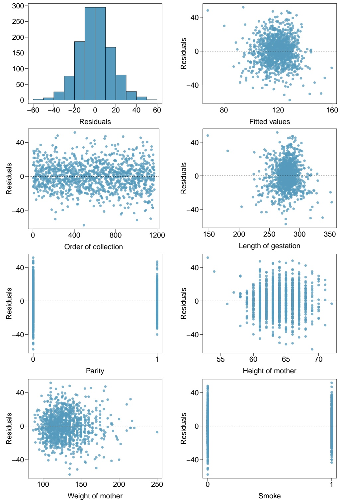
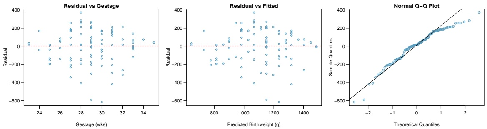
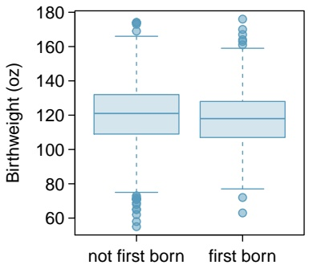
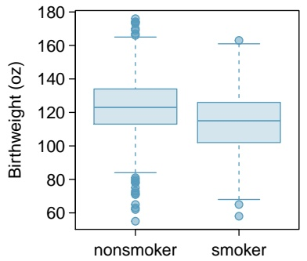
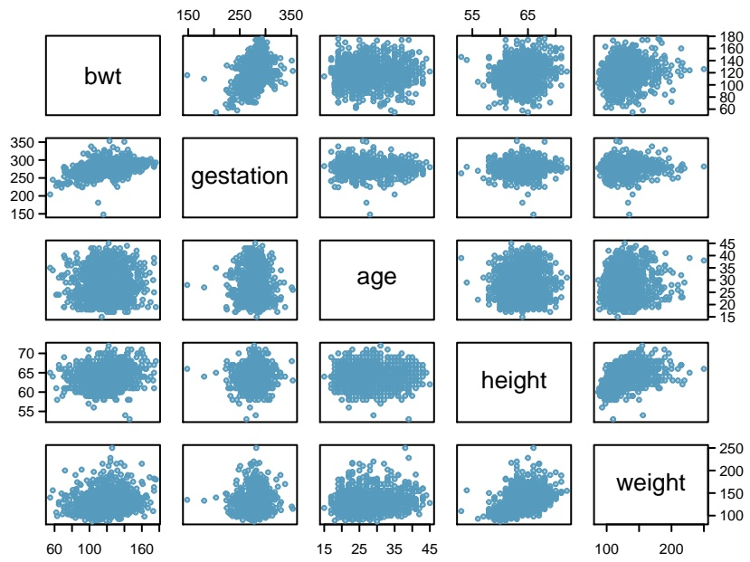
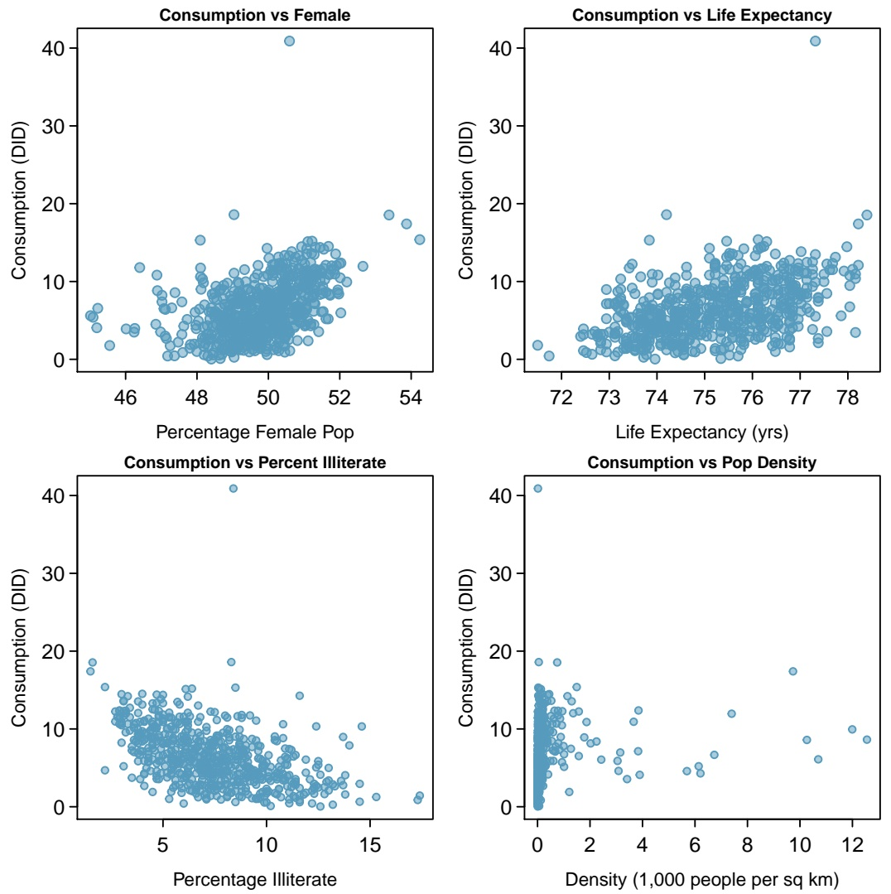

Why use ANOVA at all if fitting a linear regression model seems to provide more information? A case can be be made that the most important first step in analyzing the association between a response and a categorical variable is to compute and examine the F-statistic for evidence of any effect, and that only when the F-statistic is significant does it become appropriate to proceed to examine the nature of the differences. ANOVA displays the F-statistic prominently, emphasizing its importance. It is available in regression output, but may not always be easy to locate; the focus of regression is on the significance of the individual coefficients. ANOVA has traditionally been used in carefully designed experiments. There are complex versions of ANOVA that are appropriate for experiments in which several different factors are set at a range of levels. More complex versions of ANOVA are beyond the scope of this text and are covered in more advanced books.

Section 5.5 discussed the use of Bonferroni corrections when testing hypotheses about pairwise differences among the group means when conducting ANOVA. In principle, Bonferroni corrections can be applied in regression with categorical variables, but that is not often done. In designed experiments in which ANOVA has historically been used, the goal was typically to show definitively that a categorical predictor, often a treatment or intervention, was associated with a response variable so that the treatment could be adopted for clinical use. In experiments where the predictor can be manipulated by a scientist and cases are randomized to one of several levels of a predictor, the association can be interpreted as causal. It can be particularly important to control Type I error probabilities in those settings. Regression is often thought of as an exploratory technique, used in observational studies to discover associations that can be explored in further studies. Strict control of Type I error probabilities may be less critical in such settings.

At the introductory level, ANOVA is useful in that it provides more direct access to Type I error control and pairwise comparisons with t-tests. In practice, with the use of techniques not covered in this text, any analysis done via the ANOVA approach can also be approached with regression modeling.

## 7.10 Notes

This chapter and the previous chapter cover only the basic principles behind linear regression, and are meant to provide useful tools for getting started with data analysis. This section summarizes the most important ideas in the chapter and makes reference to some related topics that have not been discussed in detail.

## Important ideas

Keep a clear view of the purpose. Is the goal of constructing the model to understand the relationship between the response and a particular predictor after adjusting for confounders? Or is the goal to understand the joint association between a response and a set of predictors?

Avoid rushing into model fitting. Before fitting models, examine the data. Assess whether the response variable has an approximate normal distribution, or at least a symmetric distribution; a log transformation will often produce approximate normality. Examine the relationships between the response and predictors, as well as the relationships between predictors; check for nonlinear trends or outliers.

Remember the context of the problem. Context is important at each stage of a regression analysis. The best approach for constructing a model from a small number of potential predictors is based on considering the context of the problem and including predictors that have either been shown in the past to be associated with the response or for which there is a plausible working hypothesis about association with the response. When interpreting coefficients, consider whether the model results cohere with the underlying biological or medical context.

Critically examine residual plots. All models are approximations, so it is not necessary to be concerned about relatively minor violations of assumptions; residual plots are seldom as well behaved as those for the PREVEND data. In some cases, like with the California DDS data, residual plots show obvious major violations. With intermediate cases such as in the forest.birds plots, examine the plots closely and provide a detailed assessment of where the model seems less reliable.

## Related topics

Stepwise model selection. Many introductory texts recommend using “stepwise” regression. Forward stepwise regression adds predictors one by one according to a set criterion (usually by smallest p-value). Backward stepwise regression eliminates variables one by one from a larger model until a criterion is met. Stepwise methods can be useful, and are usually automated in statistical software. However, there are weaknesses—the final models are data-dependent and chance alone can lead to spurious variables being included. In very large datasets, stepwise regression can lead to substantially incorrect models.

Prediction models. An application of regression not discussed in this chapter is predictive modeling, in which the goal is to construct a model that best predicts outcomes. The focus is on overall predictive accuracy; significance of individual coefficients is less important. Evaluating a model’s predictive accuracy involves advanced methods such as cross-validation, in which the original data sample is divided into a training set and a test set, similar to the approach used with the Golub leukemia data in Chapter 1. Prediction models are typically built from large datasets, using automated model selection procedures like stepwise regression.

Prediction intervals. Predicted values from regression have an inherent uncertainty because model parameters are only estimates. There are two types of interval estimates used with prediction: confidence intervals for a predicted mean response from a set of values for the predictors, and prediction intervals that show the variability in the predicted value for a new response (i.e., for a case not in the dataset) given a set of values for the predictor variables. Prediction intervals are wider than confidence intervals for a predicted mean because prediction intervals are subject to both the variability in a predicted mean response and the variability of an individual observation about its mean.

Controlling Type I error in regression. Control of Type I error probabilities becomes more critical in regression models with very large numbers of potential predictors. Datasets containing measurements on genetic data often contain large numbers of potential predictors for a response for many cases; a stricter significance level is used to maintain an overall error rate of $\alpha = 0 . 0 5$ . For example, in genome-wide association studies, the accepted "genome-wide significance $\mathbf { r a t e } ^ { \mathsf { n } }$ for an individual marker to be considered significantly associated with an outcome is $5 \times 1 0 ^ { - 8 }$

Because there are so many tools available in multiple regression, this chapter has a larger collection of labs than most other chapters. Lab 1 introduces the multiple regression model, illustrating one its most common uses—estimating an association between a response variable and predictor of interest while adjusting for possible confounding. Lab 2 discusses the residual plots used to check assumptions for multiple regression and introduces adjusted $R ^ { 2 }$ using the California DDS dataset initially introduced in Chapter 1.

Lab 3 explores how the association between a response variable and categorical predictors with more than two levels can be be estimated using multiple regression. This topic extends the earlier material in Chapter 6, Lab 4. Lab 4 introduces the concept of a statistical interaction using the NHANES dataset, examining whether the association between BMI and age among women is different than that among men.

Multiple regression is often used to examine associations between response variables and a small set of pre-specified predictors. It can also be used to explore and select models between a response variable and a set of candidate predictors. Lab 5 discusses explanatory modeling, in which the goal is to construct a model that effectively explains the observed variation in the response variable.

# 7.11 Exercises

## 7.11.1 Introduction to multiple linear regression

There are not currently exercises available for this section.

## 7.11.2 Simple versus multiple regression

**7.1 PREVEND, Part I.** The summary table below shows the results of a multiple regression model of RFFT score versus statin use and age.

|  | Estimate | Std. Error | t value | Pr(>\|t\|) |
| --- | --- | --- | --- | --- |
| (Intercept) | 137.8822 | 5.1221 | 26.92 | 0.0000 |
| Statin | 0.8509 | 2.5957 | 0.33 | 0.7432 |
| Age | -1.2710 | 0.0943 | -13.48 | 0.0000 |

In a clinical setting, the interpretive focus lies on reporting the nature of the association between the primary predictor and the response, while specifying which potential confounders have been adjusted for. Briefly respond to a clinician who is concerned about a possible association between statin use and decreased cognitive function, based on the above analysis.

**7.2 PREVEND, Part II.** Can the results of the analysis in Exercise 7.1 be used to conclude that as one ages, one’s cognitive function (as measured by RFFT score) declines? Explain your answer.
**7.3 Baby weights, Part I.** The Child Health and Development Studies investigate a range of topics. One study considered all pregnancies between 1960 and 1967 among women in the Kaiser Foundation Health Plan in the San Francisco East Bay area. The variable smoke is coded 1 if the mother is a smoker, and 0 if not. The variable parity is 1 if the child is the first born, and 0 otherwise. The summary table below shows the results of a linear regression model for predicting the average birth weight of babies, measured in ounces, based on the smoking status of the mother and whether the child is the first born.23

|  | Estimate | Std. Error | t value | Pr(>\|t\|) |
| --- | --- | --- | --- | --- |
| (Intercept) | 123.57 | 0.72 | 172.75 | 0.0000 |
| smoke | -8.96 | 1.03 | -8.68 | 0.0000 |
| parity | -1.98 | 1.15 | -1.72 | 0.0859 |

(a) Write the equation of the regression model.
(b) Interpret the model slopes in the context of the data.
(c) Calculate the estimated difference in mean birth weight for two infants born to non-smoking mothers, if one is first born and the other is not.
(d) Calculate the estimated difference in mean birth weight for two infants born to mothers who are smokers, if one is first born and the other is not.
(e) Calculate the predicted mean birth weight for a first born baby born to a mother who is not a smoker.

<small>23Child Health and Development Studies, [Baby weights data set](http://www.ma.hw.ac.uk/~stan/aod/library).</small>

**7.4 Wolbachia, Part I.** Wolbachia is a microbial symbiont estimated to be hosted by about 40% of all arthro pod species, transmitted primarily from females to their offspring through the eggs. Researchers conducted a study on a wasp species to understand the effect of Wolbachia on the lifetime reproductive success of an insect host. They estimated the realized lifetime reproductive success of female wasps by collecting them soon after they die naturally in the field, counting the number of eggs remaining in their ovaries and quantifying Wolbachia density in their body.

In the first stage of the experiment, researchers estimated potential reproductive success by collecting female wasps as they emerged from eggs then dissecting them to count the number of eggs in their ovaries. These data were used to create a predictive model for initial number of eggs based on tibia length (an indicator of body size) and Wolbachia density. Tibia length was measured in µm, and Wolbachia density in units of -ddCt.

|  | Estimate | Std. Error | t value | Pr(>\|t\|) |
| --- | --- | --- | --- | --- |
| (Intercept) | -18.82 | 27.26 | -0.69 | 0.497 |
| wolbachia | 1.77 | 1.07 | -1.65 | 0.111 |
| tibia | 0.357 | 0.15 | 2.38 | 0.0258 |

(a) Write the model equation.
(b) Interpret the model coefficients in the context of the data.
(c) Predict mean initial egg count for a wasp with tibia length of 171.4286 µm and Wolbachia density of -3.435 -ddCt.

## 7.11.3 Evaluating the fit of a multiple regression model

**7.5 Baby weights, Part III.** We considered the variables smoke and parity, one at a time, in modeling birth weights of babies in Exercise 7.3. A more realistic approach to modeling infant weights is to consider all possibly related variables at once. Other variables of interest include length of pregnancy in days (gestation), mother’s age in years (age), mother’s height in inches (height), and mother’s pregnancy weight in pounds (weight). Below are three observations from this data set.

|  | bwt | gestation | parity | age | height | weight | smoke |
| --- | --- | --- | --- | --- | --- | --- | --- |
| 1 | 120 | 284 | 0 | 27 | 62 | 100 | 0 |
| 2 | 113 | 282 | 0 | 33 | 64 | 135 | 0 |
| $\vdots$ | $\vdots$ | $\vdots$ | $\vdots$ | $\vdots$ | $\vdots$ | $\vdots$ | $\vdots$ |
| 1236 | 117 | 297 | 0 | 38 | 65 | 129 | 0 |

The summary table below shows the results of a regression model for predicting the average birth weight of babies based on all of the variables included in the data set.

|  | Estimate | Std. Error | t value | Pr(>\|t\|) |
| --- | --- | --- | --- | --- |
| (Intercept) | -80.41 | 14.35 | -5.60 | 0.0000 |
| gestation | 0.44 | 0.03 | 15.26 | 0.0000 |
| parity | -3.33 | 1.13 | -2.95 | 0.0033 |
| age | -0.01 | 0.09 | -0.10 | 0.9170 |
| height | 1.15 | 0.21 | 5.63 | 0.0000 |
| weight | 0.05 | 0.03 | 1.99 | 0.0471 |
| smoke | -8.40 | 0.95 | -8.81 | 0.0000 |

(a) Write the equation of the regression model that includes all of the variables.
(b) Interpret the slopes of gestation and age in this context.
(c) The coefficient for parity is different than in the linear model shown in Exercise 7.3. Why might there be a difference?
(d) Calculate the residual for the first observation in the data set.
(e) The variance of the residuals is 249.28, and the variance of the birth weights of all babies in the data set is 332.57. Calculate the $R ^ { 2 }$ and the adjusted $R ^ { 2 }$ . Note that there are 1,236 observations in the data set.

**7.6 Absenteeism, Part I.** Researchers interested in the relationship between absenteeism from school and certain demographic characteristics of children collected data from 146 randomly sampled students in rural New South Wales, Australia, in a particular school year. Below are three observations from this data set.

|  | eth | sex | lrn | days |
| --- | --- | --- | --- | --- |
| 1 | 0 | 1 | 1 | 2 |
| 2 | 0 | 1 | 1 | 11 |
| $\vdots$ | $\vdots$ | $\vdots$ | $\vdots$ | $\vdots$ |
| 146 | 1 | 0 | 0 | 37 |

The summary table below shows the results of a linear regression model for predicting the average number of days absent based on ethnic background (eth: 0 - aboriginal, 1 - not aboriginal), sex (sex: 0 - female, 1 - male), and learner status (lrn: 0 - average learner, 1 - slow learner).24

|  | Estimate | Std. Error | t value | Pr(>\|t\|) |
| --- | --- | --- | --- | --- |
| (Intercept) | 18.93 | 2.57 | 7.37 | 0.0000 |
| eth | -9.11 | 2.60 | -3.51 | 0.0000 |
| sex | 3.10 | 2.64 | 1.18 | 0.2411 |
| lrn | 2.15 | 2.65 | 0.81 | 0.4177 |

(a) Write the equation of the regression model.
(b) Interpret each one of the slopes in this context.
(c) Calculate the residual for the first observation in the data set: a student who is aboriginal, male, a slow learner, and missed 2 days of school.
(d) The variance of the residuals is 240.57, and the variance of the number of absent days for all students in the data set is 264.17. Calculate the $R ^ { 2 }$ and the adjusted $R ^ { 2 }$ . Note that there are 146 observations in the data set.

**7.7 Baby weights, Part VI.** Exercise 7.5 presents a regression model for predicting the average birth weight of babies based on length of gestation, parity, height, weight, and smoking status of the mother. Use the following plots to assess whether the assumptions for linear regression are reasonably met. Discuss your reasoning.

**7.8 Toxemia and birth weight.** A model was fit for a random sample of 100 low birth weight infants born in two teaching hospitals in Boston, Massachusetts, regressing birthweight on the predictors gestational age and toxemia status. The condition toxemia, also known as preeclampsia, is characterized by high blood pressure and protein in urine by the $2 0 ^ { t h }$ week of pregnancy; left untreated, toxemia can be life-threatening. Birth weight was measured in grams and gestational age measured in weeks.

|  | Estimate | Std. Error | t value | Pr(>\|t\|) |
| --- | --- | --- | --- | --- |
| (Intercept) | -1286.200 | 234.918 | -5.475 | 0.0000 |
| toxemiaYes | -206.591 | 51.078 | -4.045 | 0.0001 |
| gestage | 84.048 | 8.251 | 10.188 | 0.0000 |

(a) Write the model equation.
(b) Interpret the coefficients of the model, and comment on whether the intercept has a meaningful interpretation.
(c) Predict the average birth weight for an infant born to a mother diagnosed with toxemia with gestational age 31 weeks.
(d) Evaluate whether the assumptions for linear regression are reasonably satisfied.
(e) A simple regression model with only toxemia status as a predictor had $R ^ { 2 } = 0 . 0 0 0 1$ and $R _ { a d j } ^ { 2 } = 0 . 0 1 0 ;$ in this model, the slope estimate for toxemia status is 7.785, with $p = 0 . 9 0 7$ . The simple regression model and multiple regression model disagree regarding the nature of the association between birth weight and toxemia. Briefly explain a potential reason behind the discrepancy. Which model do you prefer for understanding the relationship between birth weight and toxemia, and why?

**7.9 Multiple regression fact checking.** Determine which of the following statements are true and false. For each statement that is false, explain why it is false.

(a) Suppose a numerical variable x has a coefficient of $b _ { 1 } = 2 . 5$ in the multiple regression model. Suppose also that the first observation has $x _ { 1 }   =   7 . 2 ,$ , the second observation has a value of $x _ { 1 }   =   8 . 2$ , and these two observations have the same values for all other predictors. Then the predicted value of the second observation will be 2.5 higher than the prediction of the first observation based on the multiple regression model.
(b) If a regression model’s first variable has a coefficient of $b _ { 1 } = 5 . 7 ,$ , then if we are able to influence the data so that an observation will have its $x _ { 1 }$ be 1 larger than it would otherwise, the value $y _ { 1 }$ for this observation would increase by 5.7.
(c) Suppose we fit a multiple regression model based on a data set of 472 observations. We also notice that the distribution of the residuals includes some skew but does not include any particularly extreme outliers. Because the residuals are not nearly normal, we should not use this model and require more advanced methods to model these data.

## 7.11.4 The general multiple linear regression model

**7.10 Cherry trees.** Timber yield is approximately equal to the volume of a tree, however, this value is difficult to measure without first cutting the tree down. Instead, other variables, such as height and diameter, may be used to predict a tree’s volume and yield. Researchers wanting to understand the relationship between these variables for black cherry trees collected data from 31 such trees in the Allegheny National Forest, Pennsylvania. Height is measured in feet, diameter in inches (at 54 inches above ground), and volume in cubic feet.25

|  | Estimate | Std. Error | t value | Pr(>\|t\|) |
| --- | --- | --- | --- | --- |
| (Intercept) | -57.99 | 8.64 | -6.71 | 0.00 |
| height | 0.34 | 0.13 | 2.61 | 0.01 |
| diameter | 4.71 | 0.26 | 17.82 | 0.00 |

(a) Calculate a 95% confidence interval for the coefficient of height, and interpret it in the context of the data.
(b) One tree in this sample is 79 feet tall, has a diameter of 11.3 inches, and is 24.2 cubic feet in volume. Determine if the model overestimates or underestimates the volume of this tree, and by how much.

**7.11 GPA.** A survey of 55 Duke University students asked about their GPA, number of hours they study at night, number of nights they go out, and their gender. Summary output of the regression model is shown below. Note that male is coded as 1.

|  | Estimate | Std. Error | t value | Pr(>\|t\|) |
| --- | --- | --- | --- | --- |
| (Intercept) | 3.45 | 0.35 | 9.85 | 0.00 |
| studyweek | 0.00 | 0.00 | 0.27 | 0.79 |
| sleepnight | 0.01 | 0.05 | 0.11 | 0.91 |
| outnight | 0.05 | 0.05 | 1.01 | 0.32 |
| gender | -0.08 | 0.12 | -0.68 | 0.50 |

(a) Calculate a 95% confidence interval for the coefficient of gender in the model, and interpret it in the context of the data.
(b) Would you expect a 95% confidence interval for the slope of the remaining variables to include 0? Explain

**7.12 Trait inheritance of high blood pressure.** One research question of public health interest is to determine the extent to which high blood pressure is a genetic phenomenon. In 20 families, the systolic blood pressure of the mother, father, and first-born child in the family were measured (in units of mm Hg). A multi-ple linear regression model using $Y = \mathrm{c h i l d}' \mathrm{s}$ blood pressure, $X_{1} = \mathrm{mother's}$ blood pressure, and $X _ { 2 } = \mathrm { f a t h e r ^ { \prime } s }$ blood pressure led to the following estimate of a least squares line: $E ( Y ) = - 1 5 . 6 9 + 0 . 4 1 5 X _ { 1 } + 0 . 4 2 3 X _ { 2 }$ . The standard errors associated with $b _ { 0 } , b _ { 1 }$ , and $b _ { 2 } ,$ respectively, are 23.65, 0.125, and 0.119. The least squares fit produced $R ^ { 2 } = 0 . 5 9 7$ and $M S E = 1 1 3 . 8$

(a) What proportion of the variability of a child’s systolic blood pressure is explained by this model?
(b) Does the least squares line indicate statistically significant associations between each of the parent’s systolic blood pressures and that of the child? Explain your answer.
(c) What is the predicted systolic blood pressure for a child whose mother’s and father’s systolic blood pressure is 125 mm Hg and 140 mm Hg, respectively?
(d) A colleague tells you that something must be wrong with your model because your fitted intercept is negative, but blood pressures are never negative. How do you respond?
(e) Briefly describe three different plots for assessing the appropriateness or fit of the above regression model.

<small>25D.J. Hand. A handbook of small data sets. Chapman & Hall/CRC, 1994.</small>

**7.13 Wolbachia, Part II.** Exercise 7.4 introduced a study about Wolbachia and reproductive success in a wasp host. The following table shows the model coefficients for a model predicting the number of eggs laid over a lifetime from the predictor variables wolbachia density and tibia length. A higher number of eggs laid over a lifetime is indicative of greater reproductive success. The model has $R ^ { 2 } = 0 . 3 1 4$ and degrees of freedom 34. The F-statistic is 7.782, with p-value 0.0016.

|  | Estimate | Std. Error | t value | Pr(>\|t\|) |
| --- | --- | --- | --- | --- |
| (Intercept) | -17.88 | 28.63 | -0.62 | 0.537 |
| wolbachia | 4.28 | 1.25 | 3.42 | 0.002 |
| tibia | 0.272 | 0.16 | 1.69 | 0.010 |

(a) Write the model equation.
(b) Interpret the slope coefficient of wolbachia.
(c) Assess the evidence for whether Wolbachia is beneficial for its host in nature, based on these data.
(d) Compute and interpret a 95% confidence interval for the population slope of wolbachia.
(e) Interpret the significance of the F-statistic.

**7.14 Difficult encounters, Part I.** A study was conducted at a university outpatient primary care clinic in Switzerland to identify factors associated with difficult doctor-patient encounters. The data consist of 527 patient encounters, conducted by the 27 medical residents employed at the clinic. After each encounter, the attending physician completed two questionnaires: the Difficult Doctor Patient Relationship Questionnaire (DDPRQ-10) and the patient’s vulnerability grid (PVG).

A higher score on the DDPRQ-10 indicates a more difficult encounter. The maximum possible score is 60 and encounters with score 30 and higher are considered difficult.

A model was fit for the association of DDPRQ-10 score with features of the attending physician: age, sex, and years of training. The model has F-statistic of 0.23 on 3 and 286 degrees of freedom, with p-value 0.876.

|  | Estimate | Std. Error | t value | Pr(>\|t\|) |
| --- | --- | --- | --- | --- |
| (Intercept) | 30.594 | 2.886 | 10.601 | 0.0000 |
| age | -0.016 | 0.104 | -0.157 | 0.876 |
| sexM | -0.535 | 0.781 | -0.686 | 0.494 |
| yrs.train | 0.096 | 0.215 | 0.445 | 0.656 |

(a) As a group, are these physician features useful for predicting DDPRQ-10 score?
(b) Is there evidence of a significant association between DDPRQ-10 score and any of the physician features?

## 7.11.5 Categorical predictors with several levels

## 7.15 Prison isolation experiment, Part III.

Exercises 5.35 and 5.47 introduced an experiment conducted with the goal of identifying a treatment that reduces subjects’ psychopathic deviant T scores on the MMPI test. Exercise 5.35 evaluated the success of each individual treatment, and in exercise 5.47, ANOVA was used to compare the success of the three treatments. This exercise uses multiple regression to examine the intervention effect.

For this problem, a treatment variable (labeled treatment) has been constructed with three levels:

(1) Therapeutic for sensory restriction plus the 15 minute "therapeutic" tape advising that professional help is available.
(2) Neutral for sensory restriction plus a 15 minute "emotionally neutral" tap on training hunting dogs.
(3) Absent for sensory restriction but no taped message.

Forty-two subjects were randomly assigned to these treatment groups, and an MMPI test was administered before and after the treatment. Investigators hoped that the interventions would lower MMPI scores. The table below shows the result of a multiple regression in R where the response variable trt.effect is the change in MMPI score (pre-intervention - post-intervention) and the predictor variable is treatment.

|  | Estimate | Std. Error | t value | Pr(>\|t\|) |
| --- | --- | --- | --- | --- |
| (Intercept) | -3.2143 | 2.6174 | -1.23 | 0.2268 |
| treatmentNeutral | 6.0714 | 3.7015 | 1.64 | 0.1090 |
| treatmentTherapeutic | 9.4286 | 3.7015 | 2.55 | 0.0149 |

In this model, the residual standard error is 9.79, the F-statistic is 3.33 with 2 and 39 degrees of freedom; $P ( F _ { 2 , 3 9 } > 3 . 3 3 ) = 0 . 0 4 6 1$

(a) Interpret the meaning of a positive value for trt.effect versus a negative value.
(b) Write the estimated model equation.
(c) Calculate the predicted value for trt.effect for a patient in the neutral tape group.
(d) Does the intercept have a meaningful interpretation in this model?
(e) What is the interpretation of the two slope coefficients in the regression model?
(f) Describe the tested hypotheses that correspond to each of the p-values in the last column of the table.

**7.16 Poverty and educational level.** This question uses data from 500 randomly selected adults in the larger NHANES dataset. Poverty is measured as a ratio of family income to poverty guidelines. Smaller numbers indicate more poverty, and ratios of 5 or larger were recorded as 5. The Education variable indicates the highest level of education achieved: either 8th grade, 9 - 11th grade, high school, some college, or college grad.

|  | Estimate | Std. Error | t value | Pr(>\|t\|) |
| --- | --- | --- | --- | --- |
| (Intercept) | 1.4555 | 0.2703 | 5.38 | 0.0000 |
| Education9 - 11th Grade | 0.9931 | 0.3302 | 3.01 | 0.0028 |
| EducationHigh School | 1.0900 | 0.3113 | 3.50 | 0.0005 |
| EducationSome College | 1.4943 | 0.2976 | 5.02 | 0.0000 |
| EducationCollege Grad | 2.4948 | 0.2958 | 8.43 | 0.0000 |

In this model, the residual standard error is 1.46, the F-statistic is 28.09 with 4 and 456 degrees of freedom; $P ( F _ { 4 , 4 5 6 } > 2 8 . 0 9 ) < 0 . 0 0 0 1$

(a) Write the estimated model equation.
(b) Calculate the predicted poverty ratio for an individual who at most completed high school.
(c) Interpret the estimated intercept value.
(d) Interpret the slope coefficient for EducationCollege Grad, and describe the tested hypotheses that correspond to the p-value for this slope coefficient.
(e) Assess whether educational level, overall, is associated with poverty. Be sure to include any relevant numerical evidence as part of your answer.

**7.17 Prison isolation experiment, Part IV.** Exercise 7.15 used regression to examine the effect of three interventions on prisoner MMPI scores. The response variable in the regression was trt.effect, the change in MMPI score (pre-intervention - post-intervention).

Instead of estimating the intervention effect through the change in scores, suppose one is interested in predicting a post-intervention score based on the pre-intervention score for an individual and a particular intervention.

(a) The table below shows an alternative regression model that can be fit to the data. In this model, the response variable is the post-intervention MMPI value (post, not shown explicitly in the table) and the predictors are the pre-intervention score (pre) and the treatment, coded as in problem 7.15.

Write the estimated equation for this model.

|  | Estimate | Std. Error | t value | Pr(>\|t\|) |
| --- | --- | --- | --- | --- |
| (Intercept) | 28.4053 | 12.2949 | 2.31 | 0.0264 |
| pre | 0.6593 | 0.1628 | 4.05 | 0.0002 |
| treatmentNeutral | -5.7307 | 3.5545 | -1.61 | 0.1152 |
| treatmentTherapeutic | -9.7450 | 3.5540 | -2.74 | 0.0093 |

(b) In this model, describe in general terms the association of the pre-intervention and post-intervention scores.
(c) Does the pre-intervention score appear to be an important predictor of a post intervention score?
(d) What is the predicted post-intervention score for an individual with a pre-intervention score of 73 and receiving no tape after the isolation?
(e) Explain the interpretation of the coefficients for coefficient of treatmentNeutral. Is there strong statistical evidence that it is an important predictor?

**7.18 Resilience, Part I.** The American Psychological Association defines resilience as "the process of adapting well in the face of adversity, trauma, tragedy, threats, or even significant sources of stress". Studies have suggested that resilience is an important factor in contributing to how medical students perceive their qualit of life and educational environment.

Survey data were collected from 1,350 students across 25 medical schools. At each school, 54 students were randomly selected to participate in the study. Participants completed questionnaires measuring resilience, quality of life, perception of educational environment, depression symptoms, and anxiety symptoms.

The following regression model was fit to analyze the relationship between resilience and depressive symptoms. Resilience was categorized as: very low, low, moderately low, moderately high, high, and very high. Depressive symptoms were measured on a scale of 0 to 63 points, with higher scores indicating either more numerous or more severe depressive symptoms; this questionnaire is called the Beck Depression Inventory (BDI).

In this model, the residual standard error is 5.867, the F-statistic is 118.1 with 5 and 1344 degrees of freedom; $P ( F _ { 5 , 1 3 4 4 }   >   1 1 8 . 1 )   <   0 . 0 0 0 1$

|  | Estimate | Std. Error | t value | Pr(>\|t\|) |
| --- | --- | --- | --- | --- |
| (Intercept) | 4.9754 | 0.4118 | 12.08 | 0.0000 |
| resHigh | 2.2936 | 0.4987 | 4.60 | 0.0000 |
| resModHigh | 4.3005 | 0.5181 | 8.30 | 0.0000 |
| resModLow | 6.7108 | 0.5938 | 11.30 | 0.0000 |
| resLow | 9.6538 | 0.7458 | 12.94 | 0.0000 |
| resVeryLow | 15.6453 | 0.7518 | 20.81 | 0.0000 |

(a) Describe the overall trend in language accessible to someone who has not taken a statistics course.
(b) Does the intercept have a meaningful interpretation? Explain your answer.
(c) Compare the predicted mean BDI score for someone with low resilience to that of someone with very low resilience.
(d) + (e) **Continue to the next page for parts (d) and (e).**

(d) Assess whether level of resilience, overall, is associated with depressive symptoms as measured by BDI score. Be sure to include any relevant numerical evidence as part of your answer.
(e) A model was fitted predicting BDI score from resilience, with the categories numerically coded from 1 to 6, with 1 being very high resilience and 6 being very low resilience. This model has a single slope estimate of 2.76 with p-value < 0.0001.

i. Using this model, compare the predicted mean BDI score for someone with low resilience to that of someone with very low resilience. Compare this answer to the one from part (c).
ii. What does this model imply about the change in mean BDI score between groups?
iii. Explain why this model is flawed.

## 7.11.6 Reanalyzing the PREVEND data

There are not currently exercises available for this section.

## 7.11.7 Interaction in regression

**7.19 Prison isolation experiment, Part V.** Exercise 7.17 used regression to predict a post-intervention score based on pre-intervention score and a particular intervention.

The following table shows a model incorporating interaction between pre-intervention score and intervention.

|  | Estimate | Std. Error | t value | Pr(>\|t\|) |
| --- | --- | --- | --- | --- |
| (Intercept) | -17.5790 | 17.7090 | -0.99 | 0.3275 |
| pre | 1.2813 | 0.2376 | 5.39 | 0.0000 |
| treatmentNeutral | 67.7518 | 30.6168 | 2.21 | 0.0333 |
| treatmentTherapeutic | 64.4183 | 24.2124 | 2.66 | 0.0116 |
| pre:treatmentNeutral | -0.9890 | 0.4082 | -2.42 | 0.0206 |
| pre:treatmentTherapeutic | -1.0080 | 0.3266 | -3.09 | 0.0039 |

(a) Write the model equation.
(b) Interpret the model coefficients.
(c) Write a separate model equation for each intervention group.
(d) Do these data suggest that there is a statistically significant difference in association between pre- and post-intervention scores by treatment group? Explain your answer.

**7.20 Vitamin D.** A study was conducted to evaluate Vitamin D status among schoolchildren in Thailand. Exposure to sunlight allows the body to produce serum 25(OH)D, which is a marker of Vitamin D status; serum level is measured in units of nmol/L and having serum level below 50 nmol/L is indicative of Vitamin D deficiency. The following model was fit to predict serum 25(OH)D level from age, sex, and their interaction.

|  | Estimate | Std. Error | t value | Pr(>\|t\|) |
| --- | --- | --- | --- | --- |
| (Intercept) | 97.7709 | 4.7732 | 20.48 | 0.0000 |
| age | -3.0156 | 0.4774 | -6.32 | 0.0000 |
| sexM | -16.2848 | 7.0740 | -2.30 | 0.0217 |
| age:sexM | 2.9369 | 0.7054 | 4.16 | 0.0000 |

(a) Write the model equation.
(b) Interpret the model coefficients.
(c) Is there statistically significant evidence that the association between serum 25(OH)D level and age differs by sex? Explain your answer.

**7.21 PREVEND, Part III.** Exercise 7.1 showed a multiple regression model predicting RFFT score from statin use and age. For this problem, an interaction term is added between statin use and age.

|  | Estimate | Std. Error | t value | Pr(>\|t\|) |
| --- | --- | --- | --- | --- |
| (Intercept) | 140.2031 | 5.6209 | 24.94 | 0.0000 |
| Statin | -13.9720 | 15.0113 | -0.93 | 0.3524 |
| Age | -1.3149 | 0.1040 | -12.65 | 0.0000 |
| Statin:Age | 0.2474 | 0.2468 | 1.00 | 0.3166 |

(a) Write the model equation.
(b) Interpret the model coefficients.
(c) Is there statistically significant evidence that the association between RFFT score and age differs by whether someone is a statin user? Explain your answer.

**7.22 Antibiotic consumption, Part I.** Antibiotic resistance represents a major public health challenge. Overuse of antibiotics in clinical settings is thought to be a major contributor to increased antibiotic resis tance. A study was conducted across several regions in China to investigate the impact of a 2011 law prohibiting over-the-counter (OTC) sales of antibiotics in private pharmacies. The study team collected data on average monthly antibiotic consumption in 621 counties, in addition to information on socioeconomic determinants such as percentage of population illiterate.

The following model was fit to investigate whether the relationship between monthly antibiotic consumption and percentage of population (over 25 years of age) with an advanced degree differs between counties that are located in a metropolitan area and those that are not.

|  | Estimate | Std. Error | t value | Pr(>\|t\|) |
| --- | --- | --- | --- | --- |
| (Intercept) | 0.8482 | 0.3311 | 2.56 | 0.0107 |
| metroYes | 2.3035 | 0.9612 | 2.40 | 0.0169 |
| edu | 0.5711 | 0.0319 | 17.90 | 0.0000 |
| metroYes:edu | -0.1838 | 0.0752 | -2.44 | 0.0148 |

(a) Interpret the model coefficients, including any relevant inferential results.
(b) Make a prediction of average monthly antibiotic consumption for a county in a metropolitan area where 10% of the population over 25 years old has an advanced degree.

## 7.11.8 Model selection for explanatory variables

**7.23 Baby weights, Part VII.** Suppose the starting point for model selection for the birth weight data were the full model, with all variables. The table below shows the adjusted $R ^ { 2 }$ for the full model as well as the adjusted $R ^ { 2 }$ values for all models with one fewer predictor variable. Based on examining the table from Exercise 7.5 and the following table, identify which variable, if any, should be removed from the model first. Explain your answer.

|  | Model | Adjusted $R^{2}$ |
| --- | --- | --- |
| 1 | Full model | 0.2541 |
| 2 | No gestation | 0.1031 |
| 3 | No parity | 0.2492 |
| 4 | No age | 0.2547 |
| 5 | No height | 0.2311 |
| 6 | No weight | 0.2536 |
| 7 | No smoking status | 0.2072 |

**7.24 Absenteeism, Part II.** Suppose the starting point for model selection for the absenteeism data were the full model, with all variables. The table below shows the adjusted $R ^ { 2 }$ for the full model as well as the adjusted $R ^ { 2 }$ values for all models with one fewer predictor variable. Based on examining the table from Exercise 7.6 and the following table, identify which variable, if any, should be removed from the model first. Explain your answer.

|  | Model | Adjusted $R^{2}$ |
| --- | --- | --- |
| 1 | Full model | 0.0701 |
| 2 | No ethnicity | -0.0033 |
| 3 | No sex | 0.0676 |
| 4 | No learner status | 0.0723 |

**7.25 Baby weights, Part VIII.** Exercise 7.5 shows a regression model for predicting the average birth weight of babies based on all variables included in the dataset: length of pregnancy in days (gestation), mother’s age in years (age), mother’s height in inches (height), and mother’s pregnancy weight in pounds (weight).

The following plots show the relationships between the response and the numerical predictor variables, in addition to the relationships between the response and two categorical predictor variables.

boxplot

| Category | Q1 | Q2 (Median) | Q3 | IQR |
| --- | --- | --- | --- | --- |
| not first born | ~110 | ~121 | ~132 | ~22 |
| first born | ~107 | ~118 | ~128 | ~21 |

Birth Order

boxplot

| Category | Q1 | Q2 (Median) | Q3 | IQR |
| --- | --- | --- | --- | --- |
| nonsmoker | ~113 | ~123 | ~134 | ~21 |
| smoker | ~102 | ~115 | ~126 | ~24 |

Mother Smoking Status

(a) Examine the relationship between the response variable and the predictor variables. Describe what you see. Which predictor variables seem like they would be useful to include in an initial model?
(b) Identify any predictors that seem related to each other.

**7.26 Antibiotic consumption, Part II.** Exercise 7.22 introduced a study conducted about antibiotic consumption in China. One aim of the study was to develop a prediction model for predicting monthly average antibiotic consumption based on county-level data. The following plots show the association between monthly average antibiotic consumption and four potential predictor variables: proportion female inhabitants (female), average life expectancy in years (lifeexp), proportion of population illiterate (illiterate), and population density in 1,000 people $/ \; k m ^ { 2 }$ (popdensity).

(a) Summarize what you see.

(b) Identify any predictor variables that might benefit from a natural log transformation and briefly justify your choices.