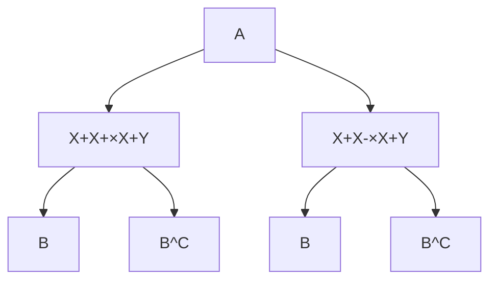

## 8.7.5 Outcome-based sampling: case-control studies

**8.41 CVD and Diabetes.** An investigator asked for the records of patients diagnosed with diabetes in his practice, then sampled 20 patients with cardiovascular disease (CVD) and 80 patients without CVD. For the sampled patients, he then recorded whether or not the age of onset of diabetes was at age 50 or younger. Of the 40 patients whose age of onset of diabetes was 50 years of age or earlier, 15 had cardiovascular disease. In the remaining 60 patients, 5 had cardiovascular disease.

(a) Write the contingency table that summarizes the result of this study.
(b) What is the relative odds of cardiovascular disease, comparing the older patients to those less than 50 years old at onset of diabetes?
(c) Interpret the relative odds of cardiovascular disease and comment on whether the relative odds cohere with what you might expect.
(d) In statistical terms, state the null hypothesis of no association between the presence of cardiovascular disease and age of onset of diabetes.
(e) What test can be used to test the null hypothesis? Are the assumptions for the test reasonably satisfied?
(f) The value of the chi-square test statistic for this table is 11. Identify the logical flaw in the following statement: "In this retrospective study of cardiovascular disease and diabetes, our study has demonstrated statistically significant evidence that diabetes increases the risk of cardiovascular disease."

**8.42 Blood thinners.** Cardiopulmonary resuscitation (CPR) is a procedure commonly used on individuals suffering a heart attack when other emergency resources are not available. This procedure is helpful in maintaining some blood circulation, but the chest compressions involved can also cause internal injuries. Internal bleeding and other injuries complicate additional treatment efforts following arrival at a hospital. For instance, while blood thinners may be used to help release a clot that is causing a heart attack, the blood thinner would have negative repercussions on any internal injuries.

This problem uses data from a study in which patients who underwent CPR for a heart attack and were subsequently admitted to a hospital. These patients were randomly divided into a treatment group where they received a blood thinner or the control group where they did not receive the blood thinner. The outcome variable of interest was whether the patients survived for at least 24 hours.

The study results are shown in the table below:

|  | Treatment | Control | Total |
| --- | --- | --- | --- |
| Survived | 14 | 11 | 25 |
| Died | 26 | 39 | 65 |
| Total | 40 | 50 | 90 |

(a) For this table, calculate the odds ratio for survival, comparing treatment to control, and the relative risk of survival, comparing treatment to control.
(b) What is the interpretation of each of these two statistics?
(c) In this study, which of the two summary statistics in part (a) is the better description of the treatment effect? Why?

**8.43 CNS disorder.** Suppose an investigator has studied the possible association between the use of a weight loss drug and a rare central nervous system (CNS) disorder. He samples from a group of volunteers with and without the disorder, and records whether they have used the weight loss drug. The data are summarized in the following table:

<table><tr><td></td><td colspan="2">Drug Use</td></tr><tr><td>CNS disorder</td><td>Yes</td><td>No</td></tr><tr><td>Yes</td><td>10</td><td>2000</td></tr><tr><td>No</td><td>7</td><td>4000</td></tr></table>

(a) Can these data be used to estimate the probability of a CNS disorder for someone taking the weight loss drug?
(b) For this study, what is an appropriate measure of association between the weight-loss drug and the presence of CNS disorder?
(c) Calculate the measure of association specified in part (b).
(d) Interpret the calculation from part (c).
(e) What test of significance is the best choice for analyzing the hypothesis of no association for these data?

**8.44 Asthma risk.** Asthma is a chronic lung disease characterized as hypersensitivity to a variety of stimuli, such as tobacco smoke, mold, and pollen. The prevalence of asthma has been increasing in recent decades, especially in children. Some studies suggest that children who either live in a farm environment or have pets become less likely to develop asthma later in life, due to early exposure to elevated amounts of microorganisms. A large study was conducted in Norway to investigate the association between early exposure to animals and subsequent risk for asthma.

Using data from national registers, researchers identified 11,585 children known to have asthma at age 6 years out of the 276,281 children born in Norway between January 1, 2006 and December 31, 2009. Children whose parents were registered as "animal producers and related workers" during the child’s first year of life were defined as being exposed to farm animals. Of the 958 children exposed to farm animals, 19 had an asthma diagnosis at age 6.

(a) Do these data support previous findings that living in a farm environment is associated with lower risk of childhood asthma? Conduct a formal analysis and summarize your findings. Be sure to check any necessary assumptions.
(b) Is the relative risk an appropriate measure of association for these data? Briefly explain your answer.
(c) In language accessible to someone who has not taken a statistics course, explain whether these results represent evidence that exposure to farm animals reduces the risk of developing asthma. Limit your answer to no more than seven sentences.

**8.45 Tea consumption and carcinoma.** In a study examining the association between green tea consump tion and esophageal carcinoma, researchers recruited 300 patients with carcinoma and 571 without carcinoma and administered a questionnaire about tea drinking habits. Out of the 47 individuals who reported that they regularly drink green tea, 17 had carcinoma. Out of the 824 individuals who reported they never drink green tea, 283 had carcinoma.

(a) Analyze the data to assess evidence for an association between green tea consumption and esophageal carcinoma from these data. Summarize your results.
(b) Report and interpret an appropriate measure of association.

# Appendix A

# End of chapter exercise solutions

## 1 Introduction to data

**1.1** (a) Treatment: 10/43 = 0.23 → 23%.

(b) Control: $2/46 = 0.04 \rightarrow 4\%.$ . (c) A higher percentage of patients in the treatment group were pain free 24 hours after receiving acupuncture. (d) It is possible that the observed difference between the two group percentages is due to chance.

**1.3** (a) “Is there an association between air pollution exposure and preterm births?" (b) 143,196 births in Southern California between 1989 and 1993. (c) Measurements of carbon monoxide, nitrogen dioxide, ozone, and particulate matter less than $1 0 \mu g / m ^ { 3 } \left( \mathrm { P M } _ { 1 0 } \right)$ collected at air-quality-monitoring stations as well as length of gestation. Continuous numerical variables.

**1.5** (a) “Does explicitly telling children not to cheat affect their likelihood to cheat?". (b) 160 children between the ages of 5 and 15. (c) Four variables: (1) age (numerical, continuous), (2) sex (categorical), (3) whether they were an only child or not (categorical), (4) whether they cheated or not (categorical).

**1.7** (a) Control: the group of 16 female birds that received no treatment. Treatment: the group of 16 female birds that were given supplementary diets.

(b) "Does egg coloration indicate the health of female collared flycatchers?"

(c) Darkness of blue color in female birds’ eggs. Continuous numerical variable.

**1.9** (a) Each row represents a participant.

(b) The response variable is colon cancer stage. The explanatory variables are the abundance levels of the five bacterial species.

(c) Colon cancer stage: ordinal categorical variable. Abundance levels of bacterial species: continuous numerical variable.

**1.11** (a) The population of interest consists of babies born in Southern California. The sample consists of the 143,196 babies born between 1989 and 1993 in Southern California.

(b) Assuming that the sample is representative of the population of interest, the results of the study can be generalized to the population. The findings cannot be used to establish causal relationships because the study was an observational study, not an experiment.

**1.13** (a) The population of interest consists of asthma patients who rely on medication for asthma treatment. The sample consists of the 600 asthma patients ages 18-69 who participated in the study.

(b) The sample may not be representative of the population because study participants were recruited, an example of a convenience sample. Thus, the results of the study may not be generalizable to the population. The findings can be used to establish causal relationships because the study is an experiment conducted with control, randomization, and a reasonably large sample size.

## 1.15 (a) Experiment.

(b) The experimental group consists of the chicks that received vitamin supplements. The control group consists of the chicks that did not receive vitamin supplements.
(c) Randomization ensures that there are not systematic differences between the control and treatment groups. Even if chicks may vary in ways that affect body mass and corticosterone levels, random allocation essentially evens out such differences, on average, between the two groups. This is essential for a causal interpretation of the results to be valid.

## 1.17 (a) Observational study.

(b) Answers may vary. One possible confounding variable is the wealth of a country. A wealthy country’s citizens tend to have a higher life expectancy due to a higher quality of life, and the country tends to have a higher percentage of internet users because there is enough money for the required infrastructure and citizens can afford computers. Wealth of a country is associated with both estimated life expectancy and percentage of internet users. Omitting the confounder from the analysis distorts the relationship between the two variables, such that there may seem to be a direct relationship when there is not.

**1.19** (a) Simple random sampling is reasonable if 500 students is a large enough sample size relative to the total student population of the university.
(b) Since student habits may vary by field of study, stratifying by field of study would be a reasonable decision.
(c) Students in the same class year may have more similar habits. Since clusters should be diverse with respect to the outcome of interest, this would not be a good approach.

**1.21** (a) Non-responders may have a different response to this question, e.g. parents who returned the surveys likely don’t have difficulty spending time with their children.

(b) It is unlikely that the women who were reached at the same address 3 years later are a random sample. These missing responders are probably renters (as opposed to homeowners) which means that they might be in a lower socio-economic class than the respondents.
(c) This is an observational study, not an experiment, so it is not advisable to draw conclusions about causal relationships. The relationship may be in the other direction; i.e., that these people go running precisely be cause they do not have joint problems. Additionally, the data are not even sufficient to provide evidence of an association between running and joint problems because data have only been collected from individuals who go running regularly. Instead, a sample of individuals should be collected that includes both people who do and do not regularly go running; the number of individuals in each group with joint problems can then be compared for evidence of an association.

**1.23** The lead author’s statements are not accurate because he or she drew conclusions about causation (that increased alcohol sales taxes lower rates of sexually transmitted infections) from an observational study. In addition, although the study observed that there was a decline in gonorrhea rate, the lead author generalized the observation to all sexually transmitted infections.

**1.25** (a) Randomized controlled experiment. (b) Explanatory: treatment group (categorical, with 3 levels). Response variable: Psychological well-being. (c) No, because the participants were volunteers. (d) Yes, because it was an experiment. (e) The statement should say “evidence” instead of “proof”.

**1.27** (a) The two distributions have the same median since they have the same middle number when ordered from least to greatest. Distribution 2 has a higher IQR because its first and third quartiles are farther apart than in Distribution 2.

(b) Distribution 2 has a higher median since it has a higher middle number when ordered from least to greatest. Distribution 2 has a higher IQR because its first and third quartiles are farther apart than in Distribution 1.
(c) Distribution 2 has a higher median since all values in this distribution are higher than in Distribution 1. The two distributions have the same IQR since the distance between the first and third quartiles in each dis tribution is the same.
(d) Distribution 2 has a higher median since most values in this distribution are higher than those in Distribution 1. Distribution 2 has a higher IQR because its first and third quartiles are farther apart than those of Distribution 1.

**1.29** (a) The distribution is bimodal, with peaks between 15-20 and 25-30. Values range from 0 to 65.

(b) The median AQI is about 30.

(c) I would expect the mean to be higher than the median, since there is some right skewing.

**1.31** (a) The median is a much better measure of the typical amount earned by these 42 people. The mean is much higher than the income of 40 of the 42 people. This is because the mean is an arithmetic average and gets affected by the two extreme observations. The median does not get effected as much since it is robust to outliers. (b) The IQR is a much better measure of variability in the amounts earned by nearly all of the 42 people. The standard deviation gets affected greatly by the two high salaries, but the IQR is robust to these extreme observations.

**1.33** (a) These data are categorical. They can be summarized numerically in either a frequency table or relative frequency table, and summarized graphically in a bar plot of either counts or proportions.

(b) The results of these studies cannot be generalized to the larger population. Individuals taking the survey represent a specific subset of the population that are conscious about dental health, since they are at the dentist’s office for an appointment. Additionally, there may be response bias; even though the surveys are anonymous, it is likely that respondents will feel some pressure to give a "correct" answer in such a setting, and claim to floss more often than they actually do.

**1.35** (a) Yes, there seems to be a positive association between lifespan and length of gestation. Generally, as gestation increases, so does life span.

(b) Positive association. Reversal of the plot axes does not change the nature of an association.

**1.37** (a) 75% of the countries have an adolescent fertility rate less than or equal to 75.73 births per 1,000 adolescents.

(b) It is likely that the observations are missing due to the Iraq War and general instability in the region during this time period. It is unlikely that the five-number summary would have been affected very much, even if the values were extreme; the median and IQR are robust estimates, and the dataset is relatively large, with data from 188 other countries.

(c) The median and IQR decreases each year, with Q1 and Q3 also decreasing.

**1.39** (a) $4 { , } 3 7 1 / 8 { , } 4 7 4 = 0 . 5 6 \rightarrow 5 6 \%$

(b) $110/190=0.58\rightarrow58\%$

(c) $27/633=0.04\to4\%$

(d) $53/3  ,  110 = 0.02 \rightarrow 2\%$

(e) Relative risk: $\textstyle { \frac { 2 7 / 6 3 3 } { 5 3 / 3 , 1 1 0 } } = 2 . 5 0$ . Yes, since the relative risk is greater than 1. A relative risk of 2.50 indicates that individuals with high trait anger are 2.5 times more likely to experience a CHD event than individuals with low trait anger.

(f) Side-by-side boxplots, since blood cholesterol level is a numerical variable and anger group is categorical.

## 2 Probability

## 2.1 (a) False. These are independent trials.

(b) False. There are red face cards.
(c) True. A card cannot be both a face card and an ace.

## 2.3 $( a ) { \frac { 1 } { 4 } } .$

Solution 1: A colorblind male has genotype $X ^ { - } Y$ . He must have inherited $X ^ { - }$ from his mother (probability of $\frac { 1 } { 2 } )$ and Y from his father (probability of $\frac { 1 } { 2 } )$ . Since these are two independent events, the probability of both occuring is $( { \textstyle { \frac { 1 } { 2 } } } ) ( { \textstyle { \frac { 1 } { 2 } } } ) = { \textstyle { \frac { 1 } { 4 } } }$

Solution 2: Determine the possibilities using a Punnett square. There are 4 equally likely possibilities, one of which is a colorblind male. Thus, the probability is ${ \frac { 1 } { 4 } } .$

|  | $X^{+}$ | Y |
| --- | --- | --- |
| $X^{+}$ | $X^{+}X^{+}$ | $X^{+}Y$ |
| $X^{-}$ | $X^{+}X^{-}$ | $X^{-}Y$ |

(b) True. An offspring of this couple cannot be both female and colorblind.

**2.5** (a) 0.25. Let H represent the event of being a high school graduate and F represent the event of being a woman. $P ( H ) = P ( H$ and $W ) + P ( H$ and $W ^ { C } ) = P ( H | W ) P ( W ) + P ( H | W ^ { C } ) P ( W ^ { C } ) = ( 0 . 2 0 ) ( 0 . 5 0 ) + ( 0 . 3 0 ) ( 0 . 5 0 ) = ( 0 . 0 0 ) ( 0 . 0 0 ) = ( 0 . 0 0 ) ( 0 . 0 0 ) = ( 0 . 0 0 ) ( 0 . 0 0 )$ 0.25.

(b) $0 . 9 1 . ( A ^ { C } ) = P ( A ^ { C }$ and $W )   +   P ( A ^ { C }$ and $W ^ { C } ) = ( 1 - 0 . 0 9 ) + ( 1 - 0 . 0 9 ) = 0 . 9 1$
(c) 0.25. Let X represent the event of having at least a Bachelor’s degree, where B represents the event of attaining at most a Bachelor’s degree and G the event of attaining at most a graduate or professional degree. $P ( X | W ^ { C } ) = P ( B | W ^ { C } ) + P ( G | W ^ { C } ) = 0 . 1 6 + 0 . 0 9 = 0 . 2 5$
(d) 0.26. P (X|W ) = P (B|W ) + P (G|W ) = 0.17 + 0.09 = 0.26.
(e) 0.065. Let $X _ { W }$ be the event that a woman has at least a Bachelor’s degree, and $X _ { M }$ be the event that a man has at least a Bachelor’s degree. Assuming that the education levels of the husband and wife are independent, $P ( X _ { W }$ and $X _ { M } ) = P ( X _ { W } ) \times P ( X _ { M } ) = ( 0 . 2 5 ) ( 0 . 2 6 ) = 0 . 0 6 5$ . This assumption is probably not reasonable, because people tend to marry someone with a comparable level of education.

**2.7** (a) Let C represent the event that one urgent care center sees 300-449 patients in a week. Assuming that the number of patient visits are independent between urgent care centers in a given county for a given week, the probability that three random urgent care centers see 300-449 patients in a week is $[ P ( C ) ] ^ { 3 } = ( 0 . 2 8 8 ) ^ { 3 } =$ 0.024. This assumption is not reasonable because a county is a small area with relatively few urgent care centers; if one urgent care center takes in more patients than usual during a given week, so might other urgent care centers in the same county (e.g., this could occur during flu season).

(b) $2 . 3 2 \times 1 0 ^ { - 7 }$ . Let D represent the event that one urgent care center sees 450 or more patients in a week. Assuming independence, the probability that 10 urgent care centers throughout a state all see 450 or more patients in a week is $[ P ( D ) ] ^ { 1 0 } = ( 0 . 2 1 7 ) ^ { 1 0 } = 2 . 3 2 \times 1 0 ^ { - 7 }$ . This assumption is reasonable because a state is a large area that contains many urgent care centers; the number of patients one urgent care center takes in is likely independent of the number of patients another urgent care center in the state takes in.
(c) No, it is not possible, because it is not reasonable to assume that the patient visits for a given week are independent of those for the following week.

**2.9** (a) If the class is not graded on a curve, they are independent. If graded on a curve, then neither independent nor disjoint – unless the instructor will only give one A, which is a situation we will ignore in parts (b) and (c). (b) They are probably not independent: if you study together, your study habits would be related, which suggests your course performances are also related. (c) No. See the answer to part (a) when the course is not graded on a curve. More generally: if two things are unrelated (independent), then one occurring does not preclude the other from occurring.

**2.11** $0.60 + 0.20 - 0.18 = 0.62$

(b) 0.18/0.20 = 0.90
(c) 0.11/0.33 = 0.33

(d) No, because the answers to parts (c) and (d) are not equal. If global warming belief were independent of political party, then among liberal Democrats and conservative Republicans, there would be equal proportions of people who believe the earth is warming.

(e) 0.06/0.34 = 0.18

**2.13** (a) $3 7 5 , 2 6 4 / 4 3 6 , 9 6 8 = 0 . 8 5 9$

(b) 229,246/255,980 = 0.896
(c) 0.896. This is equivalent to (b).
(d) $1 4 6 , 0 1 8 / 1 8 0 , 9 8 8 = 0 . 8 0 7$
(e) 4,719/7,394 = 0.638
(f) No, because the answers to (c) and (d) are not equal. If gender and seat belt usage were independent, then among males and females, there would be the same proportion of people who always wear seat belts.

**2.15** The PPV is 0.8248. The NPV is 0.9728.

$$
P (D | T ^ {+}) = \frac {P (T ^ {+} | D) P (D)}{P (T ^ {+} | D) P (D) + P (T ^ {+} | D ^ {C}) P (D ^ {C})} = \frac {(0 . 9 9 7) (0 . 0 2 5 9)}{(0 . 9 9 7) (0 . 0 2 5 9) + (1 - 0 . 9 2 6) (1 - 0 . 2 5 9)} = 0. 8 2 4 8.
$$

$$
P (D ^ {C} | T ^ {-}) = \frac {P (T ^ {-} | D ^ {C}) P (D ^ {C})}{P (T ^ {-} | D ^ {C}) P (D ^ {C}) + P (T ^ {-} | D) P (D)} = \frac {(0 . 9 2 6) (1 - 0 . 2 5 9)}{(0 . 9 2 6) (1 - 0 . 2 5 9) + (1 - 0 . 9 9 7) (0 . 2 5 9)} = 0. 9 7 2 8.
$$

funnel

| Category | Group | Probability | Result |
| --- | --- | --- | --- |
| yes | Positive | 0.259 | 0.259*0.997 = 0.258 |
| yes | Negative | 0.259 | 0.259*0.003 = 0.000 |
| no | Positive | 0.741 | 0.741*0.074 = 0.054 |
| no | Negative | 0.741 | 0.741*0.926 = 0.686 |

**2.17** 0.0714. Even when a patient tests positive for lupus, there is only a 7.14% chance that he actually has

funnel

| Group | Outcome | Probability | p-value | p-value |
| --- | --- | --- | --- | --- |
| Lupus? | yes | 0.02 | 0.02*0.98 | 0.0196 |
| Lupus? | yes | 0.02 | 0.02*0.98 | 0.0196 |
| Lupus? | yes | 0.02 | 0.02*0.98 | 0.0196 |
| Lupus? | yes | 0.02 | 0.02*0.98 | 0.0196 |
| LupUS? | no | 0.98 | 0.98*0.74 | 0.7252 |
| LupUS? | no | 0.98 | 0.98*0.74 | 0.7252 |
| LupUS? | no | 0.98 | 0.98*0.74 | 0.7252 |
| LupUS? | no | 0.98 | 0.98*0.74 | 0.7252 |
| Lupus? | no | 0.98 | 0.98*0.74 | 0.7252 |
| LupUS? | no | 0.98 | 0.98*0.74 | 0.7252 |
| LupUS? | no | 0.98 | 0.98*0.74 | 0.7252 |

lupus. House may be right.

**2.19** (a) Let E represent the event of agreeing with the idea of evolution and D be the event of being a Democrat. From the problem statement, $P(E|D)=0.67.\ P(E^{C}|D)=1-P(E|D)=1-0.67=0.33.$
(b) Let I represent the event of being an independent. $P ( E | I ) = 0 . 6 5 ,$ as stated in the problem.
(c) Let R represent the event of being a Republican. $P ( E | R ) = 1 - P ( E ^ { C } | R ) = 1 - 0 . 4 8 = 0 . 5 2 .$
(d) 0.35. $\bar{P(R|E)}=\frac{P(E  and  R)}{P(E)}=\frac{P(R)P(E|R)}{P(E)}=\frac{0.40(0.52)}{0.60}=0.35.$
**2.21** Mumps is the most likely disease state, since $P ( B _ { 3 } | A ) = 0 . 5 6 3 , \; P ( B _ { 1 } | A ) = 0 . 0 2 3 , \; \mathrm { a n d } \; P ( B _ { 2 } | A ) = . 4 1 5 .$

$$
P (B _ {i} | A) = \frac {P (A | B _ {i}) P (B _ {i})}{P (A)}. P (A) = P (A \text {and} B _ {1}) + P (A \text {and} B _ {2}) + P (A \text {and} B _ {3}) = P (A | B _ {1}) P (B _ {1}) + P (A | B _ {2}) P (B _ {2}) + P (A | B _ {3}) P (B _ {3}).
$$

**2.23** (a) Let A be the event of knowing the answer and B be the event of answering it correctly. Assume that if a participant knows the correct answer, they answer correctly with probability 1: $P ( B | A ) = 1$ . If they guess randomly, they have 1 out of m chances to answer correctly, thus $\begin{array} { r } { P ( B | A ^ { C } ) = 1 / m . \quad P ( A | B ) = \frac { 1 \cdot p } { ( 1 \cdot p ) + ( \frac { 1 } { m } \cdot ( 1 - p ) ) } = } \end{array}$ $\frac { p } { p + \frac { 1 - p } { m } }$

(b) 0.524. Let A be the event of having an IQ over 150 and B be the event of receiving a score indicating an IQ over 150. From the problem statement, $P ( B | A ) = 1$ and $\begin{array} { r } { P ( B | A ^ { C } ) = 0 . 0 0 1 . P ( A ^ { C } | B ) = \frac { 0 . 0 0 1 \cdot ( 1 - \frac { 1 } { 1 . 1 0 0 } ) } { ( 1 \cdot ( \frac { 1 } { 1 . 1 0 0 } ) ) + ( 0 . 0 0 1 \cdot ( 1 - \frac { 1 } { 1 . 1 0 0 } ) ) } = } \end{array}$ 0.524.

**2.25** (a) In descending order on the table, the PPV for each age group is 0.003, 0.064, 0.175, 0.270; the NPV for each age group is 0.999, 0.983, 0.948, 0.914.
(b) As prevalence of prostate cancer increases by age group, PPV also increases. However, with rising prevalence, NPV decreases.
(c) The probability that a man has prostate cancer, given a positive test, necessarily increases as the overall probability of having prostate cancer increases. If more men have the disease, the chance of a positive test result being a true positive increases (and the chances of the result being a false positive decreases). The decreasing NPV values follow similar logic: if more men have the disease, the chance of a negative test being a true negative decreases (and the chances of the result being a false negative increases).
(d) Lowering the cutoff for a positive test would result in more men testing positive, since men with PSA values 2.5 ng/ml to 4.1 ng/ml were not previously classified as testing positive. Since the sensitivity of a test is the proportion who test positive among those who have disease, and the number with disease does not change, the proportion will increase, except in the rare and unlikely situation where the additional positive tests are among only men without the disease.
**2.27** (a) Frequency of $X ^ { + } X ^ { + } ;$ : 0.863. Frequency of $X ^ { + } X ^ { - } \colon 0 . 1 3 2$ . Frequency of $X ^ { - } X ^ { - } \colon 0 . 0 0 5 .$ Frequency of $X ^ { - } Y { : } 0 . 0 7$ . Frequency of $X ^ { + } Y { : } 0 . 9 3$ . From frequency of $X ^ { - } X ^ { - }$ , frequency of X− allele is $\sqrt{0.005}=0.071;$ thus, frequency of $X ^ { + }$ allele is $1 - 0 . 0 7 1 = 0 . 9 2 9$ . Frequency of $X ^ { + } Y$ is $1 - 0 . 0 9 3 = 0 . 0 7$
(b) 0.033. Let A be the event that two parents are not colorblind, and B represent the event of having a colorblind child. On the tree, × represents a mating between two genotypes. $P ( B | A ) = [ P ( X ^ { + } X ^ { + } \times X ^ { + } Y | A )$ $P(B|X^{+}X^{+}\times X^{+}Y)]+[P(X^{+}X^{-}\times X^{+}Y|A)\cdot P(B|X^{+}X^{-}\times X^{+}Y)]=(0.867)(0)+(0.133)(1/4)=0.033.$

flowchart

**2.29** (a) Calculate $P ( M \cap B )$ , the probability a dog has a facial mask and a black coat. Note that the event M consists of having either a unilateral mask or a bilateral mask.

$$
\begin{array}{l} P (M \cap B) = P (M _ {1} \cap B) + P (M _ {2} \cap B) \\ = P (M _ {1} | B) P (B) + P (M _ {2} | B) P (B) \\ = (0. 2 5) (0. 4 0) + (0. 3 5) (0. 4 0) \\ = 0. 2 4 \\ \end{array}
$$

The probability an Australian cattle dog has a facial mask and a black coat is 0.31.

(b) Calculate $P ( M _ { 2 } )$ , the prevalence of bilateral masks. The event of having a bilateral mask can be partitioned into either having a bilateral mask and a red coat or having a bilateral mask and a black coat.

$$
\begin{array}{l} P (M _ {2}) = P (R \cap M _ {2}) + P (B \cap M _ {2}) \\ = P (M _ {2} | R) P (R) + P (M _ {2} | B) P (B) \\ = (0. 1 0) (0. 6 0) + (0. 3 5) (0. 4 0) \\ = 0. 2 0 \\ \end{array}
$$

The prevalence of bilateral masks in Australian cattle dogs is 0.20.

(c) Calculate $P ( \overline { { R } } | M _ { 2 } ) ,$ , the probability of having a red coat given having a bilateral mask. Apply the definition of conditional probability.

$$
\begin{array}{l} P (R | M _ {2}) = \frac {P (R \cap M _ {2})}{P (M _ {2})} \\ = \frac {P (M _ {2} | R) P (R)}{P (M _ {2})} \\ = \frac {(0 . 1 0) (0 . 6 0)}{0 . 2 0} \\ = 0. 3 0 \\ \end{array}
$$

The probability of being a Red Heeler among Australian cattle dogs with bilateral facial masks is 0.30. (d) The following new information has been introduced:

i. Calculate $P ( M _ { 2 } \cap D ^ { C } \cap R )$

$$
\begin{array}{l} P (M _ {2} \cap D ^ {C} \cap R) = P (D ^ {C} | M _ {2}, R) P (M _ {2} | R) P (R) \\ = P (D ^ {C} | M _ {2}, R) (0. 1 0) (0. 6 0) \\ \end{array}
$$

To calculate $P ( D ^ { C } | M _ { 2 } , R )$ , first calculate $P ( D _ { 1 } | M _ { 2 } , R )$ and $P ( D _ { 2 } | M _ { 2 } , R )$ from the joint probabilities given in the problem, then apply the complement rule.

$$
P (D _ {1} | M _ {2}, R) = \frac {P (M _ {2} \cap D _ {1} \cap R)}{P (M _ {2} \cap R)} = \frac {0 . 0 4 5}{(0 . 1 0) (0 . 6 0)} = 0. 7 5
$$

$$
P (D _ {2} | M _ {2}, R) = \frac {P (M _ {2} \cap D _ {2} \cap R)}{P (M _ {2} \cap R)} = \frac {0 . 0 1 2}{(0 . 1 0) (0 . 6 0)} = 0. 2 0
$$

Back to the original question...

$$
\begin{array}{l} P (M _ {2} \cap D ^ {C} \cap R) = P (D ^ {C} | M _ {2}, R) P (M _ {2} | R) P (R) \\ = P (D ^ {C} | M _ {2}, R) (0. 1 0) (0. 6 0) \\ = [ 1 - (0. 7 5 + 0. 2 0) ] (0. 1 0) (0. 6 0) \\ = (0. 0 5) (0. 1 0) (0. 6 0) \\ = 0. 0 0 3 \\ \end{array}
$$

The probability that an Australian cattle dog has a bilateral mask, no hearing deficits, and a red coat is 0.003.

ii. Calculate $P ( D ^ { C } | M _ { 2 } , B )$ ).

$$
\begin{array}{l} P (D ^ {C} | M _ {2}, B) = 1 - \left[ P (D _ {1} | M _ {2}, B) + P (D _ {2} | M _ {2}, B) \right] \\ = 1 - \left[ \frac {P (D _ {1} \cap M _ {2} \cap B)}{P (M _ {2} \cap B)} + \frac {P (D _ {2} \cap M _ {2} \cap B)}{P (M _ {2} \cap B)} \right] \\ = 1 - \left[ \frac {0 . 0 4 5}{P (M _ {2} | B) P (B)} + \frac {0 . 0 1 2}{P (M _ {2} | B) P (B)} \right] \\ = 1 - \left[ \frac {0 . 0 4 5}{(0 . 3 5) (0 . 4 0)} + \frac {0 . 0 1 2}{(0 . 3 5) (0 . 4 0)} \right] \\ = 0. 5 9 3 \\ \end{array}
$$

The proportion of bilaterally masked Blue Heelers without hearing deficits is 0.593. iii. Calculate $P ( D | R )$ and $P ( D | \bar { B } )$

$$
\begin{array}{l} P (D | R) = P (D \cap M _ {0} | R) + P (D \cap M _ {1} | R) + P (D \cap M _ {2} | R) \\ = [ 1 - P (D ^ {C} | R, M _ {0}) ] (P (M _ {0} | R) + [ 1 - P (D ^ {C} | R, M _ {1}) ] (P (M _ {1} | R) + [ 1 - P (D ^ {C} | M _ {2}, R) ] (P (M _ {2} | R)) \\ = (1 - 0. 6 0) (0. 5 0) + (1 - 0. 6 0) (0. 4 0) + (1 - 0. 0 5) (0. 1 0) \\ = 0. 4 5 5 \\ \end{array}
$$

$$
\begin{array}{l} P (D | B) = P (D \cap M _ {0} | B) + P (D \cap M _ {1} | B) + P (D \cap M _ {2} | B) \\ = [ P (D _ {1} | B, M _ {0}) + P (D _ {2} | B, M _ {0}) ] (P (M _ {0} | B) + [ P (D _ {1} | B, M _ {0}) + P (D _ {2} | B, M _ {0}) ] (P (M _ {1} | B) \\ + [ 1 - P (D ^ {C} | M _ {2}, B) ] (P (M _ {2} | B) \\ = (0. 0 5 + 0. 0 1) (0. 4 0) + (0. 0 5 + 0. 0 1) (0. 2 5) + (1 - 0. 5 9 3) (0. 3 5) \\ = 0. 1 8 1 \\ \end{array}
$$

The prevalence of deafness among Red Heelers is higher, at 0.455 versus 0.181 in Blue Heelers. iv. Calculate $P ( B | D ^ { C } )$ .

$$
\begin{array}{l} P (B | D ^ {C}) = \frac {P (B \cap D ^ {C})}{P (D ^ {C})} \\ = \frac {P (D ^ {C} | B) P (B)}{P (D ^ {C} \cap B) + P (D ^ {C} \cap R)} \\ = \frac {[ 1 - P (D | B) ] P (B)}{[ 1 - P (D | B) ] P (B) + [ 1 - P (D | R) ] P (R)} \\ = \frac {(1 - 0 . 1 8 1) (0 . 4 0)}{(1 - 0 . 1 8 1) (0 . 4 0) + (1 - 0 . 4 5 5) (0 . 6 0)} \\ = 0. 5 0 \\ \end{array}
$$

The probability that a dog is a Blue Heeler given that it is known to have no hearing deficits is 0.50.

## 3 Distributions of random variables

**3.1** (a) 13. (b) No, these 27 students are not a random sample from the university’s student population. For example, it might be argued that the proportion of smokers among students who go to the gym at 9 am on a Saturday morning would be lower than the proportion of smokers in the university as a whole.

**3.3** (a) The probability of drawing three hearts equals $( 1 3 / 5 2 ) ( 1 2 / 5 1 ) ( 1 1 / 5 0 ) = 0 . 0 1 2 9$ , and the probability of drawing three black cards equals $( 2 6 / 5 2 ) ( 2 5 / 5 1 ) ( 2 4 / 5 0 ) = 0 . 1 1 7 6 ;$ thus, the probability of any other draw is $1 - 0.0129 - 0.1176 = 0.8694. E(X) = 0.0129(50) + 0.1176(25) + 0.8694(0) = 3.589. Var(X) = 0.0129(50 - 3.589)^2 +$ $0.1176(25 - 3.589)^{2} + 0.8694(0 - 3.589)^{2} = 93.007. SD(X) = \sqrt{Var(X)} = 9.644.$

(b) Let Y represent the net profit/loss, where $Y = X - 5. E(Y) = E(X - 5) = E(X) - 5 = -1.412$ . Standard deviation does not change from a shift of the distribution; $SD(Y)=SD(X)=9.644.$

(c) It is not advantageous to play, since the expected winnings are lower than \$5.

**3.5** (a) 215 eggs. Let X represent the number of eggs laid by one gull. $E ( X ) = 0 . 2 5 ( 1 ) + 0 . 4 0 ( 2 ) + 0 . 3 0 ( 3 ) +$ $0.05(4)=2.15.E(100X)=100E(X)=215.$

(b) 85.29 eggs. $Var(X)=0.25(1-2.15)^{2}+0.40(2-2.15)^{2}+0.30(3-2.15)^{2}+0.05(4-2.15)^{2}=0.7275.Var(100X)=$ $1 0 0 ^ { 2 } V a r ( X ) = 7 2 7 5 \rightarrow { \sqrt { 7 2 7 5 } } = 8 5 . 2 9 .$

**3.7** (a) Binomial conditions are met: (1) Independent trials: In a random sample across the US, it is reasonable to assume that whether or not one 18-20 year old has consumed alcohol does not depend on whether or not another one has. (2) Fixed number of trials: $n = 1 0 . \; ( 3 )$ Only two outcomes at each trial: Consumed or did not consume alcohol. (4) Probability of a success is the same for each trial: $p = 0 . 6 9 7$

(b) Let X be the number of 18-20 year olds who have consumed alcohol; $X \sim \mathrm{Bin}(10,0.697). P(X = 6) = 0.203$ (c) Let Y be the number of 18-20 year olds who have not consumed alcohol; $Y \sim \mathrm{Bin}(10,1 - 0.697). P(Y = 4) =$ $P ( X = 6 ) = 0 . 2 0 3 .$
(d) $X \sim \mathrm { B i n } ( 5 , 0 . 6 9 7 ) . P ( X \leq 2 ) = 0 . 1 6 7 .$
(e) $X \sim \operatorname { B i n } ( 5 , 0 . 6 9 7 ) . P ( X \geq 1 ) = 1 - P ( X = 0 ) = 0 . 9 9 7 .$

**3.9** (a) $\begin{array} { r } { \mu 3 4 . 8 5 ,   \sigma = 3 . 2 5   ( \mathrm { b } )   Z = \frac { 4 5 - 3 4 . 8 5 } { 3 . 2 5 } = 3 . 1 2 . } \end{array}$ 45 is more than 3 standard deviations away from the mean, we can assume that it is an unusual observation. Therefore yes, we would be surprised. (c) Using the normal approximation, 0.0009. With 0.5 correction, 0.0015.

**3.11** (a) Both O+ and O- individuals can donate blood to a Type O+ patient; $n = 1 5 ,   p = 0 . 4 5 .     \mu = n p = 6 . 7 5$ $\sigma = { \sqrt { n p { \big ( } 1 - p { \big ) } } } = 1 . 9 3$

(b) Only O- individuals can donate blood to a Type O- patient; $n = 15,   p = 0.08.   P(X \geq 3) = 0.113$

**3.13** 0.132. Let X be the number of IV drug users who contract Hepatitis C within a month; $X \sim \mathrm { B i n } ( 5 , 0 . 3 0 )$ $P ( X = 3 ) = 0 . 1 3 2$
**3.15** (a) Let X represent the number of infected stocks in the sample; $X \sim \mathrm{Bin}(250, 0.30). P(X = 60) = 0.006$

(b) $P ( X \leq 6 0 ) = 0 . 0 2 1$

(c) $P ( X \geq 8 0 ) = 0 . 7 3 5$

(D) 40% of 250 is 100. $P ( X \leq 1 0 0 ) = 0 . 9 9 7$ . Yes, this seems reasonable; it is essentially guaranteed that within a sample of 250, no more than 40% will be infected.

**3.17** (a) $(200)(0.12)=24$ cases of hyponatremia are expected during the marathon.

(b) Let X represent the number of cases of hyponatremia during the marathon. $P(X > 30) = 0.082$

**3.19** (a) 8.85%. (b) 6.94%. (c) 58.86%. (d) 4.56%.

**3.21** (a) 0.005. (b) 0.911. (c) 0.954. (d) 1.036. (e) -0.842
**3.23** (a) Verbal: $N ( \mu = 1 5 1 , \sigma = 7 )$ , Quant: $N ( \mu = 1 5 3 , \sigma = 7 . 6 7 )$ . $Z _ { V R } = 1 . 2 9 ,   Z _ { Q R } = 0 . 5 2$ . She did better on the Verbal Reasoning section since her $\scriptstyle \mathrm { Z - S C o r e }$ on that section was higher.

violin

| Metric | Value |
| --- | --- |
| QR | — |
| VR | — |
| Z | 0.52 |
| Z | 1.29 |

(b) $P e r c _ { V R } = 0 . 9 0 0 7 \approx 9 0 \% ,   P e r c _ { Q R } = 0 . 6 9 9 0 \approx 7 0 \% . \quad 1 0 0 \% - 9 0 \% = 1 0 \%$ did better than her on VR, and $100\% - 70\% = 30\%$ did better than her on QR.
(c) 159. (d) 147.

**3.25** (a) 0.115. (b) The coldest 10% of days are colder than $7 0 . 5 9 ^ { \circ } \mathrm { F } .$
**3.27** (a) 0.023. (b) 72.66 mg/dL.

**3.29** (a) 82.4%. (b) About 38 years of age.
**3.31** (a) n = 50, and $p=0.70.\ \mu=np=35.\ \sigma=\sqrt{np(1-p)}=3.24.$

(b) Both np and $n ( 1   -   p )$ are greater than 10. Thus, it is valid to approximate the distribution as $X \sim N ( 3 5 , 3 . 2 4 )$ where X is the number of 18-20 year olds who have consumed alcohol. $P ( X \geq 4 5 ) = 0 . 0 0 1$

**3.33** Let X represent the number of students who accept the offer; $X \sim \mathtt { B i n } ( 2 5 0 0 , 0 . 7 0 )$ . This distribution can be approximated by a N(1750,22.91). The approximate probability that the school does not have enough dorm room spots equals $P ( X \geq 1 , 7 8 6 ) = 0 . 0 6$
**3.35** The data appear to follow a normal distribution, since the points closely follow the line on the normal probability plot. There are some small deviations, but this is to be expected for such a small sample size.

**3.37** (a) $P ( X = 2 ) = { \frac { \exp ^ { - 2 } ( 2 ^ { 2 } ) } { 2 ! } } = 0 . 2 7 1$ . (b) $P(X \leq 2) = P(X = 0) + P(X = 1) + P(X = 2) = 0.677. (c) P(X \geq 3) =$ $1 - P ( X \leq 2 ) = 0 . 3 2 3 .$
**3.39** (a) $\mu = \lambda = 75,   \sigma = \sqrt{\lambda} = 8.66.   (b)   Z = -1.73$ . Since 60 is within 2 standard deviations of the mean, it would not generally be considered unusual. Note that we often use this rule of thumb even when the normal model does not apply. (c) Using Poisson with $\lambda = 75 : 0.0402$
**3.41** (a) The expected number of cases of osteosarcoma in NYC in a given year is 11.2. (b) Let X represent the number of osteosarcoma cases diagnosed. The probability that 15 or more cases will be diagnosed in a given year is the quantity $P(X \geq 15) = 1 - P(X < 15) = 1 - P(X \leq 14) = 0.161$ . (c) First, calculate λB given that $n = 4 5 0 , 0 0 0$ for Brooklyn: 3.6. The probability of observing 10 or more cases in Brooklyn in a given year is the quantity $P(X_{B} \geq 10) = 1 - P(X_{B} < 10) = 1 - P(X_{B} \leq 9) = 0.004$ . (d) No, he is not correct. The probability calculated in c) deals only with Brooklyn: the probability that there are 10 or more cases in Brooklyn for a single year. It does not say anything about cases in other boroughs. If we assume independence between boroughs, the probability that the official is referring to is:

P (X = 0 in other boroughs) × P (X ≥ 10 in Brooklyn).

There is no reason to expect that $P ( X = 0$ in other boroughs) should equal 1, so this probability is differ ent from the one in part c). (e) o, this probability is not equal to the probability calculated in part c). Over five years, there are five opportunities for the event of 10 or more cases in Brooklyn in a single year to occur. Let Y represent the event that in a single year, 10 or more cases of osteosarcoma are observed in Brooklyn. If we assume independence between years, then Y follows a binomial distribution with $n = 5$ and p of success as caculated in part c); $P ( Y = 1 ) = 0 . 0 2 0$

**3.43** (a) λ for a population of 2,000,000 male births is 400. The probability of at most 380 newborn males with hemophilia is $P ( X \leq 3 8 0 )$ , where $X \sim \mathrm{Poisson(400)} : 0.165.$

(b) $P ( X \geq 4 5 0 ) = 0 . 0 0 7 5 .$
(c) The number of male births is $^ { ( 1 / 2 ) ( 1 , 5 0 0 , 0 0 0 ) } = 7 5 0 { , } 0 0 0$ . The rate λ for one year is 150. Over 5 years, the rate λ is 750. The expected number of hemophilia births over 5 years is 750 and the standard deviation is ${ \sqrt { 7 5 0 } } = 2 7 . 3 9$

**3.45** (a) On average, 2 women would need to be sampled in order to select a married woman $\left( \mu = 1 / p = \right.$ 2.123), with standard deviation 1.544 $\begin{array} { r } { ( \sigma = \sqrt { \frac { ( 1 - p ) } { p ^ { 2 } } } ) } \end{array}$ .

(b) $\mu = 3 . 3 3 . \sigma = 2 . 7 9 .$
(c) Decreasing the probability increases both the mean and the standard deviation.

**3.47** (a) Let X represent the number of stocks that must be sampled to find an infected stock; $X \sim \mathrm { G e o m } ( 0 . 3 0 )$ $P ( X \leq 5 ) = 0 . 8 3 2$

(b) $P ( X \leq 6 ) = 0 . 8 8 2 .$
(c) $P(X \geq 3) = 1 - P(X \leq 2) = 0.49.$

**3.49** (a) $0.875^{2} \times 0.125 = 0.096. (b) \mu = 8, \sigma = 7.48.$

**3.51** (a) $0 . 0 8 0 4 . \; ( \mathsf { b } ) \; 0 . 0 3 2 2 . \; ( \mathsf { c } ) \; 0 . 0 1 9 3 .$

**3.53** (a) 0.102, geometric with $p = 1 9 9 4 / 1 4 , 6 0 4 = 0 . 1 3 7$

(b) 0.854, binomial with $n = 1 0 ,   p = 0 . 1 3 7 .$

(c) 0.109, binomial with $n   =   1 0 ,   p   =   0 . 1 3 7$

(d) The mean and standard deviation of a negative binomial random variable with r = 4 and $p = 0 . 1 3 7$ are 29.30 and 13.61, respectively.

**3.55** (a) $\mu = 2 . 0 5 ;   \sigma ^ { 2 } = 1 . 7 7$

(b) Let X represent the number of soapy-taste detectors; $X \sim \mathrm { H G e o m } ( 1 9 9 4 , 1 4 6 0 4 - 1 9 9 4 , 1 5 ) . \quad P ( X = 4 ) =$ 0.09435.

(c) $P ( X \leq 2 ) = 0 . 6 6 3 .$

(d) 0.09437, from the binomial distribution. With a large sample size, sampling with replacement is highly unlikely to result in any particular individual being sampled again. In this case, the hypergeometric and binomial distributions will produce equal probabilities.

**3.57** (a) The marginal distributions for X is obtained by summing across the two rows, and for Y by summing the columns. The marginal probabilities for X = 0 and X = 1 are 0.60 and 0.40, and for Y = −1 and Y = 1 are both $0 . 5 0 ; \mathrm { i . e . , } p _ { X } ( 0 ) = 0 . 6 0 , p _ { X } ( 1 ) = 0 . 4 0 , p _ { Y } ( - 1 ) = p _ { Y } ( 1 ) = 0 . 5 0 \; \mathrm { ( b ) }$ The mean and variance of X are calculated using the formulas in Section 3.1.2 and 3.1.3 and are

$$
\mu_ {X} = (0) (0. 6 0) + (1) (0. 4 0) = 0. 4 0
$$

$$
\sigma_ {X} ^ {2} = (0 - 0. 4 0) ^ {2} (0. 6 0) + (1 - 0. 4 0) ^ {2} (0. 4 0) = 0. 2 4
$$

The standard deviation of X is $\sqrt{0.24} = 0.49.$ The two standardized values of X are obtained by subtracting the mean of X from each value and dividing by the standard deviation. The two standardized values are -0.82 and 1.23. (d) The correlation between X and Y adds the 4 products of the standardized values, weighted by the values in the joint distribution:

$$
\rho_ {X, Y} = (- 0. 8 2) (- 1) (0. 2 0) + (- 0. 8 3) (1) (0. 4 0) + (1. 2 3) (- 1) (0. 3 0) + (1. 2 3) (1) (0. 1 0) = -. 4 1
$$

(e) No. The correlation between X and Y is not zero.

**3.59** (a) Sum over the margins to calculate the marginal distributions.

$$
p _ {Y} (- 1) = 0. 2 5 \quad p _ {Y} (0) = 0. 2 0 \quad p _ {Y} (1) = 0. 5 5
$$

$$
p _ {X} (- 1) = 0. 4 5 \quad p _ {X} (0) = 0. 2 0 \quad p _ {X} (1) = 0. 3 5
$$

(b) The expected value of X is calculated as follows:

$$
E (X) = \sum_ {i} x _ {i} P (X = x _ {i}) = (- 1) (0. 4 5) + (0) (0. 2 0) + (1) (0. 3 5) = - 0. 1 0
$$

(c) The variance of Y is calculated by first calculating E(Y ), then using that in the formula for a variance of a random variable.

$$
E (Y) = \sum_ {i} y _ {i} P (Y = y _ {i}) = (- 1) (0. 2 5) + (0) (0. 2 0) + (1) (0. 5 5) = 0. 3 0
$$

$$
\mathrm{Var} (Y) = \sum_ {i} (y _ {i} - E (Y)) ^ {2} P (Y = y _ {i}) = (- 1 - 0. 3 0) ^ {2} (0. 2 5) + (0 - 0. 3 0) ^ {2} (0. 2 0) + (1 - 0. 3 0) ^ {2} (0. 5 5) = 0. 7 1
$$

**3.61** (a) No. The new marginal distributions for the costs for the two members of the couple are shown in the following table. The values and the marginal distribution for the partner’s cost do not change, so the expected value and standard deviation will not change. The previous values for the mean and standard deviation were \$980 and \$9.80.

<table><tr><td></td><td colspan="3">Partner Costs, Y</td></tr><tr><td>Employee costs, X</td><td>$968</td><td>$988</td><td>Marg. Dist., X</td></tr><tr><td>$968</td><td>0.18</td><td>0.12</td><td>0.30</td></tr><tr><td>$1,008</td><td>0.15</td><td>0.25</td><td>0.40</td></tr><tr><td>$1,028</td><td>0.07</td><td>0.23</td><td>0.30</td></tr><tr><td>Marg. Dist., Y</td><td>0.40</td><td>0.60</td><td>1.00</td></tr></table>

(b) The expected value and standard deviation of the employee’s costs are calculated as in Example 3.6, but using the new marginal distribution. The new values for the mean and standard deviation are \$1,002 and \$23.75. (c) The expected total cost is \$1, ${ 0 0 2 + \S 9 8 0 = \S 1 , 9 8 2 } .$ (d) The calculation correlation depends on the standardized costs for each member of the couple and the joint probabilities. The new standardized values for the employee costs are -1.43, 0.25, and 1.09; the corresponding values for the partner are -1.22 and 0.82. The correlation is the weighted sum of the 6 products, weighted by the joint probabilities: $\rho _ { X , Y } = 0 . 2 9 .$ . (e) The new variance for the total cost will be $( 2 3 . 8 0 ) ^ { 2 } + ( 9 . 8 0 ) ^ { 2 } + ( 2 ) ( 2 3 . 8 ) ( 9 . 8 0 ) ( 0 . 2 9 ) = 7 9 6 . 0 0$ The new standard deviation is ${ \sqrt { 7 9 6 . 0 0 } } = \S 2 8 . 2 1$

## 4 Foundations for inference

**4.1** $(a) \; \overline{x} = 0.6052.$

(b) $s = 0 . 0 1 3 1$
(c) $\begin{array} { r } { Z _ { 0 . 6 3 } = \frac { 0 . 6 3 - 0 . 6 0 5 2 } { 0 . 0 1 3 1 } = 1 . 8 9 3 } \end{array}$ . No, this level of BGC is within 2 SD of the mean.
(d) The standard error of the sample mean is given by $\frac{s}{\sqrt{n}} = \frac{0.0131}{\sqrt{70}} = 0.00157$

**4.3** (a) This is the sampling distribution of the sample mean.

(b) The sampling distribution will be normal and symmetric, centered around the theoretical population mean µ of the number of eggs laid by this hen species during a breeding period.
(c) The variability of the distribution is the standard error of the sample mean: $\frac{s}{\sqrt{n}}=\frac{18.2}{\sqrt{45}}=2.71$
(d) The variability of the new distribution will be greater than the variability of the original distribution. Conceptually, a smaller sample is less informative, which leads to a more uncertain estimate. This can be shown concretely with a calculation: $\textstyle { \frac { 1 8 . 2 } { \sqrt { 1 0 } } } = 5 . 7 6$ is larger than 2.71.

**4.5** (a) We are 95% confident that the mean number of hours that U.S. residents have to relax or pursue activities that they enjoy is between 3.53 and 3.83 hours.

(b) A larger margin of error with the same sample occurs with a higher confidence level (i.e., larger critical value).
(c) The margin of error of the new 95% confidence interval will be smaller, since a larger sample size results in a smaller standard error. (d) A 90% confidence interval will be smaller than the original 95% interval, since the critical value is smaller and results in a smaller margin of error. The interval will provide a more precise estimate, but have an associated lower confidence of capturing µ.

**4.7** (a) False. Provided the data distribution is not very strongly skewed $\left( n = 6 4 \right.$ in this sample, so we can be slightly lenient with the skew), the distribution of the sample mean will be nearly normal, allowing for the normal approximation.
(b) False. Inference is made on the population parameter, not the point estimate. The point estimate is always in the confidence interval.
(c) True.
(d) False. The confidence interval is not about a sample mean.
(e) False. A wider interval is required to be more confident about capturing the parameter.
(f) True. The margin of error is half the width of the interval, and the sample mean is the midpoint of the interval.
(g) False. To halve the margin of error requires sampling $2 ^ { 2 } = 4$ times the number of people in the initial sample.

**4.9** (a) i. False. There is a 5% chance that any 95% confidence interval does not contain the true population mean days out of the past 30 days that U.S. adults experienced poor mental health. ii. False. The population parameter $\mu$ is either inside or outside the interval; there is no probability associated with whether the fixed value $\mu$ is in a certain calculated interval. The randomness is associated with the interval (and the method for calculating $\mathbf { i } \mathbf { t } ) ,$ not the parameter $\mu .$ Thus, it would not be reasonable to say there is a 95% chance that the particular interval (3.40, 4.24) contains $\mu ;$ this interpretation is coherent with the statement in part iii. of this question. iii. True. This is the definition of what it means to be 95% confident. iv. True. The interval corresponds to a two-sided test, with $H _ { 0 } : \mu = 4 . 5$ days and $H _ { A } : \mu \neq 4 . 5$ days and $\alpha = 1 - 0 . 9 5 = 0 . 0 5$ . Since µ0 of 4.5 days is outside the interval, the sample provides sufficient evidence to reject the null hypothesis and accept the alternative hypothesis. $\mathbf { v } ,$ False. We can only be confident that 95% of the time, the entire interval calculated contains $\mu .$ It is not possible to make this statement about x or any other point within the interval. vi. False. The confidence interval is a statement about the population parameter $\mu ,$ the mean days out of the past 30 days that all US adults experienced poor mental health. The sample mean $\overline { { x } }$ is a known quantity. (b) The 90% confidence interval will be smaller than the 95% confidence interval. If we are less confident that an interval contains $\mu ,$ this implies that the interval is less wide; if we are more confident, the interval is wider. Think about a theoretical "100%" confidence interval—to be 100% confident of capturing $\mu ,$ then the range must be all possible numbers that $\mu$ could be. (c) (3.47, 4.17) days

**4.11** (a) The null hypothesis is that New Yorkers sleep an average of 8 hours of night $\left( H _ { 0 } : \mu = 8 \right.$ hours). The alternative hypothesis is that New Yorkers sleep less than 8 hours a night on average $( H _ { A } : \mu < 8$ hours).
(b) The null hypothesis is employees spend on average 15 minutes on non-business activities in a day $( H _ { 0 }$ $\mu = 1 5$ minutes). The alternative hypothesis is that employees spend on average more than 15 minutes on non-business activities in a day $( H _ { A } : \mu   >   1 5$ minutes).
**4.13** Hypotheses are always made about the population parameter $\mu ,$ not the sample mean ${ \overline { { x } } } .$ The correct value of $\mu _ { 0 }$ is 10 hours, as based on the previous evidence; both hypotheses should include $\mu _ { 0 }$ . The correct hypotheses are $H _ { 0 } : \mu = 1 0$ hours and $H _ { A } : \mu   >   1 0$ hours.
**4.15** (a) This claim is not supported by the confidence interval. 3 hours corresponds to a time of 180 minutes; there is evidence that the average waiting time is lower than 3 hours.
(b) 2.2 hours corresponds to 132 minutes, which is within the interval. It is plausible that $\mu$ is 132 minutes, since we are 95% confident that the interval (128 minutes, 147 minutes) contains the average wait time.
(c) Yes, the claim would be supported based on a 99% interval, since the 99% interval is wider than the 95% interval.
**4.17** $H _ { 0 } : \mu = 1 3 0$ grams, $H _ { A } : \mu \neq 1 3 0$ grams. Test the hypothesis by calculating the test statistic: $\begin{array} { r l } { t = \frac { \overline { { x } } - \mu _ { 0 } } { s / \sqrt { n } } = } \end{array}$ $\textstyle { \frac { 1 3 0 - 1 3 4 } { 1 7 / s q r t { 3 5 } } } = 1 . 3 9$ . This results in a $: p \cdot$ -value of 0.17. There is insufficient evidence to reject the null hypothesis. There is no evidence that the nutrition label does not provide an accurate measure of calories.

**4.19** (a) The 95% confidence interval is $3 , 1 5 0 \pm ( 1 . 9 6 \times 2 5 0 / { \sqrt { 5 0 } } ) = ( 3 0 8 0 . 7 , 3 2 1 9 . 3 )$ grams.
(b) She will conduct a test of the null against the two-sided alternative $H _ { A } : \mu \neq 3 2 5 0$ grams. Calculate the test statistic: $\begin{array} { r } { t = \frac { \overline { { x } } - \mu _ { 0 } } { s / \sqrt { n } } = \frac { 3 1 5 0 - 3 2 5 0 } { 2 5 0 / \sqrt { 5 0 } } = - 2 . 8 3 } \end{array}$ . The $p _ { 1 }$ -value is 0.007. There is sufficient evidence to reject the null hypothesis and conclude that the mean birthweight of babies from inner-city teaching hospitals is lower than 3,260 grams.
**4.21** (a) H0: Anti-depressants do not help symptoms of fibromyalgia. $H _ { A } \colon$ Anti- depressants do treat symptoms of fibromyalgia. (b) Concluding that anti-depressants work for the treatment of fibromyalgia symptoms when they actually do not. (c) Concluding that anti-depressants do not work for the treatment of fibromyalgia symptoms when they actually do. (d) If she makes a Type 1 error, she will continue taking medication that does not actually treat her disorder. If she makes a Type 2 error, she will stop taking medication that could treat her disorder.
**4.23** (a) The standard error is larger under scenario I; standard error is larger for smaller values of n.

(b) The margin of error is larger under scenario I; to be more confidence of capturing the population parameter requires a larger confidence interval.

(c) The p-value from a Z-statistic only depends on the value of the Z-statistic; the value is equal under the scenarios.

(d) The probability of making a Type II error and falsely rejecting the alternative is higher under scenario I; it is easier to reject the alternative with a high α.

## 5 Inference for numerical data

**5.1** (a) $d f = 6 - 1 = 5 , t _ { 5 } ^ { \star } = 2 . 0 2$ (column with two tails of 0.10, row with $d f   =   5 )$ . (b) $df = 21 - 1 = 20$ $t _ { 2 0 } ^ { \star } = 2 . 5 3$ (column with two tails of 0.02, row with $df = 20).\ (c)\ df = 28,   t_{28}^{\star} = 2.05.\ (d)\ df = 11,   t_{11}^{\star} = 3.11$
**5.3** On a z-distribution, the cutoff value for the upper 5% of values is 1.96. A t-distribution has wider tails than a normal distribution but approaches the shape of a standard normal as degrees of freedom increases. Thus, 1.98 corresponds to the cutoff for a t-distribution with 100 degrees of freedom, 2.01 the cutoff for 50 degrees of freedom, and 2.23 the cutoff for 10 degrees of freedom.
**5.5** The mean is the midpoint: $\bar { x } = 2 0$ . Identify the margin of error: $M E = 1 . 0 1 5 ,$ , then use $t _ { 3 5 } ^ { \star } = 2 . 0 3$ and $S E = s / { \sqrt { n } }$ in the formula for margin of error to identify $s = 3$
**5.7** (a) $H _ { 0 } \colon \mu = 8$ (New Yorkers sleep 8 hrs per night on average.) $H _ { A } \colon \mu \neq 8$ (New Yorkers sleep less or more than 8 hrs per night on average.) (b) Independence: The sample is random. The min/max suggest there are no concerning outliers. $T = - 1 . 7 5 . d f = 2 5 - 1 = 2 4 .$ (c) $\mathrm{p-value} = 0.093$ . If in fact the true population mean of the amount New Yorkers sleep per night was 8 hours, the probability of getting a random sample of 25 New Yorkers where the average amount of sleep is 7.73 hours per night or less (or 8.27 hours or more) is 0.093. (d) Since p-value $> 0 . 0 5 ,$ , do not reject $H _ { 0 }$ . The data do not provide strong evidence that New Yorkers sleep more or less than 8 hours per night on average. (e) No, since the p-value is smaller than $1 - 0 . 9 0 = 0 . 1 0$
**5.9** T is either -2.09 or 2.09. Then x¯ is one of the following:

$$
- 2. 0 9 = \frac {\bar {x} - 6 0}{\frac {8}{\sqrt {2 0}}} \rightarrow \bar {x} = 5 6. 2 6
$$

$$
2. 0 9 = \frac {\bar {x} - 6 0}{\frac {8}{\sqrt {2 0}}} \rightarrow \bar {x} = 6 3. 7 4
$$