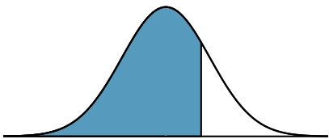
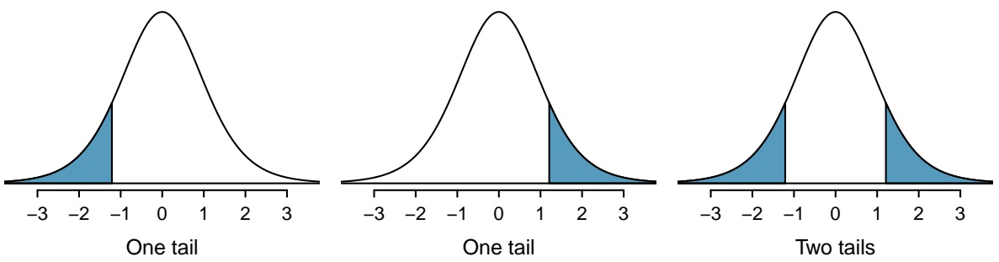
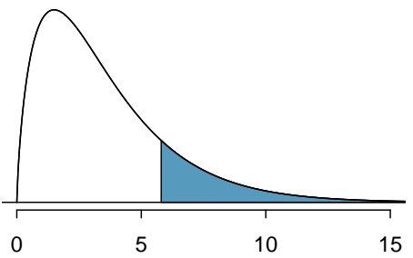

natural_image

Area under a normal distribution curve with a shaded blue region, no text or symbols present

positive Z

<table><tr><td rowspan="2">Z</td><td colspan="10">Second decimal place of Z</td></tr><tr><td>0.00</td><td>0.01</td><td>0.02</td><td>0.03</td><td>0.04</td><td>0.05</td><td>0.06</td><td>0.07</td><td>0.08</td><td>0.09</td></tr><tr><td>0.0</td><td>0.5000</td><td>0.5040</td><td>0.5080</td><td>0.5120</td><td>0.5160</td><td>0.5199</td><td>0.5239</td><td>0.5279</td><td>0.5319</td><td>0.5359</td></tr><tr><td>0.1</td><td>0.5398</td><td>0.5438</td><td>0.5478</td><td>0.5517</td><td>0.5557</td><td>0.5596</td><td>0.5636</td><td>0.5675</td><td>0.5714</td><td>0.5753</td></tr><tr><td>0.2</td><td>0.5793</td><td>0.5832</td><td>0.5871</td><td>0.5910</td><td>0.5948</td><td>0.5987</td><td>0.6026</td><td>0.6064</td><td>0.6103</td><td>0.6141</td></tr><tr><td>0.3</td><td>0.6179</td><td>0.6217</td><td>0.6255</td><td>0.6293</td><td>0.6331</td><td>0.6368</td><td>0.6406</td><td>0.6443</td><td>0.6480</td><td>0.6517</td></tr><tr><td>0.4</td><td>0.6554</td><td>0.6591</td><td>0.6628</td><td>0.6664</td><td>0.6700</td><td>0.6736</td><td>0.6772</td><td>0.6808</td><td>0.6844</td><td>0.6879</td></tr><tr><td>0.5</td><td>0.6915</td><td>0.6950</td><td>0.6985</td><td>0.7019</td><td>0.7054</td><td>0.7088</td><td>0.7123</td><td>0.7157</td><td>0.7190</td><td>0.7224</td></tr><tr><td>0.6</td><td>0.7257</td><td>0.7291</td><td>0.7324</td><td>0.7357</td><td>0.7389</td><td>0.7422</td><td>0.7454</td><td>0.7486</td><td>0.7517</td><td>0.7549</td></tr><tr><td>0.7</td><td>0.7580</td><td>0.7611</td><td>0.7642</td><td>0.7673</td><td>0.7704</td><td>0.7734</td><td>0.7764</td><td>0.7794</td><td>0.7823</td><td>0.7852</td></tr><tr><td>0.8</td><td>0.7881</td><td>0.7910</td><td>0.7939</td><td>0.7967</td><td>0.7995</td><td>0.8023</td><td>0.8051</td><td>0.8078</td><td>0.8106</td><td>0.8133</td></tr><tr><td>0.9</td><td>0.8159</td><td>0.8186</td><td>0.8212</td><td>0.8238</td><td>0.8264</td><td>0.8289</td><td>0.8315</td><td>0.8340</td><td>0.8365</td><td>0.8389</td></tr><tr><td>1.0</td><td>0.8413</td><td>0.8438</td><td>0.8461</td><td>0.8485</td><td>0.8508</td><td>0.8531</td><td>0.8554</td><td>0.8577</td><td>0.8599</td><td>0.8621</td></tr><tr><td>1.1</td><td>0.8643</td><td>0.8665</td><td>0.8686</td><td>0.8708</td><td>0.8729</td><td>0.8749</td><td>0.8770</td><td>0.8790</td><td>0.8810</td><td>0.8830</td></tr><tr><td>1.2</td><td>0.8849</td><td>0.8869</td><td>0.8888</td><td>0.8907</td><td>0.8925</td><td>0.8944</td><td>0.8962</td><td>0.8980</td><td>0.8997</td><td>0.9015</td></tr><tr><td>1.3</td><td>0.9032</td><td>0.9049</td><td>0.9066</td><td>0.9082</td><td>0.9099</td><td>0.9115</td><td>0.9131</td><td>0.9147</td><td>0.9162</td><td>0.9177</td></tr><tr><td>1.4</td><td>0.9192</td><td>0.9207</td><td>0.9222</td><td>0.9236</td><td>0.9251</td><td>0.9265</td><td>0.9279</td><td>0.9292</td><td>0.9306</td><td>0.9319</td></tr><tr><td>1.5</td><td>0.9332</td><td>0.9345</td><td>0.9357</td><td>0.9370</td><td>0.9382</td><td>0.9394</td><td>0.9406</td><td>0.9418</td><td>0.9429</td><td>0.9441</td></tr><tr><td>1.6</td><td>0.9452</td><td>0.9463</td><td>0.9474</td><td>0.9484</td><td>0.9495</td><td>0.9505</td><td>0.9515</td><td>0.9525</td><td>0.9535</td><td>0.9545</td></tr><tr><td>1.7</td><td>0.9554</td><td>0.9564</td><td>0.9573</td><td>0.9582</td><td>0.9591</td><td>0.9599</td><td>0.9608</td><td>0.9616</td><td>0.9625</td><td>0.9633</td></tr><tr><td>1.8</td><td>0.9641</td><td>0.9649</td><td>0.9656</td><td>0.9664</td><td>0.9671</td><td>0.9678</td><td>0.9686</td><td>0.9693</td><td>0.9699</td><td>0.9706</td></tr><tr><td>1.9</td><td>0.9713</td><td>0.9719</td><td>0.9726</td><td>0.9732</td><td>0.9738</td><td>0.9744</td><td>0.9750</td><td>0.9756</td><td>0.9761</td><td>0.9767</td></tr><tr><td>2.0</td><td>0.9772</td><td>0.9778</td><td>0.9783</td><td>0.9788</td><td>0.9793</td><td>0.9798</td><td>0.9803</td><td>0.9808</td><td>0.9812</td><td>0.9817</td></tr><tr><td>2.1</td><td>0.9821</td><td>0.9826</td><td>0.9830</td><td>0.9834</td><td>0.9838</td><td>0.9842</td><td>0.9846</td><td>0.9850</td><td>0.9854</td><td>0.9857</td></tr><tr><td>2.2</td><td>0.9861</td><td>0.9864</td><td>0.9868</td><td>0.9871</td><td>0.9875</td><td>0.9878</td><td>0.9881</td><td>0.9884</td><td>0.9887</td><td>0.9890</td></tr><tr><td>2.3</td><td>0.9893</td><td>0.9896</td><td>0.9898</td><td>0.9901</td><td>0.9904</td><td>0.9906</td><td>0.9909</td><td>0.9911</td><td>0.9913</td><td>0.9916</td></tr><tr><td>2.4</td><td>0.9918</td><td>0.9920</td><td>0.9922</td><td>0.9925</td><td>0.9927</td><td>0.9929</td><td>0.9931</td><td>0.9932</td><td>0.9934</td><td>0.9936</td></tr><tr><td>2.5</td><td>0.9938</td><td>0.9940</td><td>0.9941</td><td>0.9943</td><td>0.9945</td><td>0.9946</td><td>0.9948</td><td>0.9949</td><td>0.9951</td><td>0.9952</td></tr><tr><td>2.6</td><td>0.9953</td><td>0.9955</td><td>0.9956</td><td>0.9957</td><td>0.9959</td><td>0.9960</td><td>0.9961</td><td>0.9962</td><td>0.9963</td><td>0.9964</td></tr><tr><td>2.7</td><td>0.9965</td><td>0.9966</td><td>0.9967</td><td>0.9968</td><td>0.9969</td><td>0.9970</td><td>0.9971</td><td>0.9972</td><td>0.9973</td><td>0.9974</td></tr><tr><td>2.8</td><td>0.9974</td><td>0.9975</td><td>0.9976</td><td>0.9977</td><td>0.9977</td><td>0.9978</td><td>0.9979</td><td>0.9979</td><td>0.9980</td><td>0.9981</td></tr><tr><td>2.9</td><td>0.9981</td><td>0.9982</td><td>0.9982</td><td>0.9983</td><td>0.9984</td><td>0.9984</td><td>0.9985</td><td>0.9985</td><td>0.9986</td><td>0.9986</td></tr><tr><td>3.0</td><td>0.9987</td><td>0.9987</td><td>0.9987</td><td>0.9988</td><td>0.9988</td><td>0.9989</td><td>0.9989</td><td>0.9989</td><td>0.9990</td><td>0.9990</td></tr><tr><td>3.1</td><td>0.9990</td><td>0.9991</td><td>0.9991</td><td>0.9991</td><td>0.9992</td><td>0.9992</td><td>0.9992</td><td>0.9992</td><td>0.9993</td><td>0.9993</td></tr><tr><td>3.2</td><td>0.9993</td><td>0.9993</td><td>0.9994</td><td>0.9994</td><td>0.9994</td><td>0.9994</td><td>0.9994</td><td>0.9995</td><td>0.9995</td><td>0.9995</td></tr><tr><td>3.3</td><td>0.9995</td><td>0.9995</td><td>0.9995</td><td>0.9996</td><td>0.9996</td><td>0.9996</td><td>0.9996</td><td>0.9996</td><td>0.9996</td><td>0.9997</td></tr><tr><td>3.4</td><td>0.9997</td><td>0.9997</td><td>0.9997</td><td>0.9997</td><td>0.9997</td><td>0.9997</td><td>0.9997</td><td>0.9997</td><td>0.9997</td><td>0.9998</td></tr></table>

∗For Z ≥ 3.50, the probability is greater than or equal to 0.9998.

## B.2 t-Probability Table

Figure B.1: Tails for the t-distribution.

<table><tr><td colspan="2">one tailtwo tails</td><td>0.1000.200</td><td>0.0500.100</td><td>0.0250.050</td><td>0.0100.020</td><td>0.0050.010</td></tr><tr><td rowspan="5">df</td><td>1</td><td>3.08</td><td>6.31</td><td>12.71</td><td>31.82</td><td>63.66</td></tr><tr><td>2</td><td>1.89</td><td>2.92</td><td>4.30</td><td>6.96</td><td>9.92</td></tr><tr><td>3</td><td>1.64</td><td>2.35</td><td>3.18</td><td>4.54</td><td>5.84</td></tr><tr><td>4</td><td>1.53</td><td>2.13</td><td>2.78</td><td>3.75</td><td>4.60</td></tr><tr><td>5</td><td>1.48</td><td>2.02</td><td>2.57</td><td>3.36</td><td>4.03</td></tr><tr><td rowspan="5"></td><td>6</td><td>1.44</td><td>1.94</td><td>2.45</td><td>3.14</td><td>3.71</td></tr><tr><td>7</td><td>1.41</td><td>1.89</td><td>2.36</td><td>3.00</td><td>3.50</td></tr><tr><td>8</td><td>1.40</td><td>1.86</td><td>2.31</td><td>2.90</td><td>3.36</td></tr><tr><td>9</td><td>1.38</td><td>1.83</td><td>2.26</td><td>2.82</td><td>3.25</td></tr><tr><td>10</td><td>1.37</td><td>1.81</td><td>2.23</td><td>2.76</td><td>3.17</td></tr><tr><td rowspan="5"></td><td>11</td><td>1.36</td><td>1.80</td><td>2.20</td><td>2.72</td><td>3.11</td></tr><tr><td>12</td><td>1.36</td><td>1.78</td><td>2.18</td><td>2.68</td><td>3.05</td></tr><tr><td>13</td><td>1.35</td><td>1.77</td><td>2.16</td><td>2.65</td><td>3.01</td></tr><tr><td>14</td><td>1.35</td><td>1.76</td><td>2.14</td><td>2.62</td><td>2.98</td></tr><tr><td>15</td><td>1.34</td><td>1.75</td><td>2.13</td><td>2.60</td><td>2.95</td></tr><tr><td rowspan="5"></td><td>16</td><td>1.34</td><td>1.75</td><td>2.12</td><td>2.58</td><td>2.92</td></tr><tr><td>17</td><td>1.33</td><td>1.74</td><td>2.11</td><td>2.57</td><td>2.90</td></tr><tr><td>18</td><td>1.33</td><td>1.73</td><td>2.10</td><td>2.55</td><td>2.88</td></tr><tr><td>19</td><td>1.33</td><td>1.73</td><td>2.09</td><td>2.54</td><td>2.86</td></tr><tr><td>20</td><td>1.33</td><td>1.72</td><td>2.09</td><td>2.53</td><td>2.85</td></tr><tr><td rowspan="5"></td><td>21</td><td>1.32</td><td>1.72</td><td>2.08</td><td>2.52</td><td>2.83</td></tr><tr><td>22</td><td>1.32</td><td>1.72</td><td>2.07</td><td>2.51</td><td>2.82</td></tr><tr><td>23</td><td>1.32</td><td>1.71</td><td>2.07</td><td>2.50</td><td>2.81</td></tr><tr><td>24</td><td>1.32</td><td>1.71</td><td>2.06</td><td>2.49</td><td>2.80</td></tr><tr><td>25</td><td>1.32</td><td>1.71</td><td>2.06</td><td>2.49</td><td>2.79</td></tr><tr><td rowspan="5"></td><td>26</td><td>1.31</td><td>1.71</td><td>2.06</td><td>2.48</td><td>2.78</td></tr><tr><td>27</td><td>1.31</td><td>1.70</td><td>2.05</td><td>2.47</td><td>2.77</td></tr><tr><td>28</td><td>1.31</td><td>1.70</td><td>2.05</td><td>2.47</td><td>2.76</td></tr><tr><td>29</td><td>1.31</td><td>1.70</td><td>2.05</td><td>2.46</td><td>2.76</td></tr><tr><td>30</td><td>1.31</td><td>1.70</td><td>2.04</td><td>2.46</td><td>2.75</td></tr><tr><td colspan="2" rowspan="2">one tail two tails</td><td>0.100</td><td>0.050</td><td>0.025</td><td>0.010</td><td>0.005</td></tr><tr><td>0.200</td><td>0.100</td><td>0.050</td><td>0.020</td><td>0.010</td></tr><tr><td rowspan="5">df</td><td>31</td><td>1.31</td><td>1.70</td><td>2.04</td><td>2.45</td><td>2.74</td></tr><tr><td>32</td><td>1.31</td><td>1.69</td><td>2.04</td><td>2.45</td><td>2.74</td></tr><tr><td>33</td><td>1.31</td><td>1.69</td><td>2.03</td><td>2.44</td><td>2.73</td></tr><tr><td>34</td><td>1.31</td><td>1.69</td><td>2.03</td><td>2.44</td><td>2.73</td></tr><tr><td>35</td><td>1.31</td><td>1.69</td><td>2.03</td><td>2.44</td><td>2.72</td></tr><tr><td rowspan="5"></td><td>36</td><td>1.31</td><td>1.69</td><td>2.03</td><td>2.43</td><td>2.72</td></tr><tr><td>37</td><td>1.30</td><td>1.69</td><td>2.03</td><td>2.43</td><td>2.72</td></tr><tr><td>38</td><td>1.30</td><td>1.69</td><td>2.02</td><td>2.43</td><td>2.71</td></tr><tr><td>39</td><td>1.30</td><td>1.68</td><td>2.02</td><td>2.43</td><td>2.71</td></tr><tr><td>40</td><td>1.30</td><td>1.68</td><td>2.02</td><td>2.42</td><td>2.70</td></tr><tr><td rowspan="5"></td><td>41</td><td>1.30</td><td>1.68</td><td>2.02</td><td>2.42</td><td>2.70</td></tr><tr><td>42</td><td>1.30</td><td>1.68</td><td>2.02</td><td>2.42</td><td>2.70</td></tr><tr><td>43</td><td>1.30</td><td>1.68</td><td>2.02</td><td>2.42</td><td>2.70</td></tr><tr><td>44</td><td>1.30</td><td>1.68</td><td>2.02</td><td>2.41</td><td>2.69</td></tr><tr><td>45</td><td>1.30</td><td>1.68</td><td>2.01</td><td>2.41</td><td>2.69</td></tr><tr><td rowspan="5"></td><td>46</td><td>1.30</td><td>1.68</td><td>2.01</td><td>2.41</td><td>2.69</td></tr><tr><td>47</td><td>1.30</td><td>1.68</td><td>2.01</td><td>2.41</td><td>2.68</td></tr><tr><td>48</td><td>1.30</td><td>1.68</td><td>2.01</td><td>2.41</td><td>2.68</td></tr><tr><td>49</td><td>1.30</td><td>1.68</td><td>2.01</td><td>2.40</td><td>2.68</td></tr><tr><td>50</td><td>1.30</td><td>1.68</td><td>2.01</td><td>2.40</td><td>2.68</td></tr><tr><td rowspan="5"></td><td>60</td><td>1.30</td><td>1.67</td><td>2.00</td><td>2.39</td><td>2.66</td></tr><tr><td>70</td><td>1.29</td><td>1.67</td><td>1.99</td><td>2.38</td><td>2.65</td></tr><tr><td>80</td><td>1.29</td><td>1.66</td><td>1.99</td><td>2.37</td><td>2.64</td></tr><tr><td>90</td><td>1.29</td><td>1.66</td><td>1.99</td><td>2.37</td><td>2.63</td></tr><tr><td>100</td><td>1.29</td><td>1.66</td><td>1.98</td><td>2.36</td><td>2.63</td></tr><tr><td rowspan="5"></td><td>150</td><td>1.29</td><td>1.66</td><td>1.98</td><td>2.35</td><td>2.61</td></tr><tr><td>200</td><td>1.29</td><td>1.65</td><td>1.97</td><td>2.35</td><td>2.60</td></tr><tr><td>300</td><td>1.28</td><td>1.65</td><td>1.97</td><td>2.34</td><td>2.59</td></tr><tr><td>400</td><td>1.28</td><td>1.65</td><td>1.97</td><td>2.34</td><td>2.59</td></tr><tr><td>500</td><td>1.28</td><td>1.65</td><td>1.96</td><td>2.33</td><td>2.59</td></tr><tr><td></td><td>∞</td><td>1.28</td><td>1.65</td><td>1.96</td><td>2.33</td><td>2.58</td></tr></table>

## B.3 Chi-Square Probability Table

area

| X | Y |
| --- | --- |
| 0 | 0 |
| ~2 | Peak |
| ~6 | Shaded Area (Lower Bound) |
| ~7 | Shaded Area (Upper Bound) |
| 15 | 0 |

Figure B.2: Areas in the chi-square table always refer to the right tail.

<table><tr><td colspan="2">Upper tail</td><td>0.3</td><td>0.2</td><td>0.1</td><td>0.05</td><td>0.02</td><td>0.01</td><td>0.005</td><td>0.001</td></tr><tr><td rowspan="5">df</td><td>1</td><td>1.07</td><td>1.64</td><td>2.71</td><td>3.84</td><td>5.41</td><td>6.63</td><td>7.88</td><td>10.83</td></tr><tr><td>2</td><td>2.41</td><td>3.22</td><td>4.61</td><td>5.99</td><td>7.82</td><td>9.21</td><td>10.60</td><td>13.82</td></tr><tr><td>3</td><td>3.66</td><td>4.64</td><td>6.25</td><td>7.81</td><td>9.84</td><td>11.34</td><td>12.84</td><td>16.27</td></tr><tr><td>4</td><td>4.88</td><td>5.99</td><td>7.78</td><td>9.49</td><td>11.67</td><td>13.28</td><td>14.86</td><td>18.47</td></tr><tr><td>5</td><td>6.06</td><td>7.29</td><td>9.24</td><td>11.07</td><td>13.39</td><td>15.09</td><td>16.75</td><td>20.52</td></tr><tr><td rowspan="5"></td><td>6</td><td>7.23</td><td>8.56</td><td>10.64</td><td>12.59</td><td>15.03</td><td>16.81</td><td>18.55</td><td>22.46</td></tr><tr><td>7</td><td>8.38</td><td>9.80</td><td>12.02</td><td>14.07</td><td>16.62</td><td>18.48</td><td>20.28</td><td>24.32</td></tr><tr><td>8</td><td>9.52</td><td>11.03</td><td>13.36</td><td>15.51</td><td>18.17</td><td>20.09</td><td>21.95</td><td>26.12</td></tr><tr><td>9</td><td>10.66</td><td>12.24</td><td>14.68</td><td>16.92</td><td>19.68</td><td>21.67</td><td>23.59</td><td>27.88</td></tr><tr><td>10</td><td>11.78</td><td>13.44</td><td>15.99</td><td>18.31</td><td>21.16</td><td>23.21</td><td>25.19</td><td>29.59</td></tr><tr><td rowspan="5"></td><td>11</td><td>12.90</td><td>14.63</td><td>17.28</td><td>19.68</td><td>22.62</td><td>24.72</td><td>26.76</td><td>31.26</td></tr><tr><td>12</td><td>14.01</td><td>15.81</td><td>18.55</td><td>21.03</td><td>24.05</td><td>26.22</td><td>28.30</td><td>32.91</td></tr><tr><td>13</td><td>15.12</td><td>16.98</td><td>19.81</td><td>22.36</td><td>25.47</td><td>27.69</td><td>29.82</td><td>34.53</td></tr><tr><td>14</td><td>16.22</td><td>18.15</td><td>21.06</td><td>23.68</td><td>26.87</td><td>29.14</td><td>31.32</td><td>36.12</td></tr><tr><td>15</td><td>17.32</td><td>19.31</td><td>22.31</td><td>25.00</td><td>28.26</td><td>30.58</td><td>32.80</td><td>37.70</td></tr><tr><td rowspan="5"></td><td>16</td><td>18.42</td><td>20.47</td><td>23.54</td><td>26.30</td><td>29.63</td><td>32.00</td><td>34.27</td><td>39.25</td></tr><tr><td>17</td><td>19.51</td><td>21.61</td><td>24.77</td><td>27.59</td><td>31.00</td><td>33.41</td><td>35.72</td><td>40.79</td></tr><tr><td>18</td><td>20.60</td><td>22.76</td><td>25.99</td><td>28.87</td><td>32.35</td><td>34.81</td><td>37.16</td><td>42.31</td></tr><tr><td>19</td><td>21.69</td><td>23.90</td><td>27.20</td><td>30.14</td><td>33.69</td><td>36.19</td><td>38.58</td><td>43.82</td></tr><tr><td>20</td><td>22.77</td><td>25.04</td><td>28.41</td><td>31.41</td><td>35.02</td><td>37.57</td><td>40.00</td><td>45.31</td></tr><tr><td rowspan="4"></td><td>25</td><td>28.17</td><td>30.68</td><td>34.38</td><td>37.65</td><td>41.57</td><td>44.31</td><td>46.93</td><td>52.62</td></tr><tr><td>30</td><td>33.53</td><td>36.25</td><td>40.26</td><td>43.77</td><td>47.96</td><td>50.89</td><td>53.67</td><td>59.70</td></tr><tr><td>40</td><td>44.16</td><td>47.27</td><td>51.81</td><td>55.76</td><td>60.44</td><td>63.69</td><td>66.77</td><td>73.40</td></tr><tr><td>50</td><td>54.72</td><td>58.16</td><td>63.17</td><td>67.50</td><td>72.61</td><td>76.15</td><td>79.49</td><td>86.66</td></tr></table>

## Index

Ac, 100

adjusted $R ^ { 2 } \: ( R _ { a d j } ^ { 2 } ) ,$ 341, 341

adjusted R-squared, **341**

alternative hypothesis $( H _ { A } )$ , **212**

analysis of variance (ANOVA), **264**, 264–270

association, **38**

bar plot, **37**

segmented bar plot, **45**

Bayes’ Theorem, **114**, 111–116

blocking, **26**

blocks, **26**

Bonferroni correction, **269**

boxplot, **34**

case-control studies, 416–419

tests for association, 417

categorical variable, **16**

levels, **16**

nominal, **16**

ordinal, **16**

Central Limit Theorem, 202

chi-square distribution, **404**

chi-square statistic, 403

chi-square table, **405**

cohort, **24**

collections, 94

column totals, **43**

complement, **100**

conditional distribution, **178, 179**

conditional distribution for random variables, 177–183

conditional probability, 108–116

confidence interval, **205**, 210

confidence level, 207–208

difference of two means, 248–249

difference of two proportions, 396

interpretation, 209–210

regression coefficient, 309

single proportion, 389

confident, **205**

confounder, **28**, **332**, **350**

confounding factor, **28**

confounding variable, **28**

contingency table, **43**

continuous probability distribution, **98**

continuous random variable, **141**

control, **26**

correlated random variables, **180**

correlation, **40**

correlation coefficient, **40**

data, **11**

Arabidopsis thaliana, 415

births, 249–251

breast cancer, 397–400

cdc, 200

Congress approval rating, 394

developmental disability support, 253–255, 339–340

dolphins and mercury, 241–242

famuss, 15, 37–48, 406–407, 414–415

FCID, 98–99

fecal infusion, 409–413

forest birds, 359–367

frog, 14–15, 30–38, 48

glioblastoma, 392

Golub, 59–67

health care, 396

hiv, 402, 407

LEAP, 12–13, 26, 408

life.expectancy, 40

mammography, 397–400

nhanes, 38–39, 297, 391 persistent pulmonary hypertension in newborns (PPHN), 417

PREVEND, 293–295, 332–337, 350–351

stem cells, heart function, 247–249

swim suit velocities, 244

white fish and mercury, 243

data density, **33**

data fishing, **266**

data matrix, **15**

deck of cards, 95

deviation, **31**

discrete probability distributions, **98**

discrete random variable, **141**

disjoint events, **93**

distribution, **30**

t, 238–240

Bernoulli, **147**, 147–148

binomial, **149**, 147–151

normal approximation, 161–162

geometric, **171**, 170–171

hypergeometric, 175–176

negative binomial, **172**, 172–174

normal, **152**, 152–167

Poisson, **168**, 168–169

dot plot, **32**

effect size, 235

empirical rule, **36**

estimate, **199**

event, **94**, 94–95

expectation, 142

expected counts, **401**

expected value, **142**

experiment, **24**

explanatory variable, **17**, **291**

exponentially, **170**

F-statistic, **267**

factor variables, **16**

factorial, **149**

failure, **147**

false negative, **112**

false positive, **112**

Fisher’s exact test, **409**

frequency table, **37**

General Addition Rule, **96**

General Multiplication Rule, **110**

goodness-of-fit test, **414**

Greek

lambda (λ), 168

mu (µ), 142

sigma (σ), 143

high leverage, **305**

histogram, **33**, **48**

hypothesis testing, 212–222

decision errors, 221

significance level, 221–222

single proportion, 390

independent, **38**, **101**

independent random variables, **180**

influential, **306**

interaction, **352**

interquartile range, **32**

joint distribution, **177**, **181**

joint distribution for random variables, 177–183

joint probabilities, **107**

joint probability, **107**, 106–107

Law of Large Numbers, **92**

least squares regression, 295–297

R-squared (R2), **302**

least squares regression line, **295, 296**

linear association, **38**

linear model, **295**

lurking variable, **28**

margin of error, **205**, **393**, 393–394

marginal distribution, **178**

marginal distribution for random variables, 177–183

marginal probabilities, **107**

marginal probability, **107**, 106–107

marginal totals, **43**

mean, **30**

average, 30

mean square between groups (MSG), **266**

mean square error (MSE), **267**, **345**

median, **30**

Milgram, Stanley, 147

modality

bimodal, **34**

multimodal, **34**

unimodal, **34**

mode, **34**

model sum of squares (MSM), **345**

moderate relationships, **291**

multiple linear regression, **331**

F-statistic, 345

ANOVA, connection with, 368–369

assumptions, 338

categorical predictors, 347–348

confidence interval for the mean, 346

confidence intervals, 344

general model, 342

hypothesis tests, 344

interaction, 352–356

model selection, 358

prediction, 336

prediction interval, 346

residual plots, 338

residuals, 338, 343

Multiplication Rule, **103**

mutually exclusive events, **93**

n choose k, **149**

negative predictive value, **113**

negatively associated, **38**

non-response, **21**

non-response bias, **21**

normal probability plot, **163**, 163–167, 301, 339

normal probability table, **156**

null hypothesis (H0), **212**

numerical variable, **15**

continuous, **15**

discrete, **15**

observational study, **24**

odds, **418**

odds ratio, **46**, **418**

case-control studies, 418

outlier, **35**

outlier in regression, **306**

p-value, **214**

paired data, **244**, 244

parameter, **148**

percentile, **156**

placebo, **24**

point estimate, **201**, 201–204

difference of two means, 247–248

difference of two proportions, 395

population mean, 201

single proportion, 389

pooled standard deviation, **256**

population, **18**, 18–21

population effect size, **259**

population parameter, **199**

population regression model, **296**

positive predictive value, **111**, **113**

positively associated, **38**

power of a test, **257**, **259**

prediction interval, **314**

predictor, **291**

prevalence, **113**

probability, **92**, 89–116

probability density function, **98**

probability distribution, **97**

probability of a success, **147**

prospective study, **29**

quantile-quantile plot, **163**

random phenomena, 93

random variable, **139**, 139–146

rejection region, **217**, **258**

relative frequency table, **37**

relative odds, **419**

relative risk, **46**

replication, **26**

residual, **295**

residual confounders, **351**

residuals, 298–301

contingency table, 406

regression, 295, 338

response variable, **17**, **291**

retrospective study, **29**

robust estimates, **32**

row totals, **43**

S, 100

s, 31

sample, **18**

cluster, **24**

cluster sample, **24**

cluster sampling, 25

convenience sample, **20**

multistage sample, **24**

multistage sampling, 25

non-response, 21

non-response bias, 21

outcome-dependent, 416

random sample, 20–21

representative sample, **20**

simple random, **22**

simple random sampling, 23

strata, **22**

stratified sampling, **22**, 23

sample proportion, **147**, **388**

sample size

estimating a proportion, 393–394

sample space, **100**

sampling distribution

difference of two proportions, 395

regression coefficient, 308, 344

sample mean, **202**

sample proportion, 389

sampling variation, **201**

scatter plots, 294

scatterplot, **38**

scatterplot matrix, **362**

scatterplots, 293

SE, 203

sensitivity, **113**

sets, 94

shape, **33**

side-by-side boxplots, **48**

significance level, **213**, 221–222

multiple comparisons, 269–270

simple linear regression, **291**

assumptions, 294

categorical predictors, 303

interpretation, 298

outliers, 305

prediction intervals, 314

R-squared (R2), 302

simple random sample, **20**

Simpson’s paradox, **57**

skew

example: strong, 250

example: very strong, 165

left skewed, **33**

right skewed, **33**

specificity, **113**

standard deviation, **31**, 143

standard error (SE), **203**

difference in means, 248

difference in proportions, 395

regression coefficient, 309

single proportion, 389

standard normal distribution, **152**

strata, **22**

stratification, **26**

strong relationships, **291**

success, **147**

success-failure condition, **389**

sum of squared errors, **267**

sum of squares between groups, **266**

symmetric, **33**

t-distribution, 238–240

t-table, **239**

t-test

one-sample, 241–243

paired data, 244–245

two independent groups, 249–251

time series, **294**

transformation, **36**

tree diagram, **112**, 116

trial, **147**

two-by-two tables, **46**

two-sided alternative, **213**

two-sided confidence intervals, **205**

two-way tables, **43**

Type I error, **220**

Type II error, **220**

uncorrelated, **38**

variables, **14**

variance, **31**, 143

Venn diagrams, **95**

weak relationship, **291**

whiskers, **35**

Z, 153

Z-score, **153**