# Gene Cloning and DNA Analys_

MinerU 4.0.12 Advanced；FULL 视图保留页眉、页脚、页码和边栏。

T.A. Brown

# GENE CLONING & DNA ANALYSIS

An Introduction

EIGHTH EDITION

WILEY Blackwell

---


---

## GENE CLONING AND DNA ANALYSIS

---


---

# GENE CLONING AND DNA ANALYSIS

An Introduction

**T. A. BROWN**

University of Manchester

Manchester, United Kingdom

Eighth Edition

WILEY Blackwell

---

This eighth edition first published 2021

© 2021 John Wiley & Sons Ltd.

Edition History

1e; (1986, Chapman & Hall), 2e; (1990, Chapman & Hall), 3e; (1995, Chapman & Hall), 4e; (2001, John Wiley & Sons), 5e; (2006, John Wiley & Sons), 6e; (2010, John Wiley & Sons) 7e; (2016, John Wiley & Sons)

All rights reserved. No part of this publication may be reproduced, stored in a retrieval system, or transmitted, in any form or by any means, electronic, mechanical, photocopying, recording or otherwise, except as permitted by law. Advice on how to obtain permission to reuse material from this title is available at [http://www.wiley.com/go/permissions](http://www.wiley.com/go/permissions).

The right of T. A. Brown to be identified as the author of this work has been asserted in accordance with law.

Registered Offices

John Wiley & Sons, Inc., 111 River Street, Hoboken, NJ 07030, USA

John Wiley & Sons Ltd, The Atrium, Southern Gate, Chichester, West Sussex, PO19 8SQ, UK

Editorial Office

9600 Garsington Road, Oxford, OX4 2DQ, UK

For details of our global editorial offices, customer services, and more information about Wiley products visit us at [www.wiley.com](http://www.wiley.com).

Wiley also publishes its books in a variety of electronic formats and by print‐on‐demand. Some content that appears in standard print versions of this book may not be available in other formats.

Limit of Liability/Disclaimer of Warranty

While the publisher and authors have used their best efforts in preparing this work, they make no representations or warranties with respect to the accuracy or completeness of the contents of this work and specifically disclaim all warranties, including without limitation any implied warranties of merchantability or fitness for a particular purpose. No warranty may be created or extended by sales representatives, written sales materials or promotional statements for this work. The fact that an organization, website, or product is referred to in this work as a citation and/or potential source of further information does not mean that the publisher and authors endorse the information or services the organization, website, or product may provide or recommendations it may make. This work is sold with the understanding that the publisher is not engaged in rendering professional services. The advice and strategies contained herein may not be suitable for your situation. You should consult with a specialist where appropriate. Further, readers should be aware that websites listed in this work may have changed or disappeared between when this work was written and when it is read. Neither the publisher nor authors shall be liable for any loss of profit or any other commercial damages, including but not limited to special, incidental, consequential, or other damages.

Library of Congress Cataloging‐in‐Publication Data

Names: Brown, T. A. (Terence A.), author.

Title: Gene cloning and DNA analysis : an introduction / Professor Terry A. Brown.

Description: Eighth edition. | Hoboken, NJ : Wiley-Blackwell, 2021. | Includes bibliographical references and index.

Identifiers: LCCN 2020029236 (print) | LCCN 2020029237 (ebook) | ISBN 9781119640783 (paperback) | ISBN 9781119640752 (Adobe PDF) | ISBN 9781119640677 (epub)

Subjects: MESH: Cloning, Molecular | Sequence Analysis, DNA | DNA, Recombinant–analysis

Classification: LCC QH442.2 (print) | LCC QH442.2 (ebook) | NLM QU 550.5.C5 | DDC 572.8/633–dc23

LC record available at https://lccn.loc.gov/2020029236

LC ebook record available at https://lccn.loc.gov/2020029237

Cover Design: Wiley

Cover Image: © theasis/Getty Images

Set in 10/12pt Sabon by SPi Global, Pondicherry, India

10 9 8 7 6 5 4 3 2 1

---

## Contents in Brief

## CONTENTS IN BRIEF

Preface to the Eighth Edition xv

## Part I The Basic Principles of Gene Cloning and DNA Analysis 1

1 **Why Gene Cloning and DNA Analysis are Important** 3
2 **Vectors for Gene Cloning: Plasmids and Bacteriophages** 15
3 **Purification of DNA from Living Cells** 29
4 **Manipulation of Purified DNA** 53
5 **Introduction of DNA into Living Cells** 83
6 **Cloning Vectors for E. coli** 101
7 **Cloning Vectors for Eukaryotes** 121
8 **How to Obtain a Clone of a Specific Gene** 145
9 **The Polymerase Chain Reaction** 169

## Part II The Applications of Gene Cloning and DNA Analysis in Research 187

**10 Sequencing Genes and Genomes** 189
**11 Studying Gene Expression and Function** 217
**12 Studying Genomes** 243
**13 Studying Transcriptomes and Proteomes** 259

## Part III The Applications of Gene Cloning and DNA Analysis in Biotechnology 275

**14 Production of Protein from Cloned Genes** 277
**15 Gene Cloning and DNA Analysis in Medicine** 301
**16 Gene Cloning and DNA Analysis in Agriculture** 327
**17 Gene Cloning and DNA Analysis in Forensic Science and Archaeology** 355

Glossary 377

Index 395

v

---


---

Contents

CONTENTS

Preface to the Eighth Edition xv

## Part I The Basic Principles of Gene Cloning and DNA Analysis 1

1 **Why Gene Cloning and DNA Analysis are Important** 3

**1.1 The early development of genetics** 4
**1.2 The advent of gene cloning and the polymerase chain reaction** 4
**1.3 What is gene cloning?** 5
**1.4 What is PCR?** 5
**1.5 Why gene cloning and PCR are so important** 8
1.5.1 Obtaining a pure sample of a gene by cloning 8
1.5.2 PCR can also be used to purify a gene 10
**1.6 How to find your way through this book** 11 **Further reading** 13

2 **Vectors for Gene Cloning: Plasmids and Bacteriophages** 15

**2.1 Plasmids** 15

2.1.1 Size and copy number 17
2.1.2 Conjugation and compatibility 18
2.1.3 Plasmid classification 19
2.1.4 Plasmids in organisms other than bacteria 19

**2.2 Bacteriophages** 19

2.2.1 The phage infection cycle 20
2.2.2 Lysogenic phages 20
2.2.3 Viruses as cloning vectors for other organisms 26
**Further reading** 27

3 **Purification of DNA from Living Cells** 29

**3.1 Preparation of total cell DNA** 30

3.1.1 Growing and harvesting a bacterial culture 30
3.1.2 Preparation of a cell extract 31

vii

---

viii

Contents

3.1.3 Purification of DNA from a cell extract 33
3.1.4 Concentration of DNA samples 37
3.1.5 Measurement of DNA concentration 38
3.1.6 Other methods for the preparation of total cell DNA 39

## 3.2 Preparation of plasmid DNA 40

3.2.1 Separation on the basis of size 41
3.2.2 Separation on the basis of conformation 42
3.2.3 Plasmid amplification 44

## 3.3 Preparation of bacteriophage DNA 46

3.3.1 Growth of cultures to obtain a high λ titre 47
3.3.2 Preparation of non‐lysogenic λ phages 47
3.3.3 Collection of phages from an infected culture 49
3.3.4 Purification of DNA from λ phage particles 49
3.3.5 Purification of M13 DNA causes few problems 49

**Further reading** 51

## 4 Manipulation of Purified DNA 53

## 4.1 The range of DNA manipulative enzymes 55

4.1.1 Nucleases 55
4.1.2 Ligases 57
4.1.3 Polymerases 57
4.1.4 DNA modifying enzymes 58

## 4.2 Enzymes for cutting DNA – restriction endonucleases 59

4.2.1 The discovery and function of restriction endonucleases 60
4.2.2 Type II restriction endonucleases cut DNA at specific nucleotide sequences 61
4.2.3 Blunt ends and sticky ends 62
4.2.4 The frequency of recognition sequences in a DNA molecule 63
4.2.5 Performing a restriction digest in the laboratory 64
4.2.6 Analysing the result of restriction endonuclease cleavage 66
4.2.7 Estimation of the sizes of DNA molecules 68
4.2.8 Mapping the positions of different restriction sites in a DNA molecule 69
4.2.9 Special gel electrophoresis methods for separating larger molecules 70

## 4.3 Ligation – joining DNA molecules together 72

4.3.1 The mode of action of DNA ligase 72
4.3.2 Sticky ends increase the efficiency of ligation 74
4.3.3 Putting sticky ends onto a blunt‐ended molecule 74
4.3.4 Blunt‐end ligation with a DNA topoisomerase 79
**Further reading** 81

---

Contents

ix

## 5 Introduction of DNA into Living Cells 83

## 5.1 Transformation – the uptake of DNA by bacterial cells 85

5.1.1 Not all species of bacteria are equally efficient at DNA uptake 85
5.1.2 Preparation of competent E. coli cells 86
5.1.3 Selection for transformed cells 86

## 5.2 Identification of recombinants 88

5.2.1 Recombinant selection with pBR322 – insertional inactivation of an antibiotic resistance gene 89
5.2.2 Insertional inactivation does not always involve antibiotic resistance 90

## 5.3 Introduction of phage DNA into bacterial cells 92

5.3.1 Transfection 93
5.3.2 In vitro packaging of λ cloning vectors 93
5.3.3 Phage infection is visualized as plaques on an agar medium 93
5.3.4 Identification of recombinant phages 95

## 5.4 Introduction of DNA into non‐bacterial cells 97

5.4.1 Transformation of individual cells 97
5.4.2 Transformation of whole organisms 99

**Further reading** 99

## 6 Cloning Vectors for E. coli 101

## 6.1 Cloning vectors based on E. coli plasmids 102

6.1.1 The nomenclature of plasmid cloning vectors 102
6.1.2 The useful properties of pBR322 102
6.1.3 The pedigree of pBR322 103
6.1.4 More sophisticated E. coli plasmid cloning vectors 104

## 6.2 Cloning vectors based on λ bacteriophage 108

6.2.1 Natural selection was used to isolate modified λ that lack certain restriction sites 108
6.2.2 Segments of the λ genome can be deleted without impairing viability 108
6.2.3 Insertion and replacement vectors 110
6.2.4 Cloning experiments with λ insertion or replacement vectors 112
6.2.5 Long DNA fragments can be cloned using a cosmid 113
6.2.6 λ and other high‐capacity vectors enable genomic libraries to be constructed 114

## 6.3 Cloning vectors for synthesis of single‐stranded DNA 115

6.3.1 Vectors based on M13 bacteriophage 115
6.3.2 Hybrid plasmid–M13 vectors 117

---

x

Contents

## 6.4 Vectors for other bacteria 118

## Further reading 119

## 7 Cloning Vectors for Eukaryotes 121

## 7.1 Vectors for yeast and other fungi 121

7.1.1 Selectable markers for the 2 μm plasmid 122
7.1.2 Vectors based on the 2 μm plasmid – yeast episomal plasmids 122
7.1.3 A YEp may insert into yeast chromosomal DNA 124
7.1.4 Other types of yeast cloning vector 124
7.1.5 Artificial chromosomes can be used to clone long pieces of DNA in yeast 126
7.1.6 Vectors for other yeasts and fungi 129

## 7.2 Cloning vectors for higher plants 129

7.2.1 Agrobacterium tumefaciens – nature’s smallest genetic engineer 130
7.2.2 Cloning genes in plants by direct gene transfer 135
7.2.3 Attempts to use plant viruses as cloning vectors 137

## 7.3 Cloning vectors for animals 138

7.3.1 Cloning vectors for insects 139

7.3.2 Cloning in mammals 141

**Further reading** 143

## 8 How to Obtain a Clone of a Specific Gene 145

## 8.1 The problem of selection 146

8.1.1 There are two basic strategies for obtaining the clone you want 146

## 8.2 Direct selection 147

8.2.1 Marker rescue extends the scope of direct selection 149
8.2.2 The scope and limitations of marker rescue 150

## 8.3 Identification of a clone from a gene library 150

8.3.1 Gene libraries 151

## 8.4 Methods for clone identification 153

8.4.1 Complementary nucleic acid strands hybridize to each other 154
8.4.2 Colony and plaque hybridization probing 154
8.4.3 Examples of the practical use of hybridization probing 157
8.4.4 Identification methods based on detection of the translation product of the cloned gene 164
**Further reading** 166

---

Contents

xi

## 9 The Polymerase Chain Reaction 169

**9.1 PCR in outline** 170
**9.2 PCR in more detail** 172

9.2.1 Designing the oligonucleotide primers for a PCR 172
9.2.2 Working out the correct temperatures to use 174

**9.3 After the PCR: studying PCR products** 176

9.3.1 Gel electrophoresis of PCR products 177
9.3.2 Cloning PCR products 178

**9.4 Real‐time PCR** 180

9.4.1 Carrying out a real‐time PCR experiment 180
9.4.2 Real‐time PCR enables the amount of starting material to be quantified 182
9.4.3 Melting curve analysis enables point mutations to be identified 184

**Further reading** 185

# Part II The Applications of Gene Cloning and DNA Analysis in Research 187

## 10 Sequencing Genes and Genomes 189

**10.1 Chain‐termination DNA sequencing** 190

10.1.1 Chain‐termination sequencing in outline 190
10.1.2 Not all DNA polymerases can be used for sequencing 192
10.1.3 Chain‐termination sequencing with Taq polymerase 193
10.1.4 Limitations of chain‐termination sequencing 195

**10.2 Next‐generation sequencing** 196

10.2.1 Preparing a library for an Illumina sequencing experiment 197
10.2.2 The sequencing phase of an Illumina experiment 199
10.2.3 Ion semiconductor sequencing 201
10.2.4 Third‐generation sequencing 201
10.2.5 Next‐generation sequencing without a DNA polymerase 202
10.2.6 Directing next‐generation sequencing at specific sets of genes 203

**10.3 How to sequence a genome** 205

10.3.1 Shotgun sequencing of prokaryotic genomes 206
10.3.2 Sequencing of eukaryotic genomes 209

**Further reading** 215

---

xii

Contents

## 11 Studying Gene Expression and Function 217

## 11.1 Studying the RNA transcript of a gene 218

11.1.1 Detecting the presence of a transcript in an RNA sample 219
11.1.2 Transcript mapping by hybridization between gene and RNA 220
11.1.3 Transcript analysis by primer extension 222
11.1.4 Transcript analysis by PCR 223

## 11.2 Studying the regulation of gene expression 224

11.2.1 Identifying protein binding sites on a DNA molecule 225
11.2.2 Identifying control sequences by deletion analysis 230

## 11.3 Identifying and studying the translation product of a cloned gene 232

11.3.1 HRT and HART can identify the translation product of a cloned gene 233
11.3.2 Analysis of proteins by in vitro mutagenesis 234
**Further reading** 240

## 12 Studying Genomes 243

## 12.1 Locating the genes in a genome sequence 244

12.1.1 Locating protein‐coding genes by scanning a genome sequence 244
12.1.2 Gene location is aided by homology searching 247
12.1.3 Locating genes for noncoding RNA transcripts 249
12.1.4 Identifying the binding sites for regulatory proteins in a genome sequence 250

## 12.2 Determining the function of an unknown gene 251

12.2.1 Assigning gene functions by computer analysis 251
12.2.2 Assigning gene function by experimental analysis 252

## 12.3 Genome browsers 256

**Further reading** 257

## 13 Studying Transcriptomes and Proteomes 259

## 13.1 Studying transcriptomes 259

13.1.1 Studying transcriptomes by microarray or chip analysis 260
13.1.2 Studying transcriptomes by RNA sequencing 261

## 13.2 Studying proteomes 265

13.2.1 Protein profiling 266
13.2.2 Studying protein–protein interactions 270
**Further reading** 274

---

Contents

xiii

# Part III The Applications of Gene Cloning and DNA Analysis in Biotechnology 275

## 14 Production of Protein from Cloned Genes 277

**14.1 Special vectors for expression of foreign genes in E. coli** 280

14.1.1 The promoter is the critical component of an expression vector 281

14.1.2 Cassettes and gene fusions 285

**14.2 General problems with the production of recombinant protein in E. coli** 287

14.2.1 Problems resulting from the sequence of the foreign gene 288

14.2.2 Problems caused by E. coli 289

**14.3 Production of recombinant protein by eukaryotic cells** 290

14.3.1 Recombinant protein from yeast and filamentous fungi 291

14.3.2 Using animal cells for recombinant protein production 293

14.3.3 Pharming – recombinant protein from live animals and plants 295

**Further reading** 298

## 15 Gene Cloning and DNA Analysis in Medicine 301

**15.1 Production of recombinant pharmaceuticals** 301

15.1.1 Recombinant insulin 302

15.1.2 Synthesis of human growth hormones in E. coli 304

15.1.3 Recombinant factor VIII 305

15.1.4 Synthesis of other recombinant human proteins 308

15.1.5 Recombinant vaccines 308

**15.2 Identification of genes responsible for human diseases** 314

15.2.1 How to identify a gene for a genetic disease 315

15.2.2 Genetic typing of disease mutations 320

**15.3 Gene therapy** 321

15.3.1 Gene therapy for inherited diseases 321

15.3.2 Gene therapy and cancer 323

15.3.3 The ethical issues raised by gene therapy 324

**Further reading** 325

---

xiv

Contents

## 16 Gene Cloning and DNA Analysis in Agriculture 327

## 16.1 The gene addition approach to plant genetic engineering 328

16.1.1 Plants that make their own insecticides 328
16.1.2 Herbicide‐resistant crops 334
16.1.3 Improving the nutritional quality of plants by gene addition 337
16.1.4 Other gene addition projects 338

## 16.2 Gene subtraction 339

16.2.1 Antisense RNA and the engineering of fruit ripening in tomato 340
16.2.2 Other examples of the use of antisense RNA in plant genetic engineering 342

## 16.3 Gene editing with a programmable nuclease 344

16.3.1 Gene editing of phytoene desaturase in rice 344

16.3.2 Editing of multiple genes in a single plant 346

16.3.3 Future developments in gene editing of plants 347

## 16.4 Are GM plants harmful to human health and the environment? 349

16.4.1 Safety concerns with selectable markers 349
16.4.2 The possibility of harmful effects on the environment 350

**Further reading** 351

## 17 Gene Cloning and DNA Analysis in Forensic Science and Archaeology 355

## 17.1 DNA analysis in the identification of crime suspects 356

17.1.1 Genetic fingerprinting by hybridization probing 356
17.1.2 DNA profiling by PCR of short tandem repeats 357

## 17.2 Studying kinship by DNA profiling 359

17.2.1 Related individuals have similar DNA profiles 359
17.2.2 DNA profiling and the remains of the Romanovs 360

## 17.3 Sex identification by DNA analysis 363

17.3.1 PCRs directed at Y chromosome‐specific sequences 363

17.3.2 PCR of the amelogenin gene 364

## 17.4 Archaeogenetics – using DNA to study human prehistory 365

17.4.1 The origins of modern humans 365
17.4.2 DNA can also be used to study prehistoric human migrations 370

**Further reading** 374

Glossary 377

Index 395

---

# Preface to the Eighth Edition

he main development in DNA technology since publication of the Seventh Edition of Gene Cloning has been the increased use of gene editing as a tool in both research and biotechnology. The basic methodology for CRISPR editing is now described in Chapter 12 and the applications of the method are explored, in the context of plant genetic engineering, in Chapter  16. Elsewhere, the continuing evolution of next‐generation DNA sequencing is reflected by a reorganization of this part of Chapter 10, and to deal with the further proliferation of methods for studying transcriptomes and proteomes (albeit not strictly DNA Analysis) I have created a new chapter devoted to these methods. Other additions include new sections on melt curve analysis of real‐time PCR products and genetic typing of human disease mutations.

I wrote the First Edition of Gene Cloning in 1985, shortly after gaining my first academic appointment. I fondly remember that small, yellow‐covered book, even though I no longer have a copy and have been unable to track one down. I have written this latest Edition during the months immediately following my retirement from academia. I would like to thank the many colleagues, students, and email contacts who, over those 35 years have made comments and suggestions about the content of the book and the way the material is presented. In particular, I would like to thank Mehdi Evazalipour of Guilan Medical University and Salman Odooli of University of Isfahan for pointing out a couple of longstanding errors in the Seventh Edition.

Finally, the one constant throughout the 35 years of Gene Cloning has been my wife and research partner Keri, who has provided unending support and encouragement for my writing ventures.

**T. A. Brown**

University of Manchester

xv

---


---

## PART I

# The Basic Principles of Gene Cloning and DNA Analysis

1 | Why Gene Cloning and DNA Analysis are Important 3
2 | Vectors for Gene Cloning: Plasmids and Bacteriophages 15
3 | Purification of DNA from Living Cells 29
4 | Manipulation of Purified DNA 53
5 | Introduction of DNA into Living Cells 83
6 | Cloning Vectors for E. coli 101
7 | Cloning Vectors for Eukaryotes 121
8 | How to Obtain a Clone of a Specific Gene 145
9 | The Polymerase Chain Reaction 169

---


---

## Chapter 1

# Why Gene Cloning and DNA Analysis are Important

## Chapter contents

**1.1** The early development of genetics 4
**1.2** The advent of gene cloning and the polymerase chain reaction 4
**1.3** What is gene cloning? 5
**1.4** What is PCR? 5
**1.5** Why gene cloning and PCR are so important 8
**1.6** How to find your way through this book 11

In the middle of the $1 9 ^ { \mathrm { t h } }$ century, Gregor Mendel formulated a set of rules to explain the inheritance of biological characteristics. The basic assumption of these rules is that each heritable property of an organism is controlled by a factor, called a **gene**, that is a physical particle present somewhere in the cell. The rediscovery of Mendel’s laws in 1900 marks the birth of **genetics**, the science aimed at understanding what these genes are and exactly how they work.

Gene Cloning and DNA Analysis: An Introduction, Eighth Edition. T. A. Brown.

© 2021 John Wiley & Sons Ltd. Published 2021 by John Wiley & Sons Ltd.

3

---

4

Part I The Basic Principles of Gene Cloning and DNA Analysis

## 1.1 The early development of genetics

For the first 30 years of its life, this new science grew at an astonishing rate. The idea that genes reside on **chromosomes** was proposed by W. Sutton in 1903, and received experimental backing from T.H. Morgan in 1910. Morgan and his colleagues then developed the techniques for **gene mapping**, and by 1922 had produced a comprehensive analysis of the relative positions of over 2000 genes on the four chromosomes of the fruit fly, Drosophila melanogaster.

Despite the brilliance of these classical genetic studies, there was no real understanding of the molecular nature of the gene until the 1940s. Indeed, it was not until the experiments of Avery, MacLeod, and McCarty in 1944, and of Hershey and Chase in 1952, that anyone believed that deoxyribonucleic acid (DNA) is the genetic material. Up until then it was widely thought that genes were made of protein. The discovery of the role of DNA was a tremendous stimulus to genetic research, and many famous biologists (Delbrück, Chargaff, Crick, and Monod were among the most influential) contributed to the second great age of genetics. In the 14 years between 1952 and 1966, the structure of DNA was elucidated, the genetic code cracked, and the processes of transcription and translation described.

## 1.2 The advent of gene cloning and the polymerase chain reaction

These years of activity and discovery were followed by a lull, a period of anticlimax, when it seemed to some molecular biologists (as the new generation of geneticists styled themselves) that there was little of fundamental importance that was not understood. In truth there was a frustration that the experimental techniques of the late 1960s were not sophisticated enough to allow genes to be studied in any greater detail.

Then, in the years 1971–1973 genetic research was thrown back into gear by what at the time was described as a revolution in experimental biology. A whole new methodology was developed, enabling previously impossible experiments to be planned and carried out, if not with ease, then at least with success. These methods, referred to as **recombinant DNA technology** or **genetic engineering**, and having at their core the process of **gene cloning**, sparked another great age of genetics. They led to rapid and efficient **DNA sequencing** techniques that enabled the structures of individual genes to be determined, reaching a culmination at the turn of the century with the massive genome sequencing projects, including the human project which was completed in 2000. They led to procedures for studying the regulation of individual genes, which have allowed molecular biologists to understand how aberrations in gene activity can result in human diseases such as cancer. The techniques spawned modern **biotechnology**, which puts genes to work in production of proteins and other compounds needed in medicine and industrial processes.

---

Chapter 1 Why Gene Cloning and DNA Analysis are Important

5

During the 1980s, when the excitement engendered by the gene cloning revolution was at its height, it hardly seemed possible that another, equally novel and equally revolutionary process was just around the corner. According to DNA folklore, Kary Mullis invented the **polymerase chain reaction (PCR)** during a drive along California State Route 128 from Berkeley to Mendocino one Friday evening in 1983. His brainwave was an exquisitely simple technique that acts as a perfect complement to gene cloning. PCR has made easier many of the techniques that were possible but difficult to carry out when gene cloning was used on its own. It has extended the range of DNA analysis and enabled molecular biology to find new applications in areas of endeavour outside of its traditional range of medicine, agriculture, and biotechnology. Archaeogenetics, molecular ecology, and DNA forensics are just three of the new disciplines that have become possible as a direct consequence of the invention of PCR, enabling molecular biologists to ask questions about human evolution and the impact of environmental change on the biosphere, and to bring their powerful tools to bear in the fight against crime. Fifty years have passed since the dawning of the age of gene cloning, but we are still riding the rollercoaster and there is no end to the excitement in sight.

## 1.3 What is gene cloning?

What exactly is gene cloning? The easiest way to answer this question is to follow through the steps in a gene cloning experiment (Figure 1.1):

1 A fragment of DNA, containing the gene to be cloned, is inserted into a circular DNA molecule called a **vector**, to produce a **recombinant DNA molecule**.
2 The vector transports the gene into a host cell, which is usually a bacterium, although other types of living cell can be used.
3 Within the host cell the vector multiplies, producing numerous identical copies, not only of itself but also of the gene that it carries.
4 When the host cell divides, copies of the recombinant DNA molecule are passed to the progeny and further vector replication takes place.
5 After a large number of cell divisions, a colony, or **clone**, of identical host cells is produced. Each cell in the clone contains one or more copies of the recombinant DNA molecule. The gene carried by the recombinant molecule is now said to be cloned.

## 1.4 What is PCR?

The polymerase chain reaction is very different from gene cloning. Rather than a series of manipulations involving living cells, PCR is carried out in a single test tube simply by mixing DNA with a set of reagents and placing the tube in a thermal cycler, a piece of equipment that enables the mixture to be

---

6

Part I The Basic Principles of Gene Cloning and DNA Analysis

Figure 1.1

The basic steps in gene cloning.

Construction of a recombinant DNA molecule

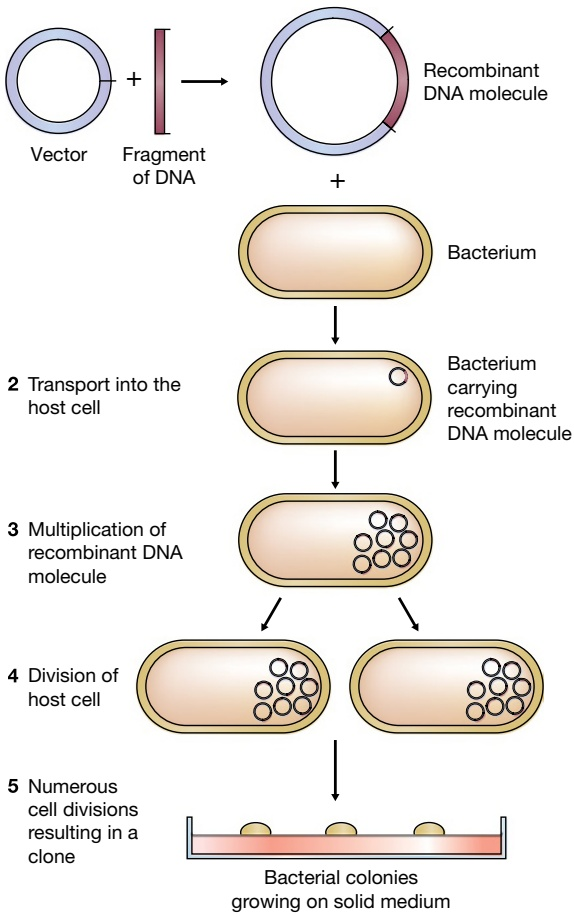

<details>
<summary>flowchart</summary>

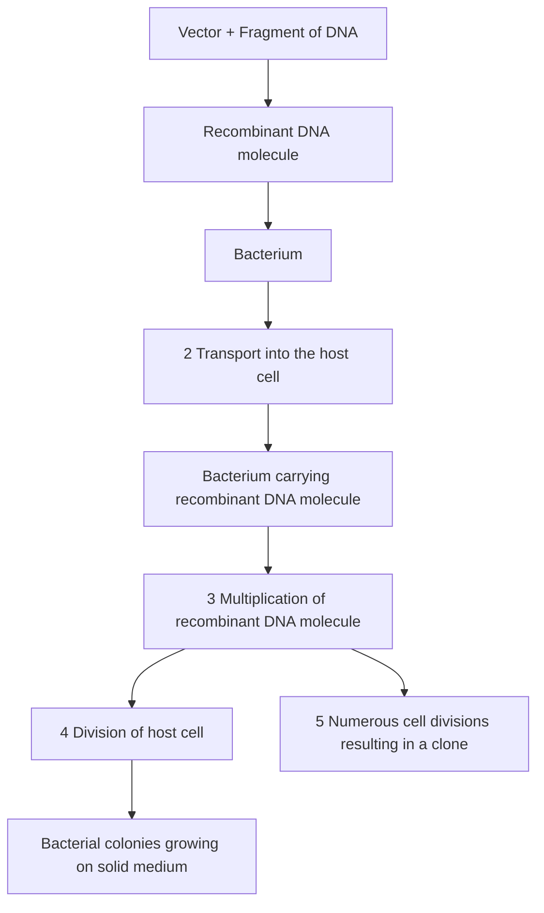
</details>

incubated at a series of temperatures that are varied in a preprogrammed manner. The basic steps in a PCR experiment are as follows (Figure 1.2):

1 The mixture is heated to $9 4 ^ { \circ } \mathrm { C } ,$ at which temperature the hydrogen bonds that hold together the two strands of the double‐stranded DNA molecule are broken, causing the molecule to **denature**.
2 The mixture is cooled down to $5 0  –  6 0 ^ { \circ } \mathrm { C }$ . The two strands of each molecule could join back together at this temperature, but most do not because the mixture contains a large excess of short DNA molecules, called **oligonucleotides** or **primers**, which **anneal** to the DNA molecules at specific positions.
3 The temperature is raised to $7 4 ^ { \circ } \mathrm { C } ,$ This is a good working temperature for the **Taq DNA polymerase** that is present in the mixture. We will learn more about **DNA polymerases** in Section 4.1.3. All we need to understand at this stage is that the Taq DNA polymerase attaches to one end of each primer and synthesizes new strands of DNA, complementary to the **template** DNA molecules, during this step of the PCR. Now we have four stands of DNA instead of the two that there were to start with.

---

Chapter 1 Why Gene Cloning and DNA Analysis are Important

7

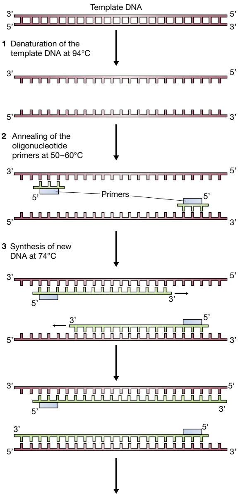

<details>
<summary>flowchart</summary>

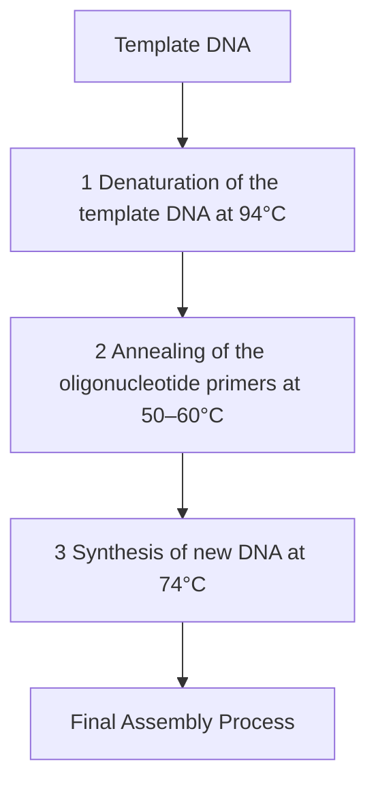
</details>

Repeat the cycle 25–30 times

Figure 1.2

The basic steps in the polymerase chain reaction.

4 The temperature is increased back to $9 4 ^ { \circ } \mathrm { C } ,$ The double‐stranded DNA molecules, each of which consists of one strand of the original molecule and one new strand of DNA, denature into single strands. This begins a second cycle of denaturation–annealing–synthesis, at the end of which there are eight DNA strands. By repeating the cycle 30 times the double‐stranded molecule that we began with is converted into over 130 million new double‐stranded molecules, each one a copy of the region of the starting molecule delineated by the annealing sites of the two primers.

---

8

Part I The Basic Principles of Gene Cloning and DNA Analysis

## 1.5 Why gene cloning and PCR are so important

As you can see from Figures 1.1 and 1.2, gene cloning and PCR are relatively straightforward procedures. Why, then, have they assumed such importance in biology? The answer is largely because both techniques can provide a pure sample of an individual gene, separated from all the other genes in the cell.

## 1.5.1 Obtaining a pure sample of a gene by cloning

To understand exactly how cloning can provide a pure sample of a gene, consider the basic experiment from Figure 1.1, but drawn in a slightly different way (Figure 1.3). In this example the DNA fragment to be cloned is one member of a mixture of many different fragments, each carrying a different

Figure 1.3

Cloning allows individual fragments of DNA to be purified.

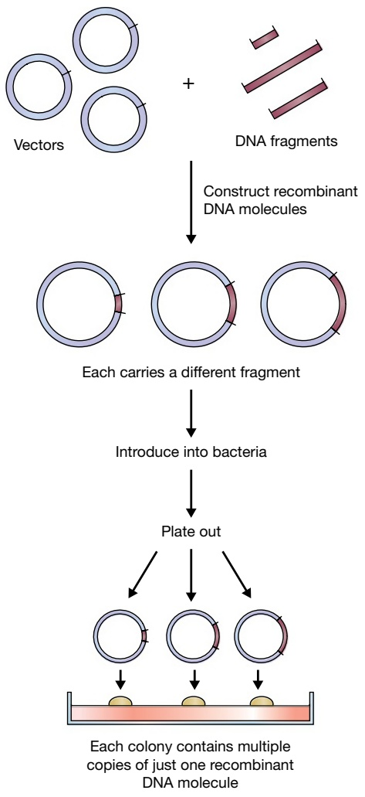

<details>
<summary>flowchart</summary>

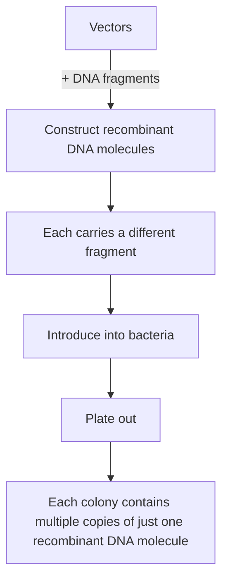
</details>

---

Chapter 1 Why Gene Cloning and DNA Analysis are Important

9

gene or part of a gene. This mixture could indeed be the entire genetic complement of an organism – a human, for instance. Each of these fragments becomes inserted into a different vector molecule to produce a family of recombinant DNA molecules, one of which carries the gene of interest. Usually only one recombinant DNA molecule is transported into any single host cell, so that although the final set of clones may contain many different recombinant DNA molecules, each individual clone contains multiple copies of just one molecule. The gene is now separated away from all the other genes in the original mixture, and its specific features can be studied in detail.

In practice, the key to the success or failure of a gene cloning experiment is the ability to identify the particular clone of interest from the many different ones that are obtained. If we consider the **genome** of the bacterium Escherichia coli, which contains just over 4000 different genes, we might at first despair of being able to find just one gene among all the possible clones (Figure 1.4). The problem becomes even more overwhelming when we remember that bacteria are relatively simple organisms and that the human genome contains about five times as many genes. However, as explained in Chapter  8, a variety of different strategies can be used to ensure that the correct gene can be obtained at the end of the cloning

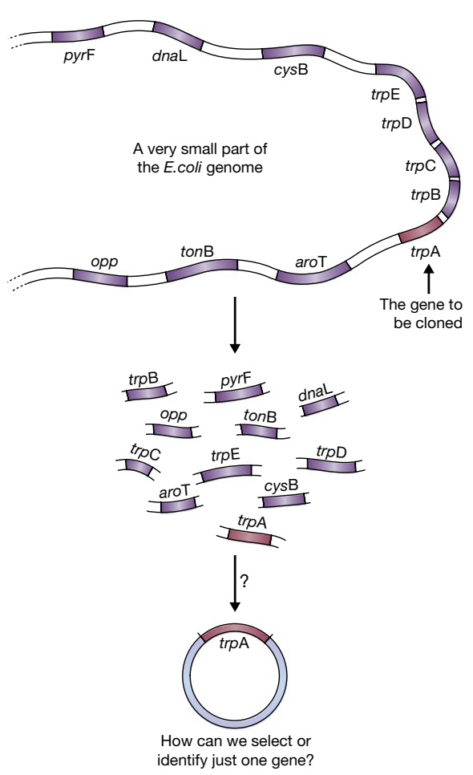

<details>
<summary>flowchart</summary>

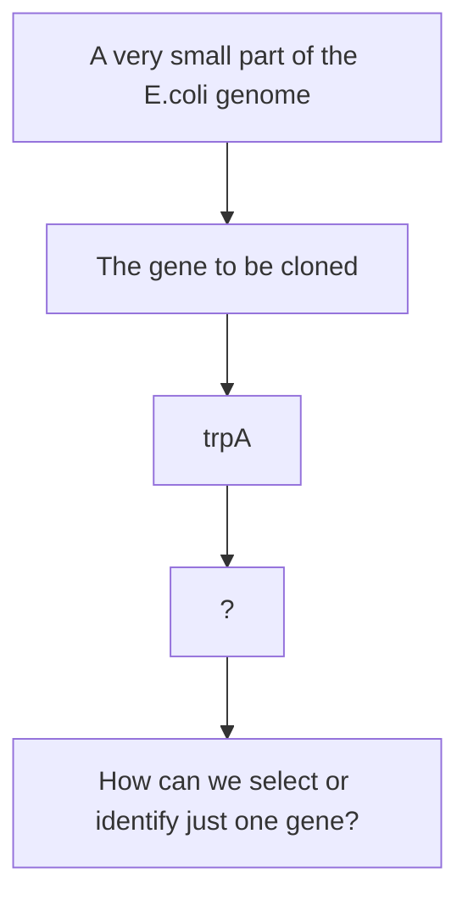
</details>

Figure 1.4 The problem of selection.

---

10

Part I The Basic Principles of Gene Cloning and DNA Analysis

experiment. Some of these strategies involve modifications to the basic cloning procedure, so that only cells containing the desired recombinant DNA molecule can divide and the clone of interest is automatically **selected**. Other methods involve techniques that enable the desired clone to be identified from a mixture of lots of different clones.

Once a gene has been cloned there is almost no limit to the information that can be obtained about its structure and expression. The availability of cloned material has stimulated the development of many different analytical methods for studying genes, with new techniques being introduced all the time. Methods for studying the structure and expression of a cloned gene are described in Chapters 10 and 11, respectively.

## 1.5.2 PCR can also be used to purify a gene

The polymerase chain reaction can also be used to obtain a pure sample of a gene. This is because the region of the starting DNA molecule that is copied during PCR is the segment whose boundaries are marked by the annealing positions of the two oligonucleotide primers. If the primers anneal either side of the gene of interest, many copies of that gene will be synthesized (Figure 1.5). The outcome is the same as with a gene cloning experiment, although the problem of selection does not arise because the desired gene is automatically ‘selected’ as a result of the positions at which the primers anneal.

A PCR experiment can be completed in a few hours, whereas it takes weeks if not months to obtain a gene by cloning. Why then is gene cloning still used? This is because PCR has two limitations:

In order for the primers to anneal to the correct positions, on either side of the gene of interest, the sequences of these annealing sites must

Figure 1.5

Gene isolation by PCR.

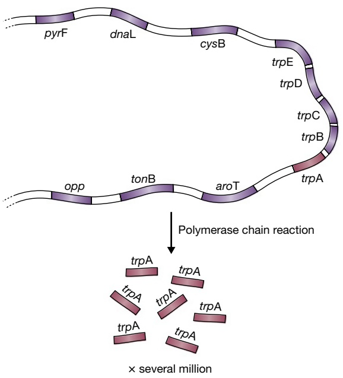

<details>
<summary>flowchart</summary>

This diagram illustrates the polymerase chain reaction process, showing how various protein domains (pyrF, dnaL, etc.) are converted into a complex structure that is then transformed into a final polymerase chain.
</details>

---

Chapter 1 Why Gene Cloning and DNA Analysis are Important

11

be known. It is easy to synthesize a primer with a predetermined sequence (see Figure 8.15), but if the sequences of the annealing sites are unknown then the appropriate primers cannot be made. This means that PCR cannot be used to isolate genes that have not been studied before – that has to be done by cloning.

There is a limit to the length of DNA sequence that can be copied by PCR. Five kilobases (kb) can be copied fairly easily, and segments up to forty kb can be dealt with by using specialized techniques, but this is shorter than the lengths of many genes, especially those of humans and other vertebrates. Cloning must be used if an intact version of a long gene is required.

Gene cloning is therefore the only way of isolating long genes or those that have never been studied before. But PCR still has many important applications. For example, even if the sequence of a gene is not known, it may still be possible to determine the appropriate sequences for a pair of primers, based on what is known about the sequence of the equivalent gene in a different organism. A gene that has been isolated and sequenced from, say, mouse could therefore be used to design a pair of primers for isolation of the equivalent gene from humans.

In addition, there are many applications where it is necessary to isolate or detect genes whose sequences are already known. A PCR of human globin genes, for example, is used to test for the presence of mutations that might cause the blood disease called thalassaemia. Design of appropriate primers for this PCR is easy because the sequences of the human globin genes are known. After the PCR, the gene copies are sequenced or studied in some other way to determine if any of the thalassaemia mutations are present.

Another clinical application of PCR involves the use of primers specific for the DNA of a disease‐causing virus. A positive result indicates that a sample contains the virus and that the person who provided the sample should undergo treatment to prevent onset of the disease. The polymerase chain reaction is tremendously sensitive, a carefully set up reaction yielding detectable amounts of DNA even if there is just one DNA molecule in the starting mixture. This means that the technique can detect viruses at the earliest stages of an infection, increasing the chances of treatment being successful. This great sensitivity means that PCR can also be used with DNA from forensic material such as hairs and dried bloodstains, or even from the bones of long‐dead humans (Chapter 17).

## 1.6 How to find your way through this book

This book explains how gene cloning, PCR, and other DNA analysis techniques are carried out and describes the applications of these techniques in modern biology. The applications are covered in the second and

---

12

Part I The Basic Principles of Gene Cloning and DNA Analysis

third parts of the book. Part II describes how genes and genomes are studied and Part III gives accounts of the broader applications of gene cloning and PCR in biotechnology, medicine, agriculture, and forensic science.

In Part I we deal with the basic principles. Most of the nine chapters in Part I are devoted to gene cloning because this technique is more complicated than PCR. When you have understood how cloning is carried out you will have understood many of the basic principles of how DNA is analyzed. In Chapter 2 we look at the central component of a gene cloning experiment – the vector – which transports the gene into the host cell and is responsible for its replication. To act as a cloning vector a DNA molecule must be capable of entering a host cell and, once inside, replicating to produce multiple copies of itself. Two naturally occurring types of DNA molecule satisfy these requirements:

• **Plasmids**, which are small circles of DNA found in bacteria and some other organisms. Plasmids can replicate independently of the host cell chromosome.
• **Virus chromosomes**, in particular the chromosomes of **bacteriophages**, which are viruses that specifically infect bacteria. During infection the bacteriophage DNA molecule is injected into the host cell where it undergoes replication.

Chapter 3 describes how DNA is purified from living cells – both the DNA that will be cloned and the vector DNA – and Chapter 4 covers the various techniques for handling purified DNA molecules in the laboratory. There are many such techniques, but two are particularly important in gene cloning. These are the ability to cut the vector at a specific point and then to repair it in such a way that the gene is inserted (see Figure 1.1). These and other DNA manipulations were developed as an offshoot of basic research into DNA synthesis and modification in living cells, and most of the manipulations make use of purified enzymes. The properties of these enzymes, and the way they are used in DNA studies, are described in Chapter 4.

Once a recombinant DNA molecule has been constructed, it must be introduced into the host cell so that replication can take place. Transport into the host cell makes use of natural processes for uptake of plasmid and viral DNA molecules. These processes and the ways they are utilized in gene cloning are described in Chapter 5, and the most important types of cloning vector are introduced, and their uses examined, in Chapters 6 and 7. To conclude the coverage of gene cloning, in Chapter 8 we investigate the problem of selection (see Figure  1.4), before returning in Chapter  9 to a more detailed description of PCR and its related techniques.

---

Chapter 1 Why Gene Cloning and DNA Analysis are Important

13

## Further reading

- Backman, K. (2001) The advent of genetic engineering. Trends in Biochemical Science, 26, 268–270. [An account of the early days of gene cloning.]
- Brock, T.D. (1990) The Emergence of Bacterial Genetics. Cold Spring Harbor Laboratory Press, New York. [Details the discovery of plasmids and bacteriophages.]
- Brown, T.A. (2017) Genomes, 4<sup>th</sup> edn. Garland Science, London. [An introduction to modern genetics and molecular biology.]
- Cherfas, J. (1982) Man Made Life. Pantheon, New York. [A history of the early years of genetic engineering.]
- Cohen, S.N. (2013) DNA cloning: a personal view after 40 years. Proceedings of the National Academy of Sciences, USA, 110, 15521–15529. [The author is one of the scientists who carried out the first gene cloning experiments in the early 1970s.]
- Judson, H.F. (1996) Eighth Day of Creation: Makers of the Revolution in Biology. Cold Spring Harbor Laboratory Press, New York. [A very readable account of the development of molecular biology in the years before the gene cloning revolution.]
- Mullis, K.B. (1990) The unusual origins of the polymerase chain reaction. Scientific American, 262(4), 56–65. [An entertaining account of how PCR was invented.]

---


---

## Chapter 2

# Vectors for Gene Cloning: Plasmids and Bacteriophages

Chapter contents

**2.1** Plasmids 15
**2.2** Bacteriophages 19

A DNA molecule needs to display several features to be able to act as a vector for gene cloning. Most importantly it must be able to replicate within the host cell, so that numerous copies of the recombinant DNA molecule can be produced and passed to the daughter cells. A cloning vector also needs to be relatively small, ideally less than 10 kb in size, as large molecules tend to break down during purification, and are also more difficult to manipulate. Two kinds of DNA molecule that satisfy these criteria can be found in bacterial cells: plasmids and bacteriophage chromosomes.

## 2.1 Plasmids

Plasmids are circular molecules of DNA that lead an independent existence in the bacterial cell (Figure 2.1). Plasmids almost always carry one or more genes, and often these genes are responsible for a useful characteristic displayed by the host bacterium. For example, the ability to survive in normally toxic concentrations of antibiotics such as chloramphenicol or

Gene Cloning and DNA Analysis: An Introduction, Eighth Edition. T. A. Brown.

© 2021 John Wiley & Sons Ltd. Published 2021 by John Wiley & Sons Ltd.

15

---

16

Part I The Basic Principles of Gene Cloning and DNA Analysis

Figure 2.1

Plasmids: independent genetic elements found in bacterial cells.

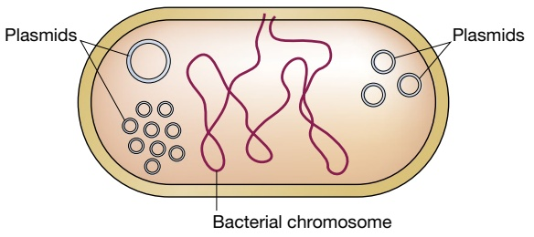

<details>
<summary>text_image</summary>

Plasmids
Bacterial chromosome
Plasmids
</details>

ampicillin is often due to the presence in the bacterium of a plasmid carrying antibiotic resistance genes. In the laboratory, antibiotic resistance is often used as a **selectable marker** to ensure that bacteria in a culture contain a particular plasmid (Figure 2.2).

Most plasmids possess at least one DNA sequence that can act as an **origin of replication**, so they are able to multiply within the cell independently of the main bacterial chromosome (Figure 2.3a). The smaller plasmids make use of the host cell’s own DNA replicative enzymes in order to make copies of themselves, whereas some of the larger ones carry genes that code for special enzymes that are specific for plasmid replication. A few types of plasmid are also able to replicate by inserting themselves into the bacterial chromosome (Figure  2.3b). These integrative plasmids or

Figure 2.2

The use of antibiotic resistance as a selectable marker for a plasmid. RP4 (top) carries genes for resistance to ampicillin, tetracycline, and kanamycin. Only those E. coli cells that contain RP4 (or a related plasmid) are able to survive and grow in a medium that contains toxic amounts of one or more of these antibiotics.

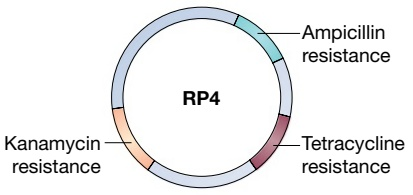

<details>
<summary>donut</summary>

| Category | Relative Resistance Level |
| --- | --- |
| Ampicillin resistance | High |
| Tetracycline resistance | Medium |
| Kanamycin resistance | Low |
| Unlabeled segment (Light Blue) | Low |
| Unlabeled segment (Grey) | Low |
</details>

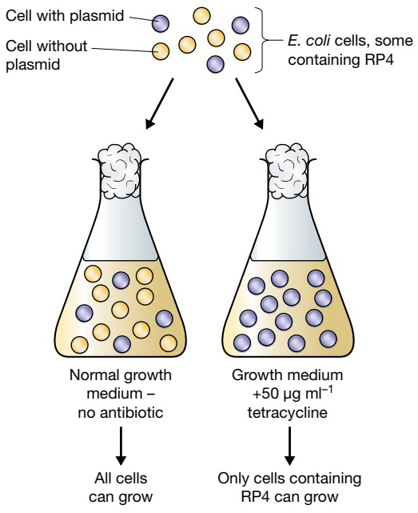

<details>
<summary>flowchart</summary>

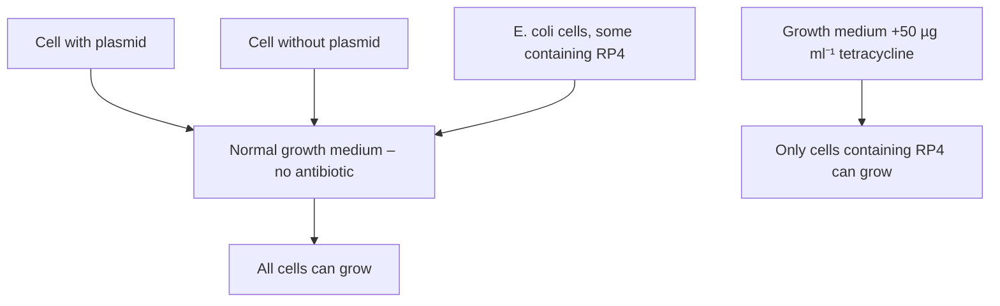
</details>

---

Chapter 2 Vectors for Gene Cloning: Plasmids and Bacteriophages

17

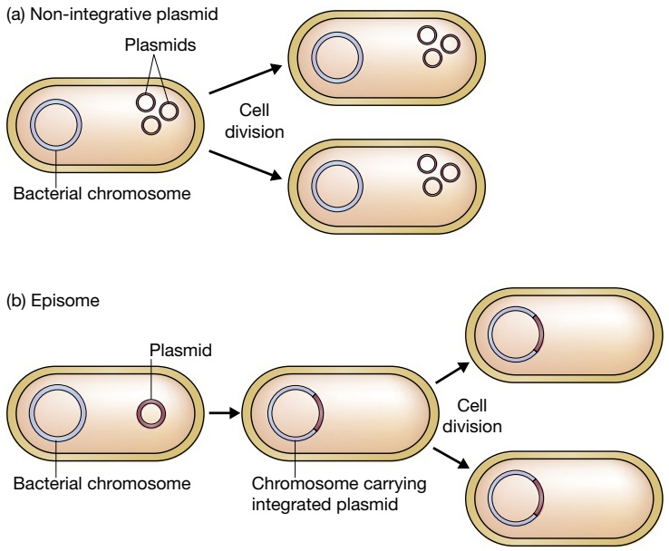

Figure 2.3

Replication strategies for (a) a non‐integrative plasmid, and (b) an episome.

**episomes** may be stably maintained in this form through numerous cell divisions, but they always at some stage exist as independent elements.

## 2.1.1 Size and copy number

The size and **copy number** of a plasmid are particularly important as far as cloning is concerned. We have already mentioned the relevance of plasmid size and stated that less than 10 kb is desirable for a cloning vector. Plasmids range from about 1.0 kb for the smallest to over 250 kb for the largest plasmids (Table 2.1), so only a few are useful for cloning purposes. However, as we will see in Chapter 7, larger plasmids can be adapted for cloning under some circumstances.

Table 2.1

Sizes of representative plasmids.

<table><tr><td rowspan="2">PLASMID</td><td colspan="2">SIZE</td><td rowspan="2">ORGANISM</td></tr><tr><td>NUCLEOTIDE LENGTH (kb)</td><td>MOLECULAR MASS (MDa)</td></tr><tr><td>pUC8</td><td>2.7</td><td>1.8</td><td>E. coli</td></tr><tr><td>ColE1</td><td>6.6</td><td>4.3</td><td>E. coli</td></tr><tr><td>RP4</td><td>54</td><td>35</td><td>Pseudomonas and others</td></tr><tr><td>F</td><td>99</td><td>64</td><td>E. coli</td></tr><tr><td>TOL</td><td>117</td><td>76</td><td>Pseudomonas putida</td></tr><tr><td>pTiBo542</td><td>245</td><td>159</td><td>Agrobacterium tumefaciens</td></tr></table>

---

18

Part I The Basic Principles of Gene Cloning and DNA Analysis

The copy number refers to the number of molecules of an individual plasmid that are normally found in a single bacterial cell. The factors that control copy number are not well understood. Some plasmids, especially the larger ones, are **stringent** and have a low copy number of perhaps just one or two per cell; others, called **relaxed** plasmids, are present in multiple copies of 50 or more per cell. Generally speaking, a useful cloning vector needs to be present in the cell in multiple copies so that large quantities of the recombinant DNA molecule can be obtained.

## 2.1.2 Conjugation and compatibility

Plasmids fall into two groups: conjugative and non‐conjugative. Conjugative plasmids are characterized by the ability to promote sexual **conjugation** between bacterial cells (Figure 2.4), a process that can result in a conjugative plasmid spreading from one cell to all the other cells in a bacterial culture. Conjugation and plasmid transfer are controlled by a set of transfer or tra genes, which are present on conjugative plasmids but absent from the non‐conjugative type. However, a non‐conjugative plasmid may, under some circumstances, be cotransferred along with a conjugative plasmid when both are present in the same cell.

Several different kinds of plasmid may be found in a single cell, including more than one different conjugative plasmid at any one time. In fact, cells of E. coli have been known to contain up to seven different plasmids at once. To be able to coexist in the same cell, different plasmids must be **compatible**. If two plasmids are incompatible, then one or the other will be rapidly lost from the cell. Different types of plasmid can therefore be assigned to different **incompatibility groups** on the basis of whether or not they can coexist, and plasmids from a single incompatibility group are

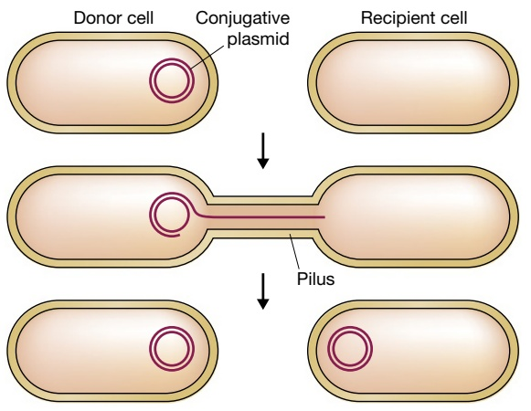

<details>
<summary>flowchart</summary>

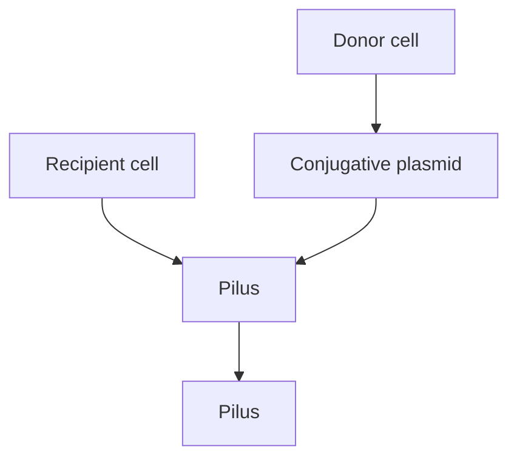
</details>

Figure 2.4

Plasmid transfer by conjugation between bacterial cells. The donor and recipient cells attach to each other by a **pilus**, a hollow appendage present on the surface of the donor cell. A copy of the plasmid is then passed to the recipient cell. Exactly how this transfer occurs is not understood. The DNA might pass directly through the pilus, as shown here, but an alternative theory is that the pilus contracts, bringing the cells together, with DNA transfer then occurring directly across the cell walls.

---

Chapter 2 Vectors for Gene Cloning: Plasmids and Bacteriophages

19

often related to each other in various ways. The basis of incompatibility is not well understood, but events during plasmid replication are thought to underlie the phenomenon.

## 2.1.3 Plasmid classification

The most useful classification of naturally occurring plasmids is based on the main characteristic coded by the plasmid genes. The five major types of plasmid according to this classification are as follows:

• **Fertility** or **F plasmids** carry only tra genes and have no characteristic beyond the ability to promote conjugal transfer of plasmids. A wellknown example is the F plasmid of E. coli.
**Resistance** or **R plasmids** carry genes conferring on the host bacterium resistance to one or more antibacterial agents, such as chloramphenicol, ampicillin, or mercury. R plasmids are very important in clinical microbiology as their spread through natural populations can have profound consequences in the treatment of bacterial infections. An example is RP4, which is commonly found in Pseudomonas, but also occurs in many other bacteria.
**Col plasmids** code for colicins, proteins that kill other bacteria. An example is ColE1 of E. coli.
**Degradative plasmids** allow the host bacterium to metabolize unusual molecules such as toluene and salicylic acid, an example being TOL of Pseudomonas putida.
**Virulence plasmids** confer pathogenicity on the host bacterium; these include the **Ti plasmids** of Agrobacterium tumefaciens, which induce crown gall disease on dicotyledonous plants.

## 2.1.4 Plasmids in organisms other than bacteria

Although plasmids are widespread in bacteria they are by no means as common in other organisms. The best‐characterized eukaryotic plasmid is the **2 μm circle** that occurs in many strains of the yeast Saccharomyces cerevisiae. The discovery of the 2 μm plasmid was very fortuitous as it allowed the construction of cloning vectors for this very important industrial organism (Section  7.1). However, the search for plasmids in other eukaryotes (such as filamentous fungi, plants, and animals) has proved disappointing, and it is suspected that many higher organisms simply do not harbour plasmids within their cells.

## 2.2 Bacteriophages

Bacteriophages, or phages as they are commonly known, are viruses that specifically infect bacteria. Like all viruses, phages are very simple in structure, consisting merely of a DNA (or occasionally ribonucleic acid [RNA])

---

20

Part I The Basic Principles of Gene Cloning and DNA Analysis

The two main types of phage structure. (a) Head‐and‐tail (e.g. λ). (b) Filamentous (e.g. M13).

Figure 2.5

(a) Head-and-tail

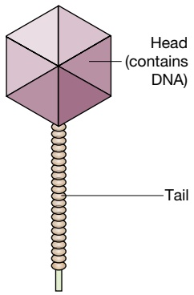

<details>
<summary>text_image</summary>

Head
(contains
DNA)
Tail
</details>

(b) Filamentous

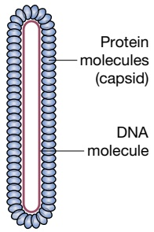

<details>
<summary>text_image</summary>

Protein
molecules
(capsid)
DNA
molecule
</details>

molecule carrying a number of genes, including several for replication of the phage, surrounded by a protective coat or **capsid** made up of protein molecules (Figure 2.5).

## 2.2.1 The phage infection cycle

The general pattern of infection, which is the same for all types of phage, is a three‐step process (Figure 2.6):

1 The phage particle attaches to the outside of the bacterium and injects its DNA chromosome into the cell.
2 The phage DNA molecule is replicated, usually by specific phage enzymes coded by genes in the phage chromosome.
3 Other phage genes direct synthesis of the protein components of the capsid, and new phage particles are assembled and released from the bacterium.

With some phage types the entire infection cycle is completed very quickly, possibly in less than 20 minutes. This type of rapid infection is called a **lytic cycle**, as release of the new phage particles is associated with lysis of the bacterial cell. The characteristic feature of a lytic infection cycle is that phage DNA replication is immediately followed by synthesis of capsid proteins, and the phage DNA molecule is never maintained in a stable condition in the host cell.

## 2.2.2 Lysogenic phages

In contrast to a lytic cycle, **lysogenic** infection is characterized by retention of the phage DNA molecule in the host bacterium, possibly for many thousands of cell divisions. With many lysogenic phages, the phage DNA is inserted into the bacterial genome, in a manner similar to episomal insertion (see Figure 2.3b). The integrated form of the phage DNA (called the **prophage**) is quiescent, and a bacterium (referred to as a **lysogen**) that carries a prophage is usually physiologically indistinguishable from an

---

Chapter 2 Vectors for Gene Cloning: Plasmids and Bacteriophages

21

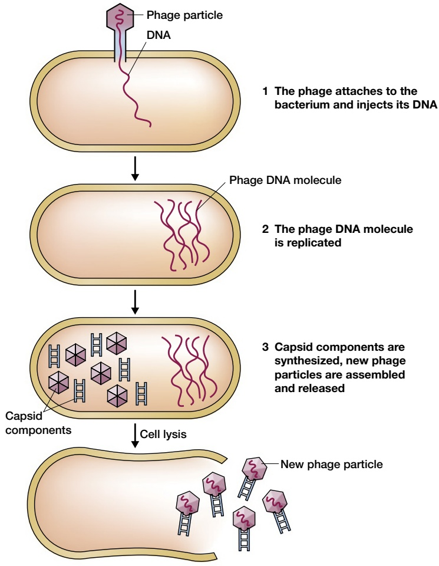

<details>
<summary>flowchart</summary>

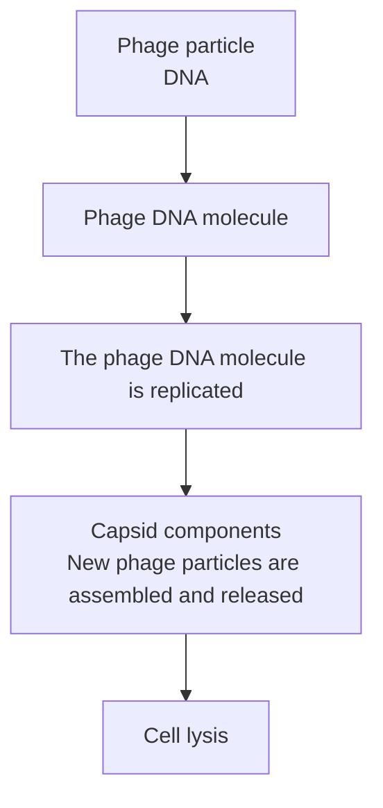
</details>

Figure 2.6

The general pattern of infection of a bacterial cell by a bacteriophage.

uninfected cell. However, the prophage is eventually released from the host genome and the phage reverts to the lytic mode and lyses the cell. The infection cycle of **lambda (λ)**, a typical lysogenic phage of this type, is shown in Figure 2.7.

A limited number of lysogenic phages follow a rather different infection cycle. When **M13** or a related phage infects E. coli, new phage particles are continuously assembled and released from the cell. The M13 DNA is not integrated into the bacterial genome and does not become quiescent. With these phages, cell lysis never occurs, and the infected bacterium can continue to grow and divide, albeit at a slower rate than uninfected cells. Figure 2.8 shows the M13 infection cycle.

Although there are many different varieties of bacteriophage, only λ and M13 have found a major role as cloning vectors. We will now consider the properties of these two phages in more detail.

---

22

Part I The Basic Principles of Gene Cloning and DNA Analysis

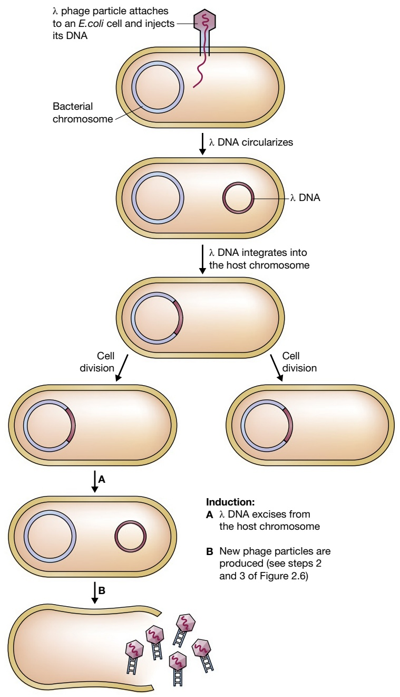

<details>
<summary>flowchart</summary>

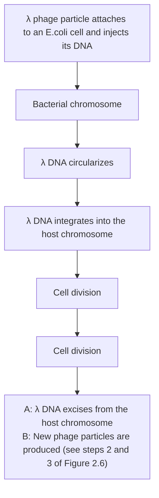
</details>

Figure 2.7

The lysogenic infection cycle of bacteriophage λ.

## Gene organization in the λ DNA molecule

Lambda is a typical example of a head‐and‐tail phage (see Figure 2.5a). The DNA is contained in the polyhedral head structure and the tail serves to attach the phage to the bacterial surface and to inject the DNA into the cell (see Figure 2.7).

---

Chapter 2 Vectors for Gene Cloning: Plasmids and Bacteriophages

23

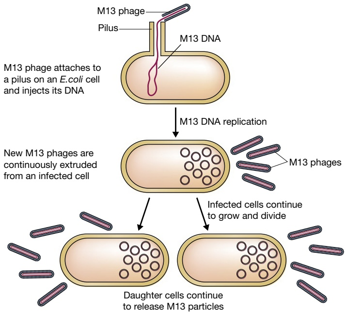

<details>
<summary>flowchart</summary>

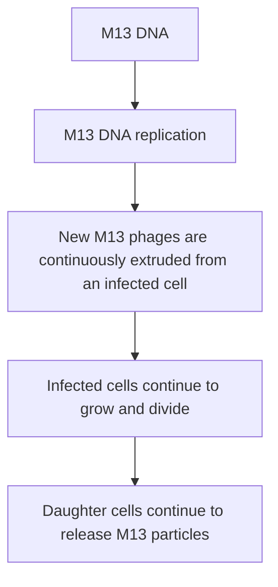
</details>

Figure 2.8

The infection cycle of bacteriophage M13.

The λ DNA molecule is 48.5 kb in size and has been intensively studied by the techniques of gene mapping and DNA sequencing. As a result, the positions and identities of all of the genes in the λ DNA molecule are known (Figure 2.9). A feature of the λ genetic map is that genes related in terms of function are clustered together in the genome. For example, all of the genes coding for components of the capsid are grouped together in the left‐hand third of the molecule, and genes controlling integration of the prophage into the host genome are clustered in the middle of the molecule. Clustering of related genes is profoundly important for controlling expression of the λ genome, as it allows genes to be switched on and off as a group rather than individually. Clustering is also important in the construction of λ‐based cloning vectors, as we will discover when we return to this topic in Chapter 6.

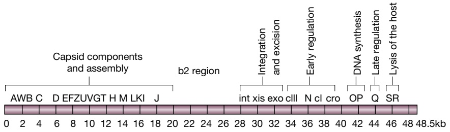

<details>
<summary>text_image</summary>

Capsid components
and assembly
b2 region
AWB C D EFZUVGT H M LKI J
int xis exo clll N cl cro
Integration
and excision
Early regulation
DNA synthesis
Late regulation
Lysis of the host
0 2 4 6 8 10 12 14 16 18 20 22 24 26 28 30 32 34 36 38 40 42 44 46 48 48.5kb
</details>

Figure 2.9

The λ genetic map, showing the positions of the important genes and the functions of the gene clusters. The b2 region contains genes that are not essential when λ phage are grown in the laboratory, but which are thought to play an important role in the natural environment.

---

24

Part I The Basic Principles of Gene Cloning and DNA Analysis

## The linear and circular forms of λ DNA

A second feature of λ that turns out to be of importance in the construction of cloning vectors is the conformation of the DNA molecule. The molecule shown in Figure 2.9 is linear, with two free ends, and represents the DNA present in the phage head structure. This linear molecule consists of two **complementary** strands of DNA, base‐paired according to the **Watson– Crick rules** (that is, double‐stranded DNA). However, at either end of the molecule is a short 12‐nucleotide stretch in which the DNA is singlestranded (Figure 2.10a). The two single strands are complementary, and so can base pair with one another to form a circular, completely doublestranded molecule (Figure 2.10b).

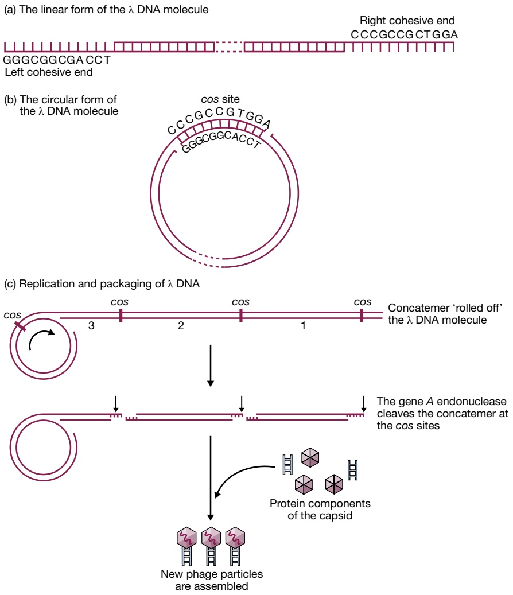

Figure 2.10

The linear and circular forms of λ DNA. (a) The linear form, showing the left and right cohesive ends. (b) Base pairing between the cohesive ends results in the circular form of the molecule. (c) Rolling circle replication produces a concatemer of new linear λ DNA molecules, which are individually packaged into phage heads as new λ particles are assembled.

---

Chapter 2 Vectors for Gene Cloning: Plasmids and Bacteriophages

25

Complementary single strands are often referred to as **‘sticky’ ends** or cohesive ends, because base pairing between them can ‘stick’ together the two ends of a DNA molecule (or the ends of two different DNA molecules). The λ cohesive ends are called the **cos sites** and they play two distinct roles during the λ infection cycle. First, they allow the linear DNA molecule that is injected into the cell to be circularized, which is a necessary prerequisite for insertion into the bacterial genome (see Figure 2.7).

The second role of the cos sites is rather different and comes into play after the prophage has excised from the host genome. At this stage, a large number of new λ DNA molecules are produced by the rolling circle mechanism of replication (Figure 2.10c), in which a continuous DNA strand is ‘rolled off’ the template molecule. The result is a concatemer consisting of a series of linear λ genomes joined at the cos sites. The role of the cos sites is now to act as recognition sequences for an **endonuclease** that cleaves the concatemer at the cos sites, producing individual λ genomes. This endonuclease, which is the product of gene A on the DNA molecule, creates the single‐stranded sticky ends, and also acts in conjunction with other proteins to package each λ genome into a phage head structure. The cleavage and packaging processes recognize just the cos sites and the DNA sequences to either side of them, so changing the structure of the internal regions of  the λ genome, for example by inserting new genes, has no effect on these events so long as the overall length of the λ genome is not altered too greatly.

## M13 – a filamentous phage

M13 is an example of a filamentous phage (see Figure  2.5b) and is completely different in structure from λ. Furthermore, the M13 DNA molecule is much smaller than the λ genome, being only 6407 nucleotides in length. It is circular and is unusual in that it consists entirely of singlestranded DNA.

The smaller size of the M13 DNA molecule means that it has room for fewer genes than the λ genome. This is possible because the M13 capsid is constructed from multiple copies of just three proteins (requiring only three genes), whereas synthesis of the λ head‐and‐tail structure involves over 15 different proteins. In addition, M13 follows a simpler infection cycle than λ, and does not need genes for insertion into the host genome.

Injection of an M13 DNA molecule into an E. coli cell occurs via the pilus, the structure that connects two cells during sexual conjugation (see Figure 2.4). Once inside the cell the single‐stranded molecule acts as the template for synthesis of a complementary strand, resulting in normal double‐stranded DNA (Figure 2.11a). This molecule is not inserted into the bacterial genome, but instead replicates until over 100 copies are present in the cell (Figure 2.11b). When the bacterium divides, each daughter cell receives copies of the phage genome, which continues to replicate, thereby maintaining its overall numbers per cell. As shown in Figure 2.11c, new phage particles are continuously assembled and released, with about 1000 new phages being produced during each generation of an infected cell.

Several features of M13 make this phage attractive as a cloning vector. The genome is less than 10 kb in size, well within the range desirable for a

---

26

Part I The Basic Principles of Gene Cloning and DNA Analysis

Figure 2.11

The M13 infection cycle, showing the different types of DNA replication that occur. (a) After infection the singlestranded M13 DNA molecule is converted into the doublestranded replicative form (RF). (b) The RF replicates to produce multiple copies of itself. (c) Single‐stranded molecules are synthesized by rolling circle replication and used in the assembly of new M13 particles.

(a) Injection of singlestranded DNA into the host cell, followed by synthesis of the second strand

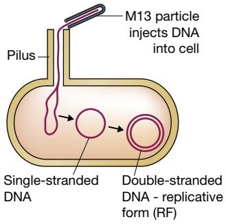

<details>
<summary>text_image</summary>

M13 particle
injects DNA
into cell
Pilus
Single-stranded DNA
Double-stranded DNA - replicative form (RF)
</details>

(b) Replication of the RF to produce new double-stranded molecules

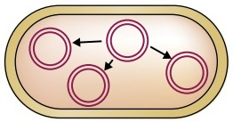

<details>
<summary>flowchart</summary>

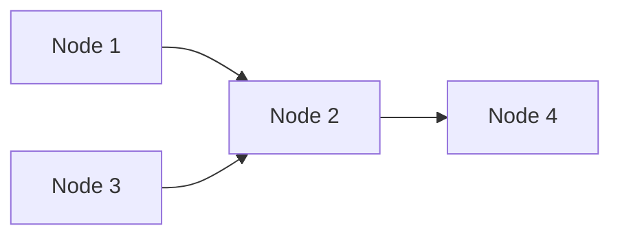
</details>

Mature M13 phage(c) are continuously produced RF replicates by rolling circle mechanism to produce linear single-stranded DNA

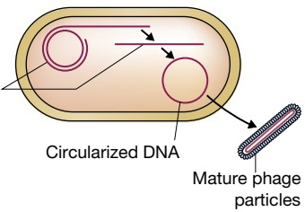

<details>
<summary>text_image</summary>

Circularized DNA
Mature phage
particles
</details>

potential vector. In addition, the double‐stranded **replicative form (RF)** of the M13 genome behaves very much like a plasmid and can be treated as such for experimental purposes. It is easily prepared from a culture of infected E. coli cells (Section 3.3.5) and can be reintroduced by **transfection** (Section 5.3.1). Most importantly, genes cloned with an M13‐based vector can be obtained in the form of single‐stranded DNA. Single‐stranded versions of cloned genes are useful for several techniques, such as in vitro mutagenesis (Section 11.3.2). Cloning in an M13 vector is an easy and reliable way of obtaining single‐stranded DNA for this type of work. M13 vectors are also used in **phage display**, a technique for identifying pairs of genes whose protein products interact with one another (Section 13.2.2).

## 2.2.3 Viruses as cloning vectors for other organisms

Most living organisms are infected by viruses and it is not surprising that there has been great interest in the possibility that viruses might be used as cloning vectors for higher organisms. This is especially important when it is remembered that plasmids are not commonly found in organisms other than bacteria and yeast. Several eukaryotic viruses have been employed as cloning vectors for specialized applications. For example, human **adenoviruses** and **retroviruses** are used in **gene therapy** (Section 15.3), **baculoviruses** are used to synthesize important pharmaceutical proteins in insect

---

Chapter 2 Vectors for Gene Cloning: Plasmids and Bacteriophages

27

cells (Section  14.3.2), and **caulimoviruses** and **geminiviruses** have been used for cloning in plants (Section 7.2.3). These vectors are discussed more fully in Chapter 7.

## Further reading

- Casjens, S.R. and Hendrix, R.W. (2015) Bacteriophage lambda: early pioneer and still relevant. Virology, 479, 310–330. [Review of the lambda infection cycle, with focus on the roles of individual genes.]
- Dale, J.W. and Park, S.F. (2010) Molecular Genetics of Bacteria, 5<sup>th</sup> edn. Wiley Blackwell, Chichester. [Provides a detailed description of plasmids and bacteriophages.]
- Marvin, D.A. (1998) Filamentous phage structure, infection and assembly. Current Opinion in Structural Biology, 8, 150–158.
- Waksman, G. (2019) From conjugation to T4S systems in Gram‐negative bacteria: a mechanistic biology perspective. EMBO Reports, 20, e47012. [Describes the latest research on DNA transfer during conjugation.]
- Willey, J., Sherwood, L., and Woolverton, C.J. (2017) Prescott’s Microbiology, 10<sup>th</sup> edn. McGraw Hill Education, New York. [A good introduction to microbiology, including plasmids and phages.]

---


---

## Chapter 3

# Purification of DNA from Living Cells

## Chapter contents

**3.1** Preparation of total cell DNA 30
**3.2** Preparation of plasmid DNA 40
**3.3** Preparation of bacteriophage DNA 46

The genetic engineer will, at different times, need to prepare at least three distinct kinds of DNA. First, **total cell DNA** will often be required as a source of material from which to obtain genes to be cloned. Total cell DNA may be DNA from a culture of bacteria, from a plant, from animal cells, or from any other type of organism that is being studied. It consists of the **genomic DNA** of the organism along with any additional DNA molecules, such as plasmids, that are present.

The second type of DNA that will be required is pure plasmid DNA. Preparation of plasmid DNA from a culture of bacteria follows the same basic steps as purification of total cell DNA, with the crucial difference that at some stage the plasmid DNA must be separated from the main bulk of chromosomal DNA also present in the cell.

Finally, phage DNA will be needed if a phage cloning vector is to be used. Phage DNA is generally prepared from bacteriophage particles rather than from infected cells, so there is no problem with contaminating bacterial DNA. However, special techniques are needed to remove the phage capsid. An exception is the double‐stranded replicative form of M13, which is prepared from E. coli cells in the same way as a bacterial plasmid.

Gene Cloning and DNA Analysis: An Introduction, Eighth Edition. T. A. Brown.

© 2021 John Wiley & Sons Ltd. Published 2021 by John Wiley & Sons Ltd.

29

---

30

Part I The Basic Principles of Gene Cloning and DNA Analysis

## 3.1 Preparation of total cell DNA

The fundamentals of DNA preparation are most easily understood by first  considering the simplest type of DNA purification procedure, that where the entire DNA complement of a bacterial cell is required. The modifications needed for plasmid and phage DNA preparation can then be described later.

The procedure for total DNA preparation from a culture of bacterial cells can be divided into four stages (Figure 3.1):

1 A culture of bacteria is grown and then **harvested**.
2 The cells are broken open to release their contents.
3 This **cell extract** is treated to remove all components except the DNA.
4 The resulting DNA solution is concentrated.

## 3.1.1 Growing and harvesting a bacterial culture

Most bacteria can be grown without too much difficulty in a liquid medium (**broth culture**). The culture medium must provide a balanced mixture of the essential nutrients at concentrations that will allow the bacteria to grow and divide efficiently. Two typical growth media are detailed in Table 3.1.

M9 is an example of a **defined medium** in which all the components are known. This medium contains a mixture of inorganic nutrients to provide essential elements such as nitrogen, magnesium, and calcium, as well as glucose to supply carbon and energy. In practice, additional growth factors such as trace elements and vitamins must be added to M9 before it will support bacterial growth. Precisely which supplements are needed depends on the species concerned.

The second medium described in Table 3.1 is rather different. Luria‐Bertani (LB) is a complex or **undefined medium**, meaning that the precise identity and quantity of its components are not known. This is because two of the ingredients, tryptone and yeast extract, are complicated mixtures of unknown chemical compounds. Tryptone in fact supplies amino acids and small peptides, while yeast extract (a dried preparation of partially digested yeast cells)

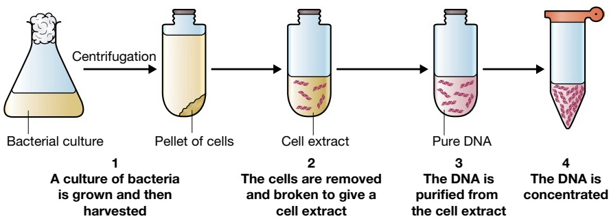

<details>
<summary>flowchart</summary>


</details>

Figure 3.1

The basic steps in preparation of total cell DNA from a culture of bacteria.

---

Chapter 3 Purification of DNA from Living Cells

31

Table 3.1

The composition of two typical media for the growth of bacterial cultures.

<table><tr><td>MEDIUM</td><td>COMPONENT</td><td>g  $I^{-1}$  OF MEDIUM</td></tr><tr><td rowspan="7">M9 medium</td><td> $Na_{2}HPO_{4}$ </td><td>6.0</td></tr><tr><td> $KH_{2}PO_{4}$ </td><td>3.0</td></tr><tr><td>NaCl</td><td>0.5</td></tr><tr><td> $NH_{4}Cl$ </td><td>1.0</td></tr><tr><td> $MgSO_{4}$ </td><td>0.5</td></tr><tr><td>Glucose</td><td>2.0</td></tr><tr><td> $CaCl_{2}$ </td><td>0.015</td></tr><tr><td rowspan="3">LB (Luria-Bertani medium)</td><td>Tryptone</td><td>10.0</td></tr><tr><td>Yeast extract</td><td>5.0</td></tr><tr><td>NaCl</td><td>10.0</td></tr></table>

provides the nitrogen requirements, along with sugars and inorganic and organic nutrients. Complex media such as LB need no further supplementation and support the growth of a wide range of bacterial species.

Defined media must be used when the bacterial culture has to be grown under precisely controlled conditions. However, this is not necessary when the culture is being grown simply as a source of DNA, and under these circumstances a complex medium is appropriate. In LB medium at $3 7 ^ { \circ } \mathrm { C } _ { 1 }$ aerated by shaking at 150–250 rpm on a rotary platform, E. coli cells divide once every 20 minutes or so until the culture reaches a maximum density of about $2 – 3   \times   1 0 ^ { 9 }$ cells $\mathbf { m } ^ { \mathrm { { l - 1 } } }$ . The growth of the culture can be monitored by reading the **optical density (OD)** at 600 nm (Figure 3.2), at which wavelength 1 OD unit corresponds to about $0 . 8 \times 1 0 ^ { 9 }$ cells ml<sup>–1</sup>.

In order to prepare a cell extract, the bacteria must be obtained in as small a volume as possible. Harvesting is therefore performed by spinning the culture in a centrifuge (Figure  3.3). Fairly low centrifugation speeds will pellet the bacteria at the bottom of the centrifuge tube, allowing the culture medium to be poured off. Bacteria from a 1000 ml culture at maximum cell density can then be resuspended into a volume of 10 ml or less.

## 3.1.2 Preparation of a cell extract

The bacterial cell is enclosed in a cytoplasmic membrane and surrounded by a rigid cell wall. With some species, including E. coli, the cell wall may itself be enveloped by a second, outer membrane. All of these barriers have to be disrupted to release the cell components.

Techniques for breaking open bacterial cells can be divided into physical methods, in which the cells are disrupted by mechanical forces, and chemical methods, where cell lysis is brought about by exposure to chemical agents that affect the integrity of the cell barriers. Chemical methods are most commonly used with bacterial cells when the object is DNA preparation.

Chemical lysis generally involves one agent attacking the cell wall and another disrupting the cell membrane (Figure 3.4a). The chemicals that are used depend on the species of bacterium involved, but with E. coli and related organisms, weakening of the cell wall is usually brought about by

---

32

Part I The Basic Principles of Gene Cloning and DNA Analysis

(a) Measurement of optical density

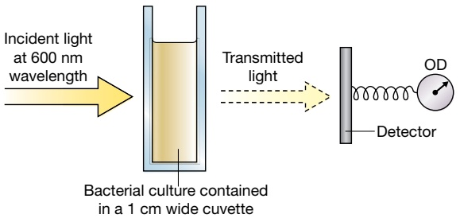

<details>
<summary>flowchart</summary>


</details>

Estimation of cell number(b) from a calibration curve

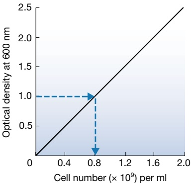

<details>
<summary>line</summary>

| Cell number (x 10^9) per ml | Optical density at 600 nm |
| --- | --- |
| 0 | 0 |
| 0.8 | 1.0 |
</details>

Figure 3.2

Estimation of bacterial cell number by measurement of optical density (OD). (a) A sample of the culture is placed in a glass cuvette and light with a wavelength of 600 nm shone through. The amount of light that passes through the culture is measured and the OD (also called the absorbance) calculated as:

$$
1 \text {OD unit} = \log_ {1 0} \frac {\text {intensity of transmitted light}}{\text {intensity of incident light}}
$$

The operation is performed with a spectrophotometer. (b) The cell number corresponding to the OD reading is calculated from a calibration curve. This curve is plotted from the OD values of a series of cultures of known cell density. For E. coli, $100\  min  = 0.8 \times 10^{9}$ cells ml<sup>–1</sup>.

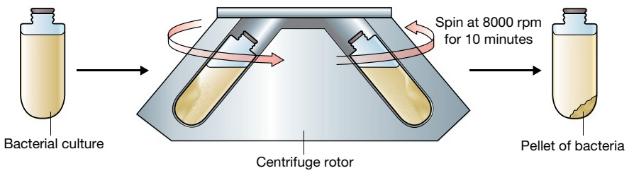

<details>
<summary>flowchart</summary>


</details>

Figure 3.3

Harvesting bacteria by centrifugation.

---

Chapter 3 Purification of DNA from Living Cells

33

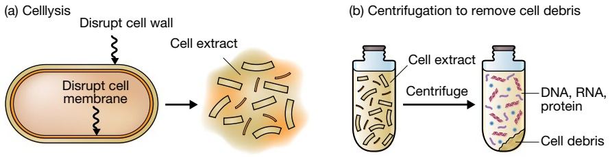

Figure 3.4

Preparation of a cell extract. (a) Cell lysis. (b) Centrifugation of the cell extract to remove insoluble debris.

**lysozyme**, ethylenediamine tetraacetate (EDTA), or a combination of both. Lysozyme is an enzyme that is present in egg white and in secretions such as tears and saliva, and which digests the polymeric compounds that give the cell wall its rigidity. EDTA removes calcium and magnesium ions that are essential for preserving the overall structure of the cell wall, and also inhibits cellular enzymes that could degrade DNA. Under some conditions, weakening the cell wall with lysozyme or EDTA is sufficient to cause bacterial cells to burst, but usually a detergent such as sodium dodecyl sulphate (SDS) is also added. Detergents aid the process of lysis by removing lipid molecules and thereby cause disruption of the cell membranes.

Having lysed the cells, the final step in preparation of a cell extract is removal of insoluble cell debris. Components such as partially digested cell wall fractions can be pelleted by centrifugation (Figure 3.4b), leaving the cell extract as a reasonably clear supernatant.

## 3.1.3 Purification of DNA from a cell extract

In addition to DNA, a bacterial cell extract contains significant quantities of protein and RNA. A variety of methods can be used to purify the DNA from this mixture. One approach is to treat the mixture with reagents which degrade the contaminants, leaving a pure solution of DNA (Figure 3.5a). Other methods use **chromatography** or some other fractionation process to separate the mixture into its various components, so the DNA is isolated from the proteins and RNA in the extract (Figure 3.5b).

Removing contaminants by organic extraction and enzyme digestion The standard way to deproteinize a cell extract is to add phenol or a 1 : 1 mixture of phenol and chloroform. These organic solvents precipitate proteins but leave the nucleic acids (DNA and RNA) in aqueous solution. The result is that if the cell extract is mixed gently with the solvent, and the layers then separated by centrifugation, precipitated protein molecules are left as a white coagulated mass at the interface between the aqueous and organic layers (Figure 3.6). The aqueous solution of nucleic acids can then be removed with a pipette.

With some cell extracts the protein content is so great that a single phenol extraction is not sufficient to completely purify the nucleic acids. This problem could be solved by carrying out several phenol extractions

---

34

Part I The Basic Principles of Gene Cloning and DNA Analysis

Figure 3.5

Two approaches to DNA purification. (a) Treating the mixture with reagents which degrade the contaminants, leaving a pure solution of DNA. (b) Separating the mixture into different fractions, one of which is pure DNA.

(a) Degradation of contaminants

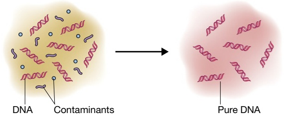

<details>
<summary>flowchart</summary>


</details>

(b) Separation of DNA from contaminants

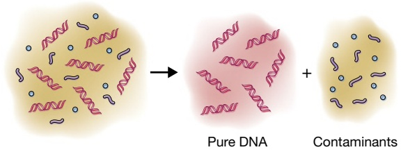

<details>
<summary>flowchart</summary>


</details>

one after the other, but this is undesirable as each mixing and centrifugation step results in a certain amount of breakage of the DNA molecules. The answer is to treat the cell extract with a **protease** such as pronase or  proteinase K before phenol extraction. These enzymes break polypeptides down into smaller units, which are more easily removed by phenol.

Some RNA molecules, especially **messenger RNA (mRNA)**, are removed by phenol treatment, but most remain with the DNA in the aqueous layer. The only effective way to remove the RNA is with the enzyme **ribonuclease**, which rapidly degrades these molecules into ribonucleotide subunits.

Using ion‐exchange chromatography to purify DNA from a cell extract Biochemists have devised various methods for using differences in electrical charge to separate mixtures of chemicals into their individual components. One of these methods is **ion‐exchange chromatography**, which separates molecules according to how tightly they bind to electrically charged particles present in a chromatographic matrix or **resin**. DNA and RNA are both negatively charged, as are some proteins, and so bind to a positively charged resin. The electrostatic attachment is disrupted by salt (Figure 3.7a), removal of the more tightly bound molecules requiring higher concentrations of salt.

Figure 3.6

Removal of protein contaminants by phenol extraction.

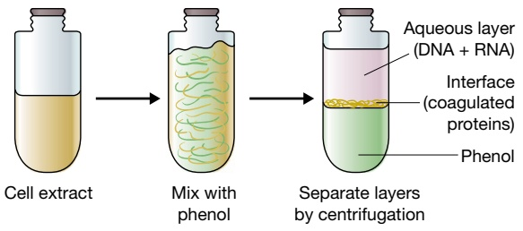

<details>
<summary>flowchart</summary>

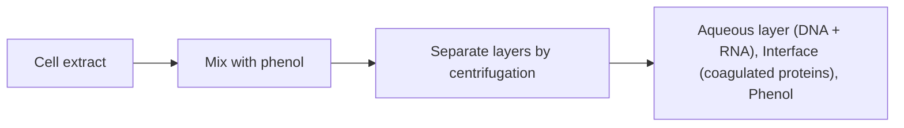
</details>

---

Chapter 3 Purification of DNA from Living Cells

35

(a) Attachment of DNA to ion-exchange particles

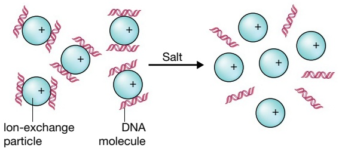

<details>
<summary>chemical</summary>

Diagram showing ion-exchange particles and DNA molecules reacting with salt to form a complex structure
</details>

(b) DNA purication by ion-exchange chromatography

Figure 3.7

DNA purification by ion‐exchange chromatography. (a) Attachment of DNA to ionexchange particles. (b) DNA is purified by column chromatography. The solutions passing through the column can be collected by gravity flow or by the spin column method, in which the column is placed in a low‐speed centrifuge.

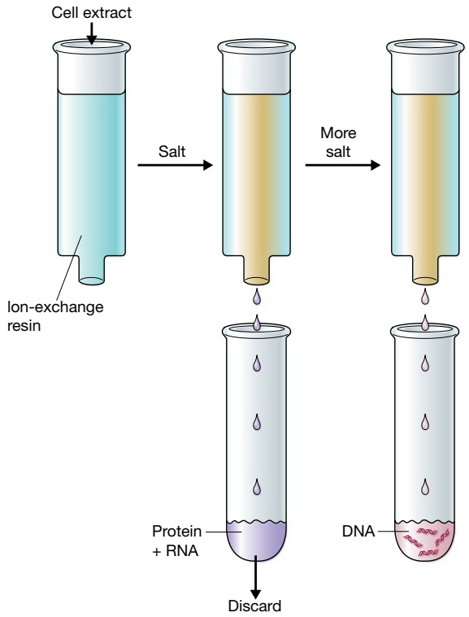

<details>
<summary>flowchart</summary>


</details>

By gradually increasing the salt concentration, different types of molecule can be detached from the resin one after another.

The simplest way to carry out ion‐exchange chromatography is to place the resin in a glass or plastic column and then add the cell extract to the top (Figure 3.7b). The extract passes through the column, and because this extract contains very little salt all the negatively charged molecules bind to the resin and are retained in the column. If a salt solution of gradually increasing concentration is now passed through the column, the different types of molecule will **elute** (i.e. become unbound) in the sequence protein, RNA, and finally DNA. However, such careful separation is usually not needed so just two salt solutions are used: one whose concentration is sufficient to elute the protein and RNA, leaving just the DNA bound, followed by a second solution of a higher concentration which elutes the DNA, now free from protein and RNA contaminants.

---

36

Part I The Basic Principles of Gene Cloning and DNA Analysis

Figure 3.8

DNA purification by the guanidinium thiocyanate and silica method.

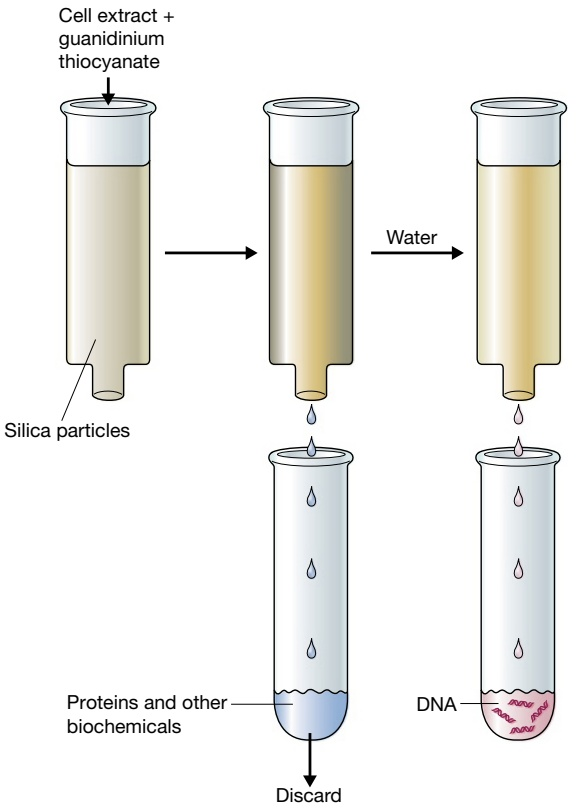

<details>
<summary>flowchart</summary>

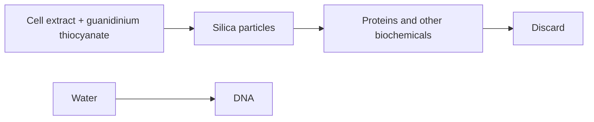
</details>

## Using silica to purify DNA from a cell extract

A second type of fractionation method for DNA purification makes use of silica particles. In the presence of guanidinium thiocyanate, DNA binds tightly to silica particles, providing an easy way of recovering the DNA from a cell extract. As with the ion‐exchange method, silica purification can be carried out in a chromatography column. The silica is placed in the column and the cell extract, to which guanidinium thiocyanate has been added, is passed through (Figure  3.8). DNA binds to the silica and is retained in the column, whereas the other biochemicals are immediately eluted. After washing away the last contaminants with guanidinium thiocyanate solution, the DNA is recovered by adding water, which destabilizes the interactions between the DNA molecules and the silica.

Alternatively, the silica and guanidinium thiocyanate can be added directly to the cell extract. After DNA binding, the sample is centrifuged to collect the silica particles (Figure 3.9a). The pellet is then resuspended in water to release the DNA. Another centrifugation re‐pellets the silica, leaving the DNA in solution. A clever modification of this method makes use of magnetic beads that are coated with silica. Rather than centrifugation, the beads are collected at the bottom of the test tube with a magnet (Figure 3.9b).

Magnetic collection has two advantages compared with the other types of fractionation method used to purify DNA. First, it is quicker, as time is not lost waiting for solutions to pass through a chromatography column

---

Chapter 3 Purification of DNA from Living Cells

37

(a) Silica particles added directly to the cell extract

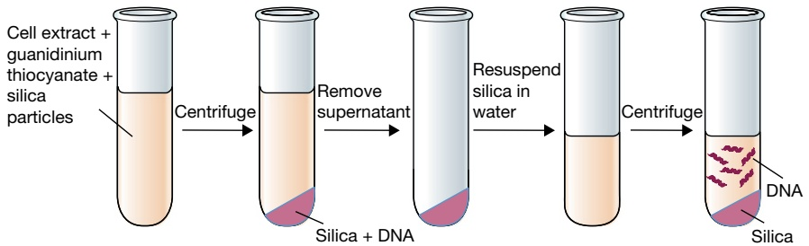

<details>
<summary>flowchart</summary>


</details>

(b) Silica-coated magnetic beads

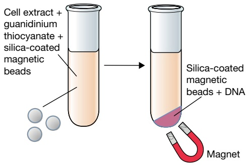

<details>
<summary>text_image</summary>

Cell extract + guanidinium thiocyanate + silica-coated magnetic beads
Silica-coated magnetic beads + DNA
Magnet
</details>

Figure 3.9

Alternative methods of using silica to purify DNA from a cell extract. (a) Silica particles are added directly to a cell extract and, after DNA binding, collected by centrifugation. (b) Silica‐coated magnetic beads are collected with a magnet.

or waiting for the centrifuge to complete its run. Second, magnetic collection is easier to automate. Using special equipment, many DNA purifications can be carried out in parallel, 96 in the simplest format but much higher numbers with the more sophisticated systems. This is an important consideration in applied settings such as clinical microbiology laboratories, where high throughput is needed so that many DNA samples can be processed as quickly as possible. The first types of magnetic beads to be used were simply particles of iron oxide, but nowadays the beads are made of synthetic polymer that contains a small amount of iron oxide to provide the magnetic properties. As well as silica coatings, synthetic polymers can be designed so they have electrically charged surfaces, so DNA is bound by electrostatic interactions and removed from the beads by changing the salt content or pH of the solution.

## 3.1.4 Concentration of DNA samples

Organic extraction often results in a very thick solution of DNA that does not need to be concentrated any further. Other purification methods give more dilute solutions and it is therefore important to consider methods for increasing the DNA concentration.

The most frequently used method of concentration is **ethanol precipitation**. In the presence of salt (strictly speaking, monovalent cations such as sodium ions, Na+), and at a temperature of $- 2 0 ^ { \circ } \mathrm { C }$ or less, absolute ethanol efficiently precipitates polymeric nucleic acids. With a thick solution of

---

38

Part I The Basic Principles of Gene Cloning and DNA Analysis

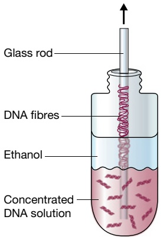

<details>
<summary>text_image</summary>

Glass rod
DNA fibres
Ethanol
Concentrated
DNA solution
</details>

(a)

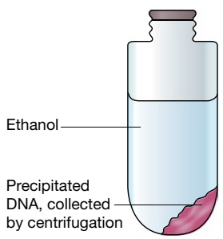

<details>
<summary>text_image</summary>

Ethanol
Precipitated
DNA, collected
by centrifugation
</details>

(b)

Figure 3.10

Collecting DNA by ethanol precipitation. (a) Absolute ethanol is layered on top of a concentrated solution of DNA. Fibres of DNA can be withdrawn with a glass rod. (b) For less concentrated solutions ethanol is added (at a ratio of 2.5 volumes of absolute ethanol to 1 volume of DNA solution) and precipitated DNA collected by centrifugation.

DNA, the ethanol can be layered on top of the sample, causing molecules to precipitate at the interface. A spectacular trick is to push a glass rod through the ethanol into the DNA solution. When the rod is removed, DNA molecules adhere and can be pulled out of the solution in the form of a long fibre (Figure  3.10a). Alternatively, if ethanol is mixed with a dilute DNA solution, the precipitate can be collected by centrifugation (Figure 3.10b), and then redissolved in an appropriate volume of water. Ethanol precipitation has the added advantage of leaving short‐chain and monomeric nucleic acid components in solution. Ribonucleotides produced by ribonuclease treatment are therefore lost at this stage.

## 3.1.5 Measurement of DNA concentration

It is crucial to know exactly how much DNA is present in a solution when carrying out a gene cloning experiment. Fortunately, DNA concentrations can be accurately measured by **ultraviolet (UV) absorbance spectrophotometry** (Figure 3.11a). The amount of UV radiation absorbed by a solution of DNA is directly proportional to the amount of DNA in the sample. Usually absorbance is measured at 260 nm, at which wavelength an absorbance $( \mathrm { A } _ { 2 6 0 } )$ of 1.0 corresponds to 50 μg of double‐stranded DNA per ml. Measurements of as little as 1 μl of a DNA solution can be carried out in spectrophotometers designed especially for this purpose.

Ultraviolet absorbance can also be used to check the purity of a DNA preparation. With a pure sample of DNA, the ratio of the absorbances at 260 and 280 nm $( \mathrm { A } _ { _ { 2 6 0 } } ^ { ^ - } / \mathrm { A } _ { _ { 2 8 0 } } )$ is 1.8. Ratios of less than 1.8 indicate that the preparation is contaminated, either with protein or with phenol.

The DNA concentration can also be measured by **fluorescent dye tagging**. This method makes use of a **fluorophore**, an organic compound that emits fluorescent light when stimulated with light of a different wavelength (Figure  3.11b). An example is the compound called PicoGreen, which

---

Chapter 3 Purification of DNA from Living Cells

39

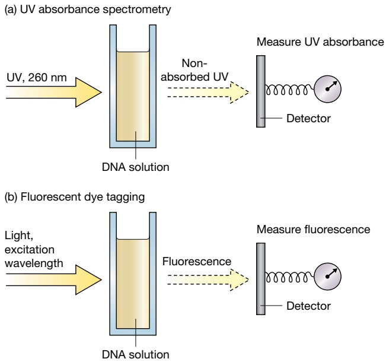

Figure 3.11

Measuring the concentration of DNA in a solution. (a) UV absorbance spectrometry. (b) Fluorescent dye tagging.

emits green light of approximately 520 nm wavelength when excited with blue light of 480 nm wavelength. The fluorescent emission only occurs when the dye is bound to DNA, so the amount of fluorescence is a measure of the DNA concentration of the solution. Fluorescent dye tagging is more sensitive than UV absorbance spectrophotometry, and so can measure the concentrations of very dilute DNA solutions. It is also more accurate if the DNA sample is contaminated with RNA. This is because RNA absorbs UV at 260 nm and so will contribute to the absorbance reading when the UV method is used. In contrast, the dyes used in DNA quantification are designed so they do not bind to RNA, so the fluorescence method gives an accurate reading of just the DNA concentration of a solution.

## 3.1.6 Other methods for the preparation of total cell DNA

Bacteria are not the only organisms from which DNA may be required. Total cell DNA from, for example, plants or animals will be needed if the aim of the genetic engineering project is to clone genes from these organisms. Although the basic steps in DNA purification are the same whatever the organism, some modifications may have to be introduced to take account of the special features of the cells being used.

Obviously, growth of cells in liquid medium is appropriate only for bacteria, other microorganisms, and plant and animal cell cultures. The major modifications, however, are likely to be needed at the cell breakage stage. The chemicals used for disrupting bacterial cells do not usually work with other organisms: lysozyme, for example, has no effect on plant cells. Specific degradative enzymes are available for most cell wall types, but

---

40

Part I The Basic Principles of Gene Cloning and DNA Analysis

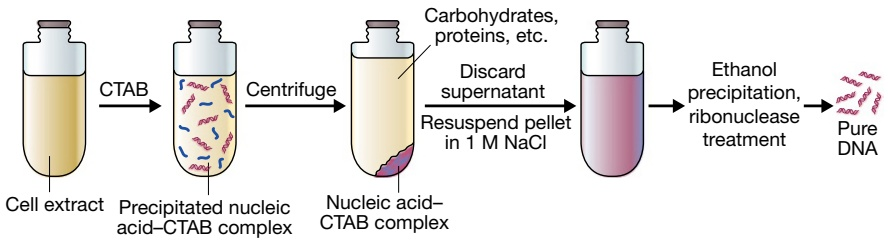

<details>
<summary>flowchart</summary>


</details>

Figure 3.12

The CTAB method for purification of plant DNA.

physical techniques, such as grinding frozen material with a mortar and pestle, are often more efficient. On the other hand, most animal cells have no cell wall at all, and can be disrupted simply by treating with detergent.

Animal tissue is also disrupted by guanidinium thiocyanate, the compound used in the silica method for DNA purification. Guanidinium thiocyanate is a **chaotropic agent**, which means that it interferes with the hydrogen bonding that normally holds water molecules together. This in turn destabilizes membranes and causes proteins and other biochemicals to denature. Guanidinium thiocyanate can therefore be used to release DNA from any type of cell or tissue that is not enclosed in a protective cell wall. The silica binding procedure, possibly in its automated magnetic bead format, is therefore a very popular method for DNA purification from clinical material such as blood samples.

Another important consideration is the biochemical content of the cells from which DNA is being extracted. With most bacteria the main biochemicals present in a cell extract are protein, DNA, and RNA, so phenol extraction and/or protease treatment, followed by removal of RNA with ribonuclease, leaves a pure DNA sample. These treatments may not, however, be sufficient to give pure DNA if the cells also contain significant quantities of other biochemicals. Plant tissues are particularly difficult in this respect as they often contain large amounts of carbohydrates that are not removed by phenol extraction. Instead a different approach must be used. One method makes use of a detergent called cetyltrimethylammonium bromide (CTAB), which forms an insoluble complex with nucleic acids. When CTAB is added to a plant cell extract the nucleic acid–CTAB complex precipitates, leaving carbohydrate, protein, and other contaminants in the supernatant (Figure 3.12). The precipitate is then collected by centrifugation and resuspended in 1 M sodium chloride, which causes the complex to break down. The nucleic acids can now be concentrated by ethanol precipitation and the RNA removed by ribonuclease treatment.

## 3.2 Preparation of plasmid DNA

Purification of plasmids from a culture of bacteria involves the same general strategy as preparation of total cell DNA. A culture of cells, containing plasmids, is grown in liquid medium, harvested, and a cell extract prepared. The protein and RNA are removed, and the DNA probably concentrated

---

Chapter 3 Purification of DNA from Living Cells

41

by ethanol precipitation. However, there is an important distinction between plasmid purification and preparation of total cell DNA. In a plasmid preparation it is always necessary to separate the plasmid DNA from the large amount of bacterial chromosomal DNA that is also present in the cells.

Separating the two types of DNA can be very difficult, but is nonetheless essential if the plasmids are to be used as cloning vectors. The presence of the smallest amount of contaminating bacterial DNA in a gene cloning experiment can easily lead to undesirable results. Fortunately, several methods are available for removal of bacterial DNA during plasmid purification, and the use of these methods, individually or in combination, can result in isolation of very pure plasmid DNA.

The methods are based on the various physical differences between plasmid DNA and bacterial DNA, the most obvious of which is size. The largest plasmids are only 8% of the size of the E. coli chromosome, and most are much smaller than this. Techniques that can separate small DNA molecules from large ones should therefore effectively purify plasmid DNA.

In addition to size, plasmids and bacterial DNA differ in **conformation**. When applied to a polymer such as DNA, the term conformation refers to the overall spatial configuration of the molecule, with the two simplest conformations being linear and circular. Plasmids and the bacterial chromosome are circular, but during preparation of the cell extract the large bacterial chromosome does not remain intact and becomes broken to give linear fragments. A method for separating circular from linear molecules will therefore result in pure plasmids.

## 3.2.1 Separation on the basis of size

The usual stage at which size fractionation is performed is during preparation of the cell extract. If the cells are lysed under very carefully controlled conditions, only a minimal amount of chromosomal DNA breakage occurs. The resulting DNA fragments are still very large  –  much larger than the plasmids – and can be removed with the cell debris by centrifugation. This process is aided by the fact that the bacterial chromosome is physically attached to the cell envelope, so fragments of the chromosome sediment with the cell debris if these attachments are not broken.

Cell disruption must therefore be carried out very gently to prevent wholesale breakage of the bacterial DNA. For E. coli and related species, controlled lysis is performed as shown in Figure  3.13. Treatment with EDTA and lysozyme is carried out in the presence of sucrose, which pre-vents the cells from bursting immediately. Instead, **sphaeroplasts** are formed, cells with partially degraded cell walls that retain an intact cytoplasmic membrane. Cell lysis is now induced by adding a non‐ionic detergent such as Triton X‐100 (ionic detergents, such as SDS, cause chromosomal breakage). This method causes very little breakage of the bacterial DNA, so centrifugation leaves a **cleared lysate**, consisting almost entirely of plasmid DNA.

A cleared lysate will, however, invariably retain some chromosomal DNA. Furthermore, if the plasmids themselves are large molecules, they

---

42

Part I The Basic Principles of Gene Cloning and DNA Analysis

Figure 3.13

Preparation of a cleared lysate.

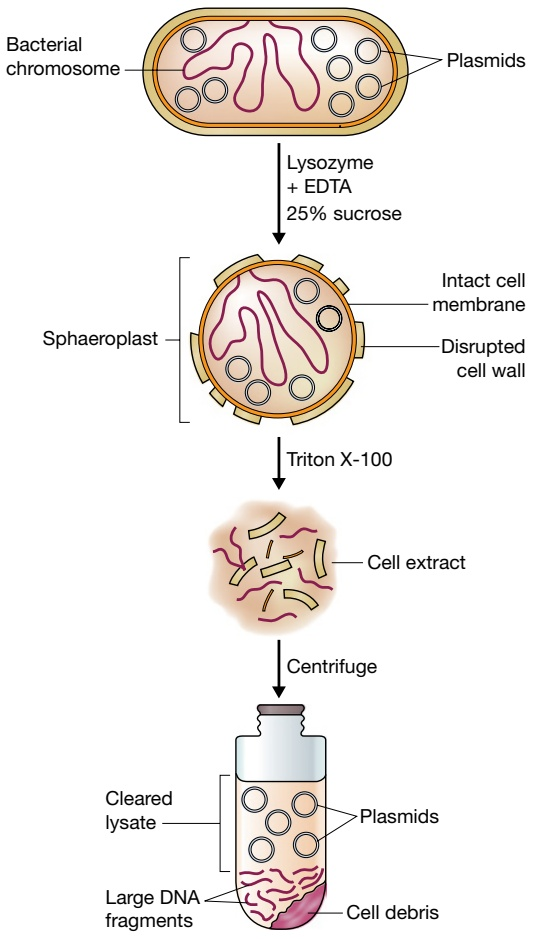

<details>
<summary>flowchart</summary>

```mermaid
graph TD
  A["Bacterial chromosome"] --> B["Plasmids"]
  B --> C["Lysozyme + EDTA\n25% sucrose"]
  C --> D["Sphaeroplast"]
  D --> E["Intact cell membrane\nDisrupted cell wall"]
  E --> F["Triton X-100"]
  F --> G["Cell extract"]
  G --> H["Centrifuge"]
  H --> I["Cleared lysate\nLarge DNA fragments\nCell debris"]
  I --> J["Plasmids"]
```
</details>

may also sediment with the cell debris. Size fractionation is therefore rarely sufficient on its own, and we must consider alternative ways of removing the bacterial DNA contaminants.

## 3.2.2 Separation on the basis of conformation

Before considering the ways in which conformational differences between plasmids and bacterial DNA can be used to separate the two types of DNA, we must look more closely at the overall structure of plasmid DNA. It is not strictly correct to say that plasmids have a circular conformation, because double‐stranded DNA circles can take up one of two quite distinct configurations. Most plasmids exist in the cell as **supercoiled** molecules (Figure 3.14a). Supercoiling occurs because the double helix of the plasmid DNA is partially unwound during the plasmid replication process by enzymes called topoisomerases (Section 4.3.4). The supercoiled conformation can be maintained only if both polynucleotide strands are intact, hence the more technical name of **covalently closed‐circular (ccc) DNA**. If one of the polynucleotide strands is broken the double helix reverts to its normal relaxed state, and the plasmid takes on the alternative conformation, called **open‐circular (oc)** (Figure 3.14b).

---

Chapter 3 Purification of DNA from Living Cells

43


Figure 3.14

Two conformations of circular doublestranded DNA. (a) Supercoiled – both strands are intact. (b) Open‐circular – one or both strands are nicked.

Supercoiling is important in plasmid preparation because supercoiled molecules can be fairly easily separated from non‐supercoiled DNA. Two different methods are commonly used. Both can purify plasmid DNA from crude cell extracts, although in practice best results are obtained if a cleared lysate is first prepared.

## Alkaline denaturation

The basis of this technique is that there is a narrow pH range at which non‐supercoiled DNA is denatured, whereas supercoiled plasmids are not. If sodium hydroxide is added to a cell extract or cleared lysate, so that the pH is adjusted to 12.0–12.5, then the hydrogen bonding in non‐supercoiled DNA molecules is broken, causing the double helix to unwind and the two polynucleotide chains to separate (Figure  3.15). If acid is now added, these denatured bacterial DNA strands reaggregate into a tangled mass. The insoluble network can be pelleted by centrifugation, leaving plasmid DNA in the supernatant. An additional advantage of this procedure is that, under some circumstances (specifically cell lysis by SDS and neutralization with sodium acetate), most of the protein and RNA also becomes insoluble and can be removed by the centrifugation step. Further purification by organic extraction or column chromatography may therefore not be needed if the alkaline denaturation method is used.

## Ethidium bromide–caesium chloride density gradient centrifugation

This is a specialized version of the more general technique of equilibrium or **density gradient centrifugation**. A density gradient is produced by centrifuging a solution of caesium chloride (CsCl) at a very high speed (Figure  3.16a). Macromolecules present in the CsCl solution when it is centrifuged form bands at distinct points in the gradient (Figure  3.16b). Exactly where a particular molecule forms its band depends on its **buoyant**


<details>
<summary>flowchart</summary>

```mermaid
graph LR
  A["Linear DNA"] -->|"pH 12.0 to 12.5"| B["Single-stranded linear DNA"]
  B -->|"pH 7.0"| C["Tangled mass of linear DNA"]
  C -->|"Centrifuge"| D["Supercoiled plasmids / Pellet of linear DNA molecules"]
```
</details>

Figure 3.15

Plasmid purification by the alkaline denaturation method.

---

44

Part I The Basic Principles of Gene Cloning and DNA Analysis

Figure 3.16

Caesium chloride density gradient centrifugation. (a) A CsCl density gradient produced by high‐speed centrifugation. (b) Separation of protein, DNA, and RNA in a density gradient.


**density**. DNA has a buoyant density of about $1 . 7 0 ~ \mathrm { g ~ c m ^ { - 3 } } ,$ , and therefore migrates to the point in the gradient where the CsCl density is also $1 . 7 0   \mathrm { ~ g ~ }   \mathrm { { c m } ^ { - 3 } }$ . In contrast, protein molecules have much lower buoyant densities, and so float at the top of the tube, whereas RNA forms a pellet at the bottom (Figure 3.16b). Density gradient centrifugation can therefore separate DNA, RNA, and protein and is an alternative to organic extraction or column chromatography for DNA purification.

More importantly, density gradient centrifugation in the presence of **ethidium bromide (EtBr)** can be used to separate supercoiled DNA from non‐supercoiled molecules. Ethidium bromide binds to DNA molecules by intercalating between adjacent base pairs, causing partial unwinding of the double helix (Figure  3.17). This unwinding results in a decrease in the buoyant density, by as much as 0.125 g cm<sup>–3</sup> for linear DNA. However, supercoiled DNA, with no free ends, has very little freedom to unwind, and can only bind a limited amount of EtBr. The decrease in buoyant density of a supercoiled molecule is therefore much less, only about $0 . 0 8 5 \; \mathrm { g } \; \mathrm { c m } ^ { - 3 }$ . As a consequence, supercoiled molecules form a band in an EtBr–CsCl gradient at a different position to linear and open‐circular DNA (Figure 3.18a).

Ethidium bromide–caesium chloride density gradient centrifugation is a very efficient method for obtaining pure plasmid DNA. When a cleared lysate is subjected to this procedure, plasmids band at a distinct point, separated from the linear bacterial DNA, with the protein floating on the top of the gradient and RNA pelleted at the bottom. The position of the DNA bands can be seen by shining ultraviolet radiation on the tube, which causes the bound EtBr to fluoresce. The pure plasmid DNA is removed by puncturing the side of the tube and withdrawing a sample with a syringe (Figure 3.18b). The EtBr bound to the plasmid DNA is extracted with n‐butanol (Figure 3.18c) and the CsCl removed by dialysis (Figure 3.18d). The resulting plasmid preparation is virtually 100% pure and ready for use as a cloning vector.

## 3.2.3 Plasmid amplification

Preparation of plasmid DNA can be hindered by the fact that plasmids make up only a small proportion of the total DNA in the bacterial cell. The yield of DNA from a bacterial culture may therefore be disappointingly low. **Plasmid amplification** offers a means of increasing this yield.

---

Chapter 3 Purification of DNA from Living Cells

45


Figure 3.17

Partial unwinding of the DNA double helix by EtBr intercalation between adjacent base pairs. The normal DNA molecule shown on the left is partially unwound by taking up four EtBr molecules, resulting in the “stretched” structure on the right.


<details>
<summary>flowchart</summary>

```mermaid
graph LR
  A["Protein"] --> B["Removal of the DNA band"]
  C["Linear and oc DNA"] --> B
  D["Supercoiled DNA"] --> B
  E["RNA"] --> B
  B --> F["Shake with n-butanol, allow layers to separate out"]
  F --> G["Extraction of the EtBr with n-butanol"]
  G --> H["EtBr in organic phase"]
  G --> I["DNA solution in dialysis tubing"]
  H --> J["Buffer"]
  I --> J
  J --> K["CsCl diffuses into buffer"]
  K --> L["Removal of the CsCl by dialysis"]
```
</details>

Figure 3.18

Purification of plasmid DNA by EtBr–CsCl density gradient centrifugation.

---

46

Part I The Basic Principles of Gene Cloning and DNA Analysis


<details>
<summary>text_image</summary>

Multicopy plasmids
(copy number 20+)
Bacterial
DNA
Incubate in the
presence of
chloramphenicol
Plasmids present at
a copy number of 1000+
</details>

Figure 3.19

Plasmid amplification.

The aim of amplification is to increase the copy number of a plasmid. Some **multicopy plasmids** (those with copy numbers of 20 or more) have the useful property of being able to replicate in the absence of protein synthesis. This contrasts with the main bacterial chromosome, which cannot replicate under these conditions. This property can be utilized during the growth of a bacterial culture for plasmid DNA purification. After a satisfactory cell density has been reached, an inhibitor of protein synthesis (e.g. chloramphenicol) is added, and the culture incubated for a further 12 hours. During this time the plasmid molecules continue to replicate, even though chromosome replication and cell division are blocked (Figure 3.19). The result is that plasmid copy numbers of several thousand may be attained. Amplification is therefore a very efficient way of increasing the yield of multicopy plasmids.

## 3.3 Preparation of bacteriophage DNA

The key difference between phage DNA purification and the preparation of either total cell DNA or plasmid DNA is that for phages the starting material is not normally a cell extract. This is because bacteriophage particles can be obtained in large numbers from the extracellular medium of an infected bacterial culture. When such a culture is centrifuged, the bacteria are pelleted, leaving the phage particles in suspension (Figure 3.20). The phage particles are then collected from the suspension and their DNA extracted by a single deproteinization step to remove the phage capsid.

This overall process is more straightforward than the procedure used  to prepare total cell or plasmid DNA. Nevertheless, successful

Figure 3.20

Preparation of a phage suspension from an infected culture of bacteria.


<details>
<summary>flowchart</summary>

```mermaid
graph LR
  A["Infected culture (bacteria + extracellular phage)"] --> B["Centrifuge"]
  B --> C["Phage suspension"]
  C --> D["Pellet of bacteria"]
```
</details>

---

Chapter 3 Purification of DNA from Living Cells

47

purification of significant quantities of phage DNA is subject to several pitfalls. The main difficulty, especially with λ, is growing an infected culture in such a way that the extracellular phage titre (the number of phage particles per ml of culture) is sufficiently high. In practical terms, the maximum titre that can reasonably be expected for $\lambda$ is $1 0 ^ { 1 0 }$ per ml; yet $1 0 ^ { 1 0 }   \lambda$ particles will yield only 500 ng of DNA. Large culture volumes, in the range of 500–1000 ml, are therefore needed if substantial quantities of λ DNA are to be obtained.

## 3.3.1 Growth of cultures to obtain a high λ titre

Growing a large volume culture is no problem (bacterial cultures of 100 litres and over are common in biotechnology) but obtaining the maximum phage titre requires a certain amount of skill. The naturally occurring λ phage is lysogenic (Section 2.2.2), and an infected culture consists mainly of cells carrying the prophage integrated into the bacterial DNA (see Figure 2.7). The extracellular λ titre is extremely low under these circumstances.

To get a high yield of extracellular λ, the culture must be **induced**, so that all the bacteria enter the lytic phase of the infection cycle, resulting in cell death and release of λ particles into the medium. Induction is normally very difficult to control, but most laboratory strains of λ carry a **temperature‐sensitive (ts) mutation** in the cI gene. This is one of the genes that are responsible for maintaining the phage in the integrated state. If inactivated by a mutation, the cI gene no longer functions correctly and the switch to lysis occurs. In the cIts mutation, the cI gene is functional at $3 0 ^ { \circ } \mathrm { C } ,$ at which temperature normal lysogeny can occur. But at $4 2 ^ { \circ } \mathrm { C } _ { \circ }$ the cIts gene product does not work properly, and lysogeny cannot be maintained. A culture of E. coli infected with a λ phage carrying the cIts mutation can therefore be induced to produce extracellular phages by transferring from $3 0 ^ { \circ } \mathrm { C }$ to $4 2 ^ { \circ } \mathrm { C }$ (Figure 3.21).

## 3.3.2 Preparation of non‐lysogenic λ phages

Although most λ strains are lysogenic, many cloning vectors derived from λ are modified, by deletions of the cI and other genes, so that lysogeny never occurs. These phages cannot integrate into the bacterial genome and can infect cells only by a lytic cycle (Section 2.2.1).

With these phages the key to obtaining a high titre lies in the way in which the culture is grown, in particular the stage at which the cells are infected by adding phage particles. If phages are added before the cells are dividing at their maximal rate, then all the cells are lysed very quickly, resulting in a low titre (Figure 3.22a). On the other hand, if the cell density is too high when the phages are added, then the culture will never be completely lysed, and again the phage titre will be low (Figure 3.22b). The ideal situation is when the age of the culture, and the size of the phage inoculum, are balanced such that the culture continues to grow, but eventually all the cells are infected and lysed (Figure 3.22c). As can be imagined, skill and experience are needed to judge the matter to perfection.

---

48

Part I The Basic Principles of Gene Cloning and DNA Analysis


<details>
<summary>flowchart</summary>

```mermaid
graph TD
  A["λ prophage"] -->|"30°C\nNo induction"| B["Cell Lysis"]
  A -->|"42°C Induction"| C["Excised λ genome"]
  C --> D["Cell Lysis"]
  D --> E["New λ particles"]
```
</details>

Figure 3.21

Induction of a λ cIts lysogen by transferring from $3 0 ^ { \circ } 0$ to $4 2 ^ { \circ } \complement ,$

Figure 3.22

Achieving the right balance between culture age and inoculum size when preparing a sample of a non‐lysogenic phage.


---

Chapter 3 Purification of DNA from Living Cells

49

## 3.3.3 Collection of phages from an infected culture

The remains of lysed bacterial cells, along with any intact cells that are inadvertently left over, can be removed from an infected culture by centrifugation, leaving the phage particles in suspension (see Figure 3.20). The problem now is to reduce the size of the suspension to 5 ml or less, a manageable size for DNA extraction.

Phage particles are so small that they are pelleted only by very highspeed centrifugation. Collection of phages is therefore usually achieved by precipitation with **polyethylene glycol (PEG)**. This is a long‐chain polymeric compound which, in the presence of salt, absorbs water, thereby causing macromolecular assemblies such as phage particles to precipitate. The precipitate can then be collected by centrifugation, and redissolved in a suitably small volume (Figure 3.23).

## 3.3.4 Purification of DNA from λ phage particles

Deproteinization of the redissolved PEG precipitate with a protease enzyme, followed by fractionation of the DNA by ion‐exchange chromatography, is often sufficient to extract the DNA from the phage particles. Alternatively, the phage capsids can be disrupted with guanidinium thiocyanate and the DNA recovered by silica binding. However, for the highest quality preparations the λ phages are subjected to an intermediate purification step. This is necessary because the PEG precipitate also contains a certain amount of bacterial debris, possibly including unwanted cellular DNA. These contaminants can be separated from the λ particles by CsCl density gradient centrifugation. The λ particles band in a CsCl gradient at $1.45-1.50\ g\ cm^{-3}$ (Figure 3.24) and can be withdrawn from the gradient as described previously for DNA bands (see Figure 3.18). Removal of CsCl by dialysis then leaves a phage preparation from which high‐purity DNA can be extracted.

## 3.3.5 Purification of M13 DNA causes few problems

Most of the differences between the M13 and λ infection cycles are to the advantage of the molecular biologist wishing to prepare M13 DNA. First, the double‐stranded replicative form of M13 (see Figure 2.11), which behaves like a high copy number plasmid, is very easily purified by the


<details>
<summary>flowchart</summary>

```mermaid
graph LR
  A["Phage suspension"] -->|"Add PEG + NaCl"| B["Precipitated phage particles"]
  B -->|"Centrifuge"| C["Pellet of phage particles and cell debris"]
  C --> D["Resuspend pellet"]
```
</details>

Figure 3.23

Collection of phage particles by polyethylene glycol (PEG) precipitation.

---

50

Part I The Basic Principles of Gene Cloning and DNA Analysis

Figure 3.24

Purification of λ phage particles by CsCl density gradient centrifugation.


<details>
<summary>bar</summary>

| Component | CsCl density (g \(cm^{-3})\) |
| --- | --- |
| \(\lambda\) phage particles | ~1.44 |
</details>

standard procedures for plasmid preparation. A cell extract is prepared from cells infected with M13, and the replicative form separated from bacterial DNA by alkaline denaturation or EtBr–CsCl density gradient centrifugation.

However, the single‐stranded form of the M13 genome, contained in the extracellular phage particles, is frequently required. In this respect the big advantage compared with λ is that high titres of M13 are very easy to obtain. As infected cells continually secrete M13 particles into the medium (see Figure 2.8), with lysis never occurring, a high M13 titre is achieved simply by growing the infected culture to a high cell density. In fact, titres of $\stackrel { - } { 1 0 ^ { 1 2 } }$ per ml and above are quite easy to obtain without any special tricks being used. Such high titres mean that significant amounts of singlestranded M13 DNA can be prepared from cultures of small volume – 5 ml or less. Furthermore, as the infected cells are not lysed, there is no problem with cell debris contaminating the phage suspension.

In summary, a typical method for single‐stranded M13 DNA preparation involves growth of a small volume of infected culture, centrifugation to pellet the bacteria, precipitation of the phage particles with PEG, phenol extraction to remove the phage protein coats, and ethanol precipitation to concentrate the resulting DNA (Figure 3.25).


<details>
<summary>flowchart</summary>

```mermaid
graph LR
  A["Culture of infected cells"] --> B["Centrifuge to remove cells"]
  B --> C["Add PEG to phage suspension, centrifuge"]
  C --> D["Precipitated M13 phage"]
  D --> E["Resuspend phage in buffer"]
  E --> F["Add phenol to remove protein capsid"]
  F --> G["Remove aqueous layer, add ethanol, centrifuge"]
  G --> H["Resuspend M13 DNA in a small volume"]
```
</details>

Figure 3.25

Preparation of single‐stranded M13 DNA from an infected culture of bacteria.

---

Chapter 3 Purification of DNA from Living Cells

51

## Further reading

- Berensmeier, S. (2006) Magnetic particles for the separation and purification of nucleic acids. Applied Microbiology and Biotechnology, 73, 495–504.
- Birnboim, H.C. and Doly, J. (1979) A rapid alkaline extraction procedure for screening recombinant plasmid DNA. Nucleic Acids Research, 7, 1513–1523. [A method for preparing plasmid DNA.]
- Boom, R., Sol, C.J., Salimans, M.M., et al. (1990) Rapid and simple method for purification of nucleic acids. Journal of Clinical Microbiology, 28, 495–503 [The guanidinium thiocyanate and silica method for DNA purification.]
- Clewell, D.B. (1972) Nature of ColE1 plasmid replication in Escherichia coli in the presence of chloramphenicol. Journal of Bacteriology, 110, 667–676 [The biological basis of plasmid amplification.]
- Marmur, J. (1961) A procedure for the isolation of deoxyribonucleic acid from microorganisms. Journal of Molecular Biology, 3, 208–218 [Genomic DNA preparation.]
- Radloff, R., Bauer, W., and Vinograd, J. (1967) A dye‐buoyant‐density method for the detection and isolation of closed‐circular duplex DNA. Proceedings of the National Academy of Sciences USA, 57, 1514–1521 [The original description of ethidium bromide density gradient centrifugation.]
- Rogers, S.O. and Bendich, A.J. (1985) Extraction of DNA from milligram amounts of fresh herbarium and mummified plant tissues. Plant Molecular Biology, 5, 69–76 [The CTAB method.]
- Yamamoto, K.R., Alberts, B.M., Benzinger, R., et al. (1970) Rapid bacteriophage sedimentation in the presence of polyethylene glycol and its application to large scale virus preparation. Virology, 40, 734–744 [Preparation of λ DNA.]
- Zinder, N.D. and Boeke, J.D. (1982) The filamentous phage (Ff) as vectors for recombinant DNA. Gene, 19, 1–10 [Methods for M13 phage growth and DNA preparation.]

---


---

## Chapter 4

# Manipulation of Purified DNA

## Chapter contents

**4.1** The range of DNA manipulative enzymes 55
**4.2** Enzymes for cutting DNA – restriction endonucleases 59
**4.3** Ligation – joining DNA molecules together 72

Once pure samples of DNA have been prepared, the next step in a gene cloning experiment is construction of the recombinant DNA molecule (see Figure 1.1). To produce this recombinant molecule, the vector, as well as the DNA to be cloned, must be cut at specific points and then joined together in a controlled manner. Cutting and joining are two examples of DNA manipulative techniques, a wide variety of which have been developed over the past few years. As well as being cut and joined, DNA molecules can be shortened, lengthened, copied into RNA or into new DNA molecules, and modified by the addition or removal of specific chemical groups. These manipulations, all of which can be carried out in the test tube, provide the foundation not only for gene cloning, but also for studies of DNA biochemistry, genome organization, gene structure, and the control of gene expression.

Almost all DNA manipulative techniques make use of purified enzymes. Within the cell these enzymes participate in essential processes such as DNA replication and transcription, breakdown of unwanted or foreign DNA (e.g. invading virus DNA), repair of mutated DNA, and **recombination** between different DNA molecules. After purification from cell

Gene Cloning and DNA Analysis: An Introduction, Eighth Edition. T. A. Brown.

© 2021 John Wiley & Sons Ltd. Published 2021 by John Wiley & Sons Ltd.

53

---

54

Part I The Basic Principles of Gene Cloning and DNA Analysis


Figure 4.1 The reactions catalysed by the two different kinds of nuclease. (a) An exonuclease, which removes nucleotides from the end of a DNA molecule. (b) An endonuclease, which breaks internal phosphodiester bonds.

extracts, many of these enzymes can be persuaded to carry out their natural reactions, or something closely related to them, under artificial conditions. Although these enzymatic reactions are often straightforward, most are absolutely impossible to perform by standard chemical methods. Purified enzymes are therefore crucial to genetic engineering and an important industry has sprung up around their preparation, characterization, and marketing. Commercial suppliers of high‐purity enzymes provide an essential service to the molecular biologist.

The cutting and joining manipulations that underlie gene cloning are carried out by enzymes called **restriction endonucleases** (for cutting) and **ligases** (for joining). Most of this chapter will be concerned with the ways in which these two types of enzyme are used. First, however, we must consider the whole range of DNA manipulative enzymes, to see exactly what types of reaction can be performed. Many of these enzymes will be mentioned in later chapters when procedures that make use of them are described.

---

Chapter 4 Manipulation of Purified DNA

55

## 4.1 The range of DNA manipulative enzymes

DNA manipulative enzymes can be grouped into four broad classes, depending on the type of reaction that they catalyse:

• **Nucleases** are enzymes that cut, shorten, or degrade nucleic acid molecules.
• **Ligases** join nucleic acid molecules together.
• **Polymerases** make copies of molecules.
• **Modifying enzymes** remove or add chemical groups.

Before considering in detail each of these classes of enzyme, two points should be made. The first is that, although most enzymes can be assigned to a particular class, a few display multiple activities that span two or more classes. Most importantly, many polymerases combine their ability to make new DNA molecules with an associated DNA degradative (i.e. nuclease) activity.

Second, it should be appreciated that, as well as the DNA manipulative enzymes, many similar enzymes able to act on RNA are known. The ribonuclease used to remove contaminating RNA from DNA preparations (Section  3.1.3) is an example of such an enzyme. Although some RNA manipulative enzymes have applications in gene cloning and will be mentioned in later chapters, we will in general restrict our thoughts to those enzymes that act on DNA.

## 4.1.1 Nucleases

Nucleases degrade DNA molecules by breaking the phosphodiester bonds that link one nucleotide to the next in a DNA strand. There are two different kinds of nuclease (Figure 4.1):

• **Exonucleases** remove nucleotides one at a time from the end of a DNA molecule.
• **Endonucleases** are able to break internal phosphodiester bonds within a DNA molecule.

The main distinction between different exonucleases lies in the number of strands that are degraded when a double‐stranded molecule is attacked. The enzyme called Bal31 (purified from the bacterium Alteromonas espejiana) is an example of an exonuclease that removes nucleotides from both strands of a double‐stranded molecule (Figure 4.2a). The greater the length of time that Bal31 is allowed to act on a group of DNA molecules, the shorter the resulting DNA fragments will be. In contrast, enzymes such as  E. coli exonuclease III degrade just one strand of a double‐stranded molecule, leaving single‐stranded DNA as the product (Figure 4.2b).

---

56

Part I The Basic Principles of Gene Cloning and DNA Analysis

(a) Bal31


<details>
<summary>flowchart</summary>

```mermaid
graph TD
  A["Initial State"] --> B["Parallel Path 1"]
  B --> C["Parallel Path 2"]
  C --> D["Final State"]
```
</details>

(b) Exonuclease III


<details>
<summary>flowchart</summary>

```mermaid
graph TD
  A["Path 1: 3'"] --> B["Intermediate Node"]
  B --> C["Final State"]
```
</details>

Figure 4.2

The reactions catalysed by different types of exonuclease. (a) Bal31, which removes nucleotides from both strands of a double‐stranded molecule. (b) Exonuclease III, which removes nucleotides only from the 3′ terminus.

The same criterion can be used to classify endonucleases. S1 endonuclease (from the fungus Aspergillus oryzae) only cleaves single strands (Figure 4.3a), whereas deoxyribonuclease I (DNase I), which is prepared from cow pancreas, cuts both single‐ and double‐stranded molecules (Figure 4.3b). DNase I is non‐specific in that it attacks DNA at any internal phosphodiester bond, so the end result of prolonged DNase I action is a mixture of mononucleotides and very short oligonucleotides. On the other hand, the special group of enzymes called restriction endonucleases cleave double‐stranded DNA only at a limited number of specific recognition sites (Figure 4.3c). These important enzymes are described in detail in Section 4.2.

The reactions catalysed by different types of endonuclease. (a) S1 nuclease, which cleaves only single‐stranded DNA, including single‐stranded nicks in mainly doublestranded molecules. (b) DNase I, which cleaves both single‐ and double‐stranded DNA. (c) A restriction endonuclease, which cleaves double‐stranded DNA, but only at a limited number of sites.

Figure 4.3

(a) S1 nuclease


<details>
<summary>flowchart</summary>

```mermaid
graph TD
  A["Path 1"] --> B["Path 2"]
  B --> C["Final Path"]
```
</details>


<details>
<summary>chemical</summary>

Diagram showing a nickel-nick molecular chain transformation with labeled 'A nick' and electron density distribution
</details>

(b) DNase I


<details>
<summary>flowchart</summary>

```mermaid
graph TD
  A["Path 1"] --> B["Path 2"]
  B --> C["Final Path"]
```
</details>


<details>
<summary>flowchart</summary>

```mermaid
graph TD
  A["Path 1: Horizontal lines with purple nodes"] --> B["Path 2: Vertical lines with pink nodes"]
  B --> C["Path 3: Connected nodes with blue nodes"]
```
</details>

(c) A restriction endonuclease


<details>
<summary>chemical</summary>

Diagram showing a structural transformation or polymer chain with pink and blue spheres connected by bonds, indicating a transformation or transformation process.
</details>

---

Chapter 4 Manipulation of Purified DNA

57


Figure 4.4

The two reactions catalysed by DNA ligase. (a) Repair of a discontinuity – a missing phosphodiester bond in one strand of a double‐stranded molecule. (b) Joining two molecules together.

## 4.1.2 Ligases

In the cell the function of DNA ligase is to repair single‐stranded breaks (‘discontinuities’) that arise in double‐stranded DNA molecules during, for example, DNA replication. DNA ligases from most organisms can also join together two individual fragments of double‐stranded DNA (Figure  4.4). The role of these enzymes in construction of recombinant DNA molecules is described in Section 4.3.

## 4.1.3 Polymerases

DNA polymerases are enzymes that synthesize a new strand of DNA complementary to an existing DNA or RNA template (Figure  4.5a). Most polymerases can function only if the **template** possesses a double‐stranded region that acts as a **primer** for initiation of polymerization.

Four types of DNA polymerase are used routinely in genetic engineering. The first is DNA polymerase I, which is usually prepared from E. coli. This enzyme attaches to a short single‐stranded region (or **nick**) in a mainly double‐stranded DNA molecule, and then synthesizes a completely new strand, degrading the existing strand as it proceeds (Figure  4.5b). DNA polymerase I is therefore an example of an enzyme with a dual activity: DNA polymerization and DNA degradation.

The polymerase and nuclease activities of DNA polymerase I are controlled by different parts of the enzyme molecule. The nuclease activity is contained in the first 323 amino acids of the polypeptide, so removal of this segment leaves a modified enzyme that retains the polymerase function but is unable to degrade DNA. This modified enzyme, called the **Klenow fragment**, can still synthesize a complementary DNA strand on a single‐stranded template, but as it has no nuclease activity it cannot continue the synthesis once the nick is filled in (Figure  4.5c). Several other enzymes – natural polymerases and modified versions – have similar properties to the Klenow fragment. For many years, these polymerases were used in DNA sequencing. They have now been largely superseded in this role, but still have important applications, for example in DNA labelling (Section 8.4.2)

The Taq DNA polymerase used in the **polymerase chain reaction (PCR)** (see Figure 1.2) is the DNA polymerase I enzyme of the bacterium Thermus aquaticus. This organism lives in hot springs, and many of its enzymes,

---

58

Part I The Basic Principles of Gene Cloning and DNA Analysis

(a) The basic reaction


<details>
<summary>chemical</summary>

DNA sequence diagram showing primer and template with nucleotide positions
</details>

Newly synthesized


<details>
<summary>chemical</summary>

DNA strand diagram showing complementary strands with labeled positions 3' and 5'
</details>

(b) DNA polymerase I


Existing nucleotides


(c) The Klenow fragment


Only the nick


<details>
<summary>chemical</summary>

Chemical structure showing functional group changes with fill-in and replacement conditions
</details>

(d) Reverse transcriptase


New strand of DNA


Figure 4.5

The reactions catalysed by DNA polymerases. (a) The basic reaction: a new DNA strand is synthesized in the $5 ^ { \prime }   { \mathfrak { t } } 0   3 ^ { \prime }$ direction. (b) DNA polymerase I, which initially fills in nicks but then continues to synthesize a new strand, degrading the existing one as it proceeds. (c) The Klenow fragment, which only fills in nicks. (d) Reverse transcriptase, which uses a template of RNA.

including the Taq DNA polymerase, are thermostable, meaning that they are resistant to denaturation by heat treatment. This is the special feature of Taq DNA polymerase that makes it suitable for PCR, because if it was not thermostable it would be inactivated when the temperature of the reaction is raised to $9 4 ^ { \circ } \mathrm { C }$ to denature the DNA.

The final type of DNA polymerase that is important in genetic engineering is **reverse transcriptase**, an enzyme involved in the replication of several kinds of virus. Reverse transcriptase is unique in that it uses as a template not DNA but RNA (Figure 4.5d). The ability of this enzyme to synthesize a DNA strand complementary to an RNA template is central to the technique called complementary DNA (cDNA) synthesis (see Figure 8.7).

## 4.1.4 DNA modifying enzymes

There are numerous enzymes that modify DNA molecules by addition or removal of specific chemical groups. The most important are as follows:

• **Alkaline phosphatase** (from E. coli, calf intestinal tissue, or arctic shrimp), which removes the phosphate group present at the $5 ^ { \prime }$ **terminus** of a DNA molecule (Figure 4.6a).

---

Chapter 4 Manipulation of Purified DNA

59


## Figure 4.6

The reactions catalysed by DNA modifying enzymes. (a) Alkaline phosphatase, which removes 5′‐phosphate groups. (b) Polynucleotide kinase, which attaches 5′‐phosphate groups. (c) Terminal deoxynucleotidyl transferase, which attaches deoxyribonucleotides to the 3′ termini of polynucleotides in either single‐ or double‐stranded molecules.

• **Polynucleotide kinase** (from E. coli infected with T4 phage), which has the reverse effect to alkaline phosphatase, adding phosphate groups onto free $5 ^ { \prime }$ termini (Figure 4.6b).
**Terminal deoxynucleotidyl transferase** (from calf thymus tissue), which adds one or more deoxyribonucleotides onto the $3 ^ { \prime }$ **terminus** of a DNA molecule (Figure 4.6c).

## 4.2 Enzymes for cutting DNA – restriction endonucleases

Gene cloning requires that DNA molecules be cut in a very precise and reproducible fashion. This is illustrated by the way in which the vector is cut during construction of a recombinant DNA molecule (Figure  4.7a). Each vector molecule must be cleaved at a single position, to open up the circle so that new DNA can be inserted. A molecule that is cut more than once will be broken into two or more separate fragments and will be of no use as a cloning vector. Furthermore, each vector molecule must be cut at exactly the same position on the circle – as will become apparent in later chapters, random cleavage is not satisfactory. It should be clear that a very special type of nuclease is needed to carry out this manipulation.

Often it is also necessary to cleave the DNA that is to be cloned (Figure 4.7b). There are two reasons for this. First, if the aim is to clone a single gene, which may consist of only 2 or 3 kb of DNA, then that gene will have to be cut out of the large (often greater than 80 kb) DNA molecules

---

60

Part I The Basic Principles of Gene Cloning and DNA Analysis

The need for very precise cutting manipulations in a gene cloning experiment.

Figure 4.7

(a) Vector molecules


<details>
<summary>text_image</summary>

Cut sites
</details>

Each vector molecule must be cut once, each at the same position

(b) The DNA molecule containing the gene to be cloned


<details>
<summary>text_image</summary>

Gene
Cut sites
Large DNA molecule
Fragments small enough
to be cloned
</details>

produced by skilful use of the preparative techniques described in Chapter 3. Second, large DNA molecules may have to be broken down simply to produce fragments small enough to be carried by the vector. Most cloning vectors exhibit a preference for DNA fragments that fall into a particular size range: most plasmid‐based vectors, for example, are very inefficient at cloning DNA molecules more than 8 kb in length.

Purified restriction endonucleases allow the molecular biologist to cut DNA molecules in the precise, reproducible manner required for gene cloning. The discovery of these enzymes, which led to Nobel Prizes for W. Arber, H. Smith, and D. Nathans in 1978, was one of the key breakthroughs in the development of genetic engineering.

## 4.2.1 The discovery and function of restriction endonucleases

The initial observation that led to the eventual discovery of restriction endonucleases was made in the early 1950s, when it was shown that some strains of bacteria are immune to bacteriophage infection, a phenomenon referred to as **host‐controlled restriction**.

The mechanism of restriction is not very complicated, even though it took over 20 years to be fully understood. Restriction occurs because the bacterium produces an enzyme that degrades the phage DNA before it has time to replicate and direct synthesis of new phage particles (Figure 4.8a). The bacterium’s own DNA, the destruction of which would of course be lethal, is protected from attack because it carries additional methyl groups that block the degradative enzyme action (Figure 4.8b).

---

Chapter 4 Manipulation of Purified DNA

61


Figure 4.8

The function of a restriction endonuclease in a bacterial cell. (a) Phage DNA is cleaved, but (b) bacterial DNA is not.

These degradative enzymes are called restriction endonucleases and are synthesized by many, perhaps all, species of bacteria. Over 4000 different ones have been isolated and more than 600 are available for use in the laboratory. Four different classes of restriction endonuclease are recognized, each distinguished by a slightly different mode of action. Types I, III, and IV are rather complex and have only a limited role in genetic engineering. Type II restriction endonucleases, on the other hand, are the cutting enzymes that are so important in gene cloning.

## 4.2.2 Type II restriction endonucleases cut DNA at specific nucleotide sequences

The central feature of type II restriction endonucleases (which will be referred to simply as ‘restriction endonucleases’ from now on) is that each enzyme has a specific recognition sequence at which it cuts a DNA molecule. A particular enzyme cleaves DNA at the recognition sequence and nowhere else. For example, the restriction endonuclease called PvuI (isolated from Proteus vulgaris) cuts DNA only at the hexanucleotide CGATCG. In contrast, a second enzyme from the same bacterium, called PvuII, cuts at a different hexanucleotide, in this case CAGCTG.

---

62

Part I The Basic Principles of Gene Cloning and DNA Analysis

Table 4.1

The recognition sequences for some of the most frequently used restriction endonucleases.

| ENZYME | ORGANISM | RECOGNITION SEQUENCE$^{a}$ | BLUNT OR STICKY END |
| --- | --- | --- | --- |
| EcoRI | Escherichia coli | GAATTC | Sticky |
| BamHI | Bacillus amyloliquefaciens | GGATCC | Sticky |
| BgIII | Bacillus globigii | AGATCT | Sticky |
| Pvul | Proteus vulgaris | CGATCG | Sticky |
| Pvull | Proteus vulgaris | CAGCTG | Blunt |
| HindIII | Haemophilus influenzae $R_{d}$ | AAGCTT | Sticky |
| Smal | Serratia marcescens | CCCGGG | Blunt |
| Hinfl | Haemophilus influenzae $R_{f}$ | GANTC | Sticky |
| Sau3A | Staphylococcus aureus | GATC | Sticky |
| Alul | Arthrobacter luteus | AGCT | Blunt |
| TaqI | Thermus aquaticus | TCGA | Sticky |
| HaeIII | Haemophilus aegyptius | GGCC | Blunt |
| Notl | Nocardia otitidis-caviarum | GCGGCCGC | Sticky |
| Sfil | Streptomyces fimbriatus | GGCCNNNNNGGCC | Sticky |

<sup>a</sup> The sequence shown is that of one strand, given in the 5´ to 3´ direction. ‘N’ indicates any nucleotide. Note that almost all recognition sequences are palindromes: when both strands are considered they read the same in each direction, for example:

$$
\begin{array}{c c} & 5 ^ {\prime} \text {-GAATTC-3^{\prime}} \\ \text {EcoRI} & | | | | | | \\ & 3 ^ {\prime} \text {-CTTAAG-5^{\prime}} \end{array}
$$

Many restriction endonucleases recognize hexanucleotide target sites, but others cut at four, five, eight, or even longer nucleotide sequences. Sau3A (from Staphylococcus aureus strain 3A) recognizes GATC, and AluI (Arthrobacter luteus) cuts at AGCT. There are also examples of restriction endonucleases with degenerate recognition sequences, meaning that they cut DNA at any one of a family of related sites. HinfI (Haemophilus influenzae strain $\begin{array} { r } { \left. \mathbf { R } _ { \mathrm { { f } } } \right\rangle _ { 1 } } \end{array}$ , for instance, recognizes GANTC, so cuts at GAATC, GATTC, GAGTC, and GACTC. The recognition sequences for some of the most frequently used restriction endonucleases are listed in Table 4.1.

## 4.2.3 Blunt ends and sticky ends

The exact nature of the cut produced by a restriction endonuclease is of considerable importance in the design of a gene cloning experiment. Many restriction endonucleases make a simple double‐stranded cut in the middle of the recognition sequence (Figure 4.9a), resulting in **blunt end** or **flush end**. PvuII and AluI are examples of blunt end cutters.

Other restriction endonucleases cut DNA in a slightly different way. With these enzymes the two DNA strands are not cut at exactly the same position. Instead the cleavage is staggered, usually by two or four nucleotides, so that the resulting DNA fragments have short single‐stranded overhangs at each end (Figure 4.9b). These are called sticky or cohesive ends, as base pairing between them can stick the DNA molecule back together again (recall that sticky ends were encountered in Section 2.2.2 during the description of λ phage replication). One important feature of sticky end enzymes is that restriction endonucleases with different recognition

---

Chapter 4 Manipulation of Purified DNA

63


Figure 4.9

The ends produced by cleavage of DNA with different restriction endonucleases. (a) A blunt end produced by AluI. (b) A sticky end produced by EcoRI. (c) The same sticky ends produced by BamHI, BglII, and Sau3A.

sequences may produce the same sticky ends. BamHI (recognition sequence GGATCC) and BglII (AGATCT) are examples  –  both produce GATC sticky ends (Figure 4.9c). The same sticky end is also produced by Sau3A, which recognizes only the tetranucleotide GATC. Fragments of DNA produced by cleavage with either of these enzymes can be joined to each other, as each fragment carries a complementary sticky end.

## 4.2.4 The frequency of recognition sequences in a DNA molecule

The number of recognition sequences for a particular restriction endonuclease in a DNA molecule of known length can be calculated mathematically. A tetranucleotide sequence (e.g. GATC) should occur once every 4<sup>4</sup> = 256 nucleotides, and a hexanucleotide (e.g. GGATCC) once every $4 ^ { 6 } = 4 0 9 6$ nucleotides. These calculations assume that the nucleotides are ordered in a random fashion and that the four different nucleotides are pre-sent in equal proportions (i.e. the GC content = 50%). In practice, neither of these assumptions is entirely valid. For example, the λ DNA molecule, at 49 kb, should contain about 12 sites for a restriction endonuclease with a hexanucleotide recognition sequence. In fact, many of these recognition sites occur less frequently (e.g. six for BglII, five for BamHI, and only two for SalI), a reflection of the fact that the GC content for λ is rather less than 50% (Figure 4.10a).

Furthermore, restriction sites are generally not evenly spaced out along a DNA molecule. If they were, then digestion with a particular restriction

---

64

Part I The Basic Principles of Gene Cloning and DNA Analysis

(a) Cleavage sites on λ DNA


<details>
<summary>dendrogram</summary>

| Protein | Fragment Size |
| :--- | :--- |
| BglII | 22 010 |
| BglII | 13 286 |
| BglII | 9688 |
| BglII | 2392 |
| BglII | 651 |
| BglII | 415 |
| BglII | 60 |
| BamHI | 16 841 |
| BamHI | 7233 |
| BamHI | 6770 |
| BamHI | 6527 |
| BamHI | 5626 |
| BamHI | 5505 |
| SalI | 15 258 |
| SalI | 499 |
| SalI | 32 745 |
</details>

Figure 4.10

Restriction of the λ DNA molecule. (a) The positions of the recognition sequences for BglII, BamHI, and SalI. (b) The fragments produced by cleavage with each of these restriction endonucleases. The numbers are the fragment sizes in base pairs.

endonuclease would give fragments of roughly equal sizes. Figure 4.10b shows the fragments produced by cutting λ DNA with BglII, BamHI, and SalI. In each case there is a considerable spread of fragment sizes, indicating that in λ DNA the nucleotides are not randomly ordered.

The lesson to be learned from Figure 4.10 is that although mathematics may give an idea of how many restriction sites to expect in a given DNA molecule, only experimental analysis can provide the true picture. We must therefore move on to consider how restriction endonucleases are used in the laboratory.

## 4.2.5 Performing a restriction digest in the laboratory

As an example, we will consider how to digest a sample of λ DNA (concentration 125 μg ml<sup>–1</sup>) with BglII.

First, the required amount of DNA must be pipetted into a test tube. The amount of DNA that will be restricted depends on the nature of the experiment. In this case we will digest 2 μg of λ DNA, which is contained in 16 μl of the sample (Figure 4.11a). Very accurate micropipettes will therefore be needed. The other main component in the reaction will be the restriction endonuclease, obtained from a commercial supplier as a pure solution of known concentration. But before adding the enzyme, the solution containing the DNA must be adjusted to provide the correct conditions to ensure maximal activity of the enzyme. Most restriction endonucleases function adequately at pH 7.4, but different enzymes vary in their requirements for ionic strength, usually provided by sodium chloride (NaCl) and magnesium

---

Chapter 4 Manipulation of Purified DNA

65


<details>
<summary>flowchart</summary>

```mermaid
graph LR
  A["2 µg λ DNA (16 µl)"] -->|Add 2 µl BglII buffer| B["BglII + 1.5 µl H2O"]
  B -->|Add 0.5 µl BglII + 1.5 µl H2O| C["BglII + 37°C for 1 h"]
  C -->|Incubate at 37°C for 1 h| D["Cleaved λ DNA + EDTA or heat at 70°C for 15 min"]
```
</details>

Figure 4.11

Performing a restriction digest in the laboratory.

$( \mathrm { M g } ^ { 2 + } )$ concentration (all type II restriction endonucleases require $\mathbf { M g } ^ { 2 + }$ in order to function). It is also advisable to add a reducing agent, such as dithiothreitol (DTT), which stabilizes the enzyme and prevents its inactivation. Providing the right conditions for the enzyme is very important – incorrect NaCl or $\mathbf { M g } ^ { 2 + }$ concentrations not only decrease the activity of the restriction endonuclease, they might also cause changes in the specificity of the enzyme, so that DNA cleavage occurs at additional, non‐standard recognition sequences.

The composition of a suitable buffer for BglII is shown in Table 4.2. This buffer is ten times the working concentration and is diluted by being added to the reaction mixture. In our example, a suitable final volume for the reaction mixture would be $2 0   \mu \mathrm { l } _ { \mathrm { i } }$ so we add $2 \; \mu \mathrm { l }$ $1 0 \times B g l \mathrm { I I }$ buffer to the 16 μl of DNA already present (Figure 4.11b).

The restriction endonuclease can now be added. By convention, 1 unit of enzyme is defined as the quantity needed to cut 1 μg of DNA in 1 hour, so we need 2 units of BglII to cut 2 μg of λ DNA. BglII is frequently obtained at a concentration of 4 units/μl, so 0.5 μl is sufficient to cleave the DNA. The final ingredients in the reaction mixture are therefore 0.5 μl BglII + 1.5 μl water, giving a final volume of 20 μl (Figure 4.11c).

The last factor to consider is incubation temperature. Most restriction endonucleases, including BglII, work best at $3 7 ^ { \circ } \mathrm { C } _ { 2 }$ but a few have different requirements. TaqI, for example, is a restriction enzyme from Thermus aquaticus and, like Taq DNA polymerase, has a high working temperature. Restriction digests with TaqI must be incubated at $6 5 ^ { \circ } \mathrm { C }$ to obtain maximum enzyme activity.

After one hour the restriction should be complete (Figure 4.11d). If the DNA fragments produced by restriction are to be used in cloning experiments, the enzyme must somehow be destroyed so that it does not accidentally digest other DNA molecules that may be added at a later stage.

Table 4.2

A 10 × buffer suitable for restriction of DNA with BglII.

| COMPONENT | CONCENTRATION (mM) |
| --- | --- |
| Tris-HCl, pH 7.4 | 500 |
| $MgCl_{2}$ | 100 |
| NaCl | 500 |
| Dithiothreitol | 10 |

---

66

Part I The Basic Principles of Gene Cloning and DNA Analysis

Figure 4.12

(a) Standard electrophoresis does not separate DNA fragments of different sizes, whereas (b) gel electrophoresis does.


There are several ways of ‘killing’ the enzyme. For many a short incubation at $7 0 ^ { \circ } \mathrm { C }$ is sufficient, for others phenol extraction or the addition of **ethylenediamine tetraacetate (EDTA)**, which binds $\mathbf { M g } ^ { 2 + }$ ions preventing restriction endonuclease action, is used (Figure 4.11e).

## 4.2.6 Analysing the result of restriction endonuclease cleavage

A restriction digest results in a number of DNA fragments, the sizes of which depend on the exact positions of the recognition sequences for the  endonuclease in the original molecule (see Figure  4.10). A way of determining the number and sizes of the fragments is needed if restriction endonucleases are to be of use in gene cloning. Whether or not a DNA molecule is cut at all can be determined fairly easily by testing the viscosity of the solution. Larger DNA molecules result in a more viscous solution than smaller ones, so cleavage is associated with a decrease in viscosity. However, working out the number and sizes of the individual cleavage products is more difficult. In fact, for several years this was one of the most tedious aspects of experiments involving DNA. Eventually the problems were solved in the early 1970s when the technique of **gel electrophoresis** was developed.

---

Chapter 4 Manipulation of Purified DNA

67

## Separation of molecules by gel electrophoresis

**Electrophoresis**, like ion‐exchange chromatography (Section  3.1.3), is a technique that uses differences in electrical charge to separate the molecules in a mixture. DNA molecules have negative charges, and so when placed in an electric field they migrate towards the positive pole (Figure 4.12a). The rate of migration of a molecule depends on two factors, its shape and its charge‐to‐mass ratio. Unfortunately, most DNA molecules are the same shape, and all have very similar charge‐to‐mass ratios. Fragments of different sizes cannot therefore be separated by standard electrophoresis.

The size of the DNA molecule does, however, become a factor if the electrophoresis is performed in a gel. A gel, which is usually made of agarose, polyacrylamide, or a mixture of the two, comprises a complex network of pores, through which the DNA molecules must travel to reach the positive electrode. The smaller the DNA molecule, the faster it can migrate through the gel. Gel electrophoresis therefore separates DNA molecules according to their size (Figure 4.12b).

In practice the composition of the gel determines the sizes of the DNA molecules that can be separated. A 0.5 cm thick slab of 0.5% agarose, which has relatively large pores, would be used for molecules in the size range 1–30 kb, allowing, for example, molecules of 10 and 12 kb to be clearly distinguished. At the other end of the scale, a very thin (0.3 mm) 40% polyacrylamide gel, with extremely small pores, would be used to  separate much smaller DNA molecules, in the range of 1–300 bp, and  could distinguish molecules differing in length by just a single nucleotide.

## Visualizing DNA molecules in an agarose gel

The easiest way to see the results of a gel electrophoresis experiment is to stain the gel with a compound that makes the DNA visible. Ethidium bromide (EtBr), already described in Section 3.2.2 as a means of visualizing DNA in caesium chloride gradients, is also routinely used to stain DNA in agarose and polyacrylamide gels (Figure 4.13). Bands showing the positions of the different size classes of DNA fragment are clearly visible under ultraviolet irradiation after EtBr staining, so long as sufficient DNA is present.

Unfortunately, this procedure is very hazardous because EtBr is a powerful mutagen. Another disadvantage is that EtBr staining also has limited sensitivity, and if a band contains less than about 10 ng of DNA then it might not be visible after staining. For these reasons, non‐mutagenic dyes that stain DNA green, red, or blue are now used in many laboratories. Most of these dyes can be used either as a post‐stain after electrophoresis, as illustrated in Figure 4.13 for EtBr, or alternatively, because they are non‐hazardous, they can be included in the buffer solution in which the agarose or polyacrylamide is dissolved when the gel is prepared. Some of these dyes require ultraviolet irradiation in order to make the bands visible, but others are visualized by illumination at other wavelengths, for example under blue light, removing a second hazard as ultraviolet radiation can cause severe burns. The most sensitive dyes are able to detect bands that contain less than 1 ng DNA.

---

68

Part I The Basic Principles of Gene Cloning and DNA Analysis

Figure 4.13

Visualizing DNA bands in an agarose gel by EtBr staining and ultraviolet (UV) irradiation.


<details>
<summary>flowchart</summary>

```mermaid
graph TD
  A["Wells for samples"] --> B["Agarose gel"]
  A --> C["UV transparent plastic support"]
  B --> D["Soak in 0.5 µg ml⁻¹ solution of EtBr, 15 min"]
  D --> E["Bands of DNA fluorescence"]
  E --> F["UV"]
```
</details>

## 4.2.7 Estimation of the sizes of DNA molecules

Gel electrophoresis separates different‐sized DNA molecules, with the smallest molecules travelling the greatest distance toward the positive electrode. If several DNA fragments of varying sizes are present (the result of a successful restriction digest, for example), then a series of bands appears in the gel. How can the sizes of these fragments be determined?

The most accurate method is to make use of the mathematical relationship that links migration rate to molecular mass. The relevant formula is:

$$
D = a - b (\log M)
$$

where D is the distance moved, M is the molecular mass, and a and b are constants that depend on the electrophoresis conditions.

Because extreme accuracy in estimating DNA fragment sizes is not always necessary, a much simpler though less precise method is more generally used. A standard restriction digest, comprising fragments of known size, is usually included in each electrophoresis gel that is run. Restriction digests of λ DNA are often used in this way as size markers. For example, HindIII cleaves λ DNA into eight fragments, ranging in size from 125 bp for the smallest to over 23 kb for the largest. As the sizes of the fragments in this digest are known, the fragment sizes in the experimental digest can be estimated by comparing the positions of the bands in the two tracks (Figure  4.14). Special mixtures of DNA fragments called **DNA ladders**, whose sizes are multiples of 100 bp or of 1 kb, can also be used as size markers. Although not precise, size estimation by comparison with DNA markers can be performed with as little as a 5% error, which is satisfactory for most purposes.

---

Chapter 4 Manipulation of Purified DNA

69

(a) Rough estimation by eye


<details>
<summary>bar</summary>

| Variant | HindIII \(\lambda\) (bp) | Unknown (bp) |
| --- | --- | --- |
| 1 | — | c. 5000 bp |
| 2 | — | c. 3200 bp |
| 3 | — | c. 2000 bp |
</details>

Figure 4.14

Estimation of the sizes of DNA fragments in an agarose gel. (a) A rough estimate of fragment size can be obtained by eye. (b) A more accurate measurement of fragment size is gained by using the mobilities of the HindIII–λ fragments to construct a calibration curve. The sizes of the unknown fragments can then be determined from the distances they have migrated.

(b) Accurate graphical estimation


<details>
<summary>line</summary>

| Distance migrated (cm) | Size of DNA (kb) |
| --- | --- |
| ~0.8 | ~9.2 |
| ~1.3 | ~6.8 |
| ~1.8 | ~4.3 |
| ~2.9 | ~2.6 |
| ~3.3 | ~2.2 |
| ~4.8 | ~1.5 |
</details>

## 4.2.8 Mapping the positions of different restriction sites in a DNA molecule

So far, we have considered how to determine the number and sizes of the DNA fragments produced by restriction endonuclease cleavage. The next step in **restriction analysis** is to construct a map showing the relative positions in the DNA molecule of the recognition sequences for a number of different enzymes. Only when a **restriction map** is available can the correct restriction endonucleases be selected for the particular cutting manipulation that is required (Figure 4.15).

To construct a restriction map, a series of restriction digests must be performed. First, the number and sizes of the fragments produced by each restriction endonuclease must be determined by gel electrophoresis followed by comparison with size markers (Figure 4.16). This information must then be supplemented by a series of **double digestions**, in which the DNA is cut by two restriction endonucleases at once. It might be possible to perform a double digestion in one step if both enzymes have similar requirements for pH, Mg<sup>2+</sup> concentration, etc. Alternatively, the two digestions may have to be carried out one after the other, adjusting the reaction mixture after the first digestion to provide a different set of conditions for the second enzyme.

Comparing the results of single and double digests will allow many, if not all, of the restriction sites to be mapped (Figure 4.16). Ambiguities can usually be resolved by **partial digestion**, carried out under conditions that result in cleavage of only a limited number of the restriction sites on any DNA molecule. Partial digestion is usually achieved by reducing the

---

70

Part I The Basic Principles of Gene Cloning and DNA Analysis

Using a restriction map to work out which restriction endonucleases should be used to obtain DNA fragments containing individual genes.

Figure 4.15

Genetic map


<details>
<summary>flowchart</summary>

```mermaid
graph LR
  A["Gene A"] --> B["BglII"]
  A --> C["BamHI"]
  A --> D["SalI"]
  B --> E["BglII"]
  B --> F["BamHI"]
  B --> G["SalI"]
  C --> H["BglII"]
  C --> I["BamHI"]
  C --> J["SalI"]
  D --> K["BglII"]
  D --> L["BamHI"]
  D --> M["SalI"]
```
</details>

To obtain gene B, digest with Bglll


<details>
<summary>text_image</summary>

Diagram showing four labeled components (A, B, C, D) connected by lines with circular motion indicators, likely illustrating a physics or physics concept.
</details>

To obtain gene D, digest with BamHl + Sall


<details>
<summary>text_image</summary>

A
B
C
D
</details>

incubation period, so the enzyme does not have time to cut all the restriction sites, or by incubating at a low temperature (e.g. 4°C rather than 37°C), which limits the activity of the enzyme.

The result of a partial digestion is a complex pattern of bands in an electrophoresis gel. As well as the standard fragments, produced by total digestion, additional sizes are seen. These are molecules that comprise two adjacent restriction fragments, separated by a site that has not been cleaved. Their sizes indicate which restriction fragments in the complete digest are next to one another in the uncut molecule (Figure 4.16).

## 4.2.9 Special gel electrophoresis methods for separating larger molecules

During agarose gel electrophoresis, a DNA fragment migrates at a rate that is proportional to its size, but this relationship is not a direct one. The formula that links migration rate to molecular mass has a logarithmic component (Section 4.2.7), which means that the difference in migration rates become increasingly small for larger molecules (Figure 4.17). In practice, molecules larger than about 50 kb cannot be resolved efficiently by standard gel electrophoresis.

This size limitation is not usually a problem when the restriction fragments being studied have been obtained by cutting the DNA with an enzyme with a tetranucleotide or hexanucleotide recognition sequence. Most, if not all, of the fragments produced in this way will be less than 30 kb in length and easily resolved by agarose gel electrophoresis.

---

Chapter 4 Manipulation of Purified DNA

71

Single and double digestions

| Enzyme | Number of fragments | Sizes (kb) |
| --- | --- | --- |
| Xbal | 2 | 24.0, 24.5 |
| Xhol | 2 | 15.0, 33.5 |
| KpnI | 3 | 1.5, 17.0, 30.0 |
| Xbal + Xhol | 3 | 9.0, 15.0, 24.5 |
| Xbal + KpnI | 4 | 1.5, 6.0, 17.0, 24.0 |

## Conclusions:

(1) As λ DNA is linear, the number of restriction sites for each enzyme is XbaI 1, XhoI 1, KpnI 2.
(2) The XbaI and XhoI sites can be mapped:


<details>
<summary>dendrogram</summary>

| Category | Value |
| --- | --- |
| XbaI fragments | 24.0 |
| XbaI - XhoI fragments | 9.0 |
| XhoI fragments | 15.0 |
| The only possibility is: (XhoI) | 15.0 |
| The only possibility is: (XbaI) | 9.0 |
| The only possibility is: (XbaI) | 24.5 |
</details>

(3) All the Kpnl sites fall in the 24.5 kb Xbal fragment, as the 24.0 kb fragment is intact after Xbal–Kpnl double digestion. The order of the Kpnl fragments can be determined only by partial digestion.

Partial digestion

| Enzyme | Fragment sizes (kb) |
| --- | --- |
| KpnI – limiting conditions | 1.5, 17.0, 18.5, 30.0, 31.5, 48.5 |

## Conclusions:

(1) 48.5 kb fragment = uncut λ.
(2) 1.5, 17.0 and 30.0 kb fragments are products of complete digestion.
(3) 18.5 and 31.5 kb fragments are products of partial digestion.


<details>
<summary>other</summary>

| Step | Value |
| --- | --- |
| The KpnI map must be: | 30.0 |
| The KpnI map must be: | 1.5 |
| The KpnI map must be: | 17.0 |
| Therefore the complete map is: | 15.0 |
| Therefore the complete map is: | 9.0 |
| Therefore the complete map is: | 6.0 |
| Therefore the complete map is: | 1.5 |
| Therefore the complete map is: | 17.0 |
</details>

## Figure 4.16

Restriction mapping. This example shows how the positions of the XbaI, XhoI, and KpnI sites on the λ DNA molecule can be determined.

Difficulties might arise, however, if an enzyme with a longer recognition sequence is used, such as NotI, which cuts at an eight‐nucleotide sequence (see Table 4.1). NotI would be expected, on average, to cut a DNA molecule once every $4 ^ { 8 } = 6 5$ 536 bp. It is therefore unlikely that NotI fragments will be separated by standard gel electrophoresis.

The limitations of standard gel electrophoresis can be overcome if a more complex electric field is used. The simplest of these systems is **orthogonal field alternation gel electrophoresis (OFAGE)**. Instead of being applied directly along the length of the gel, as in the standard method (Figure 4.18a), the electric field now alternates between two pairs of electrodes, each pair set at an angle of $4 5 ^ { \circ }$ to the length of the gel (Figure 4.18b). The result is a pulsed field, with the DNA molecules in the gel having to continually

---

72

Part I The Basic Principles of Gene Cloning and DNA Analysis

Figure 4.17

The influence of DNA size on migration rate during conventional gel electrophoresis.


<details>
<summary>line</summary>

| Distance travelled (x hours) | Length of DNA molecule |
| --- | --- |
| Low | High |
| Medium | Medium |
| High | Low |
</details>

change direction in accordance with the pulses. As the two fields alternate in a regular fashion, the net movement of the DNA molecules in the gel is still from one end to the other, in more or less a straight line. However, with every change in field direction, each DNA molecule has to realign through $\dot { 9 } 0 ^ { \circ }$ before its migration can continue. This is the key point, because a short molecule can realign faster than a long one, allowing the short molecule to progress toward the bottom of the gel more quickly. This added dimension increases the resolving power of the gel quite dramatically, so that molecules up to several thousand kilobases in length can be separated.

This size range includes not only restriction fragments but also the intact chromosomal molecules of many lower eukaryotes, including yeast, several important filamentous fungi, and protozoans such as the malaria parasite Plasmodium falciparum. OFAGE and other **pulsed‐field gel electrophoresis (PFGE)** techniques such as **contour‐clamped homogeneous electric fields (CHEF)** and **field inversion gel electrophoresis (FIGE)** can therefore be used to prepare gels showing the separated chromosomes of these organisms (Figure 4.18c), enabling DNA from these individual chromosomes to be purified.

## 4.3 Ligation – joining DNA molecules together

The final step in construction of a recombinant DNA molecule is the joining together of the vector molecule and the DNA to be cloned (Figure 4.19). This process is referred to as ligation, and the enzyme that catalyses the reaction is called DNA ligase.

## 4.3.1 The mode of action of DNA ligase

All living cells produce DNA ligases, but the enzyme used in genetic engineering is usually purified from E. coli bacteria that have been infected with T4 phage. Within the cell the enzyme carries out the very important function of repairing any discontinuities that may arise in one of the strands of a double‐stranded molecule (see Figure 4.4a). A discontinuity is quite simply a position where a phosphodiester bond between adjacent

---

Chapter 4 Manipulation of Purified DNA

73

(a) Conventional agarose gel electrophoresis


<details>
<summary>text_image</summary>

Migration
</details>


<details>
<summary>text_image</summary>

(b) OFAGE
</details>

(c) Separation of yeast chromosomes by OFAGE


<details>
<summary>text_image</summary>

Chromosome number
IV, XII
VII, XV
XIII, XVI
II
XIV
X
XI
VIII, V
IX
III
VI
200 kb
700 kb
500 kb
</details>

Figure 4.18

The difference between conventional gel electrophoresis and orthogonal field alternation gel electrophoresis (OFAGE).

nucleotides is missing (contrast this with a nick, where one or more nucleotides are absent). Although discontinuities may arise by chance breakage of the cell’s DNA molecules, they are also a natural result of processes such as DNA replication and recombination. Ligases therefore play several vital roles in the cell.

In the test tube, purified DNA ligases, as well as repairing single‐strand discontinuities, can also join together individual DNA molecules or the two ends of the same molecule. The chemical reaction involved in ligating


<details>
<summary>flowchart</summary>

```mermaid
graph LR
  A["Vector"] -->|"DNA to be cloned"| B["Gene"]
  B -->|"DNA ligase"| C["Recombinant DNA molecule"]
  C --> D["Gene"]
```
</details>

Figure 4.19

Ligation: the final step in construction of a recombinant DNA molecule.

---

74

Part I The Basic Principles of Gene Cloning and DNA Analysis

Ligating blunt ends


<details>
<summary>flowchart</summary>

```mermaid
graph LR
  A["Left Column"] --> B["Right Column"]
  B --> C["Final State"]
```
</details>

Figure 4.20

Ligation of blunt‐ended DNA molecules by DNA ligase.

two molecules is exactly the same as discontinuity repair, except that two phosphodiester bonds must be made, one for each strand (Figure 4.20).

## 4.3.2 Sticky ends increase the efficiency of ligation

The ligation reaction in Figure  4.20 shows two blunt‐ended fragments being joined together. Although this reaction can be carried out in the test tube, it is not very efficient. This is because the ligase is unable to ‘catch hold’ of the molecule to be ligated, and has to wait for chance associations to bring the ends together. If possible, blunt‐end ligation should be performed at high DNA concentrations, to increase the chances of the ends of the molecules coming together in the correct way.

In contrast, ligation of complementary sticky ends is much more efficient. This is because compatible sticky ends can base pair with one another by hydrogen bonding (Figure 4.21), forming a relatively stable structure for the enzyme to work on. If the phosphodiester bonds are not synthesized fairly quickly then the sticky ends fall apart again. These transient, base‐paired structures do, however, increase the efficiency of ligation by increasing the length of time the ends are in contact with one another.

## 4.3.3 Putting sticky ends onto a blunt‐ended molecule

For the reasons detailed in the preceding section, compatible sticky ends are desirable on the DNA molecules to be ligated together in a gene cloning experiment. Often these sticky ends can be provided by digesting both the vector and the DNA to be cloned with the same restriction endonuclease,

Ligating sticky ends


<details>
<summary>flowchart</summary>

```mermaid
graph LR
  A["Initial Structure"] --> B["Discontinuities"]
  B --> C["Transient base-paired structure"]
  C --> D["DNA ligase seals the discontinuities"]
```
</details>

Figure 4.21

Ligation of sticky‐ended molecules.

---

Chapter 4 Manipulation of Purified DNA

75

or with different enzymes that produce the same sticky end, but it is not always possible to do this. A common situation is where the vector molecule has sticky ends, but the DNA fragments to be cloned are blunt‐ended. Under these circumstances, one of three methods can be used to put the correct sticky ends onto the DNA fragments.

## Linkers

The first of these methods involves the use of **linkers**. These are short pieces of double‐stranded DNA, of known nucleotide sequence, that are synthesized in the test tube. A typical linker is shown in Figure 4.22a. It is bluntended, but contains a restriction site, BamHI in the example shown. DNA ligase can attach linkers to the ends of larger blunt‐ended DNA molecules. Although a blunt‐end ligation, this particular reaction can be performed very efficiently because synthetic oligonucleotides, such as linkers, can be made in very large amounts and added into the ligation mixture at a high concentration.

More than one linker will attach to each end of the DNA molecule, producing the chain structure shown in Figure 4.22b. Digestion with BamHI cleaves the chains at the recognition sequences, producing a large number of cleaved linkers and the original DNA fragment, now carrying BamHI sticky ends. This modified fragment is ready for ligation into a cloning vector restricted with BamHI.

## Adaptors

There is one potential drawback with the use of linkers. Consider what would happen if the blunt‐ended molecule shown in Figure  4.22b contained one or more BamHI recognition sequences. If this was the case, the


Figure 4.22

Linkers and their use. (a) The structure of a typical linker. (b) The attachment of linkers to a blunt‐ended molecule.

---

76

Part I The Basic Principles of Gene Cloning and DNA Analysis

Figure 4.23

A possible problem with the use of linkers. Compare this situation with the desired result of BamHI restriction, as shown in Figure 4.22b.


<details>
<summary>text_image</summary>

BamHI
Cleavage due to
internal BamHI sites
</details>

restriction step needed to cleave the linkers and produce the sticky ends would also cleave the blunt‐ended molecule (Figure 4.23). The resulting fragments will have the correct sticky ends, but that is no consolation if the  gene contained in the blunt‐ended fragment has now been broken into pieces.

The second method of attaching sticky ends to a blunt‐ended molecule is designed to avoid this problem. **Adaptors**, like linkers, are short synthetic oligonucleotides. But unlike linkers, an adaptor is synthesized so that it already has one sticky end (Figure 4.24a). The idea is of course to ligate the blunt end of the adaptor to the blunt ends of the DNA fragment, to produce a new molecule with sticky ends. This may appear to be a simple method but in practice a new problem arises. The sticky ends of individual adaptor molecules could base pair with each other to form dimers (Figure 4.24b), so that the new DNA molecule is still blunt‐ended (Figure 4.24c). The sticky ends could be recreated by digestion with a restriction endonuclease, but that would defeat the purpose of using adaptors in the first place.

The answer to the problem lies in the precise chemical structure of the ends of the adaptor molecule. Normally the two ends of a polynucleotide strand are chemically distinct, a fact that is clear from a careful examination of the polymeric structure of DNA (Figure 4.25a). One end, referred to as the 5′ terminus, carries a phosphate group (5′–P); the other, the 3′ terminus, has a hydroxyl group (3′–OH). In the double helix the two

Figure 4.24

Adaptors and the potential problem with their use. (a) A typical adaptor. (b) Two adaptors could ligate to one another to produce a molecule similar to a linker, so that (c) after ligation of adaptors a blunt‐ended molecule is still blunt‐ended, and the restriction step is still needed.

(a) A typical adaptor


<details>
<summary>chemical</summary>

Chemical structure of BamHI sticky end with labeled carbon chain segments
</details>

(b) Adaptors could ligate to one another


<details>
<summary>text_image</summary>

C-C-G-G G-A-T-C-C-C-G-G
| | | |
G-G-C-C-C-T-A-G G-G-C-C
</details>

(c) The new DNA molecule is still blunt-ended


<details>
<summary>flowchart</summary>

```mermaid
graph TD
  A["Adaptors"] --> B["Blunt-ended molecule"]
  B --> C["DNA ligase"]
  C --> D["Adaptors ligate to themselves"]
```
</details>

---

Chapter 4 Manipulation of Purified DNA

77

The structure of a polynucleotide strand showing the chemical(a) distinction between the 5’-P and 3’-OH termini


<details>
<summary>chemical</summary>

Chemical structure of a nucleotide-based polymer chain with repeating units and labeled base groups
</details>

(b) In the double helix the polynucleotide strands are antiparallel


<details>
<summary>text_image</summary>

5'
3'
3'
5'
</details>

(c) Ligation takes place between 5’-P and 3’-OH termini


<details>
<summary>chemical</summary>

Diagram showing molecular or atomic structure transformation with labeled nodes and arrows indicating transformation
</details>

Figure 4.25

The distinction between the 5′ and 3′ termini of a polynucleotide.

strands are antiparallel (Figure 4.25b), so each end of a double‐stranded molecule consists of one $5 ^ { \prime } \mathrm { - P }$ terminus and one $3 ^ { \prime } \mathrm { - O H }$ terminus. Ligation takes place between the $5 ^ { \prime } \mathrm { - P }$ and $3 ^ { \prime } \mathrm { - O H }$ ends (Figure 4.25c).

Adaptor molecules are synthesized so that the blunt end is the same as ‘natural’ DNA, but the sticky end is different. The $3 ^ { \prime } \mathrm { - O H }$ terminus of the sticky end is the same as usual, but the $5 ^ { \prime } \mathrm { - P }$ terminus is modified: it lacks the phosphate group and is in fact a $5 ^ { \prime } \mathrm { - O H }$ terminus (Figure  4.26a).

---

78

Part I The Basic Principles of Gene Cloning and DNA Analysis

## Figure 4.26

The use of adaptors. (a) The actual structure of an adaptor, showing the modified 5′–OH terminus. (b) Conversion of blunt ends to sticky ends through the attachment of adaptors.

(a) The precise structure of an adaptor


<details>
<summary>chemical</summary>

Chemical structure of a modified 5'-OH terminus with labeled hydroxyl and phosphate groups
</details>

(b) Ligation using adaptors


<details>
<summary>flowchart</summary>

```mermaid
graph LR
  A["DNA Ligase"] --> B["Polynucleotide Kinase"]
  B --> C["5'-P Terminus"]
```
</details>

DNA ligase is unable to form a phosphodiester bridge between 5′–OH and 3′–OH ends. The result is that, although base pairing is always occurring between the sticky ends of adaptor molecules, the association is never stabilized by ligation (Figure 4.26b).

Adaptors can therefore be ligated to a blunt‐ended DNA molecule but not to themselves. After the adaptors have been attached, the abnormal 5′–OH terminus is converted to the natural 5′–P form by treatment with the enzyme polynucleotide kinase (Section 4.1.4), producing a sticky‐ended fragment that can be inserted into an appropriate vector.

## Producing sticky ends by homopolymer tailing

The technique of **homopolymer tailing** offers a radically different approach to the production of sticky ends on a blunt‐ended DNA molecule. A  homopolymer is simply a polymer in which all the subunits are the same. A DNA strand made up entirely of, say, deoxyguanosine is an example of a homopolymer, and is referred to as polydeoxyguanosine or poly(dG).

Tailing involves using the enzyme terminal deoxynucleotidyl transferase (Section 4.1.4) to add a series of nucleotides onto the 3′–OH termini of a double‐stranded DNA molecule. If this reaction is carried out in the presence of just one deoxyribonucleotide, a homopolymer tail is produced (Figure  4.27a). Of course, in order for two tailed molecules to be able to  ligate to one another, the homopolymers must be complementary. Frequently polydeoxycytosine (poly(dC)) tails are attached to the vector and poly(dG) to the DNA to be cloned. Base pairing between the two occurs when the DNA molecules are mixed (Figure 4.27b).

In practice, the poly(dG) and poly(dC) tails are not usually exactly the same length, and the base‐paired recombinant molecules that result have nicks as well as discontinuities (Figure 4.27c). Repair is therefore a twostep process, using Klenow polymerase to fill in the nicks followed by DNA ligase to synthesize the final phosphodiester bonds. This repair

---

Chapter 4 Manipulation of Purified DNA

79


<details>
<summary>text_image</summary>

(a) Synthesis of a homopolymer tail
3' 5'
Terminal
transferase
+ dCTP
3' 5'
</details>

Figure 4.27

Homopolymer tailing. (a) Synthesis of a homopolymer tail. (b) Construction of a recombinant DNA molecule from a tailed vector plus tailed insert DNA. (c) Repair of the recombinant DNA molecule.


<details>
<summary>flowchart</summary>

```mermaid
graph LR
  A["Vector - poly(dC) tails"] --> B["Insert DNA - poly(dG) tails"]
  B --> C["Recombinant DNA molecule"]
```
</details>


<details>
<summary>flowchart</summary>

```mermaid
graph TD
  A["Nick"] --> B["Klenow polymerase repairs the nick"]
  B --> C["Ligase repairs the discontinuities"]
```
</details>

reaction does not always have to be performed in the test tube. If the complementary homopolymer tails are longer than about 20 nucleotides, then quite stable base‐paired associations are formed. A recombinant DNA molecule, held together by base pairing although not completely ligated, is often stable enough to be introduced into the host cell in the next stage of the cloning experiment (see Figure 1.1). Once inside the host, the cell’s own DNA polymerase and DNA ligase repair the recombinant DNA molecule, completing the construction begun in the test tube.

## 4.3.4 Blunt‐end ligation with a DNA topoisomerase

A more sophisticated, but easier and generally more efficient way of carrying out blunt‐end ligation, is to use a special type of enzyme called a **DNA topoisomerase**. In the cell, DNA topoisomerases are involved in processes

---

80

Part I The Basic Principles of Gene Cloning and DNA Analysis

Figure 4.28

The mode of action of a Type 1 DNA topoisomerase, which removes or adds turns to a double helix by making a transient break in one of the strands.


<details>
<summary>chemical</summary>

Diagram showing a DNA double helix structure with a labeled nick site, illustrating structural transformation.
</details>

that require turns of the double helix to be removed or added to a doublestranded DNA molecule. Turns are removed during DNA replication in order to unwind the helix and enable each polynucleotide to be replicated, and are added to newly synthesized circular molecules to introduce supercoiling. DNA topoisomerases are able to separate the two strands of a DNA molecule without actually rotating the double helix. They achieve this feat by causing transient single‐ or double‐stranded breakages in the DNA backbone (Figure 4.28). DNA topoisomerases therefore have both nuclease and ligase activities.

To carry out blunt‐end ligation with a topoisomerase, a special type of cloning vector is needed. This is a plasmid that has been linearized by the nuclease activity of the DNA topoisomerase enzyme from vaccinia virus. The vaccinia topoisomerase cuts DNA at the sequence CCCTT, which is present just once in the plasmid. After cutting the plasmid, topoisomerase enzymes remain covalently bound to the resulting blunt ends. The reaction can be stopped at this point, enabling the vector to be stored until it is needed.

Cleavage by the topoisomerase results in 5′–OH and 3′–P termini (Figure  4.29a). If the blunt‐ended molecules to be cloned have been produced from a larger molecule by cutting with a restriction enzyme, then they will have 5′–P and 3′–OH ends. Before mixing these molecules with the vector, their terminal phosphates must be removed to give 5′–OH ends that can ligate to the 3′–P termini of the vector. The molecules are therefore treated with alkaline phosphatase (Figure 4.29b).

Adding the phosphatased molecules to the vector reactivates the bound topoisomerases, which proceed to the ligation phase of their reaction. Ligation occurs between the 3′–P ends of the vector and the 5′–OH ends of a phosphatased molecule. The blunt‐ended molecule therefore becomes inserted into the vector. Only one strand is ligated at each junction point (Figure 4.29c), but this is not a problem because the discontinuities will be repaired by cellular enzymes after the recombinant molecules have been introduced into the host bacteria.

---

Chapter 4 Manipulation of Purified DNA

81

(a) The ends of the vector resulting from topoisomerase cleavage


<details>
<summary>chemical</summary>

Chemical structure diagram of a peptide chain with labeled phosphate and phosphorus groups
</details>

(b) Removal of terminal phosphates from the molecule to be cloned


<details>
<summary>chemical</summary>

Chemical reaction diagram showing the conversion of a phosphorylated sugar molecule to an alkaline phosphatase, with hydroxyl groups and phosphate groups labeled.
</details>

(c) Structure of the ligation product


<details>
<summary>chemical</summary>

Diagram of the structure of ligation product with labeled amino acid residues and hydroxyl groups
</details>

Figure 4.29

Blunt‐end ligation with a DNA topoisomerase. (a) Cleavage of the vector with the topoisomerase leaves blunt ends with 5′–OH and 3′–P termini. (b) The molecule to be cloned must therefore be treated with alkaline phosphatase to convert its 5′–P ends into 5′–OH termini. (c) The topoisomerase ligates the 3′–P and 5′–OH ends, creating a double‐stranded molecule with two discontinuities, which are repaired by cellular enzymes after introduction into the host bacteria.

## Further reading

- Deng, G. and Wu, R. (1981) An improved procedure for utilizing terminal transferase to add homopolymers to the 3′ termini of DNA. Nucleic Acids Research, 9, 4173–4188.
- Helling, R.B., Goodman, H.M., and Boyer, H.W. (1974) Analysis of endonuclease R·EcoRI fragments of DNA from lambdoid bacteriophages and other viruses by agarose‐gel electrophoresis. Journal of Virology, 14, 1235–1244.
- Heyman, J.A., Cornthwaite, J., Foncerrada, L., et al. (1999) Genomescale cloning and expression of individual open reading frames using topoisomerase I‐mediated ligation. Genome Research, 9, 383–392. [A description of ligation using topoisomerase.]
- Jacobsen, H., Klenow, H., and Overgaard‐Hansen, K. (1974) The N‐terminal amino acid sequences of DNA polymerase I from Escherichia coli and of the large and small fragments obtained by a limited proteolysis. European Journal of Biochemistry, 45, 623–627. [Production of the Klenow fragment of DNA polymerase I.]
- Lee, P.Y., Costumbrado, J., Hsu, C.‐Y., et al. (2012) Agarose gel electrophoresis for the separation of DNA fragments. Journal of

---

82

Part I The Basic Principles of Gene Cloning and DNA Analysis

- Visualized Experiments, 62, 3923. [Takes you through the steps of setting up and running an agarose gel.]
- Lehnman, I.R. (1974) DNA ligase: structure, mechanism, and function. Science, 186, 790–797.
- Loenen, W.A.M., Dryden, D.T.F., Raleigh, E.A., et al. (2014) Highlights of the DNA cutters: a short history of the restriction enzymes. Nucleic Acids Research, 42, 3–19.
- Pingoud, A., Fuxreiter, M., Pingoud, V., et al. (2005) Type II restriction endonucleases: structure and mechanism. Cellular and Molecular Life Sciences, 62, 685–707.
- REBASE: [http://rebase.neb.com/rebase/](http://rebase.neb.com/rebase/) [A comprehensive list of all the known restriction endonucleases and their recognition sequences.]
- Rothstein, R.J., Lau, L.F., Bahl, C.P., et al. (1979) Synthetic adaptors for cloning DNA. Methods in Enzymology, 68, 98–109.
- Schwartz, D.C. and Cantor, C.R. (1984) Separation of yeast chromosome‐sized DNAs by pulsed field gradient gel electrophoresis. Cell, 37, 67–75.
- Smith, H.O. and Wilcox, K.W. (1970) A restriction enzyme from Haemophilus influenzae. I. Purification and general properties. Journal of Molecular Biology, 51, 379–391. [One of the first full descriptions of a restriction endonuclease.]
- Zipper, H., Brunner, H., Bernhagen, J., et al. (2004) Investigations on DNA intercalation and surface binding by SYBR Green I, its structure determination and methodological implications. Nucleic Acids Research, 32, e103. [Details of one of the DNA dyes now used as an alternative to ethidium bromide for staining agarose gels.]

---

## Chapter 5

# Introduction of DNA into Living Cells

## Chapter contents

**5.1** Transformation – the uptake of DNA by bacterial cells 85
**5.2** Identification of recombinants 88
**5.3** Introduction of phage DNA into bacterial cells 92
**5.4** Introduction of DNA into non‐bacterial cells 97

The manipulations described in Chapter 4 allow the molecular biologist to create novel recombinant DNA molecules. The next step in a gene cloning experiment is to introduce these molecules into living cells, usually bacteria, which then grow and divide to produce clones (see Figure 1.1). Strictly speaking, the word ‘cloning’ refers only to the later stages of the procedure, and not to the construction of the recombinant DNA molecule itself.

Cloning serves two main purposes. First, it allows a large number of recombinant DNA molecules to be produced from a limited amount of starting material. At the outset only a few nanograms of recombinant DNA may be available, but each bacterium that takes up a plasmid subsequently divides numerous times to produce a colony, each cell of which contains multiple copies of the molecule. Several micrograms of recombinant DNA can usually be prepared from a single bacterial colony, representing a thousandfold increase over the starting amount (Figure 5.1). If the colony is used not as a source of DNA but as an inoculum for a liquid culture, the resulting cells may provide milligrams of DNA, a millionfold increase in yield. In this way cloning can supply the large amounts of DNA needed for molecular biological studies of gene structure and expression (Chapters 10 and 11).

Gene Cloning and DNA Analysis: An Introduction, Eighth Edition. T. A. Brown.

© 2021 John Wiley & Sons Ltd. Published 2021 by John Wiley & Sons Ltd.

83

---

84

Part I The Basic Principles of Gene Cloning and DNA Analysis


<details>
<summary>flowchart</summary>

```mermaid
graph LR
  A["Single cell containing multiple copies of a recombinant DNA molecule"] -->|Growth to a colony| B["Provides several µg of recombinant DNA"]
  B -->|Inoculate into 500 ml of liquid broth, incubate for 18 hours| C["Provides several mg of recombinant DNA"]
```
</details>

Figure 5.1

Cloning can supply large amounts of recombinant DNA.

The second important function of cloning can be described as purification. The manipulations that result in a recombinant DNA molecule can only rarely be controlled to the extent that no other DNA molecules are present at the end of the procedure. The ligation mixture may contain, in addition to the desired recombinant molecule, any number of the following (Figure 5.2a):

• Unligated vector molecules.
• Unligated DNA fragments.
• Vector molecules that have recircularized without new DNA being inserted (‘self‐ligated’ vector).
• Recombinant DNA molecules that carry the wrong inserted DNA fragment.

Unligated molecules rarely cause a problem because, even though they may be taken up by bacterial cells, only under exceptional circumstances will they be replicated. It is much more likely that enzymes within the host bacteria degrade these pieces of DNA. Self‐ligated vector molecules and incorrect recombinant plasmids are more important because they are replicated just as efficiently as the desired molecule (Figure 5.2b). However, purification of the desired molecule can still be achieved through cloning because it is extremely unusual for any one cell to take up more than one DNA molecule. Each cell gives rise to a single colony, so each of the resulting clones is made up of cells that all contain the same molecule. Of course, different colonies contain different molecules. Some contain the desired recombinant DNA molecule, some have different recombinant molecules, and some contain self‐ligated vector. The problem therefore becomes a question of identifying the colonies that contain the correct recombinant plasmids.

This chapter is concerned with the way in which plasmid and phage vectors, and recombinant molecules derived from them, are introduced into bacterial cells. During the course of the chapter it will become apparent that selection for colonies containing recombinant molecules, as opposed to colonies containing self‐ligated vector, is relatively easy. The more difficult proposition of how to distinguish clones containing the correct recombinant DNA molecule from all the other recombinant clones will be tackled in Chapter 8.

---

Chapter 5 Introduction of DNA into Living Cells

85


Figure 5.2

Cloning is analogous to purification. From a mixture of different molecules, clones containing copies of just one molecule can be obtained.

## 5.1 Transformation – the uptake of DNA by bacterial cells

Most species of bacteria are able to take up DNA molecules from the medium in which they grow. Often a DNA molecule taken up in this way will be degraded, but occasionally it is able to survive and replicate in the host cell. In particular, this will happen if the DNA molecule is a plasmid with an origin of replication recognized by the host.

## 5.1.1 Not all species of bacteria are equally efficient at DNA uptake

In nature, transformation is probably not a major process by which bacteria obtain genetic information. This is reflected by the fact that in the

---

86

Part I The Basic Principles of Gene Cloning and DNA Analysis

laboratory only a few species (notably members of the genera Bacillus and Streptococcus) can be transformed with ease. Close study of these organisms has revealed that they possess sophisticated mechanisms for DNA binding and uptake.

Most species of bacteria, including E. coli, take up only limited amounts of DNA under normal circumstances. In order to transform these species efficiently, the bacteria have to undergo some form of physical and/or chemical treatment that enhances their ability to take up DNA. Cells that have undergone this treatment are said to be **competent**.

## 5.1.2 Preparation of competent E. coli cells

As with many breakthroughs in recombinant DNA technology, the key development as far as transformation is concerned occurred in the early 1970s, when it was observed that E. coli cells that had been soaked in an ice‐cold salt solution are more efficient at DNA uptake than unsoaked cells. A solution of 50 mM calcium chloride $( \mathrm { C a C l } _ { 2 } ) ^ { \overline { { } } }$ is traditionally used, although other salts, notably rubidium chloride, are also effective.

Exactly why this treatment works is not understood. At one time it was thought that $\dot { \mathrm { C a C l } } _ { 2 }$ causes the DNA to precipitate onto the outside of the cells, or is responsible for some kind of physical change in the cell wall that improves DNA binding. More recent research has suggested that salt treatment induces overproduction of certain outer membrane proteins, including one or more that bind DNA. In any case, soaking in CaCl affects only DNA binding, and not the actual uptake into the cell. When DNA is added to treated cells, it remains attached to the cell exterior, and is not at this stage transported into the cytoplasm (Figure 5.3). The actual movement of DNA into competent cells is stimulated by briefly raising the temperature to $4 2 ^ { \circ } \mathrm { C } ,$ . Possibly this heat shock changes the permeability of the membrane to DNA, or possibly, like $\mathrm { C a C l } _ { 2 }$ treatment, the heat shock induces activity of a membrane protein that transports DNA into the cell.

## 5.1.3 Selection for transformed cells

Transformation of competent cells is an inefficient procedure, however carefully the cells have been prepared. Although 1 ng of the plasmid vector called pUC8 (Section 6.1.4) can yield between 1000 and 10 000 transformants, this represents the uptake of only 0.01% of all the available molecules. Furthermore, 10 000 transformants is only a very small proportion


<details>
<summary>flowchart</summary>

```mermaid
graph LR
  A["Normal bacterium"] -->|"CaCl₂ treatment"| B["Competent cell"]
  B -->|"Plasmid bound to cell exterior\n42°C for 2 minutes"| C["Transformed cell"]
```
</details>

Figure 5.3

The binding and uptake of DNA by a competent bacterial cell.

---

Chapter 5 Introduction of DNA into Living Cells

87

of the total number of cells that are present in a competent culture. This last fact means that some way must be found to distinguish a cell that has taken up a plasmid from the many thousands that have not been transformed.

Uptake and stable retention of a plasmid is usually detected by looking for expression of the genes carried by the plasmid. For example, E. coli cells are normally sensitive to the growth inhibitory effects of the antibiotics ampicillin and tetracycline. However, cells that contain the plasmid pBR322 (Section 6.1.2), one of the first cloning vectors to be developed back in the $1 9 7 0 s ,$ are resistant to these antibiotics. This is because pBR322 carries two sets of genes, one gene that codes for a β‐lactamase enzyme that modifies ampicillin into a form that is nontoxic to the bacterium, and a second set of genes that code for enzymes that detoxify tetracycline. After a transformation experiment with pBR322, only those E. coli cells that have taken up a plasmid are $a m p ^ { R } t e t ^ { R }$ and able to form colonies on an agar  medium that contains ampicillin or tetracycline (Figure  5.4). Nontransformants, which are still amp<sup>S</sup>tet<sup>S</sup>, do not produce colonies on the selective medium. Transformants and non‐transformants are therefore easily distinguished.

Most plasmid cloning vectors carry at least one gene that confers antibiotic resistance on the host cells, with selection of transformants being achieved by plating onto an agar medium that contains the relevant anti-biotic. Bear in mind, however, that resistance to the antibiotic is not due merely to the presence of the plasmid in the transformed cells. The resistance gene on the plasmid must also be expressed, so that the enzyme that detoxifies the antibiotic is synthesized. Expression of the resistance gene begins immediately after transformation, but it will be a few minutes before the cell contains enough of the enzyme to be able to withstand the toxic effects of the antibiotic. For this reason, the transformed bacteria should not be plated onto the selective medium immediately after the heat


<details>
<summary>flowchart</summary>

```mermaid
graph TD
  A["Normal E. coli cell\n(no plasmids)"] -->|"Does not survive"| B["Agar containing 40 µg ml⁻¹ ampicillin, 15 µg ml⁻¹ tetracycline, or a combination of both"]
  C["E. coli cell containing pBR322 plasmids"] -->|"Survives and produces a colony"| B
```
</details>

Figure 5.4

Selecting cells that contain pBR322 plasmids by plating onto agar medium containing ampicillin and/or tetracycline.

---

88

Part I The Basic Principles of Gene Cloning and DNA Analysis


<details>
<summary>flowchart</summary>

```mermaid
graph LR
  A["Antibiotic resistance protein"] -->|"Immediately after transformation"| B["Plasmid"]
  B --> C["After incubation at 37°C for 1 hour"]
```
</details>

Figure 5.5

Phenotypic expression. Incubation at $3 7 ^ { \circ } 0$ for 1 hour before plating out improves the survival of the transformants on selective medium, because the bacteria have had time to begin synthesis of the antibiotic resistance enzymes.

shock treatment, but first placed in a small volume of liquid medium, in the absence of antibiotic, and incubated for a short time. Plasmid replication and expression can then get started, so that when the cells are plated out and encounter the antibiotic, they will already have synthesized sufficient resistance enzymes to be able to survive (Figure 5.5).

## 5.2 Identification of recombinants

Plating onto a selective medium enables transformants to be distinguished from non‐transformants. The next problem is to determine which of the transformed colonies comprise cells that contain recombinant DNA molecules, and which contain self‐ligated vector molecules (see Figure  5.2). With most cloning vectors, insertion of a DNA fragment into the plasmid destroys the integrity of one of the genes present on the molecule. **Recombinants** can therefore be identified because the characteristic coded by the inactivated gene is no longer displayed by the host cells (Figure 5.6).


<details>
<summary>flowchart</summary>

```mermaid
graph LR
  subgraph a_Normal_vector_molecule["(a) Normal vector molecule"]
  A["Gene product"] --> B["Target gene for insertional inactivation"]
  end
  subgraph b_Recombinant_vector_molecule["(b) Recombinant vector molecule"]
  C["No gene product"] --> D["Target gene disrupted"]
  end
```
</details>

Figure 5.6

Insertional inactivation. (a) The normal, non‐recombinant vector molecule carries a gene whose product confers a selectable or identifiable characteristic on the host cell. (b) This gene is disrupted when new DNA is inserted into the vector; as a result the recombinant host does not display the relevant characteristic.

---

Chapter 5 Introduction of DNA into Living Cells

89

We will explore the general principles of **insertional inactivation** by looking at the different methods used with the two cloning vectors mentioned in the previous section: pBR322 and pUC8.

## 5.2.1 Recombinant selection with pBR322 – insertional inactivation of an antibiotic resistance gene

pBR322 has several single‐copy restriction sites that can be used to open up the vector before insertion of a new DNA fragment (Figure  5.7a). BamHI, for example, cuts pBR322 at just one position, within the cluster of genes that code for resistance to tetracycline. A recombinant pBR322 molecule, one that carries an extra piece of DNA in the BamHI site (Figure 5.7b), is no longer able to confer tetracycline resistance on its host, as one of the necessary genes is now disrupted by the inserted DNA. Cells containing this recombinant pBR322 molecule are still resistant to ampicillin, but sensitive to tetracycline $( a m p ^ { R } t e t ^ { S } )$

Screening for pBR322 recombinants is performed in the following way. After transformation the cells are plated onto ampicillin medium and incubated until colonies appear (Figure  5.8a). All of these colonies are transformants (remember, untransformed cells are $a m p ^ { S }$ and so do not produce colonies on the selective medium), but only a few contain recombinant pBR322 molecules: most contain the normal, self‐ligated plasmid. To identify the recombinants the colonies are **replica plated** onto agar medium that contains tetracycline (Figure 5.8b). After incubation, some of the original colonies regrow, but others do not (Figure 5.8c). Those that do grow consist of cells that carry the normal pBR322 with no inserted DNA and therefore a functional tetracycline resistance gene cluster $( a m p ^ { R } t e t ^ { R } )$ . The colonies that do not grow on tetracycline agar are recombinants $( a m p ^ { R } t e t ^ { S } )$ . Reference back to the original ampicillin agar plate reveals the positions of these colonies, enabling samples to be recovered for further study.


Figure 5.7

The cloning vector pBR322. (a) The normal vector molecule. (b) A recombinant molecule containing an extra piece of DNA inserted into the BamHI site. For a more detailed map of pBR322, see Figure 6.1.

---

90

Part I The Basic Principles of Gene Cloning and DNA Analysis


Figure 5.8

Screening for pBR322 recombinants by insertional inactivation of the tetracycline resistance gene. (a) Cells are plated onto ampicillin agar: all the transformants produce colonies. (b) The colonies are replica plated onto tetracycline medium. (c) The colonies that grow on tetracycline medium are amp<sup>R</sup>tet<sup>R</sup> and therefore non‐recombinants. Recombinants (amp<sup>R</sup>tet<sup>S</sup>) do not grow, but their position on the ampicillin plate is now known.

## 5.2.2 Insertional inactivation does not always involve antibiotic resistance

Although insertional inactivation of an antibiotic resistance gene provides an effective means of recombinant identification, the method is made inconvenient by the need to carry out two screenings, one with the antibiotic that selects for transformants, followed by the second screen, after replica plating, with the antibiotic that distinguishes recombinants. Most modern plasmid vectors therefore make use of a different system.

---

Chapter 5 Introduction of DNA into Living Cells

91


<details>
<summary>donut</summary>

| Category | Relative Size |
| --- | --- |
| Ampicillin resistance gene | ~30% |
| ampRβ-gal+ | ~45% |
| BamHI | ~5% |
| lacZ' gene | ~5% |
</details>

Figure 5.9

The cloning vector pUC8. (a) The normal vector molecule. (b) A recombinant molecule containing an extra piece of DNA inserted into the BamHI site. For a more detailed map of pUC8, see Figure 6.3.


<details>
<summary>donut</summary>

| Category | Value |
| --- | --- |
| Red segment | N/A |
| Blue segment (top) | N/A |
| Green segment (bottom) | N/A |
| Purple segment (inserted) | N/A |
| New DNA inserted in the BamHI site | N/A |
</details>

(b) A recombinant pUC8 molecule

An  example is pUC8 (Figure  5.9a), which carries the ampicillin resistance gene and a gene called lacZ′, which codes for part of the enzyme β‐galactosidase. Cloning with pUC8 involves insertional inactivation of the lacZ′ gene, with recombinants identified because of their inability to synthesize β‐galactosidase (Figure 5.9b).

β‐Galactosidase is one of a series of enzymes involved in the breakdown of lactose to glucose plus galactose. It is normally coded by the gene lacZ, which resides on the E. coli chromosome. Some strains of E. coli have a modified lacZ gene, one that lacks the segment referred to as lacZ′, which codes for the α‐peptide portion of β‐galactosidase (Figure  5.10a). These mutants can synthesize the enzyme only when they harbour a plasmid, such as pUC8, that carries the missing lacZ′ segment of the gene. A cloning experiment with pUC8 therefore involves selection of transformants on ampicillin agar followed by screening for β‐galactosidase activity to identify recombinants. Cells that harbour a normal pUC8 plasmid are amp<sup>R</sup> and able to synthesize β‐galactosidase. Recombinants are also amp<sup>R</sup> but unable to make β‐galactosidase.

Screening for β‐galactosidase presence or absence is in fact quite easy. Rather than assay for lactose being split to glucose and galactose, we test for a slightly different reaction that is also catalysed by β‐galactosidase. This involves a lactose analogue called X‐gal (5‐bromo‐4‐chloro‐3‐ indolyl‐β‐D‐galactopyranoside) which is broken down by β‐galactosidase to a product that is coloured deep blue. If X‐gal (plus an inducer of the enzyme such as isopropylthiogalactoside, IPTG) is added to the agar,

---

92

Part I The Basic Principles of Gene Cloning and DNA Analysis

(a) The role of the modied E. coli lacZ gene


<details>
<summary>text_image</summary>

E.coli lacZ⁻
Incomplete
enzyme
molecules
Gene
+ pUC8
Complete
β-galactosidase
molecules
pUC8
</details>

β-galactosidase fragment coded by bacterial gene

β-galactosidase fragment coded by plasmid gene

Complete β-galactosidase molecule

(b) Screening for pUC8 recombinants


<details>
<summary>text_image</summary>

Blue colony = non-recombinant
Agar + X-gal + IPTG
White colony = recombinant
Blue colonies = β-galactosidase synthesized
X-gal → blue product
White colonies = β-galactosidase not synthesized
X-gal → no blue product
</details>

Figure 5.10

The rationale behind insertional inactivation of the lacZ′ gene carried by pUC8. (a) The bacterial and plasmid genes complement each other to produce a functional β‐galactosidase molecule. (b) Recombinants are screened by plating onto agar containing X‐gal and IPTG.

along with ampicillin, then non‐recombinant colonies, the cells of which synthesize β‐galactosidase, will be coloured blue, whereas recombinants with a disrupted lacZ′ gene and unable to make β‐galactosidase, will be white. This system, which is called **Lac selection**, is summarized in Figure  5.10b. Note that both ampicillin resistance and the presence or absence of β‐galactosidase are tested for on a single agar plate. The two screenings are therefore carried out together and there is no need for the time‐consuming replica plating step that is necessary with plasmids such as pBR322.

## 5.3 Introduction of phage DNA into bacterial cells

There are two different methods by which a recombinant DNA molecule constructed with a phage vector can be introduced into a bacterial cell: transfection and **in vitro packaging**.

---

Chapter 5 Introduction of DNA into Living Cells

93

## 5.3.1 Transfection

Transfection is equivalent to transformation, the only difference being that phage DNA rather than a plasmid is involved. Just as with a plasmid, the purified phage DNA, or recombinant phage molecule, is mixed with competent E. coli cells and DNA uptake induced by heat shock. Transfection is the standard method for introducing the double‐stranded RF form of an M13 cloning vector into E. coli.

## 5.3.2 In vitro packaging of λ cloning vectors

Transfection with λ DNA molecules is not a very efficient process when compared with the infection of a culture of cells with mature λ phage particles. It would therefore be useful if recombinant λ molecules could be packaged into their λ head‐and‐tail structures in the test tube.

This may sound difficult but is actually relatively easy to achieve. Packaging requires a number of different proteins coded by the λ genome, but these can be prepared at a high concentration from cells infected with defective λ phage strains. Two different systems are in use. With the single strain system, the defective λ phage carries a mutation in the cos sites, so that these are not recognized by the endonuclease that normally cleaves the  λ concatemers during phage replication (Section  2.2.2). This means that the defective phage cannot replicate, though it does direct synthesis of all the proteins needed for packaging. The proteins accumulate in the bacterium and can be purified from cultures of E. coli infected with the mutated λ. The protein preparation is then used for in vitro packaging of recombinant λ molecules (Figure 5.11a).

With the second system two defective λ strains are needed. Both of these strains carry a mutation in a gene for one of the components of the phage protein coat: with one strain the mutation is in gene D, and with the second strain it is in gene E (see Figure 2.9). Neither strain is able to complete an infection cycle in E. coli because in the absence of the product of the mutated gene the complete capsid structure cannot be made. Instead the products of all the other coat protein genes accumulate (Figure 5.11b). An in vitro packaging mix can therefore be prepared by combining lysates of two cultures of cells, one infected with the λ D− strain, the other infected with the E− strain. The mixture now contains all the necessary components for in vitro packaging.

With both systems, formation of phage particles is achieved simply by mixing the packaging proteins with λ DNA, because assembly of the particles occurs automatically in the test tube (Figure 5.11c). The packaged λ DNA is then introduced into E. coli cells simply by adding the assembled phages to the bacterial culture and allowing the normal λ infective process to take place.

## 5.3.3 Phage infection is visualized as plaques on an agar medium

The final stage of the phage infection cycle is cell lysis (Section 2.2.1). If infected cells are spread onto a solid agar medium immediately after addition of the phage particles, or immediately after transfection with phage

---

94

Part I The Basic Principles of Gene Cloning and DNA Analysis

(a) A single-strain packaging system


<details>
<summary>text_image</summary>

λ DNA
E. coli SMR10 - λ DNA
has defective cos sites
λ proteins
accumulate
in the cell
</details>

(b) A two-strain packaging system


<details>
<summary>text_image</summary>

λ DNA
λ proteins
E. coli BHB2688 - λ defective
for synthesis of protein E (○)
</details>


<details>
<summary>text_image</summary>

λ DNA
λ proteins
E. coli BHB2690 - λ defective
for synthesis of protein D (○)
</details>

(c) In vitro packaging


<details>
<summary>flowchart</summary>

```mermaid
graph LR
  A["Packaging"] --> B["λ DNA concatemers"]
  B --> C["λ proteins from SMR10, or a mixture from BHB2688 and BHB2690"]
  C --> D["λ phage particles carrying packaged DNA molecules"]
```
</details>

Figure 5.11

In vitro packaging. (a) Synthesis of λ capsid proteins by E. coli strain SMR10, which carries a λ phage that has defective cos sites. (b) Synthesis of incomplete sets of λ capsid proteins by E. coli strains BHB2688 and BHB2690. (c) The cell lysates provide the complete set of capsid proteins and can package λ DNA molecules in the test tube.

DNA, cell lysis can be visualized as **plaques** on a lawn of bacteria (Figure 5.12a). Each plaque is a zone of clearing produced as the phages lyse the cells and move on to infect and eventually lyse the neighbouring bacteria (Figure 5.12b).

Both λ and M13 form plaques. With λ these are true plaques, produced by cell lysis. However, M13 plaques are slightly different as M13 does not lyse the host cells (see Figure 2.8). Instead M13 causes a decrease in the growth rate of infected cells, sufficient to produce a zone of relative clearing on a bacterial lawn. Although not true plaques, these zones of clearing are visually identical to normal phage plaques (Figure 5.12c).

The end result of a gene cloning experiment using a λ or M13 vector is therefore an agar plate covered in phage plaques. Each plaque is derived

---

Chapter 5 Introduction of DNA into Living Cells

95

(a) Plaques on a lawn of bacteria


<details>
<summary>text_image</summary>

Lawn of confluent
bacterial growth
A plaque - a
zone of clearing
</details>

(b) Lytic plaques


<details>
<summary>text_image</summary>

Plaque - all the bacteria are lysed, leading to a high titre of bacteriophages
Lawn of bacteria
</details>

(c) M13 plaques


<details>
<summary>text_image</summary>

Plaques contain slow-growing bacteria and M13 phage particles
</details>

Figure 5.12

Bacteriophage plaques. (a) The appearance of plaques on a lawn of bacteria. (b) Plaques produced by a phage that lyses the host cell (e.g. λ in the lytic infection cycle); the plaques contain lysed cells plus many phage particles. (c) Plaques produced by M13; these plaques contain slow‐growing bacteria plus many M13 phage particles.

from a single transfected or infected cell and therefore contains identical phage particles. These may contain self‐ligated vector molecules, or they may be recombinants.

## 5.3.4 Identification of recombinant phages

A variety of ways of distinguishing recombinant plaques have been devised, the following being the most important.

## Insertional inactivation of a lacZ′ gene carried by the phage vector

All M13 cloning vectors, as well as several λ vectors, carry a copy of the lacZ′ gene. Insertion of new DNA into this gene inactivates β‐galactosidase synthesis, just as with the plasmid vector pUC8. Recombinants are distinguished by plating cells onto X‐gal agar. Plaques comprising normal phages are blue; recombinant plaques are clear (Figure 5.13a).

## Insertional inactivation of the λ cl gene

With several types of λ cloning vector, the new DNA is inserted into a restriction site in the cI gene. Inactivation of this gene causes a change in plaque morphology. Normal plaques appear ‘turbid’, whereas recombinants with a disrupted cI gene are ‘clear’ (Figure 5.13b). The difference is readily apparent to the experienced eye.

## Selection using the Spi phenotype

λ phages cannot normally infect E. coli cells that already possess an integrated form of a related phage called P2. λ is therefore said to be Spi+

---

96

Part I The Basic Principles of Gene Cloning and DNA Analysis

(a) Insertional activation of the lacZ’ gene


<details>
<summary>text_image</summary>

Agar + X-gal + IPTG
Clear plaque = recombinant
Blue plaque = non-recombinant
</details>

(b) Insertional activation of the λ cl gene


<details>
<summary>text_image</summary>

Clear plaque = recombinant
Turbid plaque = non-recombinant
</details>

(c) Selection using the Spi phenotype


<details>
<summary>text_image</summary>

Only recombinant λ
phage can infect
Non-recombinant λ
- cannot infect
P2 prophage
</details>

(d) Selection on the basis of λ genome size


<details>
<summary>text_image</summary>

Correct size
for packaging
Too small
to package
λ concatemer
</details>

Figure 5.13

Strategies for the selection of recombinant phage.

(sensitive to P2 prophage inhibition). Some λ cloning vectors are designed so that insertion of new DNA causes a change from Spi+ to Spi−, enabling the recombinants to infect cells that carry P2 prophages. Such cells are used as the host for cloning experiments with these vectors. Only recombinants are Spi− so only recombinants form plaques (Figure 5.13c).

## Selection on the basis of λ genome size

The λ packaging system, which assembles the mature phage particles, can only insert DNA molecules of between 37 and 52 kb into the head structure. Anything less than 37 kb is not packaged. Many λ vectors have been constructed by deleting large segments of the λ DNA molecule and so are

---

Chapter 5 Introduction of DNA into Living Cells

97

less than 37 kb in length. These can only be packaged into mature phage particles after extra DNA has been inserted, bringing the total genome size up to 37 kb or more (Figure  5.13d). Therefore, with these vectors only recombinant phages are able to replicate.

## 5.4 Introduction of DNA into non‐bacterial cells

Ways of introducing DNA into yeast, fungi, animals, and plants are also needed if these organisms are to be used as the hosts for gene cloning. Strictly speaking, these processes are not ‘transformation’ or ‘transfection’, as those terms have specific meanings that apply only to uptake of DNA by bacteria. However, molecular biologists have forgotten this over the years and ‘transformation’ is now used to describe uptake of DNA by any organism, and ‘transfection’ is the accepted term for introduction of DNA into animal cells.

In general terms, soaking cells in salt is effective only with a few species of bacteria, although treatment with lithium chloride or lithium acetate does enhance DNA uptake by yeast cells and is frequently used in the transformation of Saccharomyces cerevisiae. However, for most higher organisms, more sophisticated methods are needed.

## 5.4.1 Transformation of individual cells

With most organisms the main barrier to DNA uptake is the cell wall. Cultured animal cells, which usually lack cell walls, can be transformed simply by precipitating the DNA onto the cell surface with calcium phosphate (Figure 5.14a). Alternatively, more efficient uptake can be achieved if the DNA is enclosed in **liposomes** that fuse with the cell membrane (Figure 5.14b), or if the cells are subjected to a short electrical pulse, which is thought to induce the transient formation of pores in the cell membrane, through which DNA molecules are able to enter the cell. The last method is called **electroporation**; similar results can be achieved by **optical transfection**, in which the pores are created by brief exposure to a laser, and **sonoporation**, which uses ultrasound.

For other types of cells, the answer is often to remove the cell wall. Enzymes that degrade yeast, fungal, and plant cell walls are available, and under the right conditions intact **protoplasts** can be obtained (Figure 5.14c). Protoplasts generally take up DNA quite readily, but transformation can be stimulated by one of the poration methods.

In contrast to the transformation systems described so far, there are two more direct methods by which DNA can be introduced into a eukaryotic cell. The first of these is **microinjection**, which makes use of a very fine pipette to inject DNA molecules directly into the nucleus of the cells to be transformed (Figure 5.15a). This technique was initially applied to animal cells but has subsequently been successful with plant cells. The second method involves bombardment of the cells with high‐velocity

---

(a) Precipitation of DNA on to animal cells


<details>
<summary>text_image</summary>

Calcium phosphate solution
DNA precipitated onto the cell surface
Monolayer of animal cells
</details>

(b) Fusion with DNA-containing liposomes


<details>
<summary>flowchart</summary>

```mermaid
graph LR
  A["Animal cell"] -->|"Fusion"| B["Fused liposome"]
  B -->|"DNA transfer to the nucleus"| C["Liposomes"]
```
</details>

(c) Transformation of plant protoplasts


<details>
<summary>flowchart</summary>

```mermaid
graph LR
  A["Plant cell"] -->|"Degraded cell wall\nNucleus\nVacuole"| B["Protoplast"]
  B -->|"Entry of DNA\nReform cell wall"| C["Transformed plant cell"]
  C -->|"Regenerate plant"| D["Transformed plant"]
```
</details>

Figure 5.14

Strategies for introducing new DNA into animal and plant cells. (a) Precipitation of DNA on to animal cells. (b) Introduction of DNA into animal cells by liposome fusion. (c) Transformation of plant protoplasts.


Figure 5.15

Two physical methods for introducing DNA into cells.

---

Chapter 5 Introduction of DNA into Living Cells

99

microprojectiles, usually particles of gold or tungsten that have been coated with DNA. These microprojectiles are fired at the cells from a particle gun (Figure 5.15b). This unusual technique is termed **biolistics** and has been used with a number of different types of cell.

## 5.4.2 Transformation of whole organisms

With animals and plants, the desired end product might not be transformed cells, but a transformed organism. Plants are relatively easy to regenerate from cultured cells, though problems have been experienced in developing regeneration procedures for monocotyledonous species such as cereals and grasses. A single transformed plant cell can therefore give rise to a transformed plant, which carries the cloned DNA in every cell, and passes the cloned DNA on to its progeny following flowering and seed formation. Animals, of course, cannot be regenerated from cultured cells, so obtaining transformed animals requires a rather more subtle approach. One technique with mammals such as mice is to remove fertilized eggs from the oviduct, to microinject DNA, and then to reimplant the transformed cells into the mother’s reproductive tract. We will look more closely at these methods for obtaining transformed animals in Section 14.3.3.

## Further reading

- Aich, P., Patra, M., Chatterjee, A.K., et al. (2012) Calcium chloride made E. coli competent for uptake of extraneous DNA through overproduction of OmpC protein. Protein Journal, 31, 366–373. [Describes the effect of calcium chloride on E. coli cells and how this treatment might stimulate DNA uptake.]
- Calvin, N.M. and Hanawalt, P.C. (1988) High efficiency transformation of bacterial cells by electroporation. Journal of Bacteriology, 170, 2796–2801.
- Capecchi, M.R. (1980) High efficiency transformation by direct microinjection of DNA into cultured mammalian cells. Cell, 22, 479–488.
- Hammer, R.E., Pursel, V.G., Rexroad, C.E., et al. (1985) Production of transgenic rabbits, sheep and pigs by microinjection. Nature, 315, 680–683.
- Hohn, B. (1979) In vitro packaging of lambda and cosmid DNA. Methods in Enzymology, 68, 299–309.
- Kaestner, L., Scholz, A., and Lipp, P. (2015) Conceptual and technical aspects of transfection and gene delivery. Bioorganic and Medicinal Chemistry Letters, 25, 1171–1176. [Details of all the various methods that can be used to introduce DNA into animal cells.]

---

100

Part I The Basic Principles of Gene Cloning and DNA Analysis

- Klein, T.M., Wolf, E.D., Wu, R., and Sanford, J.C. (1987) High velocity microprojectiles for delivering nucleic acids into living cells. Nature, 327, 70–73. [Biolistics.]
- Lederberg, J. and Lederberg, E.M. (1952) Replica plating and indirect selection of bacterial mutants. Journal of Bacteriology, 63, 399–406.
- Mandel, M. and Higa, A. (1970) Calcium‐dependent bacteriophage DNA infection. Journal of Molecular Biology, 53, 159–162. [The first description of the use of calcium chloride to prepare competent E. coli cells.]
- Rosenberg, S.M., Stahl, M.M., Kobayashi, I., et al. (1985) Improved in vitro packaging of coliphage lambda DNA: a one‐strain system free from endogenous phage. Gene, 38, 165–175.

---

## Chapter 6

# Cloning Vectors for E. coli

## Chapter contents

**6.1** Cloning vectors based on E. coli plasmids 102
**6.2** Cloning vectors based on λ bacteriophage 108
**6.3** Cloning vectors for synthesis of single‐stranded DNA 115
**6.4** Vectors for other bacteria 118

The basic experimental techniques involved in gene cloning have now been described. In chapters 3, 4, and 5 we have seen how DNA is purified from cell extracts, how recombinant DNA molecules are constructed in the test tube, how DNA molecules are reintroduced into living cells, and how recombinant clones are distinguished. Now we must look more closely at the cloning vector itself, in order to consider the range of vectors available to the molecular biologist, and to understand the properties and uses of each individual type.

The greatest variety of cloning vectors exists for use with E. coli as the host organism. This is not surprising in view of the central role that this bacterium has played in basic research over the past 60 years. The tremendous wealth of information that exists concerning the microbiology, biochemistry, and genetics of E. coli has meant that virtually all fundamental studies of gene structure and function were initially carried out with this bacterium as the experimental organism. Even when a eukaryote is being studied, E. coli is still used for construction of recombinant genes that will subsequently be placed back in the eukaryotic host in order to study their function and expression. In recent years, gene cloning and molecular biological research have become mutually synergistic – breakthroughs in gene

Gene Cloning and DNA Analysis: An Introduction, Eighth Edition. T. A. Brown.

© 2021 John Wiley & Sons Ltd. Published 2021 by John Wiley & Sons Ltd.

101

---

102

Part I The Basic Principles of Gene Cloning and DNA Analysis

cloning have acted as a stimulus to research, and the needs of research have spurred on the development of new, more sophisticated cloning vectors.

In this chapter the most important types of E. coli cloning vector will be described, and their specific uses outlined. In Chapter 7, cloning vectors for yeast, fungi, plants, and animals will be considered.

## 6.1 Cloning vectors based on E. coli plasmids

The simplest cloning vectors, and the ones most widely used in gene cloning, are those based on small bacterial plasmids. A large number of different plasmid vectors are available for use with E. coli, many obtainable from commercial suppliers. They combine ease of purification with desirable properties such as high transformation efficiency, convenient selectable markers for transformants and recombinants, and the ability to clone reasonably large (up to about 8 kb) pieces of DNA. Most routine gene cloning experiments make use of one or other of these plasmid vectors.

One of the first vectors to be developed was pBR322, which was introduced in Chapter  5 to illustrate the general principles of transformant selection and recombinant identification. Although pBR322 lacks the more sophisticated features of the newest cloning vectors, and so is no longer used extensively in research, it still illustrates the important, fundamental properties of any plasmid cloning vector. We will therefore begin our study of E. coli vectors by looking more closely at pBR322.

## 6.1.1 The nomenclature of plasmid cloning vectors

The name ‘pBR322’ conforms with the standard rules for vector nomenclature:

• ‘p’ indicates that this is indeed a plasmid.
• ‘BR’ identifies the laboratory in which the vector was originally constructed (BR stands for Bolivar and Rodriguez, the two researchers who developed pBR322).
• ‘322’ distinguishes this plasmid from others developed in the same laboratory (there are also plasmids called pBR325, pBR327, pBR328, etc.).

## 6.1.2 The useful properties of pBR322

The genetic and physical map of pBR322 (Figure 6.1) gives an indication of why this plasmid was such a popular cloning vector.

The first useful feature of pBR322 is its size. In Chapter 2 it was stated that a cloning vector ought to be less than 10 kb in size, to avoid problems such as DNA breakdown during purification. pBR322 is 4361 bp, which means that not only can the vector itself be purified with ease, but so too

---

Chapter 6 Cloning Vectors for E. coli

103


<details>
<summary>donut</summary>

| Region | Subunit/Region |
| --- | --- |
| Inner Ring | EcoRI |
| Inner Ring | HindIII |
| Inner Ring | BamHI |
| Inner Ring | tetR |
| Inner Ring | SalI |
| Outer Ring | ori |
| Outer Ring | PstI |
| Outer Ring | Pvul |
| Outer Ring | Scal |
| Outer Ring | ampR |
</details>

Figure 6.1

A map of pBR322 showing the positions of the ampicillin resistance (amp<sup>R</sup>) and tetracycline resistance (tet<sup>R</sup>) genes, the origin of replication (ori), and some of the most important restriction sites.

can recombinant DNA molecules constructed with it. Even with 6 kb of additional DNA, a recombinant pBR322 molecule is still a manageable size.

The second feature of pBR322 is that, as described in Chapter 5, it carries two sets of antibiotic resistance genes. Either ampicillin or tetracycline resistance can be used as a selectable marker for cells containing the plasmid, and each marker gene contains single‐copy restriction sites that can be used in cloning experiments. Insertion of new DNA into pBR322 that has been restricted with PstI, PvuI, or ScaI inactivates the amp<sup>R</sup> gene, and insertion using any one of eight restriction endonucleases (notably BamHI and HindIII) inactivates tetracycline resistance. This great variety of restriction sites that can be used for insertional inactivation means that pBR322 can be used to clone DNA fragments with any of several kinds of sticky end.

A third advantage of pBR322 is that it has a reasonably high copy number. Generally, there are about 15 molecules present in a transformed E. coli cell, but this number can be increased, up to 1000–3000, by plasmid amplification in the presence of a protein synthesis inhibitor such as chloramphenicol (Section 3.2.3). An E. coli culture therefore provides a good yield of recombinant pBR322 molecules.

## 6.1.3 The pedigree of pBR322

The remarkable convenience of pBR322 as a cloning vector did not arise by chance. The plasmid was in fact designed in such a way that the final construct would possess these desirable properties. An outline of the scheme used to construct pBR322 is shown in Figure 6.2a. It can be seen that its production was a tortuous business that required full and skilful use of the DNA manipulative techniques described in Chapter 4. A summary of the result of these manipulations is provided in Figure 6.2b, from which it can be seen that pBR322 comprises DNA derived from three different naturally occurring plasmids:

• The $a m p ^ { R }$ gene originally resided on the plasmid R1, a typical antibiotic resistance plasmid that occurs in natural populations of E. coli (Section 2.1.3).
• The $t e t ^ { R }$ gene is derived from R6‐5, a second antibiotic resistance plasmid.

---

104

Part I The Basic Principles of Gene Cloning and DNA Analysis


<details>
<summary>flowchart</summary>

This diagram illustrates the genetic construct of pBR322, showing how various plasmids (R1, ColE1, R6-5, pSC101, pMB9, pMB8, pMB1, pBR312, pBR313) are reorganized into EcoRI and TetR regions, with rearrangements resulting in two distinct fragments.
</details>

Figure 6.2

The pedigree of pBR322. (a) The manipulations involved in construction of pBR322. The $a m p ^ { R }$ gene was obtained from Tn3, a type of **transposable element** carried by the R1 plasmid. The $t e t ^ { R }$ gene was excised from pSC101 by treatment with EcoR1 in a low salt solution, which decreases the specificity of the enzyme so that, as well as cutting at its standard GAATTC recognition sequence, it also cuts at related sequences such TAATTC. This is called **star activity**, and the related sequences are referred to as EcoRI\* sites. (b) A summary of the origins of pBR322.

The replication origin of pBR322, which directs multiplication of the vector in host cells, is originally from pMB1, which is closely related to the colicin‐producing plasmid ColE1 (Section 2.1.3).

## 6.1.4 More sophisticated E. coli plasmid cloning vectors

pBR322 was developed in the late $1 9 7 0 s _ { 2 }$ the first research paper describing its use being published in 1977. Since then, many other plasmid cloning vectors have been constructed, the majority of these derived from pBR322 by manipulations similar to those summarized in Figure 6.2a. One of the first of these was pBR327, which was produced by removing a 1089 bp segment from pBR322. This deletion left the $a m p ^ { R }$ and $t e t ^ { R }$ genes intact,

---

Chapter 6 Cloning Vectors for E. coli

105

but changed the replicative and conjugative abilities of the resulting plasmid. This was an important step in the development of more sophisticated vectors, for two reasons:

The change in the replicative function means that pBR327 has a higher copy number than pBR322, being present at about 30–45 molecules per E. coli cell. This is not of great relevance as far as plasmid yield is concerned, as both plasmids can be amplified to copy numbers greater than 1000. However, the higher copy number of pBR327 in normal cells makes this vector more suitable if the aim of the experiment is to study the function of the cloned gene. In these cases, gene dosage becomes important, because the more copies there are of a cloned gene, the more likely it is that the effect of the cloned gene on the host cell will be detectable.
• The deletion also destroys the conjugative ability of pBR322, making pBR327 a non‐conjugative plasmid that cannot direct its own transfer to other E. coli cells. This is important for **biological containment**, averting the possibility of a recombinant pBR327 molecule escaping from the test tube and colonizing bacteria in the gut of a careless molecular biologist. In contrast, pBR322 could theoretically be passed to natural populations of E. coli by conjugation, though in fact pBR322 also has safeguards (though less‐comprehensive ones) to minimize the chances of this happening.

Although pBR327, like pBR322, is no longer widely used, its properties have been inherited by most of today’s modern plasmid vectors. There are a great number of these, and it would be pointless to attempt to describe them all. Two additional examples will suffice to illustrate the most important features.

## pUC8 – a Lac selection plasmid

This vector was mentioned in Section 5.2.2 when identification of recombinants by insertional inactivation of the β‐galactosidase gene was described. pUC8 (Figure 6.3a) is descended from pBR322, although only the replication origin and the amp<sup>R</sup> gene remain. The nucleotide sequence of the amp<sup>R</sup> gene has been changed so that it no longer contains the singlecopy restriction sites. All these cloning sites are now clustered into a short segment of the lacZ′ gene carried by pUC8.

pUC8 has two important advantages that have led to it becoming one of the most popular E. coli cloning vectors. The first of these was fortuitous. The manipulations involved in construction of pUC8 were accompanied by a chance mutation, within the origin of replication, which results in the plasmid having a copy number of 500–700 even before amplification. This has a significant effect on the yield of cloned DNA obtainable from E. coli cells transformed with recombinant pUC8 plasmids.

The second advantage is that identification of recombinant cells can be achieved by a single‐step process, by plating onto agar medium containing ampicillin plus X‐gal (Section  5.2.2). With both pBR322 and pBR327, selection of recombinants is a two‐step procedure, requiring replica plating from one antibiotic medium to another (see Figure 5.8). A cloning

---

106

Part I The Basic Principles of Gene Cloning and DNA Analysis

(a) pUC8


<details>
<summary>text_image</summary>

ampR
2665 bp
ori
lacZ'
Cluster of sites
</details>

(b) Restriction sites in pUC8


<details>
<summary>text_image</summary>

pUC8
lacZ'
HindIII
PstI
Sall, Accl, HincII
BamHI
Smal, Xmal
EcoRI
</details>

(c) Shuttling a DNA fragment from pUC8 to pUC9


<details>
<summary>flowchart</summary>

```mermaid
graph LR
  A["Recombinant pUC8"] -->|"BamHI\nNew DNA\nEcoRI"| B["EcoRI"]
  B -->|"Restrict with BamHI and EcoRI"| A
  C["pUC9"] -->|"Restriction sites"| D["Recombinant pUC9"]
  D -->|"Restrict with BamHI and EcoRI\nLigate"| C
```
</details>

(d) Restriction sites in pUC18


<details>
<summary>text_image</summary>

pUC18
lacZ'
HindIII
SphI
PstI
SalI, Accl, HincII
XbaI
BamHI
Smal, Xmal
KpnI
SacI
EcoRI
</details>

Figure 6.3

The pUC plasmids. (a) The structure of pUC8. (b) The restriction site cluster in the lacZ′ gene of pUC8. (c) Shuttling a DNA fragment between pUC8 and pUC9, which enables the fragment to be cloned in two different directions. (d) The restriction site cluster in pUC18.

experiment with pUC8 can therefore be carried out in half the time needed with pBR322 or pBR327.

The cluster of cloning sites are contained in a short artificial oligonucleotide, called a **polylinker**, which was inserted into the lacZ′ gene when the first pUC8 plasmid was created. The polylinker is designed so that it does not totally disrupt the lacZ′ gene, the reading frame being maintained throughout the polylinker, so that a functional, though altered, β‐galactosidase enzyme is still produced. The polylinker in pUC8 contains nine restriction sites that are not found elsewhere in the vector (Figure 6.3b). Because these sites are clustered, a DNA fragment with two different sticky ends (say, EcoRI at one end and BamHI at the other) can be cloned without resorting to additional manipulations such as linker attachment.

pUC8 is one of a family of vectors, differing only in the identity of the cloning sites. A second member of the family, pUC9, has the same polylinker as pUC8, but inserted into the lacZ′ gene in the opposite orientation. This pair of vectors can therefore be used to clone a DNA fragment in both the forward and reverse directions (Figure  6.3c), which enables **antisense RNA** to be prepared (Section 15.3.2). Other pUC vectors carry different combinations of restriction sites and provide even greater flexibility in the types of DNA fragment that can be cloned (Figure 6.3d).

## pGEM3Z – in vitro transcription of cloned DNA

pGEM3Z (Figure 6.4a) is very similar to a pUC vector. It carries the amp<sup>R</sup> and lacZ′ genes, the latter containing a cluster of restriction sites, and it is

---

Chapter 6 Cloning Vectors for E. coli

107


Figure 6.4

pGEM3Z. (a) Map of the vector. ‘R’ indicates a polylinker containing restriction sites for EcoRI, SacI, KpnI, AvaI, SmaI, BamHI, XbaI, SalI, AccI, HincII, PstI, SphI, and HindIII. (b) In vitro RNA synthesis from the T7 promoter.

almost exactly the same size. The distinction is that pGEM3Z has two additional short pieces of DNA, each of which acts as the recognition site for attachment of an RNA polymerase enzyme. These two **promoter** sequences lie on either side of the cluster of restriction sites used for introduction of new DNA into the pGEM3Z molecule. This means that if a recombinant pGEM3Z molecule is mixed with purified RNA polymerase in the test tube, transcription occurs, and RNA copies of the cloned fragment are synthesized (Figure 6.4b). The RNA that is produced could be used as a hybridization probe (Section  8.4.2) or might be required for experiments aimed at studying RNA processing (e.g. the removal of introns) or protein synthesis.

The promoters carried by pGEM3Z and other vectors of this type are not the standard sequences recognized by the E. coli RNA polymerase. Instead, one of the promoters is specific for the RNA polymerase coded by T7 bacteriophage and the other for the RNA polymerase of SP6 phage. These RNA polymerases are synthesized during infection of E. coli with one or other of the phages and are responsible for transcribing the phage genes. They are chosen for in vitro transcription as they are very active enzymes  –  remember that the entire lytic infection cycle takes only 20 minutes (Section 2.2.1), so the phage genes must be transcribed very quickly. These polymerases are able to synthesize 5–10 μg of RNA from 1 μg of DNA, substantially more than can be produced by the standard E. coli enzyme.

---

108

Part I The Basic Principles of Gene Cloning and DNA Analysis

## 6.2 Cloning vectors based on λ bacteriophage

As well as plasmid cloning vectors, a variety of vectors based on λ bacteriophage have been developed for cloning DNA in E. coli. The primary use of these vectors is to clone large pieces of DNA, from 5 to 25 kb, most of which are too big to be handled by plasmid vectors.

## 6.2.1 Natural selection was used to isolate modified λ that lack certain restriction sites

An essential requirement for a cloning vector is the presence of restriction sites into which new DNA can be cloned. Unfortunately, the λ genome is so large that it has more than one recognition sequence for virtually every restriction endonuclease. Restriction cannot therefore be used to cleave the normal λ molecule in a way that will allow insertion of new DNA, because the molecule would be cut into several small fragments that would be very unlikely to re‐form a viable λ genome on religation (Figure 6.5). This is a problem that is often encountered when a new vector is being developed. If just one or two sites need to be removed, then in vitro mutagenesis (Section  11.3.2) can be used to change their sequences. For example, an EcoRI site, GAATTC, could be changed to GGATTC, which is not recognized by the enzyme. However, in vitro mutagenesis was in its infancy when the first λ vectors were under development, and even today would not be an efficient means of changing more than a few sites in a single molecule.

Instead, natural selection was used to provide strains of λ that lack the unwanted restriction sites. Natural selection can be brought into play by using as a host an E. coli strain that produces EcoRI. Most λ DNA molecules that invade the cell are destroyed by this restriction endonuclease, but a few survive and produce plaques. These are mutant phages, from which one or more EcoRI sites have been lost spontaneously (Figure 6.6). Several cycles of infection will eventually result in λ molecules that lack all or most of the EcoRI sites.

## 6.2.2 Segments of the λ genome can be deleted without impairing viability

The second problem that had to be solved when λ cloning vectors were first developed was the capacity of the phage capsid. The λ DNA molecule can be increased in size by only about 5%, representing the addition of

Figure 6.5

λ DNA has multiple recognition sites for almost all restriction endonucleases.


<details>
<summary>flowchart</summary>

```mermaid
graph LR
  A["1"] -->|"EcoRI"| B["1"]
  B --> C["2"]
  C --> D["3"]
  D --> E["4"]
  E --> F["5"]
  F --> G["6"]
  G --> H["Religation"]
  H --> I["Complex mixture of molecules"]
```
</details>

---

Chapter 6 Cloning Vectors for E. coli

109


<details>
<summary>flowchart</summary>

```mermaid
graph TD
  A["5 EcoRI sites"] --> B["Normal λ DNA"]
  B --> C["Infect E. coli cells producing EcoRI"]
  C --> D["Plaque formed by mutant phage"]
  D --> E["Repeat infection with mutant phage"]
  E --> F["Second mutant phage strain"]
  F --> G["Few more plaques"]
  G --> D
```
</details>

Figure 6.6

Using natural selection to isolate λ phage lacking EcoRI restriction sites.

only 3 kb of new DNA. If the total size of the molecule is more than 52 kb, then it cannot be packaged into the λ head structure and infective phage particles are not formed. This severely limits the size of a DNA fragment that can be inserted into an unmodified λ vector (Figure 6.7).

One way to solve this problem would be to remove one or more segments from the λ genome, to reduce its length so that larger pieces of new DNA can be inserted without exceeding the size limit for packaging. It is, of course, important that the segments that are removed do not contain genes that are essential for replication of the cloning vector, which in the case of λ includes all of the genes involved in assembly of the phage protein coat as well as those genes coding for DNA replicative enzymes. Fortunately, the genes in the λ genome are clustered together according to function; for example, all of the genes for the capsid proteins are located in the left‐hand part of the genome (as drawn in Figure 6.8), and all the genes coding for


Figure 6.7

The size limitation placed on the λ genome by the need to package it into the phage head.

---

110

Part I The Basic Principles of Gene Cloning and DNA Analysis


<details>
<summary>flowchart</summary>

```mermaid
graph LR
  A["Capsid components"] --> B["b2"]
  B --> C["Integration and excision"]
  C --> D["Early regulation"]
  D --> E["DNA synthesis"]
  E --> F["Late regulation"]
  F --> G["Host lysis"]
```
</details>

Figure 6.8

The λ genetic map, showing the position of the main non‐essential region that can be deleted without affecting the ability of the phage to follow the lytic infection cycle. There are other, much shorter non‐essential regions in other parts of the genome. See Figure 2.9 for the complete map of the λ genome.

enzymes needed for the lytic infection cycle are in the right‐hand part. In between is a central region that contains most of the genes involved in integration and excision of the λ prophage from the E. coli chromosome. Removal of this segment therefore destroys the ability of the phage to follow its lysogenic infection cycle, but the lytic cycle is unaffected. The phage are still able to replicate, and loss of the lysogenic cycle is in fact an advantage as it means induction is not needed before plaques are formed (Section 3.3.1).

This ‘non‐essential region’ lies between positions 20 and 35 on the map shown in Figure 6.8. Its removal decreases the size of the resulting λ molecule by up to 15 kb, which means that as much as 18 kb of new DNA can now be added before the cut‐off point for packaging is reached.

## 6.2.3 Insertion and replacement vectors

Once the problems posed by the multiple restriction sites and the packaging constraints had been solved, the way was open for the development of different types of λ‐based cloning vectors. The first two classes of vector to be produced were λ **insertion** and λ **replacement** (or substitution) vectors.

## Insertion vectors

With an insertion vector (Figure 6.9a), a large segment of the non‐essential region has been deleted, and the two arms ligated together. An insertion vector possesses at least one single‐copy restriction site into which new DNA can be inserted. The size of the DNA fragment that an individual

λ insertion vectors. P = polylinker in the lacZ′ gene of λZAPII, containing restriction sites for SacI, NotI, XbaI, SpeI, EcoRI, and XhoI.

Figure 6.9

(a) Construction of a λ insertion vector


<details>
<summary>flowchart</summary>

```mermaid
graph LR
  A["Normal λ DNA (48.5 kb)"] -->|"Non-essential region"| B["λ insertion vector (35–40 kb)"]
  B -->|"Cleave, ligate"| C["λ insertion vector (35–40 kb)"]
```
</details>

(b) λgt10


(c) λZAPII


---

Chapter 6 Cloning Vectors for E. coli

111

vector can carry depends, of course, on the extent to which the non‐essential region has been deleted. Two popular insertion vectors are:

λ**gt10** (Figure 6.9b), which can carry up to 8 kb of new DNA, inserted into a unique EcoRI site located in the cI gene. Insertional inactivation of this gene means that recombinants are distinguished as clear rather than turbid plaques (Section 5.3.4).
**λZAPII** (Figure 6.9c), with which insertion of up to 10 kb DNA into any of six restriction sites within a polylinker inactivates the lacZ′ gene carried by the vector. Recombinants give clear rather than blue plaques on X‐gal agar.

## Replacement vectors

A λ replacement vector has two recognition sites for the restriction endonuclease used for cloning. These sites flank a segment of DNA that is replaced by the DNA to be cloned (Figure 6.10a). Often the replaceable fragment (called the **stuffer fragment**) carries additional restriction sites that can be used to cut it up into small pieces, so that its own reinsertion during a cloning experiment is very unlikely. Replacement vectors are generally designed to carry larger pieces of DNA than insertion vectors can handle. Recombinant selection is often on the basis of size, with non‐recombinant vectors being too small to be packaged into λ phage heads (Section 5.3.4).

An example of a replacement vector is:

λDASHII (Figure 6.10b), which can carry inserted DNA of between 9 and 23 kb by replacing a segment flanked by various restriction sites, any of which can be used to remove the stuffer fragment, so DNA fragments with a variety of sticky ends can be cloned. Recombinant selection with λDASHII can be on the basis of size or can utilize the Spi phenotype (Section 5.3.4). The inserted DNA is flanked by the promoter sequences of T3 and T7 phage, so RNA copies can be obtained in the same way as for pGEM3Z.


<details>
<summary>flowchart</summary>

```mermaid
graph LR
  subgraph a_Cloning_with_a_replacement_vector["(a) Cloning with a λ replacement vector"]
  A["Stuffer fragment"] -->|"Restrict, ligate"| B["New DNA"]
  end
  subgraph b_DASHII["(b) λDASHII"]
  C["Clusters of restriction sites"] -->|"Restrict, ligate"| D["New DNA, up to 23 kb"]
  end
```
</details>

Figure 6.10

λ replacement vectors. (a) Cloning with a λ replacement vector. (b) Cloning with λDASHII.

---

112

Part I The Basic Principles of Gene Cloning and DNA Analysis

## 6.2.4 Cloning experiments with λ insertion or replacement vectors

A cloning experiment with a λ vector can proceed along the same lines as with a plasmid vector – the λ molecules are restricted, new DNA is added, the mixture is ligated, and the resulting molecules used to transfect a competent E. coli host (Figure 6.11a). This type of experiment requires that the vector be in its circular form, with the cos sites hydrogen bonded to each other.

Although satisfactory for many purposes, a procedure based on transfection is not particularly efficient. A greater number of recombinants will be obtained if one or two refinements are introduced. The first is to use the linear form of the vector. When the linear form of the vector is digested with the relevant restriction endonuclease, the left and right arms are released as separate fragments. A recombinant molecule can be constructed by mixing together the DNA to be cloned with the vector arms. Ligation results in several molecular arrangements, including concatemers comprising left arm–DNA–right arm repeated many times (Figure 6.11b). If the inserted DNA is the correct size, then the cos sites that separate these structures will be the right distance apart for in vitro packaging (Section 5.3.2).


Figure 6.11

Different strategies for cloning with a λ vector. (a) Using the circular form of λ as a plasmid. (b) Using the left and right arms of the λ vector, plus in vitro packaging, to achieve a greater number of recombinant plaques.

---

Chapter 6 Cloning Vectors for E. coli

113

Recombinant phage are therefore produced in the test tube and can be used to infect an E. coli culture. This strategy, in particular the use of in vitro packaging, results in a large number of recombinant plaques.

## 6.2.5 Long DNA fragments can be cloned using a cosmid

The final and most sophisticated type of λ‐based vector is the **cosmid**. Cosmids are hybrids between a phage DNA molecule and a bacterial plasmid, and their design centres on the fact that the enzymes that package the λ DNA molecule into the phage protein coat need only the cos sites in order to function. The in vitro packaging reaction works not only with λ genomes, but also with any molecule that carries cos sites separated by 37–52 kb of DNA.

A cosmid is basically a plasmid that carries a cos site (Figure 6.12a). It also needs a selectable marker, such as the ampicillin resistance gene, and a plasmid origin of replication, as cosmids lack all the λ genes and so do


Figure 6.12

A typical cosmid and the way it is used to clone long fragments of DNA.

---

114

Part I The Basic Principles of Gene Cloning and DNA Analysis

not produce plaques. Instead colonies are formed on selective media, just as with a plasmid vector.

A cloning experiment with a cosmid is carried out as follows (Figure 6.12b). The cosmid is opened at its unique restriction site and new DNA fragments inserted. These fragments are usually produced by partial digestion with a restriction endonuclease, as total digestion almost invariably results in fragments that are too small to be cloned with a cosmid. Ligation is carried out so that concatemers are formed. Providing the inserted DNA is the right size, in vitro packaging cleaves the cos sites and places the recombinant cosmids in mature phage particles. These λ phage are then used to infect an E. coli culture, though of course plaques are not formed. Instead, infected cells are plated onto a selective medium, and antibiotic‐resistant colonies are grown. All colonies are recombinants, as non‐recombinant linear cosmids are too small to be packaged into λ heads.

## 6.2.6 λ and other high‐capacity vectors enable genomic libraries to be constructed

The main use of λ‐based vectors is to clone DNA fragments that are too long to be handled by plasmid vectors. A replacement vector, such as λDASHII, can carry up to 23 kb of new DNA, and some cosmids can manage fragments up to 40 kb. This compares with a maximum insert size of about 8 kb for most plasmids.

The ability to clone such long DNA fragments means that **genomic libraries** can be generated. A genomic library is a set of recombinant clones that contains all of the DNA present in an individual organism. An E. coli genomic library, for example, contains all the E. coli genes, so any desired gene can be withdrawn from the library and studied. Genomic libraries can be retained for many years and propagated so that copies can be sent from one research group to another.

The big question is how many clones are needed for a genomic library? The answer can be calculated with the formula:

$$
N = \frac {\ln (1 - p)}{\ln \left(1 - \frac {a}{b}\right)}
$$

where N is the number of clones that are required, p is the probability that any given gene will be present, a is the average size of the DNA fragments inserted into the vector, and b is the total size of the genome.

Table 6.1 shows the number of clones needed for genomic libraries of a variety of organisms, constructed using a λ replacement vector or a cosmid. For humans and other mammals, several hundred thousand clones are required. It is by no means impossible to obtain several hundred thousand clones, and the methods used to identify a clone carrying a desired gene (Chapter 8) can be adapted to handle such large numbers, so genomic libraries of these sizes are by no means unreasonable. However, ways of reducing the number of clones needed for mammalian genomic libraries are continually being sought.

---

Chapter 6 Cloning Vectors for E. coli

115

Table 6.1

Number of clones needed for genomic libraries of a variety of organisms.

<table><tr><td rowspan="2">SPECIES</td><td rowspan="2">GENOME SIZE (bp)</td><td colspan="2">NUMBER OF CLONES $^{a}$ </td></tr><tr><td>17 kb FRAGMENTS $^{b}$ </td><td>35 kb FRAGMENTS $^{c}$ </td></tr><tr><td>E. coli</td><td> $4.6 \times 10^{6}$ </td><td>810</td><td>390</td></tr><tr><td>Saccharomyces cerevisiae</td><td> $1.2 \times 10^{7}$ </td><td>2115</td><td>1030</td></tr><tr><td>Drosophila melanogaster</td><td> $1.8 \times 10^{8}$ </td><td>31 700</td><td>15 400</td></tr><tr><td>Rice</td><td> $4.3 \times 10^{8}$ </td><td>75 800</td><td>36 800</td></tr><tr><td>Human</td><td> $3.2 \times 10^{9}$ </td><td>564 000</td><td>274 000</td></tr><tr><td>Wheat</td><td> $1.7 \times 10^{10}$ </td><td>2 996 000</td><td>1 456 000</td></tr></table>

a Calculated for a probability (p) of 95% that any particular gene will be present in the library.

b Fragments suitable for a replacement vector such as λDASHII.

c Fragments suitable for a cosmid.

One solution is to develop new cloning vectors able to handle longer DNA inserts. The most popular of these vectors are **bacterial artificial chromosomes (BACs)**, which are based on the F plasmid (Section 2.1.3). The F plasmid is relatively large, and vectors derived from it have a higher capacity than normal plasmid vectors. BACs can handle DNA inserts up to 300 kb in size, reducing the size of the human genomic library to just 30  000 clones. Other high‐capacity vectors have been constructed from bacteriophage P1, which has the advantage over λ of being able to squeeze 110 kb of DNA into its capsid structure. Cosmid‐type vectors based on P1 have been designed and used to clone DNA fragments ranging in size from 75 to 100 kb. Vectors that combine the features of P1 vectors and BACs, called **P1‐derived artificial chromosomes (PACs)**, also have a capacity of up to 300 kb.

## 6.3 Cloning vectors for synthesis of single‐stranded DNA

Cloning vectors able to provide single‐stranded versions of cloned DNA were extremely important for many years as the DNA sequencing methods used for most of the 1980s and 1990s required single‐stranded DNA as the starting material. Those sequencing methods have now been superseded by ones that use double‐stranded DNA, but the special vectors designed in the 1980s and 1990s for synthesis of single‐stranded DNA are still important because this type of DNA is also needed for specialist applications such as in vitro mutagenesis (Section 11.3.2) and phage display (Section 13.2.2).

## 6.3.1 Vectors based on M13 bacteriophage

The first single‐stranded DNA vectors were based on M13 bacteriophage. The normal M13 genome is 6.4 kb in length, with most of the DNA taken up by ten closely packed genes (Figure  6.13), each essential for the

---

116

Part I The Basic Principles of Gene Cloning and DNA Analysis

Figure 6.13

The M13 genome, showing the positions of genes I to X and the intergenic sequence (IS).


<details>
<summary>text_image</summary>

IS
ori
II
X
V
VII
IX
VIII
III
6407 bp
IV
I
VI
</details>

replication of the phage. There is only a single 508‐nucleotide intergenic sequence into which new DNA could be inserted without disrupting one of these genes, and this region includes the replication origin which must itself remain intact. This means that there is only limited scope for modifying the M13 genome.

The first step in construction of an M13 cloning vector was to introduce the lacZ′ gene into the intergenic sequence. This gave rise to M13mp1, which forms blue plaques on X‐gal agar (Figure 6.14a). Polylinkers were then inserted into the lacZ′ gene to create a series of M13 vectors with different sets of cloning sites (Figure  6.14b). The polylinkers are the same ones used in the pUC vectors, which means that the cloned DNA can be shuttled between the equivalent M13 and pUC plasmids, so single‐ and double‐stranded versions can be obtained.

A cloning experiment with an M13 vector simply involves inserting the new DNA into one of the restriction sites in the polylinker, and then transfecting competent E. coli cells. After plating out on X‐gal agar, recombinant plaques are identified by the blue‐white colour test.


<details>
<summary>flowchart</summary>

```mermaid
graph LR
  A["(a) Construction of M13mp1"] -->|"Restriction, ligation"| B["M13mp1"]
  B --> C["(b) M13mp8"]
  C -.-> D["lacZ' Gene"]
  D -.-> E["EcoRI\nSmal, Xmal\nBamHI\nSall, Accl, HincII\nPstI\nHindIII"]
```
</details>

Figure 6.14

M13 vectors. (a) Construction of M13mp1. (b) M13mp8, which contains the same set of restriction sites as pUC8.

---

Chapter 6 Cloning Vectors for E. coli

117

(a) pEMBL8


<details>
<summary>donut</summary>

| Category | Value |
| --- | --- |
| ampR | ~25% |
| lacZ' | ~10% |
| Cluster of sites (see fig. 6.3b) | ~10% |
| M13 DNA fragment | ~25% |
</details>

(b) Conversion of pEMBL8 into single-stranded DNA


<details>
<summary>flowchart</summary>

```mermaid
graph TD
  A["M13 replication protein"] --> B["Double-stranded pEMBL8"]
  B --> C["The M13 protein replicates pEMBL8 into single-stranded DNA"]
  C --> D["Single-stranded pEMBL8 molecules"]
  D --> E["pEMBL8 'phage' particles"]
```
</details>

Figure 6.15

pEMBL8: a hybrid plasmid– M13 vector that can be converted into single‐stranded DNA.

## 6.3.2 Hybrid plasmid–M13 vectors

Although M13 vectors are very useful for the production of single‐stranded versions of cloned genes, they do suffer from one disadvantage. There is a limit to the size of DNA fragment that can be cloned with an M13 vector, with 1500 bp generally being looked on as the maximum capacity, though fragments up to 3 kb have occasionally been cloned. To get around this problem a number of hybrid vectors (**phagemids**) have been developed by combining a part of the M13 genome with plasmid DNA.

An example is provided by pEMBL8 (Figure 6.15a), which was made by transferring into pUC8 a 1300 bp fragment of the M13 genome. This piece of M13 DNA contains the signal sequence recognized by the enzymes that convert the normal double‐stranded M13 molecule into single‐stranded DNA before secretion of new phage particles. This signal sequence is still functional even though detached from the rest of the M13 genome, so pEMBL8 molecules are also converted into single‐stranded DNA and secreted as defective phage particles (Figure 6.15b). All that is necessary is

---

118

Part I The Basic Principles of Gene Cloning and DNA Analysis

that the E. coli cells used as hosts for a pEMBL8 cloning experiment are also infected with normal M13 to act as a **helper phage**, providing the necessary replicative enzymes and phage coat proteins.

pEMBL8, being derived from pUC8, has the polylinker cloning sites within the lacZ′ gene, so recombinant plaques can be identified in the standard way on agar containing X‐gal. With pEMBL8, single‐stranded versions of cloned DNA fragments up to 10 kb in length can be obtained, greatly extending the range of the M13 cloning system.

## 6.4 Vectors for other bacteria

Cloning vectors have also been developed for several other species of bacteria, including Streptomyces, Bacillus, and Pseudomonas. These vectors are used for basic studies of gene function and activity in these species, and also for the production of **recombinant protein**. A recombinant protein is a protein synthesized from a cloned gene, cloning being used in this way to obtain large quantities of important proteins, such as insulin, which are used as pharmaceuticals to treat human disorders (Chapter  14). Some recombinant proteins cannot be synthesized efficiently in E. coli, so other species, both bacterial and eukaryotic, are also used for recombinant protein synthesis.

Some cloning vectors for these other types of bacteria are based on plasmids specific to the host species, and some on **broad host range plasmids** that are able to replicate in a variety of bacteria. The origin of replication of the RK2 plasmid, for example, functions in most Gram‐negative bacteria, and is used in cloning vectors that replicate in Pseudomonas species as well as E. coli. A cloning vector that carries the RK2 origin is therefore a type of **shuttle vector**, one that can be used in two different species. Shuttle vectors are useful because the initial stages of a gene cloning experiment, up to the point when the correct recombinant DNA molecule has been identified, are usually easier to carry out with E. coli as the host. Once the desired clone has been obtained, the broad host range properties of the shuttle vector can then be exploited to transfer the molecule to the second species.

Bacteriophages have also been used as cloning vectors for bacteria other than E. coli. An example is the SV1 phage of Streptomyces venezuelae, which has been developed into a set of cloning vectors for Streptomyces species. SV1 is a lysogenic phage, but rather than deleting the genes responsible for the lysogenic infection cycle, vectors based on SV1 retain this function so that the cloned gene is inserted into the Streptomyces genome. This results in a very stable transformant, with little possibility of the cloned gene being lost from the host even after many cycles of bacterial replication. Stability is an important consideration if the aim of the gene cloning project is to obtain a recombinant bacterial strain that makes a valuable pharmaceutical protein.

---

Chapter 6 Cloning Vectors for E. coli

119

## Further reading

- Bolivar, F., Rodriguez, R.L., Green, P.J., et al. (1977) Construction and characterization of new cloning vectors. II. A multipurpose cloning system. Gene, 2, 95–113. [pBR322.]
- Choi, K.‐H., Trunck, L.A., Kumar, A., et al. (2008) Genetic tools for Pseudomonas. In: Pseudomonas Genomics and Molecular Biology (ed. Cornells, P.). Caister Academic Press, Norfolk, pp.65–86. [Describes cloning vectors for Pseudomonas.]
- Fayed, B., Younger, E., Taylor, G., et al. (2014) A novel Streptomyces spp. integration vector, derived from the S. venezuelae phage, SV1. BMC Biotechnology, 14, 51.
- Iouannou, P.A., Amemiya, C.T., Garnes, J., et al. (1994) P1‐derived vector for the propagation of large human DNA fragments. Nature Genetics, 6, 84–89.
- Melton, D.A., Krieg, P.A., Rebagliati, M.R., et al. (1984) Efficient in vitro synthesis of biologically active RNA and RNA hybridization probes from plasmids containing a bacteriophage SP6 promoter. Nucleic Acids Research, 12, 7035–7056. [RNA synthesis from DNA cloned in a plasmid such as pGEM3Z.]
- Sanger, F., Coulson, A.R., Barrell, B.G., et al. (1980) Cloning in singlestranded bacteriophage as an aid to rapid DNA sequencing. Journal of Molecular Biology, 143, 161–178. [M13 vectors.]
- Shiyuza, H., Birren, B., Kim, U.J., et al. (1992) Cloning and stable maintenance of 300 kilobase‐pair fragments of human DNA in Escherichia coli using an F‐factor‐based vector. Proceedings of the National Academy of Sciences of the USA, 89, 8794–8797. [The first description of a BAC.]
- Sternberg, N.L. (1992) Cloning high molecular weight DNA fragments by the bacteriophage P1 system. Trends in Genetics, 8, 11–16.
- Yanisch‐Perron, C., Vieira, J., and Messing, J. (1985) Improved M13 phage cloning vectors and host strains: nucleotide sequences of the M13mp18 and pUC19 vectors. Gene, 33, 103–119.

---


---

## Chapter 7

# Cloning Vectors for Eukaryotes

## Chapter contents

**7.1** Vectors for yeast and other fungi 121
**7.2** Cloning vectors for higher plants 129
**7.3** Cloning vectors for animals 138

Most cloning experiments are carried out with E. coli as the host, and the widest variety of cloning vectors are available for this organism. E. coli is particularly popular when the aim of the cloning experiment is to study the basic features of molecular biology such as gene structure and function. However, under some circumstances it may be desirable to use a eukaryotic host for a gene cloning experiment. This is especially true in biotechnology (Chapter 14), where the aim may not be to study a gene, but to use cloning to obtain recombinant protein, or to change the properties of an organism (e.g. to introduce herbicide resistance into a crop plant). We must therefore consider cloning vectors for eukaryotes.

## 7.1 Vectors for yeast and other fungi

The yeast Saccharomyces cerevisiae is one of the most important organisms in biotechnology. As well as its role in brewing and breadmaking, yeast is used as a host organism for the production of important pharmaceuticals from cloned genes (Section 14.3.1). Development of cloning vectors for yeast was initially stimulated by the discovery of a plasmid that is

Gene Cloning and DNA Analysis: An Introduction, Eighth Edition. T. A. Brown.

© 2021 John Wiley & Sons Ltd. Published 2021 by John Wiley & Sons Ltd.

121

---

122

Part I The Basic Principles of Gene Cloning and DNA Analysis

## Figure 7.1

The yeast 2 μm plasmid. REP1 and REP2 are involved in replication of the plasmid, and FLP codes for a protein that can convert the A form of the plasmid (shown here) to the B form, in which the gene order has been rearranged by intramolecular recombination. The function of gene D is not exactly known.


<details>
<summary>donut</summary>

| Category | Value |
| --- | --- |
| FLP | ~20% |
| REP1 | ~20% |
| D | ~15% |
| ori | ~40% |
| REP2 | ~15% |
</details>

present in most strains of S. cerevisiae (Figure 7.1). The **2 μm plasmid**, as it is called, is one of only a very limited number of plasmids found in eukaryotic cells.

## 7.1.1 Selectable markers for the 2 μm plasmid

The 2 μm plasmid is an excellent basis for a cloning vector. It is 6.3 kb in size, which is ideal for a vector, and has a copy number of about 60 in most yeast cells. Replication makes use of a plasmid origin, several enzymes provided by the host cell, and the proteins coded by the REP1 and REP2 genes carried by the plasmid.

However, all is not perfectly straightforward in using the 2 μm plasmid as a cloning vector. First, there is the question of a selectable marker. Some yeast cloning vectors carry genes conferring resistance to inhibitors such as methotrexate and copper, but most of the popular yeast vectors make use of a radically different type of selection system. In practice, a normal yeast gene is used, generally one that codes for an enzyme involved in amino acid biosynthesis. An example is the gene LEU2, which codes for β‐isopropylmalate dehydrogenase, one of the enzymes involved in the conversion of pyruvic acid to leucine.

In order to use LEU2 as a selectable marker, a special kind of host organism is needed. The host must be an **auxotrophic** mutant that has a non‐functional LEU2 gene. Such a leu2− yeast is unable to synthesize leucine and can survive only if this amino acid is supplied as a nutrient in the growth medium (Figure 7.2a). Selection is possible because transformants contain a plasmid‐borne copy of the LEU2 gene, and so are able to grow in the absence of the amino acid. In a cloning experiment, cells are plated out onto **minimal medium**, which contains no added amino acids. Only transformed cells are able to survive and form colonies (Figure 7.2b).

## 7.1.2 Vectors based on the 2 μm plasmid – yeast episomal plasmids

Vectors derived from the 2 μm plasmid are called **yeast episomal plasmids (YEps)**. Some YEps contain the entire 2 μm plasmid; others include just the 2 μm origin of replication. An example of the latter type is YEp13 (Figure 7.3).

---

Chapter 7 Cloning Vectors for Eukaryotes

123


Figure 7.2

Using the LEU2 gene as a selectable marker in a yeast cloning experiment.

As well as the 2 μm origin of replication and the selectable LEU2 gene, YEp13 also includes the entire pBR322 sequence. YEp13 is therefore a shuttle vector, and can replicate and be selected for in both yeast and E. coli. Most yeast cloning vectors are shuttle vectors because it is sometimes difficult to recover the recombinant DNA molecule from a transformed yeast colony. This is not such a problem with YEps, which are present in yeast cells primarily as plasmids, but with other yeast vectors, which may integrate into one of the yeast chromosomes, purification might be impossible. This is a disadvantage because in many cloning experiments purification of recombinant DNA is essential in order for the correct construct to be identified by, for example, DNA sequencing.

The standard procedure when cloning in yeast is therefore to perform the initial cloning experiment with E. coli, and to select recombinants in this organism. Recombinant plasmids can then be purified, characterized, and the correct molecule introduced into yeast (Figure 7.4).


<details>
<summary>donut</summary>

| Category | Value |
| --- | --- |
| ampR | N/A |
| tetR | N/A |
| ori | N/A |
| LEU2 | N/A |
</details>

Figure 7.3

A yeast episomal plasmid, YEp13.

---

124

Part I The Basic Principles of Gene Cloning and DNA Analysis

Figure 7.4

Cloning with an E. coli–yeast shuttle vector such as YEp13.

Recombinant YEp13 molecules


<details>
<summary>flowchart</summary>

```mermaid
graph TD
  A["The desired recombinant"] --> B["Self-ligated vector"]
  C["LEU2 / ampR"] --> D["Transform E. coli"]
  B --> D
  D --> E["E. coli clones"]
  E --> F["Ampicillin medium"]
  F --> G["Purify DNA from several clones, identify correct molecule"]
  G --> H["Yeast recombinant"]
  H --> I["Transform yeast"]
  I --> J["Minimal medium – no leucine"]
```
</details>

## 7.1.3 A YEp may insert into yeast chromosomal DNA

The word ‘episomal’ indicates that a YEp can replicate as an independent plasmid, but also implies that integration into one of the yeast chromosomes can occur (see the definition of ‘episome’ in Section 2.1). Integration occurs because the gene carried on the vector as a selectable marker is very similar to the mutant version of the gene present in the yeast chromosomal DNA. With YEp13, for example, **homologous recombination** can occur between the plasmid LEU2 gene and the yeast mutant LEU2 gene, resulting in insertion of the entire plasmid into one of the yeast chromosomes (Figure 7.5). The plasmid may remain integrated, or a later recombination event may result in it being excised again.

## 7.1.4 Other types of yeast cloning vector

In addition to YEps, there are several other types of cloning vector for use with S. cerevisiae. Three important ones are as follows:

**Yeast integrative plasmids (YIps)** are basically bacterial plasmids carrying a yeast gene. An example is YIp5, which is pBR322 with an inserted URA3 gene (Figure 7.6a). This gene codes for orotidine‐5′‐ phosphate decarboxylase (an enzyme that catalyses one of the steps in the biosynthesis pathway for pyrimidine nucleotides) and is used as a selectable marker in exactly the same way as LEU2. A YIp cannot

---

Chapter 7 Cloning Vectors for Eukaryotes

125


<details>
<summary>flowchart</summary>

```mermaid
graph TD
  A["YEp13"] --> B["Mutated LEU2"]
  B --> C["Recombination"]
  C --> D["LEU2"]
  D --> E["Plasmid DNA"]
```
</details>

Figure 7.5

Recombination between the plasmid and chromosomal LEU2 genes can integrate YEp13 into yeast chromosomal DNA. After integration there are two copies of the LEU2 gene. Usually one of these copies is functional, and the other mutated.

replicate independently as it does not contain any parts of the 2 μm plasmid, and instead depends for its survival on integration into yeast chromosomal DNA. Integration occurs just as described for a YEp (see Figure 7.5).

**Yeast replicative plasmids (YRps)** are able to multiply as independent plasmids because they carry a chromosomal DNA sequence that includes an origin of replication. Replication origins are known to be located very close to several yeast genes, including one or two which can be used as selectable markers. YRp7 (Figure 7.6b) is an example of a replicative plasmid. It is made up of pBR322 plus the yeast gene TRP1. This gene, which is involved in tryptophan biosynthesis, is located adjacent to a chromosomal origin of replication. The yeast DNA fragment present in YRp7 contains both TRP1 and the origin.


Figure 7.6

Three types of yeast cloning vector. (a) YIp5; (b) YRp7; (c) YCp50.

---

126

Part I The Basic Principles of Gene Cloning and DNA Analysis

**Yeast centromeric plasmids (YCps)** contain a replication origin and also a **centromere** sequence that binds yeast proteins to form a **kinetochore**, the structure that acts as the attachment point for the microtubules that draw chromosomes into the daughter nuclei during cell division. A YCp is therefore non‐integrative and behaves like a minichromosome. An example is YCp50 (Figure 7.6c), which contains the URA3 gene as the selective marker, as well as a DNA fragment from yeast chromosome 4 containing the CEN4 sequence (the centromere from yeast chromosome 4), and an adjacent origin of replication.

Three factors come into play when deciding which type of yeast vector is most suitable for a particular cloning experiment. The first of these is **transformation frequency**, a measure of the number of transformants that can be obtained per microgram of plasmid DNA. A high transformation frequency is necessary if a large number of recombinants are needed, or if the starting DNA is in short supply. YEps have the highest transformation frequency, providing between 10 000 and 100 000 transformed cells per μg. YRps and YCps are also quite productive, giving between 1000 and 10 000 transformants per μg, but a YIp yields less than 1000 transformants per μg, and only 1–10 unless special procedures are used. The low transformation frequency of a YIp reflects the fact that the rather rare chromosomal integration event is necessary before the vector can be retained in a yeast cell.

The second important factor is copy number. YEps and YRps have the highest copy numbers: 20–50 and 5–100, respectively. In contrast, a YCp or YIp is usually present at just one copy per cell. These figures are important if the objective is to obtain protein from the cloned gene, as the more copies there are of the gene the greater the expected yield of the protein product.

So why would one ever wish to use a YIp? With such a low transformation frequency yielding just one vector copy per cell, a YIp might appear to be a bad choice for any cloning experiment. The answer is because YIps produce very stable recombinants, as loss of a YIp that has become integrated into a chromosome occurs at only a very low frequency. In contrast, when a YCp is used, some of the daughter cells  –  about one in every 100 – will be non‐recombinant because they will fail to receive a YCp vector molecule when the parent cell divides. YRp recombinants are even more unstable, the plasmids tending to congregate in the mother cell when a daughter cell buds off, so the daughter cell does not receive any vectors. YEp recombinants suffer from similar problems, though an improved understanding of the biology of the 2 μm plasmid has enabled more stable YEps to be developed in recent years. Nevertheless, a YIp is the vector of choice if the needs of the experiment dictate that the recombinant yeast cells must retain the cloned gene for long periods in culture.

## 7.1.5 Artificial chromosomes can be used to clone long pieces of DNA in yeast

The final type of yeast cloning vector to consider is the **yeast artificial chromosome (YAC)**, which presents a totally different approach to gene cloning. The development of YACs was a spin‐off from fundamental

---

Chapter 7 Cloning Vectors for Eukaryotes

127


<details>
<summary>text_image</summary>

Telomere
Centromere
Telomere
Positions of origins
of replication
</details>

Figure 7.7 Chromosome structure.

research into the structure of eukaryotic chromosomes, work that has identified the key components of a chromosome as being (Figure 7.7):

• The centromere, which is required for the chromosome to be distributed correctly to daughter cells during cell division.
Two telomeres, the structures at the ends of a chromosome, which are needed in order for the ends to be replicated correctly and which also prevent the chromosome from being nibbled away by exonucleases.
• The origins of replication, which are the positions along the chromosome at which DNA replication initiates, similar to the origin of replication of a plasmid.

Once chromosome structure had been defined in this way, the possibility arose that the individual components might be isolated by recombinant DNA techniques and then joined together again in the test tube, creating an artificial chromosome. As the DNA molecules present in natural yeast chromosomes are several hundred kilobases in length, it might be possible with an artificial chromosome to clone long pieces of DNA.

## The structure and use of a YAC vector

Several YAC vectors have been developed but each one is constructed along the same lines, with pYAC3 being a typical example (Figure 7.8a). At first glance, pYAC3 does not look much like an artificial chromosome, but on closer examination its unique features become apparent. pYAC3 is essentially a pBR322 plasmid into which a number of yeast sequences have been inserted. Two of these are the genes, URA3 and TRP1, that we have encountered already as the selectable markers for YIp5 and YRp7, respectively. As in YRp7, the DNA fragment that carries TRP1 also contains an origin of replication, but in pYAC3 this fragment is extended even further to include CEN4, the centromeric DNA sequence also carried by YCp50. The TRP1–origin–CEN4 fragment therefore contains two of the three components of the artificial chromosome.

The third component, the telomeres, is provided by the two sequences called TEL. These are not themselves complete telomere sequences, but once inside the yeast nucleus they act as seeding sequences onto which telomeres will be built. This just leaves one other part of pYAC3 that has not been mentioned: SUP4, which is the selectable marker into which new DNA is inserted during the cloning experiment.

The cloning strategy with pYAC3 is as follows (Figure 7.8b). The vector is first restricted with a combination of BamHI and SnaBI, cutting the molecule into three fragments. The fragment flanked by BamHI sites is discarded, leaving two arms, each bounded by one TEL sequence and one

---

128

Part I The Basic Principles of Gene Cloning and DNA Analysis

Figure 7.8

A YAC vector and the way it is used to clone large pieces of DNA.


SnaBI site. The DNA to be cloned, which must have blunt ends (SnaBI is a blunt end cutter, recognizing the sequence TACGTA), is ligated between the two arms, producing the artificial chromosome. Protoplast transformation (Section 5.4.1) is then used to introduce the artificial chromosome into S. cerevisiae. The yeast strain that is used is a double auxotrophic mutant, $t r p 1 ^ { - } u r a 3 ^ { - }$ , which is converted to $t r p 1 ^ { + } u r a 3 ^ { + }$ by the two markers on the artificial chromosome. Transformants are therefore selected by plating onto minimal medium, on which only cells containing a correctly constructed artificial chromosome are able to grow. Any cell transformed with an incorrect artificial chromosome, containing two left or two right arms rather than one of each, is not able to grow on minimal medium as one of the markers is absent. The presence of the insert DNA in the vector can be checked by testing for insertional inactivation of SUP4, which is carried out by a simple colour test. Red colonies are recombinants, white colonies are not.

## Applications for YAC vectors

The initial stimulus in designing artificial chromosomes came from yeast geneticists who wanted to use them to study various aspects of chromosome structure and behaviour, for instance to examine the segregation of chromosomes during meiosis. These experiments established that artificial

---

Chapter 7 Cloning Vectors for Eukaryotes

129

chromosomes are stable during propagation in yeast cells and raised the possibility that they might be used as vectors for genes that are too long to be cloned as a single fragment in an E. coli vector. In fact, YACs are the highest‐capacity cloning vectors that have so far been developed, routinely being used to clone fragments between 200 and 500 kb in length, and even being able to handle DNA inserts as long as 1000 kb. Several important mammalian genes are greater than 100 kb in length (e.g. the human cystic fibrosis gene is 250 kb), beyond the capacity of all but the most sophisticated E. coli cloning systems (Section 6.2.6), but well within the range of a YAC vector. Yeast artificial chromosomes therefore opened the way to studies of the functions and modes of expression of genes that had previously been intractable to analysis by recombinant DNA techniques. A new dimension to these experiments was provided by the discovery that under some circumstances YACs can be propagated in mammalian cells, enabling the functional analysis to be carried out in the organism in which the gene normally resides.

Yeast artificial chromosomes are equally important in the production of genomic libraries. Recall that with fragments of 300 kb, the maximum insert size for the highest capacity E. coli vector, some 30 000 clones are needed for a human gene library (Section 6.2.6). With a YAC vector carrying 500 kb fragments, the size of a human genomic library is reduced to just 19 000 clones. Unfortunately, YACs have run into problems with insert stability, the cloned DNA sometimes becoming rearranged by intramolecular recombination. Nevertheless, YACs have been of immense value in providing long pieces of cloned DNA for use in large‐scale DNA sequencing projects.

## 7.1.6 Vectors for other yeasts and fungi

Cloning vectors for other species of yeast and fungi are needed for basic studies of the molecular biology of these organisms and to extend the possible uses of yeasts and fungi in biotechnology. Episomal plasmids based on the S. cerevisiae 2 μm plasmid are able to replicate in a few other types of yeast, but the range of species is not broad enough for 2 μm vectors to be of general value. Replicative, centromeric and integrative plasmids, similar in design to YRps, YCps, and YIps, have been designed for a second type of yeast, Pichia pastoris, and integrative vectors are available for filamentous fungi such as Aspergillus nidulans and Neurospora crassa. We will look at these vectors in more detail when we study the use of yeasts and fungi in recombinant protein production (Section 14.3.1).

## 7.2 Cloning vectors for higher plants

Cloning vectors for higher plants were developed in the 1980s and their use has led to the **genetically modified (GM) crops** that are in the headlines today. We will examine the genetic modification of crops and other plants in Chapter 16. Here we look at the cloning vectors and how they are used.

---

130

Part I The Basic Principles of Gene Cloning and DNA Analysis

Three types of vector system have been used with varying degrees of success with higher plants:

• Vectors based on the Ti plasmid of Agrobacterium tumefaciens.
• Direct gene transfer using various types of plasmid DNA.
• Vectors based on plant viruses.

## 7.2.1 Agrobacterium tumefaciens – nature’s smallest genetic engineer

Although no naturally occurring plasmids are known in higher plants, one bacterial plasmid is of great importance in gene cloning. This is the Ti plasmid of Agrobacterium tumefaciens. The species is now called Rhizobium rhizogenes by microbiologists, but we will use the old‐fashioned name that is familiar to plant genetic engineers.

A. tumefaciens is a soil microorganism that causes crown gall disease in many species of dicotyledonous plants. Crown gall occurs when a wound on the stem allows A. tumefaciens bacteria to invade the plant. After infection the bacteria cause a cancerous proliferation of the stem tissue in the region of the crown (Figure 7.9).

The ability to cause crown gall disease is associated with the presence of the Ti (tumour inducing) plasmid within the bacterial cell. This is a large (greater than 200 kb) plasmid that carries numerous genes involved in the infective process (Figure  7.10a). A remarkable feature of the Ti plasmid is that, after infection, part of the molecule is integrated into the  plant chromosomal DNA (Figure  7.10b). This segment, called the **T‐DNA**, is between 15 and 30 kb in size, depending on the strain. It is maintained in a stable form in the plant cell and is passed on to daughter cells as an integral part of the chromosomes. But the most remarkable feature of the Ti plasmid is that the T‐DNA contains eight or so genes that are expressed in the plant cell and are responsible for the cancerous properties of the transformed cells. These genes also direct synthesis of unusual compounds, called opines, that the bacteria use as nutrients (Figure  7.10c). In short, A. tumefaciens genetically engineers the plant cell for its own purposes.


<details>
<summary>flowchart</summary>

```mermaid
graph LR
  A["Healthy plant"] --> B["Agrobacterium tumefaciens"]
  B --> C["Wound in stem"]
  C --> D["Bacteria invade the wound"]
  D --> E["Rapid cell division – crown gall"]
  E --> F["Crown gall"]
```
</details>

Figure 7.9

Crown gall disease.

---

Chapter 7 Cloning Vectors for Eukaryotes

131


<details>
<summary>donut</summary>

| Region | Description |
| --- | --- |
| Top | T-DNA (oncogenes) |
| Bottom Left | Virulence region |
| Bottom Right | Host specificity region |
</details>

Figure 7.10

The Ti plasmid and its integration into the plant chromosomal DNA after A. tumefaciens infection.


<details>
<summary>flowchart</summary>

```mermaid
graph LR
  A["Ti"] -->|Recombination transfers T-DNA| B["Integrated T-DNA"]
  B --> C["Plant chromosomal DNA"]
  B --> D["T-DNA"]
  D --> E["Rapid cell division"]
  D --> F["Synthesis of opines"]
```
</details>

## Using the Ti plasmid to introduce new genes into a plant cell

It was realized very quickly that the Ti plasmid could be used to transport new genes into plant cells. All that would be necessary would be to insert the new genes into the T‐DNA and then the bacterium could do the hard work of integrating them into the plant chromosomal DNA. In practice this has proved a tricky proposition, mainly because the large size of the Ti plasmid makes manipulation of the molecule very difficult.

The main problem is, of course, that it is very unlikely that there would be any single‐copy restriction sites in a plasmid 200 kb in size, and modifying the plasmid to change all but one of the, for example, BamHI sites would be impracticable. Novel strategies therefore had to be developed for inserting new DNA into the plasmid. Two are in general use:

• The **binary vector strategy** (Figure 7.11) is based on the observation that the T‐DNA does not need to be physically attached to the rest of

---

132

Part I The Basic Principles of Gene Cloning and DNA Analysis

Figure 7.11

The binary vector strategy. Plasmids A and B complement each other when present together in the same A. tumefaciens cell. The T‐DNA carried by plasmid B is transferred to the plant chromosomal DNA by proteins coded by genes carried by plasmid A.


<details>
<summary>text_image</summary>

Virulence
region
Host
specificity
region
Plasmid A
~170 kb
</details>


<details>
<summary>text_image</summary>

Unique
restriction site
T-DNA
Plasmid B
~20 kb
</details>

the Ti plasmid. A two‐plasmid system, with the T‐DNA on a relatively small molecule, and the rest of the plasmid in normal form, is just as effective at transforming plant cells. In fact, some strains of A. tumefaciens, and related agrobacteria, have natural binary plasmid systems. The T‐DNA plasmid is small enough to have single‐copy restriction sites and to be manipulated using standard techniques.

The **co‐integration strategy** (Figure 7.12) uses an entirely new plasmid, based on an E. coli vector, but carrying a small portion of the T‐DNA. The homology between the new molecule and the Ti plasmid means that if both are present in the same A. tumefaciens cell, recombination


Figure 7.12

The co‐integration strategy.

---

Chapter 7 Cloning Vectors for Eukaryotes

133

(a) Wound infection by recombinant A. tumefaciens


<details>
<summary>text_image</summary>

Apply recombinant
bacteria
Cloned gene only
present in the
crown gall
</details>

(b) Transformation of cultured plant cells


<details>
<summary>flowchart</summary>

```mermaid
graph LR
  A["Plant cell suspension"] --> B["Bacterium"]
  B --> C["Plate onto solid medium"]
  C --> D["Transformed callus"]
  D --> E["Transfer to medium with different growth hormone balance"]
  E --> F["Shoots form"]
  F --> G["Plant into soil"]
  G --> H["Transformed plant"]
```
</details>

Figure 7.13

Transformation of plant cells by recombinant A. tumefaciens. (a) Infection of a wound: transformed plant cells are present only in the crown gall. (b) Transformation of a cell suspension: all the cells in the resulting plant are transformed.

can integrate the E. coli plasmid into the T‐DNA region. The gene to be cloned is therefore inserted into a restriction site on the small E. coli plasmid, introduced into A. tumefaciens cells carrying a Ti plasmid, and the natural recombination process left to integrate the new gene into the T‐DNA. Infection of the plant leads to insertion of the new gene, along with the rest of the T‐DNA, into the plant chromosomes.

## Production of transformed plants with the Ti plasmid

If A. tumefaciens bacteria that contain an engineered Ti plasmid are introduced into a plant in the natural way, by infection of a wound in the stem, then only the cells in the resulting crown gall will possess the cloned gene (Figure  7.13a). This is obviously of little value to the biotechnologist. Instead, a way of introducing the new gene into every cell in the plant is needed.

There are several solutions, the simplest being to infect not the mature plant but a culture of plant cells or protoplasts (Section  5.4.1) in liquid medium (Figure 7.13b). Plant cells and protoplasts whose cell walls have re‐formed can be treated in the same way as microorganisms. In particular, they can be plated onto a selective medium in order to isolate transformants. A mature plant regenerated from transformed cells will contain the cloned gene in every cell and will pass the cloned gene to its offspring.

---

134

Part I The Basic Principles of Gene Cloning and DNA Analysis

Figure 7.14

The binary Ti vector pBIN19. kan<sup>R</sup> = kanamycin resistance gene.


<details>
<summary>donut</summary>

| Category | Value |
| --- | --- |
| Left repeat | N/A |
| lacZ' | N/A |
| ranR | N/A |
| Right repeat | N/A |
</details>

However, regeneration of a transformed plant can occur only if the Ti vector has been ‘**disarmed**’ so that the transformed cells do not display cancerous properties. Disarming is possible because the cancer genes, all of which lie in the T‐DNA, are not needed for the infection process, infectivity being controlled mainly by the virulence region of the Ti plasmid. In fact, the only parts of the T‐DNA that are involved in infection are two 25 bp repeat sequences found at the left and right borders of the region integrated into the plant DNA. Any DNA placed between these two repeat sequences will be treated as T‐DNA and transferred to the plant. It is therefore possible to remove all the cancer genes from the normal T‐DNA and replace them with an entirely new set of genes, without disturbing the infection process.

A number of disarmed Ti cloning vectors are now available, a typical example being the binary vector pBIN19 (Figure 7.14). The left and right T‐DNA borders present in this vector flank a copy of the lacZ′ gene, containing a number of cloning sites, as well as a kanamycin resistance gene that functions after integration of the vector sequences into the plant chromosome. As with a yeast shuttle vector, the initial manipulations that result in insertion of the gene to be cloned into pBIN19 are carried out in E. coli, the correct recombinant pBIN19 molecule then being transferred to A. tumefaciens and thence into the plant. Transformed plant cells are selected by plating onto agar medium containing kanamycin.

## Limitations of cloning with the Ti plasmid

Higher plants are divided into two broad categories: the monocotyledons (monocots) and the dicotyledons (dicots). Several factors have combined to make it much easier to use the Ti plasmid to clone genes in dicots such as tomato, tobacco, potato, peas, and beans, but much more difficult to obtain the same results with monocots. This has been frustrating because monocots include wheat, barley, rice, and maize, which are the most important crop plants and hence the most desirable targets for genetic engineering projects.

One difficulty stems from the fact that in nature A. tumefaciens only infects dicotyledonous plants. Monocots are therefore outside of the normal host range. At one time it was thought that this natural barrier was insurmountable and that monocots were totally resistant to transformation with Ti vectors, but eventually techniques for achieving T‐DNA transfer

---

Chapter 7 Cloning Vectors for Eukaryotes

135


<details>
<summary>flowchart</summary>

```mermaid
graph LR
  A["Embryo"] --> B["Soak in solution with A. tumefaciens, plate onto solid medium"]
  B --> C["Normal agar medium"]
  C --> D["Transfer callus segments"]
  D --> E["Selective agar medium"]
  E --> F["Transformed plant"]
```
</details>

Figure 7.15

Embryo transformation.

were devised. However, this was not the end of the story. Transformation with an Agrobacterium vector normally involves regeneration of an intact plant from a transformed protoplast, cell, or callus culture. The ease with which a plant can be regenerated depends very much on the particular species involved and, once again, the most difficult plants are the monocots. With monocots, callus derived from embryos is often used, as it is easier to regenerate plants from embryogenic callus than it is from callus derived from somatic tissues. An embryo is first soaked in a solution containing recombinant A. tumefaciens, and then placed on an agar medium that induces callus formation (Figure 7.15). Not all of the cells in the embryo become transformed, so pieces of callus are cultured on a selective medium on which only the transformants can grow. Mature plants are then regenerated from the transformed callus. The approach has been successful with maize, wheat, barley, and several other important monocots.

## 7.2.2 Cloning genes in plants by direct gene transfer

Although the Ti plasmid has always been looked on as the most promising system for cloning genes in plants, the limitations with the natural host range of A. tumefaciens has stimulated the search for alternative methods for introducing new DNA into plant cells. **Direct gene transfer** is one such method.

## Direct gene transfer into the nucleus

Direct gene transfer is based on the observation, first made in 1984, that a supercoiled bacterial plasmid, although unable to replicate in a plant cell on its own, can become integrated by recombination into one of the plant chromosomes. The recombination event is poorly understood but is almost certainly distinct from the processes responsible for T‐DNA integration.

---

136

Part I The Basic Principles of Gene Cloning and DNA Analysis

Figure 7.16 Direct gene transfer.


<details>
<summary>flowchart</summary>

```mermaid
graph LR
  A["New gene"] --> B["Plasmid"]
  B --> C["Transform plant cells"]
  C --> D["Supercoiled plasmid"]
  D --> E["Non-homologous recombination"]
  E --> F["Plasmid"]
  F --> G["New gene inserted into plant DNA"]
```
</details>

It  is also distinct from the chromosomal integration of a yeast vector (Section 7.1.3), as there is no requirement for a region of similarity between the bacterial plasmid and the plant DNA. Integration appears to occur randomly at any position in any of the plant chromosomes (Figure 7.16).

Direct gene transfer therefore makes use of supercoiled plasmid DNA, possibly a simple bacterial plasmid, into which an appropriate selectable marker (e.g. a kanamycin resistance gene) and the gene to be cloned have been inserted. Biolistics (Section 5.4.1) is frequently used to introduce the plasmid DNA into plant embryos, which are then regenerated as described above for Agrobacterium transformation. Alternatively, if the species being engineered can be regenerated from protoplasts or single cells, then other strategies, possibly more efficient than biolistics, are possible. One such method involves resuspending protoplasts in a viscous solution of polyethylene glycol. This is a polymeric, negatively charged compound that is thought to precipitate DNA onto the surfaces of the protoplasts and to induce uptake by endocytosis (Figure  7.17). Electroporation is also sometimes used to increase transformation frequency. After treatment, protoplasts are left for a few days in a solution that encourages regeneration of the cell walls. The cells are then spread onto selective medium to identify transformants and to provide callus cultures from which intact plants can be grown.

Figure 7.17

Direct gene transfer by precipitation of DNA onto the surfaces of protoplasts.


<details>
<summary>text_image</summary>

DNA
Plant protoplasts
</details>

---

Chapter 7 Cloning Vectors for Eukaryotes

137

## Transfer of genes into the chloroplast genome

If biolistics is used to introduce DNA in a plant embryo, then some particles may penetrate one or more of the chloroplasts present in the cells. Chloroplasts contain their own genomes, distinct from (and much shorter) than the DNA molecules in the nucleus, and under some circumstances, plasmid DNA can become integrated into this chloroplast genome. Unlike the integration of DNA into nuclear chromosomes, integration into the chloroplast genome will not occur randomly. Instead the DNA to be cloned must be flanked by sequences similar to the region of the chloroplast genome into which the DNA is to be inserted, so that insertion can take place by homologous recombination (Section 7.1.3). Each of these flanking sequences must be 500 bp or so in length. A low level of chloroplast transformation can also be achieved after PEG‐induced DNA delivery into protoplasts if the plasmid that is taken up carries these flanking sequences.

A plant cell contains tens of chloroplasts, but probably only one per cell becomes transformed, so the inserted DNA must carry a selectable marker such as the kanamycin resistance gene, and the embryos must be treated with the antibiotic for a considerable period to ensure that the transformed genomes propagate within the cell. Although this means that chloroplast transformation is a difficult method to carry out successfully, it is becoming an important adjunct to the more traditional methods for obtaining GM crops. As each cell has many chloroplasts, but only one nucleus, a gene inserted into the chloroplast genome is likely to be expressed at a higher level than one placed in the nucleus. This is particularly important when the engineered plants are to be used for production of pharmaceutical proteins (Section  15.1.5). So far, the  approach has been most successful with tobacco, but chloroplast transformation has also been achieved with more useful crops such as soybean and cotton.

## 7.2.3 Attempts to use plant viruses as cloning vectors

Modified versions of λ and M13 bacteriophages are important cloning vectors for E. coli (Chapter 6). Most plants are subject to viral infection, so could viruses be used to clone genes in plants? If they could, then they would be much more convenient to use than other types of vector, because with many viruses, transformation can be achieved simply by rubbing the virus nucleic acid onto the surface of a leaf. The natural infection process then spreads the virus throughout the plant.

The potential of plant viruses as cloning vectors has been explored for several years but without great success. One problem is that the vast majority of plant viruses have genomes not of DNA but of RNA. RNA viruses are not so useful as potential cloning vectors because manipulations with RNA are more difficult to carry out. Only two classes of DNA virus are known to infect higher plants, the **caulimoviruses** and **geminiviruses**, and neither is ideally suited for gene cloning.

---

138

Part I The Basic Principles of Gene Cloning and DNA Analysis

## Caulimovirus vectors

Although one of the first successful plant genetic engineering experiments, back in 1984, used a caulimovirus vector to clone a new gene into turnip plants, two general difficulties with these viruses have limited their usefulness.

The first is that the total size of a caulimovirus genome is, like that of λ, constrained by the need to package it into its protein coat. Even after deletion of non‐essential sections of the virus genome, the capacity for carrying inserted DNA is still very limited. Recent research has shown that it might be possible to circumvent this problem by adopting a helper virus strategy, similar to that used with phagemids (Section  6.3.2). In this strategy, the cloning vector is a **cauliflower mosaic virus (CaMV)** genome that lacks several of the essential genes, which means that it can carry a large DNA insert but cannot by itself direct infection. Plants are inoculated with the vector DNA along with a normal CaMV genome. The normal viral genome provides the genes needed for the cloning vector to be packaged into virus proteins and spread through the plant.

This approach has considerable potential, but does not solve the second problem, which is the extremely narrow host range of caulimoviruses. This restricts cloning experiments to just a few plants, mainly brassicas such as turnips, cabbages, and cauliflowers. Caulimoviruses have, however, been important in genetic engineering as the source of highly active promoters that work in all plants and that are used to obtain expression of genes introduced by Ti plasmid cloning or direct gene transfer.

## Geminivirus vectors

What of the geminiviruses? These are particularly interesting because their natural hosts include plants such as maize and wheat, and they could therefore be potential vectors for these and other monocots. But geminiviruses have presented their own set of difficulties, one problem being that during the infection cycle the genomes of some geminiviruses undergo rearrangements and deletions, which would scramble up any additional DNA that has been inserted, an obvious disadvantage for a cloning vector. Research over the years has addressed these problems, and geminiviruses are beginning to find some specialist applications in plant gene cloning. One of these is in **virus‐induced gene silencing (VIGS)**, a technique used to investigate the functions of individual plant genes. This method exploits one of the natural defence mechanisms that plants use to protect themselves against viral attack. This method, called RNA silencing, results in degradation of viral mRNAs. If one of the viral RNAs is transcribed from a cloned gene contained within a geminivirus genome, then not only the viral transcripts but also the cellular mRNAs derived from the plant’s copy of the gene are degraded (Figure 7.18). The plant gene therefore becomes silenced and the effect of its inactivation on the phenotype of the plant can be studied.

## 7.3 Cloning vectors for animals

Considerable effort has been put into the development of vector systems for cloning genes in animal cells. These vectors are needed in biotechnology for the synthesis of recombinant protein from genes that are not

---

Chapter 7 Cloning Vectors for Eukaryotes

139


Figure 7.18

The use of a geminivirus vector to silence a plant gene via virus‐induced gene silencing.

expressed correctly when cloned in E. coli or yeast (Chapter  14), and methods for cloning in humans are being sought by clinical molecular biologists attempting to devise techniques for **gene therapy** (Section 15.3), in which a disease is treated by introduction of a cloned gene into the patient.

The clinical aspect has meant that most attention has been directed at cloning systems for mammals, but important progress has also been made with insects. Cloning in insects is interesting because it makes use of a novel type of vector that we have not met so far. We will therefore examine insect vectors before concluding the chapter with an overview of the cloning methods used with mammals.

## 7.3.1 Cloning vectors for insects

The fruit fly, Drosophila melanogaster, has been and still is one of the most important model organisms used by biologists. Its potential was first recognized by the famous geneticist Thomas Hunt Morgan, who in 1910 started to carry out genetic crosses between fruit flies with different eye colours, body shapes, and other inherited characteristics. These experiments led to the techniques still used today for gene mapping in insects and other animals. More recently, the discovery that the homeotic selector genes of Drosophila – the genes that control the overall body plan of the fly  –  are closely related to equivalent genes in mammals, has led to D. melanogaster being used as a model for the study of human developmental processes. The importance of the fruit fly in modern biology makes it imperative that vectors for cloning genes in this organism are available.

## P elements as cloning vectors for Drosophila

The development of cloning vectors for Drosophila has taken a different route to that followed with bacteria, yeast, plants, and mammals. No plasmids are known in Drosophila and although fruit flies are, like all organisms, susceptible to infection with viruses, these have not been used as the basis for cloning vectors. Instead, cloning in Drosophila makes use of a **transposon** called the **P element**.

Transposons are common in all types of organism. They are short pieces of DNA (usually less than 10 kb in length) that can move from one position

---

140

Part I The Basic Principles of Gene Cloning and DNA Analysis

Figure 7.19

Cloning in Drosophila with a P element vector. (a) The structure of a P element. (b) Transposition of a P element from a plasmid to a fly chromosome. (c) The structure of a P element cloning vector. The left‐hand P element contains a cloning site (R) that disrupts its transposase gene. The right‐hand P element has an intact transposase gene but cannot itself transpose because it is ‘wings‐clipped’ – it lacks terminal inverted repeats.

(a) The structure of a P element


<details>
<summary>text_image</summary>

Genes
Terminal inverted repeat
</details>

(b) P element transposition


<details>
<summary>flowchart</summary>

```mermaid
graph LR
  A["P element carried by a plasmid"] -->|"Transposition"| B["P element inserted in a fly chromosome"]
```
</details>

(c) The structure of a P element cloning vector


<details>
<summary>text_image</summary>

R
'Wings-clipped' element
Inverted repeats
Plasmid DNA
</details>

to another in the chromosomes of a cell. P elements, which are one of several types of transposon in Drosophila, are 2.9 kb in length and contain three genes flanked by short inverted repeat sequences at either end of the element (Figure 7.19a). The genes code for transposase, the enzyme that carries out the transposition process, and the inverted repeats form the recognition sequences that enable the enzyme to identify the two ends of the inserted transposon.

As well as moving from one site to another within a single chromosome, P elements can also jump between chromosomes, or between a plasmid carrying a P element and one of the fly’s chromosomes (Figure 7.19b). The latter is the key to the use of P elements as cloning vectors. The vector is a plasmid that carries two P elements, one of which contains the insertion site for the DNA that will be cloned. Insertion of the new DNA into this P element results in disruption of its transposase gene, so this element is inactive. The second P element carried by the plasmid is therefore one that has an intact version of the transposase gene. Ideally this second element should not itself be transferred to the Drosophila chromosomes, so it has its ‘wings clipped’, which means that its inverted repeats are removed so that the transposase does not recognize it as being a real P element (Figure 7.19c). Once the gene to be cloned has been inserted into the vector, the plasmid DNA is microinjected into fruit fly embryos. The transposase from the wings‐clipped P element directs transfer of the engineered P element into one of the fruit fly chromosomes. If this happens within a germline nucleus, then the adult fly that develops from the embryo will carry copies of the cloned gene in all its cells. P element cloning was first developed in the 1980s and has made a number of important contributions to Drosophila genetics.

---

Chapter 7 Cloning Vectors for Eukaryotes

141

## Cloning vectors based on insect viruses

Although virus vectors have not been developed for cloning genes in Drosophila, one type of virus, the **baculovirus**, has played an important role in gene cloning with other insects. The main use of baculovirus vectors is in the production of recombinant protein, and we will return to them when we consider this topic in Section 14.3.2.

## 7.3.2 Cloning in mammals

At present, gene cloning in mammals is carried out for one of three reasons:

• To achieve a **gene knockout**, which is an important technique used to help determine the function of an unidentified gene (Section 12.2.2). These experiments are usually carried out with rodents such as mice.
For production of recombinant protein in a mammalian cell culture, and in the related technique of **pharming**, which involves genetic engineering of a farm animal so that it synthesizes an important protein such as a pharmaceutical, often in its milk (Section 14.3.3).
• In **gene therapy**, in which human cells are engineered in order to treat a disease (Section 15.3).

## Viruses as cloning vectors for mammals

For many years it was thought that viruses would prove to be the key to cloning in mammals. This expectation has only partially been realized. The first cloning experiment involving mammalian cells was carried out in 1979 with a vector based on simian virus 40 (SV40). This virus is capable of infecting several mammalian species, following a lytic cycle in some hosts and a lysogenic cycle in others. The genome is 5.2 kb in size (Figure 7.20a) and contains two sets of genes: the ‘early’ genes, expressed early in the infection cycle and coding for proteins involved in viral DNA replication, and the ‘late’ genes, coding for viral capsid proteins. SV40 suffers from the same problem as λ and the plant caulimoviruses, in that


Figure 7.20

SV40 and an example of its use as a cloning vector. To clone the rabbit β‐globin gene the HindIII to BamHI restriction fragment was deleted (resulting in SVGT‐5) and replaced with the rabbit gene.

---

142

Part I The Basic Principles of Gene Cloning and DNA Analysis

packaging constraints limit the amount of new DNA that can be inserted into the genome. Cloning with SV40 therefore involves replacing one or more of the existing genes with the DNA to be cloned. In the original experiment a segment of the late gene region was replaced (Figure 7.20b), but early gene replacement is also an option.

In the years since 1979, a number of other types of virus have been used to clone genes in mammals. These include:

• **Adenoviruses**, which enable DNA fragments of up to 8 kb to be cloned, longer than is possible with an SV40 vector, though adenoviruses are more difficult to handle because their genomes are bigger.
**Papillomaviruses**, which also have a relatively high capacity for inserted DNA. Bovine papillomavirus (BPV), which causes warts on cattle, is particularly attractive because it has an unusual infection cycle in mouse cells, taking the form of a multicopy plasmid with about 100 molecules present per cell. It does not cause the death of the mouse cell, and BPV molecules are passed to daughter cells on cell division, giving rise to a permanently transformed cell line. Shuttle vectors consisting of BPV and E. coli sequences, and capable of replication in both mouse and bacterial cells, have been used for the production of recombinant proteins in mouse cell lines.
**Adeno‐associated virus (AAV)**, which is unrelated to adenovirus but often found in the same infected tissues, because AAV makes use of some of the proteins synthesized by adenovirus in order to complete its replication cycle. In the absence of this helper virus, the AAV genome inserts into its host’s DNA. With most integrative viruses this is a random event, but AAV has the unusual property of always inserting at the same position, within human chromosome 19. Knowing exactly where the cloned gene will be in the host genome is important if the outcome of the cloning experiment must be checked rigorously, as is the case in applications such as gene therapy. AAV vectors are therefore looked on as having major potential in this area.
• **Retroviruses**, which are the most commonly used vectors for gene therapy. Although they insert at random positions, the resulting integrants are very stable, which means that the therapeutic effects of the cloned gene will persist for some time. We will return to gene therapy in Section 15.3.

## Gene cloning without a vector

One of the reasons why virus vectors have not become widespread in mammalian gene cloning is because it was discovered in the early 1990s that the most effective way of transferring new genes into mammalian cells is by microinjection. Although a difficult procedure to carry out, microinjection of bacterial plasmids, or linear DNA copies of genes, into mammalian nuclei results in the DNA being inserted into the chromosomes, possibly as multiple copies in a tandem, head‐to‐tail arrangement (Figure 7.21). This procedure is generally looked on as more satisfactory than the use of a viral vector because it avoids the possibility that viral DNA will infect the cells and cause defects of one kind or another.

---

Chapter 7 Cloning Vectors for Eukaryotes

143


<details>
<summary>text_image</summary>

Multiple copies of the cloned DNA
Chromosomal DNA
</details>

Figure 7.21

Multiple copies of cloned DNA molecules inserted as a tandem array in a chromosomal DNA molecule.

Microinjection of DNA is the basis to creation of a **transgenic animal**, one that contains a cloned gene in all of its cells. A transgenic mouse can be generated by microinjection of a fertilized egg cell which is subsequently cultured in vitro for several cell divisions and then implanted into a foster mother. Alternatively, an **embryonic stem (ES) cell** can be used. These are obtained from within an early embryo and, unlike most mammalian cells, are **totipotent**, meaning that their developmental pattern is not preset and cells descended from them can form many different structures in the adult mouse. After microinjection, the ES cell is placed back in an embryo which is implanted into the foster mother. The resulting mouse is a **chimera**, comprising a mixture of engineered and non‐engineered cells, because the embryo that receives the ES cell also contains a number of ordinary cells that contribute, along with the ES cell, to the make‐up of the adult mouse. Non‐chimeric mice, which contain the cloned gene in all their cells, are obtained by allowing the chimera to reproduce, as some of the offspring will be derived from egg cells that contain the cloned gene.

## Further reading

- Bock, R. (2015) Engineering plastid genomes: methods, tools, and applications in basic research and biotechnology. Annual Review of Plant Biology, 66, 211–241. [Information on and context for chloroplast transformation.]
- Brisson, N., Paszkowski, J., Penswick, J.R., et al. (1984) Expression of a bacterial gene in plants by using a viral vector. Nature, 310, 511–114. [The first cloning experiment with a caulimovirus.]
- Burke, D.T., Carle, G.F., and Olson, M.V. (1987) Cloning of large segments of exogenous DNA into yeast by means of artificial chromosome vectors. Science, 236, 806–812.
- Carrillo‐Tripp, J., Shimada‐Beltrán, H., and Rivera‐Bustamante, R. (2006) Use of geminiviral vectors for functional genomics. Current Opinion in Plant Biology, 9, 209–215. [Virus‐induced gene silencing.]
- Chan, K.M., Liu, Y.T., Ma, C.H., et al. (2013) The 2 micron plasmid of Saccharomyces cerevisiae: a miniaturized selfish genome with optimized functional competence. Plasmid, 70, 2–17. [Reviews the features of the 2 μm plasmid.]

---

144

Part I The Basic Principles of Gene Cloning and DNA Analysis

- Colosimo, A., Goncz, K.K., Holmes, A.R., et al. (2000) Transfer and expression of foreign genes in mammalian cells. Biotechniques, 29, 314–321.
- Crystal, R.G. (2014) Adenovirus: the first effective in vivo gene delivery vector. Human Gene Therapy, 25, 3–11.
- Evans, M. (2011) Discovering pluripotency: 30 years of mouse embryonic stem cells. Nature Reviews Molecular Cell Biology, 12, 680–686.
- Gnügge, R. and Rudolf, F. (2017) Saccharomyces cerevisiae shuttle vectors. Yeast, 34, 205–221. [Details of different yeast cloning vectors.]
- Gordon, J.E. and Christie, P.J. (2014) The Agrobacterium Ti plasmids. Microbiology Spectrum, 2, 6.
- Hamer, D.H. and Leder, P. (1979) Expression of the chromosomal mouse β‐maj‐globin gene cloned in SV40. Nature, 281, 35–40.
- Hayta, S., Smedley, M.A., Demir, S.U., et al. (2019) An efficient and reproducible Agrobacterium‐mediated transformation method for hexaploid wheat (Triticum aestivum L.). Plant Methods, 15, 121. [Describes the transformation of wheat embryos.]
- Lee, L.‐Y. and Gelvin, S.B. (2008) T‐DNA binary vectors and systems. Plant Physiology, 146, 325–332.
- Nakamura, Y., Nishi, T., Noguchi, R., et al. (2018) A stable, autonomously replicating plasmid vector containing Pichia pastoris centromeric DNA. Applied and Environmental Microbiology, 84, e02882–17.
- Păcurar, D.I., Thordal‐Christensen, H., Păcurer, M.L., et al. (2011) Agrobacterium tumefaciens: from crown gall tumors to genetic transformation. Physiological and Molecular Plant Pathology, 76, 76–81.
- Paszkowski, J., Shillito, R.D., Saul, M., et al. (1984) Direct gene transfer to plants. EMBO Journal, 3, 2717–2722.
- Rubin, G.M. and Spradling, A.C. (1982) Genetic transformation of Drosophila with transposable element vectors. Science, 218, 348–353. [Cloning with P elements.]

---

## Chapter 8

# How to Obtain a Clone of a Specific Gene

## Chapter contents

**8.1** The problem of selection 146
**8.2** Direct selection 147
**8.3** Identification of a clone from a gene library 150
**8.4** Methods for clone identification 153

In the preceding chapters we have examined the basic methodology used to clone genes and surveyed the range of vector types that are used with bacteria, yeast, plants, and animals. Now we must look at the methods available for obtaining a clone of an individual, specified gene. This is the critical test of a gene cloning experiment, success or failure often depending on whether or not a strategy can be devised by which clones of the desired gene can be selected directly, or alternatively, distinguished from other recombinants. Once this problem has been resolved, and a clone has been obtained, the molecular biologist is able to make use of a wide variety of different techniques that will extract information about the gene. The most important of these will be described in Chapters 10 and 11.

Gene Cloning and DNA Analysis: An Introduction, Eighth Edition. T. A. Brown.

© 2021 John Wiley & Sons Ltd. Published 2021 by John Wiley & Sons Ltd.

145

---

146

Part I The Basic Principles of Gene Cloning and DNA Analysis

## 8.1 The problem of selection

The problem faced by the molecular biologist wishing to obtain a clone of a single, specified gene was illustrated in Figure 1.4. Even the simplest organisms, such as E. coli, contain several thousand genes, and a restriction digest of total cell DNA produces not only the fragment carrying the desired gene, but also many other fragments carrying all the other genes (Figure 8.1a). During the ligation reaction there is no selection for an individual fragment, with numerous different recombinant DNA molecules being produced, all containing different pieces of DNA (Figure 8.1b). Consequently, a variety of recombinant clones are obtained after transformation and plating out (Figure 8.1c). Somehow the correct one must be identified.

## 8.1.1 There are two basic strategies for obtaining the clone you want

Although there are many different procedures by which the desired clone can be obtained, all are variations on two basic themes:

**Direct selection for the desired gene** (Figure 8.2a), which means that the cloning experiment is designed in such a way that the only clones


Figure 8.1

The problem of selection.

---

Chapter 8 How to Obtain a Clone of a Specific Gene

147

(a) Direct selection


<details>
<summary>flowchart</summary>

```mermaid
graph TD
  A["Circle 1"] --> B{"X"}
  C["Circle 2"] --> D{"X"}
  E["Circle 3"] --> F["Blue Bar"]
  B -- "X" --> F
  D -- "X" --> F
  F --> G["Only the correct recombinant can survive"]
```
</details>

Figure 8.2

The basic strategies that can be used to obtain a particular clone. (a) Direct selection. (b) Identification of the desired recombinant from a clone library.

(b) Clone identication


<details>
<summary>text_image</summary>

A clone
library
Correct clone
</details>

that are obtained are clones of the required gene. Almost invariably, selection occurs at the plating out stage.

**Identification of the clone from a gene library** (Figure 8.2b), which entails an initial **shotgun** cloning experiment, to produce a clone library representing all or most of the genes present in the cell, followed by analysis of the individual clones to identify the correct one.

In general terms, direct selection is the preferred method, as it is quick and usually unambiguous. However, as we shall see, it is not applicable to all genes, and techniques for clone identification are therefore very important.

## 8.2 Direct selection

To be able to select for a cloned gene it is necessary to plate the transformants onto an agar medium on which only the desired recombinants, and no others, can grow. The only colonies that are obtained will therefore be ones that comprise cells containing the desired recombinant DNA molecule.

The simplest example of direct selection occurs when the desired gene specifies resistance to an antibiotic. As an example, we will consider an experiment to clone the gene for kanamycin resistance from plasmid R6‐5. This plasmid carries genes for resistances to four antibiotics: kanamycin,

---

148

Part I The Basic Principles of Gene Cloning and DNA Analysis

Figure 8.3

Direct selection for the cloned R6‐5 kanamycin resistance (kan<sup>R</sup>) gene.


<details>
<summary>flowchart</summary>

```mermaid
graph TD
  A["Plasmid R6-5"] --> B["EcoRI sites"]
  B --> C["EcoRI"]
  C --> D["13 different fragments"]
  D --> E["Ligate into the EcoRI site of pBR322"]
  E --> F["Recombinant DNA molecules"]
  F --> G{"Growth"}
  G --> H["Transform E. coli, plate out"]
  H --> I["Only one allows growth on kanamycin agar"]
  I --> J["Medium contains 50 µg ml⁻¹ kanamycin"]
  J --> K["Only the recombinant carrying the kanR gene can survive"]
```
</details>

chloramphenicol, streptomycin, and sulphonamide. The kanamycin resistance gene lies within one of the 13 fragments produced when R6‐5 is digested with EcoRI (Figure 8.3a). To clone this gene, the EcoRI fragments of R6‐5 could be inserted into the EcoRI site of a vector such as pBR322. The ligated mix will comprise many copies of 13 different recombinant DNA molecules, one set of which carries the gene for kanamycin resistance (Figure 8.3b).

Insertional inactivation cannot be used to select recombinants when the EcoRI site of pBR322 is used. This is because this site does not lie in either the ampicillin or the tetracycline resistance genes of this plasmid (see Figure 6.1). But this is immaterial for cloning the kanamycin resistance gene because in this case the cloned gene can be used as the selectable marker. Transformants are plated onto kanamycin agar, on which the only cells able to survive and produce colonies are those recombinants that contain the cloned kanamycin resistance gene (Figure 8.3c).

---

Chapter 8 How to Obtain a Clone of a Specific Gene

149


<details>
<summary>flowchart</summary>

```mermaid
graph TD
  A["EcoRI sites"] --> B["EcoRI ligate"]
  B --> C["TrpA"]
  C --> D["Non-recombinant"]
  D --> E["TrpA-"]
  E --> F["Recombinants"]
  F --> G["TrpA+"]
  G --> H["Plasmid gene is expressed"]
  H --> I["trpA protein"]
  I --> J["Only trpA+ recombinants can survive"]
```
</details>

Figure 8.4

Direct selection for the trpA gene cloned in a trpA strain of E. coli.

## 8.2.1 Marker rescue extends the scope of direct selection

Direct selection would be very limited indeed if it could be used only for cloning antibiotic resistance genes. Fortunately, the technique can be extended by making use of mutant strains of E. coli as the hosts for transformation.

As an example, consider an experiment to clone the gene trpA from E. coli. This gene codes for the enzyme tryptophan synthase, which is involved in biosynthesis of the essential amino acid tryptophan. A mutant strain of E. coli that has a non‐functional trpA gene is called trpA− and is able to survive only if tryptophan is added to the growth medium. E. coli trpA− is therefore another example of an auxotroph (Section 7.1.1).

The E. coli trpA− auxotroph can be used to clone the correct version of the trpA gene. Total DNA is first purified from a normal (wild‐type) strain of the bacterium. Digestion with a restriction endonuclease, followed by ligation into a vector, produces numerous recombinant DNA molecules, one of which may, with luck, carry an intact copy of the trpA gene (Figure 8.4a). This is, of course, the functional gene, as it has been obtained from the wild‐type strain.

---

150

Part I The Basic Principles of Gene Cloning and DNA Analysis

The ligation mixture is now used to transform the auxotrophic E. coli trpA− cells (Figure 8.4b). The vast majority of the resulting transformants will still be auxotrophic, but a few now have the plasmid‐borne copy of the correct trpA gene. These recombinants are non‐auxotrophic; they no longer require tryptophan as the cloned gene is able to direct production of tryptophan synthase (Figure  8.4c). Direct selection is therefore performed by plating transformants onto minimal medium, which lacks any added supplements, and in particular has no tryptophan (Figure  8.4d). Auxotrophs cannot grow on minimal medium, so the only colonies to appear are recombinants that contain the cloned trpA gene.

## 8.2.2 The scope and limitations of marker rescue

Although marker rescue can be used to obtain clones of many genes, the technique is subject to two limitations:

• A mutant strain must be available for the gene in question.
• A medium on which only the wild type can survive is needed.

Marker rescue is applicable for most genes that code for biosynthetic enzymes, as clones of these genes can be selected on minimal medium in the manner described for trpA. The technique is not limited to E. coli or even bacteria. Auxotrophic strains of yeast and filamentous fungi are also available, and marker rescue has been used to select genes cloned into these organisms.

In addition, E. coli auxotrophs can be used as hosts for the selection of some genes from other organisms. Often there is sufficient similarity between equivalent enzymes from different bacteria, or even from yeast, for the foreign enzyme to function in E. coli, so that the cloned gene is able to transform the host to wild type.

## 8.3 Identification of a clone from a gene library

Although marker rescue is a powerful technique, it is not all‐embracing and there are many important genes that cannot be selected by this method. Many bacterial mutants are not auxotrophs, so the mutant and wild type strains cannot be distinguished by plating onto minimal or any other special medium. In addition, neither marker rescue nor any other direct selection method is of much use in providing bacterial clones of genes from animals or plants, as in these cases the differences are usually so great that the foreign enzymes do not function in the bacterial cell.

The alternative strategy must therefore be considered. This is where a large number of different clones are obtained and the desired one identified in some way.

---

Chapter 8 How to Obtain a Clone of a Specific Gene

151

## 8.3.1 Gene libraries

Before looking at the methods used to identify individual clones, the library itself must be considered. A genomic library (Section 6.2.6) is a collection of clones sufficient in number to be likely to contain every single gene pre-sent in a particular organism. Genomic libraries are prepared by purifying total cell DNA, and then making a partial restriction digest, resulting in fragments that can be cloned into a suitable vector (Figure 8.5), usually a λ replacement vector, a cosmid, or possibly a yeast artificial chromosome (YAC), bacterial artificial chromosome (BAC), or P1 vector.

## Not all genes are expressed at the same time

For bacteria, yeast, and fungi, the number of clones needed for a complete genomic library is not so large as to be unmanageable (see Table 6.1). For plants and animals though, a complete library contains so many different clones that identification of the desired one may prove a mammoth task. With these multicellular organisms a second type of library, specific not to the whole organism but to a particular cell type, might be more useful. Each cell contains the same complement of genes, but in different cell types different sets of genes are switched on, while others are silent (Figure 8.6). Only those genes that are being expressed are transcribed into messenger RNA (mRNA), so if mRNA is used as the starting material then the resulting clones would comprise only a selection of the total number of genes in the cell.

A cloning method that uses mRNA would be particularly useful if the  desired gene is expressed at a high rate in an individual cell type.


<details>
<summary>flowchart</summary>

```mermaid
graph TD
  A["Total cell DNA"] --> B["Partial Sau3A digestion"]
  B --> C["~35 kb fragments"]
  C --> D["Ligate into cosmid"]
  D --> E["in vitro package, infect E. coli"]
  E --> F["Colonies\n+ other Petri dishes = genomic library"]
```
</details>

Figure 8.5

Preparation of a genomic library in a cosmid vector.

---

152

Part I The Basic Principles of Gene Cloning and DNA Analysis

Figure 8.6

Different genes are expressed in different types of cell.


For  example, the gene for gliadin, one of the nutritionally important proteins present in wheat, is expressed at a very high level in the cells of developing wheat seeds. In these cells over 30% of the total mRNA specifies gliadin. Clearly, if we could clone the mRNA from wheat seeds, we would obtain a large number of clones specific for gliadin.

## mRNA can be cloned as complementary DNA

Messenger RNA cannot itself be ligated into a cloning vector. However, mRNA can be converted into DNA by **complementary DNA (cDNA)** synthesis. The key to this method is the enzyme reverse transcriptase (Section 4.1.3) which synthesizes a DNA polynucleotide complementary to an existing RNA strand (Figure 8.7a). Once the cDNA strand has been synthesized the RNA member of the hybrid molecule can be partially degraded by treating with ribonuclease HI (Figure 8.7b). The remaining RNA fragments then serve as primers for DNA polymerase I, which synthesizes the second cDNA strand (Figure  8.7c), resulting in a doublestranded DNA fragment that can be ligated into a vector and cloned (Figure 8.7d).

The resulting cDNA clones are representative of the mRNA present in the original preparation. In the case of mRNA prepared from wheat seeds, the cDNA library would contain a large proportion of clones representing gliadin mRNA (Figure 8.7e). Other clones will also be present, but locating the cloned gliadin cDNA is a much easier process than identifying the equivalent gene from a complete wheat genomic library.

---

Chapter 8 How to Obtain a Clone of a Specific Gene

153

(a) First strand synthesis


<details>
<summary>flowchart</summary>

```mermaid
graph TD
  A["5' mRNA"] --> B["3' AAAA Poly(A) tail"]
  B --> C["Anneal an oligo(dT) primer"]
  C --> D["Reverse transcriptase"]
  D --> E["RNA"]
  E --> F["RNase HI"]
  F --> G["RNA fragments"]
  G --> H["DNA pol I"]
  H --> I["Second strand synthesis"]
  I --> J["RNA fragments act as primers"]
  J --> K["DNA"]
  K --> L["Double-stranded DNA"]
  L --> M["Attach sticky ends, ligate"]
  M --> N["cDNA"]
  N --> O["Ligation into a vector"]
  O --> P["cDNA clones"]
  P --> Q["Gliadin clone"]
  Q --> R["Transform"]
```
</details>

Figure 8.7

One possible scheme for cDNA cloning. First strand synthesis is primed by oligo(dT), a short oligonucleotide made up entirely of deoxythymidine nucleotides, which base pairs to the poly(A) tail present at the 3′ end of a eukaryotic mRNA.

## 8.4 Methods for clone identification

Once a suitable library has been prepared, a number of procedures can be employed to attempt identification of the desired clone. Although a few of these procedures are based on detection of the translation product of the

---

154

Part I The Basic Principles of Gene Cloning and DNA Analysis

cloned gene, it is usually easier to identify directly the correct recombinant DNA molecule. This can be achieved by the important technique of **hybridization probing**.

## 8.4.1 Complementary nucleic acid strands hybridize to each other

Any two single‐stranded nucleic acid molecules have the potential to form base pairs with one another. With most pairs of molecules, the resulting hybrid structures are unstable, as only a small number of individual interstrand bonds are formed (Figure 8.8a). However, if the polynucleotides are complementary, extensive base pairing can occur to form a stable doublestranded molecule (Figure 8.8b). Not only can this occur between singlestranded DNA molecules to form the DNA double helix, but also between a pair of single‐stranded RNA molecules or between combinations of one DNA strand and one RNA strand (Figure  8.8c). Pairing between singlestranded molecules, which is called **nucleic acid hybridization**, can be used to identify a particular recombinant clone if a DNA or RNA probe, complementary to the desired gene, is available. The exact nature of the probe will be discussed later in this chapter. First, we must consider the technique itself.

## 8.4.2 Colony and plaque hybridization probing

Hybridization probing can be used to identify recombinant DNA molecules contained in either bacterial colonies or bacteriophage plaques. First the colonies or plaques are transferred to a nitrocellulose or nylon membrane (Figure 8.9a) and then treated to remove all contaminating material, leaving just DNA (Figure 8.9b). Usually this treatment also results in denaturation of the DNA molecules, so that the hydrogen bonds between individual strands in the double helix are broken. These single‐stranded molecules can then be bound tightly to the membrane by a short period at $8 0 ^ { \circ } \mathrm { C }$ if a nitrocellulose membrane is being used, or with a nylon membrane by ultraviolet irradiation. The molecules become attached to the

(a) An unstable hybrid


<details>
<summary>natural_image</summary>

Simple line drawing of a wavy, segmented object resembling a worm or worm-like structure (no text or symbols)
</details>

(b) A stable hybrid


<details>
<summary>text_image</summary>

A stable hybrid
Short non-complementary regions
do not affect overall stability
</details>

(c) A DNA–RNA hybrid


Figure 8.8

Nucleic acid hybridization.

(a) An unstable hybrid molecule formed between two nonhomologous DNA strands.
(b) A stable hybrid formed between two complementary strands. (c) A DNA–RNA hybrid, such as may be formed between a gene and its transcript.

---

Chapter 8 How to Obtain a Clone of a Specific Gene

155

(a) Transfer colonies to nitrocellulose or nylon


<details>
<summary>flowchart</summary>

```mermaid
graph LR
  A["Nitrocellulose/nylon membrane"] --> B["Bacteria attached to the membrane"]
  B --> C["Intermediate State"]
```
</details>

(b) Degrade cells, purify DNA


<details>
<summary>flowchart</summary>

```mermaid
graph LR
  A["Bacteria"] -->|"Alkali + protease"| B["DNA"]
  B -->|"80°C for 2 hours or ultraviolet irradiation"| C["DNA bound to the membrane"]
  C --> D["Unpaired bases"]
  D --> E["DNA is bound by the sugar-phosphate backbone"]
```
</details>

(c) Probe with labelled DNA


<details>
<summary>flowchart</summary>

```mermaid
graph LR
  A["Non-specific binding"] --> B["Wash"]
  C["Specific binding"] --> B
  B --> D["Apply X-ray film"]
  D --> E["X-ray film"]
```
</details>

(d) The resulting autoradiograph


<details>
<summary>text_image</summary>

Positive
hybridization
</details>

Figure 8.9

Colony hybridization probing. In this example, the probe is labelled with a radioactive marker and hybridization detected by autoradiography, but other types of label and detection system can also be used.

membrane through their sugar–phosphate backbones, so the bases are free to pair with complementary nucleic acid molecules.

The probe must now be **labelled** with a radioactive or other type of marker, denatured by heating, and applied to the membrane in a solution of chemicals that promote nucleic acid hybridization (Figure 8.9c). After a period to allow hybridization to take place, the filter is washed to remove unbound probe, dried, and the label detected in order to identify the colonies or plaques to which the probe has become bound (Figure 8.9d).

## Labelling with a radioactive marker

A DNA molecule can be labelled by incorporating nucleotides that carry a radioactive isotope of phosphorus, 32<sub>P</sub> (Figure 8.10). Several methods are available, including:

---

156

Part I The Basic Principles of Gene Cloning and DNA Analysis

## Figure 8.10

The structure of α‐32P‐deoxyadenosine triphosphate ([α‐<sup>32</sup>P]dATP).


<details>
<summary>chemical</summary>

Chemical structure of a phosphonate derivative with radioactive 32P ligand and a pyridine ring
</details>

Nick translation. Most purified samples of DNA contain some nicked molecules, however carefully the preparation has been carried out. This means that DNA polymerase I is able to attach to the DNA and catalyse a strand replacement reaction (Figure 8.11a). This reaction requires a supply of nucleotides. If one of these is radioactively labelled, then the DNA molecule will itself become labelled. Nick translation can be used to label any DNA molecule but might under some circumstances also cause DNA cleavage.
**End filling** is a gentler method than nick translation and rarely causes breakage of the DNA, but unfortunately can only be used to label DNA molecules that have sticky ends. The enzyme used is the Klenow fragment (Section 4.1.3), which ‘fills in’ a sticky end by synthesizing the complementary strand (Figure 8.11b). As with nick translation, if the end filling reaction is carried out in the presence of labelled nucleotides, the DNA becomes labelled.
**Random priming** results in a probe with higher activity and therefore able to detect smaller amounts of membrane‐bound DNA. The denatured DNA is mixed with a set of hexameric oligonucleotides of random sequence. By chance, these random hexamers will contain a few molecules that will base pair with the probe and prime new DNA synthesis. The Klenow fragment is used as this enzyme lacks the nuclease activity of DNA polymerase I and so only fills in the gaps between adjacent primers (Figure 8.11c). Labelled nucleotides are incorporated into the new DNA that is synthesized.

(a) Labelling by nick translation


<details>
<summary>flowchart</summary>

```mermaid
graph LR
  A["Nicks"] -->|"DNA poll\n+ 32P-dATP"| B["Labelled regions"]
```
</details>

(b) Labelling by end-lling


<details>
<summary>flowchart</summary>

```mermaid
graph LR
  A["EcoRI sticky end"] -->|"Klenow fragment\n+ 32P-dATP"| B["Labelled end"]
```
</details>

(c) Labelling by random priming


<details>
<summary>flowchart</summary>

```mermaid
graph LR
  A["Double-stranded DNA probe"] --> B["Single-stranded DNA"]
  B --> C["Denature by heating"]
  C --> D["Add random hexamers"]
  D --> E["Some hexamers base-pair"]
  E --> F["Klenow fragment + 32P-dATP"]
  F --> G["Labelled DNA"]
```
</details>

Figure 8.11

Methods for labelling DNA.

---

Chapter 8 How to Obtain a Clone of a Specific Gene

157

After hybridization, the location of the bound probe can be detected by **autoradiography**. A sheet of X‐ray‐sensitive photographic film is placed over the membrane. The radioactive DNA exposes the film, which is developed to reveal the positions of the colonies or plaques to which the probe has hybridized (see Figure 8.9d). Alternatively, the radioactive signal can be detected with a **phosporimager**. This is a device that contains a plate coated with phosphor particles which emit light when stimulated with radioactive emissions. The emitted light is detected with a scanner and recorded electronically.

## Non‐radioactive labelling

Radioactive labelling methods are starting to fall out of favour, partly because of the hazard to the researcher and partly because of the problems associated with disposal of radioactive waste. As an alternative, the hybridization probe can be labelled in a non‐radioactive manner. One possibility is to use a nucleotide that has been covalently linked to a fluorescent compound, often a derivative of rhodamine or fluorescein. After hybridization, the fluorescent signal is recorded on normal photographic film in a manner analogous to autoradiography.

There are also indirect detection methods, which use labels that do not themselves emit a recordable signal, but whose positions on a membrane can be detected by some type of post‐treatment. One of these indirect methods makes use of deoxyuridine triphosphate (dUTP) nucleotides modified by reaction with **biotin**, an organic molecule that has a high affinity for a protein called **avidin**. After hybridization, the positions of the bound biotinylated probe can be determined by washing with avidin coupled to a fluorescent marker (Figure  8.12a). This method is as sensitive as radioactive probing and is becoming increasingly popular. The same is true for a second indirect procedure, in which the probe DNA is complexed with the enzyme **horseradish peroxidase**, and is detected through the enzyme’s ability to degrade luminol with the emission of chemiluminescence (Figure 8.12b).

## 8.4.3 Examples of the practical use of hybridization probing

Clearly, the success of colony or plaque hybridization as a means of identifying a particular recombinant clone depends on the availability of a DNA molecule that can be used as a probe. This probe must share at least a part of the sequence of the cloned gene. If the gene itself is not available (which presumably is the case if the aim of the experiment is to provide a clone of it), then what can be used as the probe?

In practice, the nature of the probe is determined by the information available about the desired gene. We will consider three possibilities:

Where the desired gene is expressed at a high level in a cell type from which a cDNA clone library has been prepared.
Where the amino acid sequence of the protein coded by the gene is completely or partially known.
• Where the equivalent gene from a related organism is available.

---

158

Part I The Basic Principles of Gene Cloning and DNA Analysis

Figure 8.12

Two indirect detection methods used with non‐radioactive DNA probes.


## Abundancy probing to analyse a cDNA library

As described earlier in this chapter, a cDNA library is often prepared in order to obtain a clone of a gene expressed at a relatively high level in a particular cell type. In the example of a cDNA library from developing wheat seeds, a large proportion of the clones are copies of the mRNA transcripts of the gliadin gene (see Figure 8.7e).

Identification of the gliadin clones is simply a case of using individual cDNA clones from the library to probe all the other members of the library (Figure 8.13). A clone is selected at random and the recombinant DNA molecule is purified, labelled, and used to probe the remaining clones. This is repeated with different clones as probes until one that hybridizes to a large proportion of the library is obtained. This abundant cDNA is considered a possible gliadin clone and analysed in greater detail (e.g. by DNA sequencing and isolation of the translation product) to confirm the identification.

---

Chapter 8 How to Obtain a Clone of a Specific Gene

159


<details>
<summary>flowchart</summary>

```mermaid
graph TD
  A["Clone library"] -->|"Probe A\nColony hybridization"| B["Probe B"]
  B -->|"Autoradiographs"| C["Probe A = low abundance clone"]
  B -->|"Autoradiographs"| D["Probe B = high abundance clone"]
```
</details>

Figure 8.13

Probing within a library to identify an abundant clone.

## Oligonucleotide probes for genes whose translation products have been characterized

Often the gene to be cloned codes for a protein that has already been studied in some detail. In particular, the amino acid sequence of the protein might have been determined. If the amino acid sequence is known, then it is possible to use the genetic code to predict the nucleotide sequence of the relevant gene. This prediction is always an approximation, as only methionine and tryptophan can be assigned unambiguously to triplet codons, all other amino acids being coded by at least two codons each. Nevertheless, in most cases, the different codons for an individual amino acid are related. Alanine, for example, is coded by GCA, GCC, GCG, and GCT, so two out of the three nucleotides of the triplet coding for alanine can be predicted with certainty.

As an example to show how these predictions are made, consider cytochrome c, a protein that plays an important role in the respiratory chain of all aerobic organisms. The cytochrome c protein from yeast was sequenced in 1963, with the result shown in Figure 8.14. This sequence

```txt
15
GLY-SER-ALA-LYS-LYS-GLY-ALA-THR-LEU-PHE-LYS-THR-ARG-CYS-GLU-
30
LEU-CYS-HIS-THR-VAL-GLU-LYS-GLY-GLY-PRO-HIS-LYS-VAL-GLY-PRO-
45
ASN-LEU-HIS-GLY-ILE-PHE-GLY-ARG-HIS-SER-GLY-GLN-ALA-GLN-GLY-
60
TYR-SER-TYR-THR-ASP-ALA-ASN-ILE-LYS-LYS-ASN-VAL-LEU-TRP-ASP-
75
GLU-ASN-ASN-MET-SER-GLU-TYR-LEU-THR-ASN-PRO-LYS-LYS-TYR-ILE-
90
PRO-GLY-THR-LYS-MET-ALA-PHE-GLY-GLY-LEU-LYS-LYS-GLU-LYS-ASP-
103
ARG-ASN-ASP-LEU-ILE-THR-TYR-LEU-LYS-LYS-ALA-CYS-GLU
```

Figure 8.14

The amino acid sequence of yeast cytochrome c. The hexapeptide that is highlighted red is the one used to illustrate how a nucleotide sequence can be predicted from an amino acid sequence.

---

160

Part I The Basic Principles of Gene Cloning and DNA Analysis

Figure 8.15

A simplified scheme for oligonucleotide synthesis. Each nucleotide is modified by attachment of an activating group to the 3′ carbon and a protecting group to the 5′ carbon. The activating group enables the normally inefficient process of nucleotide joining to proceed much more rapidly. The protecting group ensures that individual nucleotides cannot attach to one another, and instead react only with the terminal 5′ group of the growing oligonucleotide, this 5′ group being deprotected by chemical treatment at the appropriate point in each synthesis cycle.


5ʹ-protecting group, e.g. dimethoxytrityl

3ʹ-activating group, e.g. diisopropyl phosphoramidite

contains a segment, starting at amino acid 59, that runs Trp–Asp–Glu– Asn–Asn–Met. The genetic code states that this hexapeptide is coded by $\mathrm { T G G } \mathrm { - G A ^ { T } / _ { C } \mathrm { - G A ^ { A } / _ { G } \mathrm { - A A ^ { T } / _ { C } \mathrm { - A A ^ { T } / _ { C } \mathrm { - A T G } } } } }$ . Although this represents a total of 16 different possible sequences, 14 of the 18 nucleotides can be predicted with certainty.

Oligonucleotides of up to about 150 nucleotides in length can easily be synthesized in the laboratory (Figure 8.15). An oligonucleotide probe could therefore be constructed according to the predicted nucleotide sequence, and this probe might be able to identify the gene coding for the protein in question. In the example of yeast cytochrome c, the 16 possible oligonucleotides that can code for Trp–Asp–Glu–Asn–Asn–Met would be synthesized, either separately or as a pool, and then used to probe a yeast genomic or cDNA library (Figure 8.16). One of the oligonucleotides in the probe

---

Chapter 8 How to Obtain a Clone of a Specific Gene

161


<details>
<summary>flowchart</summary>

```mermaid
graph TD
  A["Synthetic, end-labelled oligonucleotides"] -->|Colony hybridization probing| B["Oligonucleotides hybridize to cytochrome c clone"]
  C["Gene library of yeast DNA"] --> B
  B --> D["Autoradiography"]
  D --> E["Probable cytochrome c clone"]
  E --> F["Non-specific signal?"]
  F --> G["Reprobe with second predicted oligonucleotide"]
  G --> H["Definite cytochrome c clone identification"]
```
</details>

Figure 8.16

The use of synthetic, endlabelled oligonucleotides to identify a clone of the yeast cytochrome c gene. An oligonucleotide can be 5′‐end labelled with radioactive phosphate by treating with polynucleotide kinase (Section 4.1.4).

will have the correct sequence for this region of the cytochrome c gene, and its hybridization signal will indicate which clones carry this gene. The result can be checked by carrying out a second probing with a mixture of oligonucleotides whose sequences are predicted from a different segment of the cytochrome c protein. However, the segment of the protein used for nucleotide sequence prediction must be chosen with care. The hexapeptide Ser– Glu–Tyr–Leu–Thr–Asn, which immediately follows our first choice, could be coded by several thousand different 18‐nucleotide sequences, clearly an unsuitable choice for a synthetic probe.

## Heterologous probing allows related genes to be identified

Often a substantial amount of nucleotide similarity is seen when two genes for the same protein, but from different organisms, are compared, a reflection of the conservation of gene structure during evolution. Frequently, two genes from related organisms are sufficiently similar for a singlestranded probe prepared from one gene to form a stable hybrid with the

---

162

Part I The Basic Principles of Gene Cloning and DNA Analysis


Figure 8.17

Heterologous probing.

second gene. Although the two molecules are not entirely complementary, enough base pairs are formed to produce a stable structure (Figure 8.17a).

**Heterologous probing** makes use of hybridization between related sequences for clone identification. For example, the yeast cytochrome c gene, identified in the previous section by oligonucleotide probing, could itself be used as a hybridization probe to identify cytochrome c genes in clone libraries of other organisms. A probe prepared from the yeast gene would not be entirely complementary to the gene from, say, the fungus Neurospora crassa, but sufficient base pairing should occur for a hybrid to be formed (Figure 8.17b).

## Southern hybridization enables a specific restriction fragment containing a gene to be identified

As well as colony and plaque hybridization analysis, there are also occasions when it is necessary to use hybridization probing to identify which of a series of restriction fragments contains a gene of interest. As an example, we will return to the genomic clone of the yeast cytochrome c gene, which we identified by oligonucleotide hybridization probing. Let us imagine that this particular genomic library was prepared by partial restriction of yeast DNA with BamHI followed by cloning in the cosmid vector pJB8 (see Figure 6.12). The cloned fragment containing the cytochrome c gene will therefore be approximately 40 kb in length, and will probably contain about ten BamHI fragments, remembering that the hexanucleotide recognition site for this enzyme will be present, on average, once every $4 ^ { 6 } = 4 0 9 6$ bp.

The cytochrome c protein has 103 amino acids (see Figure 8.14). There are very few introns in the yeast genome, so we can predict that the cytochrome c gene is just 309 bp in length, and therefore makes up less than 1% of the cloned DNA. This means that it is quite possible that other genes that we are not interested in are also present in the cloned DNA

---

Chapter 8 How to Obtain a Clone of a Specific Gene

163


<details>
<summary>text_image</summary>

Cytochrome c gene
Other genes
</details>

Figure 8.18

A long cloned DNA fragment may contain several genes in addition to the one in which we are interested. B = BamHI restriction site.

(Figure 8.18). The method called **Southern hybridization** enables the individual restriction fragment containing the cytochrome c gene to be identified.

The first step in using Southern hybridization for this purpose would be to digest the clone with BamHI and then separate the restriction fragments by electrophoresis in an agarose gel (Figure 8.19a). The aim is to use the oligonucleotide probe for cytochrome c to identify the fragment that contains the gene. This can be attempted while the restriction fragments are still contained in the electrophoresis gel, but the results are usually not very good, as the gel matrix causes a lot of spurious background hybridization that obscures the specific hybridization signal. Instead, the DNA bands in the agarose gel are transferred to a nitrocellulose or nylon membrane, providing a much cleaner environment for the hybridization experiment.

Transfer of DNA bands from an agarose gel to a membrane makes use of the technique perfected in 1975 by Professor E.M. Southern and referred to as **Southern transfer**. The membrane is placed on the gel, and buffer

Southern hybridization.

Figure 8.19

(a) Electrophorese BamHI-restricted DNA


<details>
<summary>text_image</summary>

BamHI fragments
</details>

(b) Southern transfer


<details>
<summary>text_image</summary>

Modern transfer
Wick
Buffer
Paper towels
Nitrocellulose or
nylon membrane
Gel
Support
</details>

(c) Result of hybridization probing


<details>
<summary>text_image</summary>

Positive signal
</details>

---

164

Part I The Basic Principles of Gene Cloning and DNA Analysis

allowed to soak through, carrying the DNA from the gel to the membrane where the DNA is bound. Sophisticated pieces of apparatus can be purchased to assist this process, but many molecular biologists prefer a homemade set‐up incorporating a lot of paper towels and considerable balancing skills (Figure 8.19b). The same method can also be used for the transfer of RNA molecules (**northern transfer**) or proteins (**western transfer**).

Southern transfer results in a membrane that carries a replica of the DNA bands from the agarose gel. If the labelled probe is now applied, hybridization occurs and autoradiography (or the equivalent detection system for a non‐radioactive probe) reveals which restriction fragment contains the cloned gene (Figure 8.19c).

## 8.4.4 Identification methods based on detection of the translation product of the cloned gene

Hybridization probing is usually the preferred method for identification of a particular recombinant from a clone library. The technique is easy to perform and, with modifications introduced in recent years, can be used to check up to 10 000 recombinants per experiment, allowing large genomic libraries to be screened in a reasonably short time. Nevertheless, the requirement for a probe that is at least partly complementary to the desired gene sometimes makes it impossible to use hybridization in clone identification. On these occasions a different strategy is needed.

The main alternative to hybridization probing is **immunological screening**. The distinction is that, whereas with hybridization probing the cloned DNA fragment is itself directly identified, an immunological method detects the protein coded by the cloned gene. Immunological techniques therefore presuppose that the cloned gene is being expressed, so that the protein is being made, and that this protein is not normally present in the host cells.

## Antibodies are required for immunological detection methods

If a purified sample of a protein is injected into the bloodstream of a rabbit, the immune system of the animal responds by synthesizing antibodies that bind to and help degrade the foreign molecule (Figure 8.20a). This is a version of the natural defence mechanism that the animal uses to deal with invasion by bacteria, viruses, and other infective agents.

Once a rabbit is challenged with a protein, the levels of antibody present in its bloodstream remain high enough over the next few days for substantial quantities to be purified. It is not necessary to kill the rabbit, because as little as 10 ml of blood provides a considerable amount of antibody (Figure 8.20b). This purified antibody binds only to the protein with which the animal was originally challenged.

## Using a purified antibody to detect protein in recombinant colonies

There are several versions of immunological screening, but the most useful method is a direct counterpart of colony hybridization probing. Recombinant colonies are transferred to a polyvinyl or nitrocellulose membrane, the cells are lysed, and a solution containing the specific antibody is added

---

Chapter 8 How to Obtain a Clone of a Specific Gene

165

(a) Antibodies bind to foreign molecules


<details>
<summary>text_image</summary>

Foreign molecule,
e.g. protein
Antibodies
</details>

(b) Antibody puri	cation


<details>
<summary>flowchart</summary>

```mermaid
graph LR
  A["Rabbit injected with foreign protein"] -->|"Remove 10 ml of blood"| B["Blood"]
  B --> C["Purified antibody"]
```
</details>

Figure 8.20

Antibodies. (a) Antibodies in the bloodstream bind to foreign molecules and help degrade them. (b) Purified antibodies can be obtained from a small volume of blood taken from a rabbit injected with the foreign protein.

(Figure  8.21a). In the original methods, either the antibody itself was labelled, or the membrane was subsequently washed with a solution of labelled protein $\mathrm { A } , \mathrm { a }$ bacterial protein that specifically binds to the immunoglobulins that antibodies are made of. In the more modern methods, the bound antibody – the **primary antibody** – is detected by washing the


<details>
<summary>flowchart</summary>

```mermaid
graph TD
  A["Colonies"] --> B["Membrane"]
  B --> C["Lyse cells (chloroform)"]
  C --> D["Antibody attaches to lysed cells containing cloned protein"]
  D --> E["Add primary antibody"]
  E --> F["Secondary antibody binds to primary antibody"]
  F --> G["Add labelled secondary antibody"]
```
</details>


<details>
<summary>text_image</summary>

(b) The resulting autoradiograph
Positive signal = recombinant synthesizing cloned protein
</details>

Figure 8.21

Using a purified antibody to detect protein in recombinant colonies. Instead of using a secondary antibody, the primary antibody itself can be labelled, or the antibody can be detected with labelled protein A.

---

166

Part I The Basic Principles of Gene Cloning and DNA Analysis

membrane with a labelled **secondary antibody**, which binds specifically to the primary antibody. The secondary antibody is prepared by injecting the primary antibody into an animal, of a different species to the one from which the primary antibody was prepared. So, for example, if the primary antibody was prepared in a rabbit, then the secondary antibody could be obtained by injecting a sample of the primary antibody into a goat. The goat’s immune system will look on the primary antibody as a foreign protein antigen and synthesize the secondary antibody to bind to it.

Several secondary antibody molecules can bind to a single primary antibody molecule, increasing the amount of signal that is produced and enabling a clearer detection of each positive colony. In all three methods, the label can be a radioactive one, in which case the colonies that bind the label are detected by autoradiography (Figure 8.21b), or non‐radioactive labels resulting in a fluorescent or chemiluminescent signal can be used.

## The problem of gene expression

Immunological screening depends on the cloned gene being expressed so that the protein translation product is present in the recombinant cells. However, as will be discussed in greater detail in Chapter 14, a gene from one organism is often not expressed in a different organism. In particular, it is very unlikely that a cloned animal or plant gene will be expressed in E. coli cells. This problem can be circumvented by using a special type of vector, called an **expression vector** (Section 14.1), designed specifically to promote expression of the cloned gene in a bacterial host. Immunological screening of recombinant E. coli colonies carrying animal genes cloned into expression vectors has been very useful in identifying genes for several important hormones.

## Further reading

- Benton, W.D. and Davis, R.W. (1977) Screening λgt recombinant clones by hybridization to single plaques in situ. Science, 196, 180–182.
- Feinberg, A.P. and Vogelstein, B. (1983) A technique for labelling DNA restriction fragments to high specific activity. Analytical Biochemistry, 132, 6–13. [Random priming labelling.]
- Grunstein, M. and Hogness, D.S. (1975) Colony hybridization: a method for the isolation of cloned cDNAs that contain a specific gene. Proceedings of the National Academy of Sciences of the USA, 72, 3961–3965.
- Gubler, U. and Hoffman, B.J. (1983) A simple and very efficient method for generating cDNA libraries. Gene, 25, 263–269.
- Southern, E.M. (2000) Blotting at 25. Trends in Biochemical Science, 25, 585–588. [The origins of Southern hybridization.]

---

Chapter 8 How to Obtain a Clone of a Specific Gene

167

- Thorpe, G.H.G., Kricka, L.J., Moseley, S.B., and Whitehead, T.P. (1985) Phenols as enhancers of the chemiluminescent horseradish peroxidase–luminol–hydrogen peroxide reaction: application in luminescence‐monitored enzyme immunoassays. Clinical Chemistry, 31, 1335–1341. [Describes the basis to a non‐radioactive labelling method.]
- Young, R.A. and Davis, R.W. (1983) Efficient isolation of genes by using antibody probes. Proceedings of the National Academy of Sciences of the USA, 80, 1194–1198.

---


---

## Chapter 9

# The Polymerase Chain Reaction

## Chapter contents

**9.1** PCR in outline 170
**9.2** PCR in more detail 172
**9.3** After the PCR: studying PCR products 176
**9.4** Real‐time PCR 180

As a result of the last eight chapters we have become familiar not only with the basic principles of gene cloning, but also with fundamental molecular biology techniques such as restriction analysis, gel electrophoresis, DNA labelling, and DNA–DNA hybridization. To complete our basic education in DNA analysis we must now return to the second major technique for studying genes, the polymerase chain reaction (PCR). PCR is a very uncomplicated technique. All that happens is that a short region of a DNA molecule, a single gene for instance, is copied many times by a DNA polymerase enzyme (see Figure 1.2). This might seem a rather trivial exercise, but it has a multitude of applications in genetics research and in broader areas of biology.

We begin this chapter with an outline of PCR in order to understand exactly what it achieves. Then we will look at the key issues that determine whether or not an individual PCR experiment is successful, before examining some of the methods that have been devised for studying the amplified DNA fragments that are obtained.

Gene Cloning and DNA Analysis: An Introduction, Eighth Edition. T. A. Brown.

© 2021 John Wiley & Sons Ltd. Published 2021 by John Wiley & Sons Ltd.

169

---

170

Part I The Basic Principles of Gene Cloning and DNA Analysis

## 9.1 PCR in outline

The polymerase chain reaction results in the selective amplification of a chosen region of a DNA molecule. Any region of any DNA molecule can be chosen, so long as the sequences at the borders of the region are known. The border sequences must be known because in order to carry out a PCR, two short oligonucleotides must hybridize to the DNA molecule, one to each strand of the double helix (Figure 9.1). These oligonucleotides, which act as primers for the DNA synthesis reactions, delimit the region that will be amplified.

Amplification is usually carried out by the DNA polymerase I enzyme from Thermus aquaticus. As mentioned in Section  4.1.3, this organism lives in hot springs, and many of its enzymes, including Taq polymerase, are thermostable, meaning that they are resistant to denaturation by heat treatment. As will be apparent in a moment, the thermostability of Taq polymerase is an essential requirement in PCR methodology.

To carry out a PCR experiment, the target DNA is mixed with Taq polymerase, the two oligonucleotide primers, and a supply of nucleotides. The amount of target DNA can be very small because PCR is extremely sensitive and will work with just a single starting molecule. The reaction is initiated by heating the mixture to $9 4 ^ { \circ } \mathrm { C } ,$ At this temperature the hydrogen bonds that hold together the two polynucleotides of the double helix are broken, so the target DNA becomes denatured into single‐stranded molecules (Figure  9.2). The temperature is then reduced to $50{-}60^{\circ} C _{3}$ which results in some rejoining of the single strands of the target DNA, but also allows the primers to attach to their annealing positions. DNA synthesis can now begin, so the temperature is raised to $7 4 ^ { \circ } \mathrm { C } _ { 2 }$ just below the optimum for Taq polymerase. In this first stage

Figure 9.1

Hybridization of the oligonucleotide primers to the template DNA at the beginning of a PCR.


<details>
<summary>flowchart</summary>

```mermaid
graph TD
  A["Target DNA"] -->|Denature| B["Step 1"]
  B -->|Add oligonucleotide primers| C["Step 2"]
  C --> D["Region to be amplified"]
```
</details>

---

Chapter 9 The Polymerase Chain Reaction

171


<details>
<summary>flowchart</summary>

```mermaid
graph TD
  A["Region to be amplified"] --> B["Target DNA"]
  B --> C["Denaturation at 94°C"]
  C --> D["Primers"]
  D --> E["Cool to 50–60°C"]
  E --> F["DNA synthesis at 74°C"]
  F --> G["'Long' products"]
```
</details>

Figure 9.2

The first stage of a PCR, resulting in synthesis of the long products.

of the PCR, ‘long products’ are synthesized from each strand of the target DNA. These polynucleotides have identical 5′ ends but random 3′ ends, the latter representing positions where DNA synthesis terminates by chance.

The cycle of denaturation–annealing–synthesis is now repeated (Figure 9.3). The long products denature and the four resulting strands are copied during the DNA synthesis stage. This gives four double‐stranded molecules, two of which are identical to the long products from the first cycle and two of which are made entirely of new DNA. During the third cycle, the latter give rise to ‘short products’, the 5′ and 3′ ends of which are both set by the primer annealing positions. In subsequent cycles, the number of short products accumulates in an exponential fashion (doubling during each cycle) until one of the components of the reaction becomes depleted. This means that after 30 cycles, there will be over 130 million short products derived from each starting molecule. In real terms, this equates to several micrograms of PCR product from a few nanograms or less of target DNA.

At the end of a PCR a sample of the reaction mixture is usually analysed by agarose gel electrophoresis, sufficient DNA having been produced for the amplified fragment to be visible as a discrete band after staining with ethidium bromide or some other DNA‐binding dye. This may by itself provide useful information about the DNA region that has been amplified, or alternatively the PCR product can be examined by techniques such as DNA sequencing.

---

172

Part I The Basic Principles of Gene Cloning and DNA Analysis


<details>
<summary>flowchart</summary>

```mermaid
graph TD
  A["5' 3'"] --> B["First cycle products"]
  B --> C["Denature"]
  C --> D["DNA synthesis"]
  D --> E["Second cycle products"]
  E --> F["Denature"]
  F --> G["DNA synthesis"]
  G --> H["Third cycle products"]
  H --> I["‘Short’ product - accumulates in an exponential manner"]
```
</details>

Figure 9.3

The second and third cycles of a PCR, during which the first short products are synthesized.

## 9.2 PCR in more detail

Although PCR experiments are very easy to set up, they must be planned carefully if the results are to be of any value. The sequences of the primers are critical to the success of the experiment, as are the precise temperatures used in the heating and cooling stages of the reaction cycle.

## 9.2.1 Designing the oligonucleotide primers for a PCR

The primers are the key to the success or failure of a PCR experiment. If the primers are designed correctly the experiment results in amplification of a single DNA fragment, corresponding to the target region of the

---

Chapter 9 The Polymerase Chain Reaction

173


<details>
<summary>text_image</summary>

Size markers
1 2 3 4
</details>

Figure 9.4

The results of PCRs with well‐designed and poorly designed primers. Lane 1 shows a single amplified fragment of the expected size, the result of a well‐designed experiment. In lane 2 there is no amplification product, suggesting that one or both of the primers were unable to hybridize to the template DNA. Lanes 3 and 4 show, respectively, an amplification product of the wrong size, and a mixture of products (the correct product plus two wrong ones). Both results are due to hybridization of one or both of the primers to non‐target sites on the template DNA molecule.

template molecule. If the primers are incorrectly designed the experiment will fail, possibly because no amplification occurs, or possibly because the wrong fragment, or more than one fragment, is amplified (Figure  9.4). Clearly a great deal of thought must be put into the design of the primers.

Working out appropriate sequences for the primers is not a problem: they must correspond with the sequences flanking the target region on the template molecule. Each primer must, of course, be complementary (not identical) to its template strand in order for hybridization to occur, and the 3′ ends of the hybridized primers should point toward one another (Figure 9.5). The DNA fragment to be amplified should not be greater than about 5 kb in length and ideally less than 1 kb. Fragments up to 10 kb can be amplified by standard PCR techniques, but the longer the fragment the less efficient the amplification and the more difficult it is to obtain consistent results. Amplification of very long fragments – up to 40 kb – is possible, but requires special methods.

The first important issue to address is the length of the primers. If the primers are too short, they might hybridize to non‐target sites and give


<details>
<summary>text_image</summary>

Human α-globin gene
100 bp
3'... GTGTCTGAGTCTCTCTTGGGTGG ...
AGACTCAGAGAGAACCC
5' ... CACAGACTCAGAGAGAACCCACC ...
... ATGGGGGCACCAGAAACTTATTT ... 5'
3' ... TACCCCCCGTGGTCTTTGAATAAA ... 3'
GGGGCACCAGAAACTTA
</details>

Figure 9.5

A pair of primers designed to amplify the human α ‐globin gene. The exons of the gene are shown as red boxes, the introns as grey boxes.

---

174

Part I The Basic Principles of Gene Cloning and DNA Analysis

Figure 9.6

The lengths of the primers are critical for the specificity of the PCR.

(a) PCR of human DNA with 8-mer primers


<details>
<summary>text_image</summary>

Hybridization sites
3' →
5'
→
→
→
→
5'
→
3'
← ← ← ← ← ← ← ← ← ← ← ← ← ← ← ← ← ← ← ← ← ← ← ← ← ← ← ← ← ← ← ← ← ← ← ← ← ← ← ← ← ← ← ← ← ← ← ← ← ← ← ← ← ← ← ← ← ← ← ← ← ← ← ← ← ← ← ← ← ← ← ← ← ← ← ← ← ← ← ← ← ← ← ← ← ← ← ← ← ← ← ← ← ← ← ← ← ← ← ← ← →
Several primer pairs can
give amplification products
1 Kb
</details>

(b) PCR of human DNA with 17-mer primers


<details>
<summary>text_image</summary>

3'
5'
Only the desired
fragment is amplified
5'
3'
</details>

undesired amplification products. To illustrate this point, imagine that total human DNA is used in a PCR experiment with a pair of primers eight nucleotides in length (in PCR jargon, these are called ‘8‐mers’). The likely result is that a number of different fragments will be amplified. This is because attachment sites for these primers are expected to occur, on average, once every $4 ^ { 8 } = 6 5 ~ 5 3 6$ bp, giving approximately 49 000 possible sites in the 3 200 000 kb of nucleotide sequence that makes up the human genome. This means that it would be very unlikely that a pair of 8‐mer primers would give a single, specific amplification product with human DNA (Figure 9.6a).

What if the 17‐mer primers shown in Figure 9.5 are used? The expected frequency of a 17‐mer sequence is once every $4 ^ { 1 7 }   =   1 7     1 7 9$ 869 184 bp. This figure is over five times greater than the length of the human genome, so a 17‐mer primer would be expected to have just one hybridization site in total human DNA. A pair of 17‐mer primers should therefore give a single, specific amplification product (Figure 9.6b).

Why not simply make the primers as long as possible? The length of the primer influences the rate at which it hybridizes to the template DNA, long primers hybridizing at a slower rate. The efficiency of the PCR, measured by the number of amplified molecules produced during the experiment, is therefore reduced if the primers are too long, as complete hybridization to the template molecules cannot occur in the time allowed during the reaction cycle. In practice, primers longer than 30‐mer are rarely used.

## 9.2.2 Working out the correct temperatures to use

During each cycle of a PCR, the reaction mixture is transferred between three temperatures (Figure 9.7):

• The denaturation temperature, usually $9 4 ^ { \circ } \mathrm { C } ,$ which breaks the base pairs and releases single‐stranded DNA to act as templates in the next round of DNA synthesis.

---

Chapter 9 The Polymerase Chain Reaction

175


<details>
<summary>line</summary>

| Time (mins) | Temperature \(({}^{\circ}C)\) |
| --- | --- |
| ~0.8 | ~84 |
| ~0.9 | 95 |
| ~1.8 | 95 |
| ~2.5 | ~52 |
| ~3.5 | ~52 |
| ~3.7 | 75 |
| ~5.8 | 75 |
| ~5.9 | ~83 |
</details>

Figure 9.7 A typical temperature profile for a PCR.

The hybridization or annealing temperature, at which the primers attach to the templates.
The extension temperature, at which DNA synthesis occurs. This is usually set at $7 4 ^ { \circ } \bar { \mathrm { C } } ,$ just below the optimum for Taq polymerase.

The annealing temperature is the important one because, again, this can  affect the specificity of the reaction. DNA–DNA hybridization is a temperature‐dependent phenomenon. If the temperature is too high no hybridization takes place, and the primers and templates remain dissociated (Figure  9.8a). However, if the temperature is too low, mismatched hybrids – ones in which not all the correct base pairs have formed – are stable (Figure 9.8b). If this occurs then the earlier calculations regarding the appropriate lengths for the primers become irrelevant, as these calculations assumed that only perfect primer–template hybrids are able to form. If mismatches are tolerated, the number of potential hybridization sites for each primer is greatly increased, and amplification is more likely to occur at non‐target sites in the template molecule.

The ideal annealing temperature must be low enough to enable hybridization between primer and template, but high enough to prevent mismatched hybrids from forming (Figure  9.8c). This temperature can be estimated by determining the **melting temperature** or $T _ { \mathbf { m } }$ of the primer– template hybrid. The $T _ { \mathrm { m } }$ is the temperature at which the correctly basepaired hybrid dissociates (‘melts’). A temperature $1 { - } 2 ^ { \circ } \mathrm { C }$ below this should be low enough to allow the correct primer–template hybrid to form, but too high for a hybrid with a single mismatch to be stable. The $T _ { \mathrm { m } }$ can be determined experimentally but is more usually calculated from the simple formula (Figure 9.9):

$$
T _ {\mathrm{m}} = (4 \times [ \mathrm{G} + \mathrm{C} ]) + (2 \times [ \mathrm{A} + \mathrm{T} ]) ^ {\circ} \mathrm{C}
$$

---

176

Part I The Basic Principles of Gene Cloning and DNA Analysis

## Figure 9.8

Temperature has an important effect on the hybridization of the primers to the template DNA.

(a) Annealing temperature is too high


<details>
<summary>text_image</summary>

Primers and templates
remain dissociated
</details>

(b) Annealing temperature is too low


<details>
<summary>text_image</summary>

Mismatched hybrid –
not all the correct base
pairs have formed
</details>

(c) Correct annealing temperature


<details>
<summary>text_image</summary>

Priming occurs only at
the desired target sites
</details>

in which [G+C] is the number of G and C nucleotides in the primer sequence, and [A+T] is the number of A and T nucleotides.

The annealing temperature for a PCR experiment is therefore determined by calculating the $T _ { \mathrm { m } }$ for each primer and using a temperature of $1 { - } 2 ^ { \circ } \mathrm { C }$ below this figure. Note that this means the two primers should be designed so that they have identical $T _ { \mathrm { m } } s .$ If this is not the case, the appropriate annealing temperature for one primer may be too high or too low for the other member of the pair.

## 9.3 After the PCR: studying PCR products

PCR is often the starting point for a longer series of experiments in which the amplification product is studied in various ways in order to gain information about the DNA molecule that acted as the original template. We will encounter many studies of this type in Parts II and III, when we examine the applications of gene cloning and PCR in research and biotechnology. Although a wide range of procedures have been devised for studying PCR products, three techniques are particularly important:

## Figure 9.9

Calculating the $T _ { \mathfrak { m } }$ of a primer.

Primer sequence: 5ʹ AGACTCAGAGAGAACCC 3ʹ

4 Gs 5 Cs 7 As 1 T

$$
\begin{array}{l} T _ {\mathrm{m}} = (4 \times 9) + (2 \times 8) \\ = 3 6 + 1 6 \\ = 52^{\circ}\mathrm{C} \\ \end{array}
$$

---

Chapter 9 The Polymerase Chain Reaction

177

• Gel electrophoresis of PCR products.
• Cloning of PCR products.
• Sequencing of PCR products.

The first two of these techniques are dealt with in this chapter. The third technique is deferred until Chapter 10, when all aspects of DNA sequencing will be covered.

## 9.3.1 Gel electrophoresis of PCR products

The results of most PCR experiments are checked by running a portion of the amplified reaction mixture in an agarose gel. A band representing the amplified DNA may be visible after staining, or if the DNA yield is low the product can be detected by Southern hybridization (see Figure 8.19). If  the expected band is absent, or if additional bands are present, then something has gone wrong and the experiment must be repeated.

In some cases, agarose gel electrophoresis is used not only to determine if a PCR experiment has worked, but also to obtain additional information. For example, the exact size of the PCR product can be used to establish if the template DNA contains an insertion or deletion mutation in the amplified region (Figure  9.10). Length mutations of this type form the basis of **DNA profiling**, a central technique in forensic science (Chapter 17).

Of course, many mutations change the sequence of a DNA fragment without affecting its length. Often, the only way to identify if a PCR product contains a point mutation is to sequence the amplified fragment. The exception is when the mutation changes the recognition sequence for a restriction endonuclease so that the enzyme is no longer able to attach and cut the DNA. The mutation therefore creates a **restriction fragment length**


<details>
<summary>flowchart</summary>

```mermaid
graph LR
  Input["Input Signal 1"] -->|PCR| Output1["Output Signal 1"]
  Input -->|PCR| Output2["Output Signal 2"]
  Output1 -->|PCR| Output1
  Output2 -->|PCR| Output2
  Output1 -.-> SizeMarkers["Size markers"]
  Output2 -.-> SizeMarkers
```
</details>

Figure 9.10

Gel electrophoresis can reveal the presence of an insertion or deletion in a PCR product. In lane 2, there is an insertion in the amplified region.

---

178

Part I The Basic Principles of Gene Cloning and DNA Analysis

Figure 9.11

Restriction fragment length polymorphism analysis of a PCR product. In lane 1, the PCR product lacks a polymorphic restriction site. In lane 2, the site is present.


<details>
<summary>flowchart</summary>

```mermaid
graph TD
  Input["Input Signal"] --> Block1["Block 1"]
  Input --> Block2["Block R"]
  Block1 --> Output["Output Device"]
  Block2 --> Output
  Output --> Process["PCR, restrict"]
  Process --> Output
  Output --> Markers["Size markers"]
```
</details>

**polymorphism (RFLP)** that can be detected by treating the PCR product with the appropriate restriction endonuclease before running the sample in the agarose gel (Figure  9.11). RFLP analysis of PCR products, which is also called **cleaved amplified polymorphic sequence** or **CAPS** analysis, is often used to distinguish closely related types of bacteria or fungi in clinical isolates, and hence to identify when a person is infected with a pathogen. With some species, it can also alert clinicians to the presence of an antibiotic‐resistant strain. For example, RFLP analysis of a 535 bp fragment amplified from the 16S ribosomal RNA gene of Heliocobacter pylori, a bacterium that can cause stomach ulcers, can distinguish strains that are resistant to tetracycline from those that should respond to treatment with this antibiotic. Digestion of the PCR product with AluI gives two fragments, of 281 bp and 254 bp, with the tetracycline‐sensitive strain. The resistant version, on the other hand, has a sequence polymorphism that creates an additional AluI recognition site, resulting in three fragments, of 280 bp, 214 bp, and 40 bp.

In other experiments, the mere presence or absence of the PCR product is the diagnostic feature. An example is when PCR is used as the screening procedure to identify a desired gene from a genomic or cDNA library. Carrying out PCRs with every clone in a genomic library might seem to be a tedious task, but one of the advantages of PCR is that individual experiments are quick to set up and many PCRs can be performed in parallel. The workload can also be reduced by **combinatorial screening**, an example of which is shown in Figure 9.12.

## 9.3.2 Cloning PCR products

Some applications require that after a PCR the resulting products are ligated into a vector and examined by any of the standard methods used  for  studying cloned DNA. This may sound easy, but there are complications.

---

Chapter 9 The Polymerase Chain Reaction

179


Figure 9.12

Combinatorial screening of clones in microtitre trays. A library of 960 clones, contained in 10 trays, is screened by a series of PCRs, each with a combination of clones. The clone combinations that give positive results enable the well(s) containing positive clone(s) to be identified. For example, if positive PCRs are given with row A of tray 2, row D of tray 6, column 7 of tray 2, and column 9 of tray 6, then it can be deduced that there are positive clones in well A7 of tray 2 and well D9 of tray 6. Although there are 960 clones, unambiguous identification of the positive clones is therefore achieved after just 200 PCRs.

The first problem concerns the ends of the PCR products. From an examination of Figure  9.3 it might be imagined that the short products resulting from PCR amplification are blunt‐ended. If this was the case, they could be inserted into a cloning vector by blunt end ligation, or alternatively the PCR products could be provided with sticky ends by the attachment of linkers or adaptors (Section 4.3.3). Unfortunately, the situation is not so straightforward. Taq polymerase tends to add an additional nucleotide, usually an adenosine, to the end of each strand that it synthesizes. This means that a double‐stranded PCR product is not blunt‐ended, and instead most 3′ termini have a single nucleotide overhang (Figure 9.13). The overhangs could be removed by treatment with an exonuclease enzyme, resulting in PCR products with true blunt ends, but this is not a popular approach as it is difficult to prevent the exonuclease from becoming overactive and causing further damage to the ends of the molecules.

One solution is to use a special cloning vector which carries thymidine (T) overhangs and which can therefore be ligated to a PCR product (Figure 9.14). These vectors are usually prepared by restricting a standard vector at a blunt end site, and then treating with Taq polymerase in the presence of just 2′‐deoxythymidine 5′‐triphosphate (dTTP). No primer is


<details>
<summary>chemical</summary>

DNA sequence diagram showing nucleotide bases and complementary strands with labeled positions 3' and 5'
</details>

Figure 9.13

Polynucleotides synthesized by Taq polymerase often have an extra adenosine at their 3′ ends.

---

180

Part I The Basic Principles of Gene Cloning and DNA Analysis


<details>
<summary>flowchart</summary>

```mermaid
graph LR
  A["PCR product"] --> B["T-tailed vector"]
  B --> C["Ligate"]
```
</details>

Figure 9.14

Using a special T‐tailed vector to clone a PCR product.

present so all the polymerase can do is add a T nucleotide to the 3′ ends of the blunt‐ended vector molecule, resulting in the T‐tailed vector into which the PCR products can be inserted. Special vectors of this type have also been designed for use with the topoisomerase ligation method (Section 4.3.4), and this is currently the most popular way of cloning PCR products.

A second solution is to design primers that contain restriction sites. After PCR the products are treated with the restriction endonuclease, which cuts each molecule within the primer sequence, leaving sticky‐ended fragments that can be ligated efficiently into a standard cloning vector (Figure 9.15a). The approach is not limited to those instances where the primers span restriction sites that are present in the template DNA. Instead, the restriction site can be included within a short extension at the 5′ end of each primer (Figure 9.15b). These extensions cannot hybridize to the template molecule, but they are copied during the PCR, resulting in PCR products that carry terminal restriction sites.

## 9.4 Real‐time PCR

So far, we have considered the standard format for a PCR experiment, where the reaction is allowed to proceed for 30–40 cycles and the product is then examined by gel electrophoresis, by cloning, and/or by DNA sequencing. It is also possible to follow formation of the product as the PCR progresses. This method, which requires a special type of thermocycler, is called **real‐time PCR**.

## 9.4.1 Carrying out a real‐time PCR experiment

A real‐time PCR experiment is set up in exactly the same way as a standard PCR, with carefully designed primers, Taq polymerase, and a supply of nucleotides. The difference is that an extra reagent is added to enable product synthesis to be assayed during the PCR.

The simplest way to follow product formation is to use a dye that gives a fluorescent signal when it binds to double‐stranded DNA. The gradual

---

Chapter 9 The Polymerase Chain Reaction

181

(a) A primer whose annealing position spans a restriction site Primer sequence


<details>
<summary>text_image</summary>

5'          3'
CTCTGGATCCAGATATG
BamHI site
</details>

Resulting PCR product


<details>
<summary>flowchart</summary>

```mermaid
graph TD
  A["Extra A"] --> B["Restrict with BamHI"]
  B --> C["GATC\nCTAGATATG\nGTCTATAC\n..."]
  C --> D["Sticky end"]
```
</details>

(b) A primer with a restriction site in a 5ʹ extension


<details>
<summary>chemical</summary>

DNA sequence diagram showing primer and restriction site with nucleotide positions and base pairing
</details>

Figure 9.15

Obtaining a PCR product with a sticky end through use of a primer whose sequence includes a restriction site.

increase in the fluorescent signal given out by the mixture indicates the rate at which the product is being synthesized. The disadvantage of this approach is that it measures the total amount of double‐stranded DNA in the PCR at any particular time, which may overestimate the actual amount of the product because sometimes the primers anneal to one another in various non‐specific ways, increasing the amount of double‐stranded DNA that is present.

An alternative method for real‐time PCR requires a short oligonucleotide called a **reporter probe**, which gives a fluorescent signal when it hybridizes to the PCR product. Because the probe only hybridizes to the PCR product, this method is less prone to inaccuracies caused by primerprimer annealing. Each probe molecule has a pair of labels. A fluorescent dye is attached to one end of the oligonucleotide, and a quenching compound, which inhibits the fluorescent signal, is attached to the other end (Figure 9.16). Normally there is no fluorescence because the oligonucleotide is designed in such a way that its two ends base pair to one another, placing the quencher next to the dye. Hybridization between the oligonucleotide and the PCR product disrupts this base pairing, moving the quencher away from the dye and enabling the fluorescent signal to be generated.

---

182

Part I The Basic Principles of Gene Cloning and DNA Analysis

Figure 9.16

Hybridization of a reporter probe to its target DNA.


<details>
<summary>flowchart</summary>

```mermaid
graph LR
  A["Quenching compound"] --> B["Oligonucleotide probe"]
  C["Fluorescent label"] --> D["DNA Target"]
  B --> D
  D --> E["Fluorescent signal"]
```
</details>

## 9.4.2 Real‐time PCR enables the amount of starting material to be quantified

The amount of product that is synthesized during a PCR depends on the number of DNA molecules that are present in the starting mixture. If there are only a few DNA molecules at the beginning of the PCR then relatively little product will be made, but if there are many starting molecules then the product yield will be higher. This relationship enables PCR to be used to quantify the number of DNA molecules present in an extract.

In **quantitative PCR (qPCR)** the amount of product synthesized during a test PCR is compared with the amounts synthesized during PCRs with known quantities of starting DNA. In the early procedures, agarose gel electrophoresis was used to make these comparisons. After staining the gel, the band intensities were examined to identify the control PCR whose product was most similar to that of the test (Figure 9.17). Although easy to perform, this type of qPCR is imprecise, because large differences in the amount of starting DNA give relatively small differences in the band intensities of the resulting PCR products.

In real‐time PCR, much more accurate quantification is possible by measuring the increase in fluorescent signal that occurs during the reaction. Quantification again requires comparison between test and control PCRs, usually by identifying the stage in the PCR at which the amount of fluorescent signal reaches a pre‐set threshold (Figure 9.18). The more

Figure 9.17

Using agarose gel electrophoresis to quantify the amount of DNA in a test PCR. Lanes 1 to 4 are control PCRs carried out with decreasing amounts of template DNA. The intensity of staining for the test band suggests that this PCR contained approximately the same amount of DNA as the control run in lane 2.


<details>
<summary>text_image</summary>

Test 1 2 3 4
</details>

---

Chapter 9 The Polymerase Chain Reaction

183


<details>
<summary>line</summary>

| Number of cycles | Blue Curve (Amount) | Purple Curve (Amount) | Green Curve (Amount) |
| --- | --- | --- | --- |
| Low | ~0.1 | 0 | 0 |
| Medium-Low | ~0.3 | ~0.1 | 0 |
| Medium-High | ~0.7 | ~0.4 | ~0.1 |
| High | >1.0 | ~0.9 | ~0.5 |
</details>

Figure 9.18

Quantification by real‐time PCR. The graph shows product synthesis during three PCRs, each with a different amount of starting DNA. During a PCR, product accumulates exponentially, the amount present at any particular cycle proportional to the amount of starting DNA. The blue curve is therefore the PCR with the greatest amount of starting DNA, and the green curve is the one with the least starting DNA. If the amounts of starting DNA in these three PCRs are known, then the amount in a test PCR can be quantified by comparison with these controls. In practice, the comparison is made by identifying the cycle at which product synthesis moves above a threshold amount, indicated by the horizontal line on the graph.

rapidly the threshold is reached, the greater the amount of DNA in the starting mixture.

Real‐time PCR can also be used to measure RNA amounts, in particular to determine the extent of expression of a particular gene by quantifying its mRNA. The gene under study could be one that is switched on in cancerous cells, in which case quantifying its mRNA will enable the development of the cancer to be monitored and the effects of subsequent treatment to be assessed. How do we carry out PCR if RNA is the starting material? The answer is to use **reverse transcriptase PCR**. The first step in this procedure is to convert the RNA molecules into single‐stranded complementary DNA (cDNA) (Figure 9.19). Once this preliminary step has been carried


<details>
<summary>flowchart</summary>

```mermaid
graph TD
  A["RNA"] -->|"Reverse transcriptase"| B["RNA DNA"]
  B -->|"Degrade RNA strand"| C["Standard PCR"]
```
</details>

Figure 9.19

Reverse transcriptase PCR.

---

184

Part I The Basic Principles of Gene Cloning and DNA Analysis

out, the PCR primers and Taq polymerase are added and the experiment proceeds exactly as in the standard technique. Some thermostable polymerases are able to make DNA copies of both RNA and DNA molecules (i.e. they have both reverse transcriptase and DNA‐dependent DNA polymerase activities) and so can carry out all the steps of this type of PCR in a single reaction.

## 9.4.3 Melting curve analysis enables point mutations to be identified

At the end of a real‐time PCR, the product can be examined by gel electrophoresis and, as with a standard PCR, information on sequence variations obtained from the size of the product and the presence of polymorphic restriction sites (Section 9.3.1). It is also possible to sequence a real‐time PCR product. However, if real‐time PCR is used, there is a quicker way to determine if the product contains one or more **single nucleotide polymorphisms (SNPs)** that do not affect a restriction site and so cannot be detected by RFLP analysis.

This rapid method for SNP typing makes use of **melting curve analysis**. During each cycle of the PCR, the product is heated to $9 4 ^ { \circ } \mathrm { C }$ to separate the two strands ready for the next round of primer annealing (see Figure 9.2). The kinetics of strand separation, or ‘melting’, depend on several factors, the most important of these being the GC content of the DNA fragment. This is because a G–C base pair is held together by three hydrogen bonds, whereas an A–T base pair has only two hydrogen bonds. A DNA fragment with high GC content is therefore more stable than an AT‐rich fragment, and so will melt at a higher temperature. The melt curve is constructed at the end of the PCR, in the presence of fluorescent dye, by gradually heating the product to $9 4 ^ { \circ } \mathrm { C }$ and following the change in fluorescent signal that occurs as the double‐stranded molecule separates into two single strands.


<details>
<summary>line</summary>

| Temperature \(({}^{\circ}C)\) | PCR product 1 (Amount of double-stranded DNA) | PCR product 2 (Amount of double-stranded DNA) |
| --- | --- | --- |
| 73 | 1.0 | 1.0 |
| 74 | ~0.95 | ~0.94 |
| 75 | ~0.82 | ~0.68 |
| 76 | ~0.35 | ~0.18 |
| 77 | ~0.05 | ~0.02 |
| 78 | 0.0 | 0.0 |
</details>

Figure 9.20

Melting curve analysis of two PCR products. In this example, PCR products 1 and 2 differ at one position, where there is a G–C base pair in product 1 and an A–T base pair in product 2. Because of the greater strength of a G–C base pair, product 1 has a higher melting temperature.

---

Chapter 9 The Polymerase Chain Reaction

185

Because the shape of the melt curve is dependent on the GC content of the PCR product, it will be slightly different if a G–C base pair is replaced with an A–T pair, or vice versa. This means that two PCR products that are identical with the exception of one or more SNPs can be distinguished from their melt curves (Figure 9.20). At one time, the degree of sensitivity that could be achieved by this method was limited, but the latest real‐time thermocyclers are able to perform **high resolution melt (HRM) analysis**, which enables two products that differ at just a single SNP to be distinguished.

## Further reading

- Arya, M., Shergill, I.S., Williamson, M., et al. (2005) Basic principles of real‐time quantitative PCR. Expert Review of Molecular Diagnostics, 5, 209–219.
- Higuchi, R., Dollinger, G., Walsh, P.S., and Griffith, R. (1992) Simultaneous amplification and detection of specific DNA sequences. Biotechnology, 10, 413–417. [The first description of real‐time PCR.]
- Marchuk, D., Drumm, M., Saulino, A., and Collins, F.S. (1991) Construction of T‐vectors, a rapid and general system for direct cloning of unmodified PCR products. Nucleic Acids Research, 19, 1154.
- Reed, G.H., Kent, J.O., and Wittwer, C.T. (2007) High‐resolution DNA melting analysis for simple and efficient molecular diagnostics. Pharmacogenomics, 8, 597–608.
- Ribeiro, M.L., Gerrits, M.M., Benvengo, Y.H.B., et al. (2004) Detection of high‐level tetracycline resistance in clinical isolates of Helicobacter pylori using PCR‐RFLP. FEMS Immunology and Medical Microbiology, 40, 57–61.
- Ririe, K.M., Rasmussen, R.P., and Wittwer, C.T. (1997) Product differentiation by analysis of DNA melting curves during the polymerase chain reaction. Analytical Biochemistry, 245, 154–160.
- Rychlik, W., Spencer, W.J., and Rhoads, R.E. (1990) Optimization of the annealing temperature for DNA amplification in vitro. Nucleic Acids Research, 18, 6409–6412.
- Saiki, R.K., Gelfand, D.H., Stoffel, S., et al. (1988) Primer‐directed enzymatic amplification of DNA with a thermostable DNA polymerase. Science, 239, 487–491. [The first description of PCR with Taq polymerase.]
- VanGuilder, H.D., Vrana, K.E., and Freeman, W.M. (2008) Twenty‐five years of quantitative PCR for gene expression analysis. Biotechniques, 44, 619–626.

---


---

# PART II

The Applications of Gene Cloning and DNA Analysis in Research

**10** | Sequencing Genes and Genomes 189
**11** | Studying Gene Expression and Function 217
**12** | Studying Genomes 243
**13** | Studying Transcriptomes and Proteomes 259

---


---

## Chapter 10

# Sequencing Genes and Genomes

## Chapter contents

**10.1** Chain‐termination DNA sequencing 190
**10.2** Next‐generation sequencing 196
**10.3** How to sequence a genome 205

Part I of this book has shown how a skilfully performed cloning or PCR experiment can provide a pure sample of an individual gene, or any other DNA sequence, separated from all the other genes and DNA sequences in the cell. Now we can turn our attention to the ways in which cloning, PCR, and other DNA analysis techniques are used to study genes and genomes. We will consider the following aspects of molecular biology research:

• The techniques used to obtain the nucleotide sequence of individual genes and entire genomes (this chapter).
The methods used to study the expression and function of individual genes (Chapter 11).
• The techniques that are used to study entire genomes (Chapter 12), transcriptomes and proteomes (Chapter 13).

Probably the most important technique available to the molecular biologist is DNA sequencing, by which the precise order of nucleotides in a piece of DNA can be determined. DNA sequencing methods have been around for 60 years, and since the mid‐1970s rapid and efficient sequencing has been possible. Initially these techniques were applied to individual genes, but since the early 1990s it has been possible to obtain entire genome sequences from prokaryotes and eukaryotes.

Gene Cloning and DNA Analysis: An Introduction, Eighth Edition. T. A. Brown.

© 2021 John Wiley & Sons Ltd. Published 2021 by John Wiley & Sons Ltd.

189

---

190

Part II The Applications of Gene Cloning and DNA Analysis in Research

Over the years, a number of different methods for DNA sequencing have been devised, and others are currently being developed and are likely to become important in the future. The techniques in use today can be divided into two categories:

• The **chain‐termination method**, which was devised by Fred Sanger and colleagues in the mid‐1970s and has been extensively used ever since.
• **Next‐generation sequencing**, which is a collection of different methods, all of which involve a **massively parallel** strategy that enables millions of sequences to be generated at the same time.

In this chapter we will study the methodology used in DNA sequencing and then examine how these techniques are used in genome projects.

## 10.1 Chain‐termination DNA sequencing

Chain‐termination DNA sequencing is based on the principle that singlestranded DNA molecules that differ in length by just a single nucleotide can be separated from one another by polyacrylamide gel electrophoresis. If the electrophoresis is carried out in a capillary system then it is possible to resolve a family of molecules representing all lengths up to 1500 nucleotides, the single‐stranded molecules emerging one after another from the end of the capillary (Figure 10.1).

## 10.1.1 Chain‐termination sequencing in outline

Chain‐termination sequencing is carried out with a DNA polymerase, which makes copies of the DNA molecule which is being sequenced. To begin the sequencing experiment, a short oligonucleotide is annealed to the


Figure 10.1

Polyacrylamide gel electrophoresis in a capillary system can resolve single‐stranded DNA molecules that differ in length by just one nucleotide. The capillary is typically 50–80 cm in length with a gel diameter of 0.1 mm.

---

Chapter 10 Sequencing Genes and Genomes

191

(a) Initiation of strand synthesis


(b) A dideoxynucleotide


<details>
<summary>chemical</summary>

Chemical structure of a dNTP-protected phosphate molecule with base and hydrogen bonding, showing position where -OH is replaced by -H.
</details>

(c) Strand synthesis terminates when a ddNTP is attached to the growing strand


<details>
<summary>text_image</summary>

5' 3'
3' T T T 5'
ddATP
5' 3'
3' T T T 5'
→
5' 3'
3' T T T 5'
The 'A' family
</details>

Figure 10.2

Chain‐termination DNA sequencing.

template DNA, this oligonucleotide subsequently acting as the primer for synthesis of a new DNA strand that is complementary to the template (Figure 10.2a).

The strand synthesis reaction, which requires the four deoxyribonucleotide triphosphates (dNTPs – dATP, dCTP, dGTP, and dTTP) as substrates, would normally continue until several thousand nucleotides had been polymerized. This does not occur in a chain‐termination sequencing experiment because, as well as the four deoxynucleotides, a small amount of each of four **dideoxynucleotides** (ddNTPs – ddATP, ddCTP, ddGTP, and ddTTP) is added to the reaction. Each of these dideoxynucleotides is labelled with a different fluorescent marker.

The polymerase enzyme does not discriminate between deoxy‐ and dideoxynucleotides, but once incorporated a dideoxynucleotide blocks further elongation because it lacks the 3′‐hydroxyl group needed to form a connection with the next nucleotide (Figure 10.2b). Because the normal deoxynucleotides are also present, in larger amounts than the dideoxynucleotides, the strand synthesis does not always terminate close to the primer, and several hundred nucleotides may be polymerized before a dideoxynucleotide is eventually incorporated. The result is a set of new molecules, all of different lengths, and each ending in a dideoxynucleotide whose identity indicates the nucleotide – A, C, G, or T – that is present at the equivalent position in the template DNA (Figure 10.2c).

---

192

Part II The Applications of Gene Cloning and DNA Analysis in Research

Reading the sequence generated by a chain‐termination experiment. (a) Each dideoxynucleotide is labelled with a different fluorescent marker, so the chain‐terminated polynucleotides are distinguished as they pass by the detector. (b) An example of a sequence printout.

Figure 10.3

(a) Detection of chain-terminated polynucleotides


<details>
<summary>flowchart</summary>

```mermaid
graph LR
  A["Polynucleotides move past the detector"] --> B["Detector"]
  B --> C["Imaging system"]
  C --> D["Key: ddATP (Orange), ddTTP (Blue), ddCTP (Green), ddGTP (Red)"]
```
</details>

(b) The print out from an automated sequencer


<details>
<summary>line</summary>

| Position | Nucleotide |
| --- | --- |
| ~1-20 | CACCGCATCGAAATTAACTTCCAAAGTTAAGCTTGG |
| ~26-35 | N/A |
</details>

To work out the DNA sequence, all that we have to do is identify the dideoxynucleotide at the end of each chain‐terminated molecule. This is where the polyacrylamide gel comes into play. The mixture is loaded into the capillary gel, and electrophoresis carried out to separate the molecules according to their lengths. After separation, the molecules are run past a fluorescent detector capable of discriminating the labels attached to the dideoxynucleotides (Figure  10.3a). The detector therefore determines if each molecule ends in an A, C, G, or T. The sequence can be printed out for examination by the operator (Figure 10.3b) or entered directly into a storage device for future analysis.

## 10.1.2 Not all DNA polymerases can be used for sequencing

Any DNA polymerase is capable of extending a primer that has been annealed to a single‐stranded DNA molecule, but not all polymerases can be used for DNA sequencing. This is because many DNA polymerases have a mixed enzymatic activity, being able to degrade as well as synthesize DNA (Section 4.1.3). Degradation can occur in either the ${ \bar { S } } ^ { \prime } { \rightarrow } 3 ^ { \prime }$ or $3 ^ { \prime } { \rightarrow } 5 ^ { \prime }$ direction (Figure 10.4), but it is the latter that is detrimental to chain‐termination sequencing. This is because the $3 ^ { \prime } { \rightarrow } 5 ^ { \prime }$ activity prevents chain termination from occurring, by removing the dideoxynucleotide immediately after it has been added to the $\overline { { 3 ^ { \prime } } }$ end of the strand that is being synthesized.

In the original method for chain‐termination sequencing, the Klenow polymerase was used as the sequencing enzyme. As described in

---

Chapter 10 Sequencing Genes and Genomes

193


Figure 10.4

The exonuclease activities of some DNA polymerases. (a) The $5 ^ { \prime } { \rightarrow } 3 ^ { \prime }$ activity has an important role in DNA repair in the cell, as it enables the polymerase to replace a damaged DNA strand. (b) The 3′→5′ activity also has an important role in the cell, as it allows the polymerase to correct its own mistakes, by reversing and replacing a nucleotide that has been added in error (e.g. a T instead of a G). This is called proofreading. During DNA sequencing, this activity can result in removal of a dideoxynucleotide that has just been added to the newly synthesized strand, so that chain termination does not occur.

Section 4.1.3, this is a modified version of the DNA polymerase I enzyme from E. coli, the modification removing the ${ \bar { S } } ^ { \prime } { \rightarrow } 3 ^ { \prime }$ exonuclease activity of the standard enzyme. The enzyme used for sequencing was further modified by mutation to remove the $3 ^ { \prime } { \rightarrow } 5 ^ { \prime }$ exonuclease activity. However, the Klenow polymerase has low **processivity**, meaning that it can only synthesize a relatively short DNA strand before dissociating from the template due to natural causes. This limits the length of sequence that can be obtained from a single experiment to about 250 bp. To avoid this problem, most sequencing today makes use of the Taq DNA polymerase, which has high processivity and no exonuclease activity and so is ideal for chaintermination sequencing, enabling sequences of 750 bp and longer to be obtained in a single experiment.

## 10.1.3 Chain‐termination sequencing with Taq polymerase

The chain‐termination method that uses Taq polymerase is called **thermal cycle sequencing**. It is carried out in a similar way to PCR, but just one primer is used, and the reaction mixture includes the four dideoxynucleotides (Figure 10.5). Because there is only one primer, only one of the strands of the starting molecule is copied, and the product accumulates in a linear fashion, not exponentially as is the case during a real PCR. The presence of the dideoxynucleotides in the reaction mixture causes chain termination, and the family of resulting strands is then separated by polyacrylamide gel electrophoresis and the sequence read as described above.

Thermal cycle sequencing is usually carried out with PCR products or with DNA that has been cloned in a plasmid or phage vector. If a PCR product is being sequenced, then one of the primers from the original PCR can be used in the sequencing reaction. If two reactions are carried out, one with each of the two PCR primers, then **forward** and **reverse sequences** are obtained (Figure 10.6a). This is an advantage if the PCR product is more than 750 bp and hence too long to be sequenced completely in one experiment. Alternatively, it is possible to extend the sequence in one direction by

---

194

Part II The Applications of Gene Cloning and DNA Analysis in Research

## Figure 10.5

The basis to thermal cycle sequencing. A PCR is set up with just one primer and one of the dideoxynucleotides. One of the template strands is copied into a family of chain‐terminated polynucleotides.


<details>
<summary>flowchart</summary>

```mermaid
graph TD
  A["5' 3'"] -->|"PCR with one primer and ddATP"| B["5' 3'"]
  B --> C["ddATP"]
  C --> D["After 4 cycles"]
```
</details>

synthesizing a new primer, designed to anneal at a position within the PCR product (Figure 10.6b).

If cloned DNA is being sequenced, then a **universal primer** can be used. This is a primer that is complementary to the part of the vector DNA immediately adjacent to the point into which new DNA is ligated (Figure 10.7). The 3′ end of the primer points toward the inserted DNA, so

(a) Obtaining forward and reverse sequences


(b) Internal primers


<details>
<summary>flowchart</summary>

```mermaid
graph LR
  A["Forward PCR primer"] --> B["Internal primer"]
  B --> C["Step 1"]
  C --> D["Step 2"]
  D --> E["Step 3"]
  E --> F["Step 4"]
  F --> G["Step 5"]
  G --> H["Final Output"]
```
</details>

## Figure 10.6

Strategies for thermal cycle sequencing. (a) Forward and reverse sequences are obtained by using different PCR primers. (b) Internal primers are used to obtain sequence from the middle region of a long PCR product.

---

Chapter 10 Sequencing Genes and Genomes

195


<details>
<summary>text_image</summary>

Primer
3' Vector DNA DNA insert 5'
Vector DNA Vector DNA
</details>

Figure 10.7

Sequencing a cloned DNA fragment with a universal primer.

the sequence that is obtained starts with a short stretch of the vector and then progresses into the cloned DNA fragment. Any fragment that is cloned in the vector can therefore be sequenced with the same primer. Once again, both forward and reverse universal primers can be used, enabling sequences to be obtained from both ends of the insert, and an internal primer can provide sequence from the middle region of a long insert.

## 10.1.4 Limitations of chain‐termination sequencing

With the most up‐to‐date versions of the chain‐termination method it is possible to obtain over 750 bp of sequence per experiment. Most genes, especially eukaryotic ones, are longer than this, but it is easy to carry out two or more chain‐termination experiments, directed at different parts of a gene, in order to build up the complete sequence. Chain‐termination sequencing is therefore the method of choice for sequencing genes and other DNA fragments obtained by cloning or PCR.

The chain‐termination method was also used to obtain the first complete genome sequences. This was a much more challenging task, because even the smallest bacterial genomes are over 1 Mb in length, and the human genome, which was initially sequenced by the chain‐termination method, is 3 200 Mb (Table 10.1). Furthermore, no sequencing method is entirely accurate, so it is necessary to sequence each region of a genome multiple times, in order to identify errors present in individual sequence **reads** (Figure  10.8). With the chain‐termination method, to ensure that errors are identified, at least 5× **sequence depth** or **coverage** is required, meaning that every nucleotide is present in five different reads. So for the human genome, a total of 5 × 3 200 = 16 000 Mb of sequence would be

Table 10.1

Sizes of representative genomes.

| SPECIES | TYPE OF ORGANISM | GENOME SIZE (Mb) |
| --- | --- | --- |
| Mycoplasma genitalium | Bacterium | 0.58 |
| Haemophilus influenzae | Bacterium | 1.83 |
| Escherichia coli | Bacterium | 4.64 |
| Saccharomyces cerevisiae | Yeast | 12.1 |
| Caenorhabditis elegans | Nematode worm | 100 |
| Drosophila melanogaster | Insect | 175 |
| Arabidopsis thaliana | Plant | 135 |
| Homo sapiens | Mammal | 3 200 |
| Triticum aestivum | Plant (wheat) | 16 500 |

---

196

Part II The Applications of Gene Cloning and DNA Analysis in Research

| AGCATCGTAGCTTCAGTATGATGATGCTAG | Read 1 |
| --- | --- |
| ATGATCGTAGCTAGCATCGTAGCTAGC | Read 2 |
| ATCGTAGCTAGCATCGTAGCTAGCATCGTAGCTT | Read 3 |
| TTGTAGCTTCAGTATGATGATGCTAG | Read 4 |
| GCATCGTAGCTAGCATCGTAGCTTCAGT | Read 5 |
| ATGATCGTAGCTAGCATCGTA | Read 6 |
| ATGATCGTAGCTAGCATCGTAGCTAGCATCGTAGCTTCAGTATGATGATGCTAG | Deduced sequence |

## Figure 10.8

Each region of a genome must be sequenced multiple times, in order to identify errors present in individual sequence reads. In this example, the discrepancy in Read 4 in the highlighted column can be ascribed to a sequencing error, the correct nucleotide at this position being C.

required. This is equivalent to over 21 million chain‐termination sequences averaging 750 bp in length. When the human genome was sequenced in the 1990s and early 2000s, chain‐termination sequencing was the only method available, so this challenge had to be met. In fact it was exceeded, the Human Genome Project generating 23 147 Mb of sequence by the time that the first draft of the genome was published in 2001. This capacity was achieved by automated sequencing machines, capable of generating 384 sequences in parallel in a single run, each run taking about one hour, corresponding to an output of almost 7 Mb per day under optimal working conditions.

Seven Mb of sequence per day is an impressive output, but still places a limitation on the speed with which a genome sequence can be obtained, even if multiple machines are operated continually in a factory setting. Cost is also an important consideration, because the objective, especially with the human genome, was not simply to sequence the genome of one person. Everybody’s genome is slightly different, with its own personal sequence variations that provide us with our individual characteristics. These characteristics include not only the pleasant things such as our eye colour and the natural shade of our hair, but also the less pleasant things such as our individual susceptibility to disease. One of the goals of **personalized medicine** is to use individual genome sequences to make accurate diagnoses of a person’s risk of developing a disease, and to use that person’s genetic characteristics to plan effective therapies and treatment regimes. For personalized medicine to become a reality, cost‐effective and rapid ways of sequencing individual genomes are needed. This requirement stimulated the development of next‐generation sequencing methods, aimed at generating larger and larger amounts of sequence data, more quickly and at less cost.

## 10.2 Next‐generation sequencing

The rationale behind next‐generation sequencing is quite different to that of the chain‐termination method. With the latter, the sequencing experiment is preceded by a cloning project or a PCR, and each cloned insert or PCR product is sequenced individually. With a next‐generation method, a large **library** made up of thousands or millions of DNA fragments is

---

Chapter 10 Sequencing Genes and Genomes

197


<details>
<summary>flowchart</summary>

```mermaid
graph LR
  A["Chain-termination sequencing"] --> B["Clone insert or PCR product"]
  B --> C["TACGGATGGCATAGA"]
  D["Next-generation sequencing"] --> E["DNA fragment library"]
  E --> F["ACGTATCATGCGGATGG\nTAGCATGACGTAGCGTT\nGTAGCAGGTACGATGCC\nGTAGACGATGCAGCATC\nTAGGACCTAGCCGGACA"]
```
</details>

Figure 10.9

The difference between chaintermination and next‐generation sequencing.

sequenced in a single experiment (Figure  10.9). Often these fragments represent an entire genome.

Several different next‐generation methods have been developed over the last twenty years, the technical improvements being measured by the amount of DNA sequence that can be obtained in a single experiment. At present, the most popular system is **Illumina sequencing**, named after the company that markets the necessary equipment.

## 10.2.1 Preparing a library for an Illumina sequencing experiment

In common with other next‐generation methods, the first step in an Illumina sequencing experiment is preparation of a library of DNA fragments that have been immobilized on a solid support, in such a way that the individual sequencing reactions can be carried out side by side in an array format (Figure 10.10). There are three steps to preparation of this library:

1 Breakage of the starting DNA into fragments of sizes that are suitable for the sequencing method being used.
2 Immobilization of the fragments on to the solid support.
3 Amplification of the immobilized fragments.

## DNA fragmentation

Library preparation begins with purification of the DNA to be sequenced, for example the total cell DNA from an organism whose genome is being studied. The DNA is then broken into fragments, usually between


<details>
<summary>text_image</summary>

Components of
the DNA library
Solid support
</details>

Figure 10.10

A DNA library immobilized on a solid support.

---

198

Part II The Applications of Gene Cloning and DNA Analysis in Research

Figure 10.11

Random fragmentation of DNA by sonication.


<details>
<summary>flowchart</summary>

```mermaid
graph TD
  A["Protein Structure"] -->|"Sonicate"| B["Ionized Ionization"]
  B --> C["Final Ionization State"]
```
</details>

200 bp and 500 bp in length. The standard fragmentation method is **sonication**, in which ultrasound is used to cause breaks in the DNA molecules (Figure  10.11). The sonicated DNA is then fractionated by agarose gel electrophoresis and fragments of the desired size purified from the gel.

Sonication is the preferred fragmentation method because it causes breaks at random positions in DNA molecules. Random breakage is important to ensure that all parts of the starting DNA are sequenced. This is because each fragment will be sequenced from its ends. If a restriction endonuclease was used to break up the DNA then some fragments might be too long to be sequenced entirely from their ends, and the internal regions of these fragments would therefore be absent in the final set of sequence reads that are obtained. With next‐generation methods it is not possible to direct the sequencing towards the middle of a fragment, as can be done by designing an internal primer for the chaintermination method.

## Immobilization of the library

The second stage in library preparation is immobilization of the sonicated DNA fragments on to a solid support. In the earliest types of nextgeneration sequencing the library was immobilized on small metallic beads, with one DNA fragment attached to each bead. In Illumina sequencing a simpler system is used, with the fragments immobilized in an array on a glass slide which has been coated with many copies of a short oligonucleotide (Figure 10.12).

The DNA fragments will have many different sequences, so how do we attach them to the oligonucleotides on the slide? The answer is to ligate adaptors (Section  4.3.3) to the ends of the fragments, the sequences of these adaptors matching the sequences of the oligonucleotides. The fragments are then denatured into single‐stranded DNA, and the resulting single‐stranded molecules attached to the glass slide by base pairing between their adaptor sequences and the immobilized oligonucleotides.

---

Chapter 10 Sequencing Genes and Genomes

199


<details>
<summary>flowchart</summary>

```mermaid
graph LR
  A["Coating of oligonucleotides"] --> B["Oligonucleotides"]
  B --> C["DNA fragment"]
  C --> D["Adaptor"]
```
</details>

Figure 10.12

Immobilization of the DNA fragments in a sequencing library by base pairing to oligonucleotides on a glass side.

## Amplification of the library

The final step in library preparation is amplification of the immobilized fragments by PCR, to produce a sufficient number of identical copies to be sequenced. The adaptors now play a second role as they provide the annealing sites for the primers for this PCR. The same pair of primers can therefore be used for all the fragments, even though the fragments themselves have many different sequences.

Following the PCR, the amplification products become attached to oligonucleotides adjacent to the template fragment, converting each template fragment into a cluster of identical fragments (Figure 10.13).

## 10.2.2 The sequencing phase of an Illumina experiment

Once the fragment library has been immobilized onto its solid support, the actual sequencing phase of the experiment can begin. An important characteristic of all next‐generation methods is that there is no electrophoresis or any other fragment separation step, which would be difficult if not impossible to carry out in a massively parallel format. Instead, each fragment in the immobilized library is copied by a DNA polymerase, and as the new strand is being made the order in which the nucleotides are incorporated is detected, so the sequence can be read as the reaction proceeds.

The Illumina method is based on **reversible terminator sequencing** which, like chain‐termination sequencing, makes use of modified nucleotides


<details>
<summary>text_image</summary>

PCR products
PCR
</details>

Figure 10.13

Amplification of an immobilized DNA library.

---

200

Part II The Applications of Gene Cloning and DNA Analysis in Research

Reversible terminator sequencing.

Figure 10.14

(a) A reversible terminator nucleotide


<details>
<summary>chemical</summary>

Chemical structure of a phosphate group with base, oxygen, and hydrogen atoms, showing the removal of a blocking group
</details>

(b) Reversible terminator sequencing


<details>
<summary>flowchart</summary>

```mermaid
graph TD
  A["From fluorescent label, identify terminal nucleotide as G"] --> B["Remove 3' blocking group and fluorescent label"]
  B --> C["Identify next nucleotide as A"]
  C --> D["Continue"]
```
</details>

which block further strand synthesis once one has been incorporated at the end of the growing polynucleotide. There is, however, a critical difference between reversible terminator and chain‐termination sequencing. As the name ‘reversible terminator’ implies, the termination step is reversible, because the chemical group that has been attached at the $3 ^ { \prime }$ position of the terminator nucleotide can be removed, converting the position to  a  3′‐hydroxyl group, which allows further extension to occur (Figure 10.14a). The terminator nucleotides are labelled, each with a different fluorophore. There are no normal deoxynucleotides present in the reaction mixture, so each step in strand synthesis is accompanied by a pause, during which an optical device detects the fluorescent label, thereby identifying the terminal nucleotide. Once the nucleotide has been identified, the $3 ^ { \prime }$ blocking group, as well as the fluorophore, are detached, leaving a standard nucleotide (Figure 10.14b). The next step in the strand synthesis reaction can now take place, enabling the next nucleotide in the sequence to be identified.

The sequencing process is initiated by a primer that anneals to the adaptor sequences attached to the ends of the DNA fragments during library preparation. Every cluster of fragments in the library is therefore sequenced at the same time. The method generates relatively short sequence reads, with a maximum length of 300 bp, but is so massively parallel that up to 3 000 Mb of sequence can be obtained per run.

---

Chapter 10 Sequencing Genes and Genomes

201


<details>
<summary>flowchart</summary>

```mermaid
graph LR
  A["Primer"] --> B["DNA template"]
  B --> C["dATP"]
  C --> D["dTTP"]
  D --> E["dGTP"]
  E --> F["hydrogen ion release ="]
  E --> G["dCTP"]
  G --> H["dATP"]
  H --> I["hydrogen ion release ="]
```
</details>

Figure 10.15

The basis to ion semiconductor sequencing. There is a wash between each nucleotide addition, to ensure no carry‐over of nucleotides from one step to the next.

## 10.2.3 Ion semiconductor sequencing

**Ion semiconductor sequencing**, which is also called the **ion torrent** method, is a second type of next‐generation method that takes a radically different approach to either chain‐termination or reversible terminator sequencing. The individual nucleotides are not labelled, and instead the sequence is read by detecting the hydrogen ions that, along with pyrophosphate, are released every time a nucleotide is incorporated into the growing strand.

A burst of hydrogen ion release therefore signals the successful copying of one position in the template molecule. Of course, if all four deoxynucleotides were added at once, then hydrogen ions would be released all the time and no useful sequence information would be obtained. Each deoxynucleotide is therefore added separately, one after the other (Figure 10.15). This procedure makes it possible to follow the order in which the deoxynucleotides are incorporated into the growing strand.

The reaction is carried out with DNA fragments immobilized on acrylamide beads, each bead in a well lined with an **ion‐sensitive field effect transistor (ISFET)**. The ISFET generates an electronic pulse each time it detects hydrogen ions, these pulses being related to the flow of nucleotides over the well in order to deduce the sequence of the immobilized fragments. Read lengths of up to 400 bp are possible, with several Mb of sequence obtainable per run.

## 10.2.4 Third‐generation sequencing

The development of new DNA sequencing methods continues apace, with the aim of enabling genome sequences to be assembled more quickly and at less cost. One limitation of both the reversible terminator and ion

---

202

Part II The Applications of Gene Cloning and DNA Analysis in Research

Figure 10.16

Real‐time DNA sequencing with each nucleotide addition detected with a zero‐mode waveguide.


<details>
<summary>flowchart</summary>

```mermaid
graph TD
  A["...G"] --> B["Zero-mode waveguide"]
  B --> C["Fluorescently labelled nucleotide"]
  C --> D["...GA"]
```
</details>

semiconductor approaches is the time that it takes to complete a sequencing experiment. This is because the methods used for reading the sequence require a delay at each step in the strand synthesis reaction. With the reversible terminator method, the delay is caused by the need to remove the 3′ blocking group and the fluorophore after each nucleotide addition, and during ion semiconductor sequencing the delay occurs because each nucleotide is presented individually to the polymerase. This delay increases the period of time needed to complete a sequence read.

**Third‐generation sequencing** aims to improve on the next‐generation methods by carrying out sequencing in real time – in other words during the normal, unimpeded progression of the polymerase along the template as it synthesizes the second strand. Real‐time sequencing also enables read lengths to be longer, as the regular pauses that occur during the nextgeneration methods reduce the processivity of the polymerase.

One of the most promising third‐generation methods is **single molecule real‐time (SMRT) sequencing**. A sophisticated optical system called a **zeromode waveguide** is used to observe the copying of a single DNA template, with each nucleotide addition identified from its attached fluorescent label (Figure 10.16). Because the optical system is so precise, there is no need to block the 3′ carbon of the nucleotide. Instead, the fluorescent signal is detected and the label removed immediately after nucleotide incorporation, so strand synthesis can progress without interruption. Read lengths of up to 20 kb have been reported with this method. The technology was initially developed by Pacific Biosciences and is often called **PacBio sequencing**.

## 10.2.5 Next‐generation sequencing without a DNA polymerase

Each of the DNA sequencing methods that we have considered so far – from the chain‐termination method through to PacBio sequencing – have one feature in common. With each method, the sequence is read by synthesizing a copy of the DNA strand with a DNA polymerase. The need for strand synthesis complicates the technology by requiring a means of delivering the nucleotides and other reagents to the immobilized DNA fragments.

---

Chapter 10 Sequencing Genes and Genomes

203


<details>
<summary>text_image</summary>

Helicase
Nanopore
Negative
Membrane
Positive
Perturbed flow of ions
</details>

Figure 10.17

Nanopore sequencing. The DNA molecule, shown in red, is denatured by the helicase and one strand passes downwards through the nanopore.

The next logical step is therefore to dispense with strand synthesis and read the sequence of a DNA molecule directly, without copying that molecule in any way. This can be achieved by **nanopore sequencing**. The method makes use of a synthetic membrane with small pores, each just 1 nm in diameter, which is just large enough for a single‐stranded DNA molecule to pass through. An electrical current is set up, positive on one side of the membrane and negative on the other, so electrophoresis causes the DNA molecule to approach one of the nanopores. To begin with, the molecule is double‐stranded, but the presence of a **helicase** enzyme in the vicinity of the nanopore breaks the base pairs, so the DNA unwinds and just one strand passes through the pore (Figure 10.17). The sequence of this strand can be read because each of the four nucleotides has a different shape and so occludes the nanopore in a different way, resulting in a  slightly different perturbation of the flow of ions passing through the membrane. These perturbations are measured in order to deduce the sequence of the polynucleotide. Because no DNA synthesis is involved, the length of the sequence that can be read by the nanopore method is not affected by polymerase processivity, and reads longer than 200 kb can be obtained.

At present nanopore sequencing is less accurate than other sequencing methods, because the accuracy of sequence identification is hampered by the influence that the part of the DNA strand that is close to, but not actually within the nanopore, has on the ion flow. This means that some short sequence motifs are read incorrectly. Accuracy is also affected by small variations in the speed with which the DNA strand passes through the nanopore. Improvements in the detection system are therefore being sought, along with ways of modifying the nanopore structure so that the polynucleotide moves through it at a more consistent rate.

## 10.2.6 Directing next‐generation sequencing at specific sets of genes

When used in genome sequencing, the random nature of a next‐generation method is an advantage, as it means that all parts of the genome are sequenced at the same time. Genome sequencing is hugely important, but sometimes the objective of a sequencing project is only to sequence a part of a genome. One example is in the screening of human DNA for sequence

---

204

Part II The Applications of Gene Cloning and DNA Analysis in Research


<details>
<summary>flowchart</summary>

```mermaid
graph LR
  A["Baits"] --> B["Targeted DNA fragments are captured"]
  B --> C["Magnetic beads are attached to enable collection"]
```
</details>

(b) Comparison between sequencing before and after capture


<details>
<summary>flowchart</summary>

```mermaid
graph LR
  A["ACGTATCATGCGGATGG\nTAGCATGACGTAGCGTT\nGTAGCAGGTACGATGCC\nGTAGACGATGCAGCATC\nTAGGACCTAGCCGGACA"] --> B["Selected fragments are sequenced"]
  B --> C["ATCGAGACTACGTAGCC\nTAGCTGATGCTACGTAA\nATCGAGACTACGTAGCC\nATCGAGACTACGTAGCC\nTACTGCAGCTATAGCGG"]
```
</details>

Figure 10.18

Target enrichment. (a) Baits are used to capture DNA fragments representing genes of interest. (b) Only the captured DNA fragments are sequenced.

variations that might indicate that a patient has a susceptibility to particular types of cancer. This type of screen would be more efficient if the sequencing were directed at just those 500–600 genes that are associated with cancer. Those genes make up about 4 Mb of DNA, compared with the 3 200 Mb of the entire human genome.

Next‐generation sequencing can be directed at specific sets of genes by a **target enrichment** method. A large set of oligonucleotides, each typically 150 nucleotides in length, is synthesized, the sequences of the oligonucleotides collectively corresponding to the sequences of the genes that are being targeted (Figure 10.18a). The oligonucleotides then act as **baits** that hybridize to, and hence capture, the DNA fragments representing the genes of interest during library preparation. Various strategies can be used. One approach is similar to the magnetic bead method for purification of total cell DNA (Section  3.1.3). One end of each bait is labelled with biotin, and  after hybridization the captured DNA is attached, via the baits, to streptavidin‐coated magnetic beads. A magnet is then used to collect the

---

Chapter 10 Sequencing Genes and Genomes

205

beads so that the DNA from the non‐targeted parts of the genome, which remains in solution, can be discarded. The captured DNA is then released from the baits and used to prepare the sequencing library (Figure 10.18b).

## 10.3 How to sequence a genome

The first DNA molecule to be completely sequenced was the 5386 nucleotide genome of bacteriophage ϕX174, which was completed in 1975. This was quickly followed by sequences for SV40 virus (5243 bp) in 1977 and pBR322 (4361 bp) in 1978. Gradually sequencing was applied to larger molecules. Professor Sanger’s group published the sequence of the human mitochondrial genome (16.6 kb) in 1981 and of bacteriophage λ (48.5 kb) in 1982.

During the 1990s, automated methods for chain‐termination sequencing were developed, enabling much larger genomes to be sequenced. The first eukaryotic chromosome sequence, for chromosome III of the yeast Saccharomyces cerevisiae, was published in 1992, and the entire yeast genome was completed in 1996. This was followed by complete genome sequences for other model organisms: for the worm Caenorhabditis elegans, the fly Drosophila melanogaster, and the plant Arabidopsis thaliana. This phase of genome sequencing included publication of the human genome sequence in 2001. With the development of next‐generation methods, genome sequencing has become more routine. Genome sequences are now known for over 300 eukaryotic species and several thousand bacteria and archaea, and many more sequencing projects are in progress.

Since the 1990s, when the chain‐termination method was first automated, the actual generation of sequence data has not been a limiting factor in genome sequencing projects. Instead, the main challenge lies with **sequence assembly**, the procedure used to convert the thousands or millions of short sequence reads into the contiguous genome sequence. The simplest way of doing this is the **shotgun approach**, in which the genome is randomly broken into short fragments which are individually sequenced. The genome sequence is then assembled by searching for overlaps between the individual short sequences (Figure 10.19).


<details>
<summary>flowchart</summary>

```mermaid
graph TD
  A["DNA"] --> B["Fragments"]
  B --> C["Sequences"]
  C --> D["GCAGC"]
  C --> E["CAATGC"]
  C --> F["CAATGC"]
  D -.-> G["Overlap"]
  E -.-> G
  F -.-> G
```
</details>

Figure 10.19

The shotgun method for sequence assembly. The DNA molecule is broken into small fragments, each of which is sequenced. The master sequence is assembled by searching for overlaps between the sequences of individual fragments. In practice, an overlap of several tens of base pairs would be needed to establish that two sequences should be linked together.

---

206

Part II The Applications of Gene Cloning and DNA Analysis in Research

## 10.3.1 Shotgun sequencing of prokaryotic genomes

The shotgun approach to sequence assembly was first used in the 1990s with bacterial and archaeal genomes, which are much shorter than eukaryotic genomes (see Table 10.1), and hence can be sequenced from a relatively small number of individual DNA fragments. The fewer the fragment number, the easier the sequence assembly will be.

## Shotgun sequencing of the Haemophilus influenzae genome

The bacterium Haemophilus influenzae was the first free‐living organism whose genome was sequenced, with the results being published in 1995. The first step was to sonicate the 1830 kb genome, breaking the DNA into short fragments, which were then cloned in plasmid and M13 vectors to provide the templates for the sequencing experiments. It was decided to concentrate on fragments of 1.6–2.0 kb because these could yield two chain‐termination DNA sequences, one from each end, reducing the amount of cloning and DNA preparation that was required. The sonicated DNA was therefore fractionated by agarose gel electrophoresis and fragments of the desired size purified from the gel (Figure 10.20). After cloning, 28 643 chain‐termination sequencing experiments were carried out with 19 687 of the clones. A few of these sequences – 4339 in all – were rejected because they were less than 400 bp in length. The remaining 24 304 sequences were entered into a computer, which spent 30 hours searching for overlaps among the sequences. The result was 140 contiguous sequences or **sequence contigs**, each made up of a series of overlapping sequence reads.

The average contig length was 12 kb, suggesting that together they made up over 90% of the genome sequence, but of course that sequence would not be complete until the contigs had been placed in their correct order and the gaps between them closed. It might have been possible to continue sequencing more of the sonicated fragments in order eventually to close the gaps between the individual sequence contigs. However, 11 631 485 bp of sequence had already been generated  –  six times the length of the genome  –  suggesting that a large amount of additional work would be needed before the correct fragments were, by chance, sequenced. It was also possible that some of the gaps were contained in fragments of DNA that could not be cloned because of incompatibility problems, which occur with all cloning vectors and prevent inserts with certain sequences from being propagated. If the gap sequences were absent from the clone library, then no amount of additional sequencing would close them.

A more directed strategy was therefore used to close each of the gaps individually. Several approaches were tried, the most successful involving hybridization analysis of a clone library prepared in a λ vector (Figure 10.21). Incompatibility problems tend to be specific for particular vector types, so fragments that cannot be cloned in a plasmid vector can often be cloned in λ. The λ library was probed in turn with a series of oligonucleotides whose sequences corresponded with the ends of each of the 140 contigs. In some cases, two oligonucleotides hybridized to the same

---

Chapter 10 Sequencing Genes and Genomes

207


<details>
<summary>flowchart</summary>

```mermaid
graph TD
  A["H. influenzae genomic DNA"] -->|Sonicate| B["DNA fragments of various sizes"]
  B -->|Agarose gel electrophoresis| C["Lane 1: Sonicated H. influenzae DNA\nLane 2: DNA markers"]
  C --> D["Purify DNA from the gel"]
  D --> E["DNA fragments – 1.6–2.0 kb"]
  E --> F["Prepare a clone library"]
  F --> G["Obtain end-sequences of DNA inserts"]
  G --> H["Construct sequence contigs"]
  H --> I["End-sequences"]
```
</details>

Figure 10.20

A schematic of the key steps in the H. influenzae genome sequencing project.

---

208

Part II The Applications of Gene Cloning and DNA Analysis in Research

Figure 10.21

Using oligonucleotide hybridization to close gaps in the H. influenzae genome sequence. Oligonucleotides 2 and 5 both hybridize to the same λ clone, indicating that contigs I and III are adjacent. The gap between them can be closed by sequencing the appropriate part of the λ clone.

(a) Prepare oligonucleotide probes


<details>
<summary>bar</summary>

| Contig | Probe Set 1 | Probe Set 2 |
| --- | --- | --- |
| Contig I | 1 | 2 |
| Contig II | 3 | 4 |
| Contig III | 5 | 6 |
</details>

(b) Probe a genomic library


<details>
<summary>text_image</summary>

Probe with
oligonucleotide 2
Probe with
oligonucleotide 5
Conclusion:
I	III	Contigs I and III
1	2	5	6	are adjacent in
the genome
</details>

λ clone, indicating that the two contig ends represented by those oligonucleotides lay adjacent to one another in the genome. The gap between these two ends could then be closed by sequencing the appropriate part of the λ clone.

## Shotgun sequencing of other prokaryotic genomes

Shotgun sequencing has been successful with many prokaryotic genomes, the short lengths of these genomes meaning that the computational requirements for finding sequence overlaps are not too great. If a next‐generation sequencing method is used then gap closure is less of an issue, because a single experiment can easily generate sequence reads whose total length is several hundred times that of the genome.

Many prokaryotic genomes are assembled by **de novo sequencing**, as described above for H. influenzae, with the genome sequence worked out solely by finding overlaps between individual sequence reads. However, as the genomes of more and more species become available, a second approach to assembly is sometimes possible. This is when an existing sequence is used as **reference genome** for assembly of a related genome. Rather than just looking for overlaps among the sequence reads for the genome that is being assembled, individual reads and short contigs are also mapped onto the reference sequence by looking for regions of sequence similarity (Figure 10.22). The rationale is that if the reference genome comes from a related species, or from a different strain of the same species, then the sequences of the two genomes will be similar, and the reference can therefore direct assembly of the new genome.

---

Chapter 10 Sequencing Genes and Genomes

209


<details>
<summary>text_image</summary>

Reads
Reference genome
</details>

Figure 10.22

Using a reference genome to aid sequence assembly.

The reference genome approach makes sequence assembly quicker and more accurate, but care has to be taken to identify any regions in the new genome where the gene order has been changed by recombination (Figure 10.23). This kind of rearrangement does not alter the sequence of the segment that moves, it merely places that segment at a different position in the genome. The only difference between the sequences will be at the boundaries of the segments that have been rearranged. If the sequence reads do not span these boundaries, then reliance on the reference genome might lead to the rearrangement not being recognized in the genome being assembled.

## 10.3.2 Sequencing of eukaryotic genomes

As well as their small size, prokaryotic genomes have a second advantage that aids sequence assembly by the shotgun method. Prokaryotic genomes contain few or no repetitive DNA sequences. These are sequences, from a few base pairs to several kilobases, which are repeated at two or more places in a genome. They cause problems for the shotgun approach because sequences that lie partly or wholly within one repeat element might accidentally be assigned an overlap with the identical sequence present in a different repeat element (Figure 10.24). This could lead to a part of the genome sequence being placed at the incorrect position or left out entirely.

Although absent from most bacterial genomes, repetitive sequences are common in eukaryotes, and in some species make up more than 50% of the genome. For this reason, it was initially thought that a eukaryotic genome could not be assembled entirely by shotgun sequencing.

## The hierarchical shotgun approach

The first eukaryotic genomes, including the human genome, were sequenced by a modification of the shotgun approach called **hierarchical shotgun**


<details>
<summary>text_image</summary>

A B C D E F G H I
Reference genome
A D E F G B C H I
Genome being
sequenced
Critical regions
</details>

Figure 10.23

One potential problem when using a reference genome. In this example, the positions of genes B and C are different in the reference compared with the genome being sequenced. If the sequence coverage does not include the critical regions at the boundaries for this recombination event, then the fact that the gene order is different in the genome being sequenced will not be recognized.

---

210

Part II The Applications of Gene Cloning and DNA Analysis in Research


<details>
<summary>flowchart</summary>

```mermaid
graph TD
  A["DNA molecule"] --> B["Identical repeated sequences"]
  B --> C["Sequence 1"]
  B --> D["Sequence 2"]
  C --> E["Sequences 1 and 2 overlap"]
  E --> F["1"]
  E --> G["2"]
  F --> H["Sequence assembly"]
  G --> H
  H --> I["Deduced DNA sequence"]
```
</details>

Figure 10.24

One problem with the shotgun approach. An incorrect overlap is made between two sequences that both terminate within a repeated element. The result is that a segment of the DNA molecule is absent from the DNA sequence.

**sequencing**. This approach involves a pre‐sequencing phase during which the genome is broken into large fragments, typically 300 kb in length, and  these fragments cloned into a high‐capacity vector such as a BAC (Section  6.2.6). Clones that contain overlapping fragments of DNA are then identified, enabling a contiguous series – a **clone contig** – to be built up (Figure 10.25). Each piece of cloned DNA is then broken into smaller fragments and these are sequenced and assembled by the shotgun method. The sequence of each cloned fragment can then be placed at its appropriate position in the series of clones in order to gradually build up the overlapping genome sequence. The confusion caused by repetitive DNA now arises only if two or more copies of the same repeat are present in the same cloned fragment, and even then it might be possible to identify errors in the assembly by examining the sequences of clones that overlap with the one containing the repeats (Figure 10.26).

The problem with the hierarchical approach is that identifying clones that contain overlapping inserts is a massive task. One technique that can be used is **chromosome walking**. To begin a chromosome walk, a clone is selected at random from the library, labelled, and used as a hybridization


<details>
<summary>flowchart</summary>

```mermaid
graph TD
  A["Circular Nodes"] --> B["Cloned fragments overlap"]
  C["Circular Nodes"] --> D["Cloned fragments overlap"]
  E["Circular Nodes"] --> F["Cloned fragments overlap"]
  G["Clone library"] --> H["Cloned fragments overlap"]
```
</details>

Figure 10.25

A set of clones whose fragments overlap.

---

Chapter 10 Sequencing Genes and Genomes

211


<details>
<summary>flowchart</summary>

This diagram illustrates a hierarchical process for generating repeat sequences using circular nodes connected by directional arrows.
</details>

Figure 10.26

Hierarchical shotgun sequencing can avoid problems with repeat sequences. The positions of repeat sequences in clones 2 and 3 from Figure 10.25 are shown. Sequence assembly of the reads from clone 2 could result in the segment between the two repeats being lost. However, the sequence of clone 3 enables the mistake to be recognized and corrected.

probe against all the other clones in the library (Figure  10.27a). Those clones that give hybridization signals are ones that overlap with the probe. One of these overlapping clones is now labelled and a second round of probing carried out. More hybridization signals are seen, some of these indicating additional overlaps (Figure 10.27b). Gradually the clone contig is built up in a step‐by‐step fashion. This method suffers from the drawback that if the probe contains a repeat sequence, then it will hybridize not only to overlapping clones but also to nonoverlapping ones whose inserts contain copies of the repeat. An alternative approach that avoids this problem is to design primers that will amplify a segment at the end of a clone insert and then use these primers in attempted PCRs with all the other

(a) Probe the library with clone A1


<details>
<summary>flowchart</summary>

```mermaid
graph LR
  A["Grid 1"] -->|"Input Path"| B["Output Path A1"]
  B -->|"Output Path B4"| C["Output Path I4"]
```
</details>

Figure 10.27

Chromosome walking, using individual clones as hybridization probes.

(b) Probe the library with clone I4


<details>
<summary>text_image</summary>

A B C D E F G H I J
1
2
3
4
5
6
→
A1
F2
B4
I4
</details>

---

212

Part II The Applications of Gene Cloning and DNA Analysis in Research


<details>
<summary>flowchart</summary>

```mermaid
graph TD
  A["Clone 1"] --> B["DNA insert"]
  B --> C["Amplified region"]
  C --> D["PCRs"]
  D --> E["Clones 2-6"]
  D --> F["Cluster 7-16"]
  D --> G["Cluster 17-21"]
  D --> H["Cluster 22-26"]
```
</details>

Figure 10.28

Chromosome walking by PCR. The two PCR primers will amplify the end region of the insert in clone 1. They are used in attempted PCRs with all the other clones in the library. Only clone 15 gives a PCR product, showing that the inserts in clones 1 and 15 overlap. The walk would be continued by designing primers that would amplify the other end of clone 15, and using these in a new set of attempted PCRs with all the other clones.

clones in the library. A second clone that gives a PCR product of the correct size must contain an insert that overlaps with that of the original clone (Figure  10.28). To speed up the process, rather than performing a PCR  with  each individual clone, a combinatorial process can be used (see Figure 9.12).

The weakness of chromosome walking is that it begins at a fixed starting point and builds up the series of overlapping clones one by one, and hence slowly, from that fixed point. More rapid techniques do not use a fixed starting point and instead aim to identify pairs of overlapping clones. When enough overlapping pairs have been identified the series of clones is revealed (Figure 10.29). The various techniques that can be used to identify overlaps are collectively known as **clone fingerprinting**. These techniques are based on the identification of sequence features that are shared by a pair of clones. If two clones contain this feature, then clearly they must overlap. A sequence feature of this type is called a **sequence tagged site (STS)**. Often an STS is a gene that has been sequenced in an earlier project. As the sequence is known, a pair of PCR primers that are specific for that gene can be designed and used to identify which members of a clone library contain the gene. The STS does not have to be a gene and can be any short piece of DNA sequence, the only requirement being that it occurs just once in the genome.


<details>
<summary>text_image</summary>

F2
G6
A1
I4
H7
B4
I4
F2
I4
B4
A1
H7
B4
A1
I4
F2
G6
Overlaps identified by clone fingerprinting
Deduced overlapping series
</details>

Figure 10.29

Building up a series of overlapping clones by a clone fingerprinting technique.

---

Chapter 10 Sequencing Genes and Genomes

213

## Shotgun sequencing of eukaryotic genomes

Identification of a series of overlapping clones is a time‐consuming process, and there would be major advantages if this stage could be sidestepped and a eukaryotic genome sequenced entirely by the shotgun approach. Eukaryotic genomes are of course much longer than prokaryotic ones – 3 200 Mb for the human genome compared with 1.83 Mb for H. influenzae  –  so a correspondingly larger number of sequence reads would have to be examined in order to build up lengthy sequence contigs. This is a computational issue, and has been solved by the development of sophisticated algorithms for sequence assembly, concurrent with the increase in processor power for laboratory computers. But what about the problems that repetitive DNA poses for sequence assembly?

Several possible ways of avoiding errors when repetitive DNA regions are assembled have been explored. The most successful strategy is to use two or more sequencing libraries, with one of the libraries containing fragments that are longer than the longest repeat sequences in the genome being studied. For example, one of the clone libraries used when this method was applied to the Drosophila melanogaster genome contained inserts with an average size of 10 kb, because most Drosophila repeat sequences are 8 kb or shorter in length. The two ends of each of these longer fragments were sequenced, to give **paired‐end reads**. Jumps during the sequence assembly, from one repeat sequence to another, were avoided by ensuring that the paired‐end reads of each 10‐kb fragment were at their appropriate positions in the master sequence (Figure 10.30).

Paired‐end reads can also be used to identify sequence contigs that are adjacent to one another in the genome. The initial result of sequence assembly is therefore a series of **scaffolds**, each scaffold comprising a set of sequence contigs separated by gaps which lie between paired‐end reads (Figure 10.31). As more sequences are added in to the dataset, longer and longer scaffolds are built up. The accuracy of sequence assembly can be further checked by obtaining paired‐end reads from fragments of 100 kb or more that have been cloned in a high‐capacity vector such as a BAC.

The scaffold strategy was initially used with chain‐termination sequencing, with short fragments of DNA cloned into a plasmid vector, and the longer fragments obtained as λ or BAC clones. With the advent of


<details>
<summary>text_image</summary>

Repeat sequences
Both end-sequences of this 10-kb
fragment are positioned correctly
on the master sequence
</details>

Figure 10.30

The strategy used to ensure that repetitive DNA regions were assembled correctly when the Drosophila melanogaster genome was sequenced. Two identical 8‐kb repeats are adjacent in the genome. The end‐sequences of the 10‐kb fragment that spans one of these repeats can be checked against the master sequence to ensure that the segment between the two repeats has not been lost.

---

214

Part II The Applications of Gene Cloning and DNA Analysis in Research


<details>
<summary>text_image</summary>

Sequence contigs
1
2
3
Short reads
Scaffold
Paired-end reads of long fragments
</details>

Figure 10.31

A scaffold. The paired‐end reads of the long fragments are used to place the sequence contigs in their correct order.

next‐generation sequencing, a hybrid approach was adopted, with the next‐generation method being used to generate reads from short fragments, and the chain‐termination method retained for obtaining the paired‐end reads of large fragment clones. In 2010 the first successful genome assembly based entirely on next‐generation sequencing was reported, for the giant panda. This project used fragment libraries of 150 bp, 500 bp, 2 kb, 5 kb, and 10 kb, along with the ability of modern nextgeneration machines to sequence both ends of a fragment and hence obtain paired‐end reads without recourse to chain‐termination sequencing.

## What do we mean by ‘genome sequence’?

It is important to recognize that a ‘complete’ genome sequence – one in which every nucleotide is sequenced, with no errors, and every segment placed at its correct position – is currently an impossibility for a eukaryotic genome. The development of the Human Genome Project illustrates this point. The initial version of the human genome obtained by the hierarchical shotgun method, published in 2001, was a draft that covered just 90% of the genome. The missing 320 Mb was located predominantly in constitutive heterochromatin, regions of chromosomes in which the DNA is very tightly packaged and which are thought to contain few, if any genes. Within the 90% of the genome that was covered, each part had been sequenced at least four times, providing an ‘acceptable’ level of accuracy, but only 25% had been sequenced the 8–10 times deemed necessary before the sequence could be considered to be ‘finished’. Furthermore, this draft sequence had approximately 150 000 gaps, and some segments had probably not been ordered correctly. Even the ‘finished’ sequence, achieved in 2005, was not entirely complete, the standard being that at least 95% of the euchromatin, the part of genome in which most of the genes are located, should be sequenced with a predicted error rate of less than one in 10<sup>4</sup> nucleotides, and all except the most refractory gaps filled.

Since 2005, a number of statistics have been devised to measure the degree of completeness of a genome sequence. One of these is the **N50 size**, which can be applied to either sequence contigs or scaffolds. A contig N50 size is worked out as follows:

1 First, the total length of all the sequence contigs added together is calculated.

---

Chapter 10 Sequencing Genes and Genomes

215

2 The contigs are then ordered by length from the longest to the shortest.
3 Beginning with the longest contig, the individual contig lengths are added together until their combined length is equal to half the total length of all the contigs.
4 The N50 value is the length of the last, and hence shortest contig, whose addition makes the combined length greater than 50% of the total.

A higher N50 value therefore indicates a more complete assembly. The same approach can be used with scaffolds rather than contigs.

A different value, the **NG50 size**, is based not on the total length of contigs or scaffolds, but on the actual genome size. The NG50 value therefore enables direct comparisons to be made between genome assemblies for different species.

## Further reading

- Ekblom, R. and Wolf, J.B.W. (2014) A field guide to whole‐genome sequencing, assembly and annotation. Evolutionary Applications, 7, 1026–1042.
- Fleischmann, R.D., Adams, M.D., White, O., et al. (1995) Whole genome random sequencing and assembly of Haemophilus influenzae Rd. Science, 269, 496–512. [The first complete bacterial genome sequence to be published.]
- Head, S.R., Komori, H.K., LaMere, S.A., et al. (2018) Library construction for next‐generation sequencing: overviews and challenges. Biotechniques, 56, 61–77.
- Levy, S.E. and Myers, R.M. (2016) Advancements in next‐generation sequencing. Annual Review of Genomics and Human Genetics, 17, 95–115.
- Li, R., Fan, W., Tian, G., et al. (2010) The sequence and de novo assembly of the giant panda genome. Nature, 463, 311–317. [Genome sequencing based entirely on next‐generation methods.]
- Loman, N.J., Constantinidou, C., Chan, J.Z.M., et al. (2012) High‐throughput bacterial genome sequencing: an embarrassment of choice, a world of opportunity. Nature Reviews Microbiology, 10, 599–606.
- Miller, J.R., Koren, S., and Sutton, G. (2010) Assembly algorithms for next‐generation sequencing data. Genomics, 95, 313–327.
- Prober, J.M., Trainor, G.L., Dam, R.J., et al. (1987) A system for rapid DNA sequencing with fluorescent chain‐terminating dideoxynucleotides. Science, 238, 336–341. [The current methodology for chain‐termination sequencing.]

---

216

Part II The Applications of Gene Cloning and DNA Analysis in Research

- Rothberg, J.M., Hinz, W., Rearick, T.M., et al. (2011) A integrated semiconductor device enabling non‐optical genome sequencing. Nature, 475, 348–352. [Ion semiconductor sequencing.]
- Sanger, F., Nicklen, S., and Coulson, A.R. (1977) DNA sequencing with chain‐terminating inhibitors. Proceedings of the National Academy of Sciences of the USA, 74, 5463–5467. [The first description of chaintermination sequencing.]
- Schatz, M.C., Delcher, A.L., and Salzberg, S.L. (2010) Assembly of large genomes using second‐generation sequencing. Genome Research, 20, 1165–1173.
- Sears, L.E., Moran, L.S., Kissinger, C., et al. (1992) CircumVent thermal cycle sequencing and alternative manual and automated DNA sequencing protocols using the highly thermostable Vent (exo–) DNA polymerase. Biotechniques, 13, 626–633. [Thermal cycle sequencing.]
- van Dijk, E.L., Jaszczyszyn, Y., Naquin, D., and Thermes, C. (2018) The third revolution in sequencing technology. Trends in Genetics, 9, 666–681. [Describes SMRT sequencing.]

---

## Chapter 11

# Studying Gene Expression and Function

## Chapter contents

**11.1** Studying the RNA transcript of a gene 218
**11.2** Studying the regulation of gene expression 224
**11.3** Identifying and studying the translation product of a cloned gene 232

All genes have to be expressed in order to function. The first step in expression is transcription of the gene into a complementary RNA strand (Figure  11.1a). For some genes, such as those coding for transfer RNA (tRNA) and ribosomal RNA (rRNA) molecules, the transcript itself is the functionally important molecule. For other genes, the transcript is translated into a protein molecule.

To understand how a gene is expressed, the RNA transcript must be studied. In particular, the molecular biologist will want to know whether the transcript is a faithful copy of the gene, or whether segments of the gene, called introns, are missing from the transcript (Figure 11.1b). In addition to introns, the exact locations of the start and end points of transcription are important. Most transcripts are copies not only of the gene itself, but also of the nucleotide regions either side of it (Figure 11.1c). The signals that determine the start and finish of the transcription process are only partly understood, and their positions must be located if the expression of a gene is to be studied.

In this chapter we will begin by looking at the methods used for **transcript analysis**. These methods can be used to map the positions

Gene Cloning and DNA Analysis: An Introduction, Eighth Edition. T. A. Brown.

© 2021 John Wiley & Sons Ltd. Published 2021 by John Wiley & Sons Ltd.

217

---

218

Part II The Applications of Gene Cloning and DNA Analysis in Research

Some fundamentals of gene expression.

Figure 11.1

(a) Genes are expressed by transcription and translation


<details>
<summary>flowchart</summary>

```mermaid
graph TD
  A["Gene"] -->|"Transcription"| B["RNA"]
  B -->|"Translation of mRNA"| C["Protein"]
  D["DNA molecule"] -.->|"rRNA, tRNA"| B
```
</details>

(b) Some genes contain introns


<details>
<summary>flowchart</summary>

```mermaid
graph TD
  A["DNA molecule"] --> B["Introns"]
  B --> C["Transcription"]
  C --> D["Primary RNA transcript – still contains introns"]
  D --> E["Processing"]
  E --> F["Mature RNA – no introns"]
  F --> G["Translation"]
  G --> H["Protein"]
```
</details>

(c) RNA transcripts include regions either side of the gene


<details>
<summary>text_image</summary>

Gene
DNA
Start signal for
transcription
RNA
End signal
</details>

of  the start and end points for transcription and also to determine if a gene contains introns. Then we will briefly consider a few of the numerous techniques developed in recent years for examining how expression of a gene is regulated. These techniques are important as aberrations in gene regulation underlie many clinical disorders. Finally, we will tackle the difficult problem of how to identify the translation product of a gene.

## 11.1 Studying the RNA transcript of a gene

Over the years a variety of techniques have been devised for studying RNA transcripts. These include methods for detecting the presence of a transcript and measuring its length, as well as more advanced techniques that

---

Chapter 11 Studying Gene Expression and Function

219

enable the start and end of the transcript to be mapped and the positions of introns to be located.

## 11.1.1 Detecting the presence of a transcript in an RNA sample

When the expression of a cloned gene is studied, often the first question that is asked is whether the gene is expressed all the time, or only in certain tissues, at certain development stages, or in response to particular stimuli. This question can be answered by **northern hybridization**, which is the RNA equivalent of Southern hybridization (see Figure 8.19).

To carry out a northern hybridization experiment, an RNA extract is electrophoresed in an agarose gel, using a denaturing electrophoresis buffer (e.g. one containing formaldehyde) to ensure that the RNAs do not form inter‐ or intramolecular base pairs, as base pairing would affect the rate at which the molecules migrate through the gel. After electrophoresis, the gel is blotted onto a nylon or nitrocellulose membrane and hybridized with a  labelled probe (Figure  11.2). If the probe is a cloned gene, and the


<details>
<summary>flowchart</summary>

```mermaid
graph TD
  A["Ribosomal RNA bands"] --> B["Smears of RNA"]
  B --> C["Northern hybridization"]
  C --> D["Hybridizing band"]
  D --> E["Autoradiograph"]
```
</details>

Figure 11.2

Northern hybridization. Three RNA extracts from different tissues have been electrophoresed in an agarose gel. The extracts are made up of many RNAs of different lengths so each extract gives a smear of RNA, but two distinct bands are seen in the gel, one for each of the abundant ribosomal RNAs. The gel is transferred to a membrane, probed with a cloned gene, and the results visualized, for example by autoradiography if the probe has been radioactively labelled. Only lane 1 gives a band, showing that the cloned gene is expressed only in the tissue from which this RNA extract was obtained.

---

220

Part II The Applications of Gene Cloning and DNA Analysis in Research

transcript of that gene is present in the RNA sample, then a band will appear in the autoradiograph.

Northern hybridization also enables the length of a transcript to be measured. RNA molecules of known length can be run alongside the RNA extract in the agarose gel, to act as size markers in exactly the same way as the DNA markers in a DNA gel (Section  4.2.7). Many RNA extracts also  contain relatively large quantities of the small and large rRNA molecules that make up ribosomes. The lengths of these rRNAs are known (e.g. 1.9 kb and 5.1 kb for humans), so they can be used as internal size markers. The length of the transcript will indicate if the cloned gene contains one or more introns, as introns are removed soon after an mRNA is transcribed from its gene and will be absent in the vast majority of the mRNAs present in the extract. If the transcript is shorter than the gene, then the presence of introns can be inferred. The length of the transcript in different RNA samples will also indicate if the gene expression process involves alternative splicing pathways, during which different combinations of exons are joined together to give a variety of mRNAs of different lengths, all derived from a single gene. Alternative splicing is quite common in vertebrates, and the transcripts of over 75% of all human protein‐coding genes are thought to be processed in this way.

## 11.1.2 Transcript mapping by hybridization between gene and RNA

The approximate length of a transcript can be measured by northern hybridization, but this method does not allow the start and end positions of the RNA molecule to be mapped onto the DNA sequence of the cloned gene. More direct methods of transcript analysis are needed to obtain this information. One of these methods is based on examination of the hybridization product formed between a cloned gene and its RNA.

Nucleic acid hybridization occurs just as readily between complementary DNA and RNA strands as between single‐stranded DNA molecules. The resulting hybrid is called a **heteroduplex**. If a heteroduplex is formed between a DNA strand, containing a gene, and its mRNA, then the boundaries between the double‐ and single‐stranded regions will mark the start and end points of the mRNA (Figure 11.3a). Introns, which are present in the DNA but not in the mRNA, will ‘loop out’ as additional single‐stranded regions.

Now consider the result of treating the DNA–RNA hybrid with a singlestrand specific nuclease such as S1 (Section 4.1.1). S1 nuclease degrades single‐stranded DNA or RNA polynucleotides, including single‐stranded regions at the ends of or within predominantly double‐stranded molecules, but has no effect on double‐stranded DNA or on DNA–RNA heteroduplexes. S1 nuclease will therefore digest the non‐hybridized single‐stranded DNA regions at each end of the DNA–RNA hybrid, along with any looped‐out introns (Figure 11.3b). Those parts of the DNA polynucleotide that were protected from S1 nuclease digestion can then be recovered if the RNA strand is degraded by treatment with alkali.

---

Chapter 11 Studying Gene Expression and Function

221


Figure 11.3

A DNA‐mRNA heteroduplex and the effect of treating this heteroduplex with a single‐strand‐specific nuclease such as S1.

Unfortunately, the manipulations shown in Figure  11.3 are not very informative. The sizes of the protected DNA fragments could be measured by gel electrophoresis, but this does not allow their order or relative positions in the DNA sequence to be determined. However, a few subtle modifications to the technique allow the precise start and end points of the transcript and of any introns it contains to be mapped onto the DNA sequence. This procedure is called **S1 nuclease mapping**, and an example of how it is used to locate the start point of a transcript is shown in Figure 11.4. Here, a Sau3A fragment that contains 100 bp of coding region, along with 300 bp of the leader sequence preceding the gene, has been cloned into an M13 vector and obtained as a single‐stranded molecule. A sample of the RNA transcript is added and allowed to anneal to the DNA molecule. The DNA molecule is still primarily single‐stranded but now has a small region protected by the RNA transcript. All but this protected region is digested by S1 nuclease and the RNA is degraded with alkali, leaving a short singlestranded DNA fragment. If these manipulations are examined closely it will become clear that the size of this single‐stranded fragment corresponds to the distance between the transcription start point and the right‐hand Sau3A site. The size of the single‐stranded fragment is therefore determined by gel electrophoresis and this information is used to locate the transcription start point on the DNA sequence. Exactly the same strategy could locate the end point of transcription and the junction points between introns and exons. The only difference would be the position of the restriction site chosen to delimit one end of the protected single‐stranded DNA fragment.

---

222

Part II The Applications of Gene Cloning and DNA Analysis in Research

Figure 11.4

Locating a transcription start point by S1 nuclease mapping.


<details>
<summary>flowchart</summary>

```mermaid
graph TD
  A["Gene"] --> B["400 bp Sau3A fragment"]
  B --> C["Insert Sau3A fragment into M13"]
  C --> D["Single-stranded DNA"]
  D --> E["Anneal mRNA"]
  E --> F["Double-stranded region"]
  F --> G["S1 nuclease"]
  G --> H["DNA RNA"]
  H --> I["Alkali"]
  I --> J["DNA"]
  J --> K["Size by electrophoresis, say 150 bp"]
  K --> L["150 bp"]
  L --> M["Start point for transcription"]
```
</details>

## 11.1.3 Transcript analysis by primer extension

S1 nuclease analysis is a powerful technique that allows both the $S ^ { \prime }$ and $3 ^ { \prime }$ termini of a transcript, as well as the positions of intron–exon boundaries, to be identified. The second method of transcript analysis that we will consider – **primer extension** – is less adaptable, because it can only identify the $S ^ { \prime }$ end of an RNA. It is, nonetheless, an important technique that is frequently used to check the results of S1 analyses.

Primer extension can only be used if at least part of the sequence of the transcript is known. This is because a short oligonucleotide primer must be annealed to the RNA at a known position, ideally within 100–200 nucleotides of the $5 ^ { \prime }$ end of the transcript. Once annealed, the primer is extended by reverse transcriptase (Section  4.1.3). The resulting cDNA synthesis reaction continues until the end of the RNA transcript is reached (Figure 11.5). The $3 ^ { \prime }$ end of the newly synthesized strand of DNA therefore corresponds with the $S ^ { \prime }$ terminus of the transcript. Locating the position of this terminus on the DNA sequence is achieved simply by

---

Chapter 11 Studying Gene Expression and Function

223


<details>
<summary>flowchart</summary>

```mermaid
graph TD
  A["5' RNA transcript"] -->|Anneal the primer| B["Intermediate"]
  B -->|Extend with reverse transcriptase| C["3' & 5' RNAs"]
  C -->|Denature RNA, measure the length of the DNA – say, 239 nucleotides| D["DNA Binding"]
  D -->|Correlate with the DNA sequence| E["Final DNA Binding"]
  E -->|Transcription start point\nPosition of the 5' end of the primer| F["Final DNA Binding"]
```
</details>

Figure 11.5

Locating a transcription start point by primer extension.

determining the length of the single‐stranded DNA molecule and correlating this information with the annealing position of the primer.

## 11.1.4 Transcript analysis by PCR

We have already studied the way in which reverse transcriptase PCR is used to quantify the amount of a particular RNA in an extract (Section  9.4.2). The standard reverse transcriptase PCR procedure provides a copy of the internal region of an RNA molecule but does not give any information about the ends of the molecule. A modified version called **rapid amplification of cDNA ends (RACE)** can be used to identify the $5 ^ { \prime }$ and $3 ^ { \prime }$ termini of RNA molecules and so, like S1 analysis, can be used to map the ends of transcripts.

There are several variations to the RACE method. Here we will consider how the $5 ^ { \prime }$ end of an RNA molecule can be mapped (Figure 11.6). This procedure uses a primer that is specific for an internal region of the RNA molecule. The primer attaches to the RNA and directs the first, reverse transcriptase catalysed, stage of the process, during which a single‐stranded cDNA is made. As in the primer extension method, the $3 ^ { \prime }$ end of the cDNA corresponds with the $S ^ { \prime }$ end of the RNA. Terminal deoxynucleotidyl transferase (Section 4.1.4) is now used to attach a series of $\mathrm { A }$ nucleotides to the $3 ^ { \prime }$ end of the cDNA, forming the priming site for a second PCR primer,

---

224

Part II The Applications of Gene Cloning and DNA Analysis in Research

Figure 11.6 One version of RACE.


<details>
<summary>flowchart</summary>

```mermaid
graph TD
  A["5' RNA"] --> B["Anneal a DNA primer"]
  B --> C["cDNA synthesis with reverse transcriptase"]
  C --> D["5' mRNA"]
  D --> E["cDNA"]
  E --> F["5' mRNA"]
  F --> G["Denature"]
  G --> H["NNNN..."]
  H --> I["3' Add As to 3' end with terminal transferase"]
  I --> J["3' NAAAAANNNN..."]
  J --> K["Anneal second primer"]
  K --> L["Second strand synthesis with Taq polymerase"]
  L --> M["Continue as for standard PCR"]
```
</details>

which is made up entirely of Ts and hence anneals to the poly(A) tail created by terminal transferase. Now the standard PCR begins, first converting the single‐stranded cDNA into a double‐stranded molecule, and then amplifying this molecule as the PCR proceeds. The PCR product is then sequenced to reveal the precise position of the start of the transcript.

## 11.2 Studying the regulation of gene expression

Few genes are expressed all the time. Most are subject to regulation and are switched on only when their gene product is required by the cell. The simplest gene regulation systems are found in bacteria such as E. coli,

---

Chapter 11 Studying Gene Expression and Function

225

Figure 11.7

Possible positions for control sequences in the region upstream of a gene.


<details>
<summary>text_image</summary>

Control sequences
Promoter
Gene
200 bp
</details>

which can regulate expression of genes for biosynthetic and metabolic processes, so that gene products that are not needed are not synthesized. For instance, the genes coding for the enzymes involved in tryptophan biosynthesis can be switched off when there are abundant amounts of tryptophan in the cell, and switched on again when tryptophan levels drop. Similarly, genes for the utilization of sugars such as lactose are activated only when the relevant sugar is there to be metabolized. In higher organisms, gene regulation is more complex because there are many more genes to control. Differentiation of cells involves wholesale changes in gene expression patterns, and the process of development from fertilized egg cell to adult requires coordination between different cells as well as time‐dependent changes in gene expression.

Many of the problems in gene regulation require a classical genetic approach. Genetics enables genes that control regulation to be located, allows the biochemical signals that influence gene expression to be identified, and can explore the interactions between different genes and gene families. It is for this reason that most of the breakthroughs in understanding gene regulation in higher organisms have started with genetic studies of model species such as the fruit fly Drosophila melanogaster. Gene cloning and DNA analysis complement classical genetics as they provide much more detailed information on the molecular events involved in regulating the expression of a single gene.

We now know that a gene subject to regulation has one or more control sequences in its upstream region (Figure 11.7), and that the gene is switched on and off by the attachment of regulatory proteins to these sequences. A regulatory protein may repress gene expression, in which case the gene is switched off when the protein is bound to the control sequence, or alternatively the protein may have a positive or enhancing role, switching on or increasing expression of the target gene. In this section we will examine methods for locating control sequences and determining their roles in regulating gene expression.

## 11.2.1 Identifying protein binding sites on a DNA molecule

A control sequence is a region of DNA that can bind a regulatory protein. It should therefore be possible to identify control sequences upstream of a gene by searching the relevant region for protein binding sites. There are three different ways of doing this.

## Gel retardation of DNA–protein complexes

Proteins are quite substantial structures and a protein attached to a DNA molecule results in a large increase in overall molecular mass. If this increase can be detected, a DNA fragment containing a protein binding site

---

226

Part II The Applications of Gene Cloning and DNA Analysis in Research

Figure 11.8

A bound protein decreases the mobility of a DNA fragment during gel electrophoresis.


<details>
<summary>text_image</summary>

1
2
Agarose gel
Lane 1: DNA fragment
Lane 2: DNA fragment + bound protein
</details>

will have been identified. In practice a DNA fragment carrying a bound protein is identified by gel electrophoresis, as it has a lower mobility than the uncomplexed DNA molecule (Figure 11.8). The procedure is referred to as **gel retardation** or the **electrophoretic mobility shift assay (EMSA)**.

In a gel retardation experiment (Figure  11.9), the region of DNA upstream of the gene being studied is digested with a restriction endonuclease and then mixed with the regulatory protein $\mathbf { o r } _ { \flat }$ if the protein has not yet been purified, with an unfractionated extract of nuclear protein (remember that gene regulation occurs in the nucleus). The restriction fragment containing the control sequence forms a complex with the regulatory protein, and all the other fragments remain as ‘naked’ DNA. The location of the control sequence is then determined by finding the position on the restriction map of the fragment that is retarded during gel electrophoresis. The precision with which the control sequence can be located depends on how conveniently placed the restriction sites are. A single control sequence may be less than 10 bp in size, so gel retardation is rarely able to pinpoint

Figure 11.9

Carrying out a gel retardation experiment.


<details>
<summary>flowchart</summary>

```mermaid
graph TD
  A["Digest with the restriction endonuclease"] --> B["Mix with the regulatory protein"]
  B --> C["Determine fragment mobilities by gel electrophoresis"]
```
</details>

---

Chapter 11 Studying Gene Expression and Function

227


<details>
<summary>flowchart</summary>

```mermaid
graph TD
  A["Regulatory protein"] --> B["Base pair"]
  B --> C["DNA molecule"]
  D["DNase I"] --> E["DNA fragment protected by the bound protein"]
```
</details>

Figure 11.10

A bound protein protects a region of a DNA molecule from degradation by a nuclease such as DNase I.

it exactly. More precise techniques are therefore needed to delineate the position of the control sequence within the fragment identified by gel retardation.

## Footprinting with DNase I

The procedure generally called **footprinting** enables a control region to be positioned within a restriction fragment that has been identified by gel retardation. Footprinting works on the basis that the interaction with a regulatory protein protects the DNA in the region of a control sequence from the degradative action of an endonuclease such as DNase I (Figure 11.10). This phenomenon can be used to locate the protein binding site on the DNA molecule.

The DNA fragment being studied is first labelled at one end, and then complexed with the regulatory protein (Figure 11.11a). Then DNase I is added, but the amount used is limited so that complete degradation of the DNA fragment does not occur. Instead the aim is to cut each molecule at just a single phosphodiester bond (Figure 11.11b). If the DNA fragment has no protein attached to it, the result of this treatment is a family of labelled fragments, differing in size by just one nucleotide each.

After removal of the bound protein and separation on a polyacrylamide gel, the family of labelled fragments appears as a ladder of bands (Figure 11.11c). However, the bound protein protected certain phosphodiester bonds from being cut by DNase I, meaning that in this case the family of fragments is not complete, as the fragments resulting from cleavage within the control sequence are absent. Their absence shows up as a ‘footprint’, clearly seen in Figure 11.11c. The region of the DNA molecule containing the control sequence can now be worked out from the sizes of the fragments on either side of the footprint.

## Modification interference assays

Gel retardation analysis and footprinting enable control sequences to be  located, but do not give information about the interaction between the  binding protein and the DNA molecule. The more precise of these two  techniques  –  footprinting  –  only reveals the region of DNA that is

---

228

Part II The Applications of Gene Cloning and DNA Analysis in Research

Figure 11.11

DNase I footprinting.


<details>
<summary>flowchart</summary>

```mermaid
graph TD
  A["DNA molecules"] -->|End-label, add the regulatory protein| B["End-label"]
  B --> C["Bound protein"]
  C --> D["Limited DNase I digestion"]
  D --> E["DNA molecules are cut at any phosphodiester bond not protected by the protein"]
  E --> F["Remove protein, gel electrophoresis, detection of the label"]
  F --> G["DNA fragment sizes"]
  G --> H["Lane 1: Control – no bound protein\nLane 2: Test – DNA + bound protein"]
  H -.->|"‘Footprint’"| I["Position where the protein is bound"]
```
</details>

protected by the bound protein. Proteins are relatively large compared with a DNA double helix, and can protect several tens of base pairs when bound to a control sequence that is just a few base pairs in length (Figure 11.12). Footprinting therefore does not delineate the control region itself, only the region within which it is located.

Nucleotides that actually form attachments with a bound protein can be identified by the **modification interference assay**. As in footprinting, the DNA fragments must first be labelled at one end. Then they are treated with a chemical that modifies specific nucleotides, an example being dimethyl sulphate, which attaches methyl groups to guanine nucleotides (Figure 11.13). This modification is carried out under limiting conditions so an average of just one nucleotide per DNA fragment is modified. Now the DNA is mixed with the protein extract. The key to the assay is that the binding protein will probably not attach to the DNA if one of the guanines within the control region is modified, because methylation of a nucleotide interferes with the specific chemical reaction that enables it to form an attachment with a protein.

---

Chapter 11 Studying Gene Expression and Function

229


<details>
<summary>text_image</summary>

Control sequence
DNA
Binding protein
Protected region
</details>

Figure 11.12

A bound protein can protect a region of DNA that is much longer than the control sequence.


<details>
<summary>flowchart</summary>

```mermaid
graph TD
  A["End-labelled restriction fragments"] -->|Dimethyl sulphate| B["Modified Gs"]
  B -->|Add nuclear extract| C["Bound protein"]
  C --> D["No bound protein (site blocked)"]
  D --> E["Agarose gel electrophoresis"]
  E --> F["DNA size markers"]
  F --> G["Non-retarded band (no bound protein)"]
  G --> H["Purify DNA"]
  H --> I["Piperidine"]
  I --> J["Determine size by polyacrylamide gel electrophoresis"]
```
</details>

Figure 11.13

A modification interference assay.

---

230

Part II The Applications of Gene Cloning and DNA Analysis in Research

How is the absence of protein binding monitored? If the DNA and protein mixture is examined by agarose gel electrophoresis two bands will be seen, one comprising the DNA–protein complex and one containing DNA with no bound protein – in essence, this part of the procedure is a gel retardation assay (as shown in Figure 11.13). The band made up of unbound DNA is purified from the gel and treated with piperidine, a chemical which cleaves DNA molecules at methylated nucleotides. The products of piperidine treatment are now separated in a polyacrylamide gel and the labelled bands visualized. The sizes of the bands that are seen indicate the position in the DNA fragment of guanines whose methylation prevented protein binding. These guanines lie within the control sequence. The modification assay can now be repeated with chemicals that target A, T, or C nucleotides to determine the precise position of the control sequence.

## 11.2.2 Identifying control sequences by deletion analysis

Gel retardation, footprinting, and modification interference assays are able to locate possible control sequences upstream of a gene, but they provide no information on the function of the individual sequences. **Deletion analysis** is a totally different approach that not only can locate control sequences (though only with the precision of gel retardation), but importantly also can indicate the function of each sequence.

The technique depends on the assumption that deletion of the control sequence will result in a change in the way in which expression of a cloned gene is regulated (Figure 11.14). For instance, deletion of a sequence that represses expression of a gene should result in that gene being expressed at a higher level. Similarly, tissue‐specific control sequences can be identified as their deletion results in the target gene being expressed in tissues other than the correct one.


<details>
<summary>flowchart</summary>

```mermaid
graph LR
  A["Enhancer"] --> B["Silencer"]
  C["Promoter"] --> D["Gene"]
  D --> E["Expression"]
  B --> F["Delete the enhancer"]
  F --> G["Less expression"]
  D --> H["Delete the silencer"]
  H --> I["More expression"]
  G --> I
```
</details>

Figure 11.14

The principle behind deletion analysis.

---

Chapter 11 Studying Gene Expression and Function

231


<details>
<summary>flowchart</summary>

```mermaid
graph LR
  A["Control sequences"] --> B["Gene under study"]
  C["Replicate"] --> D["Reporter gene"]
  E["Promoter"] --> F["Control sequences"]
```
</details>

Figure 11.15

A reporter gene.

## Reporter genes

Before carrying out a deletion analysis, a way must be found to assay the effect of a deletion on expression of the cloned gene. The effect will probably only be observed when the gene is cloned into the species from which it was originally obtained – it would be no use attempting to assay the light regulation of a plant gene if the gene is cloned in a bacterium.

Cloning vectors have now been developed for most organisms (Chapter 7), so cloning the gene that is being studied back into its host should not cause a problem. The difficulty is that in most cases the host will already possess a copy of the gene within its chromosomes. How can changes in the expression pattern of the cloned gene be distinguished from the normal pattern of expression displayed by the chromosomal copy of the gene? The answer is to use a **reporter gene**. This is a test gene that is fused to the upstream region of the cloned gene (Figure 11.15), replacing the latter. When cloned into the host organism, the expression pattern of the reporter gene should exactly mimic that of the original gene, as the reporter gene is under the influence of exactly the same control sequences as the original gene.

The reporter gene must be chosen with care. The first criterion is that the reporter gene must code for a phenotype not already displayed by the host organism. The phenotype of the reporter gene must also be relatively easy to detect after it has been cloned into the host, and ideally it should be possible to assay the phenotype quantitatively. These criteria have not proved difficult to meet and a variety of different reporter genes have been used in studies of gene regulation. A few examples are listed in Table 11.1.

Table 11.1

A few examples of reporter genes used in studies of gene regulation in higher organisms.

| GENE$^{a}$ | GENE PRODUCT | ASSAY |
| --- | --- | --- |
| lacZ | β-Galactosidase | Histochemical test |
| neo | Neomycin phosphotransferase | Kanamycin resistance |
| cat | Chloramphenicol acetyltransferase | Chloramphenicol resistance |
| dhfr | Dihydrofolate reductase | Methotrexate resistance |
| aphIV | Hygromycin resistance | Hygromycin resistance |
| lux | Luciferase | Bioluminescence |
| GFP | Green fluorescent protein | Fluorescence |
| uidA | β-Glucuronidase | Histochemical test |

a All of these genes are obtained from E. coli, except for: lux, which has three sources, the luminescent bacteria Vibrio harveyii and V. fischeri, and the firefly Photinus pyralis; and GFP, which is obtained from the jellyfish Aequorea victoria.

---

232

Part II The Applications of Gene Cloning and DNA Analysis in Research

Figure 11.16

Deletion analysis. A reporter gene has been attached to the upstream region of a seed‐specific gene from a plant. Removal of the restriction fragment bounded by the sites R deletes the control sequence that mediates seed‐specific gene expression, so that the reporter gene is now expressed in all tissues of the plant.


<details>
<summary>flowchart</summary>

```mermaid
graph TD
  A["Seed-specific control sequence"] --> B["Reporter gene"]
  B --> C["Seed-specific gene expression"]
  C --> D["Restrict, ligate"]
  D --> E["Deleted control sequence"]
  E --> F["Gene now expressed in all tissues"]
```
</details>

## Carrying out a deletion analysis

Once a reporter gene has been chosen and the necessary construction made, carrying out a deletion analysis is fairly straightforward. Deletions can be made in the upstream region of the construct by any one of several strategies, a simple example being shown in Figure 11.16. The effect of the deletion is then assessed by cloning the deleted construct into the host organism and determining the pattern and extent of expression of the reporter gene. An increase in expression will imply that a repressing or silencing sequence has been removed, a decrease will indicate removal of an activator or enhancer, and a change in tissue specificity (as shown in Figure 11.16) will pinpoint a tissue‐responsive control sequence.

The results of a deletion analysis project have to be interpreted very carefully. Complications may arise if a single deletion removes two closely linked control sequences with different regulatory functions or, as is fairly common, two different control sequences that are some distance apart cooperate to produce a single response. Despite these potential difficulties, deletion analyses, in combination with studies of protein binding sites, have provided important information about how the expression of individual genes is regulated, and have supplemented and extended the more broadly based genetic analyses of differentiation and development.

## 11.3 Identifying and studying the translation product of a cloned gene

Over the years, gene cloning has become increasingly useful in the study not only of genes themselves but also of the proteins coded by cloned genes. Investigations into protein structure and function have benefited greatly from the development of techniques that allow mutations to be introduced at specific points in a cloned gene, resulting in directed changes in the structure of the encoded protein.

---

Chapter 11 Studying Gene Expression and Function

233

Before considering these procedures, we should first look at the more mundane problem of how to isolate the protein coded by a cloned gene. In many cases this analysis will not be necessary, as the protein will have been characterized long before the gene cloning experiment is performed, and pure samples of the protein will already be available. On the other hand, there are occasions when the translation product of a cloned gene has not been identified. A method for isolating the protein is then needed.

## 11.3.1 HRT and HART can identify the translation product of a cloned gene

Two related techniques, **hybrid‐release translation (HRT)** and **hybrid‐arrest translation (HART)**, are used to identify the translation product encoded by a cloned gene. Both depend on the ability of purified mRNA to direct synthesis of proteins in **cell‐free translation systems**. These are cell extracts, usually prepared from germinating wheat seeds or from rabbit reticulocyte cells, both of which are exceptionally active in protein synthesis. The extracts contain ribosomes, tRNAs, and all the other molecules needed for protein synthesis. The mRNA sample is added to the cell‐free translation system, along with a mixture of the 20 amino acids found in proteins, one of which is labelled (often 35<sub>S</sub>‐methionine is used). The mRNA molecules are translated into a mixture of radioactive proteins (Figure 11.17), which can be separated by gel electrophoresis and visualized by autoradiography. Each band represents a single protein coded by one of the mRNA molecules present in the sample.


<details>
<summary>flowchart</summary>

```mermaid
graph TD
  A["Pure mRNA"] -->|"Mix with 35S met"| B["Cell-free translation system"]
  B --> C["Labelled protein mRNA"]
  C --> D["Gel electrophoresis, autoradiography"]
  D --> E["Labelled translation products"]
  E --> F["Protein molecular weight size markers"]
```
</details>

Figure 11.17

Cell‐free translation.

---

234

Part II The Applications of Gene Cloning and DNA Analysis in Research

Figure 11.18

Hybrid‐release translation.


<details>
<summary>flowchart</summary>

```mermaid
graph TD
  A["Specific cDNA"] --> B["Membrane"]
  B --> C["Apply mRNA mixture"]
  C --> D["Specific mRNA hybridizes"]
  D --> E["Remove hybridized mRNA"]
  E --> F["Cell-free translation, electrophoresis and autoradiography"]
  F --> G["Protein coded by the cDNA"]
```
</details>

Both HRT and HART work best when the gene being studied has been obtained as a cDNA clone. For HRT the cDNA is denatured, immobilized on a nitrocellulose or nylon membrane, and incubated with the mRNA sample (Figure  11.18). The specific mRNA counterpart of the cDNA hybridizes and remains attached to the membrane. After discarding the unbound molecules, the hybridized mRNA is recovered and translated in a cell‐free system. This provides a pure sample of the protein coded by the cDNA.

Hybrid‐arrest translation is slightly different in that the denatured cDNA is added directly to the mRNA sample (Figure 11.19). Hybridization again occurs between the cDNA and its mRNA counterpart, but in this case the unbound mRNA is not discarded. Instead the entire sample is translated in the cell‐free system. The hybridized mRNA is unable to direct translation, so all the proteins except the one coded by the cloned gene are synthesized. The cloned gene’s translation product is therefore identified as the protein that is absent from the autoradiograph.

## 11.3.2 Analysis of proteins by in vitro mutagenesis

Although HRT and HART can identify the translation product of a cloned gene, these techniques tell us little about the protein itself. Some of the major questions asked by the molecular biologist today centre on the relationship between the structure of a protein and its mode of activity. The best way of tackling these problems is to induce a mutation in the gene coding for the protein and then to determine what effect the change in

---

Chapter 11 Studying Gene Expression and Function

235


<details>
<summary>flowchart</summary>

```mermaid
graph TD
  A["mRNA preparation"] -->|Add specific cDNA| B["cDNA hybridizes to the mRNA counterpart"]
  B -->|Cell-free translation| C["Hybridized mRNA cannot be translated"]
  C -->|Gel electrophoresis, autoradiography| D["Total translation products"]
  D --> E["HART products"]
  E --> F["Protein coded by the cDNA"]
```
</details>

Figure 11.19

Hybrid‐arrest translation.

amino acid sequence has on the properties of the translation product (Figure  11.20). Under normal circumstances mutations occur randomly and a large number might have to be screened before one that gives useful information is found. A solution to this problem is provided by **in vitro** or **site‐directed mutagenesis**, a technique that enables a directed mutation to be made at a specific point in a cloned gene.


<details>
<summary>flowchart</summary>

```mermaid
graph TD
  A["Gene"] --> B["Protein"]
  C["Mutation, e.g. T→A"] --> D["Mutation, e.g. ile→leu"]
  B --> E["Properties of the normal protein"]
  D --> F["Properties of the mutated protein"]
  E --> G["Compare"]
  F --> G
```
</details>

Figure 11.20

A mutation may change the amino acid sequence of a protein, possibly affecting its properties.

---

236

Part II The Applications of Gene Cloning and DNA Analysis in Research

## Different types of in vitro mutagenesis techniques

An almost unlimited variety of DNA manipulations can be used to introduce mutations into cloned genes. The following are the simplest:

• A restriction fragment can be deleted (Figure 11.21a).
The gene can be opened at a unique restriction site, a few nucleotides removed with a double‐strand‐specific exonuclease such as Bal31 (Section 4.1.1), and the gene religated (Figure 11.21b).
A short double‐stranded oligonucleotide can be inserted at a restriction site (Figure 11.21c). The sequence of the oligonucleotide can be such that the additional stretch of amino acids inserted into the protein produces, for example, a new structure such as an α‐helix, or destabilizes an existing structure.

Although potentially useful, these manipulations depend on the fortuitous occurrence of a restriction site at the area of interest in the cloned gene. **Oligonucleotide‐directed mutagenesis** is a more versatile technique that can create a mutation at any point in the gene.

(a) Restriction fragment deletion


<details>
<summary>flowchart</summary>

```mermaid
graph LR
  A["Normal gene"] --> B["Alul, Alul"]
  B --> C["Normal protein"]
  D["Alul, ligase"] --> E["Alul"]
  E --> F["Deleted gene"]
  F --> G["Protein with a major deletion"]
```
</details>

(b) Nucleotide removal at restriction site


<details>
<summary>flowchart</summary>

```mermaid
graph LR
  A["Normal protein"] --> B["EcoRI"]
  B --> C["EcoRI + Bal31 nibbles ends"]
  C --> D["Ligase"]
  D --> E["Small deletion"]
  E --> F["Protein with a minor deletion"]
```
</details>

(c) Insertion of an oligonucleotide


<details>
<summary>flowchart</summary>

```mermaid
graph LR
  A["Normal protein"] --> B["EcoRI"]
  B --> C["Ligase"]
  C --> D["Oligonucleotide"]
  D --> E["Insertion"]
  E --> F["Destabilized protein"]
```
</details>

Figure 11.21

Various in vitro mutagenesis techniques.

---

Chapter 11 Studying Gene Expression and Function

237

Using an oligonucleotide to create a point mutation in a cloned gene There are a number of different ways of carrying out oligonucleotidedirected mutagenesis. We will consider one of the simplest of these methods. The gene to be mutated must be obtained in a single‐stranded form and so is generally cloned into an M13 or phagemid vector. A short oligonucleotide is synthesized that is complementary to the region to be mutated, and which contains the desired nucleotide alteration (Figure  11.22a). Despite this mismatch the oligonucleotide will anneal to the single‐stranded DNA and act as a primer for complementary strand synthesis by a DNA polymerase (Figure  11.22b). This strand synthesis reaction is continued

(a) The oligonucleotide


<details>
<summary>flowchart</summary>

```mermaid
graph LR
  A["gly ala asn leu met\nGGAGCT AAT TTA ATG"] --> B["Normal gene sequence"]
  C["CCT CGA ATA AAT TAC\ngly ala tyr leu met"] --> D["Oligonucleotide"]
  D --> E["Non-complementary mismatch"]
```
</details>

(b) Complementary strand synthesis


<details>
<summary>flowchart</summary>

```mermaid
graph LR
  A["Oligonucleotide"] -->|"DNA polymerase dNTPs"| B["Entire complementary strand is synthesized"]
  B --> C["Gene in M13 or phagemid vector"]
```
</details>

(c) Isolation of phage carrying the mutation


<details>
<summary>flowchart</summary>

```mermaid
graph LR
  A["Phage carrying the normal gene"] --> B["Plaque"]
  B --> C["Plate onto agar"]
  C --> D["Plaques"]
  D --> E["Probe with labelled oligonucleotide"]
  E --> F["Plaque hybridization"]
  F --> G["Plaques containing the mutated gene"]
```
</details>

Figure 11.22

One method for oligonucleotide‐directed mutagenesis.

---

238

Part II The Applications of Gene Cloning and DNA Analysis in Research

until an entire new strand is made and the recombinant molecule is completely double‐stranded.

After introduction, by transfection, into competent E. coli cells, DNA replication produces numerous copies of the recombinant DNA molecule. The semi‐conservative nature of DNA replication means that half the double‐stranded molecules that are produced are unmutated in both strands, whereas half are mutated in both strands. Similarly, half the resulting phage progeny carry copies of the unmutated molecule and half carry the mutation. The phages produced by the transfected cells are plated onto solid agar so that plaques are produced. Half the plaques should contain the original recombinant molecule, and half the mutated version. Which are which is determined by plaque hybridization, using the oligonucleotide as the probe, and employing very strict conditions so that only the completely base‐paired hybrid is stable.

Cells infected with M13 or phagemid vectors do not lyse, but instead continue to divide (see Figure 2.8). The mutated gene can therefore be expressed in the host E. coli cells, resulting in production of recombinant protein. The protein coded by the mutated gene can be purified from the recombinant cells and its properties studied. The effect of a single base pair mutation on the activity of the protein can therefore be assessed.

## Other methods of creating a point mutation in a cloned gene

The oligonucleotide‐directed procedure illustrated in Figure  11.22 is an effective way of creating a single point mutation in a cloned gene. But what if the objective is to make a number of changes to the sequence of the gene? The oligonucleotide procedure could, of course, be repeated several times, introducing a new mutation at each stage, but this would be a very lengthy process.

An alternative would be to construct the gene in the test tube, placing mutations at all the desired positions. This approach is feasible now that oligonucleotides of 150 units and longer can be made by chemical synthesis (see Figure 8.15). The gene is constructed by synthesizing a series of partially overlapping oligonucleotides, the sequences of these oligonucleotides making up the desired sequence for the gene. The overlaps can be partial, rather than complete, because the gaps can be filled in with a DNA polymerase, and the final phosphodiester bonds synthesized with DNA ligase, to create the completed, double‐stranded gene (Figure  11.23). If restriction sites are included in the end‐sequences of the gene, then treatment with the appropriate enzyme will produce sticky ends that allow the gene to be ligated into a cloning vector. This procedure is called **artificial** or **de novo gene synthesis**. It is now a routine method for synthesis of genes up to 1.2 kb in length, and much longer genes, 5 kb or more, can be made using specialized techniques.

PCR can also be used to create mutations in cloned genes, though like oligonucleotide‐directed mutagenesis, only one mutation can be created per experiment. Various procedures have been devised, one of which is shown in Figure  11.24. In this example, the starting DNA molecule is amplified by two PCRs. In each of these, one primer is normal and forms a fully base‐paired hybrid with the template DNA, but the second is

---

Chapter 11 Studying Gene Expression and Function

239


<details>
<summary>flowchart</summary>

```mermaid
graph TD
  A["Overlapping oligonucleotides"] --> B["DNA polymerase, DNA ligase"]
  B --> C["New DNA"]
```
</details>

Figure 11.23

Artificial gene synthesis.

mutagenic, as it contains a single base‐pair mismatch corresponding to the mutation that we wish to introduce into the DNA sequence. This mutation is therefore present in the two PCR products, each of which represents one half of the starting DNA molecule. The two PCR products are mixed together, and a final PCR cycle carried out. In this cycle, the overlapping regions from the two products anneal to one another and are then extended by the polymerase, producing the full‐length, mutated DNA molecule.


<details>
<summary>flowchart</summary>

```mermaid
graph TD
  A["5' 3'"] --> B["Denature, anneal primers"]
  B --> C["Primers contain mutation"]
  C --> D["5' 3'"]
  C --> E["5' 3'"]
  D --> F["5' 3'"]
  E --> G["5' 3'"]
  F --> H["Anneal mutated strands"]
  G --> H
  H --> I["Final PCR cycle"]
  I --> J["Mutation"]
```
</details>

Figure 11.24

One method for using PCR to create a directed mutation.

---

240

Part II The Applications of Gene Cloning and DNA Analysis in Research

## The potential of in vitro mutagenesis

In vitro mutagenesis has remarkable potential, both for pure research and for applied biotechnology. For example, the biochemist can now ask very specific questions about the way that protein structure affects the action of an enzyme. In the past, it has been possible through biochemical analysis to gain some idea of the identity of the amino acids that provide the substrate binding and catalytic functions of an enzyme molecule. Mutagenesis techniques provide a much more detailed picture by enabling the role of each individual amino acid to be assessed by replacing it with an alternative residue and determining the effect this has on the enzymatic activity.

The ability to manipulate enzymes in this way has resulted in dramatic advances in our understanding of biological catalysis and has led to the new field of **protein engineering**, in which mutagenesis techniques are used to develop new enzymes for biotechnological purposes. For example, careful alterations to the amino acid sequence of subtilisin, an enzyme used in biological washing powders, have resulted in engineered versions with greater resistances to the thermal and bleaching (oxidative) stresses encountered in washing machines.

## Further reading

- Berk, A.J. (1989) Characterization of RNA molecules by S1 nuclease analysis. Methods in Enzymology, 180, 334–347.
- Carrigan, P.E., Ballar, P., and Tuzman, S. (2011) Site‐directed mutagenesis. Methods in Molecular Biology, 700, 107–124.
- Frohman, M.A., Dush, D.K., and Martin, G.R. (1988) Rapid production of full length cDNAs from rare transcripts: amplification using a single gene‐specific oligonucleotide primer. Proceedings of the National Academy of Sciences of the USA, 85, 8998–9002. [An example of RACE.]
- Galas, D.J. and Schmitz, A. (1978) DNase footprinting: a simple method for the detection of protein–DNA binding specificity. Nucleic Acids Research, 5, 3157–3170.
- Goldberg, M.L., Lifton, R.P., Stark, G.R., and Williams, J.G. (1979) Isolation of specific RNAs using DNA covalently linked to diazobenzyloxymethyl cellulose or paper. Methods in Enzymology, 68, 206–220. [Hybrid‐release translation.]
- Hellman, L.M. and Fried, M.G. (2007) Electrophoretic mobility shift assay (EMSA) for detecting protein‐nucleic acid interactions. Nature Protocols, 2, 1849–1861. [Gel retardation.]
- Hendrickson, W. and Schleif, R. (1985) A dimer of AraC protein contacts three adjacent major groove regions at the ara1 DNA site.

---

Chapter 11 Studying Gene Expression and Function

241

- Proceedings of the National Academy of Sciences of the USA, 82, 3129–3133. [An example of the modification interference assay.]
- Kunkel, T.A. (1985) Rapid and efficient site‐specific mutagenesis without phenotypic selection. Proceedings of the National Academy of Sciences of the USA, 82, 488–492. [Oligonucleotide‐directed mutagenesis.]
- Matzke, A.J.M., Stöger, E.M., Schernthaner, J.P., and Matzke, M.A. (1990) Deletion analysis of a zein gene promoter in transgenic tobacco plants. Plant Molecular Biology, 14, 323–332.
- Paterson, B.M., Roberts, B.E., and Kuff, E.L. (1977) Structural gene identification and mapping by DNA.mRNA hybrid‐arrested cell‐free translation. Proceedings of the National Academy of Sciences of the USA, 74, 4370–4374. [Hybrid‐arrest translation.]
- Pellé, R. and Murphy, N.B. (1993) Northern hybridization: rapid and simple electrophoretic conditions. Nucleic Acids Research, 21, 2783–2784.
- Tsien, R.Y. (1998) The green fluorescent protein. Annual Reviews of Biochemistry, 67, 509–544. [A reporter gene system.]

---


---

## Chapter 12

# Studying Genomes

## Chapter contents

**CHAPTER CONTENTS**

**12.1** Locating the genes in a genome sequence 244
**12.2** Determining the function of an unknown gene 251
**12.3** Genome browsers 256

At the start of the $2 1 ^ { \mathrm { s t } }$ century, the emphasis in molecular biology shifted from the study of individual genes to the study of entire genomes. This change in emphasis was prompted by the development during the 1990s of methods for sequencing large genomes. Genome sequencing predates the 1990s – we learned in Chapter 10 how the first genome, that of the phage ϕX174, was completed in 1975 – but it was not until 20 years later, in 1995, that the first genome of a free‐living organism, the bacterium Haemophilus influenzae, was completely sequenced. The next five years were a watershed, with the genome sequences of almost 50 other bacteria published, along with complete sequences for the much larger genomes of yeast, fruit fly, Caenorhabditis elegans (a nematode worm), Arabidopsis thaliana (a plant), and humans. Today, the sequencing of bacterial and archaeal genomes has become routine, with several thousand completed, and over 300 eukaryotic genomes have also been sequenced.

Genome sequencing has led to the development of a new area of DNA research, loosely called **post‐genomics** or **functional genomics**. Post‐genomics includes the use of computer systems in **genome annotation**, the process by which the genes, control sequences, and other interesting features are identified in a genome sequence, as well as computer‐based and experimental

Gene Cloning and DNA Analysis: An Introduction, Eighth Edition. T. A. Brown.

© 2021 John Wiley & Sons Ltd. Published 2021 by John Wiley & Sons Ltd.

243

---

244

Part II The Applications of Gene Cloning and DNA Analysis in Research

techniques aimed at determining the functions of any unknown genes that are discovered.

Post‐genomics also encompasses techniques designed to identify which genes are expressed in a particular type of cell or tissue, and how this pattern of genome expression changes over time. This work has led to the invention of two new terms:

• The **transcriptome**, which is the RNA content of a cell, and which reflects the overall pattern of gene expression in that cell.
• The **proteome**, which is the protein content of a cell and which reflects its biochemical capability.

In this chapter we will look at the methods used to locate the genes in a genome sequence and to assign functions to those newly discovered genes. In Chapter 13 we will complete our examination of post‐genomics by considering how the contents of transcriptomes and proteomes are studied.

## 12.1 Locating the genes in a genome sequence

Identifying the positions of genes is usually the first step in the annotation of a new genome sequence. Unlike most of the DNA analysis methods that we have studied so far, gene location is carried out largely by computer methods rather than laboratory experiments. Gene location is therefore one of the ways in which **bioinformatics**, sometimes referred to as molecular biology in silico, is proving of major value as an adjunct to conventional research.

## 12.1.1 Locating protein‐coding genes by scanning a genome sequence

Locating a protein‐coding gene in a genome sequence is easy if the amino acid sequence of the protein product is known, allowing the nucleotide sequence of the gene to be predicted, or if the corresponding cDNA has been previously sequenced. But for many genes there is no prior information that enables the correct DNA sequence to be recognized. How can these genes be located in a genome sequence?

## Searching for open reading frames

The DNA sequence of a protein‐coding gene is an **open reading frame (ORF)**, a series of nucleotide triplets beginning with an initiation codon (usually but not always ATG) and ending in a termination codon (TAA, TAG, or TGA in most genomes). Searching a genome sequence for ORFs, by eye or more usually by computer, is therefore the first step in gene location. When carrying out the search it is important to remember that each DNA sequence has six reading frames, three in one direction and three in the reverse direction on the complementary strand (Figure 12.1).

---

Chapter 12 Studying Genomes

245


<details>
<summary>text_image</summary>

1 G A C →
2 T G A →
3 A T G →
5' - A T G A C C A A T G A C A T G C A A T A A -3'
3' - T A C T G G T T A C T G T A C G T T A T T -5'
← A T T 4
← T A T 5
← T T A 6
100 bp
</details>

Figure 12.1

A double‐stranded DNA molecule has six reading frames.

Figure 12.2

The typical result of a search for ORFs in a prokaryotic genome. The arrows indicate the directions in which the genes and spurious ORFs run.

The key to the success of **ORF scanning** (also called **ab initio gene pre-diction)** is the frequency with which termination codons appear in the DNA sequence. If the DNA has a random sequence and a GC content of 50%, then each of the three termination codons will appear, on average, once every $4 ^ { 3 }   =   6 4$ bp. This means that there should not be many ORFs longer than 30–40 codons in random DNA, and not all of these ORFs will start with ATG. Most genes are much longer than this: the average lengths are 300–350 codons for bacterial genes and approximately 450 codons for humans. ORF scanning therefore, in its simplest form, takes a figure of 100 codons as the shortest length of a putative gene and records positive hits for all ORFs longer than this.

With prokaryotic genomes, simple ORF scanning is an effective way of locating most of the genes in a DNA sequence. Most prokaryotic genes are much longer than 100 codons in length and so are easily recognized (Figure 12.2). With prokaryotes, the analysis is further simplified by the fact that most genes are closely spaced with very little intergenic DNA between them. If we assume that the real genes do not overlap, which is true for most prokaryotic genomes, then it is only in these short intergenic regions that there is a possibility of mistaking a spurious ORF for a real gene.

## Simple ORF scans are less effective at locating genes in eukaryotic genomes

Although ORF scans work well for prokaryotic genomes, they are less effective for locating genes in eukaryotic genomes. This is partly because there is substantially more intergenic DNA in a eukaryotic genome, increasing the chances of finding spurious ORFs, but the main problem is the presence of introns (see Figure 11.1). If a gene contains one or more introns, then it does not appear as a continuous ORF in the genome sequence. Many exons are shorter than 100 codons, and some have fewer than 50 codons. Continuing the reading frame into an intron usually leads to a termination sequence that appears to close the ORF (Figure  12.3).

---

246

Part II The Applications of Gene Cloning and DNA Analysis in Research


<details>
<summary>text_image</summary>

Exon
Intron
Exon
ATGGGCAATGCAAGGTACGGTGAGCAGTGAAGTGATTAATGCATTTCTCGCAGTGGCTAGACGATGCATAG
M G N A R Y G E Q .... W L D D A *
M G N A R Y G E Q V S D *
</details>

Figure 12.3

ORF scans are complicated by introns. The nucleotide sequence of a short gene containing a single intron is shown. The correct amino acid sequence of the protein translated from the gene is given immediately below the nucleotide sequence, using the single‐letter amino acid abbreviations. In this sequence the intron has been left out, because it is removed from the transcript before the mRNA is translated into protein. In the lower line, the sequence has been translated without recognizing that an intron is present. As a result of this error, the amino acid sequence appears to terminate within the intron.

In other words, many of the genes in a eukaryotic genome are not fulllength, uninterrupted ORFs, and simple ORF scanning cannot locate them. Finding ways of locating genes by inspection of a eukaryotic sequence is a major challenge in bioinformatics. Two approaches are being followed:

**Codon bias** can be taken into account. Not all codons are used equally frequently in the genes of a particular organism. For example, leucine is specified by six codons (TTA, TTG, CTT, CTC, CTA, and CTG), but in human genes leucine is most frequently coded by CTG and is only rarely specified by TTA or CTA. Similarly, of the four valine codons, human genes use GTG four times more frequently than GTA. The biological reason for codon bias is not understood, but all organisms have a bias, which is different in different species. Real exons display this bias, whereas chance series of triplets usually do not.
**Exon–intron boundaries** can be searched for as these have distinctive sequence features, although unfortunately the distinctiveness of these sequences is not so great as to make their location a trivial task. In vertebrates, the sequence of the upstream exon–intron boundary is usually described as $5'-AG\downarrow GTAAGT-3'$ and the downstream one as $\mathrm { S ^ { \prime } \mathrm { - P y P y P y P y P y P y N C A G } \downarrow - 3 ^ { \prime } }$ , where “Py” means one of the pyrimidine nucleotides (T or $\mathrm { C ) ,   `` N ^ { \prime \prime } }$ is any nucleotide, and the arrow shows the precise location of the boundary (Figure 12.4). These are **consensus sequences**, the averages of a large number of related but non‐identical


<details>
<summary>text_image</summary>

Exon
Intron
Exon
5' 3'
A G↓G T A A G T
Py Py Py Py Py Py N C A G↓
</details>

Figure 12.4

The consensus sequences for the upstream and downstream exon–intron boundaries of vertebrate introns. Py = pyrimidine nucleotide (C or T), N = any nucleotide. The arrows indicate the boundary positions.

---

Chapter 12 Studying Genomes

247

sequences, so the search has to include not just the sequences shown but also at least the most common variants. Despite these problems, this type of search can predict the locations of the exon–intron boundaries with an accuracy of 60–70%.

These two extensions of simple ORF scanning, despite their limitations, are generally applicable to all higher eukaryotic genomes. Additional strategies are also possible with individual organisms based on the special features of their genomes. For example, vertebrate genomes contain **CpG islands** upstream of many genes, these being sequences of approximately 1 kb in which the GC content is greater than the average for the genome as a whole. Some 40–50% of human genes have an upstream CpG island. These sequences are distinctive and when one is located in vertebrate DNA, a strong assumption can be made that a gene begins in the region immediately downstream.

## 12.1.2 Gene location is aided by homology searching

Tentative identification of a gene is often followed by a **homology search**. This is an analysis, carried out by computer, in which the sequence of the gene is compared with all the gene sequences present in the international DNA databases, not just known genes of the organism under study but also genes from all other species. If the test sequence is part of a gene that has already been sequenced by someone else, then an identical match will be found, but this is not the point of a homology search. Instead, the rationale is that two genes from different organisms that have similar functions will have similar sequences, reflecting their common evolutionary histories (Figure 12.5). The main use of homology searching is to assign functions to newly discovered genes, and we will therefore return to it when we deal with this aspect of genome analysis later in the chapter (Section 12.2.1). The technique is also central to gene identification because it enables the authenticity of tentative exon sequences located by ORF scanning to be tested. If the tentative exon sequence gives one or more positive matches after a homology search, then it is probably a real exon.

To carry out a homology search, the nucleotide sequence of the tentative gene is usually translated into an amino acid sequence, as this allows a


<details>
<summary>flowchart</summary>

```mermaid
graph TD
  A["AGGACCAGACCCATATAGGACC"] --> B["AGGGCCAGACCCATACAGGACC"]
  A --> C["AGGACCAGACTCATATAGGACC"]
  B --> C
  C --> D["Ancestral sequence"]
  D --> E["Two modern sequences"]
```
</details>

Figure 12.5

Homology between two sequences that share a common ancestor. The two sequences have acquired mutations during their evolutionary histories, but their sequence similarities indicate that they are homologues.

---

248

Part II The Applications of Gene Cloning and DNA Analysis in Research


<details>
<summary>text_image</summary>

G A P G M W L R L A A G S F Q H A G
Sequence 1 GGTGCACCCGGTATGTGGCTGCGATTAGCAGCGGGATCATTT CAGCATGCAGGG
* * * * * * * * * * * * * * * * * * * * * * *
Sequence 2 GATACACCCCGTATTTGGCAGCAATTTCGAGGGGGATTATTGCACCATGGAGCG
D T P R I W Q Q F A G G L L H H G A
</details>

## Figure 12.6

Lack of homology between two sequences is often more apparent when comparisons are made at the amino acid level. Two nucleotide sequences are shown, with nucleotides that are identical in the two sequences given in red and non‐identities given in blue. The two nucleotide sequences are 76% identical, as indicated by the asterisks. This might be taken as evidence that the sequences are homologous. However, when the sequences are translated into amino acids, the identity decreases to 28%, suggesting that the genes are not homologous, and that the similarity at the nucleotide level was fortuitous. Identical amino acids are shown in brown, and non‐identities in green. The amino acid sequences have been written using the one‐letter abbreviations.

more sensitive search. This is because there are twenty different amino acids but only four nucleotides, so there is less chance of two amino acid sequences appearing to be similar purely by chance (Figure  12.6). The analysis is carried out through the internet, by logging on to the website of one of the DNA databases and using a search program such as **BLAST** (Basic Local Alignment Search Tool). If the test sequence is over 200 amino acids in length and has 30% or greater identity with a sequence in the database (i.e. at 30 out of 100 positions the same amino acid occurs in both sequences), then the two can be considered possible homologues, and the ORF under study looked on as a possible gene.

A more precise version of homology searching is possible when genome sequences are available for two or more related species. Related species have genomes that share similarities inherited from their common ancestor, overlaid with species‐specific differences that have arisen since the two species began to evolve independently. Because of natural selection, the sequence similarities between related genomes is greatest within the genes and least in the intergenic regions. Therefore, when related genomes are compared, homologous genes are easily identified because they have high sequence similarity, and any ORF that does not have a clear homologue in the related genome can be discounted as almost certainly being a chance sequence and not a genuine gene.

This type of homology analysis  –  called **comparative genomics**  –  has proved very valuable for locating genes in the Saccharomyces cerevisiae genome, as complete sequences are available not only for this yeast but also for several related species, such as Saccharomyces paradoxus, Saccharomyces mikatae, and Saccharomyces bayanus. Comparisons between these genomes confirmed the authenticity of a number of ORFs that had been tentatively identified in the S. cerevisiae genome sequence, and also enabled almost 500 other putative ORFs to be discounted on the grounds that they have no equivalents in the related genomes. The gene maps of these yeasts are very similar, and although each genome has undergone its own species‐specific rearrangements, there are still substantial regions where the gene order in the S. cerevisiae genome is the same as in one or more of the related genomes. Conservation of gene order is called **synteny**, and it makes it very easy to identify homologous genes. More importantly, a spurious ORF, especially a short one, can be discarded with

---

Chapter 12 Studying Genomes

249


<details>
<summary>text_image</summary>

Genome being studied
Real genes
Short ORF
Related genome
ORF is absent
</details>

Figure 12.7

Using comparisons between the genomes of related species to test the authenticity of a short ORF. In this example, the questionable ORF is not present at the expected position in the related genome and so is probably not a real gene.

confidence, because its expected location in a related genome can be searched in detail to ensure that no equivalent is present (Figure 12.7).

## 12.1.3 Locating genes for noncoding RNA transcripts

Not all of the genes present in a genome sequence code for proteins. Other genes specify noncoding RNAs such as tRNAs, rRNAs and the various other types of short and long RNA molecules that have diverse functions in living cells. The genes for noncoding RNA do not contain open reading frames, so the ORF scanning methods described above cannot be used to locate them in a genome sequence. Noncoding RNA molecules do, however, have their own distinctive features, which can aid identification of their genes in a genome sequence.

The most important of these features is the presence in many noncoding RNAs of short sequences that can form intramolecular base pairs so that the RNA adopts a **stem‐loop** structure (Figure 12.8). In some noncoding RNAs, a series of stem‐loops can be formed to give the RNA a complex structure, such as the cloverleaf structure of a tRNA. Computer programmes that scan DNA sequences for those regions which, when transcribed into RNA, could form a stem‐loop can therefore be used to identify positions where noncoding RNA genes might be present. These programmes incorporate thermodynamic rules that enable the stability of a stem‐loop to be estimated, taking into account features such as the size of the loop, the number of base pairs in the stem, and the proportion of G–C base pairs. A putative stem‐loop structure with an estimated stability above a chosen limit is considered a possible indicator of the presence of a noncoding RNA gene.


<details>
<summary>chemical</summary>

RNA secondary structure diagram showing nucleotide bases and their complementary base pairing
</details>

Figure 12.8

A typical RNA stem‐loop structure.

---

250

Part II The Applications of Gene Cloning and DNA Analysis in Research

## 12.1.4 Identifying the binding sites for regulatory proteins in a genome sequence

Genome annotation can be enhanced by identification of regulatory sequences that act as binding sites for proteins such as transcription factors. These regulatory sequences are usually positioned upstream of the genes whose expression they control, so identifying them can indicate regions of the genome where genes are present and can also help to confirm the authenticity of a questionable ORF.

Regulatory sequences have distinctive features that they possess in order to carry out their role as recognition signals for the DNA binding proteins involved in gene expression. As with exon–intron boundaries, the regulatory sequences are variable, and it is difficult to locate them simply by scanning a genome sequence. These sequences are more easily located by **ChIP‐seq (chromatin immunoprecipitation sequencing)**, which identifies the positions where individual DNA‐binding proteins attach to a genome. To perform a ChIP‐seq experiment, **chromatin** – the complex of DNA and bound proteins present in the nucleus – is extracted and treated with formaldehyde to crosslink the proteins to the DNA (Figure 12.9). Next, the DNA is sonicated to break it into fragments. Because of the crosslinking, the bound proteins are not lost and remain attached to their DNA fragments. Those fragments attached to a particular transcription factor or other interesting DNA‐binding protein can therefore be purified with an antibody specific for that protein. The purified fragments are then heated overnight at $6 5 ^ { \circ } \mathrm { C }$ to break the crosslinks and detach the proteins. The released DNA fragments are sequenced by a next‐generation method and the reads mapped onto the genome sequence in order to locate the binding sites for the protein being studied.

Figure 12.9

ChIP‐seq (chromatin immunoprecipitation sequencing).


<details>
<summary>flowchart</summary>

```mermaid
graph TD
  A["DNA"] --> B["DNA-binding proteins"]
  B --> C["Crosslink proteins to DNA"]
  C --> D["Sonicate"]
  D --> E["Purify desired DNA-protein complexes"]
  E --> F["Break crosslinks and discard proteins"]
  F --> G["Sequence released DNA fragments"]
```
</details>

---

Chapter 12 Studying Genomes

251

Only those binding sites that are occupied by the protein will be represented in the reads obtained by a ChIP‐seq experiment. In any particular tissue, some sites will be occupied and others empty, depending on which genes are active in that tissue. ChIP‐seq therefore provides information not only on the locations of the binding sites for a transcription factor, but also on the expression profiles of the genes controlled by that factor. This information, in turn, enables genome annotation to move beyond the simple mapping of gene positions within a genome, and to encompass information on the expression of the genome.

## 12.2 Determining the function of an unknown gene

To a true DNA enthusiast, simply locating a new gene in a genome sequence is a thrill and an end in itself. But to understand the genome sequence in greater detail we must attempt to assign a function to every gene that is identified. This is an important area of DNA analysis because sequencing projects are revealing many new genes, even in organisms that were extensively studied by conventional genetic analysis before their genomes were sequenced. For example, 38% of the 4288 protein‐coding genes in the initial annotation of the Escherichia coli genome had no known function. Attempts to assign functions to these **orphans** make use of a combination of computer analysis and laboratory experiments.

## 12.2.1 Assigning gene functions by computer analysis

A homology search (Section 12.1.2) is often used to test whether or not an ORF is a genuine gene. A positive result, with a match being found between the ORF and a homologous gene already in the databases, can also give an indication of the function of the newly discovered gene. The rationale is that if a new gene has a similar sequence to a known gene, then the two genes are likely to have similar biochemical roles. Almost 2000 of the genes in the yeast genome were assigned functions in this way. However, the results of homology searching must be treated with care. A growing problem is the presence in the databases of genes whose stated functions are incorrect. If one of these genes is identified as a homologue of the query sequence, then the incorrect function will be passed on to this new sequence, adding to the problem. There are also cases where homologous genes have quite different biological functions, an example being the crystallins of the eye lens, some of which are homologous to metabolic enzymes. Homology between a query sequence and a crystallin therefore does not mean that the query sequence is a crystallin, and similarly, homology between a query sequence and a metabolic enzyme might not mean that the query sequence is a metabolic enzyme. It is also possible that a homology search will only reveal matches to other orphan genes whose functions have not yet been identified.

---

252

Part II The Applications of Gene Cloning and DNA Analysis in Research

**Structural bioinformatics**, which attempts to predict the structure of a protein from its amino acid sequence, can provide at least an insight into the function of an orphan gene. For some time, it has been possible to use the amino acid sequence specified by a gene to predict the positions of α‐helices and β‐sheets in the encoded protein. Although this method has limited accuracy, the resulting structural information can sometimes be used to make inferences about the function of the protein. Proteins that attach to membranes can often be identified because they possess α‐helical arrangements that span the membrane, and DNA‐binding motifs such as zinc fingers can also be recognized.

The ultimate goal of structural bioinformatics is to go beyond the pre-diction of secondary structural units such as α‐helices and β‐sheets, and instead to predict the complete three‐dimensional structure of a protein from its amino acid sequence. Knowing the three‐dimensional structure would enable the likely function of the protein to be assigned with much greater confidence. Developments in this area are advancing on two fronts. First, biochemists are acquiring greater amounts of information on the chemical interactions that underlie the folding of a polypeptide into its three‐dimensional structure. This information is being used to design more powerful algorithms for predicting the three‐dimensional conformations that can be adopted by segments of an amino acid sequence. In the second approach, proteins whose structures have been determined by X‐ray crystallography are used as templates for predicting the structure likely to be taken up by a polypeptide with a similar amino acid sequence. In other words, if a homology search reveals that a new gene has homologues in the databases, and one or more of those homologues codes for a protein whose structure is known, then the homologous protein can be used as a template for working out the structure of the protein encoded by the newly discovered gene.

## 12.2.2 Assigning gene function by experimental analysis

Experimental identification of the function of an unknown gene is proving to be one of the biggest challenges in genomics research. The problem is that the objective – to plot a course from gene to function – is the reverse of the route normally taken by genetic analysis, in which the starting point is a phenotype and the objective is to identify the underlying gene or genes (Figure 12.10). In conventional genetic analysis, the genetic basis of a phenotype is usually studied by searching for mutant organisms in which the

Figure 12.10

Forward and reverse genetics.

(a) Forward genetics


<details>
<summary>flowchart</summary>

```mermaid
graph LR
  A["PHENOTYPE"] -->|"Identify and study mutants"| B["GENE"]
```
</details>

(b) Reverse genetics


---

Chapter 12 Studying Genomes

253

phenotype has become altered. The mutants might be obtained experimentally, for example by treating a population, such as a culture of bacteria, with ultraviolet radiation or a mutagenic chemical, or the mutants might be present in a natural population. The gene or genes that have been altered in the mutant organism are then studied by genetic crosses, which can locate the position of a gene in a genome and also determine if the gene is the same as one that has already been characterized. The gene can then be studied further by molecular biology techniques such as cloning and sequencing.

The general principle of this conventional analysis – **forward genetics** – is that the genes responsible for a phenotype can be identified by determining which genes are inactivated in organisms that display a mutant version of the phenotype. If the starting point is the gene, rather than the phenotype, then the equivalent strategy – **reverse genetics** – would be to mutate the gene and identify the phenotypic change that results. This is the basis of most of the techniques used to assign functions to unknown genes.

## Specific genes can be inactivated by homologous recombination

One way to inactivate a specific gene is to disrupt it with an unrelated segment of DNA (Figure 12.11). This can be achieved by homologous recombination between the chromosomal copy of the gene and a second piece of DNA that shares some sequence identity with the target gene.

How is gene inactivation carried out in practice? We will consider two examples, the first with Saccharomyces cerevisiae. This technique makes use of a **deletion cassette**, which carries a gene for antibiotic resistance (Figure 12.12). The gene is not a normal component of the yeast genome, but it will work if transferred into a yeast chromosome, giving rise to a transformed yeast cell that is resistant to the antibiotic geneticin. Before using the deletion cassette, new segments of DNA are attached as tails to either end. These segments have sequences identical to parts of the yeast gene that is going to be inactivated. After the modified cassette is introduced into a yeast cell, homologous recombination occurs between the DNA tails and the chromosomal copy of the yeast gene, replacing the latter with the antibiotic resistance gene. The target gene therefore becomes inactivated. Cells which have undergone the replacement are selected by plating the culture onto agar medium containing geneticin, and their phenotypes examined to gain some insight into the function of the gene.

The second example of gene inactivation uses an analogous process, but with mice rather than yeast. The mouse is frequently used as a model organism for humans because the mouse genome contains many of the


<details>
<summary>flowchart</summary>

```mermaid
graph TD
  A["Chromosomal DNA"] --> B{"X"}
  C["Vector DNA"] --> D["Homologous recombination"]
  B --> D
  D --> E["Chromosomal DNA"]
  E --> F["Gene is disrupted"]
```
</details>

Figure 12.11

Gene disruption by homologous recombination.

---

254

Part II The Applications of Gene Cloning and DNA Analysis in Research

Figure 12.12

The use of a yeast deletion cassette.


<details>
<summary>flowchart</summary>

```mermaid
graph TD
  A["Deletion cassette"] --> B["Vector DNA"]
  B --> C["GenR: Insert yeast DNA into restriction sites"]
  C --> D["Chromosomal copy of the target gene"]
  D --> E["Homologous recombination disrupts the target gene by inserting the genR sequence"]
  E --> F["genR is expressed"]
```
</details>

same genes. Identifying the functions of unknown human genes is therefore being carried out by inactivating the equivalent genes in mice. The homologous recombination part of the procedure is identical to that described for yeast and once again results in a cell in which the target gene has been inactivated. The problem is that we do not want just one mutant cell, we want a whole mutant mouse, as only with the complete organism can we make a full assessment of the effect of the gene inactivation on the phenotype. To achieve this, the vector carrying the deletion cassette is initially microinjected into an embryonic stem cell (Section 7.3.2). The eventual result is a **knockout mouse**, whose phenotype will, with luck, provide the desired information on the function of the gene being studied.

## Gene inactivation with a programmable nuclease

An alternative method for gene inactivation uses a special type of endonuclease, called a **programmable nuclease**, which can be directed to a specific site in a genome where it will make a double‐stranded cut. The cut stimulates a natural repair process, called non‐homologous end‐joining in eukaryotes, which joins the DNA strands together again, but in an errorprone manner that usually results in a short insertion or deletion occurring at the repair site. If the repair is within a gene, then the insertion or deletion will inactivate the gene. This process is called **gene editing**.

---

Chapter 12 Studying Genomes

255


<details>
<summary>flowchart</summary>

```mermaid
graph TD
  A["5' NAG or NGG"] --> B["3' 5'"]
  B --> C["Attachment of guide RNA"]
  C --> D["Guide RNA"]
  D --> E["Cut by Cas9 endonuclease"]
  E --> F["Dissociation of guide RNA"]
  F --> G["Error-prone repair"]
  G --> H["Insertion"]
```
</details>

Figure 12.13

CRISPR gene editing by the error‐prone pathway. The guide RNA attaches adjacent to a 5´–NGG–3´ or 5´–NAG–3´ triplet. Repair of the resulting double‐strand break by non‐homologous end‐joining results in a short insertion, as shown here, or a deletion.

Several types of programmable nuclease are known, but the one that has become most important in gene editing is the **Cas9 endonuclease**, a natural component of the prokaryotic immune system called **clustered regularly interspaced short palindromic repeats (CRISPR)**. This enzyme forms a complex with a guide RNA which contains a 20‐nucleotide segment that binds to the target site in a DNA molecule, which must always be immediately upstream of a 5´–NGG–3´ or $5^{\prime}-NAG-3^{\prime}$ triplet (Figure 12.13). The expected frequency of a 20‐nucleotide motif in a DNA sequence is once every $4 ^ { 2 0 } = 1 . 1 \times 1 0 ^ { 1 2 }   \mathrm { { \tt b p } } ,$ so it is highly likely that the guide RNA will bind only to its specific target and not elsewhere in even the most complex eukaryotic genome.

In order to carry out a gene editing experiment, a eukaryotic cell must be engineered to synthesize both the nuclease and the guide RNA. One approach is to use virus vectors to clone the Cas9 gene from Streptococcus pyogenes into the cell line being studied and then to introduce one or more guide RNA sequences via a second cloning experiment. Alternatively, both the endonuclease gene and the guide RNA sequence can be introduced together.

In a second version of gene editing, the repair process is directed by a short template DNA molecule that is introduced into the cell along with the endonuclease gene and the guide RNA sequence. When the template DNA is present the non‐homologous repair process does not occur, and instead a version of homologous recombination replaces the two broken

---

256

Part II The Applications of Gene Cloning and DNA Analysis in Research


<details>
<summary>flowchart</summary>

```mermaid
graph TD
  A["Target gene, cut by Cas9"] --> B["Template DNA"]
  B --> C["Homology-directed repair"]
```
</details>

Figure 12.14

CRISPR gene editing by homology‐directed repair. The template DNA has the same sequence, except for a single base pair difference, as the target gene, and spans the position where the double‐strand break has been made by the Cas9 endonuclease. After homology‐directed repair, the target gene contains the sequence variation.

DNA ends with the intact template sequence. If the sequence of the template DNA is identical to that of the target site then the break is repaired, without insertion or deletion, and the original sequence is restored. However, the template DNA is able to participate in the recombination event even if its sequence is slightly different to that of the target site. If this is the case, then after repair the target sequence will contain the  variations that were originally in the template DNA (Figure  12.14). This type of gene editing, called **homology‐directed repair**, is therefore able to introduce directed mutations into the unknown gene, adding another dimension to the experiments that can be used to study the function of that gene.

Gene editing has gained immense importance during the last few years, and has many applications in addition to its use in the functional analysis of unknown genes. In particular, gene editing is one of the methods being used to obtain modified versions of crop plants. We will therefore examine gene editing in more detail when we study this aspect of plant biotechnology in Section 16.3.

## 12.3 Genome browsers

Genome annotation projects produce a wealth of information about the locations of genes in a genome sequence and the possible functions of those genes. Other computer‐based surveys of a genome sequence can reveal the positions and identities of repetitive DNA elements and other interesting features. All of this information must be assembled and made available to other researchers who are studying the same genome or a related one, or who for some other reason wish to mine the data that is available about the genome sequence.

A genome annotation is usually displayed in graphical form with each chromosome displayed as a linear map and boxes, and other symbols used

---

Chapter 12 Studying Genomes

257

to mark the positions of genes and other features. The map is produced and displayed by a computer programme called a **genome browser**. The browser enables the map to be viewed at different degrees of magnification, so at one level the annotation of an entire chromosome can be viewed, or by zooming in a region comprising just a few kilobases of sequence can be examined in detail.

A genome browser is usually used online, so that the annotation is available to other researchers even as it is being assembled. Two of the most widely used online browsers are Ensembl, which is maintained by the European Bioinformatics Institute and the UK Sanger Institute, and the UCSC Genome Browser of the University of California, Santa Cruz. Both Ensembl and the UCSC Genome Browser hold annotations of the human genome along with those of several other vertebrates and invertebrates. There are also more specialized online genome browsers, such as the Plant GDB, which holds plant genome annotations.

## Further reading

- Adli, M. (2018) The CRISPR tool kit for genome editing and beyond. Nature Communications, 9, 1911.
- Alföldi, J. and Lindblad‐Toh, K. (2013) Comparative genomics as a tool to understand evolution and disease. Genome Research, 23, 1063–1068.
- Altschul, S.F., Gish, W., Miller, W., et al. (1990) Basic local alignment search tool. Journal of Molecular Biology, 215, 403–410. [The BLAST program.]
- Guigó, R., Flicek, P., Abril, J.F., et al. (2006) EGASP: the human ENCODE Genome Annotation Assessment Project. Genome Biology, 7, S2, doi:10.1186/gb‐2006‐7‐s1‐s2. [Comparison of the accuracy of different computer programs for gene location.]
- Kellis, M., Patterson, N., Endrizzie, M., et al. (2003) Sequencing and comparison of yeast species to identify genes and regulatory elements. Nature, 423, 241–254. [Using comparative genomics to annotate the yeast genome sequence.]
- Kuhlman, B. and Bradley, P. (2019) Advances in protein structure prediction and design. Nature Reviews Molecular Cell Biology, 20, 681–697.
- Lee, D., Redfern, O., and Orengo, C. (2007) Predicting protein function from sequence and structure. Nature Reviews Molecular Cell Biology, 8, 995–1005.
- Park, P.J. (2009) ChIP‐seq: advantages and challenges of a maturing technology. Nature Reviews Genetics, 10, 669–680.

---

258

Part II The Applications of Gene Cloning and DNA Analysis in Research

- Pavesi, G., Mauri, G., Stefani, M., and Pesole, G. (2004) RNAProfile: an algorithm for finding conserved secondary structure motifs in unaligned RNA sequences. Nucleic Acids Research, 32, 3258–3269. [Locating noncoding RNA genes.]
- Quax, T.E.F., Claassens, N.J., Söll, D., and van de Oost, J. (2015) Codon bias as a means to fine‐tune gene expression. Molecular Cell, 59, 149–161. [Explains the important of codon bias in gene structure and expression.]
- Tandell, M. and Ence, D. (2012) A beginner’s guide to eukaryotic genome annotation. Nature Reviews Genetics, 13, 329–342.
- Wach, A., Brachat, A., Pöhlmann, R., and Philippsen, P. (1994) New heterologous modules for classical or PCR‐based gene disruptions in Saccharomyces cerevisiae. Yeast, 10, 1793–1808. [Gene inactivation by homologous recombination.]
- Yandell, M. and Ence, D. (2012) A beginner’s guide to eukaryotic genome annotation. Nature Reviews Genetics, 13, 329–342.

---

## Chapter 13

# Studying Transcriptomes and Proteomes

## Chapter contents

## CHAPTER CONTENTS

**13.1** Studying transcriptomes 259
**13.2** Studying proteomes 265

In Chapter 12 we considered those post‐genomics methods that are used to annotate a genome sequence by locating the genes that it contains and  assigning functions to those genes. Now we will look at the ways in which the expression products of the genome – the transcriptome and proteome – are studied.

## 13.1 Studying transcriptomes

Transcriptomes can have highly complex compositions, containing hundreds or thousands of different RNAs, each making up a different fraction of the overall population. To characterize a transcriptome, it is therefore necessary to identify the RNAs that it contains and, ideally, to determine their relative abundances.

Gene Cloning and DNA Analysis: An Introduction, Eighth Edition. T. A. Brown.

© 2021 John Wiley & Sons Ltd. Published 2021 by John Wiley & Sons Ltd.

259

---

260

Part II The Applications of Gene Cloning and DNA Analysis in Research

## 13.1.1 Studying transcriptomes by microarray or chip analysis

Techniques that enable accurate comparisons to be made between the amounts of individual mRNAs in a transcriptome were first developed as part of the yeast post‐genomics project. In essence, these techniques involve a sophisticated type of hybridization analysis. Every yeast gene – all 6000 of them – was obtained as an individual clone and samples spotted onto glass slides in arrays of $8 0 \times 8 0$ spots. This is called a microarray. To determine which genes are active in yeast cells grown under particular conditions, mRNA was extracted from the cells, converted to cDNA, and the cDNA labelled and hybridized to the microarrays (Figure 13.1). Fluorescent labels were used, and hybridization was detected by examining the microarrays by confocal microscopy. Those spots that gave a signal indicated genes that were active under the conditions being studied, and the intensities of the hybridization signals revealed the relative amounts of the mRNAs in the transcriptome. Changes in gene expression, when the yeast were transferred to different growth conditions (e.g. oxygen starvation), could be monitored by repeating the experiment with a second cDNA preparation.

Modern microarrays differ from the original design in two ways. First, rather than using DNA clones as the hybridization targets, microarrays are nowadays prepared with immobilized oligonucleotides whose sequences match those of the genes being studied. Second, rather than making each oligonucleotide separately and then spotting them individually onto the slide, the oligonucleotides are synthesized directly on the slide surface. This requires a modified type of oligonucleotide synthesis. In the normal synthesis method, the sequence of the oligonucleotide is determined by the order in which the nucleotides are added to the reaction mixture (see Figure 8.15). This means that every oligonucleotide has the same sequence, whereas in a microarray the oligonucleotides must obviously have different sequences. To enable different oligonucleotides to be synthesized in parallel, nucleotide substrates that have to be light‐activated before they will attach to the end of a growing oligonucleotide are used. The nucleotides


<details>
<summary>flowchart</summary>

```mermaid
graph TD
  A["Microarray"] --> B["Hybridize with cDNA samples"]
  B --> C["Hybridization detected by confocal microscopy"]
  C --> D["Hybridization signals"]
```
</details>

Figure 13.1

Microarray analysis. The microarray shown here has been hybridized to two different cDNA preparations, each labelled with a fluorescent marker. The clones which hybridize with the cDNAs are identified by confocal microscopy.

---

Chapter 13 Studying Transcriptomes and Proteomes

261


<details>
<summary>flowchart</summary>

```mermaid
graph LR
  A["Initial State: T, A, G, C, I"] --> B["Addition Only to Activated Oligonucleotides"]
  B --> C["Light Stimulus: A + G"]
```
</details>

Figure 13.2

Photolithography.

are added one after another to the surface of the slide, and **photolithography** used to direct pulses of light onto individual positions in the array. Only the oligonucleotides that are light‐activated will be extended by the nucleotide that is present at any particular step (Figure 13.2). This method enables microarrays with up to 300 000 oligonucleotides per square centimetre to be prepared, each one with a different sequence. These high‐density arrays are called **DNA chips** and are often prepared on a silica rather than a glass support.

As well as identifying the presence of particular transcripts in a transcriptome, microarray analysis can also provide quantitative information on the relative amounts of each RNA. The expression levels of individual genes in the cells from which the transcriptome has been obtained can therefore be assessed. Quantification is carried out simply by measuring the amount of fluorescence emitted at each position on the microarray. However, it is very difficult to achieve a high degree of reproducibility between two different microarray experiments, because factors such as the efficiency of cDNA labelling and the effectiveness of the hybridization step cannot be controlled with precision. To counter this problem, when two transcriptomes are being compared the microarrays must include one or more positive controls that should give identical signals in both transcriptomes. For vertebrate transcriptomes, the actin gene is often used as a positive control, as its expression level tends to be fairly constant in a particular tissue, regardless of the developmental stage or disease state. The amount of signal obtained from the actin gene can therefore be used to calibrate the two microarrays and hence make adjustments for experimental variations.

Alternatively, two transcriptomes can be directly compared in a single analysis. This is carried out by labelling the two cDNA preparations with different fluorescent probes and then scanning the array at the appropriate wavelengths to determine the relative intensities of the two fluorescent signals at each position. From the relative intensities, the differences between the RNA contents of the two transcriptomes can be measured.

## 13.1.2 Studying transcriptomes by RNA sequencing

The most direct way to characterize a transcriptome would be to sequence the RNA molecules that it contains, and then to use the sequence data to search the genome annotation for the genes from which the RNAs have

---

262

Part II The Applications of Gene Cloning and DNA Analysis in Research

been transcribed. This might appear to be a straightforward approach to transcriptome analysis, but in practice a number of issues have to be dealt with in order for it to be successful.

## Sequencing a transcriptome by RNA‐seq

Next‐generation sequencing can easily be adapted for sequencing RNA as well as DNA. All that is necessary in order to carry out **RNA‐seq** is to convert the RNA into cDNA prior to preparation of the sequencing library. However, if the entire transcriptome is sequenced in this way, then the sequence reads will be dominated by ribosomal RNA and other noncoding RNA sequences, which make up the major component of the transcriptomes of most cells and tissues. The mRNA content, comprising the transcripts of protein‐coding genes, is rarely more than 5% of the total RNA. If the entire transcriptome is sequenced, then a huge amount of computational work will be needed to filter out the noncoding RNA sequences, and some of the less‐abundant mRNAs might not be sequenced at all.

It is therefore necessary to separate a transcriptome into its individual components before attempting to study any one of those components by RNA‐seq. For example, an initial fractionation step can be carried out to purify the mRNA component of the transcriptome. The RNA extract is mixed with magnetic beads coated with oligo(dT), to which the mRNAs hybridize via their poly(A) tails (Figure 13.3). Very few noncoding RNAs have a poly(A) tail, so this capture method is very specific for mRNA. After purification, the mRNAs are released from the beads and mixed with short oligonucleotides of random sequences, some of which will anneal at various positions on the RNA, priming synthesis of the first cDNA strand by reverse transcriptase. The RNA is partially degraded with RNase H and the second cDNA strand synthesized as in the standard method for preparing cDNA (see Figure 8.7). Once double‐stranded cDNA has been made, library preparation can proceed exactly as for DNA sequencing (Section  10.2.1). Modified versions of the initial fractionation step can direct the sequencing at other RNA types; for example, the small regulatory microRNAs can be sequenced after size fractionation of the RNA sample so that only transcripts with lengths between 17 and 25 nucleotides are retained.

As is the case when DNA is sequenced by a next‐generation method, RNA‐seq yields many millions of individual RNA sequences. Each of these reads represents a segment of one of the transcripts in the fractionated transcriptome sample. The reads can be mapped directly onto a genome sequence, where they will form clusters revealing the genes that were being transcribed in the tissue from which the RNA sample was obtained (Figure  13.4a). Alternatively, the sequence reads can be assembled into

## Figure 13.3

Capture of mRNA with oligo(dT)‐coated magnetic beads.


<details>
<summary>text_image</summary>

Oligo (dT)
mRNA
Magnetic bead
Poly(A) tail
</details>

---

Chapter 13 Studying Transcriptomes and Proteomes

263

(a) Map RNA-seq reads directly onto the genome sequence


<details>
<summary>text_image</summary>

RNA-seq reads
Genome sequence
Transcribed regions
</details>

(b) Construct contigs and map these onto the genome sequence


<details>
<summary>flowchart</summary>

```mermaid
graph LR
  A["Transcribed regions"] --> B["Genome sequence"]
  B --> C["Contigs"]
```
</details>

Figure 13.4

Two approaches to mapping RNA‐seq reads onto a genome sequence. (a) Direct mapping of reads onto the genome sequence. (b) Initial assembly of RNA‐seq contigs, followed by mapping of the contigs onto the genome.

contigs, by finding overlaps between pairs of reads, and the assembled contigs then mapped on to the genome sequence (Figure  13.4b). The advantage with the latter approach is that many genes are members of multigene families, the members of which display sequence similarity. If short reads are mapped directly onto the genome sequence, it might not be possible to distinguish to which member of a multigene family a particular read belongs. This problem can be avoided if contigs are built up prior to mapping onto the genome, because the contigs, being longer sequences, are more likely to include the variations that distinguish between multigene family members.

If the assignment of reads to genes is performed accurately, then the numbers of reads that are obtained for each gene will be proportional to the relative amounts of the transcripts in the transcriptome. RNA‐seq, like microarray analysis, can therefore provide quantitative as well as qualitative information on the transcriptome.

## Studying a transcriptome by SAGE

Even if the transcriptome is fractionated prior to sequencing, the mapping of RNA‐seq data onto a genome sequence, either by direct mapping of reads of after construction of contigs, is computationally intensive. Can any shortcuts be used to obtain the vital sequence information more quickly?

**Serial analysis of gene expression (SAGE)** was the first method developed for the rapid identification of the mRNAs in a transcriptome. SAGE yields short sequences, as little as 12 bp in length, each of which represents a single mRNA. The basis of the technique is that these 12 bp sequences, despite their shortness, are sufficient in many cases to enable the gene that codes for the mRNA to be identified.

The first step in generating the 12 bp sequences is to immobilize the mRNA in a chromatography column by annealing the poly(A) tails to oligo(dT) strands that have been attached to cellulose beads (Figure 13.5).

---

264

Part II The Applications of Gene Cloning and DNA Analysis in Research

Figure 13.5

Serial analysis of gene expression (SAGE).


<details>
<summary>flowchart</summary>

```mermaid
graph TD
  A["Oligo (dT) strand"] -->|3' T T T T Cellulose bead| B["Add RNA"]
  B --> C["mRNA"]
  C --> D["Convert to double-stranded cDNA"]
  D --> E["cDNA"]
  E --> F["Digest with AluI"]
  F --> G["Ligate linker containing BsmF1 sequence"]
  G --> H["Digest with BsmF1"]
  H --> I["Collect, ligate to other fragments, sequence"]
  J["Discard the end fragment"] -.-> K["Feedback"]
```
</details>

The mRNA is converted into double‐stranded cDNA and then treated with a restriction enzyme that recognizes a 4 bp target site, such as AluI, and so cuts frequently in each cDNA. The terminal restriction fragment of each cDNA remains attached to the cellulose beads, enabling all the other fragments to be eluted and discarded. A short linker is now attached to the free end of each of the terminal cDNA fragments, this linker containing a recognition sequence for BsmFI. This is an unusual restriction enzyme because rather than cutting within its recognition sequence, it cuts 10–14 nucleotides downstream. Treatment with BsmFI therefore removes a fragment with an average length of 12 bp from the end of each cDNA. The fragments are collected, ligated head‐to‐tail to produce a concatemer, and sequenced. In the original method, the concatemers were cloned and sequenced by the chain‐termination method, but they can also be sequenced by a nextgeneration approach. The individual mRNA sequences can be  identified within each concatemer, because they are separated by BsmFI sites.

## CAGE follows a similar principle to SAGE but is more suited for RNA‐seq

SAGE was originally developed in the 1990s as a means of studying the RNA content of a tissue by chain‐termination sequencing. The concatemers that are produced by SAGE can easily be sequenced by a next‐generation method, but the need to deconstruct the resulting reads to give the sequences of the individual BsmFI fragments that were ligated together introduces an

---

Chapter 13 Studying Transcriptomes and Proteomes

265

additional computation burden. A second problem is that these fragments represent internal regions of a transcript, close to but a variable distance away from the start of the poly(A) tail. Mapping the fragments onto the genome sequence will identify the genes that are active in a tissue but provides no other information on the transcripts.

**Cap analysis gene expression (CAGE)** is an alternative method, related to SAGE, but less computationally intense, and with the added advantage that it enables the precise start point of the transcript to be located on the genome sequence. In Section 11.1, we studied the various methods that can be used to identify the start points for individual transcripts on a genome sequence, so why would we wish to obtain similar information when a transcriptome is being studied? The answer is that many genes have alternative transcription starts sites, each of these sites under a different regulatory regime. The human dystrophin gene, for example, which has been extensively studied because defects in it give rise to Duchenne muscular dystrophy, has seven alternative transcription start sites, each of which is used in a different tissue. The complete characterization of a transcriptome should therefore include not only information on the identities of the genes contributing to the transcriptome, but additionally an understanding of which transcription starts sites are being used in the tissue being studied.

The CAGE technique makes use of the **cap structure**, which is present at the $S ^ { \prime }$ end of every mRNA. The cap includes a modified nucleotide, 7‐ methylguanosine, that is attached to the mRNA, after transcription, by formation of an unusual $5 ^ { \prime } { - } 5 ^ { \prime }$ phosphodiester bond (remember that in the rest of the mRNA the links are $5 ^ { \prime } { - } 3 ^ { \prime }$ phosphodiester bonds). The unusual $5 ^ { \prime } { - } 5 ^ { \prime }$ bond forms a chemical structure called a diol, which enables the mRNA to be end‐labelled with biotin. As with SAGE, the first step of a CAGE experiment is to fractionate the transcriptome so that the mRNA component is purified, in the case of CAGE by binding the cap structure, via its biotin label, to a magnetic bead coated with avidin, the egg‐white protein that has a high affinity for biotin (Figure 13.6). The mRNA is converted to cDNA, and a short oligonucleotide containing an EcoP151 restriction site attached to the start of the molecule. Like BsmF1, the EcoP151 enzyme cuts downstream of its recognition sequence, but in this case 27 bp downstream, yielding a fragment that can be sequenced by a next‐generation method without prior ligation into a concatemer. The key point is that one end of each sequence read corresponds precisely to the 5′‐end of the mRNA, enabling identification of the transcription start sites that were active in the tissue from which the transcriptome was obtained.

## 13.2 Studying proteomes

The proteome is the entire collection of proteins in a cell. Proteome studies (also called **proteomics**) provide additional information that is not obtainable simply by examining the transcriptome. Examination of the transcriptome gives an accurate indication of which genes are active in a particular cell but gives a less accurate indication of the proteins that are present. This is because the factors that influence protein content include not only the

---

266

Part II The Applications of Gene Cloning and DNA Analysis in Research

Figure 13.6

Cap analysis gene expression (CAGE).


<details>
<summary>flowchart</summary>

```mermaid
graph TD
  A["mRNA"] -->|5' label with biotin| B["Biotin"]
  B -->|Capture with avidin-coated beads| C["First-strand cDNA synthesis"]
  C --> D["Degrade RNA strand"]
  D --> E["Ligate EcoP151 oligonucleotide"]
  E --> F["Second-strand cDNA synthesis"]
  F --> G["Restrict with EcoP151"]
  G --> H["Collect and sequence 27 bp fragments"]
```
</details>

amount of each mRNA that is available, but also the rate at which an mRNA is translated into protein and the rate at which the protein is degraded.

The method used to identify the constituents of a proteome is called **protein profiling** or **expression proteomics**. This is a two‐step process:

1 First, the proteins in the proteome are separated from one another.
2 Next, the individual proteins are identified, usually by **mass spectrometry**.

## 13.2.1 Protein profiling

In order to characterize a proteome, it is first necessary to prepare pure samples of its constituent proteins. A mammalian cell may contain 10 000–20 000 different proteins, so a highly discriminating separation system is needed.

---

Chapter 13 Studying Transcriptomes and Proteomes

267


<details>
<summary>flowchart</summary>

```mermaid
graph LR
  A["Load the protein sample"] --> B["First electro-phoresis"]
  B --> C["Rotate"]
  C --> D["Second electro-phoresis"]
```
</details>

Figure 13.7

Two‐dimensional gel electrophoresis.

## Separating the proteins in a proteome by polyacrylamide gel electrophoresis

**Protein electrophoresis**, in a polyacrylamide gel, is the standard method for separating the proteins in a mixture. Depending on the composition of the gel and the conditions under which the electrophoresis is carried out, different chemical and physical properties of proteins can be used as the basis for their separation. The most popular technique makes use of the detergent called sodium dodecyl sulphate, which denatures proteins and confers a negative charge that is roughly equivalent to the length of the unfolded polypeptide. Under these conditions, the proteins separate according to their molecular masses, the smallest proteins migrating more quickly toward the positive electrode. Alternatively, proteins can be separated by **isoelectric focusing** in a gel that contains chemicals which establish a pH gradient when the electrical charge is applied. In this type of gel, a protein migrates to its **isoelectric point**, the position in the gradient where its net charge is zero.

In protein profiling, these methods are combined in **two‐dimensional gel electrophoresis**. In the first dimension, the proteins are separated by isoelectric focusing. The gel is then soaked in sodium dodecyl sulphate, rotated by 90°, and a second electrophoresis, separating the proteins according to their sizes, is carried out at right angles to the first (Figure  13.7). This approach can separate several thousand proteins in a single gel. After electrophoresis, staining the gel reveals a complex pattern of spots, each one containing a different protein. When two gels are compared, differences in the pattern and intensities of the spots indicate differences in the identities and relative amounts of individual proteins in the two proteomes that are being studied. Interesting spots can therefore be targeted for the second stage of profiling during which actual protein identities are determined.

## Separating proteins by column chromatography

Two‐dimensional gel electrophoresis is the most powerful method for separating large numbers of proteins from a complex proteome, but cutting thousands of protein spots out of the gel is clearly a laborious business. Gel electrophoresis is therefore used when one or a few interesting proteins are being studied, such as those that are present at different amounts in different proteomes. If the aim of the profiling project is to identify as many of the proteins as possible in a proteome, then a different separation method is needed.

Column chromatography provides an alternative. Proteins can be separated on the basis of their electric charges by ion‐exchange chromatography (Section 3.1.3), or by **reverse‐phase liquid chromatography (RPLC)**,

---

268

Part II The Applications of Gene Cloning and DNA Analysis in Research


<details>
<summary>flowchart</summary>

```mermaid
graph LR
  A["Raw Material"] --> B["Pump"]
  B --> C["Sample Injection"]
  C --> D["HPLC Column"]
  D --> E["Fraction Collector"]
```
</details>

Figure 13.8

A typical high‐performance liquid chromatography (HPLC) system.

which separates according to surface hydrophobicity. To be of use in protein profiling, the column chromatography system must have sufficient resolving power to separate the thousands of proteins present in a proteome. **High‐performance liquid chromatography (HPLC)** is therefore used, with a capillary column whose internal diameter is less than 1 mm, as this enables proteins with very similar chromatographic properties to be separated. If the proteome is not too complex, fractions containing one or just a few proteins can be collected as they elute from the HPLC column (Figure  13.8). No further purification is needed, unlike with gel electrophoresis where the proteins must be extracted from the gel matrix. Further resolution can be achieved by linking together two different chromatography systems, so that each fraction collected from, say, an ion‐exchange system, is subsequently fractionated further by RPLC (Figure 13.9).

## Identifying the individual proteins after separation

The second stage of protein profiling is to identify the individual proteins that have been separated from the starting mixture. Although intact proteins can be examined by mass spectrometry, it is more usual in protein

Figure 13.9

A linked chromatography system. Each fraction from the ion‐exchange column is run individually through the RPLC column.


<details>
<summary>flowchart</summary>

```mermaid
graph LR
  A["Ion-exchange"] --> B["Component 1"]
  C["RPLC"] --> D["Test Tube 1a-1f"]
```
</details>

---

Chapter 13 Studying Transcriptomes and Proteomes

269


Figure 13.10

The use of MALDI‐TOF in mass spectrometry. Ionized peptides are injected into the mass spectrometer and their mass‐to‐charge ratios measured and displayed as a spectrum.

profiling to cleave the individual proteins into fragments with a sequencespecific protease, such as trypsin, which cuts proteins immediately after arginine or lysine residues. With most proteins, this results in a series of peptides 5–75 amino acids in length.

Mass spectrometry was originally designed as a means of identifying a compound from the mass‐to‐charge ratios of the ionized forms that are produced when molecules of the compound are exposed to a high‐energy field. The standard technique could not be used with proteins because they are too large to be ionized effectively, but **matrix‐assisted laser desorption ionization time‐of‐flight (MALDI‐TOF)**, gets around this problem, at least with peptides of up to 50 amino acids in length.

The method is called **peptide mass fingerprinting**. Once ionized, the mass‐to‐charge ratio of a peptide is determined from its ‘time of flight’ within the mass spectrometer as it passes from the ionization source to the detector (Figure 13.10). The mass‐to‐charge ratio enables the molecular mass of the peptide to be worked out, which in turn allows its amino acid composition to be deduced. If a number of peptides from a single protein are analysed, then the resulting compositional information can be related to the genome sequence to identify the gene that specifies that protein.

---

270

Part II The Applications of Gene Cloning and DNA Analysis in Research


<details>
<summary>bar</summary>

| Mass-to-charge ratio | 12C-labelled peptide (Relative intensity %) | 13C-labelled peptide (Relative intensity %) |
| --- | --- | --- |
| ~1200 | ~85 | ~65 |
| ~1350 | ~75 | ~55 |
| ~1550 | ~20 | ~15 |
| ~1600 | ~45 | ~35 |
| ~1700 | ~20 | ~15 |
</details>

Figure 13.11

Analysing two proteomes by ICAT. In the MALDI‐TOF spectrum, peaks resulting from peptides containing $^ { 1 2 } \complement$ atoms are shown in red, and those from peptides containing $^ { 1 3 } \complement$ are shown in blue. The protein under study is approximately 1.5 times more abundant in the proteome that has been labelled with 12<sub>C</sub>.

## Comparing the contents of two proteomes

Often the aim of a protein profiling project is not to identify every protein in a single proteome but to understand the differences between the protein contents of two different proteomes. If the differences are relatively large, then they will be apparent simply by looking at the stained gels after twodimensional electrophoresis. However, important changes in the biochemical properties of a proteome can result from relatively minor changes in the amounts of individual proteins, and methods for detecting small changes are therefore essential.

One possibility is to label the constituents of the two proteomes with different fluorescent markers, and then run them together in a single twodimensional gel. Visualization of the two‐dimensional gel at different wavelengths enables the intensities of equivalent spots to be judged more easily than is possible when two separate gels are compared.

A more accurate alternative is to label each proteome with an **isotope coded affinity tag (ICAT)**. These are chemical markers that can be attached to a peptide. In one system, the tags are short hydrocarbon chains that contain either the common $^ { 1 2 } \mathrm { C }$ isotope of carbon or the less common $^ { 1 3 } \mathrm { C }$ isotope. The proteins are separated in the normal manner, and equivalent proteins from each proteome are recovered and treated with trypsin. One set of peptides is then labelled with $^ { 1 2 } \mathrm { C }$ tags and the other with $^ { 1 3 } \mathrm { C }$ tags. Because the $^ { 1 2 } \mathrm { C }$ and $^ { 1 3 } \mathrm { C }$ tags have different masses, they can be distinguished by mass spectrometry. The peptides from the two proteomes are therefore run through the mass spectrometer together. A pair of identical peptides (one from each proteome) will occupy slightly different positions in the resulting mass spectrum (Figure  13.11). Comparison of the peak heights allows the relative amounts of each peptide to be estimated.

## 13.2.2 Studying protein–protein interactions

Important information on a proteome can also be obtained by identifying pairs or groups of proteins that work together. Within living cells, few if any proteins act in total isolation. Instead, proteins interact with one

---

Chapter 13 Studying Transcriptomes and Proteomes

271

another in biochemical pathways and in multiprotein complexes. Three techniques, **phage display**, the **yeast two‐hybrid system**, and the use of a **functional protein array**, enable these protein–protein interactions to be examined.

## Phage display

This technique is called phage display because it involves the ‘display’ of proteins on the surface of a bacteriophage, usually M13 (Figure 13.12a). This is achieved by cloning the gene for the protein in a special type of M13 vector, one that results in the cloned gene becoming fused with a gene for a phage coat protein (Figure 13.12b). After transfection of E. coli, this gene fusion directs synthesis of a hybrid protein, made up partly of the coat protein and partly of the product of the cloned gene. With luck this hybrid protein will be inserted into the phage coat so that the product of the cloned gene is now located on the surface of the phage particles.

Normally this technique is carried out with a **phage display library** made up of many recombinant phages, each displaying a different protein. Large libraries can be prepared by cloning a mixture of cDNAs from a particular tissue or, less easily, by cloning genomic DNA fragments. The library

(a) Protein display on the surface of a phage


<details>
<summary>text_image</summary>

Displayed proteins
</details>

(b) Fusion between the cloned gene and a coat protein gene


<details>
<summary>flowchart</summary>

```mermaid
graph TD
  A["Phage gene"] --> B["Cloned gene"]
  B --> C["Phage coat protein"]
  C --> D["Displayed protein"]
```
</details>

(c) Using a phage display library


<details>
<summary>flowchart</summary>

```mermaid
graph LR
  A["Microtitre well"] --> B["Phage display library"]
  B --> C["Washes"]
  C --> D["Retained phage"]
```
</details>

Figure 13.12

Phage display. (a) Display of proteins on the surface of a recombinant filamentous phage. (b) The gene fusion used to display a protein. (c) One way of detecting interactions between a test protein and phages from within a display library.

---

272

Part II The Applications of Gene Cloning and DNA Analysis in Research

consists of phages displaying a range of different proteins and is used to identify those that interact with a test protein. This test protein could be a pure protein or one that is itself displayed on a phage surface. The protein is immobilized in the wells of a microtitre tray or on particles that can be  used in an affinity chromatography column, and then mixed with the phage display library (Figure 13.12c). Phages that are retained in the microtitre tray or within the column after a series of washes are ones that display proteins that interact with the immobilized test protein.

## The yeast two‐hybrid system

The yeast two‐hybrid system is very different to phage display. This procedure is based on research into the way in which regulatory proteins called transcription factors control gene expression in eukaryotic cells. A  transcription factor binds to the DNA upstream of a gene and then interacts with the RNA polymerase enzyme in order to activate transcription (Figure 13.13a). The two functions – DNA binding and polymerase activation  –  are specified by different parts of the transcription factor. Some transcription factors can be cut into two segments, one containing the DNA‐binding activity and the other containing the activation domain. In order to work in the cell, these two transcription factor segments must interact in some way.

## Figure 13.13

The yeast two‐hybrid system. (a) A typical yeast transcription factor has a DNA‐binding domain and an activation domain. (b) After the first cloning experiment, a hybrid protein that is part DNA‐binding domain is synthesized, but this cannot activate transcription. (c) After the second cloning experiment, a hybrid protein that is part activation domain is synthesized. If the two hybrid proteins can interact, then gene expression will occur

(a) A transcription factor


<details>
<summary>flowchart</summary>

```mermaid
graph LR
  A["DNA-binding domain"] --> B["Activation domain"]
  B --> C["Gene expression"]
```
</details>

(b) Result of the first cloning experiment


<details>
<summary>flowchart</summary>

```mermaid
graph LR
  A["Hybrid protein with DNA-binding domain"] --> B["Single Gene"]
  B --> C["No gene expression"]
```
</details>

(c) Result of the second cloning experiment


<details>
<summary>flowchart</summary>

```mermaid
graph TD
  A["Hybrid protein with DNA-binding domain"] --> B["Hybrid protein with activation domain"]
  B --> C["Protein-protein interaction"]
  C --> D["Gene expression"]
```
</details>

---

Chapter 13 Studying Transcriptomes and Proteomes

273

The two‐hybrid system makes use of a Saccharomyces cerevisiae strain that lacks a transcription factor for a reporter gene. This gene is therefore switched off. To use the system, two yeast cloning experiments must be carried out. The first cloning experiment involves the gene for the target protein, the one whose interactions we wish to examine. This gene can come from any organism, not just yeast. The gene is ligated to a sequence specifying the DNA‐binding domain of a transcription factor, and the construct inserted into a suitable vector and cloned in yeast. Expression of the cloned gene gives rise to a hybrid protein, part target protein and part transcription factor. However, the recombinant yeasts that are produced are still not able to express the reporter gene, because this hybrid protein can only bind to the DNA upstream of the gene, it cannot activate the RNA polymerase (Figure 13.13b).

In the second cloning experiment, a second hybrid gene is constructed, this hybrid comprising the gene for a test protein (one that we think might interact with the target) ligated to a sequence coding for the activation domain of the transcription factor. This second construct is cloned into the yeast cells. If the target and test proteins are able to interact, then the DNA‐binding and polymerase activation components of the transcription factor become linked, and the reporter gene is expressed (Figure 13.13c). The second cloning experiment can involve a library of recombinants representing many different proteins, so that the interactions between the target protein and a variety of test proteins can be assayed in one experiment.

## Functional protein arrays

A protein array is similar to a DNA microarray (Section 13.1.1), the difference being that the immobilized molecules are proteins rather than oligonucleotides. A functional protein array is one specifically designed to enable protein interactions to be studied. A fluorescently labelled version of the test protein is applied to the array, and the positions of the resulting signals used to indicate those proteins on the array that interact with the test protein.

A functional protein array might appear to provide a straightforward means of identifying interactions between a test protein and a broad range of other proteins, but this is not yet a widely used method. One problem is that protein arrays are difficult to fabricate. There is no quick procedure for synthesizing proteins directly on to the array surface, equivalent to the construction of a DNA microarray by photolithography (see Figure 13.2). Each protein therefore has to be prepared, separated, and individually spotted onto the array. Also, some immobilized proteins have low stability, so the array must be stored carefully and used soon after preparation. For these reasons, phage display and the two-hybrid system remain the methods of choice for studying protein–protein interactions. Protein arrays are, however, popular for testing interactions between proteins and DNA fragments, for example to identify proteins that bind to a particular DNA sequence, and to identify proteins that bind to small molecules such as drugs. For these applications, there are no rapid alternatives equivalent to phage display and two‐hybrid testing.

---

274

Part II The Applications of Gene Cloning and DNA Analysis in Research

## Further reading

- Aslam, B., Basit, M., Nisar, M.A., et al. (2017) Proteomics: technologies and their applications. Journal of Chromatographic Science, 55, 182–196. [Reviews all aspects of proteomics.]
- Bumgarner, R. (2013) DNA microarrays: types, applications and their future. Current Protocols in Molecular Biology, 22, Unit 22.1.
- Görg, A., Weiss, W., and Dunn, M.J. (2004) Current two‐dimensional electrophoresis technology for proteomics. Proteomics, 4, 3665–3685.
- Hu, S., Xie, Z., Qian, J., et al. (2011) Functional protein microarray technology. Wiley Interdisciplinary Reviews. Systems Biology and Medicine, 3, 255–268.
- Lowe, R., Shirley, N., Bleackley, M., et al. (2017) Transcriptomics technologies. PLoS Computational Biology, 13, e1005457. [Reviews all aspects of transcriptome analysis.]
- Mann, M., Hendrickson, R.C., and Pandey, A. (2001) Analysis of proteins and proteomes by mass spectrometry. Annual Reviews of Biochemistry, 70, 437–473.
- Pande, J., Szewczyk, M.M., and Grover, A.K. (2010) Phage display: concept, innovations, applications and future. Biotechnology Advances, 28, 849–858.
- Parrish, J.R., Gulyas, K.D., and Finley, R.L. (2006) Yeast two‐hybrid contributions to interactome mapping. Current Opinion in Biotechnology, 17, 387–393.
- Shiraki, T., Kondo, S., Katayama, S., et al. (2003) Cap analysis gene expression for high‐throughput analysis of transcriptional starting point and identification of promoter usage. Proceedings of the National Academy of Sciences, USA, 100, 15776–15781.
- Stark, R., Grzelak, M., and Hadfield, J. (2019) RNA sequencing: the teenage years. Nature Reviews Genetics, 20, 631–656.
- Stoughton, R.B. (2005) Applications of DNA microarrays in biology. Annual Review of Biochemistry, 74, 53–82.
- Sutandy, F.X.R., Qian, J., Chen, C.‐S., and Zhu, H. (2013) Overview of protein microarrays. Current Protocols in Protein Science, 27, Unit 27.1.
- Velculescu, V.E., Vogelstein, B., and Kinzler, K.W. (2000) Analysing uncharted transcriptomes with SAGE. Trends in Genetics, 16, 423–425.
- Wang, Z., Gerstein, M., and Snyder, M. (2009) RNA‐Seq: a revolutionary tool for transcriptomics. Nature Reviews Genetics, 10, 57–63.
- Zhang, Y., Fonslow, B.R., Shan, B., et al. (2013) Protein analysis by shotgun/bottom-up proteomics. Chemical Reviews, 113, 2343–2394. [Peptide mass fingerprinting.]

---

# PART III

The Applications of Gene Cloning and DNA Analysis in Biotechnology

**14** | Production of Protein from Cloned Genes 277
**15** |   Gene Cloning and DNA Analysis in Medicine 301
**16** |   Gene Cloning and DNA Analysis in Agriculture 327
**17** |   Gene Cloning and DNA Analysis in Forensic Science and Archaeology 355

---


---

## Chapter 14

# Production of Protein from Cloned Genes

## Chapter contents

## CHAPTER CONTENTS

**14.1** Special vectors for expression of foreign genes in E. coli 280
**14.2** General problems with the production of recombinant protein in E. coli 287
**14.3** Production of recombinant protein by eukaryotic cells 290

Now that we have covered the basic techniques involved in gene cloning and DNA analysis and examined how these techniques are used in research, we can move on to consider how recombinant DNA technology is being applied in biotechnology. This is not a new subject, although biotechnology has received far more attention during recent years than it ever has in the past. Biotechnology can be defined as the use of biological processes in industry and technology. According to archaeologists, the British biotechnology industry dates back 4000 years, to the late Neolithic period, when fermentation processes that make use of living yeast cells to produce ale and mead were first introduced into this country. Certainly, brewing was well established by the time of the Roman invasion.

During the $2 0 ^ { \mathrm { t h } }$ century, biotechnology expanded with the development of a variety of industrial uses for microorganisms. The discovery by Alexander Fleming in 1929 that the mould Penicillium synthesizes a potent

Gene Cloning and DNA Analysis: An Introduction, Eighth Edition. T. A. Brown.

© 2021 John Wiley & Sons Ltd. Published 2021 by John Wiley & Sons Ltd.

277

---

278

Part III The Applications of Gene Cloning and DNA Analysis in Biotechnology

Figure 14.1

Two different systems for the growth of microorganisms.

(a) Batch culture.

(b) Continuous culture.


antibacterial agent led to the use of fungi and bacteria in the large‐scale production of antibiotics. At first the microorganisms were grown in large culture vessels from which the antibiotic was purified after the cells had been removed (Figure  14.1a), but this **batch culture** method has been largely supplanted by **continuous culture** techniques, making use of a **fermenter**, from which samples of medium can be continuously drawn off, providing a non‐stop supply of the product (Figure 14.1b). This type of process is not limited to antibiotic production and has also been used to obtain large amounts of other compounds produced by microorganisms (Table 14.1).

One of the reasons why biotechnology has received so much attention over the past three decades is because of gene cloning. Although many useful products can be obtained from microbial culture, the list in the past has been limited to those compounds naturally synthesized by microorganisms. Many important pharmaceuticals, which are produced not by microbes but by higher organisms, could not be obtained in this way. This has been changed by the application of gene cloning to biotechnology. The ability to clone genes means that a gene for an important animal or plant protein can now be taken from its normal host, inserted into a cloning vector, and introduced into a bacterium (Figure 14.2). If the manipulations are performed correctly the gene will be expressed and the **recombinant protein** synthesized by the bacterial cell. It may then be possible to obtain large amounts of the protein.

Of course, in practice the production of recombinant protein is not as easy as it sounds. Special types of cloning vector are needed, and satisfactory yields of recombinant protein are often difficult to obtain. In this chapter we will look at cloning vectors for recombinant protein synthesis and examine some of the problems associated with their use.

---

Chapter 14 Production of Protein from Cloned Genes

279

Table 14.1

Some of the compounds produced by industrial‐scale culture of microorganisms.

<table><tr><td>COMPOUND</td><td>MICROORGANISM</td></tr><tr><td colspan="2">Antibiotics</td></tr><tr><td>Cephalosporins</td><td>Cephalosporium spp.</td></tr><tr><td>Chloramphenicol, streptomycin</td><td>Streptomyces spp.</td></tr><tr><td>Gramicidins, polymixins</td><td>Bacillus spp.</td></tr><tr><td>Penicillins</td><td>Penicillium spp.</td></tr><tr><td colspan="2">Enzymes</td></tr><tr><td>Invertase</td><td>Saccharomyces cerevisiae</td></tr><tr><td>Proteases, amylases</td><td>Bacillus spp., Aspergillus spp.</td></tr><tr><td colspan="2">Other compounds</td></tr><tr><td>Acetone, butanol</td><td>Clostridium spp.</td></tr><tr><td>Alcohol</td><td>S. cerevisiae, Saccharomyces carlsbergensis</td></tr><tr><td>Butyric acid</td><td>Butyric acid bacteria</td></tr><tr><td>Citric acid</td><td>Aspergillus niger</td></tr><tr><td>Dextran</td><td>Leuconostoc spp.</td></tr><tr><td>Glycerol</td><td>S. cerevisiae</td></tr><tr><td>Vinegar</td><td>S. cerevisiae, acetic acid bacteria</td></tr></table>


<details>
<summary>flowchart</summary>

```mermaid
graph TD
  A["Animal cell"] --> B["Chromosomes"]
  B --> C["Gene encoding animal protein"]
  C --> D["Vector carrying animal gene"]
  D --> E["Animal protein mRNA"]
  E --> F["Genetically engineered bacterium synthesizing the animal protein"]
```
</details>

Figure 14.2

A possible scheme for the production of an animal protein by a bacterium.

---

280

Part III The Applications of Gene Cloning and DNA Analysis in Biotechnology

## 14.1 Special vectors for expression of foreign genes in E. coli

If a foreign (i.e. non‐bacterial) gene is simply ligated into a standard vector and cloned in E. coli, it is very unlikely that a significant amount of recombinant protein will be synthesized. This is because expression is dependent on the gene being surrounded by a collection of signals that can be recognized by the bacterium. These signals, which are short sequences of nucleotides, advertise the presence of the gene and provide instructions for the transcriptional and translational apparatus of the cell. The three most important signals for E. coli genes are as follows (Figure 14.3):

• The **promoter**, which marks the point at which transcription of the gene should start. In E. coli, the promoter is recognized by the σ subunit of the transcribing enzyme RNA polymerase.
• The **terminator**, which marks the point at the end of the gene where transcription should stop. A terminator is usually a nucleotide sequence that can base pair with itself to form a stem‐loop structure.
• The **ribosome‐binding site**, a short nucleotide sequence recognized by the ribosome as the point at which it should attach to the mRNA molecule. The initiation codon of the gene is always a few nucleotides downstream of this site.

The genes of higher organisms are also surrounded by expression signals, but their nucleotide sequences are not the same as the E. coli versions. This is illustrated by comparing the promoters of E. coli and animal genes (Figure 14.4). There are similarities, but it is unlikely that an E. coli RNA polymerase would be able to attach to an animal promoter. A foreign gene is inactive in E. coli, simply because the bacterium does not recognize its expression signals.


<details>
<summary>text_image</summary>

Promoter
Ribosome-binding site
Gene
Terminator
DNA
RNA transcript
Point at which a ribosome binds to the mRNA
</details>

Figure 14.3

The three most important signals for gene expression in E. coli.

A solution to this problem would be to insert the foreign gene into the vector in such a way that it is placed under control of a set of E. coli expression signals. If this can be achieved, then the gene should be transcribed and translated (Figure  14.5). Cloning vectors that provide these signals, and can therefore be used in the production of recombinant protein, are called **expression vectors**.

---

Chapter 14 Production of Protein from Cloned Genes

281


Figure 14.4

Typical promoter sequences for E. coli and animal genes.

## 14.1.1 The promoter is the critical component of an expression vector

The promoter is the most important component of an expression vector. This is because the promoter controls the very first stage of gene expression (attachment of an RNA polymerase enzyme to the DNA) and determines the rate at which mRNA is synthesized. The amount of recombinant protein obtained therefore depends to a great extent on the nature of the promoter carried by the expression vector.

## The promoter must be chosen with care

The two sequences shown in Figure 14.4a are consensus sequences, averages of all the E. coli promoter sequences that are known. Although most


<details>
<summary>flowchart</summary>

```mermaid
graph TD
  A["E. coli expression signals: P = promoter, R = ribosome-binding site, T = terminator"] --> B["Expression vector"]
  B --> C["Insert a foreign gene into the unique restriction site"]
  C --> D["Transform E. coli"]
  D --> E["mRNA"]
  E --> F["Protein"]
  F --> G["Foreign gene is expressed in E. coli"]
```
</details>

The use of an expression vector to achieve expression of a foreign gene in E. coli.

---

282

Part III The Applications of Gene Cloning and DNA Analysis in Biotechnology

(a) A strong promoter


<details>
<summary>flowchart</summary>

```mermaid
graph TD
  A["Strong promoter"] -->|Transcription| B["Numerous transcripts"]
  B -->|Translation| C["Numerous protein molecules"]
```
</details>

(b) A weak promoter


<details>
<summary>flowchart</summary>

```mermaid
graph TD
  A["Gene"] -->|Transcription| B["Relatively few transcripts"]
  B -->|Translation| C["Low number of protein molecules"]
```
</details>

Figure 14.6

Strong and weak promoters.

E. coli promoters do not differ much from these consensus sequences (e.g. TTTACA instead of TTGACA), a small variation may have a major effect on the efficiency with which the promoter can direct transcription. **Strong promoters** are those that can sustain a high rate of transcription, and usually control genes whose translation products are required in large amounts by the cell (Figure  14.6a). In contrast, **weak promoters**, which are relatively inefficient, direct transcription of genes whose products are needed in only small amounts (Figure 14.6b). Clearly an expression vector should carry a strong promoter, so that the cloned gene is transcribed at the highest possible rate.

A second factor to be considered when constructing an expression vector is whether it will be possible to regulate the promoter in any way. Two major types of gene regulation are recognized in E. coli – **induction** and **repression**. An inducible gene is one whose transcription is switched on by addition of a chemical to the growth medium. Often this chemical is one of the substrates for the enzyme coded by the inducible gene (Figure 14.7a). In contrast, a repressible gene is switched off by addition of the regulatory chemical (Figure 14.7b).

Gene regulation is a complex process that only indirectly involves the promoter itself. However, many of the sequences important for induction and repression lie in the region surrounding the promoter and are therefore also present in an expression vector. It may therefore be possible to extend the regulation to the expression vector, so that the chemical that induces or represses the gene normally controlled by the promoter is also able to regulate expression of the cloned gene. This can be a distinct advantage in the production of recombinant protein. For example, if the recombinant protein has a harmful effect on the bacterium, then its synthesis

---

Chapter 14 Production of Protein from Cloned Genes

283


Figure 14.7

Examples of the two major types of gene regulation that occur in bacteria. (a) An inducible gene.

(b) A repressible gene.

must be carefully monitored to prevent accumulation of toxic levels. This can be achieved by judicious use of the regulatory chemical to control expression of the cloned gene. Even if the recombinant protein has no harmful effects on the host cell, regulation of the cloned gene is still desirable, as a continuously high level of transcription may affect the ability of the recombinant plasmid to replicate, leading to its eventual loss from the culture.

## Examples of promoters used in expression vectors

Several E. coli promoters combine the desired features of strength and ease of regulation. Those most frequently used in expression vectors are as follows:

• The **lac promoter** (Figure 14.8a) is the sequence that controls transcription of the lacZ gene coding for β‐galactosidase (and also the lacZ′ gene fragment carried by the pUC and M13mp vectors; Section 5.2.2). The lac promoter is induced by isopropylthiogalactoside (IPTG), so addition of this chemical into the growth medium switches on transcription of a gene inserted downstream of the lac promoter carried by an expression vector.
• The **trp promoter** (Figure 14.8b) is normally upstream of the cluster of genes coding for several of the enzymes involved in biosynthesis of the amino acid tryptophan. The trp promoter is repressed by tryptophan but is more easily induced by 3‐β‐indoleacrylic acid.
• The **tac promoter** (Figure 14.8c) is a hybrid between the trp and lac promoters. It is stronger than either, but still induced by IPTG.
• The $\lambda P _ { _ { L } }$ **promoter** (Figure 14.8d) is one of the promoters responsible for transcription of the λ DNA molecule. $\lambda \mathrm { P _ { L } }$ is a very strong promoter

---

284

Part III The Applications of Gene Cloning and DNA Analysis in Biotechnology


Figure 14.8

Five promoters frequently used in expression vectors. The lac and trp promoters are shown upstream of the genes that they normally control in E. coli.

that is recognized by the E. coli RNA polymerase, which is subverted by λ into transcribing the bacteriophage DNA. The promoter is repressed by the product of the λcI gene. Expression vectors that carry the $\lambda \mathrm { P _ { L } }$ promoter are used with a mutant E. coli host that synthesizes a temperature‐sensitive form of the cI protein (Section 3.3.1). At a low temperature (less than $3 0 ^ { \circ } \mathrm { C } )$ this mutant cI protein is able to repress the $\lambda \mathrm { P _ { L } }$ promoter, but at higher temperatures the protein is inactivated, resulting in transcription of the cloned gene.

• The **T7 promoter** (Figure 14.8e) is specific for the RNA polymerase coded by T7 bacteriophage. This RNA polymerase is much more active than the E. coli RNA polymerase, which means that a gene inserted downstream of the T7 promoter will be expressed at a high level. The gene for the T7 RNA polymerase is not normally present in the E. coli genome, so a special strain of E. coli is needed, one which is lysogenic for T7 phage. Remember that a lysogen contains an inserted copy of the phage DNA in its genome (Section 2.2.2). In this particular strain of E. coli, the phage DNA has been altered by placing a copy of the lac promoter upstream of its gene for the T7 RNA polymerase. Addition of IPTG to the growth medium therefore switches on synthesis of the T7 RNA polymerase, which in turn leads to activation of the gene carried by the T7 expression vector.

---

Chapter 14 Production of Protein from Cloned Genes

285


<details>
<summary>flowchart</summary>

```mermaid
graph LR
  A["Cassette"] -->|"Unique restriction site"| B["Foreign gene"]
  B --> C["New Structure"]
  C --> D["Foreign gene inserted into the cassette"]
```
</details>

Figure 14.9

A typical cassette vector and the way it is used. P = promoter, R = ribosome binding site, T = terminator.

## 14.1.2 Cassettes and gene fusions

An efficient expression vector requires not only a strong, regulatable promoter, but also an E. coli ribosome binding sequence and a terminator. In most vectors these expression signals form a cassette, so called because the foreign gene is inserted into a single‐copy restriction site present in the middle of the expression signal cluster (Figure 14.9). Ligation of the foreign gene into the cassette therefore places it in the ideal position relative to the expression signals.

With some cassette vectors the cloning site is not immediately adjacent to the ribosome binding sequence, but instead is preceded by a segment from the beginning of an E. coli gene (Figure 14.10). Insertion of the foreign gene into this restriction site must be performed in such a way as to fuse the two reading frames, producing a hybrid gene that starts with the  E. coli segment and progresses without a break into the codons of


<details>
<summary>flowchart</summary>

```mermaid
graph TD
  A["Start of an E. coli gene"] --> B["Insert a foreign gene"]
  B --> C["Foreign gene"]
  C --> D{"Correct fusion"}
  C --> E{"Incorrect fusion"}
  D --> F[".....GGA GCT ATA TTA....."]
  E --> G[".....GGA GCATA TTA....."]
  F --> H["E. coli\nForeign gene will be translated"]
  G --> I["Foreign gene will not be translated"]
  H --> J["Expression"]
  I --> K["Bulk of foreign polypeptide"]
  J --> L["E. coli segment\nN terminus"]
  K --> M["C terminus"]
```
</details>

Figure 14.10

The construction of a hybrid gene and the synthesis of a fusion protein.

---

286

Part III The Applications of Gene Cloning and DNA Analysis in Biotechnology

## Figure 14.11

A problem caused by secondary structure at the start of an mRNA.


<details>
<summary>text_image</summary>

Ribosome binding
site is obscured
Base-pairing
5'
3'
</details>

the foreign gene. The product of gene expression is therefore a hybrid or **fusion protein**, consisting of the short peptide coded by the E. coli reading frame fused to the amino‐terminus of the foreign protein. This fusion system has four advantages:

Efficient translation of the mRNA produced from the cloned gene depends not only on the presence of a ribosome‐binding site but is also affected by the nucleotide sequence at the start of the coding region. This is probably because secondary structures resulting from intrastrand base pairs could interfere with attachment of the ribosome to its binding site (Figure 14.11). This possibility is avoided if the pertinent region is made up entirely of natural E. coli sequences.
• The presence of the bacterial peptide at the start of the fusion protein may stabilize the molecule and prevent it from being degraded by the host cell. In contrast, foreign proteins that lack a bacterial segment are often destroyed by the host.
The bacterial segment may constitute a signal peptide, responsible for directing the E. coli protein to its correct position in the cell. If the signal peptide is derived from a protein that is exported by the cell (e.g. the products of the ompA or malE genes), the recombinant protein may itself be exported, either into the culture medium or into the periplasmic space between the inner and outer cell membranes. Export is desirable because it simplifies the problem of purification of the recombinant protein from the culture.
• The bacterial segment may also aid purification by enabling the fusion protein to be recovered by **affinity chromatography**. For example, fusions involving the E. coli glutathione‐S‐transferase protein can be purified by adsorption onto agarose beads carrying bound glutathione (Figure 14.12).

The disadvantage with a fusion system is that the presence of the E. coli segment may alter the properties of the recombinant protein. Methods for removing the bacterial segment are therefore needed. Usually this is achieved by treating the fusion protein with a chemical or enzyme that cleaves the polypeptide chain at or near the junction between the two components. For example, if a methionine is present at the junction, the fusion protein can be cleaved with cyanogen bromide, which cuts polypeptides specifically at methionine residues (Figure 14.13). Alternatively, enzymes such as thrombin (which cleaves adjacent to arginine residues) or factor Xa (which cuts after the arginine of Gly–Arg) can be used. The important consideration is that recognition sequences for the cleavage agent must not occur within the recombinant protein.

---

Chapter 14 Production of Protein from Cloned Genes

287


<details>
<summary>flowchart</summary>

```mermaid
graph LR
  A["Add glutathione-S-transferase fusion protein"] --> B["Glutathione-agarose beads"]
  B --> C["Wash with buffer"]
  C --> D["Elute with glutathione"]
  D --> E["Agarose bead"]
  E --> F["Pure fusion protein"]
  F --> G["Glutathione molecules attached to the surface of the bead"]
  G --> H["Fusion protein bound to glutathione via the glutathione-S-transferase component"]
```
</details>

Figure 14.12

The use of affinity chromatography to purify a glutathione‐S‐transferase fusion protein.

## 14.2 General problems with the production of recombinant protein in E. coli

Despite the development of sophisticated expression vectors, there are still numerous difficulties associated with the production of protein from foreign genes cloned in E. coli. These problems can be grouped into two categories: those that are due to the sequence of the foreign gene, and those that are due to the limitations of E. coli as a host for recombinant protein synthesis.


<details>
<summary>flowchart</summary>

```mermaid
graph TD
  A["E. coli peptide"] --> B["Animal protein"]
  B --> C["Treat with cyanogen bromide"]
  D["Methionine residue"] --> E["Cleavage specifically at the methionine residue"]
```
</details>

Figure 14.13

One method for the recovery of the foreign polypeptide from a fusion protein. The methionine residue at the fusion junction must be the only one present in the entire polypeptide. If others are present cyanogen bromide will cleave the fusion protein into more than two fragments.

---

288

Part III The Applications of Gene Cloning and DNA Analysis in Biotechnology

## 14.2.1 Problems resulting from the sequence of the foreign gene

There are three ways in which the nucleotide sequence might prevent efficient expression of a foreign gene cloned in E. coli:

• The foreign gene might contain introns. This would be a major problem, as E. coli genes do not contain introns and therefore the bacterium does not possess the necessary machinery for removing introns from transcripts (Figure 14.14a).


## Figure 14.14

Three of the problems that could be encountered when foreign genes are expressed in E. coli. (a) Introns are not removed in E. coli. (b) Premature termination of transcription. (c) A problem with codon bias.

---

Chapter 14 Production of Protein from Cloned Genes

289

• The foreign gene might contain sequences that act as termination signals in E. coli (Figure 14.14b). These sequences are perfectly innocuous in the normal host cell, but in the bacterium result in premature termination and a loss of gene expression.
The codon bias of the gene may not be ideal for translation in E. coli. As described in Section 12.1.1, although virtually all organisms use the same genetic code, each organism has a bias toward preferred codons. This bias reflects the efficiency with which the tRNA molecules in the organism are able to recognize the different codons. If a cloned gene contains a high proportion of disfavoured codons, the E. coli tRNAs may encounter difficulties in translating the gene, reducing the amount of protein that is synthesized (Figure 14.14c).

These problems can usually be solved, although the necessary manipulations may be time‐consuming and costly (an important consideration in an industrial project). If the gene contains introns then its complementary DNA (cDNA), prepared from the mRNA (Section 8.3.1) and so lacking introns, might be used as an alternative. In vitro mutagenesis could then be employed to change the sequences of possible terminators and to replace disfavoured codons with those preferred by E. coli. An alternative if the gene not too long is to make an artificial version (Section 11.3.2). This involves synthesizing a set of overlapping oligonucleotides that are ligated together, the sequences of the oligonucleotides being designed to ensure that the resulting gene contains preferred E. coli codons and that terminators are absent.

## 14.2.2 Problems caused by E. coli

Some of the difficulties encountered when using E. coli as the host for recombinant protein synthesis stem from inherent properties of the bacterium. For example:

E. coli might not process the recombinant protein correctly. The proteins of most organisms are processed after translation, by chemical modification of amino acids within the polypeptide. Often these processing events are essential for the correct biological activity of the protein. Unfortunately, the proteins of bacteria and higher organisms are not processed identically. In particular, some animal proteins are glycosylated, meaning that they have chains of sugar groups, called glycans, attached to them after translation. Glycosylation is extremely uncommon in bacteria and recombinant proteins synthesized in E. coli are never glycosylated correctly.
E. coli might not fold the recombinant protein correctly, and generally is unable to synthesize the disulphide bonds present in many animal proteins. If the protein does not take up its correctly folded tertiary structure, then usually it is insoluble and forms an **inclusion body** within the bacterium (Figure 14.15). Recovery of the protein from the inclusion body is not a problem but converting the protein into its correctly folded form can be difficult or impossible in the test tube. Under these circumstances the protein is, of course, inactive.

---

290

Part III The Applications of Gene Cloning and DNA Analysis in Biotechnology

Figure 14.15 Inclusion bodies.


<details>
<summary>text_image</summary>

E. coli cell
Inclusion body
Nucleoid
</details>

• E. coli might degrade the recombinant protein. Exactly how E. coli can recognize the foreign protein, and thereby subject it to preferential turnover, is not known.

These problems are less easy to solve than the sequence problems described in the previous section but can be alleviated to a certain extent by using special E. coli strains.

Degradation of recombinant proteins can be reduced by using a mutant E. coli strain that is deficient in one or more of the proteases responsible for protein degradation. Correct folding of recombinant proteins can also be promoted by choosing a special host strain, in this case one that oversynthesizes the chaperone proteins thought to be responsible for protein folding in the cell. But the main drawback is the absence of glycosylation. Attempts have been made to solve this problem with E. coli strains that contain cloned genes for enzymes that carry out glycosylation in other organisms. These include Campylobacter jejuni, one of the few bacteria that has any glycosylation activity. Although initial results with these glycosylation‐competent E. coli strains have been promising, it will be some time before they can be used routinely for the production of recombinant protein.

## 14.3 Production of recombinant protein by eukaryotic cells

The problems associated with obtaining high yields of active recombinant proteins from genes cloned in E. coli have led to the development of expression systems for other organisms. There have been a few attempts to use other bacteria as the hosts for recombinant protein synthesis, and some progress has been made with Lactococcus lactis and with Bacillus and Pseudomonas species, but the main alternatives to E. coli are microbial eukaryotes. The argument is that a microbial eukaryote, such as a yeast or filamentous fungus, is more closely related to an animal, and so may be able to deal with recombinant protein synthesis more efficiently than E. coli. Yeasts and fungi can be grown just as easily as bacteria in continuous

---

Chapter 14 Production of Protein from Cloned Genes

291

culture and might express a cloned gene from a higher organism, and process the resulting protein, in a manner more akin to that occurring in the higher organism itself.

## 14.3.1 Recombinant protein from yeast and filamentous fungi

To a large extent the potential of microbial eukaryotes has been realized and these organisms are now being used for the routine production of several animal proteins. Expression vectors are still required because it turns out that the promoters and other expression signals for animal genes do not, in general, work efficiently in these lower eukaryotes. The vectors themselves are based on those described in Section 7.1.

Saccharomyces cerevisiae as the host for recombinant protein synthesis The yeast Saccharomyces cerevisiae is currently the most popular microbial eukaryote for recombinant protein production. Cloned genes are often placed under the control of the GAL10 promoter (Figure 14.16), which is normally upstream of the gene for UDP‐galactose epimerase, an enzyme involved in the metabolism of galactose. The GAL10 promoter is induced by galactose, providing a straightforward system for regulating expression of a cloned foreign gene. Other useful promoters are PHO5, which is regulated by the phosphate level in the growth medium, and CUP1, which is induced by copper. Most yeast expression vectors also carry a termination sequence from an S. cerevisiae gene, because animal termination signals do not work effectively in yeast.

Yields of recombinant protein are relatively high, but the use of S. cerevisiae does not fully solve the glycosylation problem. The organism is capable of carrying out glycosylation, but the glycans that it makes do not have the same structure as those found on human proteins. One problem is that yeast glycans are hyperglycosylated – they contain many more sugar units than a mammalian glycan (Figure 14.17). This is a critical problem as a hyperglycosylated protein is likely to be recognized as foreign if injected into an animal and will therefore cause an immunogenic reaction. This problem has stimulated extensive research into the biochemistry and genetics of the glycosylation pathways in S. cerevisiae, and the resulting information has been used to create mutant strains that lack the enzymes responsible for hyperglycosylation, and hence make glycans that more closely resemble the mammalian versions. Further fine‐tuning of glycan structure has been achieved by cloning human genes, specifying the enzymes responsible for the final steps of the mammalian glycosylation pathway, into yeast.

Despite these drawbacks, S. cerevisiae remains the most frequently used microbial eukaryote for recombinant protein synthesis. This is partly


<details>
<summary>flowchart</summary>

```mermaid
graph LR
  A["P"] --> B["GAL10"]
  B --> C["Galactose"]
  C --> D["Transcription"]
```
</details>

Figure 14.16

The GAL10 promoter.

---

292

Part III The Applications of Gene Cloning and DNA Analysis in Biotechnology


<details>
<summary>chemical</summary>

Diagram showing Asn- and S. cerevisiae genetic structures with sugar binding sites
</details>

Figure 14.17

Comparison between a typical glycosylation structure found on an animal protein and the hyperglycosylated structure synthesized by S. cerevisiae.

because S. cerevisiae is accepted as a safe organism for production of proteins for use in medicines or in foods, and partly because of the wealth of knowledge built up over the years regarding the biochemistry and genetics of S. cerevisiae, which means that it is relatively easy to devise strategies for minimizing those difficulties that arise.

## Other yeasts and fungi

Although S. cerevisiae retains the loyalty of many molecular biologists, there are other microbial eukaryotes that might be equally if not more effective in recombinant protein synthesis. In particular, Pichia pastoris, a second species of yeast, is able to synthesize large amounts of recombinant protein, up to 30% of the total cell protein under ideal conditions. As with S. cerevisiae, the glycosylation process in P. pastoris is dissimilar to that in mammalian cells, but again this is being addressed with mutant strains and ones that contain cloned genes for mammalian glycosylation enzymes. Expression vectors for P. pastoris make use of the alcohol oxidase (AOX) promoter (Figure 14.18a), which is induced by methanol. The only significant problem with P. pastoris is that it sometimes degrades recombinant proteins before they can be purified, but this can be controlled by using special growth media. Other yeasts that have been used for recombinant protein synthesis include Hansenula polymorpha, Yarrowia lipolytica, and Kluveromyces lactis. The last of these has the attraction that it can be grown on waste products from the food industry.

A general problem with the use of yeast species for recombinant protein production is that most of these organisms lack an efficient system for secreting proteins into the growth medium. In the absence of secretion, recombinant proteins are retained in the cell and consequently are less easy to purify. This has led to interest in the filamentous fungi, as many of these have strong natural secretory properties. The most popular filamentous fungi for recombinant protein production are the Aspergillus species and  the wood‐rot fungus Trichoderma reesei. Expression vectors for

---

Chapter 14 Production of Protein from Cloned Genes

293


Figure 14.18

Three promoters frequently used in expression factors for microbial eukaryotes.

A.  nidulans usually carry the glucoamylase promoter (Figure  14.18b), induced by starch and repressed by xylose. Those for T. reesei make use of  the cellobiohydrolase promoter (Figure  14.18c), which is induced by cellulose.

## 14.3.2 Using animal cells for recombinant protein production

The difficulties inherent in synthesis of a fully active animal protein in a microbial host have prompted biotechnologists to explore the possibility of using animal cells for recombinant protein synthesis. For proteins with complex and essential glycosylation structures, an animal cell might be the only type of host within which the active protein can be synthesized.

## Protein production in mammalian cells

Culture systems for animal cells have been around since the early 1960s, but only during the past 25 years have methods for large‐scale continuous culture become available. A problem with some animal cell lines is that they require a solid surface on which to grow, adding complications to the design of the culture vessels. One solution is to fill the inside of the vessel with plates, providing a large surface area, but this has the disadvantage that complete and continuous mixing of the medium within the vessel becomes very difficult. A second possibility is to use a standard vessel but to provide the cells with small inert particles (e.g. cellulose beads) on which to grow. However, these issues are becoming less important as suspensionadapted versions of the most popular mammalian cell lines have been developed. The biochemical and physiological changes underlying this adaptation have not been fully identified but appear to involve changes in cell‐to‐cell signalling pathways and production of extracellular proteins that hold the nonadapted cells together when they grow as a tissue. The adapted cells are able to grow in suspension without solid supports. Rates of growth and maximum cell densities are much less than can be achieved with microorganisms, limiting the yield of recombinant protein, but this

---

294

Part III The Applications of Gene Cloning and DNA Analysis in Biotechnology

can be tolerated if a mammalian cell line is the only way of obtaining the active protein.

Of course, gene cloning may not be necessary in order to obtain an animal protein from an animal cell culture. Nevertheless, expression vectors and cloned genes are still used to maximize yields, by placing the gene under control of a promoter that is stronger than the one to which it is normally attached. This promoter is often obtained from viruses such as SV40 (Section  7.3.2), cytomegalovirus (CMV), or Rous sarcoma virus (RSV). Mammalian cell lines derived from humans or hamsters have been used in synthesis of several recombinant proteins, and in most cases these proteins have been processed correctly and are indistinguishable from the non‐recombinant versions. However, this is the most expensive approach to recombinant protein production, especially as the possible co‐purification of viruses with the protein means that rigorous quality control procedures must be employed to ensure that the product is safe.

## Protein production in insect cells

Insect cells provide an alternative to mammalian cells for animal protein production. Insect cells do not behave in culture any differently to mammalian cells, but they have the great advantage that, thanks to a natural expression system, they can provide high yields of recombinant protein.

The expression system is based on the **baculoviruses**, a group of viruses that are common in insects but do not normally infect vertebrates. The baculovirus genome includes the polyhedrin gene, whose product accumulates in the insect cell as large nuclear inclusion bodies toward the end of the infection cycle (Figure  14.19). The product of this single gene frequently makes up over 50% of the total cell protein. Similar levels of protein production also occur if the polyhedrin gene is replaced by one for a recombinant protein. Baculovirus vectors have been successfully used in production of a number of mammalian proteins, but unfortunately the resulting proteins are not glycosylated correctly. In this regard the baculovirus system does not offer any advantages compared with S. cerevisiae or P. pastoris. However, the deficiencies in the insect glycosylation process can be circumvented by using a modified baculovirus that carries a mammalian promoter to express genes directly in mammalian cells. The infection is not **productive**, meaning that the virus genome is unable to replicate, but genes cloned into one of the **BacMam** vectors, as they are called, are maintained stably in mammalian cells for enough time for expression to

Figure 14.19

Crystalline inclusion bodies in the nuclei of insect cells infected with a baculovirus.


<details>
<summary>text_image</summary>

Cytoplasm
Nuclear
membrane
Inclusion
bodies
</details>

---

Chapter 14 Production of Protein from Cloned Genes

295

occur. This expression is accompanied by the mammalian cell’s own posttranslational processing activities, so the recombinant protein is correctly glycosylated and therefore should be fully active.

Of course, in nature baculoviruses infect living insects, not cell cultures. For example, one of the most popular baculoviruses used in cloning is the Bombyx mori nucleopolyhedrovirus (BmNPV), which is a natural pathogen of the silkworm. There is a huge conventional industry based on the culturing of silkworms for silk production, and this expertise is now being harnessed for production of recombinant proteins, using expression vectors based on the BmNPV genome. As well as being an easy and cheap means of obtaining proteins, silkworms have the additional advantage of not being infected by viruses that are pathogenic to humans. The possibility that dangerous viruses are co‐purified with the recombinant protein is therefore avoided.

## 14.3.3 Pharming – recombinant protein from live animals and plants

The use of silkworms for recombinant protein production is an example of the process often referred to as **pharming**, where a **transgenic** organism acts as the host for protein synthesis. Pharming is a recent and controversial innovation in gene cloning.

## Pharming in animals

A transgenic animal is one that contains a cloned gene in all of its cells. Knockout mice (Section 12.2.2), used to study the function of human and other mammalian genes, are examples of transgenic animals. With mice, a transgenic animal can be produced by microinjection of the gene to be cloned into a fertilized egg cell (Section  5.4.2). Although this technique works well with mice, injection of fertilized cells is inefficient or impossible with many other mammals, and generation of transgenic animals for recombinant protein production usually involves a more sophisticated procedure called **nuclear transfer** (Figure 14.20). This involves microinjection of the


<details>
<summary>flowchart</summary>

```mermaid
graph TD
  A["Oocyte"] -->|Remove nucleus| B["Somatic cell"]
  B -->|Remove nucleus| C["Implant into foster mother"]
  D["DNA solution"] --> E["Somatic cell"]
  E --> C
```
</details>

Figure 14.20

Transfer of the nucleus from a transgenic somatic cell to an oocyte.

---

296

Part III The Applications of Gene Cloning and DNA Analysis in Biotechnology

Figure 14.21

Recombinant protein production in the milk of a transgenic sheep.


<details>
<summary>flowchart</summary>

```mermaid
graph TD
  A["β-lactoglobulin promoter"] --> B["Gene for recombinant protein"]
  B --> C["Clone into a transgenic sheep"]
  C --> D["Recombinant protein secreted in the milk"]
```
</details>

recombinant protein gene into a somatic cell, which is a more efficient process than injection into a fertilized egg. Because the somatic cell will not itself differentiate into an animal, its nucleus, after microinjection, must be transferred to an oocyte whose own nucleus has been removed. After implantation into a foster mother, the engineered cell retains the ability of the original oocyte to divide and differentiate into an animal, one that will contain the transgene in every cell. This is a lengthy procedure and transgenic animals are therefore expensive to produce, but the technology is cost‐effective because once a transgenic animal has been made it can reproduce and pass its cloned gene to its offspring according to standard Mendelian principles.

Although proteins have been produced in the blood of transgenic animals, and in the eggs of transgenic chickens, the most successful approach has been to use farm animals such as sheep or pigs, with the cloned gene attached to the promoter for the animal’s β‐lactoglobulin gene. This promoter is active in the mammary tissue, which means that the recombinant protein is secreted in the milk (Figure 14.21). Milk production can be continuous during the animal’s adult life, resulting in a high yield of the protein. For example, the average cow produces some 8000 litres of milk per year, yielding 40–80 kg of protein. Because the protein is secreted, purification is relatively easy. Most importantly, sheep and pigs are mammals and so human proteins produced in this way are correctly modified. Production of pharmaceutical proteins in farm animals therefore offers considerable promise for synthesis of correctly modified human proteins for use in medicine.

## Recombinant proteins from plants

Plants provide the final possibility for production of recombinant protein. Plants and animals have similar protein processing activities, although there are slight differences in the glycosylation pathways. Plant cell culture is a well‐established technology that is already used in the commercial synthesis of natural plant products. Alternatively, intact plants can be grown to a high density in fields. The latter approach to recombinant protein production has been used with a variety of crops, such as maize, tobacco, rice, and sugarcane. One possibility is to place the transgene next

---

Chapter 14 Production of Protein from Cloned Genes

297

to the promoter of a seed‐specific gene such as β‐phaseolin, which codes for the main seed protein of the bean Phaseolus vulgaris. The recombinant protein is therefore synthesized specifically in the seeds, which naturally accumulate large quantities of proteins and are easy to harvest and to process. Recombinant proteins have also been synthesized in the leaves of tobacco and alfalfa and the tubers of potatoes. In all of these cases, the protein has to be purified from the complex biochemical mixture that is produced when the seeds, leaves, or tubers are crushed.

One way of avoiding this problem is to express the recombinant protein as a fusion with a signal peptide that directs secretion of the protein by the roots. Although this requires the plants to be grown in hydroponic systems rather than in fields, the decrease in yield is at least partly offset by the low cost of purification. One promising system involves infection of the transgenic plant with Rhizobium rhizogenes, a soil bacterium that is closely related to Agrobacterium tumefaciens (Section  7.2.1) and until recently was called Agrobacterium rhizogenes. Infection with R. rhizogenes results in hairy root disease, typified by a massive proliferation of a highly branched root system that can be grown at high density in liquid culture, increasing significantly the yield of a recombinant protein that is being secreted by the roots of a transgenic plant.

Whichever production system is used, plants offer a cheap and low‐technology means of mass production of recombinant proteins. A range of proteins have been produced in experimental systems, including important pharmaceuticals such as interleukins and antibodies. This is an area of intensive research at the present time, with a number of plant biotechnology companies developing systems that have reached or are nearing commercial production. One very promising possibility is that plants could be used to synthesize vaccines, providing the basis to a cheap and efficient vaccination program (Section 15.1.5).

## Ethical concerns raised by pharming

With our discussion of pharming we have entered one of the areas of gene cloning that causes concern among the public. No student of gene cloning and DNA analysis should ignore the controversies raised by the genetic manipulation of animals and plants but, equally, no textbook on the subject should attempt to teach the ‘correct’ response to these ethical concerns. You must make up your own mind on such matters.

With transgenic animals, one of the fears is that the procedures used might cause suffering. These concerns do not centre on the recombinant protein, but on the manipulations that result in production of the transgenic animal. Animals produced by nuclear transfer suffer a relatively high frequency of birth defects, and some of those that survive do not synthesize the required protein adequately, meaning that this type of pharming is accompanied by a high ‘wastage’. Even the healthy animals appear to suffer from premature aging, as was illustrated most famously by ‘Dolly the sheep’ who, although not transgenic, was the first animal to be produced by nuclear transfer. Most sheep of her breed live for up to 12 years, but Dolly developed arthritis at the age of 5 years and was euthanized one year later because she was found to be suffering from terminal lung disease,

---

298

Part III The Applications of Gene Cloning and DNA Analysis in Biotechnology

which is normally found only in old sheep. It has been speculated that this premature aging was related to the age of the somatic cell whose nucleus gave rise to Dolly, as this cell came from a six‐year‐old sheep and so Dolly was effectively aged six when she was born. Although the technology has moved on dramatically since Dolly was born in 1997, the welfare issues regarding transgenic animals have not been resolved, and the broader issues concerning the use of nuclear transfer to clone animals (i.e. to produce identical offspring, rather than to clone individual genes) remain at the forefront of public awareness.

Pharming in plants raises a completely different set of ethical concerns, relating in part to the impact that genetically manipulated (GM) crops might have on human health and the environment. These concerns apply to all GM crops, not just those used for pharming, and we will return to them in Section 16.4 after we have examined the more general uses of gene cloning in agriculture.

## Further reading

- Ahmad, M., Hirz, M., Pichler, H., and Schwab, H. (2014) Protein expression in Pichia pastoris: recent achievements and perspectives for heterologous protein production. Applied Microbiology and Biotechnology, 98, 5301–5317.
- Çelik, E. and Çalik, P. (2012) Production of recombinant proteins by yeast cells. Biotechnology Advances, 30, 1108–1118.
- Chen, R. (2012) Bacterial expression systems for recombinant protein production: E. coli and beyond. Biotechnology Advances, 30, 1102–1107. [Includes information on recombinant production in bacteria other than E. coli.]
- de Boer, H.A., Comstock, L.J., and Vasser, M. (1983) The tac promoter: a functional hybrid derived from the trp and lac promoters. Proceedings of the National Academy of Sciences of the USA, 80, 21–25.
- Drugmand, J.‐C., Schneider, Y.‐J., and Agathos, S.N. (2012) Insect cells as factories for biomanufacturing. Biotechnology Advances, 30, 1140–1157.
- Egelkrout, E., Rajan, V., and Howard, J.A. (2012) Overproduction of recombinant proteins in plants. Plant Science, 184, 83–101.
- Gomes, A.M.V., Carmo, T.S., Carvalho, L.S., et al. (2018) Comparison of yeasts as hosts for recombinant protein production. Microorganisms, 6, 38.
- Guillon, S., Trémouillaux‐Guiller, J., Pati, P.K., et al. (2006) Hairy root research: recent scenario and exciting prospects. Current Opinion in Plant Biology, 9, 341–346. [Applications of Rhizobium rhizogenes in biotechnology.]

---

Chapter 14 Production of Protein from Cloned Genes

299

- Houdebine, L.‐M. (2009) Production of pharmaceutical proteins by transgenic animals. Comparative Immunology, Microbiology and Infectious Diseases, 32, 107–121.
- Huang, C.‐J., Lin, H., and Yang, X. (2012) Industrial production of recombinant therapeutics in Escherichia coli and its recent advancements. Journal of Industrial Microbiology and Biotechnology, 39, 383–399.
- Hunter, M., Yuan, P., Vavilala, D., and Fox, M. (2018) Optimization of protein expression in mammalian cells. Current Protocols in Protein Science, 95, e77.
- Kost, T.A., Condreay, J.P., and Jarvis, D.L. (2005) Baculovirus as versatile vectors for protein expression in insect and mammalian cells. Nature Biotechnology, 23, 567–575.
- Nevalainen, H. and Peterson, R. (2014) Making recombinant proteins in filamentous fungi – are we expecting too much? Frontiers in Microbiology, 5, 75.
- Remaut, E., Stanssens, P., and Fiers, W. (1981) Plasmid vectors for high‐efficiency expression controlled by the P promoter of coliphage. Gene, 15, 81–93. [Construction of an expression vector.]
- Rosano, G.L. and Ceccarelli, E.A. (2014) Recombinant protein expression in Escherichia coli: advances and challenges. Frontiers in Microbiology, 5, 172.
- Schillberg, S., Raven, N., Spiegel, H., et al. (2019) Critical analysis of the commercial potential of plants for the production of recombinant proteins. Frontiers in Plant Science, 10, 720.
- Ward, O.P. (2012) Production of recombinant proteins by filamentous fungi. Biotechnology Advances, 30, 1119–1139.
- Wildt, S. and Gerngross, T.U. (2005) The humanization of N‐glycosylation pathways in yeast. Nature Reviews Microbiology, 3, 119–128.
- Wilmut, I., Schnieke, A.E., McWhir, J., et al. (1997) Viable offspring derived from fetal and adult mammalian cells. Nature, 385, 810–813. [The method used to produce Dolly the sheep.]
- Xu, J., Dolan, M., Medrano, G., et al. (2012) Green factory: plants as bioproduction platforms for recombinant proteins. Biotechnology Advances, 30, 1171–1184.
- Yang, Z. and Zhang, Z. (2018) Engineering strategies for enhanced production of protein and bio‐products in Pichia pastoris: a review. Biotechnology Advances, 36, 182–195.
- Zhu, J. (2012) Mammalian cell protein expression for biopharmaceutical production. Biotechnology Advances, 30, 1158–1170.

---


---

## Chapter 15

# Gene Cloning and DNA Analysis in Medicine

## Chapter contents

**15.1** Production of recombinant pharmaceuticals 301
**15.2** Identification of genes responsible for human diseases 314
**15.3** Gene therapy 321

Medicine has been and will continue to be a major beneficiary of the recombinant DNA revolution, and an entire book could be written on this topic. Later in this chapter, we will see how recombinant DNA techniques are being used to identify genes responsible for inherited diseases and to devise new therapies for these disorders. First, we will continue the theme developed in the last chapter and examine the ways in which cloned genes are being used in the production of recombinant pharmaceuticals.

## 15.1 Production of recombinant pharmaceuticals

A number of human disorders can be traced to the absence or malfunction of a protein normally synthesized in the body. Most of these disorders can be treated by supplying the patient with the correct version of the protein, but for this to be possible the relevant protein must be available in relatively large amounts. If the defect can be corrected only by administering

Gene Cloning and DNA Analysis: An Introduction, Eighth Edition. T. A. Brown.

© 2021 John Wiley & Sons Ltd. Published 2021 by John Wiley & Sons Ltd.

301

---

302

Part III The Applications of Gene Cloning and DNA Analysis in Biotechnology

the human protein, then obtaining sufficient quantities will be a major problem unless donated blood can be used as the source. Animal proteins are therefore used whenever these are effective, but there are not many disorders that can be treated with animal proteins, and there is always the possibility of side effects such as an immunogenic response.

We learned in Chapter 14 that gene cloning can be used to obtain large amounts of recombinant human proteins. How are these techniques being applied to the production of proteins for use as pharmaceuticals?

## 15.1.1 Recombinant insulin

Insulin, synthesized by the β‐cells of the islets of Langerhans in the pancreas, controls the level of glucose in the blood. An insulin deficiency manifests itself as diabetes mellitus, a complex of symptoms which may lead to death if untreated. Fortunately, many forms of diabetes can be alleviated by a continuing program of insulin injections, thereby supplementing the limited amount of hormone synthesized by the patient’s pancreas. The insulin used in this treatment was originally obtained from the pancreas of pigs and cows slaughtered for meat production. Although animal insulin is generally satisfactory, problems may arise in its use to treat human diabetes. One problem is that the slight differences between the animal and the human proteins can lead to side effects in some patients. Another is that the purification procedures are difficult, and potentially dangerous contaminants cannot always be completely removed.

Insulin displays two features that facilitate its production by recombinant DNA techniques. The first is that the human protein is not modified after translation by glycosylation, which means that recombinant insulin synthesized by a bacterium should be active. The second advantage concerns the size of the molecule. Insulin is a relatively small protein, comprising two polypeptides, one of 21 amino acids (the A chain) and one of 30 amino acids (the B chain; Figure 15.1). In humans these chains are synthesized as a precursor called preproinsulin, which contains the A and B segments linked by a third chain (C) and preceded by a leader sequence. The leader sequence is removed after translation and the C chain excised, leaving the A and B polypeptides linked to each other by two disulphide bonds.

Several strategies have been used to obtain recombinant insulin. One of the first projects, involving synthesis of artificial genes for the A and B chains followed by production of fusion proteins in E. coli, illustrates a number of the general techniques used in recombinant protein production.

## Synthesis and expression of artificial insulin genes

In the late 1970s, the idea of making an artificial gene was extremely innovative. Oligonucleotide synthesis was in its infancy at that time, and  the available methods for making artificial DNA molecules were much  more cumbersome than the present‐day automated techniques. Nevertheless, genes coding for the A and B chains of insulin were synthesized as early as 1978.

The procedure used was to synthesize trinucleotides representing all the possible codons and then join these together in the order dictated by the

---

Chapter 15 Gene Cloning and DNA Analysis in Medicine

303


<details>
<summary>flowchart</summary>

```mermaid
graph TD
  A["The insulin molecule"] --> B["30 amino acids"]
  B --> C["B chain"]
  B --> D["A chain"]
  C --> E["21 amino acids"]
  D --> E
  E --> F["Leader"]
  F --> G["Preproinsulin"]
  G --> H["Spontaneous folding"]
  H --> I["L"]
  I --> J["B"]
  J --> K["S"]
  K --> L["S"]
  L --> M["C"]
  M --> N["A"]
  N --> O["Cleavage"]
  O --> P["B"]
  P --> Q["S"]
  Q --> R["S"]
  R --> S["S"]
  S --> T["Insulin"]
```
</details>

Figure 15.1

The structure of the insulin molecule and a summary of its synthesis by processing from preproinsulin.

amino acid sequences of the A and B chains. The artificial genes would not necessarily have the same nucleotide sequences as the real gene segments coding for the A and B chains, but they would still specify the correct polypeptides. Two recombinant plasmids were constructed, one carrying the artificial gene for the A chain, and one the gene for the B chain.

In each case the artificial gene was ligated to a lacZ′ reading frame pre-sent in a pBR322‐type vector (Figure 15.2a). The insulin genes were therefore under the control of the strong lac promoter (Section  14.1.1), and were expressed as fusion proteins, consisting of the first few amino acids of β‐galactosidase followed by the A or B polypeptides (Figure  15.2b). Each gene was designed so that its β‐galactosidase and insulin segments were separated by a methionine residue, so that the insulin polypeptides could be cleaved from the β‐galactosidase segments by treatment with cyanogen bromide (Section 14.1.2). The purified A and B chains were then attached to each other by disulphide bond formation in the test tube.

The final step, involving disulphide bond formation, is actually rather  inefficient. A subsequent improvement was to synthesize not the individual  A and B genes, but the entire proinsulin reading frame,

---

304

Part III The Applications of Gene Cloning and DNA Analysis in Biotechnology

Figure 15.2

The synthesis of recombinant insulin from artificial A and B chain genes.


specifying B chain–C chain–A chain (see Figure 15.1). Although this is a more daunting proposition in terms of DNA synthesis, the prohormone has the big advantage of folding spontaneously into the correct disulphidebonded structure. The C chain segment can then be excised relatively easily by proteolytic cleavage.

## 15.1.2 Synthesis of human growth hormones in E. coli

At about the same time that recombinant insulin was first being made in E. coli, other researchers were working on similar projects with the human growth hormones somatostatin and somatotrophin. These two proteins act in conjunction to control growth processes in the human body, their malfunction leading to painful and disabling disorders such as acromegaly (uncontrolled bone growth) and dwarfism.

Somatostatin was the first human protein to be synthesized in E. coli. Being a very short protein, only 14 amino acids in length, it was ideally

---

Chapter 15 Gene Cloning and DNA Analysis in Medicine

305


<details>
<summary>flowchart</summary>

```mermaid
graph TD
  A["lac promoter"] --> B["lacZ'"]
  B --> C["Artificial somatostatin gene"]
  C --> D["Transform E. coli"]
  D --> E["Fusion protein"]
  E --> F["met"]
  F --> G["Somatostatin"]
  G --> H["Cyanogen bromide"]
  H --> I["Somatostatin"]
```
</details>

Figure 15.3

Production of recombinant somatostatin.

suited for artificial gene synthesis. The strategy used was the same as described for recombinant insulin, involving insertion of the artificial gene into a lacZ′ vector (Figure 15.3), synthesis of a fusion protein, and cleavage with cyanogen bromide.

Somatotrophin presented a more difficult problem. This protein is 191 amino acids in length, equivalent to almost 600 bp of DNA, an impossible prospect for the DNA synthesis capabilities of the late 1970s. Instead, a combination of artificial gene synthesis and complementary DNA (cDNA) cloning was used to obtain a somatotrophin‐producing E. coli strain. Messenger RNA was obtained from the pituitary, the gland that produces somatotrophin in the human body, and a cDNA library prepared. The somatotrophin cDNA contained a single site for the restriction endonuclease HaeIII, which therefore cuts the cDNA into two segments (Figure 15.4a). The longer segment, consisting of codons 24–191, was retained for use in construction of the recombinant plasmid. The smaller segment was replaced by an artificial DNA molecule that reproduced the start of the somatotrophin gene and provided the correct signals for translation in E. coli (Figure 15.4b). The modified gene was then ligated into an expression vector carrying the lac promoter.

## 15.1.3 Recombinant factor VIII

Although a number of important pharmaceutical compounds have been obtained from genes cloned in E. coli, the general problems associated with using bacteria to synthesize foreign proteins (Section 14.2) have led in many cases to these organisms being replaced by eukaryotes. An example of a recombinant pharmaceutical produced in eukaryotic cells is human factor VIII, a protein that plays a central role in blood clotting. The commonest form of haemophilia in humans results from an inability to

---

306

Part III The Applications of Gene Cloning and DNA Analysis in Biotechnology

Figure 15.4

Production of recombinant somatotrophin.

(a) Preparation of the somatotrophin cDNA fragment


<details>
<summary>flowchart</summary>

```mermaid
graph TD
  A["Codons"] --> B{"HaeIII"}
  B -->|Restrict with HaeIII| C["Retain"]
  C --> D["Discard"]
  D -.-> E["0 24 24 191"]
```
</details>

(b) Expression


<details>
<summary>flowchart</summary>

```mermaid
graph TD
  A["Synthetic leader"] -->|"Insert into an expression vector"| B((" ))
  C["lac promoter"] --> B
  B --> D["Transform E. coli"]
  D --> E["Somatotrophin is synthesized"]
```
</details>

synthesize factor VIII, leading to a breakdown in the blood clotting path way and the well‐known symptoms associated with the disease.

Until recently the only way to treat haemophilia was by injection of purified factor VIII protein, obtained from human blood provided by donors. Purification of factor VIII is a complex procedure and the treatment is expensive. More critically, the purification is beset with difficulties, in particular in removing virus particles that may be present in the blood. Hepatitis and human immunodeficiency viruses can be and have been passed on to haemophiliacs via factor VIII injections. Recombinant factor VIII, free from contamination problems, would be a significant achievement for biotechnology.

The factor VIII gene is very large, over 186 kb in length, and is split into 26 exons and 25 introns (Figure 15.5a). The mRNA codes for a large polypeptide (2351 amino acids), which undergoes a complex series of posttranslational processing events, eventually resulting in a dimeric protein consisting of a large subunit, derived from the upstream region of the initial polypeptide, and a small subunit from the downstream segment (Figure 15.5b). The two subunits contain a total of 17 disulphide bonds and a number of glycosylated sites. As might be anticipated for such a large and complex protein, it has not been possible to synthesize an active version in E. coli.

---

Chapter 15 Gene Cloning and DNA Analysis in Medicine

307


Figure 15.5

The factor VIII gene and its translation product.

Initial attempts to obtain recombinant factor VIII therefore involved mammalian cells. In the first experiments to be carried out the entire cDNA was cloned in hamster cells but yields of protein were disappointingly low. This was probably because the post‐translational events, although carried out correctly in hamster cells, did not convert all the initial product into an active form, limiting the overall yield. As an alternative, two separate fragments from the cDNA were used, one fragment coding for the large subunit polypeptide, and the second for the small subunit. Each cDNA fragment was ligated into an expression vector, downstream of the Ag promoter (a hybrid between the chicken β‐actin and rabbit β‐globin sequences) and upstream of a polyadenylation signal from SV40 virus (Figure 15.6). The plasmid was introduced into a hamster cell line and recombinant protein obtained. The yields were over ten times greater than those from cells containing the complete cDNA, and the resulting factor VIII protein was indistinguishable in terms of function from the native form.

Pharming (Section 14.3.3) has also been used for production of recombinant factor VIII. The complete human cDNA has been attached to the promoter for the whey acidic protein gene of pig, leading to synthesis of human factor VIII in pig mammary tissue and subsequent secretion of the protein in the milk. The factor VIII produced in this way appears to be exactly the same as the native protein and is fully functional in blood clotting assays. Similar results have been obtained with transgenic rabbits.


<details>
<summary>text_image</summary>

Factor VIII cDNA
Ag promoter
SV40 polyadenylation
sequence
</details>

Figure 15.6

The expression signals used in production of recombinant factor VIII. The promoter is an artificial hybrid of the chicken β‐actin and rabbit β‐globin sequences, and the polyadenylation signal (needed for correct processing of the mRNA before translation into protein) is obtained from SV40 virus.

---

308

Part III The Applications of Gene Cloning and DNA Analysis in Biotechnology

## 15.1.4 Synthesis of other recombinant human proteins

The list of human proteins synthesized by recombinant technology continues to grow (Table 15.1). As well as proteins used to treat disorders by replacement or supplementation of the dysfunctional versions, the list includes a number of growth factors (e.g. interferons and interleukins) with potential uses in cancer therapy. These proteins are synthesized in very limited amounts in the body, so recombinant technology is the only viable means of obtaining them in the quantities needed for clinical purposes. Other proteins, such as serum albumin, are more easily obtained, but are needed in such large quantities that production in microorganisms is still a more attractive option.

## 15.1.5 Recombinant vaccines

The final category of recombinant protein is slightly different from the examples given in Table 15.1. A vaccine is an antigenic preparation that, after injection into the bloodstream, stimulates the immune system to synthesize antibodies that protect the body against infection. The antigenic material present in a vaccine is normally an inactivated form of the infectious agent. For example, antiviral vaccines often consist of virus particles

Table 15.1

Some of the human proteins that have been synthesized from genes cloned in bacteria and/or eukaryotic cells or by pharming.

| PROTEIN | USED IN THE TREATMENT OF |
| --- | --- |
| $\alpha_{1}$-Antitrypsin | Emphysema |
| Deoxyribonuclease | Cystic fibrosis |
| Epidermal growth factor | Ulcers |
| Erythropoietin | Anaemia |
| Factor IX | Christmas disease |
| Factor VIII | Haemophilia |
| Fibroblast growth factor | Ulcers |
| Follicle stimulating hormone | Infertility treatment |
| Granulocyte colony stimulating factor | Cancers |
| Insulin | Diabetes |
| Insulin-like growth factor 1 | Growth disorders |
| Interferon-β | Cancers, AIDS |
| Interferon-γ | Cancers, rheumatoid arthritis |
| Interferon-α | Leukaemia and other cancers |
| Interleukins | Cancers, immune disorders |
| Lung surfactant protein | Respiratory distress |
| Relaxin | Used to aid childbirth |
| Serum albumin | Used as a plasma supplement |
| Somatostatin | Growth disorders |
| Somatotrophin | Growth disorders |
| Superoxide dismutase | Free radical damage in kidney transplants |
| Tissue plasminogen activator | Heart attack |
| Tumour necrosis factor | Cancers |

---

Chapter 15 Gene Cloning and DNA Analysis in Medicine

309

that have been attenuated by heating or a similar treatment. In the past, two problems have hindered the preparation of attenuated viral vaccines:

• The inactivation process must be 100% efficient, as the presence in a vaccine of just one live virus particle could result in infection. This has been a problem with vaccines for the cattle disease foot‐and‐mouth.
• The large amounts of virus particles needed for vaccine production are usually obtained from tissue cultures. Unfortunately, some viruses do not grow in tissue culture.

## Producing vaccines as recombinant proteins

The use of gene cloning in this field centres on the discovery that virusspecific antibodies are sometimes synthesized in response not only to the whole virus particle, but also to isolated components of the virus. This is particularly true of purified preparations of the proteins present in the virus coat (Figure 15.7). If the genes coding for the antigenic proteins of a particular virus could be identified and inserted into an expression vector, the methods described above for the synthesis of animal proteins could be employed in the production of recombinant proteins that might be used as vaccines. These vaccines would have the advantages that they would be free of intact virus particles and they could be obtained in large quantities.

The first success with this approach was with hepatitis B virus. Hepatitis B is endemic in many tropical parts of the world and leads to liver disease and possibly, after chronic infection, to cancer of the liver. A person who recovers from hepatitis B is immune to future infection because their blood contains antibodies to the hepatitis B surface antigen (HBsAg), which is one of the virus coat proteins. This protein has been synthesized in both


<details>
<summary>flowchart</summary>

```mermaid
graph TD
  A["Isolated virus coat proteins"] -->|Inject into the bloodstream| B["Antibodies specific to the coat protein"]
  B --> C["Later infection by a complete virus"]
  C --> D["Antibodies can bind to the complete virus"]
```
</details>

Figure 15.7

The principle behind the use of a preparation of isolated virus coat proteins as a vaccine.

---

310

Part III The Applications of Gene Cloning and DNA Analysis in Biotechnology

Saccharomyces cerevisiae, using a vector based on the 2 μm plasmid (Section 7.1), and in Chinese hamster ovary (CHO) cells. In both cases, the protein was obtained in reasonably high quantities, and when injected into test animals provided protection against hepatitis B.

The key to the success of recombinant HbsAg as a vaccine is provided by an unusual feature of the natural infection process for the virus. The bloodstream of infected individuals contains not only intact hepatitis B virus particles, which are 42 nm in diameter, but also smaller, 22 nm spheres made up entirely of HBsAg protein molecules. Assembly of these 22 nm spheres occurs during HbsAg synthesis in both yeast and hamster cells and it is almost certainly these spheres, rather than single HbsAg molecules, that are the effective component of the recombinant vaccine. The recombinant vaccine therefore mimics part of the natural infection process and stimulates antibody production, but as the spheres are not viable viruses the vaccine does not itself cause the disease. Both the yeast and hamster cell vaccines have been approved for use in humans, and the World Health Organization is promoting their use in national vaccination programmes.

Recombinant vaccines have also been successfully developed for human papillomavirus (HPV), different subtypes of which are responsible for a variety of cancers. The L1 coat protein gene has been expressed in S. cerevisiae, giving rise to virus‐like particles made up of aggregates of the L1 protein. Just like the HbsAg vaccines, these particles lack any nucleic acid and so are not infectious. To broaden the effectiveness of recombinant HPV vaccines, a variety of recombinant yeast strains have been produced, each synthesizing the L1 protein from a different HPV subtype. The viruslike particles from these strains are then combined to make a divalent or quadrivalent vaccine (Figure  15.8). These vaccines provide protection against cervical cancer in women and a range of sexually transmitted infections in men.

Figure 15.8

Synthesis of a quadrivalent HPV vaccine. The four recombinant yeast strains synthesize L1 proteins from HPV subtypes 6, 11, 16, and 18.


<details>
<summary>flowchart</summary>

This flowchart illustrates the progression of yeast cultures expressing L1 genes from different HPV subtypes through a virus-like vaccine to produce quadrivalent vaccines.
</details>

---

Chapter 15 Gene Cloning and DNA Analysis in Medicine

311

## Recombinant vaccines in transgenic plants

The advent of pharming (Section 14.3.3) has led to the possibility of using transgenic plants as the hosts for synthesis of recombinant vaccines. The ease with which plants can be grown and harvested means that this technology might be applicable for developing parts of the world where the more expensive approaches to recombinant protein production might be difficult to sustain. If the recombinant vaccine is effective after oral administration, then immunity could be acquired simply by eating part or all of the transgenic plant. A simpler and cheaper means of carrying out a mass vaccination programme would be hard to imagine.

The feasibility of this approach has been demonstrated by trials with vaccines such as HbsAg and the coat proteins of measles virus and respiratory syncytial virus. In each case, immunity was conferred by feeding the transgenic plant to test animals. Attempts are also being made to engineer plants that express a variety of vaccines, so that immunity against a range of diseases can be acquired from a single source. The main problem currently faced by the companies developing this technology is that the amount of recombinant protein synthesized by the plant is often insufficient to stimulate complete immunity against the target disease. To be completely effective, the vaccine needs to make up 8–10% of the soluble protein content of the part of the plant which is eaten, but in practice yields are much less than this, usually not more than 0.5%. Variability in the yields between different plants in a single crop is also a concern. A possible solution is to place the cloned gene in the chloroplast genome rather than the plant nucleus (Section  7.2.2), as this generally results in much higher yields of recombinant protein. Chloroplast synthesis of various vaccine proteins has been achieved, including ones active against anthrax, plague, smallpox, and the parasitic protozoan Entamoeba histolytica. Tobacco and lettuce chloroplasts have also been used to synthesize fusions between surface proteins from Vibrio cholerae and the malaria parasite Plasmodium falciparum. When fed to mice these plants provided protection against cholera toxin and also stimulated synthesis of antibodies that reduced the ability of P. falciparum parasites to invade human red blood cells (effectiveness against malaria could not be directed tested in mice because P. falciparum does not infect mice). Cholera and malaria are major diseases in many parts of the world, and development of an easily administered vaccine that confers dual protection would be an important advance for human health.

Plants are also being used in a radically different approach to disease protection, one in which the goal is not to make a protein that will stimulate an immune response, but instead to use the plant to synthesize the antibody that is the product of the immune response. Four transgenic tobacco lines have been engineered, each producing a different component of an antibody specific for the surface protein antigen A gene of Streptococcus mutans. After crosses between these lines, a single variety of  transgenic tobacco containing all four cloned genes was obtained (Figure 15.9). These plants assembled functional antibodies in their cells. S. mutans inhabits the human oral cavity and is a major cause of dental caries, which affects over 60% of schoolchildren in most industrialized

---

312

Part III The Applications of Gene Cloning and DNA Analysis in Biotechnology

Figure 15.9

Transgenic tobacco that synthesizes an antibody active against S. mutans.


<details>
<summary>flowchart</summary>

```mermaid
graph TD
  A["Tobacco plants synthesizing different antibody components"] --> B["Kappa chain"]
  A --> C["A-G heavy chain"]
  A --> D["Joining chain"]
  A --> E["Secretory factor"]
  B --> F["Secretory immunoglobulin recognizing S. mutans"]
  C --> F
  D --> F
  E -->|Crosses between lines| F
```
</details>

countries. A cheap source of S. mutans antibodies which might provide protection against caries, and which could be administered by rubbing on to the surface of the teeth rather than by injection, has been sought for many years.

## Live recombinant virus vaccines

The use of live vaccinia virus as a vaccine for smallpox dates back to 1796, when Edward Jenner first realized that this virus, harmless to humans, could stimulate immunity against the related and much more dangerous smallpox virus. The term ‘vaccine’ comes from vaccinia. Its use resulted in the worldwide eradication of smallpox in 1980.

A more recent idea is that recombinant vaccinia viruses could be used as live vaccines against other diseases. If a gene coding for a virus coat protein, for example HBsAg, is ligated into the vaccinia genome under control of a vaccinia promoter, then the gene will be expressed (Figure  15.10). After injection into the bloodstream, replication of the recombinant virus results not only in new vaccinia particles, but also in significant quantities of the major surface antigen. Immunity against both smallpox and hepatitis B would result.

This remarkable technique has considerable potential. Recombinant vaccinia viruses expressing a number of foreign genes have been constructed and shown to confer immunity against the relevant diseases in experimental animals (Table 15.2). The possibility of broad‐spectrum vaccines is raised by the demonstration that a single recombinant vaccinia, expressing the genes for influenza virus haemagglutinin, HBsAg, and herpes simplex virus glycoprotein, confers immunity against each disease in monkeys. Studies of vaccinia viruses expressing the rabies glycoprotein have shown that deletion of the vaccinia gene for the enzyme thymidine

---

Chapter 15 Gene Cloning and DNA Analysis in Medicine

313


<details>
<summary>flowchart</summary>

```mermaid
graph TD
  A["Vaccinia promoter"] --> B["Recombinant vaccinia genome"]
  C["Hepatitis B major surface antigen gene"] --> B
  B --> D["Inject recombinant vaccinia particles into the bloodstream"]
  D --> E["Hepatitis B protein"]
  D --> F["Vaccinia virus"]
  E --> G["Immune system synthesizes antibodies against both vaccinia and hepatitis B"]
  F --> G
  G --> H["Anti-hepatitis B"]
  G --> I["Anti-vaccinia"]
```
</details>

Figure 15.10

Table 15.2

The rationale behind the use of a recombinant vaccinia virus.

Some of the foreign genes that have been expressed in recombinant vaccinia viruses.

## GENE

## Human diseases

Plasmodium falciparum (malaria parasite) surface antigen

Influenza virus coat proteins

Hepatitis B surface antigen

Herpes simplex glycoproteins

Human immunodeficiency virus (HIV) envelope proteins

Leishmania membrane glycoprotein

Vesicular somatitis coat proteins

Sindbis virus proteins

## Animal diseases

Rabies virus G protein

Rinderpest virus F and H proteins

Feline leukaemia virus envelope protein

Newcastle disease virus F glycoprotein

---

314

Part III The Applications of Gene Cloning and DNA Analysis in Biotechnology

kinase prevents the virus from replicating. This avoids the possibility that animals treated with the live vaccine will develop any form of cowpox, the disease caused by normal vaccinia. This particular live virus vaccine is now being used in rabies control in Europe and North America.

## 15.2 Identification of genes responsible for human diseases

A second major area of medical research in which gene cloning is having an impact is in the identification and isolation of genes responsible for human diseases. A genetic or inherited disease is one that is caused by a defect in a specific gene (Table 15.3), individuals carrying the defective gene being predisposed toward developing the disease at some stage of their lives. With some inherited diseases, such as haemophilia, the gene is present on the X chromosome, so all males carrying the gene express the disease state. Females with one defective gene and one correct gene are healthy but can pass the disease on to their male offspring. Genes for other diseases are present on autosomes and in most cases are recessive, so both chromosomes of the pair must carry a defective version for the disease to occur. A few diseases, including Huntington’s chorea, are autosomal dominant, so a single copy of the defective gene is enough to lead to the disease state.

With some genetic diseases, the symptoms manifest themselves early in life, but with others the disease may not be expressed until the individual is middle‐aged or elderly. Cystic fibrosis is an example of the former, and neurodegenerative diseases such as Alzheimer’s and Huntington’s are examples of the latter. With a number of diseases that appear to have a genetic component, cancers in particular, the overall syndrome is complex with the disease remaining dormant until triggered by some metabolic or  environmental stimulus. If predisposition to these diseases can be

Table 15.3

Some of the commonest genetic diseases in the UK.

| DISEASE | SYMPTOMS | FREQUENCY (BIRTHS PER YEAR) |
| --- | --- | --- |
| Inherited breast cancer | Cancer | 1 in 300 females |
| Cystic fibrosis | Lung disease | 1 in 2000 |
| Huntington's chorea | Neurodegeneration | 1 in 2000 |
| Duchenne muscular dystrophy | Progressive muscle weakness | 1 in 3000 males |
| Haemophilia A | Blood disorder | 1 in 4000 males |
| Sickle cell anaemia | Blood disorder | 1 in 10,000 |
| Phenylketonuria | Mental retardation | 1 in 12,000 |
| β-Thalassaemia | Blood disorder | 1 in 20,000 |
| Retinoblastoma | Cancer of the eye | 1 in 20,000 |
| Haemophilia B | Blood disorder | 1 in 25,000 males |
| Tay-Sachs disease | Blindness, loss of motor control | 1 in 200,000 |

---

Chapter 15 Gene Cloning and DNA Analysis in Medicine

315

diagnosed, the risk factor can be reduced by careful management of the patient’s lifestyle to minimize the chances of the disease being triggered.

Genetic diseases have always been present in the human population, but their importance has increased in recent decades. This is because vaccination programs, antibiotics, and improved sanitation have reduced the prevalence of infectious diseases such as smallpox, tuberculosis, and cholera, which were major killers up to the mid‐20<sup>th</sup> century. The result is that a greater proportion of the population now dies from a disease that has a genetic component, especially the late‐onset diseases that are now more common because of increased life expectancies. Medical research has been successful in controlling many infectious diseases; can it be equally successful with genetic disease?

## 15.2.1 How to identify a gene for a genetic disease

There are a number of reasons why identifying the gene responsible for a genetic disease is important:

Gene identification may provide an indication of the biochemical basis to the disease, enabling therapies to be designed.
Identification of the mutation present in a defective gene can be used to devise a screening programme so that the mutant gene can be identified in individuals who are carriers or who have not yet developed the disease. Carriers can receive counselling regarding the chances of their children inheriting the disease. Early identification of individuals who have not yet developed the disease allows appropriate precautions to be taken to reduce the risk of the disease becoming expressed.
• Identification of the gene is a prerequisite for gene therapy (Section 15.3).

There is no single strategy for identification of genes that cause diseases; the best approach depends on the information that is available about the disease. To gain an understanding of the principles of this type of work, we will consider the most common and most difficult scenario. This is when all that is known about the disease is that certain people have it. Even with such an unpromising starting point, DNA techniques can locate the relevant gene.

Locating the approximate position of the gene in the human genome If there is no information about the desired gene, how can it be located in the human genome? The answer is to use basic genetics to determine the approximate position of the gene on the human genetic map. Genetic mapping is usually carried out by **linkage analysis**, in which the inheritance pattern for the target gene is compared with the inheritance patterns for genetic loci whose map positions are already known. If two loci are inherited together, they must be very close on the same chromosome (Figure  15.11a). If they are on different chromosomes, then random

---

316

Part III The Applications of Gene Cloning and DNA Analysis in Biotechnology

Inheritance patterns for linked and unlinked genes. Three families are shown, circles representing females and squares representing males. (a) Two closely linked genes are almost always inherited together. (b) Two genes on different chromosomes display random segregation. (c) Two genes that are far apart on a single chromosome are often inherited together, but recombination may unlink them.

Figure 15.11

(a) Genes are linked


<details>
<summary>flowchart</summary>

```mermaid
graph TD
  A["A"] --> B["B"]
  B --> C["a"]
  C --> D["a b"]
  D --> E["a b"]
  E --> F["A"]
  F --> G["A"]
  G --> H["A"]
  H --> I["a b"]
```
</details>

(b) Genes are on different chromosomes


<details>
<summary>flowchart</summary>

```mermaid
graph TD
  A["A"] --> B["B"]
  B --> C["a"]
  C --> D["b"]
  D --> E["A"]
  E --> F["b"]
  F --> G["a"]
  G --> H["b"]
  H --> I["a"]
```
</details>

(c) Genes are on the same chromosome, but far apart


<details>
<summary>flowchart</summary>

```mermaid
graph TD
  A["A"] --> B["B"]
  B --> C["a"]
  C --> D["b"]
  D --> E["A"]
  E --> F["a"]
  F --> G["b"]
  G --> H["A"]
  H --> I["b"]
```
</details>

Product of recombination

segregation during meiosis will result in the loci displaying different inheritance patterns (Figure 15.11b). If they are on the same chromosome but not close together, then recombination events will occasionally unlink them (Figure 15.11c). Demonstration of linkage with one or more mapped genetic loci is therefore the key to understanding the chromosomal position of an unmapped gene.

With humans it is not possible to carry out directed breeding programs aimed at determining the map position of a desired gene. Instead, mapping of disease genes must make use of data available from **pedigree analysis**, in which inheritance of the gene is examined in families with a high incidence of the disease being studied. It is important to be able to obtain DNA samples from at least three generations of each family, and the more family members there are the better, but unless the disease is very uncommon it is usually possible to find suitable pedigrees. Linkage is studied between the presence/absence of the disease and the inheritance of **DNA markers**. A DNA marker is simply a DNA sequence that is variable and so exists in two or more allelic forms, and whose location in the genome is known. To illustrate how linkage analysis is used with DNA markers we will look at the way in which one of the genes conferring susceptibility to human breast cancer was mapped.

## Linkage analysis of the human BRCA1 gene

The first breakthrough in mapping the human breast cancer susceptibility gene BRCA1 occurred in 1990 as a result of **restriction fragment length polymorphism (RFLP) linkage analyses**. This study showed that in families with a high incidence of breast cancer, a significant number of the women who suffered from the disease all possessed the same version of an RFLP called D17S74. An RFLP results from a DNA sequence variation that causes a change in a restriction site (Figure 15.12a). When digested with a

---

Chapter 15 Gene Cloning and DNA Analysis in Medicine

317


<details>
<summary>flowchart</summary>

```mermaid
graph TD
  A["(a) An RFLP"] --> B["...AGTGAATTCGTAC..."]
  B --> C["...AGTGATTCGTAC..."]
  C --> D["Sequence variation results in loss of EcoRI site"]
  E["(b) Typing an RFLP by PCR"] --> F["Restriction site"]
  F --> G["Markers"]
  F --> H["PCR, restrict"]
  G --> I["PCR, restrict"]
  H --> I
  J["PCR primers"] --> I
```
</details>

Figure 15.12

Restriction fragment length polymorphisms. (a) An RFLP is a sequence variation that changes a restriction site. (b) Typing an RFLP by PCR. In the middle lane the PCR product gives two bands because it is cut by treatment with the restriction enzyme. In the right‐hand lane there is just one band because the template DNA lacks the restriction site.

restriction endonuclease the loss of the site is revealed because two fragments remain joined together. Originally, RFLPs were typed by Southern hybridization of restricted genomic DNA, but this is a time‐consuming process, so nowadays the presence or absence of the restriction site is usually determined by PCR (Figure 15.12b). The D17S74 RFLP had previously been mapped to the long arm of chromosome 17; the gene being sought  –  BRCA1  –  must therefore also be located on the long arm of chromosome 17.

This initial linkage result was extremely important, as it indicated in which region of the human genome the BRCA1 gene was to be found, but it was far from the end of the story. In fact, over 1000 genes are thought to lie in this particular stretch of chromosome 17. The next objective was therefore to carry out more linkage studies to try to pinpoint BRCA1 more accurately. This was achieved by examining the region containing BRCA1 for **short tandem repeats (STRs)**. These sequences, also called **microsatellites**, are made up of short repetitive sequences of 1–13 nucleotides in length, linked head to tail (Figure 15.13a). The number of repeats present in a particular STR varies, usually between 5 and 20. The number can be determined by carrying out a PCR using primers that anneal either side of the STR, and then examining the size of the resulting product by agarose or polyacrylamide gel electrophoresis (Figure 15.13b). STRs are useful for fine scale mapping because many of them exist in three or more allelic forms, rather than just the two alleles that are possible for an RFLP.

---

318

Part III The Applications of Gene Cloning and DNA Analysis in Biotechnology

## Figure 15.13

Short tandem repeats. (a) An STR is a repetitive sequence made up of short units 1–13 nucleotides in length. (b) Typing an STR by PCR. The PCR product in the right‐hand lane is slightly longer than that in the middle lane, because the template DNA from which it is generated contains an additional CA unit.

(a) Two versions of an STR


(b) Typing an STR by PCR


<details>
<summary>flowchart</summary>

```mermaid
graph LR
  A["Markers"] --> B["PCR"]
  C["PCR primers"] --> D["PCR"]
  B --> D
  D --> E["Final Product"]
```
</details>

Several  alleles of an STR might therefore be present within a single pedigree, enabling more detailed mapping to be carried out. STR linkage mapping placed BRCA1 between two STRs called D17S1321 and D17S1325, reducing the size of the BRCA1 region from 20 Mb down to just 600 kb (Figure  15.14). This approach to locating a gene is called **positional cloning**.

## Identification of candidates for the disease gene

One might imagine that once the map location of the disease gene has been determined the next step is simply to refer to the genome sequence in order to identify the gene. Unfortunately, a great deal of work still has to be done. Genetic mapping, even in its most precise form, only gives an approximate indication of the location of a gene. In the breast cancer project the researchers were fortunate in being able to narrow the search area down to just 600 kb – often 10 Mb or more of DNA sequence has to be examined. Such large stretches of DNA could contain many genes: the 600 kb breast cancer region contained over 60 genes, any one of which could have been BRCA1.

A variety of approaches can be used to identify which of the genes in a mapped region is the disease gene:

• The expression profiles of the **candidate genes** can be examined by hybridization analysis or RT–PCR of RNA from different tissues. For example, BRCA1 would be expected to hybridize to RNA prepared from breast tissue, and also to ovary tissue RNA, ovarian cancer frequently being associated with inherited breast cancer.
• The presence of homologues of the candidate gene in other mammalian species can be tested by searching their genome sequences using BLAST

---

Chapter 15 Gene Cloning and DNA Analysis in Medicine

319


<details>
<summary>text_image</summary>

Chromosome 17
(83 Mb)
D17S1321
BRCA1
D17S1325
</details>

Figure 15.14

Mapping the breast cancer susceptibility gene BRCA1. Initially the gene was mapped to a segment of the left arm of chromosome 17, between map positions q12 and q23 (highlighted region in the left drawing). Additional mapping experiments narrowed this down to a 600 kb region flanked by two STR loci, D17S1321 and D17S1325 (middle drawing). After examination of expressed sequences, a strong candidate for BRCA1 was eventually identified (right drawing).

(Section 12.1.2). The rationale is that a human gene that is important enough to cause disease when mutated will almost certainly have homologues in a range of other mammals. The same analysis can be carried out by Southern hybridization of the DNA from the related species (these are called **zoo blots**). If a homologue is present in these DNA samples then it will be detectable by hybridization with a probe designed from the human gene, even though the homologous gene has a slightly different sequence from the human version.

The gene sequences could be examined in individuals with and without the disease, to see if the genes from affected individuals contain mutations that might explain why they have the disease.
To confirm the identity of a candidate gene, it might be possible to prepare a knockout mouse (Section 12.2.2) that has an inactive version of the equivalent mouse gene. If the knockout mouse displays symptoms compatible with the human disease, then the candidate gene is almost certainly the correct one.

When applied to the region between D17S1321 and D17S1325, these analyses resulted in identification of an approximately 100 kb gene, made up of 22 exons and coding for an 1863 amino acid protein, which was a strong candidate for BRCA1. Transcripts of the gene were detectable in breast and ovary tissues, and homologues were present in mice, rats, rabbits, sheep, and pigs, but not chickens. Most importantly, the genes from five susceptible families contained mutations (such as frameshift and non-sense mutations) likely to lead to a non‐functioning protein. Although circumstantial, the evidence in support of the candidate was sufficiently overwhelming for this gene to be identified as BRCA1. Subsequent research has shown that both this gene and BRCA2, a second gene associated with

---

320

Part III The Applications of Gene Cloning and DNA Analysis in Biotechnology

susceptibility to breast cancer, are involved in transcription regulation and DNA repair, and that both act as tumour suppressor genes, inhibiting abnormal cell division.

## 15.2.2 Genetic typing of disease mutations

There are thought to be over 10 000 **monogenic** inherited diseases, ones that result from mutation of a single gene. For many of these, the underlying mutations have been identified by projects similar to the one described above for the breast cancer gene BRCA1. A typical situation is that a single disease can be caused by any one of several mutations in the causative gene, the frequency of each mutation varying in the human population as a whole. For example, cystic fibrosis can be caused by any one of 1700 different mutations in the cystic fibrosis transmembrane regulator (CFTR) gene. Each mutation affects the ability of the CFTR protein to control the movement of chloride ions into and out of cells, the resulting disruption to the physiological ion balance giving rise to cystic fibrosis. The most common of these 1700 mutations, a deletion of three nucleotides that results in loss of a single phenyalanine amino acid from the protein, accounts for approximately two‐thirds of all cystic fibrosis cases worldwide. At the other end of the spectrum there are rare CFTR mutations that are found in only a few people.

If the mutations that are responsible for a genetic disease are known, then it is straightforward to devise a test to determine if a person possesses any of those mutations. For cystic fibrosis, the standard screening method involves a series of PCRs that span the entire coding region of the CFTR gene, followed by sequencing of the PCR products to identify the nucleotides present at the mutation sites. The health services of most countries provide genetic screening for many of the commonest inherited diseases, though usually screening is only carried out when there is a definite reason for doing so. The commonest example is when the doctor wishes to carry out a diagnosis because they suspect that a patient is in the early stage of a genetic disease. Prospective parents might also be tested if there is a history of a particular disease in their families, so the risk of a child inheriting the disease can be estimated, and in similar cases prenatal screening can be performed to test the actual disease status of an unborn child. An important principle is that such testing should be accompanied by robust **genetic counselling**, so that the patient or parents fully understand the meaning of a positive test result. This is especially important in those cases where a mutation does not result in the immediate manifestation of the disease symptoms, but only increases susceptibility to the disease, which might not be expressed until late in life or not at all.

In recent years there has been a proliferation of companies that offer direct‐to‐customer genetic screening, the purchaser of the service providing a DNA sample, usually in the form of a mouth swab containing cheek cells, and in return receiving a description of their mutation status for a range of diseases. The services offered by different companies vary, but typically these include typing of the BRCA1 and BRCA2 breast cancer susceptibility genes, as well as genes associated with heart disease, anaemia,

---

Chapter 15 Gene Cloning and DNA Analysis in Medicine

321

Alzheimer’s disease, and Parkinson’s disease. The nature of these services raises the concern that the customer receives the results by mail, and so does not have immediate access to genetic counselling, as is the case when the tests are done by healthcare professionals. The companies offering the services have attempted to mitigate this problem by providing detailed written information on the interpretation of test results, along with advice regarding how to seek professional help if appropriate.

A second area of concern is the impact that genetic test results could have on the ability of an individual to purchase life insurance, or the amount of the premiums that are required if a policy is arranged. In the UK, insurance companies are allowed to use the results of diagnostic genetic testing in setting premiums for life insurance, the argument being that this type of DNA screening is equivalent to a blood test or other routine medical test. However, the results of predictive genetic testing, where the data relate to the future susceptibility of developing a disease, can only be used under certain circumstances, for example if the policy value is greater than £500 000. An exception is when a predictive test is in a person’s favour, in which case the applicant can submit evidence that they have not inherited the susceptibility mutations for a disease that runs in their family, in the hope that the insurance company will set the premium lower than would otherwise be the case. The UK Code of Genetics Testing and Insurance was first established in 2001 and is followed by all members of the Association of British Insurers. Several other countries have similar agreements.

## 15.3 Gene therapy

The final application of recombinant DNA technology in medicine that we will consider is **gene therapy**. This is the name originally given to methods that aim to cure an inherited disease by providing the patient with a correct copy of the defective gene. Gene therapy has now been extended to include attempts to cure any disease by introduction of a cloned gene into the patient. First, we will examine the techniques used in gene therapy, and then we will attempt to address the ethical issues.

## 15.3.1 Gene therapy for inherited diseases

There are two basic approaches to gene therapy: **germline therapy** and **somatic cell therapy**. In germline therapy, a fertilized egg is provided with a copy of the correct version of the relevant gene and reimplanted into the mother. If successful, the gene is present and expressed in all cells of the resulting individual. Germline therapy is usually carried out by microinjection of a somatic cell followed by nuclear transfer into an oocyte (Section  14.3.3), and theoretically could be used to treat any inherited disease.

Somatic cell therapy involves manipulation of cells, which either can be removed from the organism, transfected, and then placed back in the body, or transfected in situ without removal. The technique has most promise for

---

322

Part III The Applications of Gene Cloning and DNA Analysis in Biotechnology

Figure 15.15

Differentiation of a transfected stem cell leads to the new gene being present in all the mature blood cells.


<details>
<summary>flowchart</summary>

```mermaid
graph TD
  A["Isolated stem cell"] -->|"Transfect"| B["Reimplant"]
  B --> C["Differentiation"]
  C --> D["T cell"]
  C --> E["B cell"]
  C --> F["Basophil"]
  C --> G["Eosinophil"]
  C --> H["Neutrophil"]
  C --> I["Monocyte"]
```
</details>

inherited blood diseases (e.g. haemophilia and thalassaemia), with genes being introduced into stem cells from the bone marrow, which give rise to all the specialized cell types in the blood. The strategy is to prepare a bone extract containing several billion cells, transfect these with a retrovirus‐based vector, and then reimplant the cells. Subsequent replication and differentiation of transfectants leads to the added gene being present in all the mature blood cells (Figure 15.15). The advantage of a retrovirus is that this type of vector has an extremely high transfection frequency, enabling a large proportion of the stem cells in a bone marrow extract to receive the new gene.

Somatic cell therapy also has potential in the treatment of lung diseases such as cystic fibrosis, as DNA cloned in a virus vector (Section 7.3.2) or contained in liposomes (Section 5.4.1) is taken up by the epithelial cells in the lungs after introduction into the respiratory tract via an inhaler. However, turnover of the epithelial cells means that gene expression occurs for only a few weeks, and as yet this has not been developed into an effective means of treating cystic fibrosis.

With those genetic diseases where the defect arises because the mutated gene does not code for a functional protein, all that is necessary is to provide the cell with the correct version of the gene. Removal of the defective gene is unnecessary. The situation is less easy with dominant genetic diseases, as with these it is the defective gene product itself that is responsible for the disease state, and so the therapy must include not only addition of

---

Chapter 15 Gene Cloning and DNA Analysis in Medicine

323

the correct gene but also removal of the defective version. This requires a  gene delivery system that promotes recombination between the chromosomal and vector‐borne versions of the gene, so that the defective  chromosomal copy is replaced by the gene from the vector. The technique is complex and unreliable, and broadly applicable procedures have not yet been developed.

## 15.3.2 Gene therapy and cancer

The clinical uses of gene therapy are not limited to treatment of inherited diseases. There have also been attempts to use gene cloning to disrupt the infection cycles of pathogens such as human immunodeficiency virus (HIV). However, the most intensive area of current research concerns the potential use of gene therapy as a treatment for cancer.

Most cancers result from activation of an oncogene that leads to tumour formation, or inactivation of a gene that normally suppresses formation of a tumour. In both cases a gene therapy could be envisaged to treat the cancer. Inactivation of a tumour suppressor gene could be reversed by introduction of the correct version of the gene by one of the methods described above for inherited disease. Inactivation of an oncogene would, however, require a more subtle approach, as the objective would be to prevent expression of the oncogene, not to replace it with a non‐defective copy. One possible way of doing this would be to introduce into a tumour a gene specifying an **antisense** version of the mRNA transcribed from the oncogene (Figure 15.16a). An antisense RNA is the reverse complement of a normal RNA, and can prevent synthesis of the protein coded by the gene it is directed against, probably by hybridizing to the mRNA producing a double‐stranded RNA molecule that is rapidly degraded by cellular ribonucleases (Figure 15.16b). The target is therefore inactivated.

An alternative would be to introduce a gene that selectively kills cancer cells or promotes their destruction by drugs administered in a conventional fashion. This is called **suicide gene therapy** and is looked on as an effective general approach to cancer treatment, because it does not require a detailed understanding of the genetic basis of the particular disease being treated. Many genes that code for toxic proteins are known, and there are also examples of enzymes that convert non‐toxic precursors of drugs into the toxic form. Introduction of the gene for one of these toxic proteins or enzymes into a tumour should result in the death of the cancer cells, either immediately or after drug administration. It is obviously important that the introduced gene is targeted accurately at the cancer cells, so that healthy cells are not killed. This requires a very precise delivery system, such as direct inoculation into the tumour, or some other means of ensuring that the gene is expressed only in the cancer cells. One possibility is to place the gene under control of the human telomerase promoter, which is active only in cancerous tissues.

Another approach is to use gene therapy to improve the natural killing of cancer cells by the patient’s immune system. This strategy involves engineering the patient’s lymphocytes so that they are better able to recognize and kill tumour cells. The engineered lymphocytes, called **chimeric antigen**

---

324

Part III The Applications of Gene Cloning and DNA Analysis in Biotechnology

Antisense RNA can be used to silence a cellular mRNA.

Figure 15.16

(a) Synthesis of an antisense RNA


<details>
<summary>flowchart</summary>

```mermaid
graph TD
  A["Promoter"] --> B["Gene in the correct orientation"]
  B --> C["Transcription"]
  C --> D["mRNA"]
  E["Promoter"] --> F["Gene in the reverse orientation"]
  F --> G["Transcription"]
  G --> H["Antisense RNA (reverse complement of the mRNA)"]
```
</details>

(b) Mode of action of antisense RNA


<details>
<summary>flowchart</summary>

```mermaid
graph TD
  A["mRNA"] -->|"Hybridization"| B["mRNA + Antisense RNA"]
  C["Antisense RNA"] --> B
  B --> D["Degraded by cellular ribonucleases"]
```
</details>

**receptor T (CAR‐T) cells**, target proteins that are present on surfaces of cancer cells, but absent from the cells of normal tissues. The results of clinical trials have been promising, with high initial remission rates following CAR‐T therapy, but there are worries that the effects might temporary due to the presence of some cancer cells that lack the target protein, and hence are able to evade the CAR‐T cells and re‐establish the cancerous state. Additionally, in some trials, CAR‐T cells have induced harmful side effects including overproduction of cytokines, which can result in heart, liver, and kidney damage. There have also been cases where CAR‐T cells have not only targeted cancer cells, but also normal cells whose functions are subsequently lost or impaired. Despite these problems, CAR‐T and other types of gene therapy hold great promise in the fight against cancer.

## 15.3.3 The ethical issues raised by gene therapy

Should gene therapy be used to cure human disease? As with many ethical questions, there is no simple answer. On the one hand, there could surely be no justifiable objection to the routine application via a respiratory

---

Chapter 15 Gene Cloning and DNA Analysis in Medicine

325

inhaler of correct versions of the cystic fibrosis gene as a means of managing this disease. Similarly, if bone marrow transplants are acceptable, then it is difficult to argue against gene therapies aimed at correction of blood disorders via stem cell transfection. And cancer is such a terrible disease that the withholding of effective treatment regimens on moral grounds could itself be criticized as immoral.

Germline therapy is a more difficult issue. The problem is that the techniques used for germline correction of inherited diseases are exactly the same techniques that could be used for germline manipulation of other inherited characteristics. Indeed, the development of this technique with animals has not been prompted by any desire to cure genetic diseases, the aims being to ‘improve’ farm animals, for example by making genetic changes that result in lower fat content. This type of manipulation, where the genetic constitution of an organism is changed in a directed, heritable fashion, is considered by many people to be unacceptable in humans, and is currently banned in over 40 countries. However, it was announced in 2018 that twin children had been born following modification of a fertilized egg cell by gene editing with a programmable nuclease (Section 12.2.2) to improve resistance to HIV. The stated justification was that the male parent was HIV positive and so could conceivably pass the virus to his offspring via his sperm, although there are existing strategies not involving gene therapy to prevent father–offspring transmission of HIV. The furore generated by announcement of this work has prompted calls for a worldwide moratorium on research into human germline editing, so that the ethical issues can be fully discussed and agreement reached on the rules and regulations which must be followed if this work is to be permitted.

## Further reading

- Anguela, X.M. and High, K.A. (2019) Entering the modern era of gene therapy. Annual Review of Medicine, 70, 273–288.
- Brochier, B., Kieny, M.P., Costy, F., et al. (1991) Large‐scale eradication of rabies using recombinant vaccinia‐rabies vaccine. Nature, 354, 520–522.
- Broder, C.C. and Earl, P.L. (1999) Recombinant vaccinia viruses – design, generation, and isolation. Molecular Biotechnology, 13, 223–245.
- Caplan, A. (2019) Getting serious about the challenges of regulating germline gene therapy. PLoS Biology, 17, e3000223.
- Davoodi‐Semiromi, A., Schreiber, M., Nalapalli, S., et al. (2009) Chloroplast‐derived vaccine antigens confer dual immunity against cholera and malaria by oral or injectable delivery. Plant Biotechnology Journal, 8, 223–242.

---

326

Part III The Applications of Gene Cloning and DNA Analysis in Biotechnology

- Goeddel, D.V., Heyneker, H.L., Hozumi, T., et al. (1979) Direct expression in Escherichia coli of a DNA sequence coding for human growth hormone. Nature, 281, 544–548. [Production of recombinant somatotrophin.]
- Goeddel, D.V., Kleid, D.G., Bolivar, F., et al. (1979) Expression in Escherichia coli of chemically synthesized genes for human insulin. Proceedings of the National Academy of Sciences of the USA, 76, 106–110.
- Itakura, K., Hirose, T., Crea, R., et al. (1977) Expression in Escherichia coli of a chemically synthesized gene for the hormone somatostatin. Science, 198, 1056–1063.
- Kaufman, R.J., Wasley, L.C., and Dorner, A.J. (1988) Synthesis, processing, and secretion of recombinant human factor VIII expressed in mammalian cells. Journal of Biological Chemistry, 263, 6352–6362.
- Liu, M.A. (1998) Vaccine developments. Nature Medicine, 4, 515–519. [Describes the development of recombinant vaccines.]
- Ma, J.K.‐C., Hiatt, A., Hein, M., et al. (1995) Generation and assembly of secretory antibodies in plants. Science, 268, 716–719. [Antibodies against Streptococcus mutans.]
- Maki, J., Guiot, A.L., Aubert, M., et al. (2017) Oral vaccination of wildlife using a vaccinia‐rabies‐glycoprotein recombinant virus vaccine (RABORAL V‐RG®): a global review. Veterinary Research, 48, 57.
- Miki, Y., Swensen, J., Shattuck‐Eidens, D., et al. (1994) A strong candidate for the breast and ovarian cancer susceptibility gene BRCA1. Science, 266, 66–71.
- Oliveri, S., Ferrari, F., Manfrinati, A., and Pravettoni, G. (2018) A systematic review of the psychological implications of genetic testing: a comparative analysis among cardiovascular, neurodegenerative and cancer diseases. Frontiers in Genetics, 9, 624.
- Paleyanda, R.K., Velander, W.H., Lee, T.K., et al. (1997) Transgenic pigs produce functional human factor VIII in milk. Nature Biotechnology, 15, 971–975.
- Tiwari, S., Verma, P.C., Sing, P.K., and Tuli, R. (2009) Plants as bioreactors for the production of vaccine antigens. Biotechnology Advances, 27, 449–467.

---

## Chapter 16

# Gene Cloning and DNA Analysis in Agriculture

## Chapter contents

**16.1** The gene addition approach to plant genetic engineering 328
**16.2** Gene subtraction 339
**16.3** Gene editing with a programmable nuclease 344
**16.4** Are GM plants harmful to human health and the environment? 349

Agriculture, or more specifically the cultivation of plants, has an unbroken history that stretches back at least 10 000 years. Throughout this period humans have constantly searched for improved varieties of their crop plants: varieties with better nutritional qualities, higher yields, or features that aid cultivation and harvesting. During the first few millennia, crop improvements occurred in a sporadic fashion, but in recent centuries new varieties have been obtained by breeding programmes of ever‐increasing sophistication. However, the most sophisticated breeding programme still retains an element of chance, dependent as it is on the random merging of parental characteristics in the hybrid offspring that are produced. The development of a new variety of crop plant, displaying a precise combination of desired characteristics, is a lengthy and difficult process.

Gene cloning provides a new dimension to crop breeding by enabling directed changes to be made to the genotype of a plant, circumventing the

Gene Cloning and DNA Analysis: An Introduction, Eighth Edition. T. A. Brown.

© 2021 John Wiley & Sons Ltd. Published 2021 by John Wiley & Sons Ltd.

327

---

328

Part III The Applications of Gene Cloning and DNA Analysis in Biotechnology

random processes inherent in conventional breeding. Three general strategies have been used:

• **Gene addition**, in which cloning is used to alter the characteristics of a plant by providing it with one or more new genes.
**Gene subtraction**, in which genetic engineering techniques are used to inactivate one or more of the plant’s existing genes.
• **Gene editing**, in which a programmable nuclease is used to alter the sequence of one or more of the plant’s existing genes.

A number of projects are being carried out around the world, many by biotechnology companies, aimed at exploiting the potential of genetic engineering in crop improvement. In this chapter we will investigate a representative selection of these projects and look at some of the problems that must be solved if plant genetic engineering is to gain widespread acceptance in agriculture.

## 16.1 The gene addition approach to plant genetic engineering

Gene addition involves the use of cloning techniques to introduce into a plant one or more new genes coding for a useful characteristic that the plant lacks. A good example of the technique is provided by the development of plants that resist insect attack by synthesizing insecticides coded by cloned genes.

## 16.1.1 Plants that make their own insecticides

Plants are subject to predation by virtually all other types of organism – viruses, bacteria, fungi, and animals  –  but in agricultural settings the greatest problems are caused by insects. To reduce losses, crops are regularly sprayed with insecticides. Most conventional insecticides (e.g. pyrethroids and organophosphates) are relatively non‐specific poisons that kill a broad spectrum of insects, not just the ones eating the crop. Because of their high toxicity, several of these insecticides also have potentially harmful side effects for other members of the local biosphere, including in some cases humans. These problems are exacerbated by the need to apply conventional insecticides to the surfaces of plants by spraying, which means that subsequent movement of the chemicals in the ecosystem cannot be controlled. Furthermore, insects that live within the plant, or on the undersurfaces of leaves, can sometimes avoid the toxic effects altogether.

What features would be displayed by the ideal insecticide? Clearly it must be toxic to the insects against which it is targeted, but if possible, this toxicity should be highly selective, so that the insecticide is harmless to other insects and is not poisonous to animals or to humans. The insecticide should be biodegradable, so that any residues that remain after the crop is harvested, or which are carried out of the field by rainwater, do not persist

---

Chapter 16 Gene Cloning and DNA Analysis in Agriculture

329

long enough to damage the environment. And it should be possible to apply the insecticide in such a way that all parts of the crop, not just the upper surfaces of the plants, are protected against insect attack.

The ideal insecticide has not yet been discovered. The closest we have are the δ‐endotoxins produced by the soil bacterium Bacillus thuringiensis.

## The δ‐endotoxins of Bacillus thuringiensis

Insects do not only eat plants; bacteria also form an occasional part of their diet. In response, several types of bacteria have evolved defence mechanisms against insect predation, an example being B. thuringiensis which, during sporulation, forms intracellular crystalline bodies that contain an insecticidal protein called the δ‐endotoxin. The activated protein is highly poisonous to insects, some 80 000 times more toxic than organophosphate insecticides, and is relatively selective, different strains of the bacterium synthesizing proteins effective against the larvae of different groups of insects (Table 16.1).

The δ‐endotoxin protein that accumulates in the bacterium is an inactive precursor. After ingestion by the insect, this protoxin is cleaved by proteases, resulting in shorter versions of the protein that display the toxic activity. These toxins bind to the inside of the insect’s gut and damage the surface epithelium, so that the insect is unable to feed and consequently starves to death (Figure 16.1). Variation in the structure of the gut binding sites in different groups of insects is probably the underlying cause of the high specificities displayed by the different types of δ‐endotoxin.

B. thuringiensis toxins are not recent discoveries, the first patent for their use in crop protection having been granted in 1904. Over the years there have been several attempts to market them as environmentally friendly insecticides, but their biodegradability acts as a disadvantage because it means that they must be reapplied at regular intervals during the growing season, increasing the farmer’s costs. Research has therefore been aimed at developing δ‐endotoxins that do not require regular application. One approach is via protein engineering (Section 11.3.2), modifying the structure of the toxin so that it is more stable. A second approach is to engineer the crop to synthesize its own toxin.

## Cloning a δ‐endotoxin gene in maize

Maize is an example of a crop plant that is not served well by conventional insecticides. A major pest is the European corn borer (Ostrinia nubilialis),

Table 16.1

The range of insects poisoned by the various types of B. thuringiensis δ‐endotoxins.

| δ-ENDOTOXIN TYPE | EFFECTIVE AGAINST |
| --- | --- |
| CryI | Lepidoptera (moth and butterfly) larvae |
| CryII | Lepidoptera and Diptera (two-winged fly) larvae |
| CryIII | Coleoptera (beetles) |
| CryIV | Diptera larvae |
| CryV | Nematode worms |
| CryVI | Nematode worms |

---

330

Part III The Applications of Gene Cloning and DNA Analysis in Biotechnology


<details>
<summary>flowchart</summary>

```mermaid
graph TD
  A["δ-endotoxin gene"] --> B["Expression - in the bacterium"]
  B --> C["Inactive protein"]
  C --> D["Proteinase digestion - in the insect gut"]
  D --> E["Active toxin"]
  E --> F["Damages the gut epithelial cells"]
```
</details>

which tunnels into the plant from eggs laid on the undersurfaces of leaves, thereby evading the effects of insecticides applied by spraying. The first attempt at countering this pest by engineering maize plants to synthesize δ‐endotoxin was made by plant biotechnologists in 1993, working with the CryIA(b) version of the toxin. The CryIA(b) protein is 1155 amino acids in length, with the toxic activity residing in the segment from amino acids 29–607. Rather than isolating the natural gene, a shortened version containing the first 648 codons was made by artificial gene synthesis. This strategy enabled modifications to be introduced into the gene to improve its expression in maize plants. For example, the codons that were used in the artificial gene were those known to be preferred by maize, and the overall GC content of the gene was set at 65%, compared with the 38% GC content of the native bacterial version of the gene (Figure 16.2a). The artificial gene was ligated into a cassette vector (Section 14.1.2) between a promoter and polyadenylation signal from cauliflower mosaic virus (Figure 16.2b) and introduced into maize embryos by bombardment with DNA‐coated microprojectiles (Section  5.4.1). The embryos were grown into mature plants, and transformants identified by PCR analysis of DNA extracts, using primers specific for a segment of the artificial gene (Figure 16.2c).

The next step was to use an immunological test to determine if δ‐endotoxin was being synthesized by the transformed plants. The results showed that the artificial gene was indeed active, but that the amounts of δ‐endotoxin being produced varied from plant to plant, from about 250–1750 ng of toxin per mg of total protein. These differences were probably due to **positional effects**, the level of expression of a gene cloned in a plant (or animal) often being influenced by the exact location of the gene in the host chromosomes (Figure 16.3).

Were the transformed plants able to resist the attentions of the corn borers? This was assessed by field trials in which transformed and normal

---

Chapter 16 Gene Cloning and DNA Analysis in Agriculture

331

(a) Synthesis of an articial δ-endotoxin gene


<details>
<summary>bar</summary>

| Category | Value |
| --- | --- |
| Artificial gene | 648 |
| B. thuringiensis gene | 1155 |
</details>

(b) Attachment of a promoter and polyadenylation signal


<details>
<summary>text_image</summary>

Promoter sequence
Polyadenylation sequence
</details>

(c) PCR analysis of mature plants


<details>
<summary>text_image</summary>

1
2
3
1. DNA size markers
2. Result of PCR with DNA from a transformed plant
3. Result of PCR with DNA from a non-transformed plant
</details>

Figure 16.2

Important steps in the procedure used to obtain genetically engineered maize plants expressing an artificial δ‐endotoxin gene.

maize plants were artificially infested with larvae and the effects of predation measured over a period of 6 weeks. The criteria that were used were the amount of damage suffered by the foliage of the infested plants, and the lengths of the tunnels produced by the larvae boring into the plants. In both respects the transformed plants gave better results than the normal ones. In particular, the average length of the larval tunnels was reduced from 40.7 cm for the controls to just 6.3 cm for the engineered plants. In real terms, this is a very significant level of resistance.


<details>
<summary>text_image</summary>

A
Gene inserted at point A
– poorly expressed
B
Gene inserted at point B
– highly expressed
Chromosome
</details>

Figure 16.3

Positional effects.

---

332

Part III The Applications of Gene Cloning and DNA Analysis in Biotechnology

## Cloning δ‐endotoxin genes in chloroplasts

One objection that has been raised to the use of genetically modified (GM) crops is the possibility that the cloned gene might escape from the engineered plant and become established in a weed species. From a biological viewpoint, this is an unlikely scenario as the pollen produced by a plant is usually only able to fertilize the ovary of a plant of the same species, so transfer of a gene from a crop to a weed is highly unlikely. However, one way of making such transfer totally impossible would be to place the cloned gene not in the nucleus but in the plant’s chloroplasts. A transgene located in the chloroplast genome cannot escape via pollen for the simple reason that pollen does not contain chloroplasts.

Synthesis of δ‐endotoxin protein in transgenic chloroplasts was first achieved in an experimental system with tobacco. The CryIIA(a2) gene was used, which codes for a protein that has a broader toxicity spectrum than the CryIA toxins, killing the larvae of two‐winged flies as well as lepidopterans (see Table 16.1). In the B. thuringiensis genome, the CryIIA(a2) gene is the third gene in a short operon, the first two genes of which code for proteins that help to fold and process the δ‐endotoxin (Figure 16.4). One advantage of using chloroplasts as the sites of recombinant protein synthesis is that the gene expression machinery of chloroplasts, being related to that of bacteria (because chloroplasts were once free‐living prokaryotes), is able to express all the genes in an operon. In contrast, each gene that is placed in a plant (or animal) nuclear genome must be cloned individually, with its own promoter and other expression signals, which makes it very difficult to introduce two or more genes at the same time.

The CryIIA(a2) operon was attached to a kanamycin resistance gene along with flanking chloroplast DNA sequences, and biolistics used to introduce the construct into tobacco leaf cells. Insertion into the chloroplast genome was ensured by rigorously selecting for kanamycin resistance, by placing leaf segments on agar containing kanamycin for up to 13 weeks (Section 7.2.2). Transgenic shoots growing out of the leaf segments were then placed on a medium that induced root formation, and plants grown.

The amounts of CryIIA(a2) protein produced in the tissues of these GM plants was quite remarkable, the toxin making up over 45% of the total soluble protein, more than previously achieved in any plant cloning experiment. This high level of expression almost certainly results from the combined effects of the high copy number for the transgene (there being many chloroplast genomes per cell, compared with just two copies of the nuclear genome) and the presence in the chloroplasts of the two helper proteins coded by the other genes in the CryIIA(a2) operon. As might be anticipated, the plants proved to be extremely toxic to susceptible insect larvae. Five days after being placed on the GM plants, all cotton bollworm and beet armyworm larvae were dead, with appreciable damage being visible only on the leaves of the plants exposed to armyworms, which have a relatively high natural resistance to δ‐endotoxins. The presence of large

Figure 16.4 The CryIIA(a2) operon.


<details>
<summary>text_image</summary>

Helper proteins
CryIIA(a2)
</details>

---

Chapter 16 Gene Cloning and DNA Analysis in Agriculture

333

amounts of toxin in the leaf tissues appeared not to affect the plants themselves, the GM tobacco being undistinguishable from non‐GM plants when factors such as growth rates, chlorophyll content, and level of photosynthesis were considered. Chloroplast transformation is not yet a routine procedure, but a similar project has been carried out with soybean, resulting in transgenic plants with high resistance to the velvetbean caterpillar, Anticarsia gemmatalis.

## Countering insect resistance to δ‐endotoxin crops

It has long been recognized that crops synthesizing δ‐endotoxins might become ineffective after a few seasons due to the build‐up of resistance among the insect populations feeding on the crops. This would be a natural consequence of exposing these populations to high amounts of toxins and, of course, could render the GM plants no better than the non‐GM versions after a just a few years. Various strategies have been proposed to prevent the development of δ‐endotoxin‐resistant insects. One of the first to be suggested was to develop crops expressing two or more Cry genes (Figure 16.5a), the rationale being that the different versions of these toxins are quite distinct from one another, so it would be difficult for an insect

(a) Production of two toxins


<details>
<summary>text_image</summary>

Cryl
Cryll
</details>

(b) Temporal control over toxin synthesis


<details>
<summary>text_image</summary>

toxin synthesis
— No toxin synthesis
— Toxin synthesis
</details>

(c) Mixed planting


<details>
<summary>text_image</summary>

Protected
Refuge for insects
</details>

Figure 16.5

Three strategies for countering the development of insect resistance to δ‐endotoxin crops.

---

334

Part III The Applications of Gene Cloning and DNA Analysis in Biotechnology

population to develop resistance to two toxins at the same time. Whether this is a sound argument is not yet clear. Most examples of δ‐endotoxin resistance that have been documented have had a narrow spectrum; for example, the CryIIA(a2) tobacco plants described above were equally poisonous to cotton budworms that were or were not resistant to CryIA(b). On the other hand, some strains of meal moth larvae exposed to plants containing the CryIA(c) toxin have acquired a resistance that also provides protection against the CryII toxins. The use of multi‐toxin plants is currently the most widely adopted approach to preventing the development of resistance among insects, but it is still too soon to assess how effective the strategy will be in the long term.

An alternative might be to engineer toxin production in such a way that synthesis occurs only in those parts of the plant that need protection. For example, in a crop such as maize, some damage to the non‐fruiting parts of the plant could be tolerated if this did not affect the production of cobs (Figure 16.5b). If expression of the toxin only occurred late in the plant life cycle, when the cobs are developing, then overall exposure of the insects to the toxin might be reduced without any decrease in the value of the crop. However, although this strategy might delay the onset of resistance, it is unlikely to avoid it altogether.

A third strategy is to mix GM plants with non‐GM ones, so that each field contains plants that the insects can feed on without being exposed to the toxin produced by the engineered versions (Figure 16.5c). These non‐GM plants would act as a refuge for the insects, ensuring that the insect population continually includes a high proportion of non‐resistant individuals. As all the δ‐endotoxin resistance phenotypes so far encountered are recessive, heterozygotes arising from a mating between a susceptible insect and a resistant partner would themselves be susceptible, continually diluting the proportion of resistant insects in the population. Trials have been carried out, and theoretical models have been examined, to identify the most effective mixed planting strategies. In practice, success or failure would depend to a very large extent on the farmers who grow the crops, these farmers having to adhere to the precise planting strategy dictated by the scientists, despite the resulting loss in productivity due to the damage suffered by the non‐GM plants. Again, this introduces an element of risk. The success of GM projects with plants clearly depends on much more that the cleverness of the genetic engineers.

## 16.1.2 Herbicide‐resistant crops

Although δ‐endotoxin production has been engineered in crops as diverse as maize, cotton, rice, potato, and tomato, these plants are not the most widespread GM crops grown today. In commercial terms the most important transgenic plants are those that have been engineered to withstand the herbicide glyphosate. This herbicide, which is widely used by farmers and horticulturists, is environmentally friendly, as it is non‐toxic to insects and to animals and has a short residence time in soils, breaking down over a period of a few days into harmless products. However, glyphosate kills all plants, both weeds and crop species, and so has to be

---

Chapter 16 Gene Cloning and DNA Analysis in Agriculture

335

applied to fields very carefully in order to prevent the growth of weeds without harming the crop itself. GM crops that are able to withstand the  effects of glyphosate are therefore desirable as they would enable a less rigorous and hence less expensive herbicide application regime to be followed.

## ‘Roundup Ready’ crops

The first crops to be engineered for glyphosate resistance were called ‘Roundup Ready’, reflecting the trade name of the herbicide. These plants contain a modified gene for the enzyme enolpyruvylshikimate‐3‐phosphate synthase (EPSPS), which converts shikimate and phosphoenol pyruvate (PEP) into enolpyruvylshikimate‐3‐phosphate, an essential precursor for synthesis of the aromatic amino acids tryptophan, tyrosine, and phenylalanine (Figure  16.6). Glyphosate competes with PEP for binding to the enzyme surface, thereby inhibiting synthesis of enolpyruvylshikimate‐3‐ phosphate and preventing the plant from making the three amino acids. Without these amino acids, the plant quickly dies.

Initially, genetic engineering was used to generate plants that made greater than normal amounts of EPSPS, in the expectation that these would be able to withstand higher doses of glyphosate than non‐engineered plants. However, this approach was unsuccessful because, although engineered plants that made up to 80 times the normal amount of EPSPS were obtained, the resulting increase in glyphosate tolerance was not sufficient to protect these plants from herbicide application in the field.

A search was therefore carried out for an organism whose EPSPS enzyme is resistant to glyphosate inhibition and whose EPSPS gene might therefore be used to confer resistance on a crop plant. After testing the genes from various bacteria, as well as mutant forms of Petunia that displayed glyphosate resistance, the EPSPS gene from Agrobacterium strain CP4 was chosen, because of its combination of high catalytic activity and high resistance to the herbicide. EPSPS is located in the plant chloroplasts, so the Agrobacterium EPSPS gene was cloned in a Ti vector as a fusion protein with a leader sequence that would direct the enzyme across the chloroplast membrane and into the organelle. Biolistics was used to introduce the recombinant vector into soybean callus culture. After regeneration, the GM plants were found to have a threefold increase in herbicide resistance.


<details>
<summary>flowchart</summary>

```mermaid
graph TD
  A["Phosphoenol pyruvate"] --> C["Compete"]
  B["Glyphosate"] --> C
  C --> D["Shikimate"]
  D --> E["EPSPS"]
  E --> F["Enolpyruvylshikimate-3-phosphate"]
  F --> G["Tryptophan"]
  F --> H["Tyrosine"]
  F --> I["Phenylalanine"]
```
</details>

Figure 16.6

Glyphosate competes with phosphoenol pyruvate in the EPSPS‐catalysed synthesis of enolpyruvylshikimate‐3‐phosphate, and hence inhibits synthesis of tryptophan, tyrosine, and phenylalanine.

---

336

Part III The Applications of Gene Cloning and DNA Analysis in Biotechnology

## A new generation of glyphosate‐resistant crops

Roundup Ready versions of a variety of crops have been produced in recent years, and several of these, in particular soybean and maize, are grown routinely in the USA and other parts of the world. However, these plants do not actually destroy glyphosate, which means that the herbicide can accumulate in the plant tissues. Glyphosate is not poisonous to humans or other animals, so the use of such plants as food or forage should not be a concern, but accumulation of the herbicide can interfere with reproduc tion of the plant.

Until recently, there has been only a few scattered reports of organisms capable of actively degrading glyphosate. However, searches of microbial collections have revealed that this property is relatively common among bacteria of the genus Bacillus, which possess an enzyme, now called glyphosate N‐acetyltransferase (GLYAT), which detoxifies glyphosate by attaching an acetyl group to the herbicide molecule (Figure  16.7a). The most active detoxifier known is a strain of B. licheniformis, but even this bacterium detoxifies glyphosate at rates that are too low to be of value if transferred to a GM crop.

Is it possible to increase the activity of the GLYAT synthesized by B. licheniformis? The discovery that the bacterium possesses three related genes for this enzyme pointed a way forward. A type of **directed evolution** called **multigene shuffling** was used. Multigene shuffling involves taking segments of each member of a multigene family and reassembling the segments to create new gene variants. At each stage of the process, the most active genes are identified by cloning all variants in E. coli and assaying the recombinant colonies for GLYAT activity. The most active genes are then used as the substrates for the next round of shuffling. After 11 rounds, a gene specifying a GLYAT with 10 000 times the activity of the enzymes present in the original B. licheniformis strain was obtained (Figure 16.7b). This gene was introduced into maize, and the resulting GM plants were found to tolerate levels of glyphosate six times higher than the amount normally used by farmers to control weeds, without any reduction in the


Figure 16.7

Use of glyphosate N‐acetyltransferase to generate plants that detoxify glyphosate. (a) GLYAT detoxifies glyphosate by adding an acetyl group (shown in blue). (b) Creation of a highly active GLYAT enzyme by multigene shuffling.

---

Chapter 16 Gene Cloning and DNA Analysis in Agriculture

337

productivity of the plant. This new way of engineering glyphosate resistance is being exploited in the development of herbicide‐resistant soybean, canola, and cotton.

## 16.1.3 Improving the nutritional quality of plants by gene addition

As well as engineering crops to improve their resistance to insects and herbicides, gene addition can also be used to enhance their nutritional properties. One of the most important of these projects has resulted in a version of rice that has been engineered so that the grains produce β‐carotene, which humans use as a precursor for vitamin A synthesis. Almost half a million children every year become blind because they do not have enough vitamin A in their diet, so there would be considerable social and health value in having a variety of rice containing β‐carotene for use in those parts of the world where there is a high incidence of vitamin A deficiency. Rice is able to synthesize β‐carotene from a precursor compound called geranylgeranyl diphosphate (Figure 16.8), but only in the photosynthetic parts of the plant, not in the endosperm, the part of the grain that provides the nutritional content. This is because the two enzymes that are required to catalyse the first three steps in the pathway, phytoene synthase and carotene desaturase, are absent in the endosperm of unmodified rice plants.

To engineer a variety of rice that produces β‐carotene in the grain, the daffodil gene for phytoene synthase and the carotene desaturase from the bacterium Pantoea ananas (formerly called Erwinia uredovora) were each ligated downstream of an endosperm‐specific promoter and inserted into the Agrobacterium vector pBIN19 (Figure 16.9). The modified plants produced β‐carotene in the grain, but in quantities that were too low to be effective in combating vitamin A deficiency. To increase the yield, biochemical studies of the synthesis pathway were carried out, which revealed that the rate limiting step was the conversion of geranylgeranyl diphosphate to phytoene, by phytoene synthase. When the daffodil gene for phytoene synthase used in the initial experiments was replaced with the equivalent maize gene, β‐carotene synthesis increased 25‐fold, to the extent that the daily requirement for this compound could be met by consuming 75 g of


<details>
<summary>flowchart</summary>

```mermaid
graph TD
  A["geranylgeranyl diphosphate"] --> B["phytoene synthase"]
  B --> C["phytoene"]
  C --> D["carotene desaturase"]
  D --> E["ζ-carotene"]
  E --> F["carotene desaturase"]
  F --> G["lycopene"]
  G --> H["lycopene cyclase"]
  H --> I["β-carotene"]
```
</details>

Figure 16.8

The pathway leading from geranylgeranyl diphosphate to β‐carotene.

---

338

Part III The Applications of Gene Cloning and DNA Analysis in Biotechnology


<details>
<summary>text_image</summary>

Endosperm-specific
promoter
Carotene desaturase
(Pantoea ananas)
Phytoene synthase
(daffodil or maize)
Endosperm-specific
promoter
</details>

Figure 16.9

The construct used to engineer a variety of rice that produces β‐carotene in the grain.

rice. The higher β‐carotene content gives the grains a yellow colour, and the GM variety is called ‘golden rice’.

A similar strategy has been used to increase the β‐carotene content of cassava, by transferring the genes for phytoene synthase from the bacterium Pantoea agglomerans (formerly called Erwinia herbicola) and deoxyxylulose‐5‐phosphate synthase from Arabidopsis thaliana. The iron and protein contents of cassava have also been increased, the former by introducing a metal transporter protein from Chlamydomonas reinhardtii, and the latter with a protein called sporazein. The sporazein gene is a fusion between sporamin, a protein from sweet potato tubers, and zein from maize kernels, designed to combine the best nutritional qualities of the sweet potato and maize proteins. Cassava is a staple crop in many parts of sub‐Saharan Africa, but dependency on unmodified cassava leads to vitamin A and iron deficiencies, especially among children. Development of a biofortified version of cassava could therefore have a significant impact on nutrition and health in parts of Africa. In an analogous project, biofortified maize with improved β‐carotene, ascorbate (vitamin C), and folate (vitamin B) contents has been engineered by transfer of genes from rice and the bacteria Escherichia coli and Pantoea ananatis.

## 16.1.4 Other gene addition projects

GM crops that synthesize δ‐endotoxins, glyphosate resistance enzymes, or enzymes that enhance nutritional quality are by no means the only examples of plants engineered by gene addition. Examples of other gene addition projects are listed in Table 16.2. These projects include an alternative means of conferring insect resistance, using genes coding for proteinase inhibitors, small polypeptides that disrupt the activities of enzymes in the insect gut, preventing or slowing growth. Proteinase inhibitors are produced naturally by several types of plant, notably legumes such as cowpeas and common beans, and their genes have been successfully transferred to other crops which do not normally make significant amounts of these proteins. The inhibitors are particularly effective against beetle larvae that feed on seeds, and so may be a better alternative than δ‐endotoxin for plants whose seeds are stored for long periods.

Other projects are exploring the use of genetic modification to improve the drought tolerance of crop plants, a vitally important objective if crop productivity to be maintained during global warming. Finally, in a

---

Chapter 16 Gene Cloning and DNA Analysis in Agriculture

339

Table 16.2

Examples of gene addition projects with plants.

| GENE FOR | SOURCE ORGANISM | MODIFIED CHARACTERISTIC |
| --- | --- | --- |
| 1-Aminocyclopropane-1-carboxylic acid deaminase | Various | Fruit ripening |
| 2′-5′-Oligoadenylate synthetase | Rat | Virus resistance |
| Acyl carrier protein thioesterase | Umbellularia californica | Fat and oil content |
| Acyl-coenzyme A binding protein | Arabidopsis thaliana | Drought tolerance |
| Barnase ribonuclease inhibitor | Bacillus amyloliquefaciens | Male sterility |
| Carotene desaturase | various bacteria | β-carotene content |
| Chitinase | Rice | Fungal resistance |
| Dehydroascorbate reductase | Rice | Ascorbate content |
| Delta-12 desaturase | Glycine max | Fat and oil content |
| Deoxyxylulose-5-phosphate synthase | Arabidopsis thaliana | β-carotene content |
| Dihydroflavanol reductase | Various flowering plants | Flower colour |
| Enolpyruvylshikimate-3-phosphate synthase | Agrobacterium spp. | Herbicide tolerance |
| FEA1 metal transporter | Chlamydomonas reinhardtii | Iron content |
| Flavonoid hydroxylase | Various flowering plants | Flower colour |
| Glucanase | Alfalfa | Fungal resistance |
| Glyphosate N-acetyltransferase | B. licheniformis | Herbicide tolerance |
| Glyphosate oxidoreductase | Ochrobactrum anthropi | Herbicide tolerance |
| GTP cyclohydrolase | Escherichia coli | Folate content |
| Methionine-rich protein | Brazil nuts | Sulphur content |
| Monellin, thaumatin | Thaumatococcus danielli | Sweetness |
| Nitrilase | Klebsiella ozaenae | Herbicide tolerance |
| Ornithine carbamyltransferase | Pseudomonas syringae | Bacterial resistance |
| Phosphinothricin acetyltransferase | Streptomyces spp. | Herbicide tolerance |
| Phytoene synthase | Various plants and bacteria | β-carotene content |
| Proteinase inhibitors | Various legumes | Insect resistance |
| Sporazein | Maize and sweet potato | Protein content |
| Vacuolar pyrophosphatase | Arabidopsis thaliana | Drought tolerance |
| Virus coat proteins, satellite RNAs | Various viruses | Virus resistance |
| δ-Endotoxin | B. thuringiensis | Insect resistance |

different sphere of commercial activity, ornamental plants with unusual flower colours are being produced by transferring genes for enzymes involved in pigment production from one species to another.

## 16.2 Gene subtraction

The second way of changing the genotype of a plant is by gene subtraction. This term is a misnomer, as the modification does not involve the actual removal of a gene, merely its inactivation. There are several possible

---

340

Part III The Applications of Gene Cloning and DNA Analysis in Biotechnology

strategies for inactivating a single, chosen gene in a living plant, the most successful so far in practical terms being the use of antisense RNA (Section 15.3.2).

## 16.2.1 Antisense RNA and the engineering of fruit ripening in tomato

To illustrate how antisense RNA has been used in plant genetic engineering, we will examine how tomatoes with delayed ripening have been produced. This is an important example of plant genetic modification as it resulted in one of the first GM foodstuffs to be approved for sale to the general public.

Commercially grown tomatoes and other soft fruits are usually picked before they are completely ripe, to allow time for the fruits to be transported to the marketplace before they begin to spoil. This is essential if the process is to be economically viable, but there is a problem in that most immature fruits do not develop their full flavour if they are removed from the plant before they are completely ripe. The result is that mass‐produced tomatoes often have a bland taste, which makes them less attractive to the consumer. Antisense technology has been used in two ways to genetically engineer tomato plants so that the fruit ripening process is slowed down. This enables the grower to leave the fruits on the plant until they ripen to the stage where the flavour has fully developed, there still being time to transport and market the crop before spoilage sets in.

## Using antisense RNA to inactivate the polygalacturonase gene

The timescale for development of a fruit is measured as the number of days or weeks after flowering. In tomato, this process takes approximately eight weeks from start to finish, with the colour and flavour changes associated with ripening beginning after about six weeks. At this time a number of genes involved in the later stages of ripening are switched on, including one coding for the polygalacturonase enzyme (Figure 16.10). This enzyme slowly breaks down the polygalacturonic acid component of the cell walls in the fruit pericarp, resulting in a gradual softening. The softening makes

Figure 16.10

The increase in polygalacturonase gene expression seen during the later stages of tomato fruit ripening.


<details>
<summary>line</summary>

| Weeks after flowering | Relative amount of polygalacturonase gene expression |
| --- | --- |
| ~6.1 | ~7 |
| ~6.3 | ~10 |
| ~6.5 | ~38 |
| ~6.9 | ~75 |
| ~7.4 | ~95 |
| ~7.7 | ~99 |
</details>

---

Chapter 16 Gene Cloning and DNA Analysis in Agriculture

341


<details>
<summary>flowchart</summary>

```mermaid
graph TD
  A["Polygalacturonase gene"] --> B["Restriction, ligation to control sequences in the reverse orientation"]
  B --> C["Polyadenylation signal"]
  C --> D["Antisense polygalacturonase gene"]
  D --> E["Promoter"]
```
</details>

Figure 16.11

Construction of an antisense polygalacturonase gene.

the fruit palatable, but if taken too far results in a squashy, spoilt tomato, attractive only to students with limited financial resources.

Partial inactivation of the polygalacturonase gene should increase the time between flavour development and spoilage of the fruit. To test this hypothesis, a 730 bp restriction fragment was obtained from the 5′ region of the normal polygalacturonase gene, representing just under half of the coding sequence (Figure  16.11). The orientation of the fragment was reversed, a cauliflower mosaic virus promoter ligated to the start of the sequence, and a plant polyadenylation signal attached to the end. The construction was then inserted into the Ti plasmid vector pBIN19 (see Figure 7.14). Once inside the plant, transcription from the cauliflower mosaic virus promoter should result in synthesis of an antisense RNA complementary to the first half of the polygalacturonase mRNA. Previous experiments with antisense RNA had suggested that this would be sufficient to reduce or even prevent translation of the target mRNA.

Transformation was carried out by introducing the recombinant pBIN19 molecules into Agrobacterium tumefaciens bacteria and then allowing the bacteria to infect tomato stem segments. Small amounts of callus material collected from the surfaces of these segments were tested for their ability to grow on an agar medium containing kanamycin (remember that pBIN19 carries a gene for kanamycin resistance). Resistant transformants were identified and allowed to develop into mature plants.

The effect of antisense RNA synthesis on the amount of polygalacturonase mRNA in the cells of ripening fruit was determined by northern hybridization with a single‐stranded DNA probe specific for the sense mRNA. These experiments showed that ripening fruit from transformed plants contained less polygalacturonase mRNA than the fruits from normal plants. The amounts of polygalacturonase enzyme produced in the ripening fruits of transformed plants were then estimated from the intensities of the relevant bands after separation of fruit proteins by polyacrylamide gel electrophoresis, and by directly measuring the enzyme activities in the fruits. The results showed that less enzyme was synthesized in transformed fruits (Figure  16.12). Most importantly, the transformed fruits, although undergoing a gradual softening, could be stored for a prolonged period before beginning to spoil. This indicated that the antisense RNA had not completely inactivated the polygalacturonase gene but had

---

342

Part III The Applications of Gene Cloning and DNA Analysis in Biotechnology

## Figure 16.12

The differences in polygalacturonase activity in normal tomato fruits and in fruits expressing the antisense polygalacturonase gene.


<details>
<summary>line</summary>

| Weeks after flowering | Normal plants | Transformed plants |
| --- | --- | --- |
| ~6.1 | ~7 | ~4 |
| ~6.3 | ~10 | ~7 |
| ~6.5 | ~36 | ~11 |
| ~6.8 | ~75 | ~12 |
| ~7.3 | ~94 | ~12 |
| ~7.7 | ~98 | ~13 |
</details>

nonetheless produced a sufficient reduction in gene expression to delay the ripening process as desired. The GM tomatoes – marketed under the trade name ‘FlavrSavr’ – were one of the first genetically engineered plants to be approved for sale to the public, first appearing in supermarkets in 1994.

## Using antisense RNA to inactivate ethylene synthesis

The main trigger that switches on the genes involved in the later stages of tomato ripening is ethylene which, despite being a gas, acts as a hormone in many plants. A second way of delaying fruit ripening would therefore be to engineer plants so that they do not synthesize ethylene. Fruits on these plants would develop as normal for the first six weeks but would be unable to complete the ripening process. The unripe fruit could therefore be transported to the marketplace without any danger of the crop spoiling. Before selling to the consumer, or conversion into paste or some other product, artificial ripening would be induced by spraying the tomatoes with ethylene.

The penultimate step in the ethylene synthesis pathway is conversion of S‐adenosylmethionine to 1‐aminocyclopropane‐1‐carboxylic acid (ACC), which is the immediate precursor for ethylene. This step is catalysed by an enzyme called ACC synthase. As with polygalacturonase, ACC synthase inactivation was achieved by cloning into tomato a truncated version of the normal ACC synthase gene, inserted into the cloning vector in the reverse orientation, so that the construct would direct synthesis of an antisense version of the ACC synthase mRNA. After regeneration, the engineered plants were grown to the fruiting stage and found to make only 2% of the amount of ethylene produced by non‐engineered plants. This reduction was more than sufficient to prevent the fruit from completing the ripening process. These tomatoes have been marketed as the ‘Endless Summer’ variety.

## 16.2.2 Other examples of the use of antisense RNA in plant genetic engineering

In general terms, the applications of gene subtraction in plant genetic engineering are less broad than those of gene addition. It is easier to think of useful characteristics that a plant lacks which might be introduced by gene

---

Chapter 16 Gene Cloning and DNA Analysis in Agriculture

343

Table 16.3

Examples of gene subtraction projects with plants.

| TARGET GENE | MODIFIED CHARACTERISTIC |
| --- | --- |
| 1-Aminocyclopropane-1-carboxylic acid synthase | Modified fruit ripening in tomato |
| 1D-myo-inositol 3-phosphate synthase | Reduction of indigestible phosphorus content of rice grains |
| Chalcone synthase | Modification of flower colour in various decorative plants |
| Delta-12 oleate desaturase | High oleic acid content in soybean |
| DET1 photomorphogenesis regulatory gene | Improved carotenoid and flavonoid content in tomato |
| Lycopene epsilon cyclase | Enhanced carotenoid content of potato |
| 5-Methylcytosine DNA glycosylase | Reduced immunogenicity of wheat seed proteins |
| Polygalacturonase | Delay of fruit spoilage in tomato |
| Polyphenol oxidase | Prevention of discoloration in fruits and vegetables |
| Solanidine glucosyl transferase | Reduction of steroidal glycoalkaloid content of potato |
| Starch synthase | Reduction of starch content in vegetables |

addition, than it is to identify disadvantageous traits that the plant already possesses which could be removed by gene subtraction. There are, however, a growing number of plant biotechnology projects based on gene subtraction (Table 16.3). Several of these are aimed at reducing spoilage by delaying the ripening process, as described above for tomato. Other gene subtraction projects are making more direct improvements to the nutritional quality of plants by increasing the content of useful compounds such as carotenoids and flavonoids in tomato, potato, canola, and rice. These compounds are important antioxidants thought to reduce the risk of coronary disease, and the carotenoids include β‐carotene which, as we learnt above, has a specific role in vitamin A synthesis. Gene subtraction has been used to disrupt regulatory pathways that limit the synthesis of carotenoids and flavonoids and also to inactivate enzymes involved in the turnover of these compounds in the edible parts of the crop.

Similar approaches have been used in complementary projects where gene subtraction has resulted in reduced synthesis of compounds that are less useful in the human diet. Potatoes, for example, contain steroidal glycoalkaloids which help to protect the plants against insect pests, but which are toxic to humans and other animals. Potato tubers for human consumption must have a glycoalkaloid content of less than 200 mg $\mathbf { k g } ^ { - 1 }$ , and under normal circumstances this limit is easily met. However, the glycoalkaloid content can increase above this level if the growth or storage conditions are not ideal, in which case the crop cannot be sold to consumers and has to be destroyed. Maintaining a low glycoalkaloid content is also an issue in breeding programmes between cultivated and wild potatoes, aimed at introducing desirable traits from the wild species into the crop. Wild potatoes have a naturally high glycoalkaloid content, and it can be difficult to

---

344

Part III The Applications of Gene Cloning and DNA Analysis in Biotechnology

avoid transferring this undesirable feature to the progeny alongside the more desirable traits. Gene subtraction directed at enzymes involved in glycoalkaloid synthesis can circumvent many of these problems by generating cultivated varieties with very low glycoalkaloid content.

## 16.3 Gene editing with a programmable nuclease

During the last decade, the gene addition and gene subtraction approaches to the production of GM crops have been supplemented by gene editing methods, using programmable nucleases such as the CRISPR system. We studied this technique in Section 12.2.2, in the context of genome annotation, where gene editing is used to introduce a short insertion or deletion into a target gene, so that the gene is inactivated, the resulting change in phenotype being used to deduce the function of the gene. This is, of course, equivalent to the gene subtraction method described above, and CRISPR and related editing procedures have indeed been used for this purpose in plant genetic engineering. However, the great potential of gene editing lies not with its ability to inactivate a target gene, but with the possibility of introducing changes to the coding sequence of a gene, via the homologydirected repair process (see Figure 12.14). Gene editing therefore enables plant genetic engineering to progress beyond the simple addition or subtraction of a gene activity, by making it possible to alter the nucleotide sequence of a plant gene, and hence also the amino acid sequence of the encoded protein, in a highly directed manner so that precise phenotypic changes can be achieved.

## 16.3.1 Gene editing of phytoene desaturase in rice

The first use of CRISPR in plant genetic engineering was reported in 2013. One of these initial projects was directed at the phytoene desaturase gene of rice. Phytoene desaturase is one of the two enzymes needed to convert geranylgeranyl diphosphate to lycopene, at the start of the metabolic pathway that gives rise to β‐carotene, the precursor of vitamin A (see Figure 16.8), as well as the other carotenoids that are important antioxidants in the human diet. Editing of the phytoene desaturase gene could therefore improve the nutritional quality of rice. Additionally, phytoene desaturase is the target for a herbicide called norflurazon, so editing of this gene provides another possible way of obtaining herbicide‐resistant crop plants (Section 16.1.2).

To test the utility of gene editing with rice, attempts were first made to inactivate the rice phytoene desaturase gene with a guide RNA sequence designed to induce the error‐prone repair system that leads to an insertion or deletion being placed in the target gene. The first step was to obtain a Cas9 endonuclease gene that would function inside rice cells. This endonuclease is normally found in bacteria (Section 12.2.2), so its gene requires

---

Chapter 16 Gene Cloning and DNA Analysis in Agriculture

345


<details>
<summary>text_image</summary>

Cas9 endonuclease
(codons favoured by rice)
Nuclear localization
signals
</details>

Figure 16.13

A modified Cas9 gene designed to function inside rice cells.

some modification in order to be expressed efficiently inside a plant. To this end, an artificial gene was synthesized, based on the sequence of the Streptomyces pyogenes Cas9 gene but using the codons favoured by rice, and extended at both the start and end so that the Cas9 endonuclease would have a pair of nuclear localization signals. These are short amino acid sequences that ensure that the protein, following synthesis by a ribosome in the cytoplasm, is imported into the nucleus (Figure 16.13). Import of the endonuclease into the nucleus is, of course, essential as it is within the nucleus that gene editing takes place. The artificial gene was then placed downstream of the cauliflower mosaic virus promoter, so that it would be expressed within the plant cell.

The Cas9 gene was introduced into rice callus cells by microprojectile bombardment, along with DNA sequences specifying two guide RNAs directed at adjacent parts of the phytoene desaturase gene. Transformed cells were grown into whole plants and these tested for phytoene desaturase activity. Nine out of 96 plants had inactivated phytoene desaturase genes, the majority having single‐nucleotide insertions at the target site (Figure 16.14a). In six of these plants, only one of the pair of phytoene desaturase genes in the diploid chromosome set had been inactivated, but three plants were homozygotes with both genes inactivated.

Having demonstrated that the error‐prone system could be used to inactivate the phytoene desaturase gene, the next step was to test the possibility of introducing specific changes by the homology‐directed repair version of gene editing. A template DNA for homology‐directed repair was designed to alter a 12‐nucleotide segment of the gene, so that a Pst1 site was replaced by a Kpn1 and an EcoR1 site. Successful editing could therefore be checked

(a) Error-prone editing


<details>
<summary>flowchart</summary>

```mermaid
graph TD
  A["Phytoene synthase gene"] -->|"Error-prone repair"| B["9/96 transformants\nSmall insertion or deletion"]
```
</details>

(b) Homology-directed editing


<details>
<summary>flowchart</summary>

```mermaid
graph TD
  A["Phytoene synthase gene"] -->|"Homology directed repair"| B["2/29 transformants"]
  B --> C["12-nucleotide edit"]
```
</details>

Figure 16.14

Editing of the rice phytoene desaturase gene. (a) Gene inactivation by the error‐prone repair process. (b) Editing of a 12‐nucleotide sequence by the homology‐directed process.

---

346

Part III The Applications of Gene Cloning and DNA Analysis in Biotechnology

by restriction endonuclease treatment of a PCR product spanning the edited site. Protoplasts were then transformed with the Cas9 gene, the template DNA, and the guide RNA sequence. Examination of genomic DNA samples from the transformants showed that two out of 29 had undergone the expected editing (Figure  16.14b). This lower success rate compared with error‐prone editing is in agreement with other gene editing projects, not just with plants, which have shown that homology‐directed repair is the less efficient of the two systems.

## 16.3.2 Editing of multiple genes in a single plant

Even if gene editing is used solely in the error‐prone mode to inactivate a gene, this approach has benefits compared to the use of antisense RNA and other methods that are used to achieve gene subtraction. One important advantage is the ease with which gene editing can be carried out, which means that it is feasible to make two or more edits to a single plant cell. In one project, three genes involved in grain yield in rice were inactivated by gene editing. Previous studies had shown that each of these genes has a negative effect on yield, one limiting the overall size of the rice grains, the second affecting grain weight, and the third negatively regulating grain number. Following editing of the three genes, an increase of up to 68% in grain yield per plant was obtained. In a second project, three copies of a fatty acid desaturase gene were inactivated in the oilseed crop plant, Camelina sativa, leading to variations in the oleic acid content of the oil. The notable feature with this experiment is that C. sativa has a hexaploid genome, and the three genes were homeologues – the equivalent genes on each of the three subgenomes making up the hexaploid chromosome set (Figure  16.15). Several important crop plants have polyploid genomes  –  examples are bread wheat, which is a hexaploid, and some types of cultivated cotton, which are tetraploid – and gene editing of these crops will often require that equivalent alterations are made in homeologous genes.

Multiple gene editing has also been used to obtain improved tomato varieties, but not by using the domesticated tomato Solanum lycopersicum


<details>
<summary>flowchart</summary>

```mermaid
graph LR
  A["Fatty acid desaturase gene\n(subgenome Cs-G1)"] --> B["Inactivated"]
  C["Fatty acid desaturase gene\n(subgenome Cs-G2)"] --> D["Inactivated"]
  E["Fatty acid desaturase gene\n(subgenome Cs-G3)"] --> F["Inactivated"]
```
</details>

Figure 16.15

Editing of the homeologous fatty acid desaturase genes on the three subgenomes of Camelina sativa.

---

Chapter 16 Gene Cloning and DNA Analysis in Agriculture

347

as the starting material. Despite its many attractions, the tomato we grow today has lost several valuable attributes possessed by the wild ancestral species, Solanum pimpinellifolium, which is more resistant to some of the common diseases that afflict the tomato crop, and also has greater tolerance to salt stress. However, the wild tomato has very small fruits, giving rise to one of its common names, currant tomato. Rather than attempting to engineer disease resistance and stress tolerance back into cultivated tomato, gene editing has been used to provide S. pimpinellifolium with a set of ‘domestication traits’, features such as increased fruit size and number, as well as changes to the plant architecture to give more bushy plants, and disruption of the circadian response so the plant flowers earlier in the season. Similar projects are underway aimed at obtaining domesticated versions of other wild plant species.

## 16.3.3 Future developments in gene editing of plants

Since the initial demonstration of successful gene editing in plants in 2013, there has been a rapid increase in the use of this technology in experiments aimed at the development of new types of GM crop (Table 16.4). The phenotypes that are being modified by gene editing are ones that we are familiar with from our studies of gene addition and subtraction, including increased resistance to diseases and herbicides, improved nutritional content, and modification of the fruit ripening process.

Although the majority of the projects carried out so far make use of the error‐prone system to achieve gene inactivation, an increasing understanding of homology‐directed repair is leading to more prevalent use of this method to make precise sequence changes in the targeted genes. Two key issues have been to increase the efficiency of homology‐directed repair, so

Table 16.4

Examples of gene editing projects with plants.

<table><tr><td>TARGET GENE</td><td>MODIFIED CHARACTERISTIC</td></tr><tr><td colspan="2">Error-prone repair (gene inactivation)</td></tr><tr><td>Auxin-responsive protein IAA9</td><td>Seedless tomatoes</td></tr><tr><td>Ethylene responsive factor</td><td>Resistance to Magnaporthe oryzae (blast fungus) in rice</td></tr><tr><td>Fruit ripening transcription factor RIN</td><td>Control of fruit ripening in tomato</td></tr><tr><td>Mildew resistance locus proteins</td><td>Powdery mildew resistance in bread wheat</td></tr><tr><td>Peroxiredoxin</td><td>Potassium deficiency tolerance in rice</td></tr><tr><td colspan="2">Homology-directed repair (directed sequence alteration)</td></tr><tr><td>Acetolactase synthase</td><td>Herbicide resistance in potato</td></tr><tr><td>Auxin regulated gene ARGOS8</td><td>Improved grain yield in maize under drought conditions</td></tr><tr><td>Enolpyruvylshikimate-3-phosphate synthase</td><td>Glyphosate resistance in cassava</td></tr><tr><td>Phytoene desaturase</td><td>Improved carotenoid content in rice and cassava</td></tr><tr><td>Vacuolar iron transporter</td><td>Biofortification of iron content of wheat flour</td></tr></table>

---

348

Part III The Applications of Gene Cloning and DNA Analysis in Biotechnology


<details>
<summary>flowchart</summary>

```mermaid
graph LR
  A["Target gene"] --> B["Guide RNA\n(no mismatches)"]
  C["Non-target gene"] --> D["Guide RNA attaches with mismatches"]
  D --> E["Non-target gene"]
```
</details>

Figure 16.16

Off‐target editing.

that a greater proportion of the transformants become edited, and to reduce ‘off‐target’ effects, where editing occurs at additional, undesired positions in a genome. Off‐target editing can occur because the guide RNA does not require complete complementarity in order to bind to a DNA sequence, and so can attach not only to the target site but also to sites where there are one or a few mismatches (Figure 16.16). Editing of these additional sites could lead to unwanted changes being made to non‐target genes. To address these issues, programmable nucleases other than Cas9 have been tested, such as the Cpf1 or Cas12a nuclease, from the Prevotella and Francisella genera of bacteria, which works in a similar fashion to Cas9 but appears to carry out homology‐directed repair with greater efficiency.

Other developments include the creation of fusions between a programmable nuclease and a **base editor**, an enzyme capable of changing one nucleotide to another within a DNA molecule. An example is the adenine deaminase of Escherichia coli, which converts adenine nucleotides to inosine during the synthesis of tRNAs. When fused to the Cas9 nuclease, adenine deaminase carries out the adenine to inosine conversion within the region specified by the guide RNA (Figure 16.17). There is no strand breakage or repair and the editing is therefore achieved without the need for a template DNA. After editing, the inosine base pairs with cytosine when the gene is transcribed or replicated, so in effect an A‐to‐G edit has been made. Base editors that convert C to T have also been designed. Both types have been used with some success with crops including wheat, rice, and potato.

Finally, progress is being made in designing gene editing systems that do not involve the introduction of DNA into the plant that is being edited. This is important because the conventional method for gene editing results in the Cas9 gene and other editing constructs becoming semi‐permanent components of the plant genome. The plants are therefore classed as ‘genetically modified’ and are subject to the restrictions and controls imposed on GM crops by different national agencies. If, on the other hand, at the end of the process the only alteration to the genome is the insertion,

Figure 16.17

Adenine base editing. The base editor converts an adenine to an inosine. The latter base pairs with C when the DNA is transcribed into mRNA.


<details>
<summary>flowchart</summary>

```mermaid
graph TD
  A["-G-G-C-A-T-C-C-"] -->|Adenine is edited to inosine| B["-G-G-C-I-T-C-C-"]
  B -->|Inosine base pairs with C| C["-G-G-C-I-T-C-C-"]
  C -->|mRNA| D["-C-C-G-C-A-G-G-"]
```
</details>

---

Chapter 16 Gene Cloning and DNA Analysis in Agriculture

349

deletion, or point mutation resulting from the editing process, then the plants would be no different from those obtained by any other mutagenesis method, and hence, logically, should not be subject to GM regulations. In this context, an important recent discovery is that error‐prone editing occurs after transformation of protoplasts not with DNA, but with a ribonucleoprotein complex comprising the Cas9 endonuclease protein and the guide RNA. In an initial trial of this DNA‐free system with Brassica species, up to 25% of transformants displayed edits in the targeted genes.

## 16.4 Are GM plants harmful to human health and the environment?

Ripening‐delayed tomatoes produced by gene subtraction were among the first GM whole foods to be approved for marketing. Partly because of this, plant genetic engineering has provided the battleground on which biotechnologists and other interested parties have fought over the safety and ethical issues that arise from our ability to alter the genetic make‐up of living organisms. A number of the most important questions do not directly concern genes and the expertise needed to answer them will not be found in this book. For example, we cannot discuss in an authoritative fashion the possible impact, good or otherwise, that GM crops might have on local farming practices in the developing world. However, we can, and should, look at the biological issues.

## 16.4.1 Safety concerns with selectable markers

One of the main areas of concern to emerge from the debate over GM tomatoes was the possible harmful effects of the marker genes used with plant cloning vectors. Most plant vectors carry a copy of a gene for resistance to kanamycin or hygromycin, enabling transformed plants to be identified during the cloning process. The resistance genes are bacterial in origin and code for the enzymes neomycin phosphotransferase II and hygromycin phosphotransferase II. The gene and its enzyme product are present in all cells of an engineered plant. The fear that the phosphotransferases might be toxic to humans has been allayed by tests with animal models, but two other safety issues remain:

• Could the resistance gene contained in a GM foodstuff be passed to bacteria in the human gut, making these resistant to the antibiotic?
• Could the resistance gene be passed to other organisms in the environment, and would this result in damage to the ecosystem?

Most scientists agree that there is no evidence that the antibiotic resistance gene in a GM food can be passed to other bacteria, either in the human gut or in the wider environment. Digestive processes would destroy all the resistance genes before they could reach the bacterial flora of the gut, and even if a gene did avoid destruction, the chances of it being

---

350

Part III The Applications of Gene Cloning and DNA Analysis in Biotechnology

Figure 16.18

DNA excision by the Cre recombinase enzyme.


<details>
<summary>flowchart</summary>

```mermaid
graph TD
  A["Target sequences for Cre"] -->|"Recombination catalysed by Cre"| B["Fragment flanked by the target sequences is now excised"]
  B -.-> A
```
</details>

transferred to a bacterium would be very small. Nevertheless, the risk factor is not zero. These fears have prompted biotechnologists to devise ways of removing the antibiotic resistance genes from plant DNA after the transformation event has been verified. One of the strategies makes use of an enzyme from bacteriophage P1, called Cre, which catalyses a recombination event that excises DNA fragments flanked by specific 34 bp recognition sequences (Figure 16.18). To use this system the plant is transformed with two cloning vectors, the first carrying the gene being added to the plant along with the antibiotic resistance gene, the latter flanked by the Cre target sequences, and the second carrying the Cre gene. After transformation, expression of the Cre gene results in excision of the antibiotic resistance gene from the plant DNA.

What if the Cre gene is itself hazardous in some way? This is immaterial as the two vectors used in the transformation would probably integrate their DNA fragments into different chromosomes, so random segregation during sexual reproduction would result in first‐generation plants that contained one integrated fragment but not the other. A plant that contains neither the Cre gene nor the antibiotic resistance gene, but does contain the important gene that we wished to add to the plant’s genome, can therefore be obtained.

## 16.4.2 The possibility of harmful effects on the environment

A second area of concern regarding GM plants is that their new gene combinations might harm the environment in some way. These concerns have to be addressed individually for each type of GM crop, as different engineered genes might have different impacts. We will examine the work that has been carried out to assess whether it is possible that herbicide‐resistant plants, one of the examples of gene addition that we studied earlier in this chapter, can have a harmful effect. As these are the most widely grown GM crops, they have been subject to some of the most comprehensive environmental studies. In particular, in 1999, the UK Government commissioned an independent investigation into how herbicide‐resistant crops, whose growth in the UK was not at that time permitted, might affect the abundance and diversity of farmland wildlife.

After delays due to activists attempting to prevent the work from being carried out, the UK research team reported their findings in 2003.

---

Chapter 16 Gene Cloning and DNA Analysis in Agriculture

351

The  study involved 273 field trials throughout England, Wales, and Scotland, and included glyphosate‐resistant sugar beet as well as maize and spring rape engineered for resistance to a second herbicide, glufosinate‐ammonium. The results, as summarized in the official report (see Burke [2003] in Further Reading), were as follows:

The team found that there were differences in the abundance of wildlife between GM crop fields and conventional crop fields. Growing conventional beet and spring rape was better for many groups of wildlife than growing GM beet and spring rape. There were more insects, such as butterflies and bees, in and around the conventional crops because there were more weeds to provide food and cover. There were also more weed seeds in conventional beet and spring rape crops than in their GM counterparts. Such seeds are important in the diets of some animals, particularly some birds. In contrast, growing GM maize was better for many groups of wildlife than conventional maize. There were more weeds in and around the GM crops, more butterflies and bees around at certain times of the year, and more weed seeds. The researchers stress that the differences they found do not arise just because the crops have been genetically modified. They arise because these GM crops give farmers new options for weed control. That is, they use different herbicides and apply them differently. The results of this study suggest that growing such GM crops could have implications for wider farmland biodiversity. However, other issues will affect the medium‐ and long‐term impacts, such as the areas and distribution of land involved, how the land is cultivated and how crop rotations are managed. These make it hard for researchers to predict the medium‐ and large‐scale effects of GM cropping with any certainty. In addition, other management decisions taken by farmers growing conventional crops will continue to impact on wildlife.

The interpretations that have been drawn from the above and similar studies of other types of GM crop vary from country to country. In many parts of the world, a GM crop is considered safe to eat and harmless to the environment providing that it passes the safety assessments laid down by national legislation. In 2015, GM crops accounted for 70.9 million hectares of cultivation in the USA, 44.2 million hectares in Brazil, 24.5 million hectares in Argentina, and were also grown in other parts of North and South America, and in India, Pakistan, China, and South Africa. In other countries, notably the members of the European Union, there is virtually no cultivation of GM crops.

## Further reading

Burke, M. (2003) GM crops: effects on farmland wildlife. Produced by the Farmscale Evaluations Research Team and the Scientific Steering Committee. ISBN: 0‐85521‐035‐4. [For a more detailed description of this work see Philosophical Transactions of the Royal Society, Biological Sciences, 358, 1775–1913 (2003).]

---

352

Part III The Applications of Gene Cloning and DNA Analysis in Biotechnology

- Castle, L.A., Siehl, D.L., Gorton, R., et al. (2004) Discovery and directed evolution of a glyphosate tolerance gene. Science, 304, 1151–1154. [Cloning the GLYAT gene in maize.]
- Christiansen, A.T., Andersen, M.M., and Kappel, K. (2019) Are current EU policies on GMOs justified? Transgenic Research, 28, 267–286.
- De Cosa, B., Moar, W., Lee, S.B., et al. (2001) Overexpression of the Bt cry2Aa2 operon in chloroplasts leads to formation of insecticidal crystals. Nature Biotechnology, 19, 71–74.
- Fischhoff, D.A., Bowdish, K.S., Perlak, F.J., et al. (1987) Insect‐tolerant transgenic tomato plants. Biotechnology, 5, 807–813. [The first transfer of a δ‐endotoxin gene to a plant.]
- Halford, N.G. (2019) Legislation governing genetically modified and genome‐edited crops in Europe: the need for change. Journal of the Science of Food and Agriculture, 99, 8–12.
- Koziel, M.G., Beland, G.L., Bowman, C., et al. (1993) Field performance of elite transgenic maize plants expressing an insecticidal protein derived from Bacillus thuringiensis. Nature Biotechnology, 11, 194–200. [Cloning a δ‐endotoxin gene in maize.]
- Li, T., Yang, X., Yu, Y., et al. (2018) Domestication of wild tomato accelerated by genome editing. Nature Biotechnology, 36, 1160–1163.
- Miki, B. and McHugh, S. (2003) Selectable marker genes in transgenic plants: applications, alternatives and biosafety. Journal of Biotechnology, 107, 193–232.
- Morineau, C., Bellec, Y., Tellier, F., et al. (2017) Selective gene dosage by CRISPR‐Cas9 genome editing in hexaploid Camelina sativa. Plant Biotechnology Journal, 15, 729–739.
- Murovec, J., Guček, K., Bohanec, B., et al. (2018) DNA‐free genome editing of Brassica oleracea and B. rapa protoplasts using CRISPR‐Cas9 ribonucleoprotein complexes. Frontiers in Plant Science, 9, 1594.
- Paine, J.A., Shipton, C.A., Chaggar, S., et al. (2005) Improving the nutritional value of Golden Rice through increased pre‐vitamin A content. Nature Biotechnology, 23, 482–487.
- Sayre, R., Beeching, J.R., Cahoon, E.B., et al. (2011) The BioCassava plus program: biofortification of cassava for sub‐Saharan Africa. Annual Review of Plant Biology, 62, 251–272.
- Shan, Q., Wang, Y., Li, J., et al. (2013) Targeted genome modification of crop plants using a CRISPR‐Cas system. Nature Biotechnology, 31, 686–688. [Editing the rice phytoene desaturase gene.]
- Smith, C.J.S., Watson, C.F., Ray, J., et al. (1988) Antisense RNA inhibition of polygalacturonase gene expression in transgenic tomatoes. Nature, 334, 724–726.
- Tabashnik, B.E., Brévault, T., and Carrière, Y. (2013) Insect resistance to Bt crops: lessons from the first billion acres. Nature Biotechnology, 31, 510–521.

---

Chapter 16 Gene Cloning and DNA Analysis in Agriculture

353

- Wolter, F., Schindele, P., and Puchta, H. (2019) Plant breeding at the speed of light: the power of CRISPR/Cas to generate directed genetic diversity at multiple sites. BMC Plant Biology, 19, 176.
- Zhang, Y., Malzahn, A.A., Sretenovic, S., and Qi, Y. (2019) The emerging and uncultivated potential of CRISPR technology in plant science. Nature Plants, 5, 778–794.
- Zhou, J., Xin, X., and He, Y. (2019) Multiplex QTL editing of grain‐related genes improves yield in elite rice varieties. Plant Cell Reports, 38, 475–485.

---


---

## Chapter 17

# Gene Cloning and DNA Analysis in Forensic Science and Archaeology

## Chapter contents

**17.1** DNA analysis in the identification of crime suspects 356
**17.2** Studying kinship by DNA profiling 359
**17.3** Sex identification by DNA analysis 363
**17.4** Archaeogenetics – using DNA to study human prehistory 365

Forensic science is the final area of biotechnology that we will consider. Hardly a week goes by without a report in the national press of another high‐profile crime that has been solved thanks to DNA analysis. The applications of molecular biology in forensics centre largely on the ability of DNA analysis to identify an individual from hairs, bloodstains, and other items recovered from the crime scene. In the popular media, these techniques are called **genetic fingerprinting**, though the more accurate term for the procedures used today is **DNA profiling**. We begin this chapter by examining the methods used in genetic fingerprinting and DNA profiling, including their use both in identification of individuals and in establishing if individuals are members of a single family. This will lead us into an exploration of the ways in which genetic techniques are being used in archaeology.

Gene Cloning and DNA Analysis: An Introduction, Eighth Edition. T. A. Brown.

© 2021 John Wiley & Sons Ltd. Published 2021 by John Wiley & Sons Ltd.

355

---

356

Part III The Applications of Gene Cloning and DNA Analysis in Biotechnology

## 17.1 DNA analysis in the identification of crime suspects

It is probably impossible for a person to commit a crime without leaving behind a trace of his or her DNA. Hairs, spots of blood, and even conventional fingerprints contain traces of DNA, enough to be studied by the polymerase chain reaction (PCR). The analysis does not have to be done immediately, and in recent years a number of past crimes – so‐called ‘cold cases’ – have been solved and the criminal brought to justice because of DNA testing that has been carried out on archived material. So how do these powerful methods work?

The basis to genetic fingerprinting and DNA profiling is that identical twins are the only individuals who have identical copies of the human genome. Of course, the human genome is more or less the same in everybody  –  the same genes will be in the same order with the same stretches of intergenic DNA between them. But the human genome, as well as those of other organisms, contains many **polymorphisms**, positions where the nucleotide sequence is not the same in every member of the population. We have already encountered the most important of these polymorphic sites, because these variable sequences are the same ones that are used as DNA markers in positional cloning of disease susceptibility genes (Section  15.2.1). They include restriction fragment length polymorphisms (RFLPs), short tandem repeats (STRs), and **single nucleotide polymorphisms (SNPs)**, the latter being positions in the genome where either of two different nucleotides can occur. All three types of polymorphism can occur within genes as well as in intergenic regions, and altogether there are several million of these polymorphic sites in the human genome, with SNPs being the most common.

## 17.1.1 Genetic fingerprinting by hybridization probing

The first method for using DNA analysis to identify individuals was developed in the mid‐1980s by Sir Alec Jeffreys of Leicester University. This technique was not based on any of the types of polymorphic site listed above, but on a different kind of variation in the human genome called a **hypervariable dispersed repetitive sequence**. As the name indicates, this is a repeated sequence that occurs at various positions (‘dispersed’) in the human genome. The key feature of these sequences is that they are located at different positions in the genomes of different people (Figure 17.1a).

The particular repeat that was initially used in genetic fingerprinting contains the sequence GGGCAGGANG (where ‘N’ is any nucleotide). To prepare a fingerprint, a sample of genomic DNA is digested with a restriction endonuclease, the fragments separated by agarose gel electrophoresis, and a Southern blot prepared (see Figure 8.19). Hybridization to the blot of a labelled probe containing the repeat sequence reveals a series of bands, each one representing a restriction fragment that contains the repeat (Figure 17.1b). Because the insertion sites of the repeat sequence are

---

Chapter 17 Gene Cloning and DNA Analysis in Forensic Science and Archaeology

357

(a) Polymorphic repeat sequences in the human genome


<details>
<summary>text_image</summary>

Chromosomal
DNA segments
First person
Second person
Positions of
repeat sequences
</details>

(b) Two genetic ngerprints


<details>
<summary>text_image</summary>

1
2
</details>

Lanes 1 and 2: DNA from two individuals

Figure 17.1

Genetic fingerprinting. (a) The positions of polymorphic repeats, such as hypervariable dispersed repetitive sequences, in the genomes of two individuals. In the chromosome segment shown, the second person has an additional repeat sequence. (b) An autoradiograph showing the genetic fingerprints of two individuals.

variable, the same procedure carried out with a DNA sample from a second person will give a different pattern of bands. These are the genetic fingerprints for those two individuals.

## 17.1.2 DNA profiling by PCR of short tandem repeats

Strictly speaking, genetic fingerprinting refers only to hybridization analysis of hypervariable dispersed repetitive sequences. This technique has been valuable in forensic work but suffers from three limitations:

• A relatively large amount of DNA is needed because the technique depends on hybridization analysis. Fingerprinting cannot be used with the minute amounts of DNA in hair and bloodstains.
Interpretation of the fingerprint can be difficult because of variations in the intensities of the hybridization signals. In a court of law, minor differences in band intensity between a test fingerprint and that of a suspect can be sufficient for the suspect to be acquitted.
Although the insertion sites of the repeat sequences are hypervariable, there is a limit to this variability and therefore a small chance that two unrelated individuals could have the same, or at least very similar, fingerprints. Again, this consideration can lead to acquittal when a case is brought to court.

The more powerful technique of DNA profiling avoids these problems. Profiling makes use of the polymorphic sequences called STRs. As described

---

358

Part III The Applications of Gene Cloning and DNA Analysis in Biotechnology

(a) Two alleles of an STR

$$
\begin{array}{l} \dots \text {CACACACACA} \dots \quad n = 5 \\ \dots \text {CACACACACACA} \dots n = 6 \\ \end{array}
$$

(b) The results of PCR


<details>
<summary>text_image</summary>

1 DNA size markers
2, 3 PCRs of a single STR
in two individuals
4 Multiplex PCR of three
STRs (A–C)
</details>

(c) Analysis of multiplex PCR results by capillary gel electrophoresis


<details>
<summary>violin</summary>

| Series | Peak Size (bp) |
| --- | --- |
| A | ~185 |
| B | ~160 |
| C | ~120 |
</details>

Figure 17.2

DNA profiling. (a) DNA profiling makes use of STRs which have variable repeat units. (b) A gel obtained after DNA profiling. In lanes 2 and 3 the same STR has been examined in two individuals. These two people have different profiles but have a band in common. Lane 4 shows the result of a multiplex PCR in which three STRs have been typed in a single PCR. (c) Capillary gel electrophoresis can be used to determine the sizes of multiplex PCR products.

in Section 15.2.1, an STR is a short sequence, 1–13 nucleotides in length, which is repeated several times in a tandem array. In the human genome, the most common type of STR is the dinucleotide repeat [CA] , where ‘n’, the number of repeats, is usually between 5 and 20 (Figure 17.2a).

The number of repeats in a particular STR is variable because repeats can be added or, less frequently, removed by errors that occur during DNA replication. In the population as a whole, there might be as many as ten different versions of a particular STR, each of the alleles characterized by a different number of repeats. In DNA profiling, the alleles of a selected number of different STRs are identified. This can be achieved quickly and with very small amounts of DNA by PCRs with primers that anneal to the DNA sequences either side of a repeat (see Figure 15.13). After the PCR, the products can be examined by agarose gel electrophoresis. The size of the band or bands that are seen in the gel indicate the allele or alleles pre-sent in the DNA sample that has been tested (Figure 17.2b). Two alleles of an STR can be present in a single DNA sample because there are two

---

Chapter 17 Gene Cloning and DNA Analysis in Forensic Science and Archaeology

359

copies of each STR, one on the chromosome inherited from the mother and one on the chromosome from the father.

Because PCR is used, DNA profiling is very sensitive and enables results to be obtained with hairs and other specimens that contain trace amounts of DNA. The results are unambiguous, and a match between DNA profiles is usually accepted as evidence in a trial. The current methodology, called CODIS (Combined DNA Index System), makes use of 20 STRs with sufficient variability to give only a one in $1 0 ^ { 1 8 }$ chance that two individuals, other than identical twins, have the same profile. As the world population is around $7 . 7   \times   1 0 ^ { 9 } ,$ the statistical likelihood of two individuals on the planet sharing the same profile is so low as to be considered implausible when DNA evidence is presented in a court of law. Each STR is typed by PCRs with primers that are fluorescently labelled, and which anneal either side of the variable repeat region. The alleles present at the STR are then typed by determining the sizes of the amplified fragments by capillary gel electrophoresis. Two or more STRs can be typed together in a **multiplex PCR** if their product sizes do not overlap, or if the individual primer pairs are labelled with different fluorescent markers, enabling the products to be distinguished in the capillary gel (Figure 17.2c).

## 17.2 Studying kinship by DNA profiling

As well as identification of criminals, DNA profiling can also be used to infer if two or more individuals are members of the same family. This type of study is called **kinship analysis** and its main day‐to‐day application is in paternity testing.

## 17.2.1 Related individuals have similar DNA profiles

Your DNA profile, like all other aspects of your genome, is inherited partly from your mother and partly from your father. Relationships within a family therefore become apparent when the alleles of a particular STR are marked on the family pedigree (Figure 17.3). In this example, we see that 3 of the 4 children have inherited the 12‐repeat allele from the father. This observation in itself is not sufficient to deduce that these three children are siblings, though the statistical chance would be quite high if the 12‐repeat allele was uncommon in the population as a whole. To increase the degree


Figure 17.3

Inheritance of the alleles of an STR within a family.

---

360

Part III The Applications of Gene Cloning and DNA Analysis in Biotechnology

of certainty, more STRs would have to be typed but, as with identification of individuals, the analysis need not be endless, because a comparison of 20 STRs gives an acceptable probability that relationships that are observed are real.

## 17.2.2 DNA profiling and the remains of the Romanovs

An interesting example of the use of DNA profiling in a kinship study is provided by work carried out during the 1990s on the bones of the Romanovs, the last members of the Russian ruling family. The Romanovs and their descendants ruled Russia from the early 17<sup>th</sup> century until the time of the Russian Revolution, when Tsar Nicholas II was deposed and he and his wife, the Tsarina Alexandra, and their five children imprisoned. On 17 July, 1918, all seven, along with their doctor and three servants, were murdered and their bodies disposed of in a shallow roadside grave near Yekaterinburg in the Urals. In 1991, after the fall of communism, the remains were recovered with the intention that they should be given a more fitting burial.

## STR analysis of the Romanov bones

Although it was suspected that the bones recovered were indeed those of the Romanovs, the possibility that they belonged to some other unfortunate group of people could not be discounted. Nine skeletons had been found in the grave – six adults and three children – with examination of the bones suggesting that four of the adults were male and two female, and the three children were all female. If these were the remains of the Romanovs, then their son Alexei and one of their daughters were, for some, reason, absent. The bodies showed signs of violence, consistent with reports of their treatment during and after death, and at least some of the remains were clearly aristocratic as their teeth were filled with porcelain, silver, and gold, dentistry well beyond the means of the average Russian of the early 20<sup>th</sup> century.

DNA was extracted from the bones of each individual and five STRs typed by PCR to test the hypothesis that the three children were siblings and that two of the adults were their parents, as would be the case if indeed these were the Romanovs. The results immediately showed that the three children could be siblings, as they have identical genotypes for the STRs called VWA/31 and FES/FPS and share alleles at each of the three other loci (Figure 17.4). The THO1 data show that female adult 2 cannot be the mother of the children because she only possesses allele 6, which none of the children have. Female adult 1, however, has allele 8, which all three children have. Examination of the other STRs confirms that she could be the mother of each of the children, and so she is identified as the Tsarina. The THO1 data exclude male adult 4 as a possible father of the children, and the VWA/31 results exclude male adults 1 and 2. When all the STRs are taken into account, male adult 3 could be the father of the  children and therefore is identified as the Tsar. Note that all these

---

Chapter 17 Gene Cloning and DNA Analysis in Forensic Science and Archaeology

361

(a) The Romanov family tree


<details>
<summary>flowchart</summary>

```mermaid
graph TD
  A["Tsar Nicholas II"] --> B["Tsarina Alexandra"]
  A --> C["Olga"]
  A --> D["Tatiana"]
  A --> E["Maria"]
  A --> F["Anastasia"]
  A --> G["Alexei"]
```
</details>

(b) The STR analysis

<table><tr><td rowspan="2">(b) The STR analysis</td><td colspan="5">STRs</td></tr><tr><td>VWA/31</td><td>THO1</td><td>F13A1</td><td>FES/FPS</td><td>ACTBP2</td></tr><tr><td>Child 1</td><td>15, 16</td><td>8, 10</td><td>5, 7</td><td>12, 13</td><td>11, 32</td></tr><tr><td>Child 2</td><td>15, 16</td><td>7, 8</td><td>5, 7</td><td>12, 13</td><td>11, 36</td></tr><tr><td>Child 3</td><td>15, 16</td><td>8, 10</td><td>3, 7</td><td>12, 13</td><td>32, 36</td></tr><tr><td>Female adult 1</td><td>15, 16</td><td>8, 8</td><td>3, 5</td><td>12, 13</td><td>32, 36</td></tr><tr><td>Female adult 2</td><td>16, 17</td><td>6, 6</td><td>6, 7</td><td>11, 12</td><td>not done</td></tr><tr><td>Male adult 1</td><td>14, 20</td><td>9, 10</td><td>6, 16</td><td>10, 11</td><td>not done</td></tr><tr><td>Male adult 2</td><td>17, 17</td><td>6, 10</td><td>5, 7</td><td>10, 11</td><td>11, 30</td></tr><tr><td>Male adult 3</td><td>15, 16</td><td>7, 10</td><td>7, 7</td><td>12, 12</td><td>11, 32</td></tr><tr><td>Male adult 4</td><td>15, 17</td><td>6, 9</td><td>5, 7</td><td>8, 10</td><td>not done</td></tr></table>

## Figure 17.4

Short tandem repeat analysis of the Romanov bones. (a) The Romanov family tree. (b) The results of the STR analysis. Data taken from Gill et al. (1994) (see Further Reading).

conclusions can be drawn simply from the THO1 and VWA/31 results: the other STR data simply provide corroborating evidence.

## Mitochondrial DNA was used to link the Romanov skeletons with living relatives

The STR analysis showed that the skeletons included a family group, as expected if these were indeed the bones of the Romanovs. But could they be the remains of some other group of people? To address this problem, the DNA from the bones was compared with DNA samples from living relatives of the Romanovs. This work included studies of **mitochondrial DNA**, the small 16‐kb circles of DNA contained in the energy‐generating mitochondria of cells. Mitochondrial DNA contains polymorphisms that can be used to infer relationships between individuals, but the degree of variability is not as great as displayed by STRs, so mitochondrial DNA is rarely used for kinship studies among closely related people such as those of a single family group. But mitochondrial DNA has the important property of being inherited solely through the female line, the father’s mitochondrial DNA being lost during fertilization and not contributing to the

---

362

Part III The Applications of Gene Cloning and DNA Analysis in Biotechnology

Figure 17.5

Family tree showing the matrilineal relationship between Prince Philip, Duke of Edinburgh, and Princess Victoria of Hesse, the Tsarina’s sister. Males are shown as blue boxes and females as red circles.


<details>
<summary>flowchart</summary>

```mermaid
graph TD
  A["Grand Duke Ludwig"] --> B["Princess Alice"]
  C["Tsarina"] --> D["Princess Victoria of Hesse"]
  B --> D
  D --> E["Alice of Battenburg"]
  E --> F["Prince Philip, Duke of Edinburgh"]
```
</details>

son or daughter’s DNA content. This maternal inheritance pattern makes it easier to distinguish relationships when the individuals being compared are more distantly related, as was the case with the living relatives of the Romanovs.

Comparisons were therefore made between mitochondrial DNA sequences obtained from the skeletons and that of Prince Philip, the Duke of Edinburgh, whose maternal grandmother was Princess Victoria of Hesse, the Tsarina Alexandra’s sister (Figure  17.5). The mitochondrial DNA sequences from four of the female skeletons – the three children and the adult female identified as the Tsarina – were exactly the same as that of Prince Philip, strong evidence that the four females were members of the same lineage. Comparisons were also made with two living matrilineal descendants of Tsar Nicholas’s grandmother, Louise of Hesse‐Cassel. This analysis was more complicated, as two sequences were present among the clones of the PCR product obtained from the adult male thought to be the Tsar. These sequences differed at a single position which was either a C or a T, the former four times more frequent than the latter. This could indicate that the sample was contaminated with somebody else’s DNA, but instead was interpreted as showing that the Tsar’s mitochondrial DNA was **heteroplasmic**, an infrequent situation where two different mitochondrial DNAs co‐exist within the same cells. The two descendants of the Tsar’s grandmother both had the mitochondrial DNA version with a T at this position, suggesting that the mutation producing the C variant had occurred very recently in the Tsar’s lineage. Support for this hypothesis was subsequently provided by analysis of DNA from the Tsar’s brother, Grand Duke George Alexandrovich, who died in 1899, which showed that he also displayed heteroplasmy at the same position in his mitochondrial DNA. On balance, the evidence suggested that the Tsar’s remains had been correctly identified.

## The missing children

Only three children were found in the Romanovs’ grave. Alexei, the only boy, and one of the four girls were missing. During the middle decades of the $2 0 ^ { \mathrm { t h } }$ century, several women claimed to be a Romanov princess, because even before the bones were recovered there had been rumours that one of

---

Chapter 17 Gene Cloning and DNA Analysis in Forensic Science and Archaeology

363

the girls, Anastasia, had escaped the clutches of the Bolsheviks and fled to the West. One of the most famous of these claimants was Anna Anderson, whose case was first widely publicized in the 1920s. Anna Anderson died in 1984 but she left an archived tissue sample whose mitochondrial DNA does not match the Tsarina’s. There have also been various people claiming to be descended from Tsarevich Alexei. But these stories are almost certainly romances, as the partially cremated bodies of two other children found near Yekaterinburg in 2007 have now been shown to have mitochondrial DNA sequences that suggest that they are the missing Romanov children.

## 17.3 Sex identification by DNA analysis

DNA analysis can also be used to identify the sex of an individual. The genetic difference between the sexes is the possession of a Y chromosome by males, so detection of DNA specific for the Y chromosome would enable males and females to be distinguished. Forensic scientists occasionally have to deal with bodies that are so badly damaged that DNA analysis is the only way of identifying their sex.

DNA tests can also be used to identify the sex of an unborn child. Finding out if a foetus is a boy or a girl is usually delayed until the anatomical differences have developed and the sex can be identified by scanning, but under some circumstances an earlier indication of sex is desirable. An example is when the pedigree of the family indicates that an unborn male might suffer from an inherited disease and the parents wish to make an early decision about whether to continue the pregnancy.

A third application of DNA‐based sex identification, and the one that has been responsible for many of the developments in this field, is in the analysis of archaeological specimens. Male and female skeletons can be distinguished if key bones such as the skull or the pelvis are intact, but with fragmentary remains, or those of young children, there are not enough sex‐specific anatomical differences for a confident identification to be made. If **ancient DNA** is preserved in the bones, a DNA‐based method can tell the archaeologists if they are dealing with a male or a female.

## 17.3.1 PCRs directed at Y chromosome‐specific sequences

The simplest way to use DNA analysis to identify sex is to design a PCR specific for a region of the Y chromosome. The PCR has to be designed with care, because the X and Y chromosomes are not completely different, some segments being shared between the two. But there are many unique regions within the Y chromosome. In particular, there are several repeated sequences that are only located in the Y chromosome, these repeated sequences acting as multiple targets for the PCR and hence giving greater sensitivity, an important consideration if you are dealing with a badly damaged body or an ancient bone.

---

364

Part III The Applications of Gene Cloning and DNA Analysis in Biotechnology

Figure 17.6

Sex identification by PCR of a Y‐specific DNA sequence. Male DNA gives a PCR product (lane 2), but female DNA does not (lane 3). The problem is that a failed PCR (lane 4) gives the same result as female DNA.


<details>
<summary>text_image</summary>

1 DNA markers
2 Male DNA
3 Female DNA
4 Failed PCR
</details>

A PCR directed at Y‐specific DNA sequences would give a product with male DNA but no band if the sample comes from a female (Figure 17.6). This is a clear distinction between the two alternatives and hence a perfectly satisfactory system for most applications. But what if the sample did not contain any DNA, or if the DNA was too degraded to work in the PCR, or if the sample also contained inhibitors of Taq polymerase that prevented the enzyme from carrying out the PCR? All of these possibilities could occur with archaeological specimens, especially those that have been buried in the ground and become contaminated with humic acids and other compounds known to inhibit many of the enzymes used in molecular biology research. Now the test becomes ambiguous because a specimen that is unable to give a PCR product for one of these reasons could mistakenly be identified as female. The result would be exactly the same: there would be no band in the gel.

## 17.3.2 PCR of the amelogenin gene

The lack of discrimination between ‘female’ and ‘failed PCR’ that occurs when Y‐specific sequences are studied has led to the development of more sophisticated DNA tests for sex identification, ones that give unambiguous results for both males and females. The most widely used of these involves PCRs that amplify the amelogenin gene.

The amelogenin gene codes for a protein found in tooth enamel. It is one of the few genes that are present on the Y chromosome and, like many of these genes, there is also a copy on the X chromosome. But the two copies are far from identical, and when the nucleotide sequences are aligned a number of **indels**, positions where a segment of DNA has either been inserted into one sequence or deleted from the other sequence, are seen (Figure 17.7a). If the primers for a PCR anneal either side of an indel, the products obtained from the X and Y chromosomes would have different sizes. Female DNA would give a single band when the products are examined, because females only have the X chromosome, whereas males would give two bands, one from the X chromosome and one from the Y (Figure 17.7b). If the sample contains no DNA or the PCR fails for some other reason, no bands will be obtained. There is no confusion between a failure and a male or female result.

---

Chapter 17 Gene Cloning and DNA Analysis in Forensic Science and Archaeology

365

(a) Part of the amelogenin gene


<details>
<summary>text_image</summary>

Y chromosome
X chromosome
6 bp deletion in
the X chromosome
sequence
</details>

(b) Results of PCR


<details>
<summary>text_image</summary>

1
2
3
4
1 DNA markers
2 Male DNA
3 Female DNA
4 Failed PCR
</details>

Figure 17.7

Sex identification by PCR of part of the amelogenin gene. (a) An indel in the amelogenin gene. (b) The results of PCRs spanning the indel. Male DNA gives two PCR products, of 106 and 112 bp in one of the standard systems used in forensics and biomolecular archaeology. Female DNA gives just the smaller product. A failed PCR gives no products and so is clearly distinguishable from the two types of positive result.

The development of the amelogenin system for sex identification is having an important impact in archaeology. No longer is it necessary to assign sex to buried bones on the basis of vague differences in the structures of the bones. The greater confidence that DNA‐based sex testing allows is resulting in some unexpected discoveries. In particular, archaeologists are now reviewing their preconceptions about the meaning of the objects buried in a grave along with the body. It was thought that if a body was accompanied by a sword then it must be male, or if the grave contained beads then the body was female. DNA testing has shown that these stereotypes are not always correct and that archaeologists must take a broader view of the link between grave goods and sex.

## 17.4 Archaeogenetics – using DNA to study human prehistory

Sex identification and kinship studies are not the only ways in which gene cloning and DNA analysis are being applied in archaeology. By examining DNA sequences in living and dead humans, archaeologists have begun to understand the evolutionary origins of modern humans, and the routes followed by prehistoric people as they colonized the planet. This area of research is called **archaeogenetics**.

## 17.4.1 The origins of modern humans

Palaeontologists believe that humans originated in Africa because it is here that all of the oldest pre‐human fossils have been found. The fossil evidence reveals that humans first migrated out of Africa over one million

---

366

Part III The Applications of Gene Cloning and DNA Analysis in Biotechnology

## Figure 17.8

The multiregional hypothesis for the origins of modern humans.


<details>
<summary>flowchart</summary>

```mermaid
graph TD
  A["Homoerectus"] --> B["Parallel evolution"]
  B --> C["Europe"]
  B --> D["Asia"]
```
</details>

Modern Homo sapiens

years ago, but these were not members of our own species. Instead they were an earlier type called Homo erectus, who were the first humans to become geographically dispersed, eventually spreading to most parts of the Old World.

The events that followed the dispersal of H. erectus are controversial. From studies of fossils, many palaeontologists believe that the H. erectus populations which became located in different parts of the Old World gave rise to the modern Homo sapiens populations found in those areas today (Figure  17.8). This process is called **multiregional evolution**. There may have been a certain amount of interbreeding between humans from different geographical regions but, to a large extent, these various populations remained separate throughout their evolutionary history.

## DNA analysis has challenged the multiregional hypothesis

Doubts about the multiregional hypothesis were raised in 1987 when geneticists first started using DNA analysis to ask questions about human evolution. In one of the very first archaeogenetics projects, RFLPs were typed in mitochondrial DNA samples taken from 147 humans, from all parts of the world. The resulting data were then used to construct a phylogenetic tree showing the evolutionary relationships between different human populations. From this tree, various deductions were made:

The root of the tree represents a woman (remember, mitochondrial DNA is inherited only through the female line) whose mitochondrial genome is ancestral to all the 147 modern mitochondrial DNAs that were tested. This woman has been called **mitochondrial Eve**. Of course, she was not equivalent to the Biblical character and was by no means the only woman alive at the time. She simply was the person who carried the ancestral mitochondrial DNA that gave rise to all the mitochondrial DNAs in existence today.
• Mitochondrial Eve lived in Africa. This was deduced because the ancestral sequence split the tree into two segments, one of which was composed solely of African mitochondrial DNAs. Because of this split, it was inferred that the ancestor was also located in Africa.
• Mitochondrial Eve lived between 140 000 and 290 000 years ago. This conclusion was drawn by applying the **molecular clock** to the

---

Chapter 17 Gene Cloning and DNA Analysis in Forensic Science and Archaeology

367


<details>
<summary>text_image</summary>

Europe
Africa
Asia
Homo
erectus
Displacement
Displacement
</details>

Modern Homo sapiens

Figure 17.9

The Out of Africa hypothesis for the origins of modern humans.

phylogenetic tree. The molecular clock is a measure of the speed at which evolutionary change occurs in mitochondrial DNA sequences and is calibrated from the rate at which mutations are known to accumulate in mitochondrial DNA. By comparing the sequence inferred for Eve’s mitochondrial DNA with the sequences of the 147 modern DNAs, the number of years needed for all of the necessary evolutionary changes to take place was calculated.

The key finding was that mitochondrial Eve lived in Africa no earlier than 290 000 years ago, because this does not agree with the suggestion that we are all descended from H. erectus populations who left Africa over a million years ago. A new hypothesis for human origins was therefore devised, called **Out of Africa**. According to this hypothesis, modern humans – H. sapiens – evolved specifically from those H. erectus populations that remained in Africa. Modern humans then moved into the rest of the Old World, displacing the descendants of H. erectus that they encountered (Figure 17.9).

At first, the mitochondrial Eve results were heavily criticized. It became apparent that the computer analysis used to construct the phylogenetic tree was flawed, mainly because the algorithms used to compare the RFLP data were not sufficiently robust to deal with this huge amount of information. However, the criticisms died away as the results of more extensive mitochondrial DNA studies, using actual DNA sequences rather than RFLPs and analysed using more powerful computers, confirmed the findings of the first project. To take one example, when the complete mitochondrial DNA sequences of 53 people, again from all over the world, were compared, a date of 120 000–220 000 years for mitochondrial Eve was obtained. An interesting complement was provided by studies of the Y chromosome which, of course, descends exclusively through the male line. This work revealed that ‘Y chromosome Adam’ also lived in Africa, between 200 000 and 300 000 years ago.

## DNA analysis shows that Neanderthals are not the direct ancestors of modern Europeans

Neanderthals are an extinct type of human who lived in Europe between 200 000 and 30 000 years ago. According to the Out of Africa hypothesis, they were displaced when modern humans reached Europe. Therefore, one

---

368

Part III The Applications of Gene Cloning and DNA Analysis in Biotechnology


Figure 17.10

Phylogenetic analysis of ancient DNA suggests that modern humans are not directly descended from Neanderthals. (a) The first comparison between Neanderthal and H. sapiens mitochondrial DNA. The H. sapiens mitochondrial sequences were obtained from various African and non‐African groups. (b) Comparison based on a complete Neanderthal mitochondrial DNA sequence. The human sequences are from populations associated with different parts of the world. ‘Human CRS’ refers to the ‘Cambridge Reference Sequence’, which was the first human mitochondrial sequence to be obtained, and was from a person of European origin.

prediction of the Out of Africa hypothesis is that Neanderthals are not the ancestors of modern Europeans. Analysis of ancient DNA from Neanderthal bones has been used to test this prediction.

The first Neanderthal specimen selected for study was the type specimen, which had been found in Germany in the 19<sup>th</sup> century. This fossil has not been precisely dated but is between 30 000 and 100 000 years old. A short part of the mitochondrial DNA of this individual was sequenced by carrying out nine overlapping PCRs, each one amplifying less than 170 bp of DNA but together giving a total length of 377 bp. A phylogenetic tree was then constructed to compare the sequence obtained from the Neanderthal bone with the sequences of other mitochondrial DNA variants (called **haplogroups**) pre-sent in H. sapiens. The Neanderthal sequence was positioned on a branch of its own, connected to the root of the tree but not linked directly to any of the modern human sequences (Figure 17.10a). This was the first evidence suggesting that Neanderthals are not ancestral to modern Europeans.

The first study of Neanderthal mitochondrial DNA was published in 1997. The results were confirmed in 2008 when a complete mitochondrial DNA sequence was obtained from three small pieces of Neanderthal bone, dating to 38 000 years ago, found in a cave at Vindija in Croatia. The phylogenetic tree constructed from the complete DNA sequence again places Neanderthals on a branch of their own, separate from modern humans (Figure  17.10b). The Neanderthal mitochondrial genome therefore falls outside the H. sapiens range, the expected result if Neanderthals are not the ancestors of modern Europeans. The results therefore provide an independent proof of the Out of Africa hypothesis, and show that, at least for Europe, the multiregional model is incorrect.

The Neanderthal genome sequence suggests there was interbreeding with H. sapiens

One of the great achievements of next‐generation sequencing (Section 10.2) has been the complete sequence of the Neanderthal genome, obtained from

---

Chapter 17 Gene Cloning and DNA Analysis in Forensic Science and Archaeology

369

ancient DNA preserved in small pieces of a bone from a cave in the Altai mountains of Siberia. The genome sequence has raised the intriguing possibility that there might have been interbreeding between Neanderthals and modern humans. Homo sapiens became widespread in Europe about 45 000 years ago, and Neanderthals did not become extinct until about 30 000 years ago, so they must have lived in the same regions for several thousand years. Prior to the genome sequence becoming available, tentative evidence for interbreeding had been obtained from archaeological work. In 1998, the skeleton of a 4‐year‐old child was found at Abrigo do Lagar Velho in Portugal. This skeleton seems to have both Neanderthal and modern human features, but its status as a hybrid is doubtful because the burial has been dated to 24 500 years ago, about 5000 years after Neanderthals are thought to have become extinct.

Much stronger evidence of interbreeding was obtained when comparisons were made between the Neanderthal genome and the genomes of H. sapiens from Europe and Africa. If there had been no interbreeding, then modern Europeans and Africans should be indistinguishable when compared with Neanderthals. However, the degree of divergence between Neanderthals and modern Europeans was slightly less than that between Neanderthals and modern Africans, suggesting that some Neanderthal DNA has found its way into the genomes of modern Europeans (Figure 17.11). This indicates that there was a small amount of interbreeding between Neanderthals and H. sapiens during the 15 000 years or so that they were co‐resident in Europe.

Ancient DNA sequencing has also identified a new type of human that was present in Eurasia around 40 000 years ago. Sequencing of ancient DNA from a finger bone from Denisova cave in Siberia revealed an unusual mitochondrial DNA variant whose features were unlike those of Neanderthals or modern humans, suggesting that the finger bone might have come from an unknown species, who were called the ‘Denisovans’. However, the complete Denisovan genome sequence shows a closer affinity with Neanderthals than indicated by the mitochondrial DNA, so possibly Denisovans were an Asian version of Neanderthals. The Denisovan genome sequence gave additional evidence for interbreeding with H. sapiens, in this case specifically with the ancestors of modern inhabitants of Oceania. The most recent estimates suggest that 2–3% of the DNA of modern


<details>
<summary>bar</summary>

| Category | % divergence |
| --- | --- |
| Neanderthal-African | 4.81% |
| Neanderthal-European | 4.57% |
</details>

Figure 17.11

Comparison between the Neanderthal genome and the genomes of modern‐day Africans and Europeans. There is less divergence between Neanderthal and European genomes, suggesting that the ancestors of modern Europeans interbred with Neanderthals.

---

370

Part III The Applications of Gene Cloning and DNA Analysis in Biotechnology

Figure 17.12

Interbreeding between H. sapiens and extinct types of human. The arrows indicate the direction in which DNA has been transferred.


<details>
<summary>flowchart</summary>

```mermaid
graph TD
  A["HOMO SAPIENS\nEUROPE\nASIA\nOCEANIA"] --> B["DENISOVANS"]
  C["NEANDERTHALS"] --> A
  D["UNKNOWN\nEXTINCT HUMAN"] --> E["DENISOVANS"]
  B --> A
  B --> C
  B --> D
```
</details>

humans from outside of Africa is of Neanderthal origin, and about 1% of the genomes of modern inhabitants of Oceania is derived from Denisovans. There is also evidence for interbreeding between Neanderthals and Denisovans, and between Denisovans and an unidentified extinct type of human (Figure 17.12).

## 17.4.2 DNA can also be used to study prehistoric human migrations

As well as establishing that our common ancestor lived in Africa relatively recently, DNA sequencing is also helping to trace and date the migrations by which our species colonized the rest of the planet. This leads us to the increasingly controversial question of when modern humans – members of H. sapiens – first left Africa.

## Modern humans may have migrated from Ethiopia to Arabia

When we examine a map of the world, it might seem obvious that humans travelling from Africa to Asia would walk across the physical link that exists in the area of modern Suez. In fact, it is more likely that the first modern human migration out of Africa left from further south, from Ethiopia. This hypothesis is based partly on archaeological evidence and partly on analysis of mitochondrial DNA sequences. Over 270 mitochondrial DNA haplogroups are known in the modern human population, all of which can be linked together in a large network displaying their sequence relationships. Within this network, all of the haplogroups that are common today in Africa are clustered together, with just two links connecting them with the remainder of the network. These two links are between haplogroup L3 on the African side and M and N on the non‐African side (Figure 17.13). Archaeogeneticists believe that these two links reveal that the first migration of H. sapiens out of Africa was from Ethiopia to southern Arabia. The argument is as follows:

• Haplogroups M and N are found mainly in Asia, suggesting that the initial migration was into Asia.
• The modern Africans whose L3 mitochondrial DNAs have the greatest similarity to M and N live in or close to Ethiopia, so the migration probably originated in the area we now call Ethiopia.

---

Chapter 17 Gene Cloning and DNA Analysis in Forensic Science and Archaeology

371


<details>
<summary>flowchart</summary>

```mermaid
graph LR
  A["L3"] --> B["M"]
  A --> C["N"]
  B --> D["All other African haplogroups"]
  C --> E["All other non-African haplogroups"]
```
</details>


African haplogroup


Figure 17.13

Non-African haplogroup

The two links between the African haplogroup L3 and haplogroups M and N in the non‐African part of the human mitochondrial DNA network.

• There is a direct route from Ethiopia to Asia across the entrance of the Red Sea to the southern coast of Arabia (Figure 17.14).

Applying the molecular clock suggests that haplogroups M and N both originated between 50 000 and 70 000 years ago, suggesting that the migration from Africa began around that time. The archaeological record indicates that modern humans reached Australia by 50 000–60 000 years ago, so the hypothesis is that the descendants of the first migration out of Africa moved along the southern Asian coast and then island hopped all  the way to Australia. The rate of migration would have been about 0.7–4.0 km per year.

The DNA evidence suggests that this migration resulted eventually in the human colonization of the planet. For example, in a second project,


<details>
<summary>text_image</summary>

ASIA
AFRICA
</details>

Figure 17.14

The route from Ethiopia to southern Arabia, thought to be the trajectory for the first migration of H. sapiens from Africa to Asia.

---

372

Part III The Applications of Gene Cloning and DNA Analysis in Biotechnology

4  million SNPs were compared in present‐day human genomes from Australia, Africa, Europe, and East Asia, and the combined dataset compared with the Neanderthal and Denisovan genomes. The conclusion was that non‐Africans originate from a single population that left Africa approximately 72 000 years ago, with subsequent divergence between Aboriginal Australians and Eurasians some 59 000 years ago and a split between Europeans and East Asians 42 000 years ago.

The two DNA studies, with mitochondrial and nuclear DNA, are therefore in agreement, and suggest that our ancestors first left Africa about 70 000 years ago. However, the palaeontological evidence gives a different picture, and indicates that at least some humans were living in Asia and Europe much earlier than this. A skeleton that has been identified as H. sapiens was recently found in a cave in Greece, dating to more than 210 000 years ago, and other H. sapiens fossils have been found at sites in the Levant and elsewhere in Asia, from 100 000 to 130 000 years ago. However, the migrations that took these people to Europe and Asia at such an early period have left no record in modern human DNA. One possibility is that those populations of H. sapiens died out, leaving the migration from Ethiopia some 70 000 years ago as the productive event that led to modern humans becoming permanent residents in Asia and Europe.

## Colonization of the New World

As well as Europe and Asia, humans also migrated to the Americas. The most likely point of entry is across the Bering Strait, which separates Siberia from Alaska (Figure  17.15). The Bering Strait is quite shallow and if the sea level dropped by 50 metres it would be possible to walk across from one continent to the other. It is believed that this ‘Beringian

Figure 17.15

The Bering Strait between modern Siberia and Alaska.


<details>
<summary>text_image</summary>

Arctic Ocean
Arctic Circle
Alaska
Siberia
Bering Strait
Aleutian Islands
North Pacific Ocean
</details>

---

Chapter 17 Gene Cloning and DNA Analysis in Forensic Science and Archaeology

373


<details>
<summary>text_image</summary>

Cordilleran
ice sheet
Laurentide
ice sheet
Ice-free
corridor
</details>

Figure 17.16

The ice‐free corridor leading from Beringia to central North America.

land bridge’ was the route taken by the first humans to venture into the New World.

The sea was 50 metres or more below its current level for most of the last Ice Age, between about 60 000 and 11 000 years ago, but for a large part of this time the route would have been impassable because of the build‐up of ice, not on the land bridge itself but in the areas that are now Alaska and northwest Canada. In addition, the glacier‐free parts of northern America would have been arctic during much of this period, providing few game animals for the migrants to hunt and very little wood with which they could make fires. Only for a brief period between 14 000 and 12 000 years ago was the Beringian land bridge open, at a time when the climate was warming and the glaciers were receding. During these 2000 years there was an ice‐free corridor leading from Beringia to central North America (Figure 17.16). The implication is that the first modern humans might have reached the Americas by migrating through this corridor about 13 000 years ago.

The vast majority of Native Americans have one of four mitochondrial DNA haplogroups, namely A, B, C, and D, all of which are common in east Asia, suggesting that east Asia is the source of the populations that colonized the Americas. The New World versions of these four haplogroups originated between 24 000 and 14 000 years ago, implying that the initial migration into the New World occurred during this period. This is not quite what would be expected if the migration was through the ice‐free corridor between 14 000 and 12 000 years ago. The dates do not quite match up.

Some archaeologists believe that there is evidence of human occupation in the Americas earlier than 13 000 years ago. Ancient DNA sequencing has added to this evidence. Coprolites – fossilized excrement – dating to more than 14 000 years ago were discovered in a cave in Oregon. Judging by the size, shape, and colour of the coprolites they could be human in

---

374

Part III The Applications of Gene Cloning and DNA Analysis in Biotechnology

origin, or they might be from wild dogs. Excrement contains DNA from the animal or person that deposited the material, and coprolites have pre-viously been shown to be a good source of ancient DNA, so DNA was sequenced from these specimens to determine whether they were human or canine in origin. The sequences were clearly human mitochondrial DNA, belonging to haplogroups A and B. This discovery pushes the date for the first migration into the Americas back to 15 000 years or so.

Archaeogenetics truly illustrates how broad ranging an impact gene cloning and DNA analysis have had on science.

## Further reading

- Brown, T.A. (2010) Stranger from Siberia. Nature, 464, 838–839. [The discovery of the Denisovans.]
- Cann, R.L., Stoneking, M., and Wilson, A.C. (1987) Mitochondrial DNA and human evolution. Nature, 325, 31–36. [The first paper to propose the mitochondrial Eve hypothesis.]
- Coble, M.D., Loreille, O.M., Wadhams, M.J., et al. (2009) Mystery solved: the identification of the two missing Romanov children using DNA analysis. PLoS ONE, 4(3), e4838.
- Gilbert, M.T.P., Jenkins, D.L., Götherstrom, A., et al. (2008) DNA from Pre‐Clovis human coprolites in Oregon, North America. Science, 320, 786–789.
- Gill, P., Ivanov, P.L., Kimpton, C., et al. (1994) Identification of the remains of the Romanov family by DNA analysis. Nature Genetics, 6, 130–135.
- Green, R.E., Malaspinas, A.S., Krause, J., et al. (2008) A complete Neandertal mitochondrial genome sequence determined by highthroughput sequencing. Cell, 134, 416–426.
- Harvati, K., Röding, C., Bosman, A.M., et al. (2019) Apidima Cave fossils provide earliest evidence of Homo sapiens in Eurasia. Nature, 571, 500–504. [Evidence that humans were in Europe more than 210 000 years ago.]
- Jeffreys, A.J., Wilson, V., and Thein, L.S. (1985) Individual‐specific fingerprints of human DNA. Nature, 316, 76–79. [Genetic fingerprinting by analysis of dispersed repeats.]
- Jobling, M.A., and Gill, P. (2004) Encoded evidence: DNA in forensic analysis. Nature Reviews Genetics, 5, 739–751.
- Krings, M., Stone, A., Schmitz, R.W., et al. (1997) Neandertal DNA sequences and the origin of modern humans. Cell, 90, 19–30.
- Llamas, B., Willerslev, E., and Orlando, L. (2017) Human evolution: a tale from ancient genomes. Philosophical Transactions of the Royal Society, Biological Sciences, 372, 20150484.

---

Chapter 17 Gene Cloning and DNA Analysis in Forensic Science and Archaeology

375

- Malaspinas, A.S., Westaway, M.C., Muller, C., et al. (2016) A genomic history of Aboriginal Australia. Nature, 538, 207–214. [Deductions regarding the first human migrations out of Africa.]
- Mellars, P., Gori, K.C., Carr, M., et al. (2013) Genetic and archaeological perspectives on the initial modern human colonization of southern Asia. Proceedings of the National Academy of Sciences USA, 110, 10699–10704.
- Nakahori, Y., Hamano, K., Iwaya, M., and Nakagome, Y. (1991) Sex identification by polymerase chain reaction using X–Y homologous primer. American Journal of Medical Genetics, 39, 472–473. [The amelogenin method.]
- Prüfer, K., Racimo, F., Patterson, N., et al. (2014) The complete genome sequence of a Neanderthal from the Altai Mountains. Nature, 505, 43–49.
- Wolf, A.B. and Akey, J.M. (2018) Outstanding questions in the study of archaic hominin admixture. PLoS Genetics, 14(5), e1007349.

---


---

# Glossary

# GLOSSARY

**2 μm plasmid** A plasmid found in the yeast Saccharomyces cerevisiae and used as the basis for a series of cloning vectors.
**3′ terminus** One of the two ends of a polynucleotide: that which carries the hydroxyl group attached to the 3′ position of the sugar.
**5′ terminus** One of the two ends of a polynucleotide: that which carries the phosphate group attached to the 5′ position of the sugar.
**Ab initio gene prediction** Identification of putative genes by ORF scanning of a DNA sequence.
**Adaptor** A synthetic, double‐stranded oligonucleotide used to attach sticky ends to a blunt‐ended molecule.
**Adeno‐associated virus (AAV)** A virus that is unrelated to adenovirus but which is often found in the same infected tissues, because AAV makes use of some of the proteins synthesized by adenovirus in order to complete its replication cycle.
**Adenovirus** An animal virus, derivatives of which have been used to clone genes in mammalian cells.
**Affinity chromatography** A chromatography method that makes use of a ligand that binds a specific protein and which can therefore be used to aid purification of that protein.
**Agrobacterium tumefaciens** The soil bacterium which, when containing the Ti plasmid, is able to form crown galls on a number of dicotyledonous plant species.
**Ancient DNA** Preserved DNA from an archaeological or fossil specimen.
**Annealing** Attachment of an oligonucleotide to a single‐stranded DNA molecule by hybridization.
**Antisense RNA** An RNA molecule that is the reverse complement of a naturally occurring mRNA, and which can be used to prevent translation of that mRNA in a transformed cell.
**Archaeogenetics** The use of DNA analysis to study the human past.
**Artificial gene synthesis** Construction of an artificial gene from a series of overlapping oligonucleotides.
**Autoradiography** A method of detecting radioactively labelled molecules through exposure of an X‐ray‐sensitive photographic film.
**Auxotroph** A mutant microorganism that grows only when supplied with a nutrient not required by the wild type.

Gene Cloning and DNA Analysis: An Introduction, Eighth Edition. T. A. Brown.

© 2021 John Wiley & Sons Ltd. Published 2021 by John Wiley & Sons Ltd.

377

---

378

Glossary

**Avidin** A protein that has a high affinity for biotin and is used in a detection system for biotinylated probes.

**BacMam vector** A modified baculovirus that carries a mammalian promoter and so is able to express a cloned gene directly in a mammalian cell.

**Bacterial artificial chromosome (BAC)** A cloning vector based on the F plasmid, used for cloning relatively large fragments of DNA in E. coli.

**Bacteriophage or phage** A virus whose host is a bacterium. Bacteriophage DNA molecules are often used as cloning vectors.

**Baculovirus** A virus that has been used as a cloning vector for the production of recombinant protein in insect cells.

**Baits** The oligonucleotides used to capture DNA fragments during target enrichment, prior to preparation of a next‐generation DNA sequencing library.

**Base editor** An enzyme capable of changing one nucleotide to another within a DNA molecule.

**Batch culture** Growth of bacteria in a fixed volume of liquid medium in a closed vessel, with no additions or removals made during the period of incubation.

**Bioinformatics** The use of computer methods in studies of genomes.

**Biolistics** A means of introducing DNA into cells that involves bombardment with high‐velocity microprojectiles coated with DNA.

**Biological containment** One of the precautionary measures taken to prevent the replication of recombinant DNA molecules in microorganisms in the natural environment. Biological containment involves the use of vectors and host organisms that have been modified so that they will not survive outside the laboratory.

**Biotechnology** The use of biological processes in industry and technology.

**Biotin** A molecule that can be incorporated into dUTP and used as a nonradioactive label for a DNA probe.

**BLAST** An algorithm frequently used in homology searching.

**Blunt end** or **flush end** An end of a DNA molecule at which both strands terminate at the same nucleotide position with no single‐stranded extension.

**Broad host range plasmid** A plasmid that can replicate in a variety of host species.

**Broth culture** Growth of microorganisms in a liquid medium.

**Buoyant density** The density possessed by a molecule or particle when suspended in an aqueous salt or sugar solution.

**Candidate gene** A gene, identified by positional cloning, that might be a disease‐causing or disease‐susceptibility gene.

**Cap analysis gene expression (CAGE)** A method for studying the composition of a transcriptome.

**Capsid** The protein coat that encloses the DNA or RNA molecule of a bacteriophage or virus.

**Cap structure** The chemical modification at the 5´‐end of most eukaryotic mRNA molecules.

**Cas9 endonuclease** A programmable nuclease that is directed to its target site by a 20‐nucleotide guide RNA.

**Cassette** A DNA sequence consisting of promoter–ribosome‐binding site– single‐copy restriction site–terminator (or for a eukaryotic host, promoter– single‐copy restriction site–polyadenylation sequence) carried by certain

---

Glossary

379

types of expression vector. A foreign gene inserted into the restriction site is placed under control of the expression signals.

**Cauliflower mosaic virus (CaMV)** The best studied of the caulimoviruses, used in the past as a cloning vector for some species of higher plant. Cauliflower mosaic virus is the source of strong promoters used in other types of plant cloning vector.

**Caulimoviruses** One of the two groups of DNA viruses to infect plants, the members of which have potential as cloning vectors for some species of higher plant.

**Cell extract** A preparation consisting of a large number of broken cells and their released contents.

**Cell‐free translation system** A cell extract containing all the components required for protein synthesis (i.e. ribosomal subunits, tRNAs, amino acids, enzymes, and cofactors) and able to translate added mRNA molecules.

**Centromere** The constricted region of a chromosome that is the position at which the pair of chromatids is held together.

**Chaotropic agent** A chemical that interferes with the hydrogen bonding that normally holds water molecules together

**Chimera** (1) A recombinant DNA molecule made up of DNA fragments from more than one organism, named after the mythological beast. (2) The initial product of cloning using embryonic stem cells: an animal made up of a mixture of cells with different genotypes.

**ChIP‐seq** A method for identifying the positions where individual DNA‐binding proteins attach to a genome.

**Chromatin** The DNA‐protein complex found in the nuclei of eukaryotic cells.

**Chromatin immunoprecipitation sequencing (ChiP‐seq)** A method for identifying the positions where individual DNA‐binding proteins attach to a genome.

**Chromatography** A group of techniques which achieve separation of substances by virtue of differential partitioning between mobile and stationary phases.

**Chromosome** One of the DNA–protein structures that contains part of the nuclear genome of a eukaryote. Less accurately, the DNA molecule(s) that contains a prokaryotic genome.

**Chromosome walking** A technique that can be used to construct a clone contig by identifying overlapping fragments of cloned DNA.

**Cleared lysate** A cell extract that has been centrifuged to remove cell debris, subcellular particles, and possibly chromosomal DNA.

**Cleaved amplified polymorphic sequence (CAPS) analysis** Restriction fragment length polymorphism analysis applied to a PCR product.

**Clone** A population of identical cells, generally those containing identical recombinant DNA molecules.

**Clone contig** A collection of clones whose DNA fragments overlap.

**Clone fingerprinting** Any one of a variety of techniques that compares cloned DNA fragments in order to identify ones that overlap.

**Clustered regularly interspaced short palindromic repeats (CRISPR)** A prokaryotic immune system that forms the basis to gene editing.

**Codon bias** The fact that not all codons are used equally frequently in the genes of a particular organism.

**Combinatorial screening** A technique that reduces the number of PCRs or other analyses that must be performed by combining samples in an ordered

---

380

Glossary

fashion, so that a sample giving a particular result can be identified even though that sample is not individually examined.

**Comparative genomics** A research strategy that uses information obtained from the study of one genome to make inferences about the map positions and functions of genes in a second genome.

**Compatibility** The ability of two different types of plasmid to coexist in the same cell.

**Competent** A culture of bacteria that has been treated to enhance their ability to take up DNA molecules.

**Complementary** Two polynucleotides that can base pair to form a doublestranded molecule.

**Complementary DNA (cDNA) cloning** A cloning technique involving conversion of purified mRNA to DNA before insertion into a vector.

**Conformation** The spatial organization of a molecule. Linear and circular are two possible conformations of a polynucleotide.

**Conjugation** Physical contact between two bacteria, usually associated with transfer of DNA from one cell to the other.

**Consensus sequence** A nucleotide sequence used to describe a large number of related though non‐identical sequences. Each position of the consensus sequence represents the nucleotide most often found at that position in the real sequences.

**Continuous culture** The culture of microorganisms in liquid medium under controlled conditions, with additions to and removals from the medium over a lengthy period of time.

**Contour clamped homogeneous electric fields (CHEF)** An electrophoresis technique for the separation of large DNA molecules.

**Copy number** The number of molecules of a plasmid contained in a single cell.

**Cosmid** A cloning vector consisting of the λ cos site inserted into a plasmid, used to clone DNA fragments up to 40 kb in size.

**cos site** One of the cohesive, single‐stranded extensions present at the ends of the DNA molecules of certain strains of λ phage.

**Covalently closed‐circular DNA (cccDNA)** A completely double‐stranded circular DNA molecule, with no nicks or discontinuities, usually with a supercoiled conformation.

**Coverage** The average number of reads that cover each nucleotide position in a DNA sequence obtained by a next-generation method.

**CpG island** A GC‐rich DNA region located upstream of 40–50% of the genes in the human genome.

**Defined medium** A bacterial growth medium in which all the components are known.

**Deletion analysis** The identification of control sequences for a gene by determining the effects on gene expression of specific deletions in the upstream region.

**Deletion cassette** A segment of DNA that is transferred to a yeast chromosome by homologous recombination in order to create a deleted version of a target gene, in order to inactivate that gene and identify its function.

**Denaturation** Of nucleic acid molecules: breakdown by chemical or physical means of the hydrogen bonds involved in base pairing.

**De novo gene synthesis** Construction of an artificial gene from a series of overlapping oligonucleotides.

---

Glossary

381

**De novo sequencing** A strategy in which a genome sequence is assembled solely by finding overlaps between individual sequence reads.

**Density gradient centrifugation** Separation of molecules and particles on the basis of buoyant density, by centrifugation in a concentrated sucrose or caesium chloride solution.

**Deoxyribonuclease** An enzyme that degrades DNA.

**Dideoxynucleotide** A modified nucleotide that lacks the 3′ hydroxyl group and so prevents further chain elongation when incorporated into a growing polynucleotide.

**Directed evolution** A set of experimental techniques that is used to obtain novel genes with improved products.

**Direct gene transfer** A cloning process that involves transfer of a gene into a chromosome without the use of a cloning vector able to replicate in the host organism.

**Disarmed plasmid** A Ti plasmid that has had some or all of the T‐DNA genes removed, so it is no longer able to promote cancerous growth of plant cells.

**DNA chip** A wafer of silicon carrying a high‐density array of oligonucleotides used in transcriptome and other studies.

**DNA ladder** A mixture of DNA fragments, whose sizes are multiples of 100 bp or of 1 kb, used as size markers during gel electrophoresis.

**DNA ligase** An enzyme that, in the cell, repairs single‐stranded discontinuities in double‐stranded DNA molecules. Purified DNA ligase is used in gene cloning to join DNA molecules together.

**DNA marker** A DNA sequence that exists as two or more alleles and which can therefore be used in genetic mapping.

**DNA polymerase** An enzyme that synthesizes DNA on a DNA or RNA template.

**DNA profiling** A PCR technique that determines the alleles present at different STR loci within a genome in order to use DNA information to identify individuals.

**DNA sequencing** Determination of the order of nucleotides in a DNA molecule.

**Double digestion** Cleavage of a DNA molecule with two different restriction endonucleases, either concurrently or consecutively.

**Electrophoresis** Separation of molecules on the basis of their charge‐to‐mass ratio.

**Electrophoretic mobility shift assay (EMSA)** A technique that identifies a DNA fragment that has a bound protein by virtue of its decreased mobility during gel electrophoresis.

**Electroporation** A method for increasing DNA uptake by protoplasts through prior exposure to a high voltage, which results in the temporary formation of small pores in the cell membrane.

**Elution** The unbinding of a molecule from a chromatography column.

**Embryonic stem (ES) cell** A totipotent cell from the embryo of a mouse or other organism, used in construction of a transgenic animal such as a knockout mouse.

**End filling** Conversion of a sticky end to a blunt end by enzymatic synthesis of the complement to the single‐stranded extension.

**Endonuclease** An enzyme that breaks phosphodiester bonds within a nucleic acid molecule.

---

382

Glossary

**Episome** A plasmid capable of integration into the host cell’s chromosome.

**Ethanol precipitation** Precipitation of nucleic acid molecules by ethanol plus salt, used primarily as a means of concentrating DNA.

**Ethidium bromide** A fluorescent chemical that intercalates between base pairs in a double‐stranded DNA molecule, used in the detection of DNA.

**Exonuclease** An enzyme that sequentially removes nucleotides from the ends of a nucleic acid molecule.

**Expression proteomics** The methodology used to identify the proteins in a proteome.

**Expression vector** A cloning vector designed so that a foreign gene inserted into the vector is expressed in the host organism.

**Fermenter** A vessel used for the large‐scale culture of microorganisms.

**Field inversion gel electrophoresis (FIGE)** An electrophoresis technique for the separation of large DNA molecules.

**Fluorescent dye tagging** A method for measuring DNA concentration with a DNA‐binding fluorophore.

**Fluorophore** An organic compound that emits fluorescent light when stimulated with light of a different wavelength.

**Footprinting** The identification of a protein‐binding site on a DNA molecule by determining which phosphodiester bonds are protected from cleavage by deoxyribonuclease I.

**Forward genetics** The strategy by which the genes responsible for a phenotype are identified by determining which genes are inactivated in organisms that display a mutant version of that phenotype.

**Forward sequence** One of the two directions in which a double‐stranded DNA molecule can be sequenced.

**Functional genomics** Studies aimed at identifying all the genes in a genome and determining their expression patterns and functions.

**Functional protein array** A protein array designed to enable protein interactions to be studied.

**Fusion protein** A recombinant protein that carries a short peptide from the host organism at its amino or, less commonly, carboxyl terminus.

**Gel electrophoresis** Electrophoresis performed in a gel matrix so that molecules of similar electric charge can be separated on the basis of size.

**Gel retardation** A technique that identifies a DNA fragment that has a bound protein by virtue of its decreased mobility during gel electrophoresis.

**Geminivirus** One of the two groups of DNA viruses that infect plants, the members of which have potential as cloning vectors for some species of higher plants.

**Gene** A segment of DNA that codes for an RNA and/or polypeptide molecule.

**Gene addition** A genetic engineering strategy that involves the introduction of a new gene or group of genes into an organism.

**Gene cloning** Insertion of a fragment of DNA, carrying a gene, into a cloning vector, and subsequent propagation of the recombinant DNA molecule in a host organism. Also used to describe those techniques that achieve the same result without the use of a cloning vector (e.g. direct gene transfer).

**Gene editing** A method that enables directed changes to be made in a target gene.

**Gene knockout** A technique that results in inactivation of a gene, as a means of determining the function of that gene.

---

Glossary

383

**Gene mapping** Determination of the relative positions of different genes on a DNA molecule.

**Gene subtraction** A genetic engineering strategy that involves the inactivation of one or more of an organism’s genes.

**Gene therapy** A clinical procedure in which a gene or other DNA sequence is used to treat a disease.

**Genetic counselling** A service that provides patients with guidance on the interpretation of genetic typing results.

**Genetic engineering** The use of experimental techniques to produce DNA molecules containing new genes or new combinations of genes.

**Genetic fingerprinting** A hybridization technique that determines the genomic distribution of a hypervariable dispersed repetitive sequence and results in a banding pattern that is specific for each individual.

**Genetics** The branch of biology devoted to the study of genes.

**Genome** The complete set of genes of an organism.

**Genome annotation** The process by which the genes, control sequences, and other interesting features are identified in a genome sequence.

**Genome browser** A software package or online system for display of an annotated genome sequence.

**Genomic DNA** Consists of all the DNA present in a single cell or group of cells.

**Genomic library** A collection of clones sufficient in number to include all the genes of a particular organism.

**Genomics** The study of a genome, in particular the complete sequencing of a genome.

**Germline therapy** A type of gene therapy in which a fertilized egg is provided with a copy of the correct version of the defective gene and reimplanted into the mother.

**GM (genetically modified) crop** A crop plant that has been engineered by gene addition or gene subtraction.

**Haplogroup** One of the major sequence classes of mitochondrial DNA pre-sent in the human population.

**Harvesting** The removal of microorganisms from a culture, usually by centrifugation.

**Helicase** An enzyme that breaks base pairs in a double‐stranded DNA molecule.

**Helper phage** A phage that is introduced into a host cell in conjunction with a related cloning vector, in order to provide enzymes required for replication of the cloning vector.

**Heteroduplex** A DNA–RNA hybrid.

**Heterologous probing** The use of a labelled nucleic acid molecule to identify related molecules by hybridization probing.

**Heteroplasmic** Possessing two different versions of the mitochondrial genome.

**Hierarchical shotgun sequencing** A DNA sequencing strategy which involves a pre‐sequencing phase during which the genome is broken into large fragments, which are cloned and each sequenced individually by the shotgun method.

**High performance liquid chromatography (HPLC)** A column chromatography method with high resolving power.

**High resolution melt (HRM) analysis** A type of melt analysis that enables a single nucleotide polymorphism to be detected in a PCR product.

---

384

Glossary

**Homologous recombination** Recombination between two homologous doublestranded DNA molecules, i.e. ones which share extensive nucleotide sequence similarity.

**Homology** Refers to two genes from different organisms that have evolved from the same ancestral gene. Two homologous genes are usually sufficiently similar in sequence for one to be used as a hybridization probe for the other.

**Homology‐directed repair** The version of gene editing that enables individual nucleotides in a target gene to be changed.

**Homology search** A technique in which genes with sequences similar to that of an unknown gene are sought, in order to confirm a gene identification or to understand the function of the unknown gene.

**Homopolymer tailing** The attachment of a sequence of identical nucleotides (e.g. AAAAA) to the end of a nucleic acid molecule, usually referring to the synthesis of single‐stranded homopolymer extensions on the ends of a double‐stranded DNA molecule.

**Horseradish peroxidase** An enzyme that can be complexed to DNA and which is used in a non‐radioactive procedure for DNA labelling.

**Host‐controlled restriction** A mechanism by which some bacteria prevent phage attack through the synthesis of a restriction endonuclease that cleaves the non‐bacterial DNA.

**Hybrid‐arrest translation (HART)** A method used to identify the polypeptide coded by a cloned gene.

**Hybridization probe** A labelled nucleic acid molecule that can be used to identify complementary or homologous molecules through the formation of stable base‐paired hybrids.

**Hybrid‐release translation (HRT)** A method used to identify the polypeptide coded by a cloned gene.

**Hypervariable dispersed repetitive sequence** The type of human repetitive DNA sequence used in genetic fingerprinting.

**Illumina sequencing** A next generation sequencing method utilizing reversible terminator sequencing of fragments immobilized on a slide.

**Immunological screening** The use of an antibody to detect a polypeptide synthesized by a cloned gene.

**In situ hybridization** A technique for gene mapping involving hybridization of a labelled sample of a cloned gene to a large DNA molecule, usually a chromosome.

**In vitro mutagenesis** Any one of several techniques used to produce a specified mutation at a predetermined position in a DNA molecule.

**In vitro packaging** Synthesis of infective λ particles from a preparation of λ capsid proteins and a concatemer of DNA molecules separated by cos sites.

**Inclusion body** A crystalline or paracrystalline deposit within a cell, often containing substantial quantities of insoluble protein.

**Incompatibility group** Comprises a number of different types of plasmid, often related to each other, that are unable to coexist in the same cell.

**Indel** A position where a DNA sequence has been inserted into or deleted from a genome, so called because it is impossible from comparison of two sequences to determine which alternative has occurred, insertion into one genome or deletion from the other.

**Induction** (1) Of a gene: the switching on of the expression of a gene or group of genes in response to a chemical or other stimulus. (2) Of λ phage: the excision

---

Glossary

385

of the integrated form of λ and accompanying switch to the lytic mode of infection, in response to a chemical or other stimulus.

**Insertion vector** A λ vector constructed by deleting a segment of non‐essential DNA.

**Insertional inactivation** A cloning strategy whereby insertion of a new piece of DNA into a vector inactivates a gene carried by the vector.

**Ion‐exchange chromatography** A method for separating molecules according to how tightly they bind to electrically charged particles present in a chromatographic matrix.

**Ion semiconductor sequencing** A next‐generation sequencing method that reads a sequence by detection of the hydrogen ions that are released every time a nucleotide is incorporated into the growing strand.

**Ion‐sensitive field effect transistor (ISFET)** The component of an ion semiconductor sequencer that detects the hydrogen ions that are released during strand synthesis.

**Ion torrent** A next‐generation sequencing method that reads a sequence by detection of the hydrogen ions that are released every time a nucleotide is incorporated into the growing strand.

**Isoelectric focussing** Separation of proteins in a gel that contains chemicals which establish a pH gradient when the electrical charge is applied.

**Isoelectric point** The position in a pH gradient where the net charge of a protein is zero.

**Isotope coded affinity tag (ICAT)** Markers, containing normal hydrogen or deuterium atoms, used to label individual proteomes.

**Kinetochore** The part of the centromere to which spindle microtubules attach.

**Kinship analysis** An examination of DNA profiles or other information to determine if two individuals are related.

**Klenow fragment (of DNA polymerase I)** A DNA polymerase enzyme, obtained by chemical modification of E. coli DNA polymerase I.

**Knockout mouse** A mouse that has been engineered so that it carries an inactivated gene.

**Labelling** The incorporation of a marker nucleotide into a nucleic acid molecule. The marker is often, but not always, a radioactive or fluorescent label.

**Lac selection** A means of identifying recombinant bacteria containing vectors that carry the lacZ′ gene. The bacteria are plated on a medium that contains an analogue of lactose that gives a blue colour in the presence of β‐galactosidase activity.

**Lambda (λ)** A bacteriophage that infects E. coli, derivatives of which are used as cloning vectors.

**Library** (1) A collections of clones, e.g. a genomic library. (2) A collection of DNA fragments prepared for sequencing by a next-generation method.

**Ligase (DNA ligase)** An enzyme that, in the cell, repairs single‐stranded discontinuities in double‐stranded DNA molecules. Purified DNA ligase is used in gene cloning to join DNA molecules together.

**Linkage analysis** A technique for mapping the chromosomal position of a gene by comparing its inheritance pattern with that of genes and other loci whose map positions are already known.

**Linker** A synthetic, double‐stranded oligonucleotide used to attach sticky ends to a blunt‐ended molecule.

**Liposome** A lipid vesicle sometimes used to introduce DNA into an animal or plant cell.

---

386

Glossary

**Lysogen** A bacterium that harbours a prophage.

**Lysogenic infection cycle** The pattern of phage infection that involves integration of the phage DNA into the host chromosome.

**Lysozyme** An enzyme that weakens the cell walls of certain types of bacteria.

**Lytic infection cycle** The pattern of infection displayed by a phage that replicates and lyses the host cell immediately after the initial infection. Integration of the phage DNA molecule into the bacterial chromosome does not occur.

**M13** A bacteriophage that infects E. coli, derivatives of which are used as cloning vectors.

**Massively parallel** A high‐throughput sequencing strategy in which many individual sequences are generated in parallel.

**Mass spectrometry** An analytical technique in which ions are separated according to their mass‐to‐charge ratios.

**Matrix‐assisted laser desorption ionization time‐of‐flight (MALDI‐TOF)** A type of mass spectrometry used in proteomics.

**Melting curve analysis** A method used to detect the presence of single nucleotide polymorphisms in a PCR product.

**Melting temperature** $\langle T _ { \mathbf { m } } \rangle$ The temperature at which a double‐stranded DNA or DNA–RNA molecule denatures.

**Messenger RNA (mRNA)** The transcript of a protein‐coding gene.

**Microarray** A set of genes or cDNAs immobilized on a glass slide and used in transcriptome studies.

**Microinjection** A method of introducing new DNA into a cell by injecting it directly into the nucleus.

**Microsatellite** A polymorphism comprising tandem copies of, usually, two‐, three‐, four‐ or five‐nucleotide repeat units. Also called a short tandem repeat (STR).

**Minimal medium** A defined medium that provides only the minimum number of different nutrients needed for growth of a particular bacterium.

**Mitochondrial DNA** The DNA molecules present in the mitochondria of eukaryotes.

**Mitochondrial Eve** The woman who lived in Africa between 140 000 and 290 000 years ago and who carried the ancestral mitochondrial DNA that gave rise to all the mitochondrial DNAs in existence today.

**Modification interference assay** A technique that uses chemical modification to identify nucleotides involved in interactions with a DNA‐binding protein.

**Molecular clock** An analysis based on the inferred mutation rate that enables times to be assigned to the branch points in a phylogenetic tree.

**Monogenic** A characteristic that is specified by a single gene.

**Multicopy plasmid** A plasmid with a high copy number.

**Multigene family** A number of identical or related genes present in the same organism, usually coding for a family of related polypeptides.

**Multigene shuffling** A directed evolution strategy that involves taking parts of each member of a multigene family and reassembling these parts to create new gene variants.

**Multiplex PCR** A PCR carried out with more than one pair of primers and hence targeting two or more sites in the DNA being studied

**Multiregional evolution** A hypothesis that holds that modern humans in the Old World are descended from Homo erectus populations that left Africa over one million years ago.

---

Glossary

387

**N50 size** A measure of the degree of completeness of a genome sequence based on the total length of contigs or scaffolds.

**Nanopore sequencing** A method for DNA sequencing without the use of a DNA polymerase.

**Next‐generation sequencing** A collection of DNA sequencing methods, each involving a massively parallel strategy.

**NG50 size** A measure of the degree of completeness of a genome sequence that takes account of the actual size of the genome.

**Nick** A single‐strand break, involving the absence of one or more nucleotides, in a double‐stranded DNA molecule.

**Nick translation** The repair of a nick with DNA polymerase I, usually to introduce labelled nucleotides into a DNA molecule.

**Northern transfer** A technique for transferring bands of RNA from an agarose gel to a nitrocellulose or nylon membrane.

**Nuclear transfer** A technique, used in the production of transgenic animals, that involves transfer of the nucleus of a somatic cell into an oocyte whose own nucleus has been removed.

**Nucleic acid hybridization** Formation of a double‐stranded molecule by base pairing between complementary or homologous polynucleotides.

**Oligonucleotide** A short, synthetic, single‐stranded DNA molecule, such as one used as a primer in DNA sequencing or PCR.

**Oligonucleotide‐directed mutagenesis** An in vitro mutagenesis technique that involves the use of a synthetic oligonucleotide to introduce the predetermined nucleotide alteration into the gene to be mutated.

**Open‐circular DNA (ocDNA)** The non‐supercoiled conformation taken up by a circular double‐stranded DNA molecule when one or both polynucleotides carry nicks.

**Open reading frame (ORF)** A series of codons that is or could be a gene.

**Optical density (OD)** A parameter used to measure the growth of a bacterial culture.

**Optical transfection** A method for increasing DNA uptake by protoplasts through prior exposure to a laser, which results in the temporary formation of small pores in the cell membrane.

**ORF scanning** Examination of a DNA sequence for open reading frames in order to locate the genes.

**Origin of replication** The specific position on a DNA molecule where DNA replication begins.

**Orphan** An open reading frame thought to be a functional gene but to which no function has yet been assigned.

**Orthogonal field alternation gel electrophoresis (OFAGE)** A gel electrophoresis technique that employs a pulsed electric field to achieve separation of very large molecules of DNA.

**Out of Africa hypothesis** A hypothesis that holds that modern humans evolved in Africa, moving to the rest of the Old World and displacing the descendants of Homo erectus that they encountered.

**P element** A transposon from Drosophila melanogaster used as the basis of a cloning vector for that organism.

**P1** A bacteriophage that infects E. coli, derivatives of which are used as cloning vectors.

**P1‐derived artificial chromosome (PAC)** A cloning vector based on the P1 bac teriophage, used for cloning relatively large fragments of DNA in E. coli.

---

388

Glossary

**PacBio sequencing** A version of single‐molecule real‐time DNA sequencing.

**Papillomaviruses** A group of mammalian viruses, derivatives of which have been used as cloning vectors.

**Partial digestion** Treatment of a DNA molecule with a restriction endonuclease under such conditions that only a fraction of all the recognition sites are cleaved.

**Pedigree analysis** The use of a human family tree to analyse the inheritance of a genetic or DNA marker.

**Peptide mass fingerprinting** Identification of a protein by examination of the mass spectrometric properties of peptides generated by treatment with a sequence‐specific protease.

**Personalized medicine** The use of individual genome sequences to make accurate diagnoses of a person’s risk of developing a disease, and the use of that person’s genetic characteristics to plan effective therapies and treatment regimes.

**Phage display** A technique involving cloning in M13 that is used to identify proteins that interact with one another.

**Phage display library** A collection of M13 clones carrying different DNA fragments, used in phage display.

**Phagemid** A double‐stranded plasmid vector that possesses an origin of replication from a filamentous phage and hence can be used to synthesize a single‐stranded version of a cloned gene.

**Pharming** Genetic modification of a farm animal so that the animal synthesizes a recombinant pharmaceutical protein, often in its milk.

**Phosphorimager** A type of plate radiography that can be used to image the positions of radioactive label in an electrophoresis gel.

**Photolithography** A technique that uses pulses of light to construct an oligonucleotide from light‐activated nucleotide substrates.

**Pilus** One of the structures present on the surface of a bacterium containing a conjugative plasmid, through which DNA is thought to pass during conjugation.

**Plaque** A zone of clearing on a lawn of bacteria caused by lysis of the cells by infecting phage particles.

**Plasmid** A usually circular piece of DNA, primarily independent of the host chromosome, often found in bacteria and some other types of cells.

**Plasmid amplification** A method involving incubation with an inhibitor of protein synthesis aimed at increasing the copy number of certain types of plasmid in a bacterial culture.

**Polyethylene glycol** A polymeric compound used to precipitate macromolecules and molecular aggregates.

**Polylinker** A synthetic double‐stranded oligonucleotide carrying a number of restriction sites.

**Polymerase chain reaction (PCR)** A technique that enables multiple copies of a DNA molecule to be generated by enzymatic amplification of a target DNA sequence.

**Polymorphism** Refers to a locus that is present as a number of different alleles or other variations in the population as a whole.

**Positional cloning** A procedure that uses information on the map position of a gene to obtain a clone of that gene.

**Positional effect** Refers to the variations in expression levels observed for genes inserted at different positions in a genome.

---

Glossary

389

**Post‐genomics** Studies aimed at identifying all the genes in a genome and determining their expression patterns and functions.

**Primer** A short single‐stranded oligonucleotide which, when attached by base pairing to a single‐stranded template molecule, acts as the start point for complementary strand synthesis directed by a DNA polymerase enzyme.

**Primer extension** A method of transcript analysis in which the 5′ end of an RNA is mapped by annealing and extending an oligonucleotide primer.

**Processivity** Refers to the amount of DNA synthesis that is carried out by a DNA polymerase before dissociation from the template.

**Productive** A virus infection cycle that is able to proceed to completion and result in synthesis and release of new virus particles.

**Promoter** The nucleotide sequence, upstream of a gene, that acts as a signal for RNA polymerase binding.

**Proofreading** The 3′ to 5′ exonuclease activity possessed by some DNA polymerases which enables the enzyme to replace a misincorporated nucleotide.

**Prophage** The integrated form of the DNA molecule of a lysogenic phage.

**Protease** An enzyme that degrades protein.

**Protein A** A protein from the bacterium Staphylococcus aureus that binds specifically to immunoglobulin G (i.e. antibody) molecules.

**Protein electrophoresis** Separation of proteins in an electrophoresis gel.

**Protein engineering** A collection of techniques, including but not exclusively in vitro mutagenesis, that result in directed alterations being made to protein molecules, often to improve the properties of enzymes used in industrial processes.

**Protein profiling** The methodology used to identify the proteins in a proteome.

**Proteome** The entire protein content of a cell or tissue.

**Proteomics** The collection of techniques used to study the proteome.

**Protoplast** A cell from which the cell wall has been completely removed.

**Pulsed field gel electrophoresis (PFGE)** A gel electrophoresis technique that employs a pulsed electric field to achieve separation of very large molecules of DNA.

**Pyrosequencing** A DNA sequencing method in which addition of a nucleotide to the end of a growing polynucleotide is detected directly by conversion of the released pyrophosphate into a flash of chemiluminescence.

**Quantitative PCR** A method for quantifying the amount of product synthesized during a test PCR by comparison with the amounts synthesized during PCRs with known amounts of starting DNA.

**RACE (rapid amplification of cDNA ends)** A PCR‐based technique for mapping the end of an RNA molecule.

**Radioactive marker** A radioactive atom used in the detection of a larger molecule into which it has been incorporated.

**Random priming** A method for DNA labelling that utilizes random DNA hexamers, which anneal to single‐stranded DNA and act as primers for complementary strand synthesis by a suitable enzyme.

**Read** A single sequence from the output of a next‐generation sequencing run.

**Reading frame** One of the six overlapping sequences of triplet codons, three on each polynucleotide, contained in a segment of a DNA double helix.

**Real‐time PCR** A modification of the standard PCR technique in which synthesis of the product is measured as the PCR proceeds through its series of cycles.

**Recombinant** A transformed cell that contains a recombinant DNA molecule.

---

390

Glossary

**Recombinant DNA molecule** A DNA molecule created in the test tube by ligating together pieces of DNA that are not normally contiguous.

**Recombinant DNA technology** All of the techniques involved in the construction, study, and use of recombinant DNA molecules.

**Recombinant protein** A polypeptide that is synthesized in a recombinant cell as the result of expression of a cloned gene.

**Recombination** The exchange of DNA sequences between different molecules, occurring either naturally or as a result of DNA manipulation.

**Reference genome** An existing genome sequence that is used to aid assembly of the reads obtained by next-generation sequencing of a related genome.

**Relaxed** (1) Refers to a plasmid with a high copy number of perhaps 50 or more per cell. (2) The non‐supercoiled conformation of open‐circular DNA.

**Replacement vector** A λ vector designed so that insertion of new DNA is by replacement of part of the non‐essential region of the λ DNA molecule.

**Replica plating** A technique whereby the colonies on an agar plate are transferred en masse to a new plate, on which the colonies grow in the same relative positions as before.

**Replicative form (RF) of M13** The double‐stranded form of the M13 DNA molecule found within infected E. coli cells.

**Reporter gene** A gene whose phenotype can be assayed in a transformed organism, and which is used in, for example, deletion analyses of regulatory regions.

**Reporter probe** A short oligonucleotide that gives a fluorescent signal when it hybridizes with a target DNA.

**Repression** The switching off of expression of a gene or a group of genes in response to a chemical or other stimulus.

**Resin** A chromatography matrix.

**Restriction analysis** Determination of the number and sizes of the DNA fragments produced when a particular DNA molecule is cut with a particular restriction endonuclease.

**Restriction endonuclease** An endonuclease that cuts DNA molecules only at a limited number of specific nucleotide sequences.

**Restriction fragment length polymorphism (RFLP)** A mutation that results in alteration of a restriction site and hence a change in the pattern of fragments obtained when a DNA molecule is cut with a restriction endonuclease.

**Restriction map** A map showing the positions of different restriction sites in a DNA molecule.

**Retrovirus** A virus with an RNA genome, able to insert into a host chromosome, derivatives of which have been used to clone genes in mammalian cells.

**Reverse genetics** The strategy by which the function of a gene is identified by mutating that gene and identifying the phenotypic change that results.

**Reverse‐phase liquid chromatography (RPLC)** A column chromatography method that separates proteins according to their degree of surface hydrophobicity.

**Reverse sequence** One of the two directions in which a double‐stranded DNA molecule can be sequenced.

**Reverse transcriptase** An RNA‐dependent DNA polymerase, able to synthesize a complementary DNA molecule on a template of single‐stranded RNA.

---

Glossary

391

**Reverse transcription–PCR** A PCR technique in which the starting material is RNA. The first step in the procedure is conversion of the RNA to cDNA with reverse transcriptase.

**Reversible terminator sequencing** A DNA sequencing method in which the sequence is read by detection of the fluorescent label attached to each nucleotide that is added to a growing polynucleotide.

**RFLP linkage analysis** A technique that uses a closely linked RFLP as a marker for the presence of a particular allele in a DNA sample, often as a means of screening individuals for a defective gene responsible for a genetic disease.

**Ribonuclease** An enzyme that degrades RNA.

**Ribosome‐binding site** The short nucleotide sequence upstream of a gene, which after transcription forms the site on the mRNA molecule to which the ribosome binds.

**RNA‐seq** Next-generation sequencing of RNA.

**S1 nuclease mapping** A method for RNA transcript mapping.

**Selectable marker** A gene carried by a vector and conferring a recognizable characteristic on a cell containing the vector or a recombinant DNA molecule derived from the vector.

**Selection** A means of obtaining a clone containing a desired recombinant DNA molecule.

**Sequence assembly** Assembly of the many short reads obtained by nextgeneration sequencing into a contiguous DNA sequence.

**Sequence contig** A contiguous DNA sequence obtained as an intermediate in a genome sequencing project.

**Sequence depth** The average number of reads that cover each nucleotide position in a DNA sequence obtained by a next-generation method.

**Sequence tagged site (STS)** A DNA sequence whose position has been mapped in a genome.

**Serial analysis of gene expression (SAGE)** A method for studying the composition of a transcriptome.

**Short tandem repeat (STR)** A polymorphism comprising tandem copies of, usually, two‐, three‐, four‐ or five‐nucleotide repeat units. Also called a microsatellite.

**Shotgun approach** A genome sequencing strategy in which the molecules to be sequenced are randomly broken into fragments which are then individually sequenced.

**Shotgun cloning** A cloning strategy that involves the insertion of random fragments of a large DNA molecule into a vector, resulting in a large number of different recombinant DNA molecules.

**Shuttle vector** A vector that can replicate in the cells of more than one organism (e.g. in E. coli and in yeast).

**Simian virus 40 (SV40)** A mammalian virus that has been used as the basis for a cloning vector.

**Single molecule real‐time (SMRT) sequencing** A third‐generation DNA sequencing method which uses an advanced optical system to observe the addition of individual nucleotides to a growing polynucleotide.

**Single nucleotide polymorphism (SNP)** A point mutation that is carried by some individuals of a population.

**Site‐directed mutagenesis** Techniques used to produce a specified mutation at a predetermined position in a DNA molecule.

---

392

Glossary

**Somatic cell therapy** A type of gene therapy in which the correct version of a gene is introduced into a somatic cell.

**Sonication** A procedure that uses ultrasound to cause random breaks in DNA molecules.

**Sonoporation** A method for increasing DNA uptake by protoplasts through prior exposure to ultrasound, which results in the temporary formation of small pores in the cell membrane.

**Southern transfer** A technique for transferring bands of DNA from an agarose gel to a nitrocellulose or nylon membrane.

**Sphaeroplast** A cell with a partially degraded cell wall.

**Spin column** A method for accelerating ion‐exchange chromatography by centrifuging the chromatography column.

**Star activity** The relaxation of the specificity of a restriction endonuclease that sometimes occurs when the reaction is carried out under non‐optimal conditions, e.g. in a low‐salt buffer.

**Stem‐loop** A hairpin structure, consisting of a base‐paired stem and a nonbase‐paired loop, that may form in a polynucleotide.

**Sticky end** An end of a double‐stranded DNA molecule where there is a singlestranded extension.

**Stringent** Refers to a plasmid with a low copy number of perhaps just one or two per cell.

**Strong promoter** An efficient promoter that can direct synthesis of RNA transcripts at a relatively fast rate.

**Structural bioinformatics** Computer methods that attempt to predict the structure and/or function of a protein or a protein domain from its amino acid sequence.

**Stuffer fragment** The part of a λ replacement vector that is removed during insertion of new DNA.

**Suicide gene therapy** A gene therapy approach that makes use of a gene that selectively kills cancer cells or promotes their destruction by drugs administered in a conventional fashion.

**Supercoiled** The conformation of a covalently closed‐circular DNA molecule, which is coiled by torsional strain into the shape taken by a wound‐up elastic band.

**Synteny** Refers to a pair of genomes in which at least some of the genes are located at similar map positions.

**Target enrichment** A method for enriching a next‐generation DNA sequencing library for fragments derived from particular genes of interest.

**Taq DNA polymerase** The thermostable DNA polymerase that is used in PCR.

**T‐DNA** The portion of the Ti plasmid transferred to the plant DNA.

**Temperature‐sensitive mutation** A mutation that results in a gene product that is functional within a certain temperature range (e.g. at less than $3 0 ^ { \circ } \mathrm { C } )$ , but non‐functional at different temperatures (e.g. above 30°C).

**Template** A single‐stranded polynucleotide (or region of a polynucleotide) that directs synthesis of a complementary polynucleotide.

**Terminator** The short nucleotide sequence, downstream of a bacterial gene, that acts as a signal for termination of transcription.

**Thermal cycle sequencing** A DNA sequencing method that uses PCR to generate chain‐terminated polynucleotides.

**Third‐generation sequencing** Methods in which DNA sequencing is carried out in real time.

---

Glossary

393

**Ti plasmid** The large plasmid found in those Agrobacterium tumefaciens cells able to direct crown gall formation on certain species of plants.

**Topoisomerase** An enzyme that introduces or removes turns from the double helix by breakage and reunion of one or both polynucleotides.

**Total cell DNA** Consists of all the DNA present in a single cell or group of cells.

**Totipotent** Refers to a cell that is not committed to a single developmental pathway and can hence give rise to all types of differentiated cell.

**Transcript analysis** A type of experiment aimed at determining which portions of a DNA molecule are transcribed into RNA.

**Transcriptome** The entire mRNA content of a cell or tissue.

**Transfection** The introduction of purified virus DNA molecules into any living cell.

**Transformation** The introduction of any DNA molecule into any living cell.

**Transformation frequency** A measure of the proportion of cells in a population that are transformed in a single experiment.

**Transgenic** Refers to an animal or plant that contains a cloned gene in all of its cells.

**Transgenic animal** An animal that possesses a cloned gene in all of its cells.

**Transposable element or transposon** A DNA sequence that is able to move from place to place within a genome.

**Two‐dimensional gel electrophoresis** A method for separation of proteins used especially in studies of the proteome.

**Undefined medium** A growth medium in which not all the components have been identified.

**Universal primer** A sequencing primer that is complementary to the part of the vector DNA immediately adjacent to the point into which new DNA is ligated.

**UV absorbance spectrophotometry** A method for measuring the concentration of a compound by determining the amount of ultraviolet radiation absorbed by a sample.

**Vector** A DNA molecule, capable of replication in a host organism, into which a gene is inserted to construct a recombinant DNA molecule.

**Vehicle** Sometimes used as a substitute for the word ‘vector’, emphasizing that the vector transports the inserted gene through the cloning experiment.

**Virus chromosome** The DNA or RNA molecule(s) contained within a virus capsid and carrying the viral genes.

**Virus‐induced gene silencing (VIGS)** A technique involving a geminivirus vector used to study the function of a plant gene.

**Watson–Crick rules** The base pairing rules that underlie gene structure and expression. A pairs with T, and G pairs with C.

**Weak promoter** An inefficient promoter that directs synthesis of RNA transcripts at a relatively low rate.

**Western transfer** A technique for transferring bands of protein from an electrophoresis gel to a membrane support.

**Yeast artificial chromosome (YAC)** A cloning vector comprising the structural components of a yeast chromosome and able to clone very large pieces of DNA.

**Yeast centromeric plasmid (YCp)** A yeast vector that carries a centromere sequence.

**Yeast episomal plasmid (YEp)** A yeast vector carrying the 2 μm plasmid origin of replication.

---

394

Glossary

**Yeast integrative plasmid (YIp)** A yeast vector that relies on integration into the host chromosome for replication.

**Yeast replicative plasmid (YRp)** A yeast vector that carries a chromosomal origin of replication.

**Yeast two‐hybrid system** A technique involving cloning in Saccharomyces cerevisiae that is used to identify proteins that interact with one another.

**Zero‐mode waveguide** A nanostructure that enables individual molecules to be observed.

**Zoo blot** A nitrocellulose or nylon membrane carrying immobilized DNAs of several species, used to determine if a gene from one species has homologues in the other species.

---

## Index

## INDEX

2 μm plasmid 121–125

AAV see adeno‐associated virus

ab initio gene prediction 245

abundancy probing, cDNA library analysis 158–159

adaptors, attachment of DNA sticky ends 75–76, 77–78, 198–199

adeno‐associated virus (AAV) 142

adenoviruses 142

affinity chromatography 286, 287

agar medium, direct selection of specific clones 147–150

agarose, use in gel electrophoresis 67

agricultural applications 327–353

see also genetically modified crops

Agrobacterium rhizogenes 297

Agrobacterium tumefaciens

EPSPS gene from strain CP4 335

name and characteristics 130

Ti plasmid as plant cloning vector 19, 130–135, 337, 341

alkaline denaturation of DNA 43, 154, 155

alkaline phosphatase 58–59, 80, 81

alternative splicing of gene products 220

amelogenin gene, PCR for sex identification 364–365

amino acid sequences

finding protein coding genes in genome 244

homology searching 247–249

amino acid synthesis, selectable markers 122

ancient DNA

Denisovan specimens 369–370

Neanderthal specimens 368 sex identification of archaeological specimens 363–365

animal cells

cloning vectors 138–143

culture systems 293

DNA preparation 39–40

recombinant protein production 293–295

transformation 97, 98

animals

recombinant protein production/ pharming 141, 295–296, 297–298, 304–305, 307

whole organism transformation 99

animal welfare issues 297–298

annealing of primers, PCR 6–7, 10–11, 170–171, 175–176

antibiotic production 277–278, 279

antibiotic resistance genes

detection by RFLP analysis 178

direct selection of required clone 147–148

gene inactivation system 253, 254

insertional inactivation used to identify recombinants 88–90

naturally occurring plasmids 19, 103–104

pBR322 plasmid 87, 89–90, 103

plasmids 15–16, 19, 87–90, 103–104

selectable markers in GM crops 349–350

selection of transformed cells 87–88

antibodies

immunological screening 164–166

production by GM plants 311–312

Gene Cloning and DNA Analysis: An Introduction, Eighth Edition. T. A. Brown.

© 2021 John Wiley & Sons Ltd. Published 2021 by John Wiley & Sons Ltd.

395

---

396

Index

antigens, recombinant vaccines 308–314

antiparallel strands in polynucleotides 77

antisense RNA

gene therapy for cancer 323, 324

GM crops 340–344

production by pUC plasmids 106

archaeogenetics 365–374

archaeological specimens 363–365

artificial chromosomes see bacterial artificial chromosomes; P1‐ derived artificial chromosomes; yeast artificial chromosomes

artificial (de novo) gene synthesis

expression in E. coli 289

human protein production 302–305

introducing point mutations 238, 239

plants 330, 331, 345

artificial oligonucleotides, polylinkers 106

Aspergillus nidulans 129, 292–293

autoradiography 155, 157, 219–220, 233–234

auxotrophs, selection markers 122, 128, 149–150

avidin see biotin/avidin reaction

Bacillus, transformation 86

Bacillus licheniformis, glyphosate degrading genes 336

Bacillus thuringiensis, δ‐endotoxins 329

bacteria

antibiotic resistance genes on plasmids 15–16, 19, 87–90

cell number estimation 31, 32

disruption for cell extract preparation 31, 33, 41–42

functions and effects of plasmids 19

growing in cultures 30–31

pathogenicity 19

recombinant protein production 278, 279–290

restriction endonucleases conferring immunity to phages 60–61

total cell DNA preparation 30–39

see also E. coli; plasmids

bacterial artificial chromosomes (BACs) 115, 210, 213

bacterial colonies, hybridization probing 154–155

bacterial conjugation 18, 19, 25, 26, 105

bacterial genes used in plants

β‐carotene production 337–338

herbicide resistance 335, 336

insecticide synthesis 329–334

bacterial genomes

open reading frame scanning 245

shotgun sequencing 206–209

bacteriophages 19–26

cloning vectors 108–118

DNA preparation methods 46–50

filamentous type 20, 25

gene organisation and clustering 22–23

head‐and‐tail type 20, 22

identification of recombinants 95–97

infection cycles 20, 21, 22, 23, 25, 26

inoculation of bacterial cell culture 47, 48

introducing recombinant DNA into bacteria 92–97

in vitro packaging of cloning vectors 92, 93, 94

lysogenic 20–26

lytic cycles 20

mutations maximise phage DNA extraction 47

packaging constraints 108–109

plaque types 93–95

restriction endonucleases protecting bacteria 60–61

structures 19–20

transfection 93

types 20

see also lambda phage; M13 phage

baculoviruses 141, 294–295

bait oligonucleotides 204–205

base editors 348

Basic Local Alignment Search Tool (BLAST) 248, 318

batch culture production methods 278

β‐carotene, GM crops 337–338

β‐galactosidase gene inactivation 91‐92, 95, 105‐106

binary vector strategy, use of Ti plasmid and T‐DNA in plants 131–132

bioinformatics

gene function 251–252

gene location 244–251

---

Index

397

homology searches 247–249, 251

structure of protein 252

biolistics (microprojectile bombardment) 97–99, 136–137, 332, 335, 345

biological containment of antibiotic resistance genes 105

biotechnology history 277–278

biotin/avidin reaction

labelling hybridization probes 157, 158

mRNA sequencing 265, 266

target enrichment in next‐generation sequencing 204

biotinylated nucleotide probes 157, 158

BLAST see Basic Local Alignment Search Tool

blood diseases, stem cell gene therapy 322

blunt ends

adding sticky ends for ligation 74–79

ligation with DNA topoisomerase 79–81

ligation with ligases 74

restriction endonuclease cuts 62–63

bound proteins, protecting DNA regions 227–228, 229

bovine papillomavirus (BPV) 142

BPV see bovine papillomavirus

breast cancer susceptibility gene BRCA1 316–320

broad host range plasmid vectors 118

broth culture media 30–31

BsmFI restriction enzyme 264

buffer solutions, restriction digest techniques 64–65

caesium chloride (CsCl) density gradient centrifugation 49, 50

see also ethidium bromide–caesium chloride density gradient centrifugation

CAGE see cap analysis gene expression

callus culture of plant cells 133, 135, 136, 335, 341, 345

Camelina sativa, gene editing 346

CaMV see cauliflower mosaic virus cancer

breast cancer genetics 316–320

gene therapy 323–324

genetic component 314 sequencing susceptibility genes 204, 319

candidate disease genes 318–319

cap analysis gene expression (CAGE) 264–265

capillary electrophoresis 190, 192

CAPS see cleaved amplified polymorphic sequence

β‐carotene, GM crops 337–338

CAR‐T see chimeric antigen receptor T cells

Cas9 endonuclease, gene editing 254–256, 344–346, 348, 349

cassava, nutritional improvement 338

cassettes for gene inactivation 253, 254

cassette vectors 285–287, 330

cauliflower mosaic virus (CaMV) 138

caulimovirus cloning vectors 27, 138

ccc see covalently closed‐circular DNA

cDNA see complementary DNA

cell extracts

preparation 31–33, 41–42

purification of DNA 33–37

purification of plasmids 40–46

cell‐free translation systems 233, 234, 235

cell walls

disrupting bacterial cells 31–33, 41, 42

disrupting non‐bacterial cells 39–40, 97, 98

fruit ripening 340

centrifugation

bacterial harvesting from culture 31, 32

collection of phages from infected culture 49, 50

concentration of DNA samples 38

density gradient methods 43–44, 45, 49, 50

DNA purification from cell extract 33–34, 36, 37, 40

plasmid separation from bacterial DNA 41–42, 43–44

centromeres, artificial chromosomes 127

centromeric plasmids 126

cetyltrimethylammonium bromide (CTAB) 40

CFTR see cystic fibrosis transmembrane regulator gene

---

398

Index

chain‐termination DNA sequencing 190–196

DNA polymerase types 195–196

eukaryotic sequence assembly 213–214

history of genome sequencing 205

large genome sequencing 205, 213

limitations 195–196

next‐generation sequencing comparison 196, 197

prokaryotic sequence assembly 206

thermal cycle methods 193–195

whole genomes 195–196

CHEF see contour‐clamped homogeneous electric fields

chemical lysis of bacteria 31, 33

chemiluminescence, hybridization probes 157, 158

chimeric antigen receptor T cells (CAR‐T) 323–324

chimeric mammals 143

ChIP‐seq (chromatin immunoprecipitation sequencing) 250–251

chloroplasts

gene insertion 137, 332–333, 335

recombinant vaccine production 311

chromatin immunoprecipitation sequencing (ChIP‐seq) 250–251

chromatography

affinity chromatography 286, 287

DNA purification from cell extract 33, 34–35

high‐performance liquid chromatography 268

ion‐exchange chromatography 34–35

protein profiling 267–268, 286, 287

reverse‐phase liquid chromatography 267–268

chromosome walking, eukaryotic genome sequencing 210–212

circular DNA

λ phage 24–25

supercoiled versus relaxed 42–43

see also plasmids

cleared lysate, plasmid extraction methods 41–42, 43, 44

cleavage see DNA cleavage; restriction

cleaved amplified polymorphic sequence (CAPS) 178

see also restriction fragment length polymorphism

clone contigs, eukaryotic genome sequencing 210

cloned animals, by nuclear transfer 297–298

cloned DNA, sequencing 194–195

cloned genes

definition 5

hybridization with its mRNA transcript 220–222

inserted in chloroplasts 332–333

in vitro mutagenesis 235–240

studying expression and function 217–241

transcript analysis 217–224

clone fingerprinting 212

cloning

definitions 5, 83

functions 83–84

large pieces of DNA 113–114, 126–129

PCR products 178–180

specific genes 145–167

cloning genes

PCR comparison 10–11

process 5, 6

producing pure samples 8–10, 84

cloning vectors see vectors

clustered regularly interspaced short palindromic repeats (CRISPR) 255–256, 344

codon bias 246, 288, 289

cohesive ends see sticky ends

co‐integration strategy, use of E. coli plasmid and T‐DNA in plants 132–133

ColE1 plasmid 19, 104

Col plasmids 19

column chromatography 267–268

combinatorial screening, PCR 178, 179

combined DNA Index System (CODIS) 359

comparative genomics 248–249

compatibility of plasmids 18–19

competent cells, bacterial transformation 86, 93

complementary DNA (cDNA)

isolation of translation products 234, 235

libraries 152–153, 158–159

rapid amplification of cDNA ends 223–224

transcriptome sequencing 262, 264

used to produce intron‐free genes 289

---

Index

399

‘complete’ genome sequence, meaning 214–215

computer analysis

assigning gene functions 251–252

gene location 244–251

conjugation, bacteria 18, 19, 25, 26, 105

conjugative abilities of plasmids 18, 19, 105

continuous culture production methods 278, 293

contour‐clamped homogeneous electric fields (CHEF) 72

control sequences

deletion analysis 230–232

location and identification methods 225–232

modification interference assays 227–232

protein binding site identification 225–230

copy number of plasmids 17, 18, 46, 105, 126

cosmids, phage/plasmid hybrids 113–114

cos sites

cloning experiments using circular lambda DNA 112

cosmids 113, 114

λ phage replication 24, 25

mutated in cloning vectors 93, 94

covalently closed‐circular (ccc/ supercoiled) DNA in plasmids 42, 43

Cre gene, removal of selectable markers by recombination 350

CRISPR see clustered regularly interspaced short palindromic repeats

crown gall disease 130, 133

CsCl see caesium chloride

CTAB see cetyltrimethylammonium bromide

culture media for bacteria 30–31

cutting DNA see DNA cleavage; restriction

cystic fibrosis, possible gene therapy 322

cystic fibrosis transmembrane regulator (CFTR) gene 320

defined media, bacterial cultures 30, 31

degradative plasmids 19

deletion analysis, control sequence identification 230–232

deletion cassettes 253, 254

deletions, see also insertion/deletion mutations

δ‐endotoxins

Bacillus thuringiensis 329

cloned gene in crops 329–334

countering resistance 333–334

genes in chloroplasts 332–333

as insecticides on crops 329

denaturation of DNA

alkaline chemical techniques 43, 154, 155

PCR 6–7, 170–172, 174–175

plasmid extraction 43

thermal separation of strands 6–7, 155, 156, 170–172, 174–175

Denisovans 369–370

de novo gene synthesis see artificial gene synthesis

density gradient centrifugation

phage particle purification 49, 50

plasmid DNA extraction 43–44

deoxyribonuclease I (DNase I) 56, 227, 228

detergents, lysis of bacteria 33, 41, 42

dicotyledonous plants (dicots), Ti plasmid cloning vectors 134

dideoxynucleotides, chain‐termination DNA sequencing 191–193

directed evolution, multigene shuffling 336

direct gene transfer in plants 135–137

direct selection of specific clones 146–150

disarming plasmids, Ti plasmid vectors in plants 134

discontinuities, repair after homopolymer tailing 78–79

disease mutations see genetic diseases

DNA amplification see polymerase chain reaction

DNA‐binding proteins, identifying binding sites on genome 250–251

DNA chips, transcriptomes 261

DNA cleavage

λ phage concatemer 24, 25

nuclease types 54, 57

restriction techniques 59–72

see also restriction

DNA concentration

from organic extracts 37–38

measurement 38–39

---

400

Index

DNA degradation by bacterial cells 84, 85 DNA polymerase I 57 see also nucleases

DNA fragment libraries 196–199

DNA‐free gene editing systems 349

DNA isolation from recombinant bacterial colonies or phage plaques 154–155

DNA ladders, size markers in gel electrophoresis 68

DNA ligases 54 adaptors 76, 78 artificial gene synthesis 238, 239 DNA repair 57, 73–74 function in cells 57 linkers 75 mode of action 72–74

DNA manipulation 53–82 enzyme types 54–59 range of techniques 53 see also ligation; restriction endonucleases

DNA markers, gene mapping by linkage analysis 316–318

DNA modifying enzymes 55, 57–58

DNA molecules estimating size 68–69 gel electrophoresis methods 66–67, 70–72 visualization after separation 67–68

DNA polymerases 55 chain‐termination DNA sequencing 190–193 DNA polymerase I functions 57 making DNA copies for quantitative RNA measurement 184

PCR process 6 Taq DNA polymerase 6, 57–58, 170, 193 types 57–58 see also polymerase chain reaction

DNA preparation from living cells 29–51

DNA profiling crime scene investigation 355–359 gel electrophoresis of PCR products 177 genetic fingerprinting 355–357 kinship analysis 359–363 PCR of short tandem repeats 356, 357–359 Romanov family 360–363

DNA–protein complexes, protein binding site identification by gel retardation 225–227

DNA–protein interactions, microarrays 273

DNA purification cloning and selection 84–85 from cell extracts 33–37 phage particles 49, 50 plasmids 40–44, 45

DNA repair error‐prone repair system 254–255, 344–345, 346, 347, 349 homology‐directed repair system 256, 344, 345–346, 347–348 ligases 57, 73–74 nicks 56, 58, 78–79, 156

DNA replication see polymerase chain reaction DNase I endonuclease 56, 227, 228

DNA sequencing chain‐termination method 190–196, 205, 206, 213–214 next‐generation sequencing 196–205

origins 4 speed comparison of next‐generation and third generation methods 202 techniques 189–216 thermal cycle sequencing 193–195 whole genome sequence assembly 205–215 without DNA polymerase 202–203 see also genome sequencing

DNA structure, 5’ and 3’ ends and antiparallel strands 76–77

Dolly the sheep 297–298 dominant genetic diseases 314, 322–323 double digestion, restriction mapping 69–70, 71

Drosophila melanogaster baculoviral cloning vectors 141 genome sequencing 4, 213 importance in molecular biology 139 P element cloning vectors 139–140 dyes visualization of DNA molecules after gel electrophoresis 67 see also fluorescent dye tagging

---

Index

401

E. coli

antibiotic resistance genes 87–90

cloning vectors 101–118

bacteriophages 93–97, 108–117

hybrids 113–114, 117–118

plasmids 86–92, 102–107

expression regulation 224–225

growth hormone production 304–305

importance 101–102, 121

insulin production 302–304

LacZ gene 91–92, 95

recombinant protein production 280–290

expression regulation 282–283

foreign gene expression 280–281

gene promoters 280, 281–284

limitations as host 289–990

problems from sequence 288–289

shuttle vectors with yeast 123, 124

transformation 86–97

unable to synthesise larger pharmaceuticals 306–307

EcoRI enzyme 62, 63, 104, 108, 146, 148

EcoRI restriction sites 103, 104, 106–112, 116, 148, 236, 317, 345

EDTA see ethylenediamine tetraacetate

electrophoresis

capillary electrophoresis 190, 192

nanopore DNA sequencing 203

see also gel electrophoresis

electrophoretic mobility shift assay (EMSA/gel retardation) 226–227, 230

electroporation of non‐bacterial cells 97

embryonic stem (ES) cells 143

embryo transformation in plants 135

EMSA see electrophoretic mobility shift assay

end filling, labelling method for DNA 156

endonucleases

finding protein binding sites 227, 228

function 54

λ phage DNA cleavage 25

types 55, 56

see also restriction endonucleases

endotoxins see δ‐endotoxins

enolpyruvylshikimate‐3‐phosphate synthase (EPSPS) 335

environmental issues

biological containment of antibiotic resistance genes 105

GM crops 350–351

enzymes

chemical modification of DNA 55, 57–58

digestion used for DNA purification from cell extract 34, 40

DNA manipulation 54–59

removal/inactivation after reaction 66

role in cells 53, 60, 72–73

see also individual enzymes

episomal plasmids, yeast 122–124

episomes 16–17, 124

EPSPS see enolpyruvylshikimate‐3‐ phosphate synthase

error‐prone repair system, gene editing 254–255, 344–345, 346, 347, 349

ES see embryonic stem cells

EtBr see ethidium bromide

ethanol precipitation of DNA 37

ethical issues

gene therapy 324–325

genetic testing 320–321

GM crops 298, 349–351

transgenic and cloned animals 297–298

ethidium bromide–caesium chloride (EtBr–CsCl) density gradient centrifugation 43–44, 45

see also caesium chloride density gradient centrifugation

ethidium bromide (EtBr)

risks and limitations 67

structure and effect on DNA 45

visualization of DNA molecules after gel electrophoresis 67–68

ethylenediamine tetraacetate (EDTA) 33, 41, 42, 65, 66

ethylene synthesis reduction 342

eukaryotic cells

chromosome structure 127

cloning vectors 121–144

plasmids 121–122

recombinant protein production 290–298

eukaryotic genomes

codon bias in exons and introns 246

gene location approaches 246–247

history of sequencing 196, 205, 214

---

402

Index

eukaryotic genomes (cont’d)

homology searching 247–249

impossibility of complete sequences 214–215

open reading frame scanning 245–246

sequence assembly 209–214

eukaryotic viruses as cloning vectors 26–27

exon–intron boundary location 246–247

exonucleases 54, 55–56, 127, 179, 193, 236

experimental analysis of gene function 252–256

expression profiles

chromatin immunoprecipitation sequencing 251

hybridization analysis of candidate disease genes 318

expression proteomics see protein profiling

expression vectors in E. coli

cassette/gene fusions 285–287

promoters 281–284

recombinant genes 166, 281–287

extension temperature, PCR 175

factor VIII 305–307

fermentation 277, 278

fertility (F) plasmids 19, 115

field inversion gel electrophoresis (FIGE) 72

filamentous fungi

cloning vectors 129

recombinant protein production 290–291, 292–293

filamentous phages 20

see also M13 phage

fingerprinting see clone fingerprinting; genetic fingerprinting; peptide mass fingerprinting

‘FlavrSavr’ tomatoes 342

flower colours, GM plants 339

fluorescent dye tagging 38–39

fluorescent labelling

comparing two proteomes 270

dideoxynucleotides for chaintermination DNA sequencing 191, 192

ethidium bromide 44, 67

hybridization probes 157, 158

microarray analysis 260–261, 273 reversible terminator nucleotides for next‐generation sequencing 200

short tandem repeats 359

single molecule real‐time sequencing 202

fluorescent signals, double stranded DNA quantification 39–40, 180–182, 184–185

flush ends see blunt ends

footprinting with DNase I 227, 228

foreign gene expression in E. coli 280–290

forensic science 355–375

DNA profiling by PCR of short tandem repeats 357–359

genetic fingerprinting 355–357

kinship studies 359–363

sex identification 363–365

forward genetics, gene function 252–253

F plasmids, see also fertility plasmids

fruit ripening control 340–342

functional genomics (post genomics) 243–244

determining function of unknown genes 251–256

functional protein arrays 273

fungi see filamentous fungi; yeasts

fusion proteins, foreign gene expression in E. coli 286–287

gel electrophoresis

agarose versus polyacrylamide 67

chain‐termination DNA sequencing 190, 192

estimating size of molecules 68–69

PCR products 173, 177–178

proteins from cell‐free translation of mRNA 233, 234, 235

proteomes 267

restriction endonuclease cleavage analysis 66–72

retardation of DNA–protein complexes 225–227, 230

special methods for larger DNA fragments 70–72

visualization of bands 67–68

gel retardation (electrophoretic mobility shift assay) 226–227, 230

geminivirus cloning vectors 27, 138, 139

gene addition, GM crops 328–339

---

Index

403

gene cloning see cloned genes; cloning genes

gene disruption, homologous recombination 253–254

gene editing

GM crops 328, 344–349

multiple genes in a single plant 346–347

programmable nucleases 254–256, 344–349

gene expression

control sequence identification 225–232

in different organism using expression vectors 166

immunological screening of translation products 164–166

influenced by location on chromosome 330

process 217, 218

regulation 224–232

studying transcriptomes and proteomes 259–274

transcript analysis 217–224

translation product study 232–240

gene function determination 251–256

computer analysis 251–252

experimental analysis 252–256

gene identification, genetic diseases 315–320

gene inactivation

by homologous recombination 253–254

error‐prone gene editing 344–345, 346

knockout mammals 141, 253–254, 319

with programmable nucleases 254–256

to determine function 253–256

gene libraries

animal and plant cells 151–153

clone identification methods 153–166

creation from expressed genes 151–153

creation from total cell DNA 151

hybridization cloning 154–164

use in clone selection 147, 150

gene order conservation (synteny) 248–249

gene purification

cloning 8–10, 11

PCR 10–11

gene rearrangements, missed in genome sequencing using reference genome 209

gene selection, during/after cloning 9–10

gene sequences, disease gene identification 319

gene subtraction

GM crops 239–244, 328

see also antisense RNA; gene inactivation

gene therapy

cancer 323–324

cloning vectors for animal cells 139

dominant genetic diseases 322–323

ethical issues 324–325

recessive inherited diseases 321–322

genetically modified (GM) crops 129–130

antibiotic resistance genes 349–350

avoiding regulation using minimal gene editing 348–349

drought tolerance 338

environmental issues 350–351

ethical issues 298, 349–351

gene addition 328–339

gene editing 328, 344–349

gene subtraction 239–244, 328

herbicide resistance 334–337

insecticide production 328–334

insect resistant seeds 338

nutritional improvement 337–338, 343

slowing fruit ripening 340–342

genetic counselling 320, 321

genetic diseases

gene mapping by linkage analysis 315–318

gene therapy 321–323

genetic typing and screening 315, 320–321

identification of genes 315–320

types 314

genetic fingerprinting 355–357

definition and use of term 355, 357

limitations 357

method 356–357

genetic mapping, linkage analysis 315–318

genetic predisposition to disease 314–315

genetic typing/screening/testing, disease mutations 315, 320–321

---

404

Index

genome annotation 243–251, 256–257

genome browsers 256–257

genome sequencing 205–215

closing gaps 206–208

history 196, 205, 214, 243

reference genomes for related species 208–209

sequence assembly 205–214

genome study 243–258

genomic libraries

construction 114–115, 129

next‐generation sequencing 196–199

yeast artificial chromosomes 129

germline therapy 321, 325

gliadin clones, cDNA library of wheat seed cells 152–153, 158–159

GLYAT see glyphosate N‐acetyltransfer

glycoalkaloid reduction in potatoes 343–344

glyphosate N‐acetyltransferase (GLYAT), gene insertion in crops 336

glyphosate‐resistant GM crops 334–337, 351

GM see genetically modified

golden rice, β‐carotene production 337–338

guanidinium thiocyanate plus silicabased DNA extraction methods 36–37, 40

Haemophilus influenzae 62, 206–208

HART see hybrid‐arrest translation

harvesting bacteria from culture 31, 32

head‐and‐tail phages 20

see also lambda phage

helicase, nanopore DNA sequencing 203

helper phages 118

helper virus cloning strategy in plants 138

hepatitis B, recombinant vaccine 309–310

herbicide‐resistant GM crops 334–337, 350–351

heteroduplex, hybridization of DNA with its mRNA 220–222

heterologous probing, identification of related gene clones 161–162

hierarchical shotgun methods, eukaryotic genome sequencing 209–213

high‐performance liquid chromatography (HPLC) 268

high resolution melt (HRM) analysis 185

high‐throughput systems

DNA purification from cell extract 37

see also next‐generation sequencing

history

biotechnology 277–278

genetics 3–4

genome sequencing 196, 205, 214, 243

molecular biology techniques 4–5

Romanov family 360–363

see also archaeogenetics; archaeological specimens

Homo erectus 366–367

homologous recombination, yeast episomal plasmid insertion into chromosomal DNA 124

homologues of candidate human disease genes in other mammalian species 318–319

homology‐directed repair system, gene editing 256, 344, 345–346, 347–348

homology searches

assigning gene functions 251

Basic Local Alignment Search Tool 248, 318

gene location techniques 247–249

homopolymer tailing, producing sticky ends on blunt DNA 78–79

Homo sapiens

archaeogenetic study 366–374

interbreeding with Neanderthals and Denisovans 368–370

Out of Africa versus multiregional hypothesis of evolution 367–368

prehistoric migrations 370–374

host‐controlled restriction 60

HPLC see high‐performance liquid chromatography

HPV see human papillomavirus

HRM see high resolution melt analysis

HRT see hybrid‐release translation

human BRCA1 gene mapping 316–318

human diseases, genetic research 314–321

human evolution, archaeogenetics 366–370

---

Index

405

Human Genome Project 196, 214

human genomic libraries 115, 129

human growth hormone production 304–307

human/mammal DNA hybridization, disease gene identification 319

human migrations

colonizing the New World 372–374

out of Africa 370–372

human papillomavirus (HPV) 310

human remains, forensic analysis 360–365

hybrid‐arrest translation (HART) 233–234, 235

hybridization, annealing of primers 6–7, 10–11, 170–171, 175

hybridization probing

applications and methods 157–164

clone identification from a gene library 154–164

genetic fingerprinting 356–357

isolation method 154–155

labelling methods 155–157, 158

see also heterologous probing

hybrid‐release translation (HRT) 233–234

hypervariable dispersed repetitive sequences 356–357

ICAT see isotope coding affinity tag

Illumina DNA sequencing 197–200

immunological screening of cloned genes 164–166

incompatibility groups of plasmids 18–19

inheritance patterns, genetic mapping by linkage analysis 315–318

inherited human diseases see genetic diseases

initiation and termination codons, open reading frame scanning 244–245

insect cells, recombinant protein production 294–295

insect cloning vectors 139–141

insecticide resistance 333–334

insecticides 328–329

insect‐resistant GM crops 329–334, 338

insertional inactivation

recombinant identification 88–92, 95–96

see also Lac selection

insertion/deletion mutations

in vitro techniques 236

in PCR products 177

insertion of DNA into bacterial genome

phages 20–21, 22

plasmids 16–17

insertion vectors, λ derived 110–111, 112

insulin production 302–304

insurance, genetic testing effects 321

integration of plasmid DNA into plant chromosomes 130–131, 135–137

integrative plasmids, yeast 124–125

introducing DNA into cells bacteria 84–97

non‐bacterial cells 97–99

physical methods 97, 98, 99

see also transfection; transformation

introns

locating boundaries with exons 246–247

problems with recombinant protein production in E. coli 288

problems using open reading frame scanning in eukaryotic genomes 245–246

transcript analysis 217, 218, 220, 221–222

in vitro mutagenesis

insertion/deletion mutations 236

point mutations 237–239

protein engineering 240, 329

protein structure and function analysis 235–240

translation products of cloned genes 235–240

in vitro packaging of phage vectors 93, 94, 112–113

in vitro transcription of promoter sequences 108

ion‐exchange chromatography 34–35

ion semiconductor DNA sequencing (ion torrent method) 201, 202

ion‐sensitive field effect transistor (ISFET) 201

isoelectric focusing, protein gel electrophoresis 267

isotope coding affinity tag (ICAT) 270

joining DNA (ligation), techniques 72–81

---

406

Index

kanamycin resistance, direct selection of required clone 147–148

kinship analysis, DNA profiling 359–363

Klenow fragment of DNA polymerase I

DNA labelling 156

function 57, 58

nick repair in homopolymer tailing 78–79

sequencing 192–193

use in chain‐termination DNA sequencing 192–193

knockout mice, determination of gene function 141, 253–254, 319

labelling methods

antibodies for immunological screening 165–166

DNA for hybridization probes 156–157, 158

see also fluorescent labelling; radioactive labelling

lac promoter 283, 284

Lac selection of recombinants phages 95

plasmids 91–92, 105–106

lambda (λ) phage

cloning experiments with insertion and replacement vectors 112–113

as cloning vectors 108–114

DNA preparation methods 47–49, 50

gene organisation 22–23

genetic map 23

identifying recombinants 95–97

infection cycle 22

infection plaques 94–95

insertion vectors 110–111, 112–113

in vitro packaging of vectors 93

linear and circular DNA forms 24–25

lysis induction by temperature change 47, 48

phage hybrids/cosmids 113–114

removal of lysogenic capability in vectors 109–110

replacement vectors 111–113

replication and packaging 24, 25

restriction endonuclease cleavage 64–66

restriction recognition sequence frequency and distribution 63–64

λDASHII phage vector 111

λgt10 phage vector 111

λP promoter 283–284

λZAPII phage vector 111

late‐onset genetic diseases 314, 315

LB see Luria‐Bertani medium

LEU2 gene, yeast plasmid marker 122, 123, 124

libraries see gene libraries; genomic libraries

ligation

blunt ended DNA molecules 74–81

methods 72–81

recombinant DNA molecules 73

see also DNA ligases

linear DNA, λ phage 24–25

linkage analysis

mapping disease genes 315–318

restriction fragment length polymorphisms 316–317

short tandem repeats 317–318

linkers, adding sticky ends to blunt DNA 75–76

liposomes, transformation of cells 97, 98, 322

live recombinant virus vaccines 312–314

living cells, DNA preparation 29–51

locating genes in a genome sequence 244–251

long products, PCR 170–171

Luria‐Bertani (LB) medium, bacterial cultures 30–31

lymphocyte engineering, cancer therapy 323–324

lysis

animal cells for DNA preparation 39–40

bacteria for DNA preparation 31, 33

bacteriophage infection plaques 93–95

λ phage 47, 48

lysogenic bacteriophages 20–26

lysozyme, lysis of bacteria 33

lytic cycles

bacteriophages 20

modified λ phage 47

M9 medium, bacterial cultures 30–31

M13 phage

cloning vector for single‐stranded DNA 115–118

DNA preparation methods 49–50

---

Index

407

DNA replication 25, 26

features 25–26

identifying recombinants 95

infection cycle 21, 23, 25, 26

infection plaques 94–95

phage hybrids/phagemids 115–118

transfection 93

magnetic beads

DNA purification 36–37, 40

mRNA sequencing 262, 265

target enrichment in next‐generation sequencing 204–205

magnetic collection, DNA purification from cell extract 36–37

maize

δ‐endotoxin gene insertion 329–331

environmental effects of GM crops 351

geminivirus vectors 138

glyphosate resistance 336

nutritional improvement 338

MALDI‐TOF see matrix assisted laser desorption ionization time‐of‐flight

mammalian cells

cloning vectors 141–143

recombinant protein production 142, 293–294, 307

yeast artificial chromosomes 129

mammalian genomic libraries 114–115

mammals

homologues of candidate human disease genes in other mammalian species 318–319

mouse models used to determine gene function 141, 253–254, 319

recombinant protein production 141, 295–296, 307

mapping mRNA transcripts 220–222

mapping RNA‐seq reads 263

marker rescue, selection of specific clones 149–150

massively parallel strategies, nextgeneration sequencing 190, 199–200

mass spectrometry 266, 268–270

matrix assisted laser desorption ionization time‐of‐flight (MALDI‐TOF) 269–270

media components, bacterial cultures 30–31

medicine

biotechnology uses 301–326

gene therapy 321–325

identification of disease genes 314–321

recombinant pharmaceutical production 296, 301–308

recombinant vaccines 308–314

melting curve analysis, mutations 184–185

melting temperature (T ), primer– template hybrids 175–176

messenger RNA see mRNA

microarrays

functional protein arrays 273

transcriptomes 260–261

microbial cultures, use in protein production 277–278, 279

microbial eukaryotes see filamentous fungi; yeasts

microinjection, introducing DNA into non‐bacterial cells 97, 98, 142–143

microprojectile bombardment (biolistics) 97–99, 136–137, 332, 335, 345

microRNA sequencing 262

microsatellites see short tandem repeats

milk, recombinant protein production 141, 296, 307

minimal medium

direct selection of specific clones 150

selecting transformed cells 122

mitochondrial DNA analysis

Denisovans 369

human prehistory 366–367, 368

Neanderthals 368

Romanov family 361–362, 363

mitochondrial Eve 366

model organisms

genome sequencing 205

knockout mice to determine gene function 141, 253–254, 319

modification interference assays 227–230

molecular clock, archaeogenetics 366–367

monocotyledonous plants (monocots)

cloning vectors 134–135, 138, 139

see also maize; wheat

monogenic inherited diseases 320

---

408

Index

mouse cell lines, bovine papillomavirus vectors 142

mouse models see knockout mice mRNA

alternative splicing 220

cap structure 265

creating gene libraries of expressed genes 151–152

purification 262, 263, 265

quantification of starting quantity 183–184

transcript analysis 217–224

transcriptome analysis 261–265

multicopy plasmids 18, 46, 142

multigene shuffling, directed evolution 336

multiplex PCR, DNA profiling 359

multiregional hypothesis of human evolution 366

mutations

forward and reverse genetic studies 252–253

in PCR products 177–178, 184–185

protein function analysis 234, 240

see also insertion/deletion mutations; in vitro mutagenesis; point mutations

N50 size, measure of genome sequence completeness 214–215

nanopore DNA sequencing 203

Neanderthals 367–370

next‐generation sequencing 196–205

amplification of library 199

directed at specific sets of genes 203–205

Illumina method 197–200

immobilization of library 198–199

libraries of DNA fragments 196–199

massively parallel strategies 190, 199–200

random DNA fragmentation 197–198

reversible terminator sequencing 199–200

RNA‐seq 262–263

NG50 size, measure of genome sequence completeness 215

nicks in DNA

DNA topoisomerase 80

enzyme actions 56, 57

open‐circular DNA 43

repair 56, 58, 78–79, 156 nick translation, labelling method for DNA 156, 158

nitrocellulose membranes

DNA isolation from bacterial colonies or phage plaques 154–155

Southern/northern transfer 163–164, 219

noncoding RNA, removal for transcriptome analysis 262

noncoding RNA genes, location 249

non‐integrative plasmids 16, 17

non‐ionic detergents, cell lysis 41, 42

non‐lysogenic λ phages 48

non‐radioactive labelling 157, 158

northern hybridization 219–220, 341

northern transfer method 164

nuclear transfer

cloned animals 297–298

transgenic animals 295–296

nucleases

DNA polymerase I 57

endonucleases 54, 55, 56

exonucleases 54, 55–56, 127, 179, 193, 236

see also restriction endonucleases

nucleic acid hybridization types 154

nutritional improvement, GM crops 337–338, 343

nylon membranes

DNA isolation from bacterial colonies or phage plaques 154–155

Southern/northern transfer 163–164, 219

oc see open‐circular DNA

OD see optical density

OFAGE see orthogonal field alternation gel electrophoresis

off‐target editing, homology‐directed repair system 348

oligonucleotide‐directed mutagenesis 236–238

oligonucleotide primers

annealing temperature 175–176

design 172–174

optimal length 173–174

PCR 170–171, 172–174

oligonucleotide probes, gene identification 159

oligonucleotide reporter probes, realtime PCR 181–182

oligonucleotide synthesis 160

---

Index

409

oncogenes, gene therapy 323

open‐circular (oc) DNA, plasmids 42, 43

open reading frames (ORF) 244–250

optical density (OD), bacterial cell number estimation 31, 32

optical transfection, transformation of non‐bacterial cells 97

ORF see open reading frames

organic solvent extraction of DNA from cell extract 33–34

origins of replication

bacterial plasmids 16, 85, 103, 105, 118

eukaryotic artificial chromosomes 127

yeast plasmids 122–123, 125–126

orthogonal field alternation gel electrophoresis (OFAGE) 70–72, 73

Out of Africa

human evolution hypothesis 367–368

human migration route 370–372

P1‐derived artificial chromosomes (PACs) 115

Pacific Biosciences/PacBio sequencing 202

paired‐end reads, genome sequencing 213, 214

papillomaviruses

as cloning vectors 142

recombinant vaccines 310

parallel processing

DNA samples 37

see also next‐generation sequencing

partial digestions, restriction mapping 69–70, 71

pathogenicity of bacteria, virulence plasmids 19

pBR322 plasmid

antibiotic resistance genes 87, 88–90, 103

derivatives 104–105

map 103

name 102

pedigree/construction 103–104

selection of recombinants 88–90, 148

selection of transformed cells 87–88

size 102–103

useful properties as vector 102–104

yeast plasmid hybrids 123, 124, 125, 127

pBR327 plasmid 104–105

PCR see polymerase chain reaction

pedigree analysis, mapping disease genes 316–318

PEG see polyethylene glycol

P elements, use as cloning vectors in insects 139–140

pEMBL8 plasmid–M13 hybrid vector 117

peptide mass fingerprinting 269–270

personalized medicine 196

pesticides see herbicides; insecticides

PFGE see pulsed‐field gel electrophoresis

pGEM3Z plasmid 106–107

phage display libraries 271–272

phage display technique 26, 271–272

phagemids, hybrid plasmid–M13 vectors 117–118

phages see bacteriophages

pharmaceutical production 301–314

pharming

animals 141, 295–296, 297–298, 307

ethical issues 297–298

plants 296–297, 311–312

phenol extraction, DNA purification 33–34, 40, 50

phosphate groups

addition to DNA 59

missing on adaptor molecules 77–78

removal from DNA 58

phosphorimager, detecting radioactive labels 157

phosphotransferases, selectable markers in GM crops 349–350

photolithography, microarray analysis 261

phylogenetic trees, human evolution 366–367, 368

phytoene desaturase 344–346

Pichia pastoris 129, 292

plant cell cultures 133–134, 135, 296

plant cells

bacterial plasmids as cloning vectors 130–137

cloning by direct gene transfer 135–137

cloning vectors 129–138

Ti bacterial plasmid integration into DNA 130, 131

Ti plasmid vectors 131–135

total DNA preparation 39–40

transformation 97, 98

viral cloning vectors 137–138

---

410

Index

plants

recombinant protein production/ pharming 296–297

transformation of whole organisms 99

see also GM crops

plaques in bacteria on agar medium, bacteriophage infection 93–95

plasmids 15–19

amplification 44, 46

antibiotic resistance genes 15–16, 19, 87–90, 103–104

cloning in insects 140

cloning in plants 130–137

as cloning vectors 102–107, 118

compatibility/incompatibility 18–19

conjugative abilities 18, 19, 105

copy number 17–18, 46

DNA preparation from living cells 40–46

DNA structure 42–43

episomes 16–17, 124

extraction from bacterial cell extract 40–44

from eukaryotic cells 121–122

increasing copy number in bacteria 46

integrative versus non‐integrative 16–17

M13 phage similarity 26

multiple copies 18, 46, 142

nomenclature 102

replication 16, 17

replication in absence of protein synthesis 46

separation by conformation 42–44

separation by size 40–42

size 17

stringent or relaxed 18

transformation of bacterial cells 85–92

types/classification 19

yeasts 19, 121–125

see also pBR322 plasmid

point mutations

artificial gene synthesis 238, 239

in vitro techniques 237–239

oligonucleotide‐directed mutagenesis 236–238

in PCR products

directed mutations 238–239

melting curve analysis after realtime PCR 184–185

restriction fragment length polymorphism 177–178 polyacrylamide, use in gel electrophoresis 67

polyethylene glycol (PEG), phage precipitation 49, 50

polygalacturonase gene inactivation 340–342

polylinker cloning sites 106–107, 110, 111, 116, 118

polymerase chain reaction (PCR) 169–185

annealing primers to DNA 6–7, 10–11, 170–171, 175–176

applications 11

cloning of products 178–180

design of primers 172–174

directed point mutations 238–239

DNA measurement 182–183

DNA profiling 356, 357–359

ends of short products 179–180

eukaryotic genome sequencing 212–213

expression profiles of candidate disease genes 318

gel electrophoresis 173, 177–178

gene cloning comparison 10–11

genetic typing for disease genes 320

invention 5

kinship analysis 360

limitations 10–11

maximum DNA length 173

melting curve analysis 184–185

method outline 5–7, 170–172

mutations in products 177–178, 184–185, 238–239

process 5–7

pure sample of gene 10–11

quantitative 182–184

real‐time 180–185

restriction fragment length polymorphisms 317

RNA measurement 183–184

sex identification 363–365

short tandem repeats 317–318

standard format 170–180

studying products 176–180

Taq DNA polymerase, origins and thermostability 57–58

temperatures 170, 174–176

thermal cycle sequencing 193–194

transcript analysis 223–224

Y chromosome specific sequences 363–364

polymerases see DNA polymerases; RNA polymerase

---

Index

411

polymorphisms, DNA profiling 356–359

polynucleotide kinase 59

polynucleotides, 5’ and 3’ ends 76–78

polyploid genomes, gene editing 346

positional cloning, gene location 318

positional effects, gene expression 330

positive controls, microarray analysis 261

post genomics (functional genomics) 243–244, 251–256

primer extension, transcript analysis 222–223

primers

annealing in PCR 6–7, 10–11, 170–171, 175–176

melting temperature of primer– template hybrids 175–176

for PCR 6, 7, 11, 170–174

polymerases 57

thermal cycle sequencing 193, 195

see also oligonucleotide primers

programmable nucleases 254–256, 325, 344–349

prokaryotes, see also bacteria

prokaryotic genomes chloroplasts 332

open reading frame scanning 245

shotgun sequencing 206–209

promoters

expression of non‐bacterial genes in E. coli 280, 281–284

regulation in E. coli 282

strong and weak types 282

used in expression vectors 283–284

promoter sequences, on cloning vectors 108

proteases

DNA purification 34, 49

sequence specific 269

proteinase inhibitors, GM crops with insect resistant seeds 338

protein binding site identification control sequence study 225–230

footprinting with DNase I 227, 228

gel retardation 226–227, 230

modification interference assays 227–230

protein coding genes, scanning genome sequences 244–249

protein–DNA interactions, microarrays 273

protein–drug interactions, microarrays 273

protein engineering 240, 329

protein profiling 266–270

protein identification 268–270

protein separation 267–268

proteome comparisons 270

protein–protein interactions, proteome studies 270–273

proteins

gel electrophoresis 267

production from cloned genes 277–299

removal from cell extract 33–34

studying mode of activity by mutagenesis 235–240

translation products of cloned genes 232–240

protein separation, proteomes 267–268

protein structures, predicting gene function from amino acid sequence 252

proteomes

definition 244

study methods 265–273

transcriptome study comparison 265–266

proteomics, use of term 265

protoplasts

direct gene transfer in plants 136

reforming cell walls 133, 136

transformation 97, 98, 128, 136, 146

Pseudomonas, plasmid vectors 118

pUC8 plasmid

Lac selection 91–92, 105–106

M13 phage hybrid/phagemid pEMBL8 117–118

selection of recombinants 91–92

yield of transformed cells 86

pulsed‐field gel electrophoresis (PFGE) 72

see also orthogonal field alternation gel electrophoresis

qPCR see quantitative PCR

quantification of RNA, microarray analysis 261

quantitative PCR (qPRC) 182–184

rabies vaccine 313–314

RACE see rapid amplification of cDNA ends

radioactive labelling 155–157, 219–220, 233–234

---

412

Index

random priming labelling method 156

rapid amplification of cDNA ends (RACE) 223–224

real‐time DNA sequencing 201–202

real‐time polymerase chain reaction (RT‐PCR) 180–185

expression profiles of candidate disease genes 318

point mutation identification by melting curve analysis 184–185

quantification of nucleic acids 182–184

recognition sequences for restriction endonucleases 61–64

see also restriction sites

recombinant DNA construction techniques 53–82

recombinant identification

phage vectors 95–97

plasmid vectors 88–92

recombinant pharmaceuticals 301–314

factor VIII 305–307

human growth hormones 304–305

insulin 302–304

recombinant protein production 278–298

in animal cells 293–295

in bacteria other than E.coli 290

in E. coli 280–290

in fungi 290–291, 292–293

in mammals 141, 295–296

in plants 296–297, 311–312

vectors 118

in yeasts 290–292

recombinant vaccines 308–314

recombination, unlinking genes depending on chromosomal position 316

recovery of polypeptides from fusion proteins 286, 287

reference genomes, genome sequencing of related species 208–209

regulation of gene expression 224–232, 282–283

regulatory microRNA sequencing 262

regulatory protein binding site identification 225–230, 250–251

relaxed plasmids 18

repeated DNA sequences

genome sequencing problems 209, 211, 213

see also short tandem repeats replacement vectors, λ derived 111, 112

replicative form (RF), M13 phage 26

replicative plasmids, yeast 125

reporter genes, deletion analysis for control sequence identification 231–232

reporter probes, real‐time PCR 181–182

research applications 187–258

resistance see antibiotic resistance genes; herbicide‐resistant GM crops; insecticide resistance

resistance (R) plasmids 19

restriction digestion

analysis of results 66–72

method 64–66

multiple endonucleases 69, 70

partial digestion for mapping 69–70, 71

restriction endonucleases 54, 59–72

blunt ends and sticky ends 62–63

definition 56

discovery 60–61

precision of cut position 59–60

removal or inactivation after digestion 65–66

star activity 104

type II enzymes 61–62

types I‐IV 61

use in laboratory 64–66

restriction fragment length polymorphism (RFLP)

DNA profiling 356

linkage analyses 316–317

mitochondrial DNA analysis of human prehistory 366–367

in PCR products 177–178

restriction mapping 69–70, 71

restriction sites

in vitro mutagenesis techniques 236

phage vectors 108, 109, 110–112, 116

plasmid vectors 103, 105, 106–107

removal of unwanted sites from phage vectors 108

to produce sticky ends 180

retroviruses, use as cloning vectors in mammalian cells 142

reverse genetics, gene function 252, 253

reverse‐phase liquid chromatography (RPLC) 267–268

reverse transcriptase, function 58

---

Index

413

reverse transcriptase PCR

mRNA quantification 183–184

transcript analysis 223–224

reversible terminator DNA sequencing 199–200

RF see replicative form

RFLP see restriction fragment length polymorphism

Rhizobium rhizogenes (Agrobacterium rhizogenes) 297

ribonucleases 34, 38, 40, 55, 152, 323, 324

ribosomal RNA

gene analysis 178

internal size markers in RNA electrophoresis 219, 220

in transcriptomes 262

ribosome‐binding sites, expression of non‐bacterial genes in E. coli 280, 281, 285, 286

rice

β‐carotene production 337–338

improving grain yield 346

phytoene desaturase gene editing 344–346

RK2 plasmid vectors 118

RNA

cloning via complementary DNA 152–153

DNA hybridization 220–221

northern hybridization 219–220, 341

removal cell extract 34, 40

reverse transcriptase PCR 183–184, 223–224

sequencing 261–265

stem‐loop structure of noncoding RNAs 249

transcript analysis 217–224

see also mRNA

RNA polymerase

promoters 107, 280, 281, 284

transcription factors 272–273

RNA‐seq 262–263, 264

RNA viruses not useful as cloning vectors 137

Romanov family, DNA profiling 360–363

‘Roundup Ready’ GM crops 335

R plasmids see Resistance plasmids

RPLC see reverse‐phase liquid chromatography

RT–PCR see real‐time polymerase chain reaction

S1 endonuclease 56

S1 nuclease mapping 221–222

Saccharomyces cerevisiae

2 μm plasmid 121–125

cloning vectors 121–129

deletion cassettes 253, 254

DNA uptake 97

gene inactivation by homologous recombination 253

genome sequencing 205

importance in biotechnology 121

recombinant protein production 290–292

two‐hybrid system 272–273

yeast artificial chromosomes 126–129

safety, antibiotic resistance genes 105, 349–350

SAGE see serial analysis of gene expression

scaffolds for genome sequencing 213, 214

scanning genome sequences 244–247

selectable markers

2 μm plasmid in yeast 122

antibiotic resistance genes 16

selection of specific clones 146–167

direct selection 146–150

hybridization cloning 154–164

identification of a clone from a gene library 147, 150–166

sequence assembly, shotgun methods 205–214

sequence contigs, genome sequencing 206

sequence tagged site (STS) 212

sequencing genes and genomes 189–216

serial analysis of gene expression (SAGE) 263–264

sex identification from DNA 363–365

short products, PCR 171, 172

short tandem repeats (STRs)

DNA profiling 356, 357–361

linkage analysis 317–318, 319

shotgun methods

eukaryotic genome sequencing 209–214

hierarchical 209–212

limitations 209, 210

prokaryotic genome sequencing 205–209

sequence assembly 205–214

---

414

Index

shuttle vectors, moving DNA between species 118, 123–124, 134, 142

silica‐based DNA extraction methods 36–37, 40

silkworms 295

simian virus 40 (SV40) 141–142

single molecule real‐time (SMRT) sequencing 202

single nucleotide overhangs, PCR product ends 179–180

single nucleotide polymorphisms (SNPs) 184–185, 356

single‐stranded DNA 25–26, 50, 115–118

site‐directed mutagenesis 235–236

size fractionation of plasmids 41–42

slowing of bacterial growth, bacteriophage infection plaques 93–95

SMRT see single molecule real‐time sequencing

somatic cell gene therapy 321–322, 324–325

sonication, random DNA fragmentation for sequencing 198

sonoporation, transformation of nonbacterial cells 97

Southern hybridization 162–164, 319

Southern transfer method 162–163

soybean

glyphosate resistance 335, 336, 337

insect resistance via chloroplast transformation 333

sphaeroplasts, plasmid harvesting 41, 42

stability of recombinants, yeast 126

standard restriction digests, size markers in gel electrophoresis 68, 69

star activity of restriction endonucleases 104

stem cells

gene therapy 321–322

microinjection of DNA 143

stem‐loop structure, noncoding RNA genes 249

sticky ends

adding to blunt ended DNA 74–79

advantage in ligation 74

λ phage cos sites 25

PCR products 180

restriction endonuclease cuts 62–63

Streptococcus, transformation 86

Streptomyces, phage vectors 118

stringent plasmids 18

STRs see short tandem repeats

structural bioinformatics 252

STS see sequence tagged site

stuffer fragments 111

suicide gene therapy for cancer 323

supercoiled plasmid DNA 42, 43, 135–136

SV40 see simian virus 40

synteny (gene order conservation) 248–249

T7 promoter 284

tac promoter 283, 284

Taq DNA polymerase

origins 57–58

PCR 6, 58, 170

thermostability 58, 170

use in chain‐termination DNA sequencing 193

Taq enzymes (from Thermus aquaticus), thermostability and working temperatures 58, 65

target enrichment, next‐generation sequencing 204–205

T‐DNA, Ti bacterial plasmid integrated in plant DNA 130, 131

telomerase promoter, cancer gene therapy 323

telomeres, artificial chromosomes 127

temperatures

PCR 170, 174–176

polymerases 58

restriction endonucleases 65

terminal deoxynucleotidyl transferase 59, 78–79

terminators

expression of non‐bacterial genes in E. coli 280, 281, 285, 288, 289

see also initiation and termination codons; reversible terminator sequencing

thermal cycle sequencing, chaintermination DNA sequencing using Taq DNA polymerase 193–195

thermostability, Taq DNA polymerase 58

Thermus aquaticus see Taq enzymes

third generation DNA sequencing 201–202

---

Index

415

Ti plasmid of Agrobacterium tumefaciens

integration of plasmid genes into plant DNA 130, 131

limitations as a cloning vector 134–135

in nature 130–131

recombinant and disarmed vectors 133–134

use as cloning vector in plant cells 131–135

$T _ { \mathrm { m } }$ see melting temperature

tobacco

antibody production 311–312

chloroplast transformation 137, 311, 332

insect control toxin production 332–334

tomatoes

controlling fruit ripening 340–342

gene editing to domesticate wild varieties 346–347

total cell DNA

preparation from bacterial cells 29–39

preparation from plant and animal cells 39–40

totipotent mammalian stem cells 143

transcript analysis 217–224

gene hybridization mapping 220–222

northern hybridization 219–220

PCR 223–224

primer extension 222–223

S1 nuclease mapping 221–222

transcriptomes

cap analysis gene expression 264–266

definition 244

DNA chips 261

microarray analysis 260–261

proteome comparison 265–266

RNA‐seq 262–263

serial analysis of gene expression 263–264

study methods 260–265

transfected stem cells, gene therapy 321–322

transfection, M13 phage vectors 93

transformation

animal and plant cells 97–99

DNA uptake by bacteria 85–88

identification of recombinants 88–92

preparation of competent E. coli 86

selection of transformed cells 85–88

of whole organisms 99

transformation frequency, yeast plasmid vectors 126

transgenic animals

ethical issues 297–298

microinjection of DNA 143

recombinant protein production 141, 295–297, 307

transgenic plants

recombinant protein

production 296–297, 311–312

see also genetically modified crops

translation products, immunological screening to identify cloned genes 164–166

translation product sequences, oligonucleotide probes to identify gene clones 159–161

transposons, cloning vectors in insects 139–140

Trichoderma reesei 292–293

trp promoter 283, 284

T‐tailed vectors, PCR product insertion 179–180

tumour suppressor genes 320, 323

two‐dimensional gel electrophoresis 267, 270

two‐hybrid system, yeast 272–273

ultraviolet (UV) absorbance spectrophotometry 38, 39

ultraviolet (UV) irradiation, gel electrophoresis 67–68

undefined media, bacterial cultures 30, 31

universal primer, thermal cycle sequencing 194–195

UV see ultraviolet

vaccines

recombinant antigen production 309–314

traditional sources and problems 308–309

vaccinia virus, live recombinant virus vaccines 312–314

vectors 15–27

cloning process 5

cosmids 113–114

for E. coli 101–118

for eukaryotes 121–144

---

416

Index

vectors (cont’d)

expression of foreign genes in E. coli 280–287

for non‐E.coli bacteria bacteria 118–119

phagemids 117–118

plasmid/phage hybrids 113–114, 117–118

single‐stranded DNA 115–118

types 12

see also bacteriophages; plasmids; viruses

VIGS see virus‐induced gene silencing

viral coat proteins, recombinant vaccines 309–310

viral vectors

in eukaryotes 26–27

in insect cells 141

in mammalian cells 141–142

in plant cells 137–138, 139

virulence plasmids 19

viruses

identification using PCR 11

vaccines 308–314

see also bacteriophages

virus‐induced gene silencing (VIGS) 138, 139

western transfer method 164

wheat

geminivirus vectors 138

gliadin gene 152, 158

whole genome sequencing 195–196, 205–215

wild plant varieties, domestication by gene editing 347

YACs see yeast artificial chromosomes

Y chromosome analysis, archaeogenetics 367

Y chromosome specific sequences, sex identification 363–364

YCps see yeast centromeric plasmids

yeast artificial chromosomes (YACs) 126–129

applications 128–129

genomic libraries 115

invention 127

structure and use 127–128

yeast centromeric plasmids (YCps) 126

yeast–E.coli, shuttle vectors 123, 124

yeast episomal plasmids (YEps) 122–124

yeast integrative plasmids (YIps) 124–125

yeast replicative plasmids (YRps) 125

yeasts

comparative genomics 248

plasmids 19

recombinant protein production 290, 292

see also Saccharomyces cerevisiae

yeast two‐hybrid system, proteome studies 272–273

YEps see yeast episomal plasmids

YIps see yeast integrative plasmids

YRps see yeast replicative plasmids

zero‐mode waveguides, single molecule real‐time sequencing 202

zoo blots, Southern hybridization of human with other mammalian DNA 319

---

## WILEY END USER LICENSE AGREEMENT

Go to [www.wiley.com/go/eula](http://www.wiley.com/go/eula) to access Wiley’s ebook EULA.
