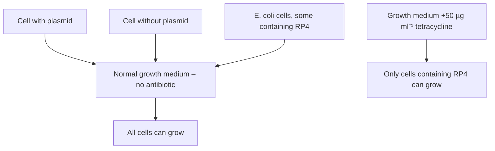
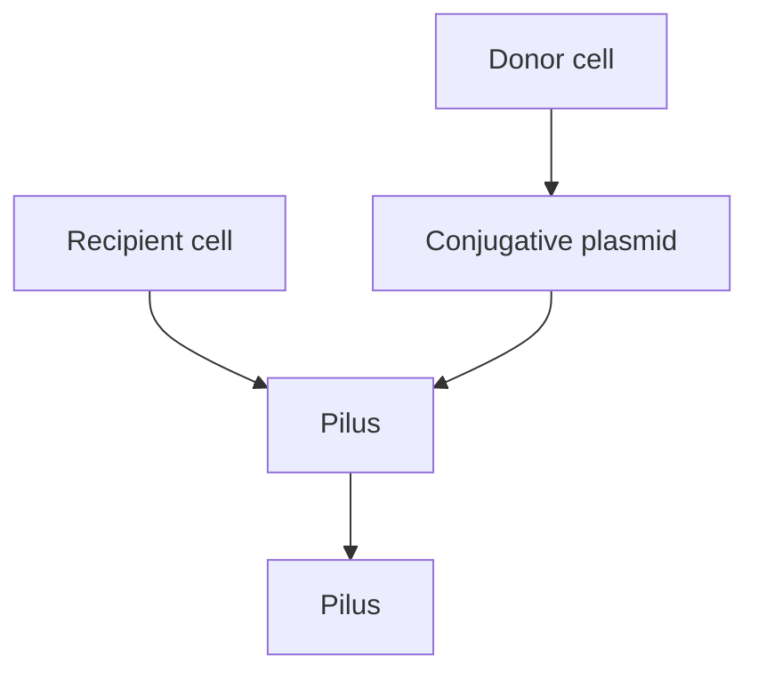
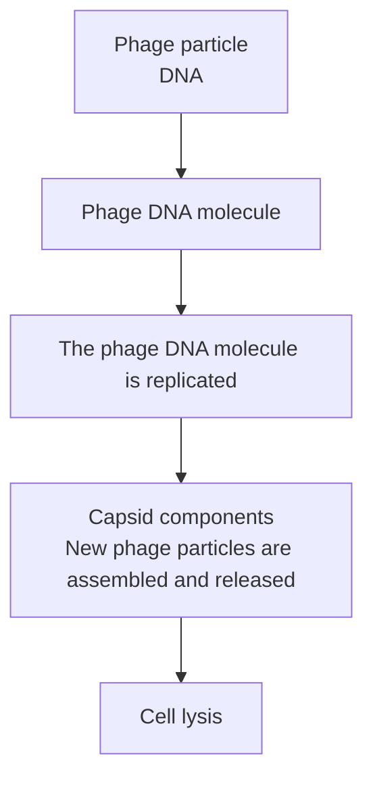
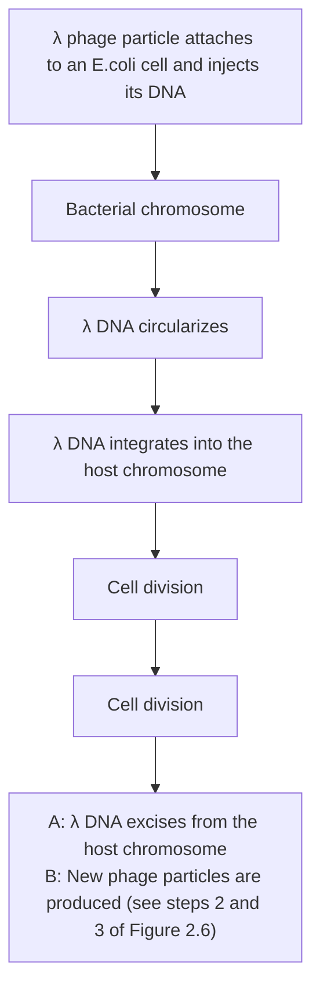
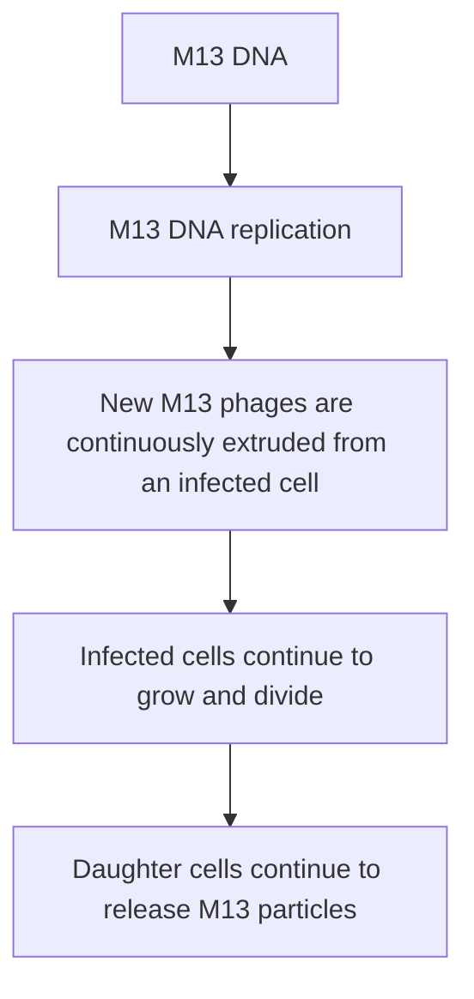
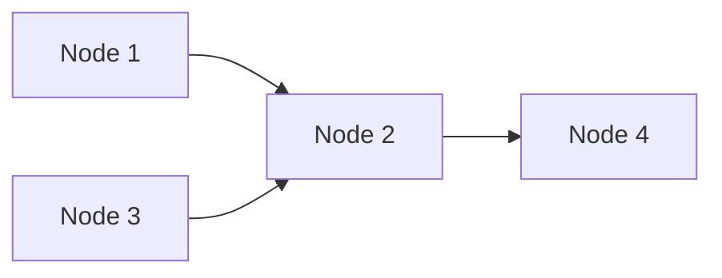

# Part I The Basic Principles of Gene Cloning and DNA Analysis / Chapter 2 Vectors for Gene Cloning: Plasmids and Bacteriophages

原始 PDF 第 33–46 页。

## Chapter 2

# Vectors for Gene Cloning: Plasmids and Bacteriophages

Chapter contents

**2.1** Plasmids 15
**2.2** Bacteriophages 19

A DNA molecule needs to display several features to be able to act as a vector for gene cloning. Most importantly it must be able to replicate within the host cell, so that numerous copies of the recombinant DNA molecule can be produced and passed to the daughter cells. A cloning vector also needs to be relatively small, ideally less than 10 kb in size, as large molecules tend to break down during purification, and are also more difficult to manipulate. Two kinds of DNA molecule that satisfy these criteria can be found in bacterial cells: plasmids and bacteriophage chromosomes.

## 2.1 Plasmids

Plasmids are circular molecules of DNA that lead an independent existence in the bacterial cell (Figure 2.1). Plasmids almost always carry one or more genes, and often these genes are responsible for a useful characteristic displayed by the host bacterium. For example, the ability to survive in normally toxic concentrations of antibiotics such as chloramphenicol or

Gene Cloning and DNA Analysis: An Introduction, Eighth Edition. T. A. Brown.

© 2021 John Wiley & Sons Ltd. Published 2021 by John Wiley & Sons Ltd.

15

---

16

Part I The Basic Principles of Gene Cloning and DNA Analysis

Figure 2.1

Plasmids: independent genetic elements found in bacterial cells.

text_image

Plasmids
Bacterial chromosome
Plasmids

ampicillin is often due to the presence in the bacterium of a plasmid carrying antibiotic resistance genes. In the laboratory, antibiotic resistance is often used as a **selectable marker** to ensure that bacteria in a culture contain a particular plasmid (Figure 2.2).

Most plasmids possess at least one DNA sequence that can act as an **origin of replication**, so they are able to multiply within the cell independently of the main bacterial chromosome (Figure 2.3a). The smaller plasmids make use of the host cell’s own DNA replicative enzymes in order to make copies of themselves, whereas some of the larger ones carry genes that code for special enzymes that are specific for plasmid replication. A few types of plasmid are also able to replicate by inserting themselves into the bacterial chromosome (Figure  2.3b). These integrative plasmids or

Figure 2.2

The use of antibiotic resistance as a selectable marker for a plasmid. RP4 (top) carries genes for resistance to ampicillin, tetracycline, and kanamycin. Only those E. coli cells that contain RP4 (or a related plasmid) are able to survive and grow in a medium that contains toxic amounts of one or more of these antibiotics.

donut

| Category | Relative Resistance Level |
| --- | --- |
| Ampicillin resistance | High |
| Tetracycline resistance | Medium |
| Kanamycin resistance | Low |
| Unlabeled segment (Light Blue) | Low |
| Unlabeled segment (Grey) | Low |

flowchart

---

Chapter 2 Vectors for Gene Cloning: Plasmids and Bacteriophages

17

Figure 2.3

Replication strategies for (a) a non‐integrative plasmid, and (b) an episome.

**episomes** may be stably maintained in this form through numerous cell divisions, but they always at some stage exist as independent elements.

## 2.1.1 Size and copy number

The size and **copy number** of a plasmid are particularly important as far as cloning is concerned. We have already mentioned the relevance of plasmid size and stated that less than 10 kb is desirable for a cloning vector. Plasmids range from about 1.0 kb for the smallest to over 250 kb for the largest plasmids (Table 2.1), so only a few are useful for cloning purposes. However, as we will see in Chapter 7, larger plasmids can be adapted for cloning under some circumstances.

Table 2.1

Sizes of representative plasmids.

<table><tr><td rowspan="2">PLASMID</td><td colspan="2">SIZE</td><td rowspan="2">ORGANISM</td></tr><tr><td>NUCLEOTIDE LENGTH (kb)</td><td>MOLECULAR MASS (MDa)</td></tr><tr><td>pUC8</td><td>2.7</td><td>1.8</td><td>E. coli</td></tr><tr><td>ColE1</td><td>6.6</td><td>4.3</td><td>E. coli</td></tr><tr><td>RP4</td><td>54</td><td>35</td><td>Pseudomonas and others</td></tr><tr><td>F</td><td>99</td><td>64</td><td>E. coli</td></tr><tr><td>TOL</td><td>117</td><td>76</td><td>Pseudomonas putida</td></tr><tr><td>pTiBo542</td><td>245</td><td>159</td><td>Agrobacterium tumefaciens</td></tr></table>

---

18

Part I The Basic Principles of Gene Cloning and DNA Analysis

The copy number refers to the number of molecules of an individual plasmid that are normally found in a single bacterial cell. The factors that control copy number are not well understood. Some plasmids, especially the larger ones, are **stringent** and have a low copy number of perhaps just one or two per cell; others, called **relaxed** plasmids, are present in multiple copies of 50 or more per cell. Generally speaking, a useful cloning vector needs to be present in the cell in multiple copies so that large quantities of the recombinant DNA molecule can be obtained.

## 2.1.2 Conjugation and compatibility

Plasmids fall into two groups: conjugative and non‐conjugative. Conjugative plasmids are characterized by the ability to promote sexual **conjugation** between bacterial cells (Figure 2.4), a process that can result in a conjugative plasmid spreading from one cell to all the other cells in a bacterial culture. Conjugation and plasmid transfer are controlled by a set of transfer or tra genes, which are present on conjugative plasmids but absent from the non‐conjugative type. However, a non‐conjugative plasmid may, under some circumstances, be cotransferred along with a conjugative plasmid when both are present in the same cell.

Several different kinds of plasmid may be found in a single cell, including more than one different conjugative plasmid at any one time. In fact, cells of E. coli have been known to contain up to seven different plasmids at once. To be able to coexist in the same cell, different plasmids must be **compatible**. If two plasmids are incompatible, then one or the other will be rapidly lost from the cell. Different types of plasmid can therefore be assigned to different **incompatibility groups** on the basis of whether or not they can coexist, and plasmids from a single incompatibility group are

flowchart

Figure 2.4

Plasmid transfer by conjugation between bacterial cells. The donor and recipient cells attach to each other by a **pilus**, a hollow appendage present on the surface of the donor cell. A copy of the plasmid is then passed to the recipient cell. Exactly how this transfer occurs is not understood. The DNA might pass directly through the pilus, as shown here, but an alternative theory is that the pilus contracts, bringing the cells together, with DNA transfer then occurring directly across the cell walls.

---

Chapter 2 Vectors for Gene Cloning: Plasmids and Bacteriophages

19

often related to each other in various ways. The basis of incompatibility is not well understood, but events during plasmid replication are thought to underlie the phenomenon.

## 2.1.3 Plasmid classification

The most useful classification of naturally occurring plasmids is based on the main characteristic coded by the plasmid genes. The five major types of plasmid according to this classification are as follows:

• **Fertility** or **F plasmids** carry only tra genes and have no characteristic beyond the ability to promote conjugal transfer of plasmids. A wellknown example is the F plasmid of E. coli.
**Resistance** or **R plasmids** carry genes conferring on the host bacterium resistance to one or more antibacterial agents, such as chloramphenicol, ampicillin, or mercury. R plasmids are very important in clinical microbiology as their spread through natural populations can have profound consequences in the treatment of bacterial infections. An example is RP4, which is commonly found in Pseudomonas, but also occurs in many other bacteria.
**Col plasmids** code for colicins, proteins that kill other bacteria. An example is ColE1 of E. coli.
**Degradative plasmids** allow the host bacterium to metabolize unusual molecules such as toluene and salicylic acid, an example being TOL of Pseudomonas putida.
**Virulence plasmids** confer pathogenicity on the host bacterium; these include the **Ti plasmids** of Agrobacterium tumefaciens, which induce crown gall disease on dicotyledonous plants.

## 2.1.4 Plasmids in organisms other than bacteria

Although plasmids are widespread in bacteria they are by no means as common in other organisms. The best‐characterized eukaryotic plasmid is the **2 μm circle** that occurs in many strains of the yeast Saccharomyces cerevisiae. The discovery of the 2 μm plasmid was very fortuitous as it allowed the construction of cloning vectors for this very important industrial organism (Section  7.1). However, the search for plasmids in other eukaryotes (such as filamentous fungi, plants, and animals) has proved disappointing, and it is suspected that many higher organisms simply do not harbour plasmids within their cells.

## 2.2 Bacteriophages

Bacteriophages, or phages as they are commonly known, are viruses that specifically infect bacteria. Like all viruses, phages are very simple in structure, consisting merely of a DNA (or occasionally ribonucleic acid [RNA])

---

20

Part I The Basic Principles of Gene Cloning and DNA Analysis

The two main types of phage structure. (a) Head‐and‐tail (e.g. λ). (b) Filamentous (e.g. M13).

Figure 2.5

(a) Head-and-tail

text_image

Head
(contains
DNA)
Tail

(b) Filamentous

text_image

Protein
molecules
(capsid)
DNA
molecule

molecule carrying a number of genes, including several for replication of the phage, surrounded by a protective coat or **capsid** made up of protein molecules (Figure 2.5).

## 2.2.1 The phage infection cycle

The general pattern of infection, which is the same for all types of phage, is a three‐step process (Figure 2.6):

1 The phage particle attaches to the outside of the bacterium and injects its DNA chromosome into the cell.
2 The phage DNA molecule is replicated, usually by specific phage enzymes coded by genes in the phage chromosome.
3 Other phage genes direct synthesis of the protein components of the capsid, and new phage particles are assembled and released from the bacterium.

With some phage types the entire infection cycle is completed very quickly, possibly in less than 20 minutes. This type of rapid infection is called a **lytic cycle**, as release of the new phage particles is associated with lysis of the bacterial cell. The characteristic feature of a lytic infection cycle is that phage DNA replication is immediately followed by synthesis of capsid proteins, and the phage DNA molecule is never maintained in a stable condition in the host cell.

## 2.2.2 Lysogenic phages

In contrast to a lytic cycle, **lysogenic** infection is characterized by retention of the phage DNA molecule in the host bacterium, possibly for many thousands of cell divisions. With many lysogenic phages, the phage DNA is inserted into the bacterial genome, in a manner similar to episomal insertion (see Figure 2.3b). The integrated form of the phage DNA (called the **prophage**) is quiescent, and a bacterium (referred to as a **lysogen**) that carries a prophage is usually physiologically indistinguishable from an

---

Chapter 2 Vectors for Gene Cloning: Plasmids and Bacteriophages

21

flowchart

Figure 2.6

The general pattern of infection of a bacterial cell by a bacteriophage.

uninfected cell. However, the prophage is eventually released from the host genome and the phage reverts to the lytic mode and lyses the cell. The infection cycle of **lambda (λ)**, a typical lysogenic phage of this type, is shown in Figure 2.7.

A limited number of lysogenic phages follow a rather different infection cycle. When **M13** or a related phage infects E. coli, new phage particles are continuously assembled and released from the cell. The M13 DNA is not integrated into the bacterial genome and does not become quiescent. With these phages, cell lysis never occurs, and the infected bacterium can continue to grow and divide, albeit at a slower rate than uninfected cells. Figure 2.8 shows the M13 infection cycle.

Although there are many different varieties of bacteriophage, only λ and M13 have found a major role as cloning vectors. We will now consider the properties of these two phages in more detail.

---

22

Part I The Basic Principles of Gene Cloning and DNA Analysis

flowchart

Figure 2.7

The lysogenic infection cycle of bacteriophage λ.

## Gene organization in the λ DNA molecule

Lambda is a typical example of a head‐and‐tail phage (see Figure 2.5a). The DNA is contained in the polyhedral head structure and the tail serves to attach the phage to the bacterial surface and to inject the DNA into the cell (see Figure 2.7).

---

Chapter 2 Vectors for Gene Cloning: Plasmids and Bacteriophages

23

flowchart

Figure 2.8

The infection cycle of bacteriophage M13.

The λ DNA molecule is 48.5 kb in size and has been intensively studied by the techniques of gene mapping and DNA sequencing. As a result, the positions and identities of all of the genes in the λ DNA molecule are known (Figure 2.9). A feature of the λ genetic map is that genes related in terms of function are clustered together in the genome. For example, all of the genes coding for components of the capsid are grouped together in the left‐hand third of the molecule, and genes controlling integration of the prophage into the host genome are clustered in the middle of the molecule. Clustering of related genes is profoundly important for controlling expression of the λ genome, as it allows genes to be switched on and off as a group rather than individually. Clustering is also important in the construction of λ‐based cloning vectors, as we will discover when we return to this topic in Chapter 6.

text_image

Capsid components
and assembly
b2 region
AWB C D EFZUVGT H M LKI J
int xis exo clll N cl cro
Integration
and excision
Early regulation
DNA synthesis
Late regulation
Lysis of the host
0 2 4 6 8 10 12 14 16 18 20 22 24 26 28 30 32 34 36 38 40 42 44 46 48 48.5kb

Figure 2.9

The λ genetic map, showing the positions of the important genes and the functions of the gene clusters. The b2 region contains genes that are not essential when λ phage are grown in the laboratory, but which are thought to play an important role in the natural environment.

---

24

Part I The Basic Principles of Gene Cloning and DNA Analysis

## The linear and circular forms of λ DNA

A second feature of λ that turns out to be of importance in the construction of cloning vectors is the conformation of the DNA molecule. The molecule shown in Figure 2.9 is linear, with two free ends, and represents the DNA present in the phage head structure. This linear molecule consists of two **complementary** strands of DNA, base‐paired according to the **Watson– Crick rules** (that is, double‐stranded DNA). However, at either end of the molecule is a short 12‐nucleotide stretch in which the DNA is singlestranded (Figure 2.10a). The two single strands are complementary, and so can base pair with one another to form a circular, completely doublestranded molecule (Figure 2.10b).

Figure 2.10

The linear and circular forms of λ DNA. (a) The linear form, showing the left and right cohesive ends. (b) Base pairing between the cohesive ends results in the circular form of the molecule. (c) Rolling circle replication produces a concatemer of new linear λ DNA molecules, which are individually packaged into phage heads as new λ particles are assembled.

---

Chapter 2 Vectors for Gene Cloning: Plasmids and Bacteriophages

25

Complementary single strands are often referred to as **‘sticky’ ends** or cohesive ends, because base pairing between them can ‘stick’ together the two ends of a DNA molecule (or the ends of two different DNA molecules). The λ cohesive ends are called the **cos sites** and they play two distinct roles during the λ infection cycle. First, they allow the linear DNA molecule that is injected into the cell to be circularized, which is a necessary prerequisite for insertion into the bacterial genome (see Figure 2.7).

The second role of the cos sites is rather different and comes into play after the prophage has excised from the host genome. At this stage, a large number of new λ DNA molecules are produced by the rolling circle mechanism of replication (Figure 2.10c), in which a continuous DNA strand is ‘rolled off’ the template molecule. The result is a concatemer consisting of a series of linear λ genomes joined at the cos sites. The role of the cos sites is now to act as recognition sequences for an **endonuclease** that cleaves the concatemer at the cos sites, producing individual λ genomes. This endonuclease, which is the product of gene A on the DNA molecule, creates the single‐stranded sticky ends, and also acts in conjunction with other proteins to package each λ genome into a phage head structure. The cleavage and packaging processes recognize just the cos sites and the DNA sequences to either side of them, so changing the structure of the internal regions of  the λ genome, for example by inserting new genes, has no effect on these events so long as the overall length of the λ genome is not altered too greatly.

## M13 – a filamentous phage

M13 is an example of a filamentous phage (see Figure  2.5b) and is completely different in structure from λ. Furthermore, the M13 DNA molecule is much smaller than the λ genome, being only 6407 nucleotides in length. It is circular and is unusual in that it consists entirely of singlestranded DNA.

The smaller size of the M13 DNA molecule means that it has room for fewer genes than the λ genome. This is possible because the M13 capsid is constructed from multiple copies of just three proteins (requiring only three genes), whereas synthesis of the λ head‐and‐tail structure involves over 15 different proteins. In addition, M13 follows a simpler infection cycle than λ, and does not need genes for insertion into the host genome.

Injection of an M13 DNA molecule into an E. coli cell occurs via the pilus, the structure that connects two cells during sexual conjugation (see Figure 2.4). Once inside the cell the single‐stranded molecule acts as the template for synthesis of a complementary strand, resulting in normal double‐stranded DNA (Figure 2.11a). This molecule is not inserted into the bacterial genome, but instead replicates until over 100 copies are present in the cell (Figure 2.11b). When the bacterium divides, each daughter cell receives copies of the phage genome, which continues to replicate, thereby maintaining its overall numbers per cell. As shown in Figure 2.11c, new phage particles are continuously assembled and released, with about 1000 new phages being produced during each generation of an infected cell.

Several features of M13 make this phage attractive as a cloning vector. The genome is less than 10 kb in size, well within the range desirable for a

---

26

Part I The Basic Principles of Gene Cloning and DNA Analysis

Figure 2.11

The M13 infection cycle, showing the different types of DNA replication that occur. (a) After infection the singlestranded M13 DNA molecule is converted into the doublestranded replicative form (RF). (b) The RF replicates to produce multiple copies of itself. (c) Single‐stranded molecules are synthesized by rolling circle replication and used in the assembly of new M13 particles.

(a) Injection of singlestranded DNA into the host cell, followed by synthesis of the second strand

text_image

M13 particle
injects DNA
into cell
Pilus
Single-stranded DNA
Double-stranded DNA - replicative form (RF)

(b) Replication of the RF to produce new double-stranded molecules

flowchart

Mature M13 phage(c) are continuously produced RF replicates by rolling circle mechanism to produce linear single-stranded DNA

text_image

Circularized DNA
Mature phage
particles

potential vector. In addition, the double‐stranded **replicative form (RF)** of the M13 genome behaves very much like a plasmid and can be treated as such for experimental purposes. It is easily prepared from a culture of infected E. coli cells (Section 3.3.5) and can be reintroduced by **transfection** (Section 5.3.1). Most importantly, genes cloned with an M13‐based vector can be obtained in the form of single‐stranded DNA. Single‐stranded versions of cloned genes are useful for several techniques, such as in vitro mutagenesis (Section 11.3.2). Cloning in an M13 vector is an easy and reliable way of obtaining single‐stranded DNA for this type of work. M13 vectors are also used in **phage display**, a technique for identifying pairs of genes whose protein products interact with one another (Section 13.2.2).

## 2.2.3 Viruses as cloning vectors for other organisms

Most living organisms are infected by viruses and it is not surprising that there has been great interest in the possibility that viruses might be used as cloning vectors for higher organisms. This is especially important when it is remembered that plasmids are not commonly found in organisms other than bacteria and yeast. Several eukaryotic viruses have been employed as cloning vectors for specialized applications. For example, human **adenoviruses** and **retroviruses** are used in **gene therapy** (Section 15.3), **baculoviruses** are used to synthesize important pharmaceutical proteins in insect

---

Chapter 2 Vectors for Gene Cloning: Plasmids and Bacteriophages

27

cells (Section  14.3.2), and **caulimoviruses** and **geminiviruses** have been used for cloning in plants (Section 7.2.3). These vectors are discussed more fully in Chapter 7.

## Further reading

- Casjens, S.R. and Hendrix, R.W. (2015) Bacteriophage lambda: early pioneer and still relevant. Virology, 479, 310–330. [Review of the lambda infection cycle, with focus on the roles of individual genes.]
- Dale, J.W. and Park, S.F. (2010) Molecular Genetics of Bacteria, 5th edn. Wiley Blackwell, Chichester. [Provides a detailed description of plasmids and bacteriophages.]
- Marvin, D.A. (1998) Filamentous phage structure, infection and assembly. Current Opinion in Structural Biology, 8, 150–158.
- Waksman, G. (2019) From conjugation to T4S systems in Gram‐negative bacteria: a mechanistic biology perspective. EMBO Reports, 20, e47012. [Describes the latest research on DNA transfer during conjugation.]
- Willey, J., Sherwood, L., and Woolverton, C.J. (2017) Prescott’s Microbiology, 10th edn. McGraw Hill Education, New York. [A good introduction to microbiology, including plasmids and phages.]

---

