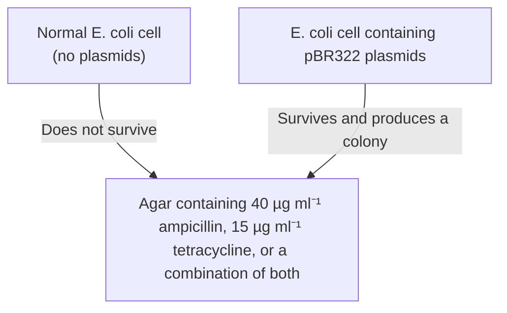
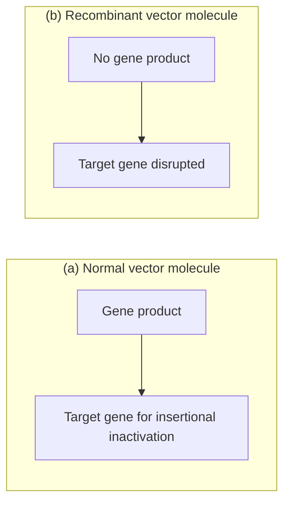

# Part I The Basic Principles of Gene Cloning and DNA Analysis / Chapter 5 Introduction of DNA into Living Cells

原始 PDF 第 101–118 页。

## Chapter 5

# Introduction of DNA into Living Cells

## Chapter contents

**5.1** Transformation – the uptake of DNA by bacterial cells 85
**5.2** Identification of recombinants 88
**5.3** Introduction of phage DNA into bacterial cells 92
**5.4** Introduction of DNA into non‐bacterial cells 97

The manipulations described in Chapter 4 allow the molecular biologist to create novel recombinant DNA molecules. The next step in a gene cloning experiment is to introduce these molecules into living cells, usually bacteria, which then grow and divide to produce clones (see Figure 1.1). Strictly speaking, the word ‘cloning’ refers only to the later stages of the procedure, and not to the construction of the recombinant DNA molecule itself.

Cloning serves two main purposes. First, it allows a large number of recombinant DNA molecules to be produced from a limited amount of starting material. At the outset only a few nanograms of recombinant DNA may be available, but each bacterium that takes up a plasmid subsequently divides numerous times to produce a colony, each cell of which contains multiple copies of the molecule. Several micrograms of recombinant DNA can usually be prepared from a single bacterial colony, representing a thousandfold increase over the starting amount (Figure 5.1). If the colony is used not as a source of DNA but as an inoculum for a liquid culture, the resulting cells may provide milligrams of DNA, a millionfold increase in yield. In this way cloning can supply the large amounts of DNA needed for molecular biological studies of gene structure and expression (Chapters 10 and 11).

Gene Cloning and DNA Analysis: An Introduction, Eighth Edition. T. A. Brown.

© 2021 John Wiley & Sons Ltd. Published 2021 by John Wiley & Sons Ltd.

83

---

84

Part I The Basic Principles of Gene Cloning and DNA Analysis

flowchart

Figure 5.1

Cloning can supply large amounts of recombinant DNA.

The second important function of cloning can be described as purification. The manipulations that result in a recombinant DNA molecule can only rarely be controlled to the extent that no other DNA molecules are present at the end of the procedure. The ligation mixture may contain, in addition to the desired recombinant molecule, any number of the following (Figure 5.2a):

• Unligated vector molecules.
• Unligated DNA fragments.
• Vector molecules that have recircularized without new DNA being inserted (‘self‐ligated’ vector).
• Recombinant DNA molecules that carry the wrong inserted DNA fragment.

Unligated molecules rarely cause a problem because, even though they may be taken up by bacterial cells, only under exceptional circumstances will they be replicated. It is much more likely that enzymes within the host bacteria degrade these pieces of DNA. Self‐ligated vector molecules and incorrect recombinant plasmids are more important because they are replicated just as efficiently as the desired molecule (Figure 5.2b). However, purification of the desired molecule can still be achieved through cloning because it is extremely unusual for any one cell to take up more than one DNA molecule. Each cell gives rise to a single colony, so each of the resulting clones is made up of cells that all contain the same molecule. Of course, different colonies contain different molecules. Some contain the desired recombinant DNA molecule, some have different recombinant molecules, and some contain self‐ligated vector. The problem therefore becomes a question of identifying the colonies that contain the correct recombinant plasmids.

This chapter is concerned with the way in which plasmid and phage vectors, and recombinant molecules derived from them, are introduced into bacterial cells. During the course of the chapter it will become apparent that selection for colonies containing recombinant molecules, as opposed to colonies containing self‐ligated vector, is relatively easy. The more difficult proposition of how to distinguish clones containing the correct recombinant DNA molecule from all the other recombinant clones will be tackled in Chapter 8.

---

Chapter 5 Introduction of DNA into Living Cells

85

Figure 5.2

Cloning is analogous to purification. From a mixture of different molecules, clones containing copies of just one molecule can be obtained.

## 5.1 Transformation – the uptake of DNA by bacterial cells

Most species of bacteria are able to take up DNA molecules from the medium in which they grow. Often a DNA molecule taken up in this way will be degraded, but occasionally it is able to survive and replicate in the host cell. In particular, this will happen if the DNA molecule is a plasmid with an origin of replication recognized by the host.

## 5.1.1 Not all species of bacteria are equally efficient at DNA uptake

In nature, transformation is probably not a major process by which bacteria obtain genetic information. This is reflected by the fact that in the

---

86

Part I The Basic Principles of Gene Cloning and DNA Analysis

laboratory only a few species (notably members of the genera Bacillus and Streptococcus) can be transformed with ease. Close study of these organisms has revealed that they possess sophisticated mechanisms for DNA binding and uptake.

Most species of bacteria, including E. coli, take up only limited amounts of DNA under normal circumstances. In order to transform these species efficiently, the bacteria have to undergo some form of physical and/or chemical treatment that enhances their ability to take up DNA. Cells that have undergone this treatment are said to be **competent**.

## 5.1.2 Preparation of competent E. coli cells

As with many breakthroughs in recombinant DNA technology, the key development as far as transformation is concerned occurred in the early 1970s, when it was observed that E. coli cells that had been soaked in an ice‐cold salt solution are more efficient at DNA uptake than unsoaked cells. A solution of 50 mM calcium chloride $( \mathrm { C a C l } _ { 2 } ) ^ { \overline { { } } }$ is traditionally used, although other salts, notably rubidium chloride, are also effective.

Exactly why this treatment works is not understood. At one time it was thought that $\dot { \mathrm { C a C l } } _ { 2 }$ causes the DNA to precipitate onto the outside of the cells, or is responsible for some kind of physical change in the cell wall that improves DNA binding. More recent research has suggested that salt treatment induces overproduction of certain outer membrane proteins, including one or more that bind DNA. In any case, soaking in CaCl affects only DNA binding, and not the actual uptake into the cell. When DNA is added to treated cells, it remains attached to the cell exterior, and is not at this stage transported into the cytoplasm (Figure 5.3). The actual movement of DNA into competent cells is stimulated by briefly raising the temperature to $4 2 ^ { \circ } \mathrm { C } ,$ . Possibly this heat shock changes the permeability of the membrane to DNA, or possibly, like $\mathrm { C a C l } _ { 2 }$ treatment, the heat shock induces activity of a membrane protein that transports DNA into the cell.

## 5.1.3 Selection for transformed cells

Transformation of competent cells is an inefficient procedure, however carefully the cells have been prepared. Although 1 ng of the plasmid vector called pUC8 (Section 6.1.4) can yield between 1000 and 10 000 transformants, this represents the uptake of only 0.01% of all the available molecules. Furthermore, 10 000 transformants is only a very small proportion

flowchart

Figure 5.3

The binding and uptake of DNA by a competent bacterial cell.

---

Chapter 5 Introduction of DNA into Living Cells

87

of the total number of cells that are present in a competent culture. This last fact means that some way must be found to distinguish a cell that has taken up a plasmid from the many thousands that have not been transformed.

Uptake and stable retention of a plasmid is usually detected by looking for expression of the genes carried by the plasmid. For example, E. coli cells are normally sensitive to the growth inhibitory effects of the antibiotics ampicillin and tetracycline. However, cells that contain the plasmid pBR322 (Section 6.1.2), one of the first cloning vectors to be developed back in the $1 9 7 0 s ,$ are resistant to these antibiotics. This is because pBR322 carries two sets of genes, one gene that codes for a β‐lactamase enzyme that modifies ampicillin into a form that is nontoxic to the bacterium, and a second set of genes that code for enzymes that detoxify tetracycline. After a transformation experiment with pBR322, only those E. coli cells that have taken up a plasmid are $a m p ^ { R } t e t ^ { R }$ and able to form colonies on an agar  medium that contains ampicillin or tetracycline (Figure  5.4). Nontransformants, which are still ampStetS, do not produce colonies on the selective medium. Transformants and non‐transformants are therefore easily distinguished.

Most plasmid cloning vectors carry at least one gene that confers antibiotic resistance on the host cells, with selection of transformants being achieved by plating onto an agar medium that contains the relevant anti-biotic. Bear in mind, however, that resistance to the antibiotic is not due merely to the presence of the plasmid in the transformed cells. The resistance gene on the plasmid must also be expressed, so that the enzyme that detoxifies the antibiotic is synthesized. Expression of the resistance gene begins immediately after transformation, but it will be a few minutes before the cell contains enough of the enzyme to be able to withstand the toxic effects of the antibiotic. For this reason, the transformed bacteria should not be plated onto the selective medium immediately after the heat

flowchart

Figure 5.4

Selecting cells that contain pBR322 plasmids by plating onto agar medium containing ampicillin and/or tetracycline.

---

88

Part I The Basic Principles of Gene Cloning and DNA Analysis

flowchart

Figure 5.5

Phenotypic expression. Incubation at $3 7 ^ { \circ } 0$ for 1 hour before plating out improves the survival of the transformants on selective medium, because the bacteria have had time to begin synthesis of the antibiotic resistance enzymes.

shock treatment, but first placed in a small volume of liquid medium, in the absence of antibiotic, and incubated for a short time. Plasmid replication and expression can then get started, so that when the cells are plated out and encounter the antibiotic, they will already have synthesized sufficient resistance enzymes to be able to survive (Figure 5.5).

## 5.2 Identification of recombinants

Plating onto a selective medium enables transformants to be distinguished from non‐transformants. The next problem is to determine which of the transformed colonies comprise cells that contain recombinant DNA molecules, and which contain self‐ligated vector molecules (see Figure  5.2). With most cloning vectors, insertion of a DNA fragment into the plasmid destroys the integrity of one of the genes present on the molecule. **Recombinants** can therefore be identified because the characteristic coded by the inactivated gene is no longer displayed by the host cells (Figure 5.6).

flowchart

Figure 5.6

Insertional inactivation. (a) The normal, non‐recombinant vector molecule carries a gene whose product confers a selectable or identifiable characteristic on the host cell. (b) This gene is disrupted when new DNA is inserted into the vector; as a result the recombinant host does not display the relevant characteristic.

---

Chapter 5 Introduction of DNA into Living Cells

89

We will explore the general principles of **insertional inactivation** by looking at the different methods used with the two cloning vectors mentioned in the previous section: pBR322 and pUC8.

## 5.2.1 Recombinant selection with pBR322 – insertional inactivation of an antibiotic resistance gene

pBR322 has several single‐copy restriction sites that can be used to open up the vector before insertion of a new DNA fragment (Figure  5.7a). BamHI, for example, cuts pBR322 at just one position, within the cluster of genes that code for resistance to tetracycline. A recombinant pBR322 molecule, one that carries an extra piece of DNA in the BamHI site (Figure 5.7b), is no longer able to confer tetracycline resistance on its host, as one of the necessary genes is now disrupted by the inserted DNA. Cells containing this recombinant pBR322 molecule are still resistant to ampicillin, but sensitive to tetracycline $( a m p ^ { R } t e t ^ { S } )$

Screening for pBR322 recombinants is performed in the following way. After transformation the cells are plated onto ampicillin medium and incubated until colonies appear (Figure  5.8a). All of these colonies are transformants (remember, untransformed cells are $a m p ^ { S }$ and so do not produce colonies on the selective medium), but only a few contain recombinant pBR322 molecules: most contain the normal, self‐ligated plasmid. To identify the recombinants the colonies are **replica plated** onto agar medium that contains tetracycline (Figure 5.8b). After incubation, some of the original colonies regrow, but others do not (Figure 5.8c). Those that do grow consist of cells that carry the normal pBR322 with no inserted DNA and therefore a functional tetracycline resistance gene cluster $( a m p ^ { R } t e t ^ { R } )$ . The colonies that do not grow on tetracycline agar are recombinants $( a m p ^ { R } t e t ^ { S } )$ . Reference back to the original ampicillin agar plate reveals the positions of these colonies, enabling samples to be recovered for further study.

Figure 5.7

The cloning vector pBR322. (a) The normal vector molecule. (b) A recombinant molecule containing an extra piece of DNA inserted into the BamHI site. For a more detailed map of pBR322, see Figure 6.1.

---

90

Part I The Basic Principles of Gene Cloning and DNA Analysis

Figure 5.8

Screening for pBR322 recombinants by insertional inactivation of the tetracycline resistance gene. (a) Cells are plated onto ampicillin agar: all the transformants produce colonies. (b) The colonies are replica plated onto tetracycline medium. (c) The colonies that grow on tetracycline medium are ampRtetR and therefore non‐recombinants. Recombinants (ampRtetS) do not grow, but their position on the ampicillin plate is now known.

## 5.2.2 Insertional inactivation does not always involve antibiotic resistance

Although insertional inactivation of an antibiotic resistance gene provides an effective means of recombinant identification, the method is made inconvenient by the need to carry out two screenings, one with the antibiotic that selects for transformants, followed by the second screen, after replica plating, with the antibiotic that distinguishes recombinants. Most modern plasmid vectors therefore make use of a different system.

---

Chapter 5 Introduction of DNA into Living Cells

91

donut

| Category | Relative Size |
| --- | --- |
| Ampicillin resistance gene | ~30% |
| ampRβ-gal+ | ~45% |
| BamHI | ~5% |
| lacZ' gene | ~5% |

Figure 5.9

The cloning vector pUC8. (a) The normal vector molecule. (b) A recombinant molecule containing an extra piece of DNA inserted into the BamHI site. For a more detailed map of pUC8, see Figure 6.3.

donut

| Category | Value |
| --- | --- |
| Red segment | N/A |
| Blue segment (top) | N/A |
| Green segment (bottom) | N/A |
| Purple segment (inserted) | N/A |
| New DNA inserted in the BamHI site | N/A |

(b) A recombinant pUC8 molecule

An  example is pUC8 (Figure  5.9a), which carries the ampicillin resistance gene and a gene called lacZ′, which codes for part of the enzyme β‐galactosidase. Cloning with pUC8 involves insertional inactivation of the lacZ′ gene, with recombinants identified because of their inability to synthesize β‐galactosidase (Figure 5.9b).

β‐Galactosidase is one of a series of enzymes involved in the breakdown of lactose to glucose plus galactose. It is normally coded by the gene lacZ, which resides on the E. coli chromosome. Some strains of E. coli have a modified lacZ gene, one that lacks the segment referred to as lacZ′, which codes for the α‐peptide portion of β‐galactosidase (Figure  5.10a). These mutants can synthesize the enzyme only when they harbour a plasmid, such as pUC8, that carries the missing lacZ′ segment of the gene. A cloning experiment with pUC8 therefore involves selection of transformants on ampicillin agar followed by screening for β‐galactosidase activity to identify recombinants. Cells that harbour a normal pUC8 plasmid are ampR and able to synthesize β‐galactosidase. Recombinants are also ampR but unable to make β‐galactosidase.

Screening for β‐galactosidase presence or absence is in fact quite easy. Rather than assay for lactose being split to glucose and galactose, we test for a slightly different reaction that is also catalysed by β‐galactosidase. This involves a lactose analogue called X‐gal (5‐bromo‐4‐chloro‐3‐ indolyl‐β‐D‐galactopyranoside) which is broken down by β‐galactosidase to a product that is coloured deep blue. If X‐gal (plus an inducer of the enzyme such as isopropylthiogalactoside, IPTG) is added to the agar,

---

92

Part I The Basic Principles of Gene Cloning and DNA Analysis

(a) The role of the modied E. coli lacZ gene

text_image

E.coli lacZ⁻
Incomplete
enzyme
molecules
Gene
+ pUC8
Complete
β-galactosidase
molecules
pUC8

β-galactosidase fragment coded by bacterial gene

β-galactosidase fragment coded by plasmid gene

Complete β-galactosidase molecule

(b) Screening for pUC8 recombinants

text_image

Blue colony = non-recombinant
Agar + X-gal + IPTG
White colony = recombinant
Blue colonies = β-galactosidase synthesized
X-gal → blue product
White colonies = β-galactosidase not synthesized
X-gal → no blue product

Figure 5.10

The rationale behind insertional inactivation of the lacZ′ gene carried by pUC8. (a) The bacterial and plasmid genes complement each other to produce a functional β‐galactosidase molecule. (b) Recombinants are screened by plating onto agar containing X‐gal and IPTG.

along with ampicillin, then non‐recombinant colonies, the cells of which synthesize β‐galactosidase, will be coloured blue, whereas recombinants with a disrupted lacZ′ gene and unable to make β‐galactosidase, will be white. This system, which is called **Lac selection**, is summarized in Figure  5.10b. Note that both ampicillin resistance and the presence or absence of β‐galactosidase are tested for on a single agar plate. The two screenings are therefore carried out together and there is no need for the time‐consuming replica plating step that is necessary with plasmids such as pBR322.

## 5.3 Introduction of phage DNA into bacterial cells

There are two different methods by which a recombinant DNA molecule constructed with a phage vector can be introduced into a bacterial cell: transfection and **in vitro packaging**.

---

Chapter 5 Introduction of DNA into Living Cells

93

## 5.3.1 Transfection

Transfection is equivalent to transformation, the only difference being that phage DNA rather than a plasmid is involved. Just as with a plasmid, the purified phage DNA, or recombinant phage molecule, is mixed with competent E. coli cells and DNA uptake induced by heat shock. Transfection is the standard method for introducing the double‐stranded RF form of an M13 cloning vector into E. coli.

## 5.3.2 In vitro packaging of λ cloning vectors

Transfection with λ DNA molecules is not a very efficient process when compared with the infection of a culture of cells with mature λ phage particles. It would therefore be useful if recombinant λ molecules could be packaged into their λ head‐and‐tail structures in the test tube.

This may sound difficult but is actually relatively easy to achieve. Packaging requires a number of different proteins coded by the λ genome, but these can be prepared at a high concentration from cells infected with defective λ phage strains. Two different systems are in use. With the single strain system, the defective λ phage carries a mutation in the cos sites, so that these are not recognized by the endonuclease that normally cleaves the  λ concatemers during phage replication (Section  2.2.2). This means that the defective phage cannot replicate, though it does direct synthesis of all the proteins needed for packaging. The proteins accumulate in the bacterium and can be purified from cultures of E. coli infected with the mutated λ. The protein preparation is then used for in vitro packaging of recombinant λ molecules (Figure 5.11a).

With the second system two defective λ strains are needed. Both of these strains carry a mutation in a gene for one of the components of the phage protein coat: with one strain the mutation is in gene D, and with the second strain it is in gene E (see Figure 2.9). Neither strain is able to complete an infection cycle in E. coli because in the absence of the product of the mutated gene the complete capsid structure cannot be made. Instead the products of all the other coat protein genes accumulate (Figure 5.11b). An in vitro packaging mix can therefore be prepared by combining lysates of two cultures of cells, one infected with the λ D− strain, the other infected with the E− strain. The mixture now contains all the necessary components for in vitro packaging.

With both systems, formation of phage particles is achieved simply by mixing the packaging proteins with λ DNA, because assembly of the particles occurs automatically in the test tube (Figure 5.11c). The packaged λ DNA is then introduced into E. coli cells simply by adding the assembled phages to the bacterial culture and allowing the normal λ infective process to take place.

## 5.3.3 Phage infection is visualized as plaques on an agar medium

The final stage of the phage infection cycle is cell lysis (Section 2.2.1). If infected cells are spread onto a solid agar medium immediately after addition of the phage particles, or immediately after transfection with phage

---

94

Part I The Basic Principles of Gene Cloning and DNA Analysis

(a) A single-strain packaging system

text_image

λ DNA
E. coli SMR10 - λ DNA
has defective cos sites
λ proteins
accumulate
in the cell

(b) A two-strain packaging system

text_image

λ DNA
λ proteins
E. coli BHB2688 - λ defective
for synthesis of protein E (○)

text_image

λ DNA
λ proteins
E. coli BHB2690 - λ defective
for synthesis of protein D (○)

(c) In vitro packaging

flowchart

Figure 5.11

In vitro packaging. (a) Synthesis of λ capsid proteins by E. coli strain SMR10, which carries a λ phage that has defective cos sites. (b) Synthesis of incomplete sets of λ capsid proteins by E. coli strains BHB2688 and BHB2690. (c) The cell lysates provide the complete set of capsid proteins and can package λ DNA molecules in the test tube.

DNA, cell lysis can be visualized as **plaques** on a lawn of bacteria (Figure 5.12a). Each plaque is a zone of clearing produced as the phages lyse the cells and move on to infect and eventually lyse the neighbouring bacteria (Figure 5.12b).

Both λ and M13 form plaques. With λ these are true plaques, produced by cell lysis. However, M13 plaques are slightly different as M13 does not lyse the host cells (see Figure 2.8). Instead M13 causes a decrease in the growth rate of infected cells, sufficient to produce a zone of relative clearing on a bacterial lawn. Although not true plaques, these zones of clearing are visually identical to normal phage plaques (Figure 5.12c).

The end result of a gene cloning experiment using a λ or M13 vector is therefore an agar plate covered in phage plaques. Each plaque is derived

---

Chapter 5 Introduction of DNA into Living Cells

95

(a) Plaques on a lawn of bacteria

text_image

Lawn of confluent
bacterial growth
A plaque - a
zone of clearing

(b) Lytic plaques

text_image

Plaque - all the bacteria are lysed, leading to a high titre of bacteriophages
Lawn of bacteria

(c) M13 plaques

text_image

Plaques contain slow-growing bacteria and M13 phage particles

Figure 5.12

Bacteriophage plaques. (a) The appearance of plaques on a lawn of bacteria. (b) Plaques produced by a phage that lyses the host cell (e.g. λ in the lytic infection cycle); the plaques contain lysed cells plus many phage particles. (c) Plaques produced by M13; these plaques contain slow‐growing bacteria plus many M13 phage particles.

from a single transfected or infected cell and therefore contains identical phage particles. These may contain self‐ligated vector molecules, or they may be recombinants.

## 5.3.4 Identification of recombinant phages

A variety of ways of distinguishing recombinant plaques have been devised, the following being the most important.

## Insertional inactivation of a lacZ′ gene carried by the phage vector

All M13 cloning vectors, as well as several λ vectors, carry a copy of the lacZ′ gene. Insertion of new DNA into this gene inactivates β‐galactosidase synthesis, just as with the plasmid vector pUC8. Recombinants are distinguished by plating cells onto X‐gal agar. Plaques comprising normal phages are blue; recombinant plaques are clear (Figure 5.13a).

## Insertional inactivation of the λ cl gene

With several types of λ cloning vector, the new DNA is inserted into a restriction site in the cI gene. Inactivation of this gene causes a change in plaque morphology. Normal plaques appear ‘turbid’, whereas recombinants with a disrupted cI gene are ‘clear’ (Figure 5.13b). The difference is readily apparent to the experienced eye.

## Selection using the Spi phenotype

λ phages cannot normally infect E. coli cells that already possess an integrated form of a related phage called P2. λ is therefore said to be Spi+

---

96

Part I The Basic Principles of Gene Cloning and DNA Analysis

(a) Insertional activation of the lacZ’ gene

text_image

Agar + X-gal + IPTG
Clear plaque = recombinant
Blue plaque = non-recombinant

(b) Insertional activation of the λ cl gene

text_image

Clear plaque = recombinant
Turbid plaque = non-recombinant

(c) Selection using the Spi phenotype

text_image

Only recombinant λ
phage can infect
Non-recombinant λ
- cannot infect
P2 prophage

(d) Selection on the basis of λ genome size

text_image

Correct size
for packaging
Too small
to package
λ concatemer

Figure 5.13

Strategies for the selection of recombinant phage.

(sensitive to P2 prophage inhibition). Some λ cloning vectors are designed so that insertion of new DNA causes a change from Spi+ to Spi−, enabling the recombinants to infect cells that carry P2 prophages. Such cells are used as the host for cloning experiments with these vectors. Only recombinants are Spi− so only recombinants form plaques (Figure 5.13c).

## Selection on the basis of λ genome size

The λ packaging system, which assembles the mature phage particles, can only insert DNA molecules of between 37 and 52 kb into the head structure. Anything less than 37 kb is not packaged. Many λ vectors have been constructed by deleting large segments of the λ DNA molecule and so are

---

Chapter 5 Introduction of DNA into Living Cells

97

less than 37 kb in length. These can only be packaged into mature phage particles after extra DNA has been inserted, bringing the total genome size up to 37 kb or more (Figure  5.13d). Therefore, with these vectors only recombinant phages are able to replicate.

## 5.4 Introduction of DNA into non‐bacterial cells

Ways of introducing DNA into yeast, fungi, animals, and plants are also needed if these organisms are to be used as the hosts for gene cloning. Strictly speaking, these processes are not ‘transformation’ or ‘transfection’, as those terms have specific meanings that apply only to uptake of DNA by bacteria. However, molecular biologists have forgotten this over the years and ‘transformation’ is now used to describe uptake of DNA by any organism, and ‘transfection’ is the accepted term for introduction of DNA into animal cells.

In general terms, soaking cells in salt is effective only with a few species of bacteria, although treatment with lithium chloride or lithium acetate does enhance DNA uptake by yeast cells and is frequently used in the transformation of Saccharomyces cerevisiae. However, for most higher organisms, more sophisticated methods are needed.

## 5.4.1 Transformation of individual cells

With most organisms the main barrier to DNA uptake is the cell wall. Cultured animal cells, which usually lack cell walls, can be transformed simply by precipitating the DNA onto the cell surface with calcium phosphate (Figure 5.14a). Alternatively, more efficient uptake can be achieved if the DNA is enclosed in **liposomes** that fuse with the cell membrane (Figure 5.14b), or if the cells are subjected to a short electrical pulse, which is thought to induce the transient formation of pores in the cell membrane, through which DNA molecules are able to enter the cell. The last method is called **electroporation**; similar results can be achieved by **optical transfection**, in which the pores are created by brief exposure to a laser, and **sonoporation**, which uses ultrasound.

For other types of cells, the answer is often to remove the cell wall. Enzymes that degrade yeast, fungal, and plant cell walls are available, and under the right conditions intact **protoplasts** can be obtained (Figure 5.14c). Protoplasts generally take up DNA quite readily, but transformation can be stimulated by one of the poration methods.

In contrast to the transformation systems described so far, there are two more direct methods by which DNA can be introduced into a eukaryotic cell. The first of these is **microinjection**, which makes use of a very fine pipette to inject DNA molecules directly into the nucleus of the cells to be transformed (Figure 5.15a). This technique was initially applied to animal cells but has subsequently been successful with plant cells. The second method involves bombardment of the cells with high‐velocity

---

(a) Precipitation of DNA on to animal cells

text_image

Calcium phosphate solution
DNA precipitated onto the cell surface
Monolayer of animal cells

(b) Fusion with DNA-containing liposomes

flowchart

(c) Transformation of plant protoplasts

flowchart

Figure 5.14

Strategies for introducing new DNA into animal and plant cells. (a) Precipitation of DNA on to animal cells. (b) Introduction of DNA into animal cells by liposome fusion. (c) Transformation of plant protoplasts.

Figure 5.15

Two physical methods for introducing DNA into cells.

---

Chapter 5 Introduction of DNA into Living Cells

99

microprojectiles, usually particles of gold or tungsten that have been coated with DNA. These microprojectiles are fired at the cells from a particle gun (Figure 5.15b). This unusual technique is termed **biolistics** and has been used with a number of different types of cell.

## 5.4.2 Transformation of whole organisms

With animals and plants, the desired end product might not be transformed cells, but a transformed organism. Plants are relatively easy to regenerate from cultured cells, though problems have been experienced in developing regeneration procedures for monocotyledonous species such as cereals and grasses. A single transformed plant cell can therefore give rise to a transformed plant, which carries the cloned DNA in every cell, and passes the cloned DNA on to its progeny following flowering and seed formation. Animals, of course, cannot be regenerated from cultured cells, so obtaining transformed animals requires a rather more subtle approach. One technique with mammals such as mice is to remove fertilized eggs from the oviduct, to microinject DNA, and then to reimplant the transformed cells into the mother’s reproductive tract. We will look more closely at these methods for obtaining transformed animals in Section 14.3.3.

## Further reading

- Aich, P., Patra, M., Chatterjee, A.K., et al. (2012) Calcium chloride made E. coli competent for uptake of extraneous DNA through overproduction of OmpC protein. Protein Journal, 31, 366–373. [Describes the effect of calcium chloride on E. coli cells and how this treatment might stimulate DNA uptake.]
- Calvin, N.M. and Hanawalt, P.C. (1988) High efficiency transformation of bacterial cells by electroporation. Journal of Bacteriology, 170, 2796–2801.
- Capecchi, M.R. (1980) High efficiency transformation by direct microinjection of DNA into cultured mammalian cells. Cell, 22, 479–488.
- Hammer, R.E., Pursel, V.G., Rexroad, C.E., et al. (1985) Production of transgenic rabbits, sheep and pigs by microinjection. Nature, 315, 680–683.
- Hohn, B. (1979) In vitro packaging of lambda and cosmid DNA. Methods in Enzymology, 68, 299–309.
- Kaestner, L., Scholz, A., and Lipp, P. (2015) Conceptual and technical aspects of transfection and gene delivery. Bioorganic and Medicinal Chemistry Letters, 25, 1171–1176. [Details of all the various methods that can be used to introduce DNA into animal cells.]

---

100

Part I The Basic Principles of Gene Cloning and DNA Analysis

- Klein, T.M., Wolf, E.D., Wu, R., and Sanford, J.C. (1987) High velocity microprojectiles for delivering nucleic acids into living cells. Nature, 327, 70–73. [Biolistics.]
- Lederberg, J. and Lederberg, E.M. (1952) Replica plating and indirect selection of bacterial mutants. Journal of Bacteriology, 63, 399–406.
- Mandel, M. and Higa, A. (1970) Calcium‐dependent bacteriophage DNA infection. Journal of Molecular Biology, 53, 159–162. [The first description of the use of calcium chloride to prepare competent E. coli cells.]
- Rosenberg, S.M., Stahl, M.M., Kobayashi, I., et al. (1985) Improved in vitro packaging of coliphage lambda DNA: a one‐strain system free from endogenous phage. Gene, 38, 165–175.
