# Part I The Basic Principles of Gene Cloning and DNA Analysis / Chapter 8 How to Obtain a Clone of a Specific Gene

原始 PDF 第 163–186 页。

## Chapter 8

# How to Obtain a Clone of a Specific Gene

## Chapter contents

**8.1** The problem of selection 146
**8.2** Direct selection 147
**8.3** Identification of a clone from a gene library 150
**8.4** Methods for clone identification 153

In the preceding chapters we have examined the basic methodology used to clone genes and surveyed the range of vector types that are used with bacteria, yeast, plants, and animals. Now we must look at the methods available for obtaining a clone of an individual, specified gene. This is the critical test of a gene cloning experiment, success or failure often depending on whether or not a strategy can be devised by which clones of the desired gene can be selected directly, or alternatively, distinguished from other recombinants. Once this problem has been resolved, and a clone has been obtained, the molecular biologist is able to make use of a wide variety of different techniques that will extract information about the gene. The most important of these will be described in Chapters 10 and 11.

Gene Cloning and DNA Analysis: An Introduction, Eighth Edition. T. A. Brown.

© 2021 John Wiley & Sons Ltd. Published 2021 by John Wiley & Sons Ltd.

145

---

146

Part I The Basic Principles of Gene Cloning and DNA Analysis

## 8.1 The problem of selection

The problem faced by the molecular biologist wishing to obtain a clone of a single, specified gene was illustrated in Figure 1.4. Even the simplest organisms, such as E. coli, contain several thousand genes, and a restriction digest of total cell DNA produces not only the fragment carrying the desired gene, but also many other fragments carrying all the other genes (Figure 8.1a). During the ligation reaction there is no selection for an individual fragment, with numerous different recombinant DNA molecules being produced, all containing different pieces of DNA (Figure 8.1b). Consequently, a variety of recombinant clones are obtained after transformation and plating out (Figure 8.1c). Somehow the correct one must be identified.

## 8.1.1 There are two basic strategies for obtaining the clone you want

Although there are many different procedures by which the desired clone can be obtained, all are variations on two basic themes:

**Direct selection for the desired gene** (Figure 8.2a), which means that the cloning experiment is designed in such a way that the only clones


Figure 8.1

The problem of selection.

---

Chapter 8 How to Obtain a Clone of a Specific Gene

147

(a) Direct selection


<details>
<summary>flowchart</summary>

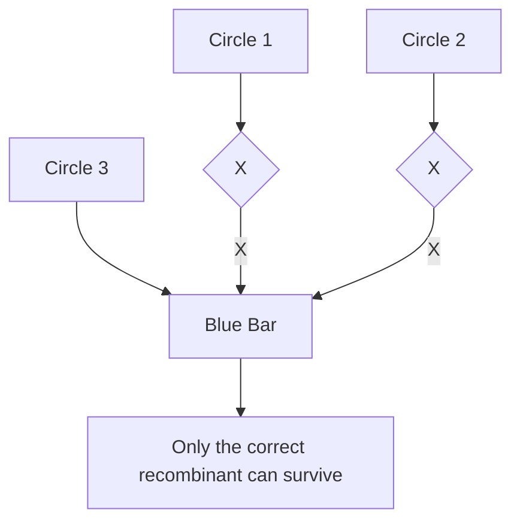
</details>

Figure 8.2

The basic strategies that can be used to obtain a particular clone. (a) Direct selection. (b) Identification of the desired recombinant from a clone library.

(b) Clone identication


<details>
<summary>text_image</summary>

A clone
library
Correct clone
</details>

that are obtained are clones of the required gene. Almost invariably, selection occurs at the plating out stage.

**Identification of the clone from a gene library** (Figure 8.2b), which entails an initial **shotgun** cloning experiment, to produce a clone library representing all or most of the genes present in the cell, followed by analysis of the individual clones to identify the correct one.

In general terms, direct selection is the preferred method, as it is quick and usually unambiguous. However, as we shall see, it is not applicable to all genes, and techniques for clone identification are therefore very important.

## 8.2 Direct selection

To be able to select for a cloned gene it is necessary to plate the transformants onto an agar medium on which only the desired recombinants, and no others, can grow. The only colonies that are obtained will therefore be ones that comprise cells containing the desired recombinant DNA molecule.

The simplest example of direct selection occurs when the desired gene specifies resistance to an antibiotic. As an example, we will consider an experiment to clone the gene for kanamycin resistance from plasmid R6‐5. This plasmid carries genes for resistances to four antibiotics: kanamycin,

---

148

Part I The Basic Principles of Gene Cloning and DNA Analysis

Figure 8.3

Direct selection for the cloned R6‐5 kanamycin resistance (kan<sup>R</sup>) gene.


<details>
<summary>flowchart</summary>

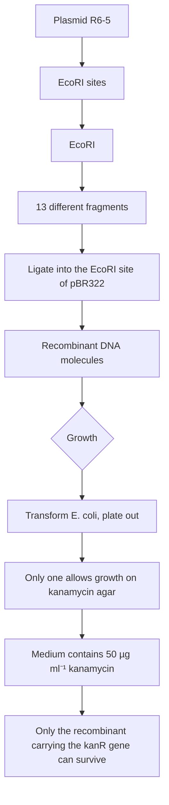
</details>

chloramphenicol, streptomycin, and sulphonamide. The kanamycin resistance gene lies within one of the 13 fragments produced when R6‐5 is digested with EcoRI (Figure 8.3a). To clone this gene, the EcoRI fragments of R6‐5 could be inserted into the EcoRI site of a vector such as pBR322. The ligated mix will comprise many copies of 13 different recombinant DNA molecules, one set of which carries the gene for kanamycin resistance (Figure 8.3b).

Insertional inactivation cannot be used to select recombinants when the EcoRI site of pBR322 is used. This is because this site does not lie in either the ampicillin or the tetracycline resistance genes of this plasmid (see Figure 6.1). But this is immaterial for cloning the kanamycin resistance gene because in this case the cloned gene can be used as the selectable marker. Transformants are plated onto kanamycin agar, on which the only cells able to survive and produce colonies are those recombinants that contain the cloned kanamycin resistance gene (Figure 8.3c).

---

Chapter 8 How to Obtain a Clone of a Specific Gene

149


<details>
<summary>flowchart</summary>

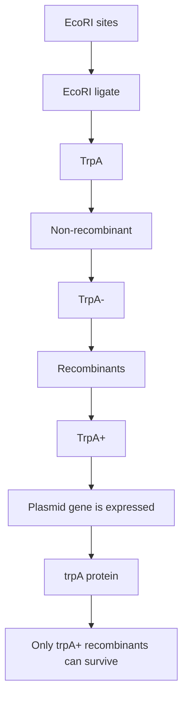
</details>

Figure 8.4

Direct selection for the trpA gene cloned in a trpA strain of E. coli.

## 8.2.1 Marker rescue extends the scope of direct selection

Direct selection would be very limited indeed if it could be used only for cloning antibiotic resistance genes. Fortunately, the technique can be extended by making use of mutant strains of E. coli as the hosts for transformation.

As an example, consider an experiment to clone the gene trpA from E. coli. This gene codes for the enzyme tryptophan synthase, which is involved in biosynthesis of the essential amino acid tryptophan. A mutant strain of E. coli that has a non‐functional trpA gene is called trpA− and is able to survive only if tryptophan is added to the growth medium. E. coli trpA− is therefore another example of an auxotroph (Section 7.1.1).

The E. coli trpA− auxotroph can be used to clone the correct version of the trpA gene. Total DNA is first purified from a normal (wild‐type) strain of the bacterium. Digestion with a restriction endonuclease, followed by ligation into a vector, produces numerous recombinant DNA molecules, one of which may, with luck, carry an intact copy of the trpA gene (Figure 8.4a). This is, of course, the functional gene, as it has been obtained from the wild‐type strain.

---

150

Part I The Basic Principles of Gene Cloning and DNA Analysis

The ligation mixture is now used to transform the auxotrophic E. coli trpA− cells (Figure 8.4b). The vast majority of the resulting transformants will still be auxotrophic, but a few now have the plasmid‐borne copy of the correct trpA gene. These recombinants are non‐auxotrophic; they no longer require tryptophan as the cloned gene is able to direct production of tryptophan synthase (Figure  8.4c). Direct selection is therefore performed by plating transformants onto minimal medium, which lacks any added supplements, and in particular has no tryptophan (Figure  8.4d). Auxotrophs cannot grow on minimal medium, so the only colonies to appear are recombinants that contain the cloned trpA gene.

## 8.2.2 The scope and limitations of marker rescue

Although marker rescue can be used to obtain clones of many genes, the technique is subject to two limitations:

• A mutant strain must be available for the gene in question.
• A medium on which only the wild type can survive is needed.

Marker rescue is applicable for most genes that code for biosynthetic enzymes, as clones of these genes can be selected on minimal medium in the manner described for trpA. The technique is not limited to E. coli or even bacteria. Auxotrophic strains of yeast and filamentous fungi are also available, and marker rescue has been used to select genes cloned into these organisms.

In addition, E. coli auxotrophs can be used as hosts for the selection of some genes from other organisms. Often there is sufficient similarity between equivalent enzymes from different bacteria, or even from yeast, for the foreign enzyme to function in E. coli, so that the cloned gene is able to transform the host to wild type.

## 8.3 Identification of a clone from a gene library

Although marker rescue is a powerful technique, it is not all‐embracing and there are many important genes that cannot be selected by this method. Many bacterial mutants are not auxotrophs, so the mutant and wild type strains cannot be distinguished by plating onto minimal or any other special medium. In addition, neither marker rescue nor any other direct selection method is of much use in providing bacterial clones of genes from animals or plants, as in these cases the differences are usually so great that the foreign enzymes do not function in the bacterial cell.

The alternative strategy must therefore be considered. This is where a large number of different clones are obtained and the desired one identified in some way.

---

Chapter 8 How to Obtain a Clone of a Specific Gene

151

## 8.3.1 Gene libraries

Before looking at the methods used to identify individual clones, the library itself must be considered. A genomic library (Section 6.2.6) is a collection of clones sufficient in number to be likely to contain every single gene pre-sent in a particular organism. Genomic libraries are prepared by purifying total cell DNA, and then making a partial restriction digest, resulting in fragments that can be cloned into a suitable vector (Figure 8.5), usually a λ replacement vector, a cosmid, or possibly a yeast artificial chromosome (YAC), bacterial artificial chromosome (BAC), or P1 vector.

## Not all genes are expressed at the same time

For bacteria, yeast, and fungi, the number of clones needed for a complete genomic library is not so large as to be unmanageable (see Table 6.1). For plants and animals though, a complete library contains so many different clones that identification of the desired one may prove a mammoth task. With these multicellular organisms a second type of library, specific not to the whole organism but to a particular cell type, might be more useful. Each cell contains the same complement of genes, but in different cell types different sets of genes are switched on, while others are silent (Figure 8.6). Only those genes that are being expressed are transcribed into messenger RNA (mRNA), so if mRNA is used as the starting material then the resulting clones would comprise only a selection of the total number of genes in the cell.

A cloning method that uses mRNA would be particularly useful if the  desired gene is expressed at a high rate in an individual cell type.


<details>
<summary>flowchart</summary>

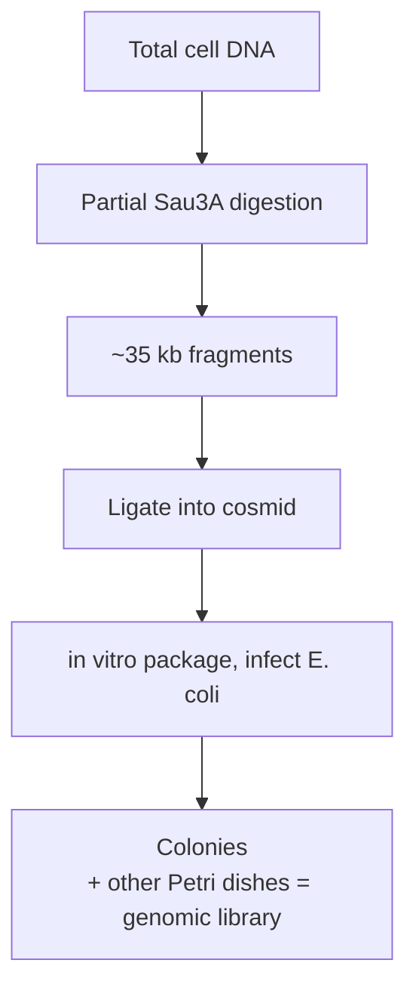
</details>

Figure 8.5

Preparation of a genomic library in a cosmid vector.

---

152

Part I The Basic Principles of Gene Cloning and DNA Analysis

Figure 8.6

Different genes are expressed in different types of cell.


For  example, the gene for gliadin, one of the nutritionally important proteins present in wheat, is expressed at a very high level in the cells of developing wheat seeds. In these cells over 30% of the total mRNA specifies gliadin. Clearly, if we could clone the mRNA from wheat seeds, we would obtain a large number of clones specific for gliadin.

## mRNA can be cloned as complementary DNA

Messenger RNA cannot itself be ligated into a cloning vector. However, mRNA can be converted into DNA by **complementary DNA (cDNA)** synthesis. The key to this method is the enzyme reverse transcriptase (Section 4.1.3) which synthesizes a DNA polynucleotide complementary to an existing RNA strand (Figure 8.7a). Once the cDNA strand has been synthesized the RNA member of the hybrid molecule can be partially degraded by treating with ribonuclease HI (Figure 8.7b). The remaining RNA fragments then serve as primers for DNA polymerase I, which synthesizes the second cDNA strand (Figure  8.7c), resulting in a doublestranded DNA fragment that can be ligated into a vector and cloned (Figure 8.7d).

The resulting cDNA clones are representative of the mRNA present in the original preparation. In the case of mRNA prepared from wheat seeds, the cDNA library would contain a large proportion of clones representing gliadin mRNA (Figure 8.7e). Other clones will also be present, but locating the cloned gliadin cDNA is a much easier process than identifying the equivalent gene from a complete wheat genomic library.

---

Chapter 8 How to Obtain a Clone of a Specific Gene

153

(a) First strand synthesis


<details>
<summary>flowchart</summary>

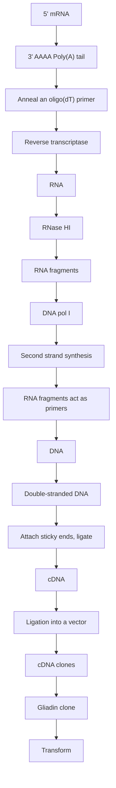
</details>

Figure 8.7

One possible scheme for cDNA cloning. First strand synthesis is primed by oligo(dT), a short oligonucleotide made up entirely of deoxythymidine nucleotides, which base pairs to the poly(A) tail present at the 3′ end of a eukaryotic mRNA.

## 8.4 Methods for clone identification

Once a suitable library has been prepared, a number of procedures can be employed to attempt identification of the desired clone. Although a few of these procedures are based on detection of the translation product of the

---

154

Part I The Basic Principles of Gene Cloning and DNA Analysis

cloned gene, it is usually easier to identify directly the correct recombinant DNA molecule. This can be achieved by the important technique of **hybridization probing**.

## 8.4.1 Complementary nucleic acid strands hybridize to each other

Any two single‐stranded nucleic acid molecules have the potential to form base pairs with one another. With most pairs of molecules, the resulting hybrid structures are unstable, as only a small number of individual interstrand bonds are formed (Figure 8.8a). However, if the polynucleotides are complementary, extensive base pairing can occur to form a stable doublestranded molecule (Figure 8.8b). Not only can this occur between singlestranded DNA molecules to form the DNA double helix, but also between a pair of single‐stranded RNA molecules or between combinations of one DNA strand and one RNA strand (Figure  8.8c). Pairing between singlestranded molecules, which is called **nucleic acid hybridization**, can be used to identify a particular recombinant clone if a DNA or RNA probe, complementary to the desired gene, is available. The exact nature of the probe will be discussed later in this chapter. First, we must consider the technique itself.

## 8.4.2 Colony and plaque hybridization probing

Hybridization probing can be used to identify recombinant DNA molecules contained in either bacterial colonies or bacteriophage plaques. First the colonies or plaques are transferred to a nitrocellulose or nylon membrane (Figure 8.9a) and then treated to remove all contaminating material, leaving just DNA (Figure 8.9b). Usually this treatment also results in denaturation of the DNA molecules, so that the hydrogen bonds between individual strands in the double helix are broken. These single‐stranded molecules can then be bound tightly to the membrane by a short period at $8 0 ^ { \circ } \mathrm { C }$ if a nitrocellulose membrane is being used, or with a nylon membrane by ultraviolet irradiation. The molecules become attached to the

(a) An unstable hybrid


<details>
<summary>natural_image</summary>

Simple line drawing of a wavy, segmented object resembling a worm or worm-like structure (no text or symbols)
</details>

(b) A stable hybrid


<details>
<summary>text_image</summary>

A stable hybrid
Short non-complementary regions
do not affect overall stability
</details>

(c) A DNA–RNA hybrid


Figure 8.8

Nucleic acid hybridization.

(a) An unstable hybrid molecule formed between two nonhomologous DNA strands.
(b) A stable hybrid formed between two complementary strands. (c) A DNA–RNA hybrid, such as may be formed between a gene and its transcript.

---

Chapter 8 How to Obtain a Clone of a Specific Gene

155

(a) Transfer colonies to nitrocellulose or nylon


<details>
<summary>flowchart</summary>

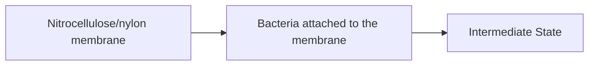
</details>

(b) Degrade cells, purify DNA


<details>
<summary>flowchart</summary>

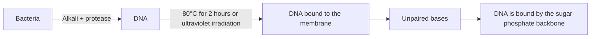
</details>

(c) Probe with labelled DNA


<details>
<summary>flowchart</summary>

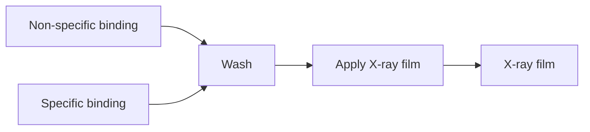
</details>

(d) The resulting autoradiograph


<details>
<summary>text_image</summary>

Positive
hybridization
</details>

Figure 8.9

Colony hybridization probing. In this example, the probe is labelled with a radioactive marker and hybridization detected by autoradiography, but other types of label and detection system can also be used.

membrane through their sugar–phosphate backbones, so the bases are free to pair with complementary nucleic acid molecules.

The probe must now be **labelled** with a radioactive or other type of marker, denatured by heating, and applied to the membrane in a solution of chemicals that promote nucleic acid hybridization (Figure 8.9c). After a period to allow hybridization to take place, the filter is washed to remove unbound probe, dried, and the label detected in order to identify the colonies or plaques to which the probe has become bound (Figure 8.9d).

## Labelling with a radioactive marker

A DNA molecule can be labelled by incorporating nucleotides that carry a radioactive isotope of phosphorus, 32<sub>P</sub> (Figure 8.10). Several methods are available, including:

---

156

Part I The Basic Principles of Gene Cloning and DNA Analysis

## Figure 8.10

The structure of α‐32P‐deoxyadenosine triphosphate ([α‐<sup>32</sup>P]dATP).


<details>
<summary>chemical</summary>

Chemical structure of a phosphonate derivative with radioactive 32P ligand and a pyridine ring
</details>

Nick translation. Most purified samples of DNA contain some nicked molecules, however carefully the preparation has been carried out. This means that DNA polymerase I is able to attach to the DNA and catalyse a strand replacement reaction (Figure 8.11a). This reaction requires a supply of nucleotides. If one of these is radioactively labelled, then the DNA molecule will itself become labelled. Nick translation can be used to label any DNA molecule but might under some circumstances also cause DNA cleavage.
**End filling** is a gentler method than nick translation and rarely causes breakage of the DNA, but unfortunately can only be used to label DNA molecules that have sticky ends. The enzyme used is the Klenow fragment (Section 4.1.3), which ‘fills in’ a sticky end by synthesizing the complementary strand (Figure 8.11b). As with nick translation, if the end filling reaction is carried out in the presence of labelled nucleotides, the DNA becomes labelled.
**Random priming** results in a probe with higher activity and therefore able to detect smaller amounts of membrane‐bound DNA. The denatured DNA is mixed with a set of hexameric oligonucleotides of random sequence. By chance, these random hexamers will contain a few molecules that will base pair with the probe and prime new DNA synthesis. The Klenow fragment is used as this enzyme lacks the nuclease activity of DNA polymerase I and so only fills in the gaps between adjacent primers (Figure 8.11c). Labelled nucleotides are incorporated into the new DNA that is synthesized.

(a) Labelling by nick translation


<details>
<summary>flowchart</summary>


</details>

(b) Labelling by end-lling


<details>
<summary>flowchart</summary>


</details>

(c) Labelling by random priming


<details>
<summary>flowchart</summary>

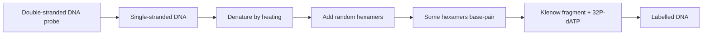
</details>

Figure 8.11

Methods for labelling DNA.

---

Chapter 8 How to Obtain a Clone of a Specific Gene

157

After hybridization, the location of the bound probe can be detected by **autoradiography**. A sheet of X‐ray‐sensitive photographic film is placed over the membrane. The radioactive DNA exposes the film, which is developed to reveal the positions of the colonies or plaques to which the probe has hybridized (see Figure 8.9d). Alternatively, the radioactive signal can be detected with a **phosporimager**. This is a device that contains a plate coated with phosphor particles which emit light when stimulated with radioactive emissions. The emitted light is detected with a scanner and recorded electronically.

## Non‐radioactive labelling

Radioactive labelling methods are starting to fall out of favour, partly because of the hazard to the researcher and partly because of the problems associated with disposal of radioactive waste. As an alternative, the hybridization probe can be labelled in a non‐radioactive manner. One possibility is to use a nucleotide that has been covalently linked to a fluorescent compound, often a derivative of rhodamine or fluorescein. After hybridization, the fluorescent signal is recorded on normal photographic film in a manner analogous to autoradiography.

There are also indirect detection methods, which use labels that do not themselves emit a recordable signal, but whose positions on a membrane can be detected by some type of post‐treatment. One of these indirect methods makes use of deoxyuridine triphosphate (dUTP) nucleotides modified by reaction with **biotin**, an organic molecule that has a high affinity for a protein called **avidin**. After hybridization, the positions of the bound biotinylated probe can be determined by washing with avidin coupled to a fluorescent marker (Figure  8.12a). This method is as sensitive as radioactive probing and is becoming increasingly popular. The same is true for a second indirect procedure, in which the probe DNA is complexed with the enzyme **horseradish peroxidase**, and is detected through the enzyme’s ability to degrade luminol with the emission of chemiluminescence (Figure 8.12b).

## 8.4.3 Examples of the practical use of hybridization probing

Clearly, the success of colony or plaque hybridization as a means of identifying a particular recombinant clone depends on the availability of a DNA molecule that can be used as a probe. This probe must share at least a part of the sequence of the cloned gene. If the gene itself is not available (which presumably is the case if the aim of the experiment is to provide a clone of it), then what can be used as the probe?

In practice, the nature of the probe is determined by the information available about the desired gene. We will consider three possibilities:

Where the desired gene is expressed at a high level in a cell type from which a cDNA clone library has been prepared.
Where the amino acid sequence of the protein coded by the gene is completely or partially known.
• Where the equivalent gene from a related organism is available.

---

158

Part I The Basic Principles of Gene Cloning and DNA Analysis

Figure 8.12

Two indirect detection methods used with non‐radioactive DNA probes.


## Abundancy probing to analyse a cDNA library

As described earlier in this chapter, a cDNA library is often prepared in order to obtain a clone of a gene expressed at a relatively high level in a particular cell type. In the example of a cDNA library from developing wheat seeds, a large proportion of the clones are copies of the mRNA transcripts of the gliadin gene (see Figure 8.7e).

Identification of the gliadin clones is simply a case of using individual cDNA clones from the library to probe all the other members of the library (Figure 8.13). A clone is selected at random and the recombinant DNA molecule is purified, labelled, and used to probe the remaining clones. This is repeated with different clones as probes until one that hybridizes to a large proportion of the library is obtained. This abundant cDNA is considered a possible gliadin clone and analysed in greater detail (e.g. by DNA sequencing and isolation of the translation product) to confirm the identification.

---

Chapter 8 How to Obtain a Clone of a Specific Gene

159


<details>
<summary>flowchart</summary>

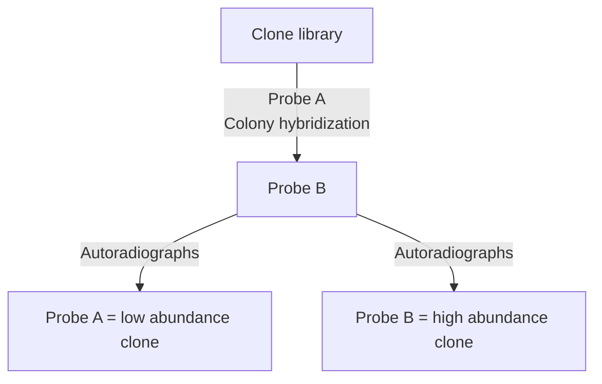
</details>

Figure 8.13

Probing within a library to identify an abundant clone.

## Oligonucleotide probes for genes whose translation products have been characterized

Often the gene to be cloned codes for a protein that has already been studied in some detail. In particular, the amino acid sequence of the protein might have been determined. If the amino acid sequence is known, then it is possible to use the genetic code to predict the nucleotide sequence of the relevant gene. This prediction is always an approximation, as only methionine and tryptophan can be assigned unambiguously to triplet codons, all other amino acids being coded by at least two codons each. Nevertheless, in most cases, the different codons for an individual amino acid are related. Alanine, for example, is coded by GCA, GCC, GCG, and GCT, so two out of the three nucleotides of the triplet coding for alanine can be predicted with certainty.

As an example to show how these predictions are made, consider cytochrome c, a protein that plays an important role in the respiratory chain of all aerobic organisms. The cytochrome c protein from yeast was sequenced in 1963, with the result shown in Figure 8.14. This sequence

```txt
15
GLY-SER-ALA-LYS-LYS-GLY-ALA-THR-LEU-PHE-LYS-THR-ARG-CYS-GLU-
30
LEU-CYS-HIS-THR-VAL-GLU-LYS-GLY-GLY-PRO-HIS-LYS-VAL-GLY-PRO-
45
ASN-LEU-HIS-GLY-ILE-PHE-GLY-ARG-HIS-SER-GLY-GLN-ALA-GLN-GLY-
60
TYR-SER-TYR-THR-ASP-ALA-ASN-ILE-LYS-LYS-ASN-VAL-LEU-TRP-ASP-
75
GLU-ASN-ASN-MET-SER-GLU-TYR-LEU-THR-ASN-PRO-LYS-LYS-TYR-ILE-
90
PRO-GLY-THR-LYS-MET-ALA-PHE-GLY-GLY-LEU-LYS-LYS-GLU-LYS-ASP-
103
ARG-ASN-ASP-LEU-ILE-THR-TYR-LEU-LYS-LYS-ALA-CYS-GLU
```

Figure 8.14

The amino acid sequence of yeast cytochrome c. The hexapeptide that is highlighted red is the one used to illustrate how a nucleotide sequence can be predicted from an amino acid sequence.

---

160

Part I The Basic Principles of Gene Cloning and DNA Analysis

Figure 8.15

A simplified scheme for oligonucleotide synthesis. Each nucleotide is modified by attachment of an activating group to the 3′ carbon and a protecting group to the 5′ carbon. The activating group enables the normally inefficient process of nucleotide joining to proceed much more rapidly. The protecting group ensures that individual nucleotides cannot attach to one another, and instead react only with the terminal 5′ group of the growing oligonucleotide, this 5′ group being deprotected by chemical treatment at the appropriate point in each synthesis cycle.


5ʹ-protecting group, e.g. dimethoxytrityl

3ʹ-activating group, e.g. diisopropyl phosphoramidite

contains a segment, starting at amino acid 59, that runs Trp–Asp–Glu– Asn–Asn–Met. The genetic code states that this hexapeptide is coded by $\mathrm { T G G } \mathrm { - G A ^ { T } / _ { C } \mathrm { - G A ^ { A } / _ { G } \mathrm { - A A ^ { T } / _ { C } \mathrm { - A A ^ { T } / _ { C } \mathrm { - A T G } } } } }$ . Although this represents a total of 16 different possible sequences, 14 of the 18 nucleotides can be predicted with certainty.

Oligonucleotides of up to about 150 nucleotides in length can easily be synthesized in the laboratory (Figure 8.15). An oligonucleotide probe could therefore be constructed according to the predicted nucleotide sequence, and this probe might be able to identify the gene coding for the protein in question. In the example of yeast cytochrome c, the 16 possible oligonucleotides that can code for Trp–Asp–Glu–Asn–Asn–Met would be synthesized, either separately or as a pool, and then used to probe a yeast genomic or cDNA library (Figure 8.16). One of the oligonucleotides in the probe

---

Chapter 8 How to Obtain a Clone of a Specific Gene

161


<details>
<summary>flowchart</summary>

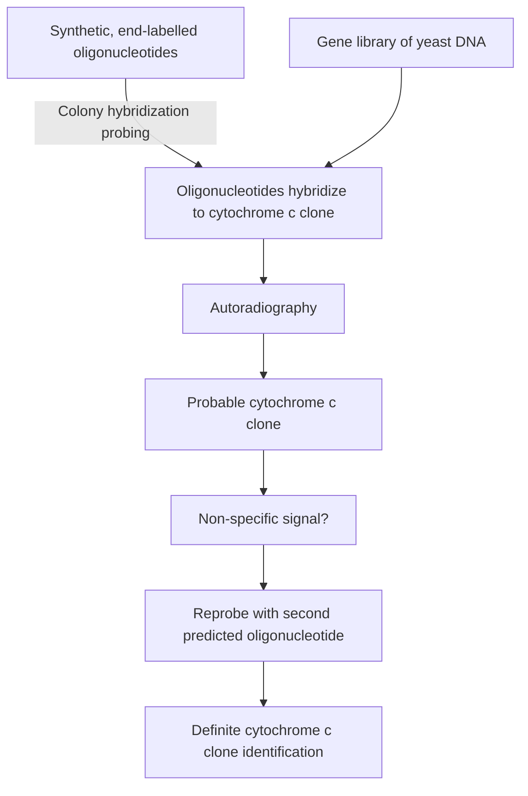
</details>

Figure 8.16

The use of synthetic, endlabelled oligonucleotides to identify a clone of the yeast cytochrome c gene. An oligonucleotide can be 5′‐end labelled with radioactive phosphate by treating with polynucleotide kinase (Section 4.1.4).

will have the correct sequence for this region of the cytochrome c gene, and its hybridization signal will indicate which clones carry this gene. The result can be checked by carrying out a second probing with a mixture of oligonucleotides whose sequences are predicted from a different segment of the cytochrome c protein. However, the segment of the protein used for nucleotide sequence prediction must be chosen with care. The hexapeptide Ser– Glu–Tyr–Leu–Thr–Asn, which immediately follows our first choice, could be coded by several thousand different 18‐nucleotide sequences, clearly an unsuitable choice for a synthetic probe.

## Heterologous probing allows related genes to be identified

Often a substantial amount of nucleotide similarity is seen when two genes for the same protein, but from different organisms, are compared, a reflection of the conservation of gene structure during evolution. Frequently, two genes from related organisms are sufficiently similar for a singlestranded probe prepared from one gene to form a stable hybrid with the

---

162

Part I The Basic Principles of Gene Cloning and DNA Analysis


Figure 8.17

Heterologous probing.

second gene. Although the two molecules are not entirely complementary, enough base pairs are formed to produce a stable structure (Figure 8.17a).

**Heterologous probing** makes use of hybridization between related sequences for clone identification. For example, the yeast cytochrome c gene, identified in the previous section by oligonucleotide probing, could itself be used as a hybridization probe to identify cytochrome c genes in clone libraries of other organisms. A probe prepared from the yeast gene would not be entirely complementary to the gene from, say, the fungus Neurospora crassa, but sufficient base pairing should occur for a hybrid to be formed (Figure 8.17b).

## Southern hybridization enables a specific restriction fragment containing a gene to be identified

As well as colony and plaque hybridization analysis, there are also occasions when it is necessary to use hybridization probing to identify which of a series of restriction fragments contains a gene of interest. As an example, we will return to the genomic clone of the yeast cytochrome c gene, which we identified by oligonucleotide hybridization probing. Let us imagine that this particular genomic library was prepared by partial restriction of yeast DNA with BamHI followed by cloning in the cosmid vector pJB8 (see Figure 6.12). The cloned fragment containing the cytochrome c gene will therefore be approximately 40 kb in length, and will probably contain about ten BamHI fragments, remembering that the hexanucleotide recognition site for this enzyme will be present, on average, once every $4 ^ { 6 } = 4 0 9 6$ bp.

The cytochrome c protein has 103 amino acids (see Figure 8.14). There are very few introns in the yeast genome, so we can predict that the cytochrome c gene is just 309 bp in length, and therefore makes up less than 1% of the cloned DNA. This means that it is quite possible that other genes that we are not interested in are also present in the cloned DNA

---

Chapter 8 How to Obtain a Clone of a Specific Gene

163


<details>
<summary>text_image</summary>

Cytochrome c gene
Other genes
</details>

Figure 8.18

A long cloned DNA fragment may contain several genes in addition to the one in which we are interested. B = BamHI restriction site.

(Figure 8.18). The method called **Southern hybridization** enables the individual restriction fragment containing the cytochrome c gene to be identified.

The first step in using Southern hybridization for this purpose would be to digest the clone with BamHI and then separate the restriction fragments by electrophoresis in an agarose gel (Figure 8.19a). The aim is to use the oligonucleotide probe for cytochrome c to identify the fragment that contains the gene. This can be attempted while the restriction fragments are still contained in the electrophoresis gel, but the results are usually not very good, as the gel matrix causes a lot of spurious background hybridization that obscures the specific hybridization signal. Instead, the DNA bands in the agarose gel are transferred to a nitrocellulose or nylon membrane, providing a much cleaner environment for the hybridization experiment.

Transfer of DNA bands from an agarose gel to a membrane makes use of the technique perfected in 1975 by Professor E.M. Southern and referred to as **Southern transfer**. The membrane is placed on the gel, and buffer

Southern hybridization.

Figure 8.19

(a) Electrophorese BamHI-restricted DNA


<details>
<summary>text_image</summary>

BamHI fragments
</details>

(b) Southern transfer


<details>
<summary>text_image</summary>

Modern transfer
Wick
Buffer
Paper towels
Nitrocellulose or
nylon membrane
Gel
Support
</details>

(c) Result of hybridization probing


<details>
<summary>text_image</summary>

Positive signal
</details>

---

164

Part I The Basic Principles of Gene Cloning and DNA Analysis

allowed to soak through, carrying the DNA from the gel to the membrane where the DNA is bound. Sophisticated pieces of apparatus can be purchased to assist this process, but many molecular biologists prefer a homemade set‐up incorporating a lot of paper towels and considerable balancing skills (Figure 8.19b). The same method can also be used for the transfer of RNA molecules (**northern transfer**) or proteins (**western transfer**).

Southern transfer results in a membrane that carries a replica of the DNA bands from the agarose gel. If the labelled probe is now applied, hybridization occurs and autoradiography (or the equivalent detection system for a non‐radioactive probe) reveals which restriction fragment contains the cloned gene (Figure 8.19c).

## 8.4.4 Identification methods based on detection of the translation product of the cloned gene

Hybridization probing is usually the preferred method for identification of a particular recombinant from a clone library. The technique is easy to perform and, with modifications introduced in recent years, can be used to check up to 10 000 recombinants per experiment, allowing large genomic libraries to be screened in a reasonably short time. Nevertheless, the requirement for a probe that is at least partly complementary to the desired gene sometimes makes it impossible to use hybridization in clone identification. On these occasions a different strategy is needed.

The main alternative to hybridization probing is **immunological screening**. The distinction is that, whereas with hybridization probing the cloned DNA fragment is itself directly identified, an immunological method detects the protein coded by the cloned gene. Immunological techniques therefore presuppose that the cloned gene is being expressed, so that the protein is being made, and that this protein is not normally present in the host cells.

## Antibodies are required for immunological detection methods

If a purified sample of a protein is injected into the bloodstream of a rabbit, the immune system of the animal responds by synthesizing antibodies that bind to and help degrade the foreign molecule (Figure 8.20a). This is a version of the natural defence mechanism that the animal uses to deal with invasion by bacteria, viruses, and other infective agents.

Once a rabbit is challenged with a protein, the levels of antibody present in its bloodstream remain high enough over the next few days for substantial quantities to be purified. It is not necessary to kill the rabbit, because as little as 10 ml of blood provides a considerable amount of antibody (Figure 8.20b). This purified antibody binds only to the protein with which the animal was originally challenged.

## Using a purified antibody to detect protein in recombinant colonies

There are several versions of immunological screening, but the most useful method is a direct counterpart of colony hybridization probing. Recombinant colonies are transferred to a polyvinyl or nitrocellulose membrane, the cells are lysed, and a solution containing the specific antibody is added

---

Chapter 8 How to Obtain a Clone of a Specific Gene

165

(a) Antibodies bind to foreign molecules


<details>
<summary>text_image</summary>

Foreign molecule,
e.g. protein
Antibodies
</details>

(b) Antibody puri	cation


<details>
<summary>flowchart</summary>

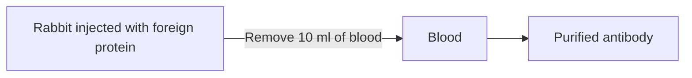
</details>

Figure 8.20

Antibodies. (a) Antibodies in the bloodstream bind to foreign molecules and help degrade them. (b) Purified antibodies can be obtained from a small volume of blood taken from a rabbit injected with the foreign protein.

(Figure  8.21a). In the original methods, either the antibody itself was labelled, or the membrane was subsequently washed with a solution of labelled protein $\mathrm { A } , \mathrm { a }$ bacterial protein that specifically binds to the immunoglobulins that antibodies are made of. In the more modern methods, the bound antibody – the **primary antibody** – is detected by washing the


<details>
<summary>flowchart</summary>

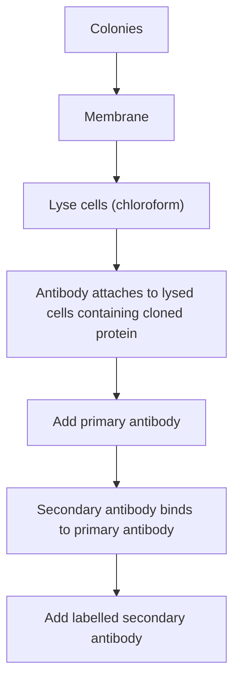
</details>


<details>
<summary>text_image</summary>

(b) The resulting autoradiograph
Positive signal = recombinant synthesizing cloned protein
</details>

Figure 8.21

Using a purified antibody to detect protein in recombinant colonies. Instead of using a secondary antibody, the primary antibody itself can be labelled, or the antibody can be detected with labelled protein A.

---

166

Part I The Basic Principles of Gene Cloning and DNA Analysis

membrane with a labelled **secondary antibody**, which binds specifically to the primary antibody. The secondary antibody is prepared by injecting the primary antibody into an animal, of a different species to the one from which the primary antibody was prepared. So, for example, if the primary antibody was prepared in a rabbit, then the secondary antibody could be obtained by injecting a sample of the primary antibody into a goat. The goat’s immune system will look on the primary antibody as a foreign protein antigen and synthesize the secondary antibody to bind to it.

Several secondary antibody molecules can bind to a single primary antibody molecule, increasing the amount of signal that is produced and enabling a clearer detection of each positive colony. In all three methods, the label can be a radioactive one, in which case the colonies that bind the label are detected by autoradiography (Figure 8.21b), or non‐radioactive labels resulting in a fluorescent or chemiluminescent signal can be used.

## The problem of gene expression

Immunological screening depends on the cloned gene being expressed so that the protein translation product is present in the recombinant cells. However, as will be discussed in greater detail in Chapter 14, a gene from one organism is often not expressed in a different organism. In particular, it is very unlikely that a cloned animal or plant gene will be expressed in E. coli cells. This problem can be circumvented by using a special type of vector, called an **expression vector** (Section 14.1), designed specifically to promote expression of the cloned gene in a bacterial host. Immunological screening of recombinant E. coli colonies carrying animal genes cloned into expression vectors has been very useful in identifying genes for several important hormones.

## Further reading

- Benton, W.D. and Davis, R.W. (1977) Screening λgt recombinant clones by hybridization to single plaques in situ. Science, 196, 180–182.
- Feinberg, A.P. and Vogelstein, B. (1983) A technique for labelling DNA restriction fragments to high specific activity. Analytical Biochemistry, 132, 6–13. [Random priming labelling.]
- Grunstein, M. and Hogness, D.S. (1975) Colony hybridization: a method for the isolation of cloned cDNAs that contain a specific gene. Proceedings of the National Academy of Sciences of the USA, 72, 3961–3965.
- Gubler, U. and Hoffman, B.J. (1983) A simple and very efficient method for generating cDNA libraries. Gene, 25, 263–269.
- Southern, E.M. (2000) Blotting at 25. Trends in Biochemical Science, 25, 585–588. [The origins of Southern hybridization.]

---

Chapter 8 How to Obtain a Clone of a Specific Gene

167

- Thorpe, G.H.G., Kricka, L.J., Moseley, S.B., and Whitehead, T.P. (1985) Phenols as enhancers of the chemiluminescent horseradish peroxidase–luminol–hydrogen peroxide reaction: application in luminescence‐monitored enzyme immunoassays. Clinical Chemistry, 31, 1335–1341. [Describes the basis to a non‐radioactive labelling method.]
- Young, R.A. and Davis, R.W. (1983) Efficient isolation of genes by using antibody probes. Proceedings of the National Academy of Sciences of the USA, 80, 1194–1198.

---


