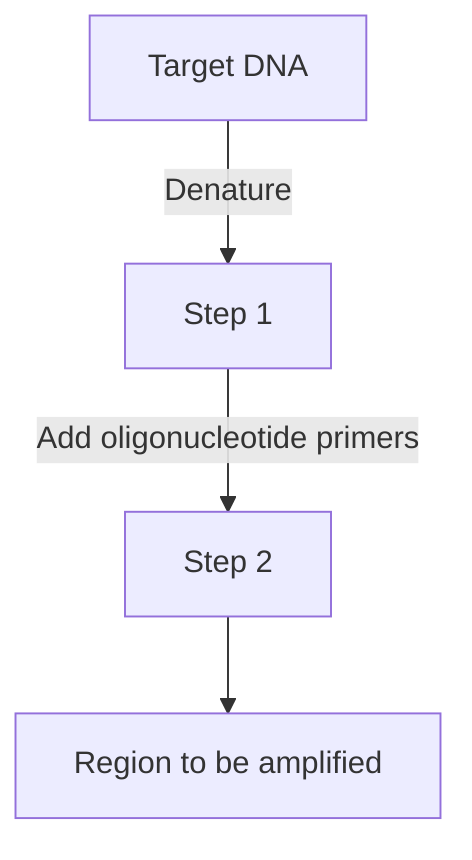
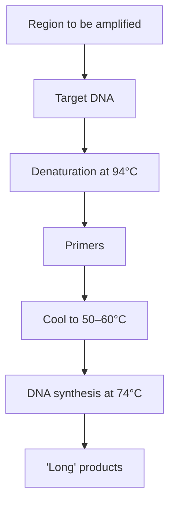
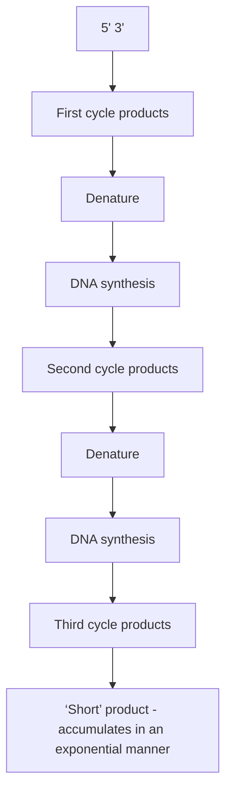
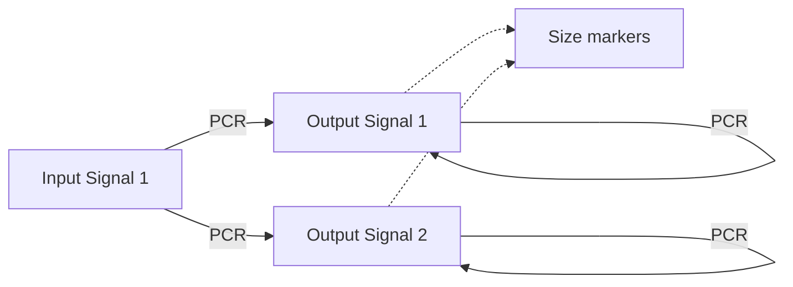
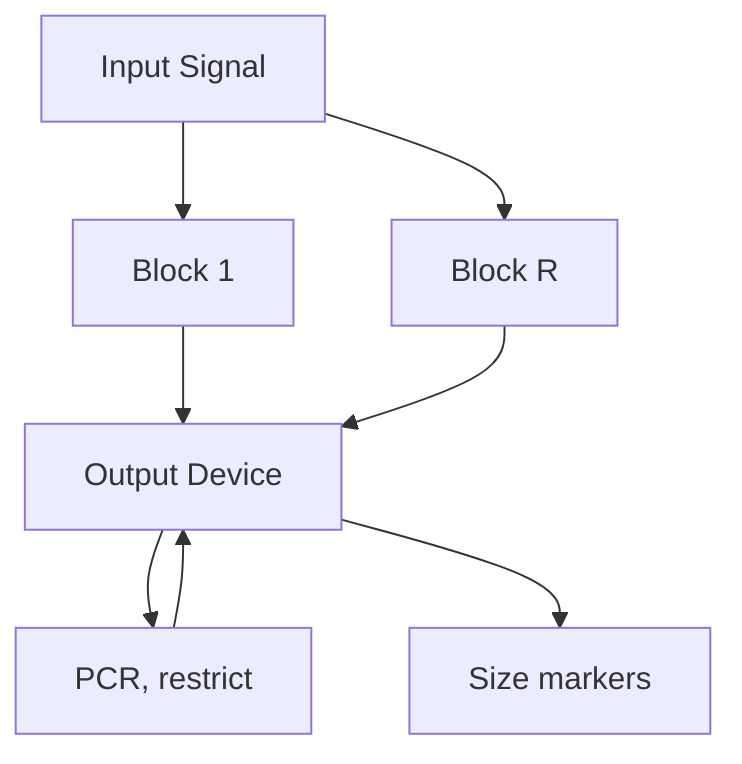
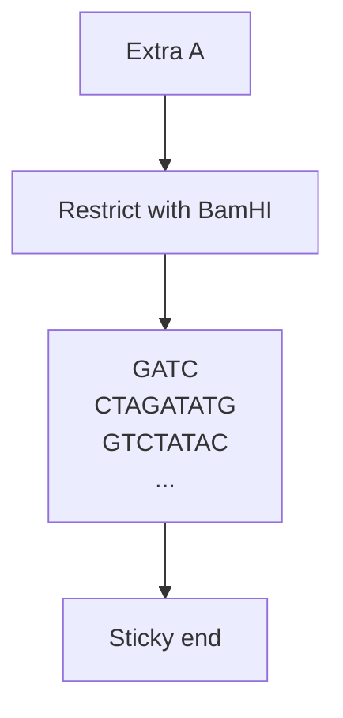
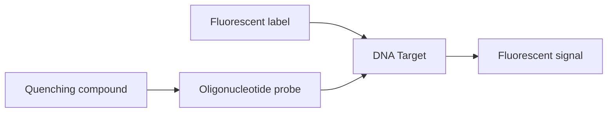
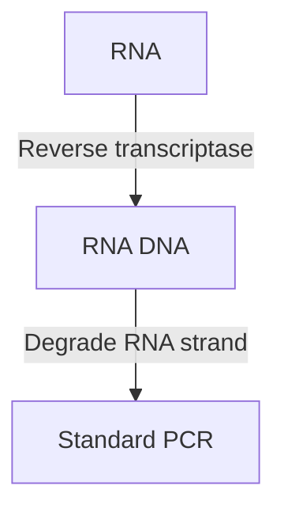

# Part I The Basic Principles of Gene Cloning and DNA Analysis / Chapter 9 The Polymerase Chain Reaction

原始 PDF 第 187–206 页。

## Chapter 9

# The Polymerase Chain Reaction

## Chapter contents

**9.1** PCR in outline 170
**9.2** PCR in more detail 172
**9.3** After the PCR: studying PCR products 176
**9.4** Real‐time PCR 180

As a result of the last eight chapters we have become familiar not only with the basic principles of gene cloning, but also with fundamental molecular biology techniques such as restriction analysis, gel electrophoresis, DNA labelling, and DNA–DNA hybridization. To complete our basic education in DNA analysis we must now return to the second major technique for studying genes, the polymerase chain reaction (PCR). PCR is a very uncomplicated technique. All that happens is that a short region of a DNA molecule, a single gene for instance, is copied many times by a DNA polymerase enzyme (see Figure 1.2). This might seem a rather trivial exercise, but it has a multitude of applications in genetics research and in broader areas of biology.

We begin this chapter with an outline of PCR in order to understand exactly what it achieves. Then we will look at the key issues that determine whether or not an individual PCR experiment is successful, before examining some of the methods that have been devised for studying the amplified DNA fragments that are obtained.

Gene Cloning and DNA Analysis: An Introduction, Eighth Edition. T. A. Brown.

© 2021 John Wiley & Sons Ltd. Published 2021 by John Wiley & Sons Ltd.

169

---

170

Part I The Basic Principles of Gene Cloning and DNA Analysis

## 9.1 PCR in outline

The polymerase chain reaction results in the selective amplification of a chosen region of a DNA molecule. Any region of any DNA molecule can be chosen, so long as the sequences at the borders of the region are known. The border sequences must be known because in order to carry out a PCR, two short oligonucleotides must hybridize to the DNA molecule, one to each strand of the double helix (Figure 9.1). These oligonucleotides, which act as primers for the DNA synthesis reactions, delimit the region that will be amplified.

Amplification is usually carried out by the DNA polymerase I enzyme from Thermus aquaticus. As mentioned in Section  4.1.3, this organism lives in hot springs, and many of its enzymes, including Taq polymerase, are thermostable, meaning that they are resistant to denaturation by heat treatment. As will be apparent in a moment, the thermostability of Taq polymerase is an essential requirement in PCR methodology.

To carry out a PCR experiment, the target DNA is mixed with Taq polymerase, the two oligonucleotide primers, and a supply of nucleotides. The amount of target DNA can be very small because PCR is extremely sensitive and will work with just a single starting molecule. The reaction is initiated by heating the mixture to $9 4 ^ { \circ } \mathrm { C } ,$ At this temperature the hydrogen bonds that hold together the two polynucleotides of the double helix are broken, so the target DNA becomes denatured into single‐stranded molecules (Figure  9.2). The temperature is then reduced to $50{-}60^{\circ} C _{3}$ which results in some rejoining of the single strands of the target DNA, but also allows the primers to attach to their annealing positions. DNA synthesis can now begin, so the temperature is raised to $7 4 ^ { \circ } \mathrm { C } _ { 2 }$ just below the optimum for Taq polymerase. In this first stage

Figure 9.1

Hybridization of the oligonucleotide primers to the template DNA at the beginning of a PCR.

flowchart

---

Chapter 9 The Polymerase Chain Reaction

171

flowchart

Figure 9.2

The first stage of a PCR, resulting in synthesis of the long products.

of the PCR, ‘long products’ are synthesized from each strand of the target DNA. These polynucleotides have identical 5′ ends but random 3′ ends, the latter representing positions where DNA synthesis terminates by chance.

The cycle of denaturation–annealing–synthesis is now repeated (Figure 9.3). The long products denature and the four resulting strands are copied during the DNA synthesis stage. This gives four double‐stranded molecules, two of which are identical to the long products from the first cycle and two of which are made entirely of new DNA. During the third cycle, the latter give rise to ‘short products’, the 5′ and 3′ ends of which are both set by the primer annealing positions. In subsequent cycles, the number of short products accumulates in an exponential fashion (doubling during each cycle) until one of the components of the reaction becomes depleted. This means that after 30 cycles, there will be over 130 million short products derived from each starting molecule. In real terms, this equates to several micrograms of PCR product from a few nanograms or less of target DNA.

At the end of a PCR a sample of the reaction mixture is usually analysed by agarose gel electrophoresis, sufficient DNA having been produced for the amplified fragment to be visible as a discrete band after staining with ethidium bromide or some other DNA‐binding dye. This may by itself provide useful information about the DNA region that has been amplified, or alternatively the PCR product can be examined by techniques such as DNA sequencing.

---

172

Part I The Basic Principles of Gene Cloning and DNA Analysis

flowchart

Figure 9.3

The second and third cycles of a PCR, during which the first short products are synthesized.

## 9.2 PCR in more detail

Although PCR experiments are very easy to set up, they must be planned carefully if the results are to be of any value. The sequences of the primers are critical to the success of the experiment, as are the precise temperatures used in the heating and cooling stages of the reaction cycle.

## 9.2.1 Designing the oligonucleotide primers for a PCR

The primers are the key to the success or failure of a PCR experiment. If the primers are designed correctly the experiment results in amplification of a single DNA fragment, corresponding to the target region of the

---

Chapter 9 The Polymerase Chain Reaction

173

text_image

Size markers
1 2 3 4

Figure 9.4

The results of PCRs with well‐designed and poorly designed primers. Lane 1 shows a single amplified fragment of the expected size, the result of a well‐designed experiment. In lane 2 there is no amplification product, suggesting that one or both of the primers were unable to hybridize to the template DNA. Lanes 3 and 4 show, respectively, an amplification product of the wrong size, and a mixture of products (the correct product plus two wrong ones). Both results are due to hybridization of one or both of the primers to non‐target sites on the template DNA molecule.

template molecule. If the primers are incorrectly designed the experiment will fail, possibly because no amplification occurs, or possibly because the wrong fragment, or more than one fragment, is amplified (Figure  9.4). Clearly a great deal of thought must be put into the design of the primers.

Working out appropriate sequences for the primers is not a problem: they must correspond with the sequences flanking the target region on the template molecule. Each primer must, of course, be complementary (not identical) to its template strand in order for hybridization to occur, and the 3′ ends of the hybridized primers should point toward one another (Figure 9.5). The DNA fragment to be amplified should not be greater than about 5 kb in length and ideally less than 1 kb. Fragments up to 10 kb can be amplified by standard PCR techniques, but the longer the fragment the less efficient the amplification and the more difficult it is to obtain consistent results. Amplification of very long fragments – up to 40 kb – is possible, but requires special methods.

The first important issue to address is the length of the primers. If the primers are too short, they might hybridize to non‐target sites and give

text_image

Human α-globin gene
100 bp
3'... GTGTCTGAGTCTCTCTTGGGTGG ...
AGACTCAGAGAGAACCC
5' ... CACAGACTCAGAGAGAACCCACC ...
... ATGGGGGCACCAGAAACTTATTT ... 5'
3' ... TACCCCCCGTGGTCTTTGAATAAA ... 3'
GGGGCACCAGAAACTTA

Figure 9.5

A pair of primers designed to amplify the human α ‐globin gene. The exons of the gene are shown as red boxes, the introns as grey boxes.

---

174

Part I The Basic Principles of Gene Cloning and DNA Analysis

Figure 9.6

The lengths of the primers are critical for the specificity of the PCR.

(a) PCR of human DNA with 8-mer primers

text_image

Hybridization sites
3' →
5'
→
→
→
→
5'
→
3'
← ← ← ← ← ← ← ← ← ← ← ← ← ← ← ← ← ← ← ← ← ← ← ← ← ← ← ← ← ← ← ← ← ← ← ← ← ← ← ← ← ← ← ← ← ← ← ← ← ← ← ← ← ← ← ← ← ← ← ← ← ← ← ← ← ← ← ← ← ← ← ← ← ← ← ← ← ← ← ← ← ← ← ← ← ← ← ← ← ← ← ← ← ← ← ← ← ← ← ← ← →
Several primer pairs can
give amplification products
1 Kb

(b) PCR of human DNA with 17-mer primers

text_image

3'
5'
Only the desired
fragment is amplified
5'
3'

undesired amplification products. To illustrate this point, imagine that total human DNA is used in a PCR experiment with a pair of primers eight nucleotides in length (in PCR jargon, these are called ‘8‐mers’). The likely result is that a number of different fragments will be amplified. This is because attachment sites for these primers are expected to occur, on average, once every $4 ^ { 8 } = 6 5 ~ 5 3 6$ bp, giving approximately 49 000 possible sites in the 3 200 000 kb of nucleotide sequence that makes up the human genome. This means that it would be very unlikely that a pair of 8‐mer primers would give a single, specific amplification product with human DNA (Figure 9.6a).

What if the 17‐mer primers shown in Figure 9.5 are used? The expected frequency of a 17‐mer sequence is once every $4 ^ { 1 7 }   =   1 7     1 7 9$ 869 184 bp. This figure is over five times greater than the length of the human genome, so a 17‐mer primer would be expected to have just one hybridization site in total human DNA. A pair of 17‐mer primers should therefore give a single, specific amplification product (Figure 9.6b).

Why not simply make the primers as long as possible? The length of the primer influences the rate at which it hybridizes to the template DNA, long primers hybridizing at a slower rate. The efficiency of the PCR, measured by the number of amplified molecules produced during the experiment, is therefore reduced if the primers are too long, as complete hybridization to the template molecules cannot occur in the time allowed during the reaction cycle. In practice, primers longer than 30‐mer are rarely used.

## 9.2.2 Working out the correct temperatures to use

During each cycle of a PCR, the reaction mixture is transferred between three temperatures (Figure 9.7):

• The denaturation temperature, usually $9 4 ^ { \circ } \mathrm { C } ,$ which breaks the base pairs and releases single‐stranded DNA to act as templates in the next round of DNA synthesis.

---

Chapter 9 The Polymerase Chain Reaction

175

line

| Time (mins) | Temperature \(({}^{\circ}C)\) |
| --- | --- |
| ~0.8 | ~84 |
| ~0.9 | 95 |
| ~1.8 | 95 |
| ~2.5 | ~52 |
| ~3.5 | ~52 |
| ~3.7 | 75 |
| ~5.8 | 75 |
| ~5.9 | ~83 |

Figure 9.7 A typical temperature profile for a PCR.

The hybridization or annealing temperature, at which the primers attach to the templates.
The extension temperature, at which DNA synthesis occurs. This is usually set at $7 4 ^ { \circ } \bar { \mathrm { C } } ,$ just below the optimum for Taq polymerase.

The annealing temperature is the important one because, again, this can  affect the specificity of the reaction. DNA–DNA hybridization is a temperature‐dependent phenomenon. If the temperature is too high no hybridization takes place, and the primers and templates remain dissociated (Figure  9.8a). However, if the temperature is too low, mismatched hybrids – ones in which not all the correct base pairs have formed – are stable (Figure 9.8b). If this occurs then the earlier calculations regarding the appropriate lengths for the primers become irrelevant, as these calculations assumed that only perfect primer–template hybrids are able to form. If mismatches are tolerated, the number of potential hybridization sites for each primer is greatly increased, and amplification is more likely to occur at non‐target sites in the template molecule.

The ideal annealing temperature must be low enough to enable hybridization between primer and template, but high enough to prevent mismatched hybrids from forming (Figure  9.8c). This temperature can be estimated by determining the **melting temperature** or $T _ { \mathbf { m } }$ of the primer– template hybrid. The $T _ { \mathrm { m } }$ is the temperature at which the correctly basepaired hybrid dissociates (‘melts’). A temperature $1 { - } 2 ^ { \circ } \mathrm { C }$ below this should be low enough to allow the correct primer–template hybrid to form, but too high for a hybrid with a single mismatch to be stable. The $T _ { \mathrm { m } }$ can be determined experimentally but is more usually calculated from the simple formula (Figure 9.9):

$$
T _ {\mathrm{m}} = (4 \times [ \mathrm{G} + \mathrm{C} ]) + (2 \times [ \mathrm{A} + \mathrm{T} ]) ^ {\circ} \mathrm{C}
$$

---

176

Part I The Basic Principles of Gene Cloning and DNA Analysis

## Figure 9.8

Temperature has an important effect on the hybridization of the primers to the template DNA.

(a) Annealing temperature is too high

text_image

Primers and templates
remain dissociated

(b) Annealing temperature is too low

text_image

Mismatched hybrid –
not all the correct base
pairs have formed

(c) Correct annealing temperature

text_image

Priming occurs only at
the desired target sites

in which [G+C] is the number of G and C nucleotides in the primer sequence, and [A+T] is the number of A and T nucleotides.

The annealing temperature for a PCR experiment is therefore determined by calculating the $T _ { \mathrm { m } }$ for each primer and using a temperature of $1 { - } 2 ^ { \circ } \mathrm { C }$ below this figure. Note that this means the two primers should be designed so that they have identical $T _ { \mathrm { m } } s .$ If this is not the case, the appropriate annealing temperature for one primer may be too high or too low for the other member of the pair.

## 9.3 After the PCR: studying PCR products

PCR is often the starting point for a longer series of experiments in which the amplification product is studied in various ways in order to gain information about the DNA molecule that acted as the original template. We will encounter many studies of this type in Parts II and III, when we examine the applications of gene cloning and PCR in research and biotechnology. Although a wide range of procedures have been devised for studying PCR products, three techniques are particularly important:

## Figure 9.9

Calculating the $T _ { \mathfrak { m } }$ of a primer.

Primer sequence: 5ʹ AGACTCAGAGAGAACCC 3ʹ

4 Gs 5 Cs 7 As 1 T

$$
\begin{array}{l} T _ {\mathrm{m}} = (4 \times 9) + (2 \times 8) \\ = 3 6 + 1 6 \\ = 52^{\circ}\mathrm{C} \\ \end{array}
$$

---

Chapter 9 The Polymerase Chain Reaction

177

• Gel electrophoresis of PCR products.
• Cloning of PCR products.
• Sequencing of PCR products.

The first two of these techniques are dealt with in this chapter. The third technique is deferred until Chapter 10, when all aspects of DNA sequencing will be covered.

## 9.3.1 Gel electrophoresis of PCR products

The results of most PCR experiments are checked by running a portion of the amplified reaction mixture in an agarose gel. A band representing the amplified DNA may be visible after staining, or if the DNA yield is low the product can be detected by Southern hybridization (see Figure 8.19). If  the expected band is absent, or if additional bands are present, then something has gone wrong and the experiment must be repeated.

In some cases, agarose gel electrophoresis is used not only to determine if a PCR experiment has worked, but also to obtain additional information. For example, the exact size of the PCR product can be used to establish if the template DNA contains an insertion or deletion mutation in the amplified region (Figure  9.10). Length mutations of this type form the basis of **DNA profiling**, a central technique in forensic science (Chapter 17).

Of course, many mutations change the sequence of a DNA fragment without affecting its length. Often, the only way to identify if a PCR product contains a point mutation is to sequence the amplified fragment. The exception is when the mutation changes the recognition sequence for a restriction endonuclease so that the enzyme is no longer able to attach and cut the DNA. The mutation therefore creates a **restriction fragment length**

flowchart

Figure 9.10

Gel electrophoresis can reveal the presence of an insertion or deletion in a PCR product. In lane 2, there is an insertion in the amplified region.

---

178

Part I The Basic Principles of Gene Cloning and DNA Analysis

Figure 9.11

Restriction fragment length polymorphism analysis of a PCR product. In lane 1, the PCR product lacks a polymorphic restriction site. In lane 2, the site is present.

flowchart

**polymorphism (RFLP)** that can be detected by treating the PCR product with the appropriate restriction endonuclease before running the sample in the agarose gel (Figure  9.11). RFLP analysis of PCR products, which is also called **cleaved amplified polymorphic sequence** or **CAPS** analysis, is often used to distinguish closely related types of bacteria or fungi in clinical isolates, and hence to identify when a person is infected with a pathogen. With some species, it can also alert clinicians to the presence of an antibiotic‐resistant strain. For example, RFLP analysis of a 535 bp fragment amplified from the 16S ribosomal RNA gene of Heliocobacter pylori, a bacterium that can cause stomach ulcers, can distinguish strains that are resistant to tetracycline from those that should respond to treatment with this antibiotic. Digestion of the PCR product with AluI gives two fragments, of 281 bp and 254 bp, with the tetracycline‐sensitive strain. The resistant version, on the other hand, has a sequence polymorphism that creates an additional AluI recognition site, resulting in three fragments, of 280 bp, 214 bp, and 40 bp.

In other experiments, the mere presence or absence of the PCR product is the diagnostic feature. An example is when PCR is used as the screening procedure to identify a desired gene from a genomic or cDNA library. Carrying out PCRs with every clone in a genomic library might seem to be a tedious task, but one of the advantages of PCR is that individual experiments are quick to set up and many PCRs can be performed in parallel. The workload can also be reduced by **combinatorial screening**, an example of which is shown in Figure 9.12.

## 9.3.2 Cloning PCR products

Some applications require that after a PCR the resulting products are ligated into a vector and examined by any of the standard methods used  for  studying cloned DNA. This may sound easy, but there are complications.

---

Chapter 9 The Polymerase Chain Reaction

179

Figure 9.12

Combinatorial screening of clones in microtitre trays. A library of 960 clones, contained in 10 trays, is screened by a series of PCRs, each with a combination of clones. The clone combinations that give positive results enable the well(s) containing positive clone(s) to be identified. For example, if positive PCRs are given with row A of tray 2, row D of tray 6, column 7 of tray 2, and column 9 of tray 6, then it can be deduced that there are positive clones in well A7 of tray 2 and well D9 of tray 6. Although there are 960 clones, unambiguous identification of the positive clones is therefore achieved after just 200 PCRs.

The first problem concerns the ends of the PCR products. From an examination of Figure  9.3 it might be imagined that the short products resulting from PCR amplification are blunt‐ended. If this was the case, they could be inserted into a cloning vector by blunt end ligation, or alternatively the PCR products could be provided with sticky ends by the attachment of linkers or adaptors (Section 4.3.3). Unfortunately, the situation is not so straightforward. Taq polymerase tends to add an additional nucleotide, usually an adenosine, to the end of each strand that it synthesizes. This means that a double‐stranded PCR product is not blunt‐ended, and instead most 3′ termini have a single nucleotide overhang (Figure 9.13). The overhangs could be removed by treatment with an exonuclease enzyme, resulting in PCR products with true blunt ends, but this is not a popular approach as it is difficult to prevent the exonuclease from becoming overactive and causing further damage to the ends of the molecules.

One solution is to use a special cloning vector which carries thymidine (T) overhangs and which can therefore be ligated to a PCR product (Figure 9.14). These vectors are usually prepared by restricting a standard vector at a blunt end site, and then treating with Taq polymerase in the presence of just 2′‐deoxythymidine 5′‐triphosphate (dTTP). No primer is

chemical

DNA sequence diagram showing nucleotide bases and complementary strands with labeled positions 3' and 5'

Figure 9.13

Polynucleotides synthesized by Taq polymerase often have an extra adenosine at their 3′ ends.

---

180

Part I The Basic Principles of Gene Cloning and DNA Analysis

flowchart

Figure 9.14

Using a special T‐tailed vector to clone a PCR product.

present so all the polymerase can do is add a T nucleotide to the 3′ ends of the blunt‐ended vector molecule, resulting in the T‐tailed vector into which the PCR products can be inserted. Special vectors of this type have also been designed for use with the topoisomerase ligation method (Section 4.3.4), and this is currently the most popular way of cloning PCR products.

A second solution is to design primers that contain restriction sites. After PCR the products are treated with the restriction endonuclease, which cuts each molecule within the primer sequence, leaving sticky‐ended fragments that can be ligated efficiently into a standard cloning vector (Figure 9.15a). The approach is not limited to those instances where the primers span restriction sites that are present in the template DNA. Instead, the restriction site can be included within a short extension at the 5′ end of each primer (Figure 9.15b). These extensions cannot hybridize to the template molecule, but they are copied during the PCR, resulting in PCR products that carry terminal restriction sites.

## 9.4 Real‐time PCR

So far, we have considered the standard format for a PCR experiment, where the reaction is allowed to proceed for 30–40 cycles and the product is then examined by gel electrophoresis, by cloning, and/or by DNA sequencing. It is also possible to follow formation of the product as the PCR progresses. This method, which requires a special type of thermocycler, is called **real‐time PCR**.

## 9.4.1 Carrying out a real‐time PCR experiment

A real‐time PCR experiment is set up in exactly the same way as a standard PCR, with carefully designed primers, Taq polymerase, and a supply of nucleotides. The difference is that an extra reagent is added to enable product synthesis to be assayed during the PCR.

The simplest way to follow product formation is to use a dye that gives a fluorescent signal when it binds to double‐stranded DNA. The gradual

---

Chapter 9 The Polymerase Chain Reaction

181

(a) A primer whose annealing position spans a restriction site Primer sequence

text_image

5'          3'
CTCTGGATCCAGATATG
BamHI site

Resulting PCR product

flowchart

(b) A primer with a restriction site in a 5ʹ extension

chemical

DNA sequence diagram showing primer and restriction site with nucleotide positions and base pairing

Figure 9.15

Obtaining a PCR product with a sticky end through use of a primer whose sequence includes a restriction site.

increase in the fluorescent signal given out by the mixture indicates the rate at which the product is being synthesized. The disadvantage of this approach is that it measures the total amount of double‐stranded DNA in the PCR at any particular time, which may overestimate the actual amount of the product because sometimes the primers anneal to one another in various non‐specific ways, increasing the amount of double‐stranded DNA that is present.

An alternative method for real‐time PCR requires a short oligonucleotide called a **reporter probe**, which gives a fluorescent signal when it hybridizes to the PCR product. Because the probe only hybridizes to the PCR product, this method is less prone to inaccuracies caused by primerprimer annealing. Each probe molecule has a pair of labels. A fluorescent dye is attached to one end of the oligonucleotide, and a quenching compound, which inhibits the fluorescent signal, is attached to the other end (Figure 9.16). Normally there is no fluorescence because the oligonucleotide is designed in such a way that its two ends base pair to one another, placing the quencher next to the dye. Hybridization between the oligonucleotide and the PCR product disrupts this base pairing, moving the quencher away from the dye and enabling the fluorescent signal to be generated.

---

182

Part I The Basic Principles of Gene Cloning and DNA Analysis

Figure 9.16

Hybridization of a reporter probe to its target DNA.

flowchart

## 9.4.2 Real‐time PCR enables the amount of starting material to be quantified

The amount of product that is synthesized during a PCR depends on the number of DNA molecules that are present in the starting mixture. If there are only a few DNA molecules at the beginning of the PCR then relatively little product will be made, but if there are many starting molecules then the product yield will be higher. This relationship enables PCR to be used to quantify the number of DNA molecules present in an extract.

In **quantitative PCR (qPCR)** the amount of product synthesized during a test PCR is compared with the amounts synthesized during PCRs with known quantities of starting DNA. In the early procedures, agarose gel electrophoresis was used to make these comparisons. After staining the gel, the band intensities were examined to identify the control PCR whose product was most similar to that of the test (Figure 9.17). Although easy to perform, this type of qPCR is imprecise, because large differences in the amount of starting DNA give relatively small differences in the band intensities of the resulting PCR products.

In real‐time PCR, much more accurate quantification is possible by measuring the increase in fluorescent signal that occurs during the reaction. Quantification again requires comparison between test and control PCRs, usually by identifying the stage in the PCR at which the amount of fluorescent signal reaches a pre‐set threshold (Figure 9.18). The more

Figure 9.17

Using agarose gel electrophoresis to quantify the amount of DNA in a test PCR. Lanes 1 to 4 are control PCRs carried out with decreasing amounts of template DNA. The intensity of staining for the test band suggests that this PCR contained approximately the same amount of DNA as the control run in lane 2.

text_image

Test 1 2 3 4

---

Chapter 9 The Polymerase Chain Reaction

183

line

| Number of cycles | Blue Curve (Amount) | Purple Curve (Amount) | Green Curve (Amount) |
| --- | --- | --- | --- |
| Low | ~0.1 | 0 | 0 |
| Medium-Low | ~0.3 | ~0.1 | 0 |
| Medium-High | ~0.7 | ~0.4 | ~0.1 |
| High | >1.0 | ~0.9 | ~0.5 |

Figure 9.18

Quantification by real‐time PCR. The graph shows product synthesis during three PCRs, each with a different amount of starting DNA. During a PCR, product accumulates exponentially, the amount present at any particular cycle proportional to the amount of starting DNA. The blue curve is therefore the PCR with the greatest amount of starting DNA, and the green curve is the one with the least starting DNA. If the amounts of starting DNA in these three PCRs are known, then the amount in a test PCR can be quantified by comparison with these controls. In practice, the comparison is made by identifying the cycle at which product synthesis moves above a threshold amount, indicated by the horizontal line on the graph.

rapidly the threshold is reached, the greater the amount of DNA in the starting mixture.

Real‐time PCR can also be used to measure RNA amounts, in particular to determine the extent of expression of a particular gene by quantifying its mRNA. The gene under study could be one that is switched on in cancerous cells, in which case quantifying its mRNA will enable the development of the cancer to be monitored and the effects of subsequent treatment to be assessed. How do we carry out PCR if RNA is the starting material? The answer is to use **reverse transcriptase PCR**. The first step in this procedure is to convert the RNA molecules into single‐stranded complementary DNA (cDNA) (Figure 9.19). Once this preliminary step has been carried

flowchart

Figure 9.19

Reverse transcriptase PCR.

---

184

Part I The Basic Principles of Gene Cloning and DNA Analysis

out, the PCR primers and Taq polymerase are added and the experiment proceeds exactly as in the standard technique. Some thermostable polymerases are able to make DNA copies of both RNA and DNA molecules (i.e. they have both reverse transcriptase and DNA‐dependent DNA polymerase activities) and so can carry out all the steps of this type of PCR in a single reaction.

## 9.4.3 Melting curve analysis enables point mutations to be identified

At the end of a real‐time PCR, the product can be examined by gel electrophoresis and, as with a standard PCR, information on sequence variations obtained from the size of the product and the presence of polymorphic restriction sites (Section 9.3.1). It is also possible to sequence a real‐time PCR product. However, if real‐time PCR is used, there is a quicker way to determine if the product contains one or more **single nucleotide polymorphisms (SNPs)** that do not affect a restriction site and so cannot be detected by RFLP analysis.

This rapid method for SNP typing makes use of **melting curve analysis**. During each cycle of the PCR, the product is heated to $9 4 ^ { \circ } \mathrm { C }$ to separate the two strands ready for the next round of primer annealing (see Figure 9.2). The kinetics of strand separation, or ‘melting’, depend on several factors, the most important of these being the GC content of the DNA fragment. This is because a G–C base pair is held together by three hydrogen bonds, whereas an A–T base pair has only two hydrogen bonds. A DNA fragment with high GC content is therefore more stable than an AT‐rich fragment, and so will melt at a higher temperature. The melt curve is constructed at the end of the PCR, in the presence of fluorescent dye, by gradually heating the product to $9 4 ^ { \circ } \mathrm { C }$ and following the change in fluorescent signal that occurs as the double‐stranded molecule separates into two single strands.

line

| Temperature \(({}^{\circ}C)\) | PCR product 1 (Amount of double-stranded DNA) | PCR product 2 (Amount of double-stranded DNA) |
| --- | --- | --- |
| 73 | 1.0 | 1.0 |
| 74 | ~0.95 | ~0.94 |
| 75 | ~0.82 | ~0.68 |
| 76 | ~0.35 | ~0.18 |
| 77 | ~0.05 | ~0.02 |
| 78 | 0.0 | 0.0 |

Figure 9.20

Melting curve analysis of two PCR products. In this example, PCR products 1 and 2 differ at one position, where there is a G–C base pair in product 1 and an A–T base pair in product 2. Because of the greater strength of a G–C base pair, product 1 has a higher melting temperature.

---

Chapter 9 The Polymerase Chain Reaction

185

Because the shape of the melt curve is dependent on the GC content of the PCR product, it will be slightly different if a G–C base pair is replaced with an A–T pair, or vice versa. This means that two PCR products that are identical with the exception of one or more SNPs can be distinguished from their melt curves (Figure 9.20). At one time, the degree of sensitivity that could be achieved by this method was limited, but the latest real‐time thermocyclers are able to perform **high resolution melt (HRM) analysis**, which enables two products that differ at just a single SNP to be distinguished.

## Further reading

- Arya, M., Shergill, I.S., Williamson, M., et al. (2005) Basic principles of real‐time quantitative PCR. Expert Review of Molecular Diagnostics, 5, 209–219.
- Higuchi, R., Dollinger, G., Walsh, P.S., and Griffith, R. (1992) Simultaneous amplification and detection of specific DNA sequences. Biotechnology, 10, 413–417. [The first description of real‐time PCR.]
- Marchuk, D., Drumm, M., Saulino, A., and Collins, F.S. (1991) Construction of T‐vectors, a rapid and general system for direct cloning of unmodified PCR products. Nucleic Acids Research, 19, 1154.
- Reed, G.H., Kent, J.O., and Wittwer, C.T. (2007) High‐resolution DNA melting analysis for simple and efficient molecular diagnostics. Pharmacogenomics, 8, 597–608.
- Ribeiro, M.L., Gerrits, M.M., Benvengo, Y.H.B., et al. (2004) Detection of high‐level tetracycline resistance in clinical isolates of Helicobacter pylori using PCR‐RFLP. FEMS Immunology and Medical Microbiology, 40, 57–61.
- Ririe, K.M., Rasmussen, R.P., and Wittwer, C.T. (1997) Product differentiation by analysis of DNA melting curves during the polymerase chain reaction. Analytical Biochemistry, 245, 154–160.
- Rychlik, W., Spencer, W.J., and Rhoads, R.E. (1990) Optimization of the annealing temperature for DNA amplification in vitro. Nucleic Acids Research, 18, 6409–6412.
- Saiki, R.K., Gelfand, D.H., Stoffel, S., et al. (1988) Primer‐directed enzymatic amplification of DNA with a thermostable DNA polymerase. Science, 239, 487–491. [The first description of PCR with Taq polymerase.]
- VanGuilder, H.D., Vrana, K.E., and Freeman, W.M. (2008) Twenty‐five years of quantitative PCR for gene expression analysis. Biotechniques, 44, 619–626.

---

---

# PART II

The Applications of Gene Cloning and DNA Analysis in Research

**10** | Sequencing Genes and Genomes 189
**11** | Studying Gene Expression and Function 217
**12** | Studying Genomes 243
**13** | Studying Transcriptomes and Proteomes 259

---

