# Part II The Applications of Gene Cloning and DNA Analysis in Research / Chapter 10 Sequencing Genes and Genomes

原始 PDF 第 207–234 页。

## Chapter 10

# Sequencing Genes and Genomes

## Chapter contents

**10.1** Chain‐termination DNA sequencing 190
**10.2** Next‐generation sequencing 196
**10.3** How to sequence a genome 205

Part I of this book has shown how a skilfully performed cloning or PCR experiment can provide a pure sample of an individual gene, or any other DNA sequence, separated from all the other genes and DNA sequences in the cell. Now we can turn our attention to the ways in which cloning, PCR, and other DNA analysis techniques are used to study genes and genomes. We will consider the following aspects of molecular biology research:

• The techniques used to obtain the nucleotide sequence of individual genes and entire genomes (this chapter).
The methods used to study the expression and function of individual genes (Chapter 11).
• The techniques that are used to study entire genomes (Chapter 12), transcriptomes and proteomes (Chapter 13).

Probably the most important technique available to the molecular biologist is DNA sequencing, by which the precise order of nucleotides in a piece of DNA can be determined. DNA sequencing methods have been around for 60 years, and since the mid‐1970s rapid and efficient sequencing has been possible. Initially these techniques were applied to individual genes, but since the early 1990s it has been possible to obtain entire genome sequences from prokaryotes and eukaryotes.

Gene Cloning and DNA Analysis: An Introduction, Eighth Edition. T. A. Brown.

© 2021 John Wiley & Sons Ltd. Published 2021 by John Wiley & Sons Ltd.

189

---

190

Part II The Applications of Gene Cloning and DNA Analysis in Research

Over the years, a number of different methods for DNA sequencing have been devised, and others are currently being developed and are likely to become important in the future. The techniques in use today can be divided into two categories:

• The **chain‐termination method**, which was devised by Fred Sanger and colleagues in the mid‐1970s and has been extensively used ever since.
• **Next‐generation sequencing**, which is a collection of different methods, all of which involve a **massively parallel** strategy that enables millions of sequences to be generated at the same time.

In this chapter we will study the methodology used in DNA sequencing and then examine how these techniques are used in genome projects.

## 10.1 Chain‐termination DNA sequencing

Chain‐termination DNA sequencing is based on the principle that singlestranded DNA molecules that differ in length by just a single nucleotide can be separated from one another by polyacrylamide gel electrophoresis. If the electrophoresis is carried out in a capillary system then it is possible to resolve a family of molecules representing all lengths up to 1500 nucleotides, the single‐stranded molecules emerging one after another from the end of the capillary (Figure 10.1).

## 10.1.1 Chain‐termination sequencing in outline

Chain‐termination sequencing is carried out with a DNA polymerase, which makes copies of the DNA molecule which is being sequenced. To begin the sequencing experiment, a short oligonucleotide is annealed to the

Figure 10.1

Polyacrylamide gel electrophoresis in a capillary system can resolve single‐stranded DNA molecules that differ in length by just one nucleotide. The capillary is typically 50–80 cm in length with a gel diameter of 0.1 mm.

---

Chapter 10 Sequencing Genes and Genomes

191

(a) Initiation of strand synthesis

(b) A dideoxynucleotide

chemical

Chemical structure of a dNTP-protected phosphate molecule with base and hydrogen bonding, showing position where -OH is replaced by -H.

(c) Strand synthesis terminates when a ddNTP is attached to the growing strand

text_image

5' 3'
3' T T T 5'
ddATP
5' 3'
3' T T T 5'
→
5' 3'
3' T T T 5'
The 'A' family

Figure 10.2

Chain‐termination DNA sequencing.

template DNA, this oligonucleotide subsequently acting as the primer for synthesis of a new DNA strand that is complementary to the template (Figure 10.2a).

The strand synthesis reaction, which requires the four deoxyribonucleotide triphosphates (dNTPs – dATP, dCTP, dGTP, and dTTP) as substrates, would normally continue until several thousand nucleotides had been polymerized. This does not occur in a chain‐termination sequencing experiment because, as well as the four deoxynucleotides, a small amount of each of four **dideoxynucleotides** (ddNTPs – ddATP, ddCTP, ddGTP, and ddTTP) is added to the reaction. Each of these dideoxynucleotides is labelled with a different fluorescent marker.

The polymerase enzyme does not discriminate between deoxy‐ and dideoxynucleotides, but once incorporated a dideoxynucleotide blocks further elongation because it lacks the 3′‐hydroxyl group needed to form a connection with the next nucleotide (Figure 10.2b). Because the normal deoxynucleotides are also present, in larger amounts than the dideoxynucleotides, the strand synthesis does not always terminate close to the primer, and several hundred nucleotides may be polymerized before a dideoxynucleotide is eventually incorporated. The result is a set of new molecules, all of different lengths, and each ending in a dideoxynucleotide whose identity indicates the nucleotide – A, C, G, or T – that is present at the equivalent position in the template DNA (Figure 10.2c).

---

192

Part II The Applications of Gene Cloning and DNA Analysis in Research

Reading the sequence generated by a chain‐termination experiment. (a) Each dideoxynucleotide is labelled with a different fluorescent marker, so the chain‐terminated polynucleotides are distinguished as they pass by the detector. (b) An example of a sequence printout.

Figure 10.3

(a) Detection of chain-terminated polynucleotides

flowchart

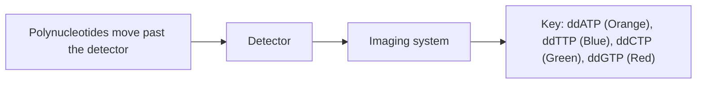

(b) The print out from an automated sequencer

line

| Position | Nucleotide |
| --- | --- |
| ~1-20 | CACCGCATCGAAATTAACTTCCAAAGTTAAGCTTGG |
| ~26-35 | N/A |

To work out the DNA sequence, all that we have to do is identify the dideoxynucleotide at the end of each chain‐terminated molecule. This is where the polyacrylamide gel comes into play. The mixture is loaded into the capillary gel, and electrophoresis carried out to separate the molecules according to their lengths. After separation, the molecules are run past a fluorescent detector capable of discriminating the labels attached to the dideoxynucleotides (Figure  10.3a). The detector therefore determines if each molecule ends in an A, C, G, or T. The sequence can be printed out for examination by the operator (Figure 10.3b) or entered directly into a storage device for future analysis.

## 10.1.2 Not all DNA polymerases can be used for sequencing

Any DNA polymerase is capable of extending a primer that has been annealed to a single‐stranded DNA molecule, but not all polymerases can be used for DNA sequencing. This is because many DNA polymerases have a mixed enzymatic activity, being able to degrade as well as synthesize DNA (Section 4.1.3). Degradation can occur in either the ${ \bar { S } } ^ { \prime } { \rightarrow } 3 ^ { \prime }$ or $3 ^ { \prime } { \rightarrow } 5 ^ { \prime }$ direction (Figure 10.4), but it is the latter that is detrimental to chain‐termination sequencing. This is because the $3 ^ { \prime } { \rightarrow } 5 ^ { \prime }$ activity prevents chain termination from occurring, by removing the dideoxynucleotide immediately after it has been added to the $\overline { { 3 ^ { \prime } } }$ end of the strand that is being synthesized.

In the original method for chain‐termination sequencing, the Klenow polymerase was used as the sequencing enzyme. As described in

---

Chapter 10 Sequencing Genes and Genomes

193

Figure 10.4

The exonuclease activities of some DNA polymerases. (a) The $5 ^ { \prime } { \rightarrow } 3 ^ { \prime }$ activity has an important role in DNA repair in the cell, as it enables the polymerase to replace a damaged DNA strand. (b) The 3′→5′ activity also has an important role in the cell, as it allows the polymerase to correct its own mistakes, by reversing and replacing a nucleotide that has been added in error (e.g. a T instead of a G). This is called proofreading. During DNA sequencing, this activity can result in removal of a dideoxynucleotide that has just been added to the newly synthesized strand, so that chain termination does not occur.

Section 4.1.3, this is a modified version of the DNA polymerase I enzyme from E. coli, the modification removing the ${ \bar { S } } ^ { \prime } { \rightarrow } 3 ^ { \prime }$ exonuclease activity of the standard enzyme. The enzyme used for sequencing was further modified by mutation to remove the $3 ^ { \prime } { \rightarrow } 5 ^ { \prime }$ exonuclease activity. However, the Klenow polymerase has low **processivity**, meaning that it can only synthesize a relatively short DNA strand before dissociating from the template due to natural causes. This limits the length of sequence that can be obtained from a single experiment to about 250 bp. To avoid this problem, most sequencing today makes use of the Taq DNA polymerase, which has high processivity and no exonuclease activity and so is ideal for chaintermination sequencing, enabling sequences of 750 bp and longer to be obtained in a single experiment.

## 10.1.3 Chain‐termination sequencing with Taq polymerase

The chain‐termination method that uses Taq polymerase is called **thermal cycle sequencing**. It is carried out in a similar way to PCR, but just one primer is used, and the reaction mixture includes the four dideoxynucleotides (Figure 10.5). Because there is only one primer, only one of the strands of the starting molecule is copied, and the product accumulates in a linear fashion, not exponentially as is the case during a real PCR. The presence of the dideoxynucleotides in the reaction mixture causes chain termination, and the family of resulting strands is then separated by polyacrylamide gel electrophoresis and the sequence read as described above.

Thermal cycle sequencing is usually carried out with PCR products or with DNA that has been cloned in a plasmid or phage vector. If a PCR product is being sequenced, then one of the primers from the original PCR can be used in the sequencing reaction. If two reactions are carried out, one with each of the two PCR primers, then **forward** and **reverse sequences** are obtained (Figure 10.6a). This is an advantage if the PCR product is more than 750 bp and hence too long to be sequenced completely in one experiment. Alternatively, it is possible to extend the sequence in one direction by

---

194

Part II The Applications of Gene Cloning and DNA Analysis in Research

## Figure 10.5

The basis to thermal cycle sequencing. A PCR is set up with just one primer and one of the dideoxynucleotides. One of the template strands is copied into a family of chain‐terminated polynucleotides.

flowchart

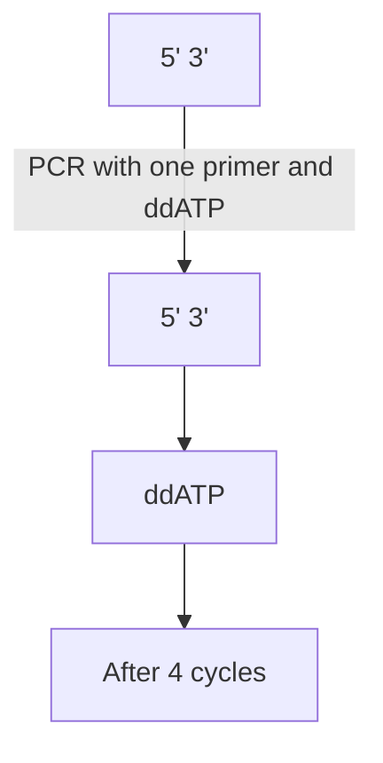

synthesizing a new primer, designed to anneal at a position within the PCR product (Figure 10.6b).

If cloned DNA is being sequenced, then a **universal primer** can be used. This is a primer that is complementary to the part of the vector DNA immediately adjacent to the point into which new DNA is ligated (Figure 10.7). The 3′ end of the primer points toward the inserted DNA, so

(a) Obtaining forward and reverse sequences

(b) Internal primers

flowchart

## Figure 10.6

Strategies for thermal cycle sequencing. (a) Forward and reverse sequences are obtained by using different PCR primers. (b) Internal primers are used to obtain sequence from the middle region of a long PCR product.

---

Chapter 10 Sequencing Genes and Genomes

195

text_image

Primer
3' Vector DNA DNA insert 5'
Vector DNA Vector DNA

Figure 10.7

Sequencing a cloned DNA fragment with a universal primer.

the sequence that is obtained starts with a short stretch of the vector and then progresses into the cloned DNA fragment. Any fragment that is cloned in the vector can therefore be sequenced with the same primer. Once again, both forward and reverse universal primers can be used, enabling sequences to be obtained from both ends of the insert, and an internal primer can provide sequence from the middle region of a long insert.

## 10.1.4 Limitations of chain‐termination sequencing

With the most up‐to‐date versions of the chain‐termination method it is possible to obtain over 750 bp of sequence per experiment. Most genes, especially eukaryotic ones, are longer than this, but it is easy to carry out two or more chain‐termination experiments, directed at different parts of a gene, in order to build up the complete sequence. Chain‐termination sequencing is therefore the method of choice for sequencing genes and other DNA fragments obtained by cloning or PCR.

The chain‐termination method was also used to obtain the first complete genome sequences. This was a much more challenging task, because even the smallest bacterial genomes are over 1 Mb in length, and the human genome, which was initially sequenced by the chain‐termination method, is 3 200 Mb (Table 10.1). Furthermore, no sequencing method is entirely accurate, so it is necessary to sequence each region of a genome multiple times, in order to identify errors present in individual sequence **reads** (Figure  10.8). With the chain‐termination method, to ensure that errors are identified, at least 5× **sequence depth** or **coverage** is required, meaning that every nucleotide is present in five different reads. So for the human genome, a total of 5 × 3 200 = 16 000 Mb of sequence would be

Table 10.1

Sizes of representative genomes.

| SPECIES | TYPE OF ORGANISM | GENOME SIZE (Mb) |
| --- | --- | --- |
| Mycoplasma genitalium | Bacterium | 0.58 |
| Haemophilus influenzae | Bacterium | 1.83 |
| Escherichia coli | Bacterium | 4.64 |
| Saccharomyces cerevisiae | Yeast | 12.1 |
| Caenorhabditis elegans | Nematode worm | 100 |
| Drosophila melanogaster | Insect | 175 |
| Arabidopsis thaliana | Plant | 135 |
| Homo sapiens | Mammal | 3 200 |
| Triticum aestivum | Plant (wheat) | 16 500 |

---

196

Part II The Applications of Gene Cloning and DNA Analysis in Research

| AGCATCGTAGCTTCAGTATGATGATGCTAG | Read 1 |
| --- | --- |
| ATGATCGTAGCTAGCATCGTAGCTAGC | Read 2 |
| ATCGTAGCTAGCATCGTAGCTAGCATCGTAGCTT | Read 3 |
| TTGTAGCTTCAGTATGATGATGCTAG | Read 4 |
| GCATCGTAGCTAGCATCGTAGCTTCAGT | Read 5 |
| ATGATCGTAGCTAGCATCGTA | Read 6 |
| ATGATCGTAGCTAGCATCGTAGCTAGCATCGTAGCTTCAGTATGATGATGCTAG | Deduced sequence |

## Figure 10.8

Each region of a genome must be sequenced multiple times, in order to identify errors present in individual sequence reads. In this example, the discrepancy in Read 4 in the highlighted column can be ascribed to a sequencing error, the correct nucleotide at this position being C.

required. This is equivalent to over 21 million chain‐termination sequences averaging 750 bp in length. When the human genome was sequenced in the 1990s and early 2000s, chain‐termination sequencing was the only method available, so this challenge had to be met. In fact it was exceeded, the Human Genome Project generating 23 147 Mb of sequence by the time that the first draft of the genome was published in 2001. This capacity was achieved by automated sequencing machines, capable of generating 384 sequences in parallel in a single run, each run taking about one hour, corresponding to an output of almost 7 Mb per day under optimal working conditions.

Seven Mb of sequence per day is an impressive output, but still places a limitation on the speed with which a genome sequence can be obtained, even if multiple machines are operated continually in a factory setting. Cost is also an important consideration, because the objective, especially with the human genome, was not simply to sequence the genome of one person. Everybody’s genome is slightly different, with its own personal sequence variations that provide us with our individual characteristics. These characteristics include not only the pleasant things such as our eye colour and the natural shade of our hair, but also the less pleasant things such as our individual susceptibility to disease. One of the goals of **personalized medicine** is to use individual genome sequences to make accurate diagnoses of a person’s risk of developing a disease, and to use that person’s genetic characteristics to plan effective therapies and treatment regimes. For personalized medicine to become a reality, cost‐effective and rapid ways of sequencing individual genomes are needed. This requirement stimulated the development of next‐generation sequencing methods, aimed at generating larger and larger amounts of sequence data, more quickly and at less cost.

## 10.2 Next‐generation sequencing

The rationale behind next‐generation sequencing is quite different to that of the chain‐termination method. With the latter, the sequencing experiment is preceded by a cloning project or a PCR, and each cloned insert or PCR product is sequenced individually. With a next‐generation method, a large **library** made up of thousands or millions of DNA fragments is

---

Chapter 10 Sequencing Genes and Genomes

197

flowchart

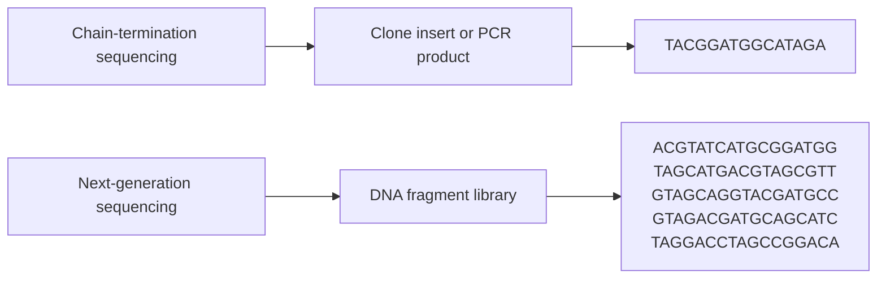

Figure 10.9

The difference between chaintermination and next‐generation sequencing.

sequenced in a single experiment (Figure  10.9). Often these fragments represent an entire genome.

Several different next‐generation methods have been developed over the last twenty years, the technical improvements being measured by the amount of DNA sequence that can be obtained in a single experiment. At present, the most popular system is **Illumina sequencing**, named after the company that markets the necessary equipment.

## 10.2.1 Preparing a library for an Illumina sequencing experiment

In common with other next‐generation methods, the first step in an Illumina sequencing experiment is preparation of a library of DNA fragments that have been immobilized on a solid support, in such a way that the individual sequencing reactions can be carried out side by side in an array format (Figure 10.10). There are three steps to preparation of this library:

1 Breakage of the starting DNA into fragments of sizes that are suitable for the sequencing method being used.
2 Immobilization of the fragments on to the solid support.
3 Amplification of the immobilized fragments.

## DNA fragmentation

Library preparation begins with purification of the DNA to be sequenced, for example the total cell DNA from an organism whose genome is being studied. The DNA is then broken into fragments, usually between

text_image

Components of
the DNA library
Solid support

Figure 10.10

A DNA library immobilized on a solid support.

---

198

Part II The Applications of Gene Cloning and DNA Analysis in Research

Figure 10.11

Random fragmentation of DNA by sonication.

flowchart

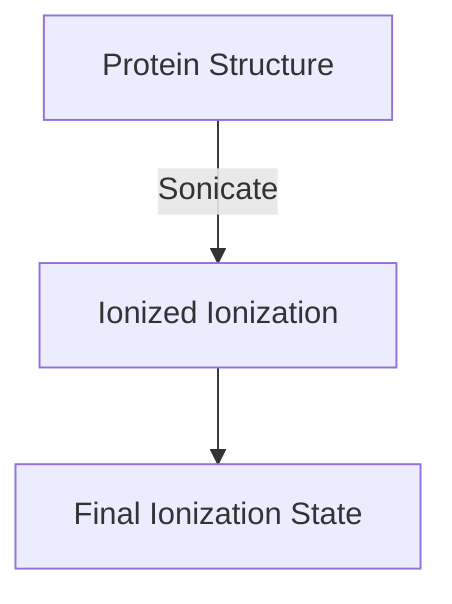

200 bp and 500 bp in length. The standard fragmentation method is **sonication**, in which ultrasound is used to cause breaks in the DNA molecules (Figure  10.11). The sonicated DNA is then fractionated by agarose gel electrophoresis and fragments of the desired size purified from the gel.

Sonication is the preferred fragmentation method because it causes breaks at random positions in DNA molecules. Random breakage is important to ensure that all parts of the starting DNA are sequenced. This is because each fragment will be sequenced from its ends. If a restriction endonuclease was used to break up the DNA then some fragments might be too long to be sequenced entirely from their ends, and the internal regions of these fragments would therefore be absent in the final set of sequence reads that are obtained. With next‐generation methods it is not possible to direct the sequencing towards the middle of a fragment, as can be done by designing an internal primer for the chaintermination method.

## Immobilization of the library

The second stage in library preparation is immobilization of the sonicated DNA fragments on to a solid support. In the earliest types of nextgeneration sequencing the library was immobilized on small metallic beads, with one DNA fragment attached to each bead. In Illumina sequencing a simpler system is used, with the fragments immobilized in an array on a glass slide which has been coated with many copies of a short oligonucleotide (Figure 10.12).

The DNA fragments will have many different sequences, so how do we attach them to the oligonucleotides on the slide? The answer is to ligate adaptors (Section  4.3.3) to the ends of the fragments, the sequences of these adaptors matching the sequences of the oligonucleotides. The fragments are then denatured into single‐stranded DNA, and the resulting single‐stranded molecules attached to the glass slide by base pairing between their adaptor sequences and the immobilized oligonucleotides.

---

Chapter 10 Sequencing Genes and Genomes

199

flowchart

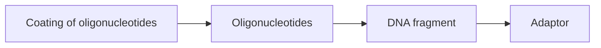

Figure 10.12

Immobilization of the DNA fragments in a sequencing library by base pairing to oligonucleotides on a glass side.

## Amplification of the library

The final step in library preparation is amplification of the immobilized fragments by PCR, to produce a sufficient number of identical copies to be sequenced. The adaptors now play a second role as they provide the annealing sites for the primers for this PCR. The same pair of primers can therefore be used for all the fragments, even though the fragments themselves have many different sequences.

Following the PCR, the amplification products become attached to oligonucleotides adjacent to the template fragment, converting each template fragment into a cluster of identical fragments (Figure 10.13).

## 10.2.2 The sequencing phase of an Illumina experiment

Once the fragment library has been immobilized onto its solid support, the actual sequencing phase of the experiment can begin. An important characteristic of all next‐generation methods is that there is no electrophoresis or any other fragment separation step, which would be difficult if not impossible to carry out in a massively parallel format. Instead, each fragment in the immobilized library is copied by a DNA polymerase, and as the new strand is being made the order in which the nucleotides are incorporated is detected, so the sequence can be read as the reaction proceeds.

The Illumina method is based on **reversible terminator sequencing** which, like chain‐termination sequencing, makes use of modified nucleotides

text_image

PCR products
PCR

Figure 10.13

Amplification of an immobilized DNA library.

---

200

Part II The Applications of Gene Cloning and DNA Analysis in Research

Reversible terminator sequencing.

Figure 10.14

(a) A reversible terminator nucleotide

chemical

Chemical structure of a phosphate group with base, oxygen, and hydrogen atoms, showing the removal of a blocking group

(b) Reversible terminator sequencing

flowchart

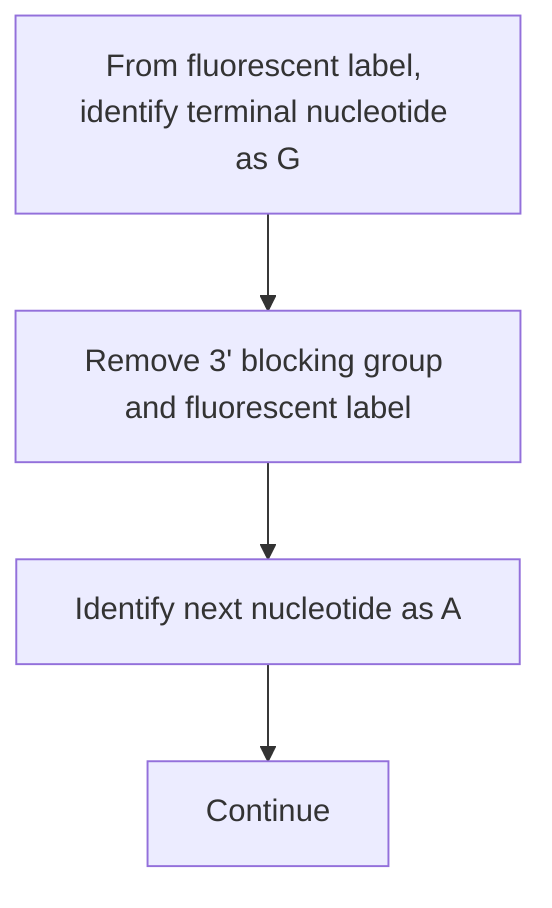

which block further strand synthesis once one has been incorporated at the end of the growing polynucleotide. There is, however, a critical difference between reversible terminator and chain‐termination sequencing. As the name ‘reversible terminator’ implies, the termination step is reversible, because the chemical group that has been attached at the $3 ^ { \prime }$ position of the terminator nucleotide can be removed, converting the position to  a  3′‐hydroxyl group, which allows further extension to occur (Figure 10.14a). The terminator nucleotides are labelled, each with a different fluorophore. There are no normal deoxynucleotides present in the reaction mixture, so each step in strand synthesis is accompanied by a pause, during which an optical device detects the fluorescent label, thereby identifying the terminal nucleotide. Once the nucleotide has been identified, the $3 ^ { \prime }$ blocking group, as well as the fluorophore, are detached, leaving a standard nucleotide (Figure 10.14b). The next step in the strand synthesis reaction can now take place, enabling the next nucleotide in the sequence to be identified.

The sequencing process is initiated by a primer that anneals to the adaptor sequences attached to the ends of the DNA fragments during library preparation. Every cluster of fragments in the library is therefore sequenced at the same time. The method generates relatively short sequence reads, with a maximum length of 300 bp, but is so massively parallel that up to 3 000 Mb of sequence can be obtained per run.

---

Chapter 10 Sequencing Genes and Genomes

201

flowchart

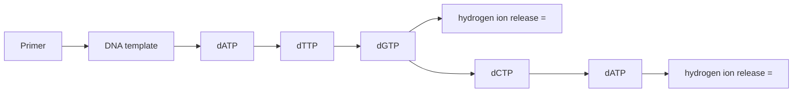

Figure 10.15

The basis to ion semiconductor sequencing. There is a wash between each nucleotide addition, to ensure no carry‐over of nucleotides from one step to the next.

## 10.2.3 Ion semiconductor sequencing

**Ion semiconductor sequencing**, which is also called the **ion torrent** method, is a second type of next‐generation method that takes a radically different approach to either chain‐termination or reversible terminator sequencing. The individual nucleotides are not labelled, and instead the sequence is read by detecting the hydrogen ions that, along with pyrophosphate, are released every time a nucleotide is incorporated into the growing strand.

A burst of hydrogen ion release therefore signals the successful copying of one position in the template molecule. Of course, if all four deoxynucleotides were added at once, then hydrogen ions would be released all the time and no useful sequence information would be obtained. Each deoxynucleotide is therefore added separately, one after the other (Figure 10.15). This procedure makes it possible to follow the order in which the deoxynucleotides are incorporated into the growing strand.

The reaction is carried out with DNA fragments immobilized on acrylamide beads, each bead in a well lined with an **ion‐sensitive field effect transistor (ISFET)**. The ISFET generates an electronic pulse each time it detects hydrogen ions, these pulses being related to the flow of nucleotides over the well in order to deduce the sequence of the immobilized fragments. Read lengths of up to 400 bp are possible, with several Mb of sequence obtainable per run.

## 10.2.4 Third‐generation sequencing

The development of new DNA sequencing methods continues apace, with the aim of enabling genome sequences to be assembled more quickly and at less cost. One limitation of both the reversible terminator and ion

---

202

Part II The Applications of Gene Cloning and DNA Analysis in Research

Figure 10.16

Real‐time DNA sequencing with each nucleotide addition detected with a zero‐mode waveguide.

flowchart

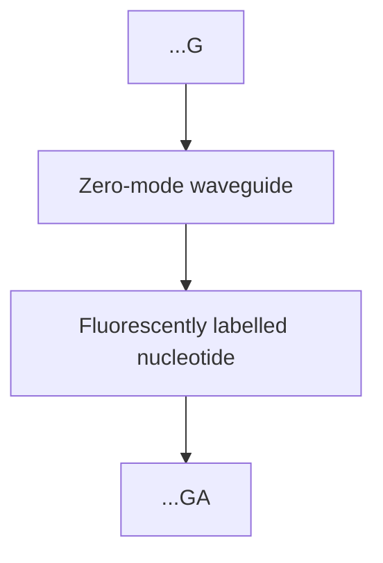

semiconductor approaches is the time that it takes to complete a sequencing experiment. This is because the methods used for reading the sequence require a delay at each step in the strand synthesis reaction. With the reversible terminator method, the delay is caused by the need to remove the 3′ blocking group and the fluorophore after each nucleotide addition, and during ion semiconductor sequencing the delay occurs because each nucleotide is presented individually to the polymerase. This delay increases the period of time needed to complete a sequence read.

**Third‐generation sequencing** aims to improve on the next‐generation methods by carrying out sequencing in real time – in other words during the normal, unimpeded progression of the polymerase along the template as it synthesizes the second strand. Real‐time sequencing also enables read lengths to be longer, as the regular pauses that occur during the nextgeneration methods reduce the processivity of the polymerase.

One of the most promising third‐generation methods is **single molecule real‐time (SMRT) sequencing**. A sophisticated optical system called a **zeromode waveguide** is used to observe the copying of a single DNA template, with each nucleotide addition identified from its attached fluorescent label (Figure 10.16). Because the optical system is so precise, there is no need to block the 3′ carbon of the nucleotide. Instead, the fluorescent signal is detected and the label removed immediately after nucleotide incorporation, so strand synthesis can progress without interruption. Read lengths of up to 20 kb have been reported with this method. The technology was initially developed by Pacific Biosciences and is often called **PacBio sequencing**.

## 10.2.5 Next‐generation sequencing without a DNA polymerase

Each of the DNA sequencing methods that we have considered so far – from the chain‐termination method through to PacBio sequencing – have one feature in common. With each method, the sequence is read by synthesizing a copy of the DNA strand with a DNA polymerase. The need for strand synthesis complicates the technology by requiring a means of delivering the nucleotides and other reagents to the immobilized DNA fragments.

---

Chapter 10 Sequencing Genes and Genomes

203

text_image

Helicase
Nanopore
Negative
Membrane
Positive
Perturbed flow of ions

Figure 10.17

Nanopore sequencing. The DNA molecule, shown in red, is denatured by the helicase and one strand passes downwards through the nanopore.

The next logical step is therefore to dispense with strand synthesis and read the sequence of a DNA molecule directly, without copying that molecule in any way. This can be achieved by **nanopore sequencing**. The method makes use of a synthetic membrane with small pores, each just 1 nm in diameter, which is just large enough for a single‐stranded DNA molecule to pass through. An electrical current is set up, positive on one side of the membrane and negative on the other, so electrophoresis causes the DNA molecule to approach one of the nanopores. To begin with, the molecule is double‐stranded, but the presence of a **helicase** enzyme in the vicinity of the nanopore breaks the base pairs, so the DNA unwinds and just one strand passes through the pore (Figure 10.17). The sequence of this strand can be read because each of the four nucleotides has a different shape and so occludes the nanopore in a different way, resulting in a  slightly different perturbation of the flow of ions passing through the membrane. These perturbations are measured in order to deduce the sequence of the polynucleotide. Because no DNA synthesis is involved, the length of the sequence that can be read by the nanopore method is not affected by polymerase processivity, and reads longer than 200 kb can be obtained.

At present nanopore sequencing is less accurate than other sequencing methods, because the accuracy of sequence identification is hampered by the influence that the part of the DNA strand that is close to, but not actually within the nanopore, has on the ion flow. This means that some short sequence motifs are read incorrectly. Accuracy is also affected by small variations in the speed with which the DNA strand passes through the nanopore. Improvements in the detection system are therefore being sought, along with ways of modifying the nanopore structure so that the polynucleotide moves through it at a more consistent rate.

## 10.2.6 Directing next‐generation sequencing at specific sets of genes

When used in genome sequencing, the random nature of a next‐generation method is an advantage, as it means that all parts of the genome are sequenced at the same time. Genome sequencing is hugely important, but sometimes the objective of a sequencing project is only to sequence a part of a genome. One example is in the screening of human DNA for sequence

---

204

Part II The Applications of Gene Cloning and DNA Analysis in Research

flowchart

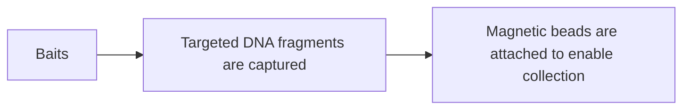

(b) Comparison between sequencing before and after capture

flowchart

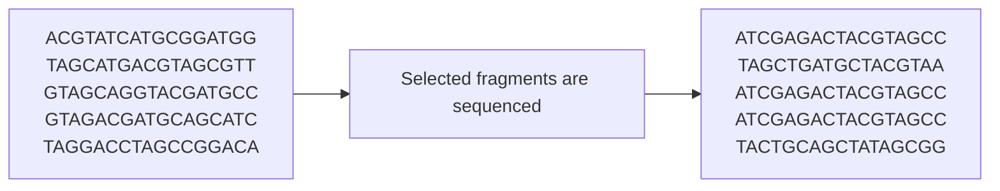

Figure 10.18

Target enrichment. (a) Baits are used to capture DNA fragments representing genes of interest. (b) Only the captured DNA fragments are sequenced.

variations that might indicate that a patient has a susceptibility to particular types of cancer. This type of screen would be more efficient if the sequencing were directed at just those 500–600 genes that are associated with cancer. Those genes make up about 4 Mb of DNA, compared with the 3 200 Mb of the entire human genome.

Next‐generation sequencing can be directed at specific sets of genes by a **target enrichment** method. A large set of oligonucleotides, each typically 150 nucleotides in length, is synthesized, the sequences of the oligonucleotides collectively corresponding to the sequences of the genes that are being targeted (Figure 10.18a). The oligonucleotides then act as **baits** that hybridize to, and hence capture, the DNA fragments representing the genes of interest during library preparation. Various strategies can be used. One approach is similar to the magnetic bead method for purification of total cell DNA (Section  3.1.3). One end of each bait is labelled with biotin, and  after hybridization the captured DNA is attached, via the baits, to streptavidin‐coated magnetic beads. A magnet is then used to collect the

---

Chapter 10 Sequencing Genes and Genomes

205

beads so that the DNA from the non‐targeted parts of the genome, which remains in solution, can be discarded. The captured DNA is then released from the baits and used to prepare the sequencing library (Figure 10.18b).

## 10.3 How to sequence a genome

The first DNA molecule to be completely sequenced was the 5386 nucleotide genome of bacteriophage ϕX174, which was completed in 1975. This was quickly followed by sequences for SV40 virus (5243 bp) in 1977 and pBR322 (4361 bp) in 1978. Gradually sequencing was applied to larger molecules. Professor Sanger’s group published the sequence of the human mitochondrial genome (16.6 kb) in 1981 and of bacteriophage λ (48.5 kb) in 1982.

During the 1990s, automated methods for chain‐termination sequencing were developed, enabling much larger genomes to be sequenced. The first eukaryotic chromosome sequence, for chromosome III of the yeast Saccharomyces cerevisiae, was published in 1992, and the entire yeast genome was completed in 1996. This was followed by complete genome sequences for other model organisms: for the worm Caenorhabditis elegans, the fly Drosophila melanogaster, and the plant Arabidopsis thaliana. This phase of genome sequencing included publication of the human genome sequence in 2001. With the development of next‐generation methods, genome sequencing has become more routine. Genome sequences are now known for over 300 eukaryotic species and several thousand bacteria and archaea, and many more sequencing projects are in progress.

Since the 1990s, when the chain‐termination method was first automated, the actual generation of sequence data has not been a limiting factor in genome sequencing projects. Instead, the main challenge lies with **sequence assembly**, the procedure used to convert the thousands or millions of short sequence reads into the contiguous genome sequence. The simplest way of doing this is the **shotgun approach**, in which the genome is randomly broken into short fragments which are individually sequenced. The genome sequence is then assembled by searching for overlaps between the individual short sequences (Figure 10.19).

flowchart

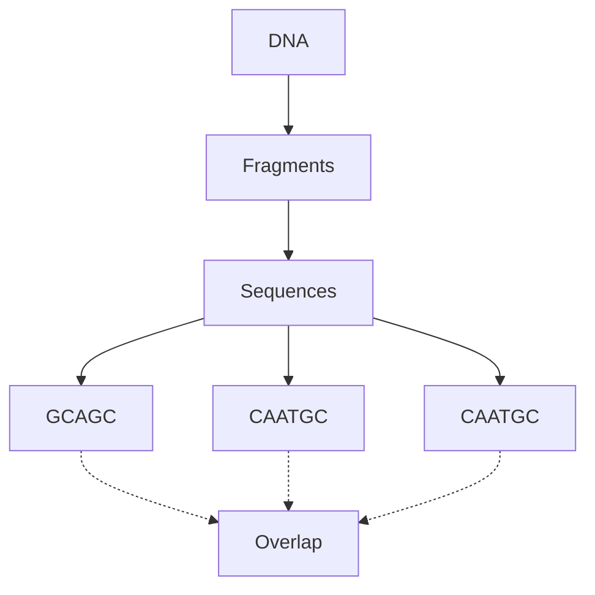

Figure 10.19

The shotgun method for sequence assembly. The DNA molecule is broken into small fragments, each of which is sequenced. The master sequence is assembled by searching for overlaps between the sequences of individual fragments. In practice, an overlap of several tens of base pairs would be needed to establish that two sequences should be linked together.

---

206

Part II The Applications of Gene Cloning and DNA Analysis in Research

## 10.3.1 Shotgun sequencing of prokaryotic genomes

The shotgun approach to sequence assembly was first used in the 1990s with bacterial and archaeal genomes, which are much shorter than eukaryotic genomes (see Table 10.1), and hence can be sequenced from a relatively small number of individual DNA fragments. The fewer the fragment number, the easier the sequence assembly will be.

## Shotgun sequencing of the Haemophilus influenzae genome

The bacterium Haemophilus influenzae was the first free‐living organism whose genome was sequenced, with the results being published in 1995. The first step was to sonicate the 1830 kb genome, breaking the DNA into short fragments, which were then cloned in plasmid and M13 vectors to provide the templates for the sequencing experiments. It was decided to concentrate on fragments of 1.6–2.0 kb because these could yield two chain‐termination DNA sequences, one from each end, reducing the amount of cloning and DNA preparation that was required. The sonicated DNA was therefore fractionated by agarose gel electrophoresis and fragments of the desired size purified from the gel (Figure 10.20). After cloning, 28 643 chain‐termination sequencing experiments were carried out with 19 687 of the clones. A few of these sequences – 4339 in all – were rejected because they were less than 400 bp in length. The remaining 24 304 sequences were entered into a computer, which spent 30 hours searching for overlaps among the sequences. The result was 140 contiguous sequences or **sequence contigs**, each made up of a series of overlapping sequence reads.

The average contig length was 12 kb, suggesting that together they made up over 90% of the genome sequence, but of course that sequence would not be complete until the contigs had been placed in their correct order and the gaps between them closed. It might have been possible to continue sequencing more of the sonicated fragments in order eventually to close the gaps between the individual sequence contigs. However, 11 631 485 bp of sequence had already been generated  –  six times the length of the genome  –  suggesting that a large amount of additional work would be needed before the correct fragments were, by chance, sequenced. It was also possible that some of the gaps were contained in fragments of DNA that could not be cloned because of incompatibility problems, which occur with all cloning vectors and prevent inserts with certain sequences from being propagated. If the gap sequences were absent from the clone library, then no amount of additional sequencing would close them.

A more directed strategy was therefore used to close each of the gaps individually. Several approaches were tried, the most successful involving hybridization analysis of a clone library prepared in a λ vector (Figure 10.21). Incompatibility problems tend to be specific for particular vector types, so fragments that cannot be cloned in a plasmid vector can often be cloned in λ. The λ library was probed in turn with a series of oligonucleotides whose sequences corresponded with the ends of each of the 140 contigs. In some cases, two oligonucleotides hybridized to the same

---

Chapter 10 Sequencing Genes and Genomes

207

flowchart

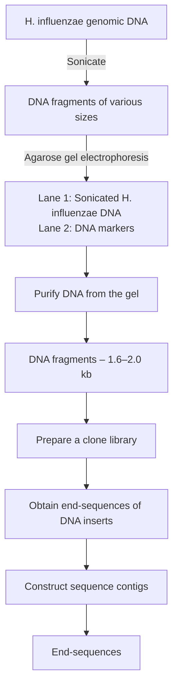

Figure 10.20

A schematic of the key steps in the H. influenzae genome sequencing project.

---

208

Part II The Applications of Gene Cloning and DNA Analysis in Research

Figure 10.21

Using oligonucleotide hybridization to close gaps in the H. influenzae genome sequence. Oligonucleotides 2 and 5 both hybridize to the same λ clone, indicating that contigs I and III are adjacent. The gap between them can be closed by sequencing the appropriate part of the λ clone.

(a) Prepare oligonucleotide probes

bar

| Contig | Probe Set 1 | Probe Set 2 |
| --- | --- | --- |
| Contig I | 1 | 2 |
| Contig II | 3 | 4 |
| Contig III | 5 | 6 |

(b) Probe a genomic library

text_image

Probe with
oligonucleotide 2
Probe with
oligonucleotide 5
Conclusion:
I	III	Contigs I and III
1	2	5	6	are adjacent in
the genome

λ clone, indicating that the two contig ends represented by those oligonucleotides lay adjacent to one another in the genome. The gap between these two ends could then be closed by sequencing the appropriate part of the λ clone.

## Shotgun sequencing of other prokaryotic genomes

Shotgun sequencing has been successful with many prokaryotic genomes, the short lengths of these genomes meaning that the computational requirements for finding sequence overlaps are not too great. If a next‐generation sequencing method is used then gap closure is less of an issue, because a single experiment can easily generate sequence reads whose total length is several hundred times that of the genome.

Many prokaryotic genomes are assembled by **de novo sequencing**, as described above for H. influenzae, with the genome sequence worked out solely by finding overlaps between individual sequence reads. However, as the genomes of more and more species become available, a second approach to assembly is sometimes possible. This is when an existing sequence is used as **reference genome** for assembly of a related genome. Rather than just looking for overlaps among the sequence reads for the genome that is being assembled, individual reads and short contigs are also mapped onto the reference sequence by looking for regions of sequence similarity (Figure 10.22). The rationale is that if the reference genome comes from a related species, or from a different strain of the same species, then the sequences of the two genomes will be similar, and the reference can therefore direct assembly of the new genome.

---

Chapter 10 Sequencing Genes and Genomes

209

text_image

Reads
Reference genome

Figure 10.22

Using a reference genome to aid sequence assembly.

The reference genome approach makes sequence assembly quicker and more accurate, but care has to be taken to identify any regions in the new genome where the gene order has been changed by recombination (Figure 10.23). This kind of rearrangement does not alter the sequence of the segment that moves, it merely places that segment at a different position in the genome. The only difference between the sequences will be at the boundaries of the segments that have been rearranged. If the sequence reads do not span these boundaries, then reliance on the reference genome might lead to the rearrangement not being recognized in the genome being assembled.

## 10.3.2 Sequencing of eukaryotic genomes

As well as their small size, prokaryotic genomes have a second advantage that aids sequence assembly by the shotgun method. Prokaryotic genomes contain few or no repetitive DNA sequences. These are sequences, from a few base pairs to several kilobases, which are repeated at two or more places in a genome. They cause problems for the shotgun approach because sequences that lie partly or wholly within one repeat element might accidentally be assigned an overlap with the identical sequence present in a different repeat element (Figure 10.24). This could lead to a part of the genome sequence being placed at the incorrect position or left out entirely.

Although absent from most bacterial genomes, repetitive sequences are common in eukaryotes, and in some species make up more than 50% of the genome. For this reason, it was initially thought that a eukaryotic genome could not be assembled entirely by shotgun sequencing.

## The hierarchical shotgun approach

The first eukaryotic genomes, including the human genome, were sequenced by a modification of the shotgun approach called **hierarchical shotgun**

text_image

A B C D E F G H I
Reference genome
A D E F G B C H I
Genome being
sequenced
Critical regions

Figure 10.23

One potential problem when using a reference genome. In this example, the positions of genes B and C are different in the reference compared with the genome being sequenced. If the sequence coverage does not include the critical regions at the boundaries for this recombination event, then the fact that the gene order is different in the genome being sequenced will not be recognized.

---

210

Part II The Applications of Gene Cloning and DNA Analysis in Research

flowchart

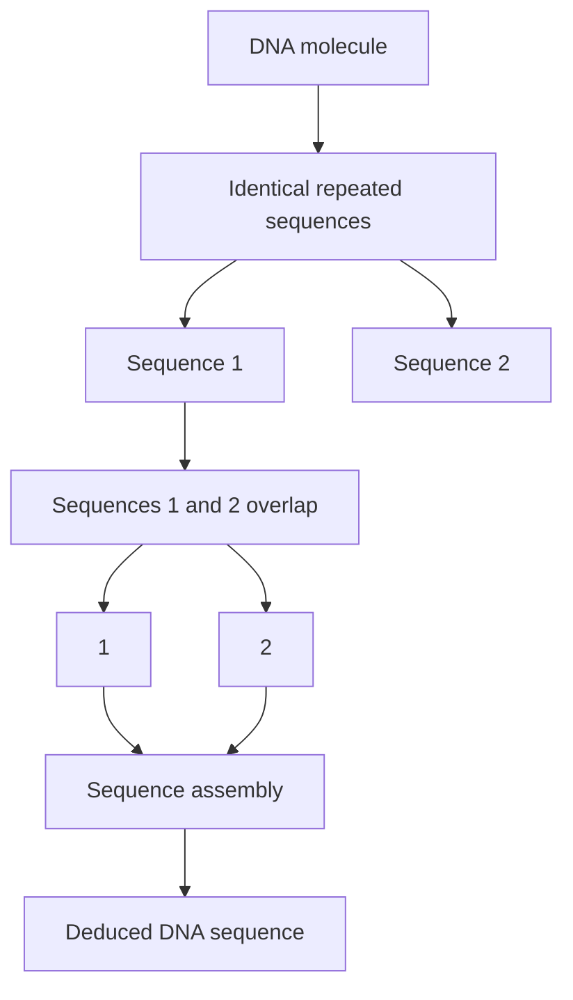

Figure 10.24

One problem with the shotgun approach. An incorrect overlap is made between two sequences that both terminate within a repeated element. The result is that a segment of the DNA molecule is absent from the DNA sequence.

**sequencing**. This approach involves a pre‐sequencing phase during which the genome is broken into large fragments, typically 300 kb in length, and  these fragments cloned into a high‐capacity vector such as a BAC (Section  6.2.6). Clones that contain overlapping fragments of DNA are then identified, enabling a contiguous series – a **clone contig** – to be built up (Figure 10.25). Each piece of cloned DNA is then broken into smaller fragments and these are sequenced and assembled by the shotgun method. The sequence of each cloned fragment can then be placed at its appropriate position in the series of clones in order to gradually build up the overlapping genome sequence. The confusion caused by repetitive DNA now arises only if two or more copies of the same repeat are present in the same cloned fragment, and even then it might be possible to identify errors in the assembly by examining the sequences of clones that overlap with the one containing the repeats (Figure 10.26).

The problem with the hierarchical approach is that identifying clones that contain overlapping inserts is a massive task. One technique that can be used is **chromosome walking**. To begin a chromosome walk, a clone is selected at random from the library, labelled, and used as a hybridization

flowchart

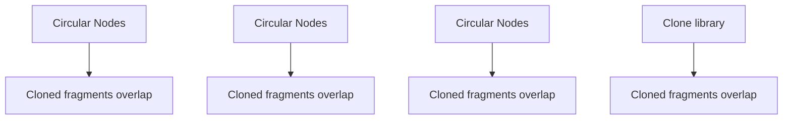

Figure 10.25

A set of clones whose fragments overlap.

---

Chapter 10 Sequencing Genes and Genomes

211

flowchart

This diagram illustrates a hierarchical process for generating repeat sequences using circular nodes connected by directional arrows.

Figure 10.26

Hierarchical shotgun sequencing can avoid problems with repeat sequences. The positions of repeat sequences in clones 2 and 3 from Figure 10.25 are shown. Sequence assembly of the reads from clone 2 could result in the segment between the two repeats being lost. However, the sequence of clone 3 enables the mistake to be recognized and corrected.

probe against all the other clones in the library (Figure  10.27a). Those clones that give hybridization signals are ones that overlap with the probe. One of these overlapping clones is now labelled and a second round of probing carried out. More hybridization signals are seen, some of these indicating additional overlaps (Figure 10.27b). Gradually the clone contig is built up in a step‐by‐step fashion. This method suffers from the drawback that if the probe contains a repeat sequence, then it will hybridize not only to overlapping clones but also to nonoverlapping ones whose inserts contain copies of the repeat. An alternative approach that avoids this problem is to design primers that will amplify a segment at the end of a clone insert and then use these primers in attempted PCRs with all the other

(a) Probe the library with clone A1

flowchart

Figure 10.27

Chromosome walking, using individual clones as hybridization probes.

(b) Probe the library with clone I4

text_image

A B C D E F G H I J
1
2
3
4
5
6
→
A1
F2
B4
I4

---

212

Part II The Applications of Gene Cloning and DNA Analysis in Research

flowchart

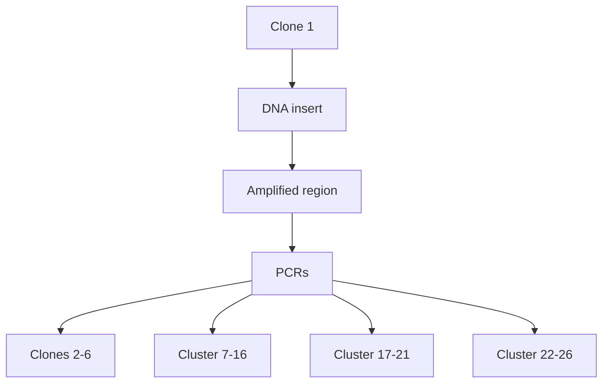

Figure 10.28

Chromosome walking by PCR. The two PCR primers will amplify the end region of the insert in clone 1. They are used in attempted PCRs with all the other clones in the library. Only clone 15 gives a PCR product, showing that the inserts in clones 1 and 15 overlap. The walk would be continued by designing primers that would amplify the other end of clone 15, and using these in a new set of attempted PCRs with all the other clones.

clones in the library. A second clone that gives a PCR product of the correct size must contain an insert that overlaps with that of the original clone (Figure  10.28). To speed up the process, rather than performing a PCR  with  each individual clone, a combinatorial process can be used (see Figure 9.12).

The weakness of chromosome walking is that it begins at a fixed starting point and builds up the series of overlapping clones one by one, and hence slowly, from that fixed point. More rapid techniques do not use a fixed starting point and instead aim to identify pairs of overlapping clones. When enough overlapping pairs have been identified the series of clones is revealed (Figure 10.29). The various techniques that can be used to identify overlaps are collectively known as **clone fingerprinting**. These techniques are based on the identification of sequence features that are shared by a pair of clones. If two clones contain this feature, then clearly they must overlap. A sequence feature of this type is called a **sequence tagged site (STS)**. Often an STS is a gene that has been sequenced in an earlier project. As the sequence is known, a pair of PCR primers that are specific for that gene can be designed and used to identify which members of a clone library contain the gene. The STS does not have to be a gene and can be any short piece of DNA sequence, the only requirement being that it occurs just once in the genome.

text_image

F2
G6
A1
I4
H7
B4
I4
F2
I4
B4
A1
H7
B4
A1
I4
F2
G6
Overlaps identified by clone fingerprinting
Deduced overlapping series

Figure 10.29

Building up a series of overlapping clones by a clone fingerprinting technique.

---

Chapter 10 Sequencing Genes and Genomes

213

## Shotgun sequencing of eukaryotic genomes

Identification of a series of overlapping clones is a time‐consuming process, and there would be major advantages if this stage could be sidestepped and a eukaryotic genome sequenced entirely by the shotgun approach. Eukaryotic genomes are of course much longer than prokaryotic ones – 3 200 Mb for the human genome compared with 1.83 Mb for H. influenzae  –  so a correspondingly larger number of sequence reads would have to be examined in order to build up lengthy sequence contigs. This is a computational issue, and has been solved by the development of sophisticated algorithms for sequence assembly, concurrent with the increase in processor power for laboratory computers. But what about the problems that repetitive DNA poses for sequence assembly?

Several possible ways of avoiding errors when repetitive DNA regions are assembled have been explored. The most successful strategy is to use two or more sequencing libraries, with one of the libraries containing fragments that are longer than the longest repeat sequences in the genome being studied. For example, one of the clone libraries used when this method was applied to the Drosophila melanogaster genome contained inserts with an average size of 10 kb, because most Drosophila repeat sequences are 8 kb or shorter in length. The two ends of each of these longer fragments were sequenced, to give **paired‐end reads**. Jumps during the sequence assembly, from one repeat sequence to another, were avoided by ensuring that the paired‐end reads of each 10‐kb fragment were at their appropriate positions in the master sequence (Figure 10.30).

Paired‐end reads can also be used to identify sequence contigs that are adjacent to one another in the genome. The initial result of sequence assembly is therefore a series of **scaffolds**, each scaffold comprising a set of sequence contigs separated by gaps which lie between paired‐end reads (Figure 10.31). As more sequences are added in to the dataset, longer and longer scaffolds are built up. The accuracy of sequence assembly can be further checked by obtaining paired‐end reads from fragments of 100 kb or more that have been cloned in a high‐capacity vector such as a BAC.

The scaffold strategy was initially used with chain‐termination sequencing, with short fragments of DNA cloned into a plasmid vector, and the longer fragments obtained as λ or BAC clones. With the advent of

text_image

Repeat sequences
Both end-sequences of this 10-kb
fragment are positioned correctly
on the master sequence

Figure 10.30

The strategy used to ensure that repetitive DNA regions were assembled correctly when the Drosophila melanogaster genome was sequenced. Two identical 8‐kb repeats are adjacent in the genome. The end‐sequences of the 10‐kb fragment that spans one of these repeats can be checked against the master sequence to ensure that the segment between the two repeats has not been lost.

---

214

Part II The Applications of Gene Cloning and DNA Analysis in Research

text_image

Sequence contigs
1
2
3
Short reads
Scaffold
Paired-end reads of long fragments

Figure 10.31

A scaffold. The paired‐end reads of the long fragments are used to place the sequence contigs in their correct order.

next‐generation sequencing, a hybrid approach was adopted, with the next‐generation method being used to generate reads from short fragments, and the chain‐termination method retained for obtaining the paired‐end reads of large fragment clones. In 2010 the first successful genome assembly based entirely on next‐generation sequencing was reported, for the giant panda. This project used fragment libraries of 150 bp, 500 bp, 2 kb, 5 kb, and 10 kb, along with the ability of modern nextgeneration machines to sequence both ends of a fragment and hence obtain paired‐end reads without recourse to chain‐termination sequencing.

## What do we mean by ‘genome sequence’?

It is important to recognize that a ‘complete’ genome sequence – one in which every nucleotide is sequenced, with no errors, and every segment placed at its correct position – is currently an impossibility for a eukaryotic genome. The development of the Human Genome Project illustrates this point. The initial version of the human genome obtained by the hierarchical shotgun method, published in 2001, was a draft that covered just 90% of the genome. The missing 320 Mb was located predominantly in constitutive heterochromatin, regions of chromosomes in which the DNA is very tightly packaged and which are thought to contain few, if any genes. Within the 90% of the genome that was covered, each part had been sequenced at least four times, providing an ‘acceptable’ level of accuracy, but only 25% had been sequenced the 8–10 times deemed necessary before the sequence could be considered to be ‘finished’. Furthermore, this draft sequence had approximately 150 000 gaps, and some segments had probably not been ordered correctly. Even the ‘finished’ sequence, achieved in 2005, was not entirely complete, the standard being that at least 95% of the euchromatin, the part of genome in which most of the genes are located, should be sequenced with a predicted error rate of less than one in 104 nucleotides, and all except the most refractory gaps filled.

Since 2005, a number of statistics have been devised to measure the degree of completeness of a genome sequence. One of these is the **N50 size**, which can be applied to either sequence contigs or scaffolds. A contig N50 size is worked out as follows:

1 First, the total length of all the sequence contigs added together is calculated.

---

Chapter 10 Sequencing Genes and Genomes

215

2 The contigs are then ordered by length from the longest to the shortest.
3 Beginning with the longest contig, the individual contig lengths are added together until their combined length is equal to half the total length of all the contigs.
4 The N50 value is the length of the last, and hence shortest contig, whose addition makes the combined length greater than 50% of the total.

A higher N50 value therefore indicates a more complete assembly. The same approach can be used with scaffolds rather than contigs.

A different value, the **NG50 size**, is based not on the total length of contigs or scaffolds, but on the actual genome size. The NG50 value therefore enables direct comparisons to be made between genome assemblies for different species.

## Further reading

- Ekblom, R. and Wolf, J.B.W. (2014) A field guide to whole‐genome sequencing, assembly and annotation. Evolutionary Applications, 7, 1026–1042.
- Fleischmann, R.D., Adams, M.D., White, O., et al. (1995) Whole genome random sequencing and assembly of Haemophilus influenzae Rd. Science, 269, 496–512. [The first complete bacterial genome sequence to be published.]
- Head, S.R., Komori, H.K., LaMere, S.A., et al. (2018) Library construction for next‐generation sequencing: overviews and challenges. Biotechniques, 56, 61–77.
- Levy, S.E. and Myers, R.M. (2016) Advancements in next‐generation sequencing. Annual Review of Genomics and Human Genetics, 17, 95–115.
- Li, R., Fan, W., Tian, G., et al. (2010) The sequence and de novo assembly of the giant panda genome. Nature, 463, 311–317. [Genome sequencing based entirely on next‐generation methods.]
- Loman, N.J., Constantinidou, C., Chan, J.Z.M., et al. (2012) High‐throughput bacterial genome sequencing: an embarrassment of choice, a world of opportunity. Nature Reviews Microbiology, 10, 599–606.
- Miller, J.R., Koren, S., and Sutton, G. (2010) Assembly algorithms for next‐generation sequencing data. Genomics, 95, 313–327.
- Prober, J.M., Trainor, G.L., Dam, R.J., et al. (1987) A system for rapid DNA sequencing with fluorescent chain‐terminating dideoxynucleotides. Science, 238, 336–341. [The current methodology for chain‐termination sequencing.]

---

216

Part II The Applications of Gene Cloning and DNA Analysis in Research

- Rothberg, J.M., Hinz, W., Rearick, T.M., et al. (2011) A integrated semiconductor device enabling non‐optical genome sequencing. Nature, 475, 348–352. [Ion semiconductor sequencing.]
- Sanger, F., Nicklen, S., and Coulson, A.R. (1977) DNA sequencing with chain‐terminating inhibitors. Proceedings of the National Academy of Sciences of the USA, 74, 5463–5467. [The first description of chaintermination sequencing.]
- Schatz, M.C., Delcher, A.L., and Salzberg, S.L. (2010) Assembly of large genomes using second‐generation sequencing. Genome Research, 20, 1165–1173.
- Sears, L.E., Moran, L.S., Kissinger, C., et al. (1992) CircumVent thermal cycle sequencing and alternative manual and automated DNA sequencing protocols using the highly thermostable Vent (exo–) DNA polymerase. Biotechniques, 13, 626–633. [Thermal cycle sequencing.]
- van Dijk, E.L., Jaszczyszyn, Y., Naquin, D., and Thermes, C. (2018) The third revolution in sequencing technology. Trends in Genetics, 9, 666–681. [Describes SMRT sequencing.]
