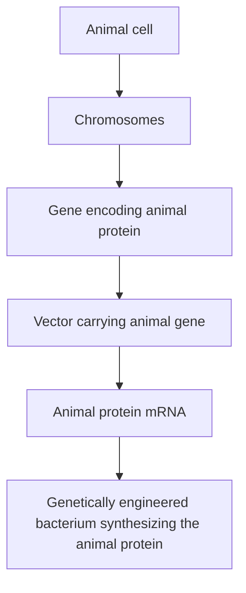
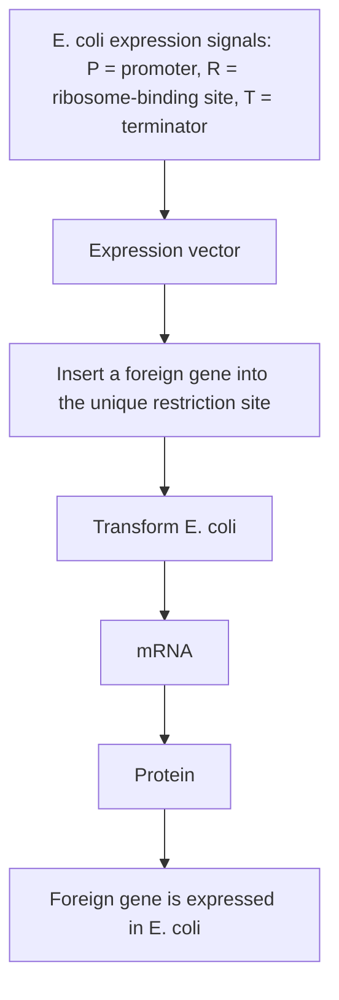
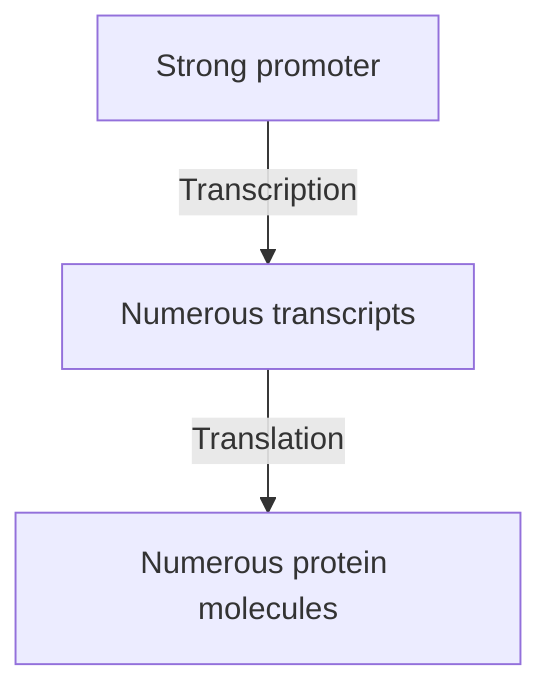
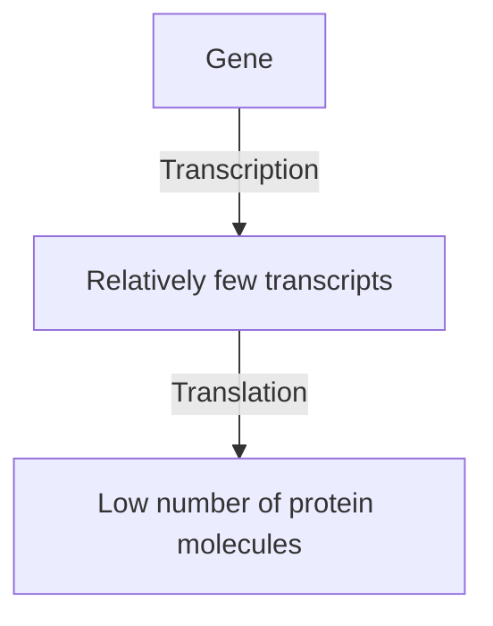
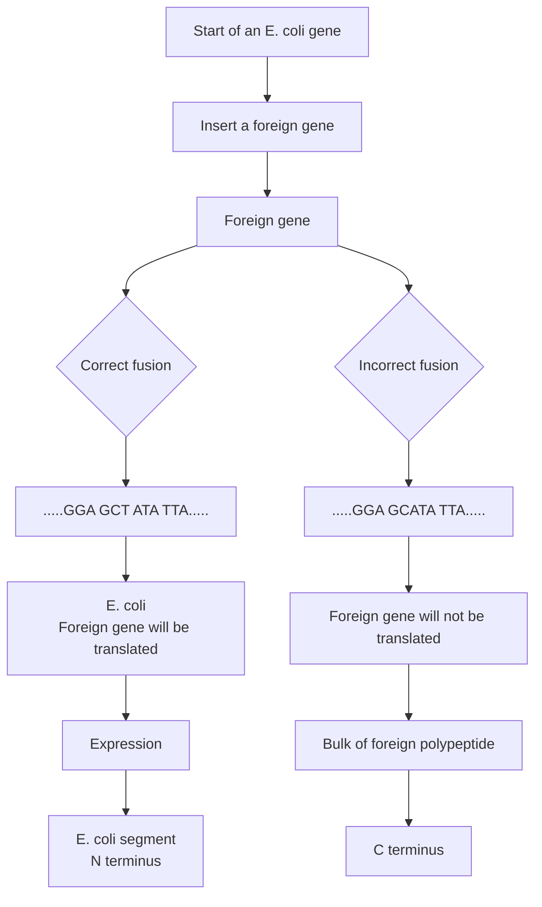
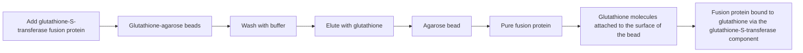
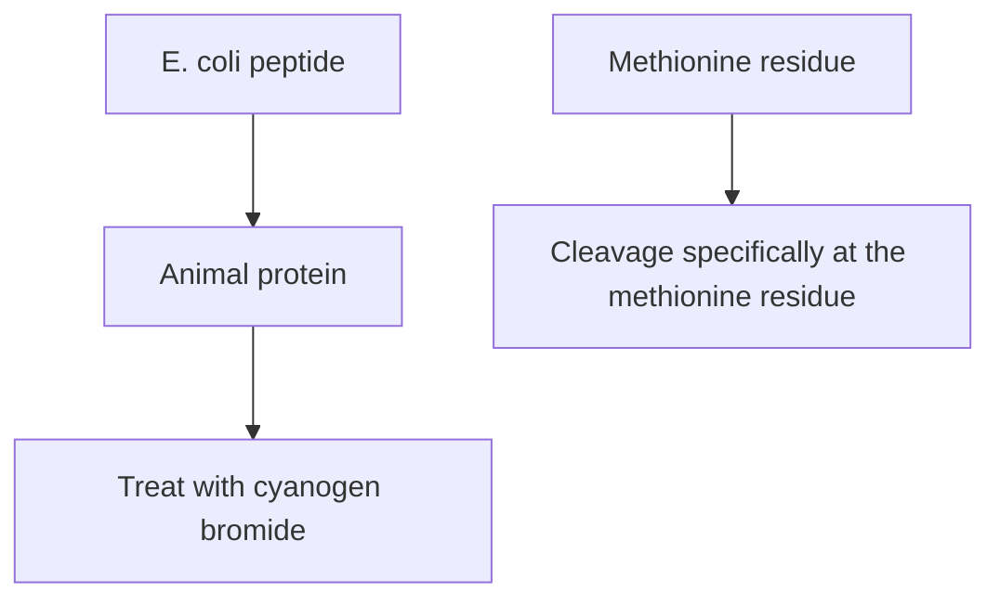
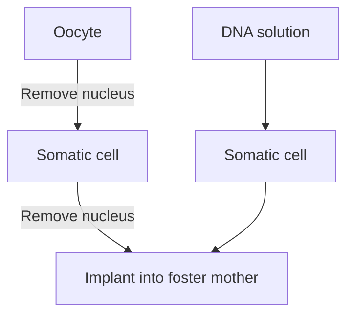
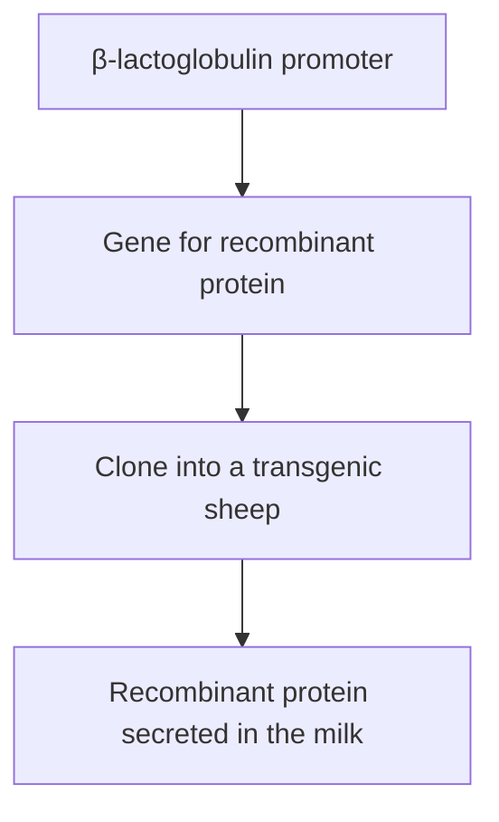

# Part III The Applications of Gene Cloning and DNA Analysis in Biotechnology / Chapter 14 Production of Protein from Cloned Genes

原始 PDF 第 295–318 页。

## Chapter 14

# Production of Protein from Cloned Genes

## Chapter contents

## CHAPTER CONTENTS

**14.1** Special vectors for expression of foreign genes in E. coli 280
**14.2** General problems with the production of recombinant protein in E. coli 287
**14.3** Production of recombinant protein by eukaryotic cells 290

Now that we have covered the basic techniques involved in gene cloning and DNA analysis and examined how these techniques are used in research, we can move on to consider how recombinant DNA technology is being applied in biotechnology. This is not a new subject, although biotechnology has received far more attention during recent years than it ever has in the past. Biotechnology can be defined as the use of biological processes in industry and technology. According to archaeologists, the British biotechnology industry dates back 4000 years, to the late Neolithic period, when fermentation processes that make use of living yeast cells to produce ale and mead were first introduced into this country. Certainly, brewing was well established by the time of the Roman invasion.

During the $2 0 ^ { \mathrm { t h } }$ century, biotechnology expanded with the development of a variety of industrial uses for microorganisms. The discovery by Alexander Fleming in 1929 that the mould Penicillium synthesizes a potent

Gene Cloning and DNA Analysis: An Introduction, Eighth Edition. T. A. Brown.

© 2021 John Wiley & Sons Ltd. Published 2021 by John Wiley & Sons Ltd.

277

---

278

Part III The Applications of Gene Cloning and DNA Analysis in Biotechnology

Figure 14.1

Two different systems for the growth of microorganisms.

(a) Batch culture.

(b) Continuous culture.

antibacterial agent led to the use of fungi and bacteria in the large‐scale production of antibiotics. At first the microorganisms were grown in large culture vessels from which the antibiotic was purified after the cells had been removed (Figure  14.1a), but this **batch culture** method has been largely supplanted by **continuous culture** techniques, making use of a **fermenter**, from which samples of medium can be continuously drawn off, providing a non‐stop supply of the product (Figure 14.1b). This type of process is not limited to antibiotic production and has also been used to obtain large amounts of other compounds produced by microorganisms (Table 14.1).

One of the reasons why biotechnology has received so much attention over the past three decades is because of gene cloning. Although many useful products can be obtained from microbial culture, the list in the past has been limited to those compounds naturally synthesized by microorganisms. Many important pharmaceuticals, which are produced not by microbes but by higher organisms, could not be obtained in this way. This has been changed by the application of gene cloning to biotechnology. The ability to clone genes means that a gene for an important animal or plant protein can now be taken from its normal host, inserted into a cloning vector, and introduced into a bacterium (Figure 14.2). If the manipulations are performed correctly the gene will be expressed and the **recombinant protein** synthesized by the bacterial cell. It may then be possible to obtain large amounts of the protein.

Of course, in practice the production of recombinant protein is not as easy as it sounds. Special types of cloning vector are needed, and satisfactory yields of recombinant protein are often difficult to obtain. In this chapter we will look at cloning vectors for recombinant protein synthesis and examine some of the problems associated with their use.

---

Chapter 14 Production of Protein from Cloned Genes

279

Table 14.1

Some of the compounds produced by industrial‐scale culture of microorganisms.

<table><tr><td>COMPOUND</td><td>MICROORGANISM</td></tr><tr><td colspan="2">Antibiotics</td></tr><tr><td>Cephalosporins</td><td>Cephalosporium spp.</td></tr><tr><td>Chloramphenicol, streptomycin</td><td>Streptomyces spp.</td></tr><tr><td>Gramicidins, polymixins</td><td>Bacillus spp.</td></tr><tr><td>Penicillins</td><td>Penicillium spp.</td></tr><tr><td colspan="2">Enzymes</td></tr><tr><td>Invertase</td><td>Saccharomyces cerevisiae</td></tr><tr><td>Proteases, amylases</td><td>Bacillus spp., Aspergillus spp.</td></tr><tr><td colspan="2">Other compounds</td></tr><tr><td>Acetone, butanol</td><td>Clostridium spp.</td></tr><tr><td>Alcohol</td><td>S. cerevisiae, Saccharomyces carlsbergensis</td></tr><tr><td>Butyric acid</td><td>Butyric acid bacteria</td></tr><tr><td>Citric acid</td><td>Aspergillus niger</td></tr><tr><td>Dextran</td><td>Leuconostoc spp.</td></tr><tr><td>Glycerol</td><td>S. cerevisiae</td></tr><tr><td>Vinegar</td><td>S. cerevisiae, acetic acid bacteria</td></tr></table>

flowchart

Figure 14.2

A possible scheme for the production of an animal protein by a bacterium.

---

280

Part III The Applications of Gene Cloning and DNA Analysis in Biotechnology

## 14.1 Special vectors for expression of foreign genes in E. coli

If a foreign (i.e. non‐bacterial) gene is simply ligated into a standard vector and cloned in E. coli, it is very unlikely that a significant amount of recombinant protein will be synthesized. This is because expression is dependent on the gene being surrounded by a collection of signals that can be recognized by the bacterium. These signals, which are short sequences of nucleotides, advertise the presence of the gene and provide instructions for the transcriptional and translational apparatus of the cell. The three most important signals for E. coli genes are as follows (Figure 14.3):

• The **promoter**, which marks the point at which transcription of the gene should start. In E. coli, the promoter is recognized by the σ subunit of the transcribing enzyme RNA polymerase.
• The **terminator**, which marks the point at the end of the gene where transcription should stop. A terminator is usually a nucleotide sequence that can base pair with itself to form a stem‐loop structure.
• The **ribosome‐binding site**, a short nucleotide sequence recognized by the ribosome as the point at which it should attach to the mRNA molecule. The initiation codon of the gene is always a few nucleotides downstream of this site.

The genes of higher organisms are also surrounded by expression signals, but their nucleotide sequences are not the same as the E. coli versions. This is illustrated by comparing the promoters of E. coli and animal genes (Figure 14.4). There are similarities, but it is unlikely that an E. coli RNA polymerase would be able to attach to an animal promoter. A foreign gene is inactive in E. coli, simply because the bacterium does not recognize its expression signals.

text_image

Promoter
Ribosome-binding site
Gene
Terminator
DNA
RNA transcript
Point at which a ribosome binds to the mRNA

Figure 14.3

The three most important signals for gene expression in E. coli.

A solution to this problem would be to insert the foreign gene into the vector in such a way that it is placed under control of a set of E. coli expression signals. If this can be achieved, then the gene should be transcribed and translated (Figure  14.5). Cloning vectors that provide these signals, and can therefore be used in the production of recombinant protein, are called **expression vectors**.

---

Chapter 14 Production of Protein from Cloned Genes

281

Figure 14.4

Typical promoter sequences for E. coli and animal genes.

## 14.1.1 The promoter is the critical component of an expression vector

The promoter is the most important component of an expression vector. This is because the promoter controls the very first stage of gene expression (attachment of an RNA polymerase enzyme to the DNA) and determines the rate at which mRNA is synthesized. The amount of recombinant protein obtained therefore depends to a great extent on the nature of the promoter carried by the expression vector.

## The promoter must be chosen with care

The two sequences shown in Figure 14.4a are consensus sequences, averages of all the E. coli promoter sequences that are known. Although most

flowchart

The use of an expression vector to achieve expression of a foreign gene in E. coli.

---

282

Part III The Applications of Gene Cloning and DNA Analysis in Biotechnology

(a) A strong promoter

flowchart

(b) A weak promoter

flowchart

Figure 14.6

Strong and weak promoters.

E. coli promoters do not differ much from these consensus sequences (e.g. TTTACA instead of TTGACA), a small variation may have a major effect on the efficiency with which the promoter can direct transcription. **Strong promoters** are those that can sustain a high rate of transcription, and usually control genes whose translation products are required in large amounts by the cell (Figure  14.6a). In contrast, **weak promoters**, which are relatively inefficient, direct transcription of genes whose products are needed in only small amounts (Figure 14.6b). Clearly an expression vector should carry a strong promoter, so that the cloned gene is transcribed at the highest possible rate.

A second factor to be considered when constructing an expression vector is whether it will be possible to regulate the promoter in any way. Two major types of gene regulation are recognized in E. coli – **induction** and **repression**. An inducible gene is one whose transcription is switched on by addition of a chemical to the growth medium. Often this chemical is one of the substrates for the enzyme coded by the inducible gene (Figure 14.7a). In contrast, a repressible gene is switched off by addition of the regulatory chemical (Figure 14.7b).

Gene regulation is a complex process that only indirectly involves the promoter itself. However, many of the sequences important for induction and repression lie in the region surrounding the promoter and are therefore also present in an expression vector. It may therefore be possible to extend the regulation to the expression vector, so that the chemical that induces or represses the gene normally controlled by the promoter is also able to regulate expression of the cloned gene. This can be a distinct advantage in the production of recombinant protein. For example, if the recombinant protein has a harmful effect on the bacterium, then its synthesis

---

Chapter 14 Production of Protein from Cloned Genes

283

Figure 14.7

Examples of the two major types of gene regulation that occur in bacteria. (a) An inducible gene.

(b) A repressible gene.

must be carefully monitored to prevent accumulation of toxic levels. This can be achieved by judicious use of the regulatory chemical to control expression of the cloned gene. Even if the recombinant protein has no harmful effects on the host cell, regulation of the cloned gene is still desirable, as a continuously high level of transcription may affect the ability of the recombinant plasmid to replicate, leading to its eventual loss from the culture.

## Examples of promoters used in expression vectors

Several E. coli promoters combine the desired features of strength and ease of regulation. Those most frequently used in expression vectors are as follows:

• The **lac promoter** (Figure 14.8a) is the sequence that controls transcription of the lacZ gene coding for β‐galactosidase (and also the lacZ′ gene fragment carried by the pUC and M13mp vectors; Section 5.2.2). The lac promoter is induced by isopropylthiogalactoside (IPTG), so addition of this chemical into the growth medium switches on transcription of a gene inserted downstream of the lac promoter carried by an expression vector.
• The **trp promoter** (Figure 14.8b) is normally upstream of the cluster of genes coding for several of the enzymes involved in biosynthesis of the amino acid tryptophan. The trp promoter is repressed by tryptophan but is more easily induced by 3‐β‐indoleacrylic acid.
• The **tac promoter** (Figure 14.8c) is a hybrid between the trp and lac promoters. It is stronger than either, but still induced by IPTG.
• The $\lambda P _ { _ { L } }$ **promoter** (Figure 14.8d) is one of the promoters responsible for transcription of the λ DNA molecule. $\lambda \mathrm { P _ { L } }$ is a very strong promoter

---

284

Part III The Applications of Gene Cloning and DNA Analysis in Biotechnology

Figure 14.8

Five promoters frequently used in expression vectors. The lac and trp promoters are shown upstream of the genes that they normally control in E. coli.

that is recognized by the E. coli RNA polymerase, which is subverted by λ into transcribing the bacteriophage DNA. The promoter is repressed by the product of the λcI gene. Expression vectors that carry the $\lambda \mathrm { P _ { L } }$ promoter are used with a mutant E. coli host that synthesizes a temperature‐sensitive form of the cI protein (Section 3.3.1). At a low temperature (less than $3 0 ^ { \circ } \mathrm { C } )$ this mutant cI protein is able to repress the $\lambda \mathrm { P _ { L } }$ promoter, but at higher temperatures the protein is inactivated, resulting in transcription of the cloned gene.

• The **T7 promoter** (Figure 14.8e) is specific for the RNA polymerase coded by T7 bacteriophage. This RNA polymerase is much more active than the E. coli RNA polymerase, which means that a gene inserted downstream of the T7 promoter will be expressed at a high level. The gene for the T7 RNA polymerase is not normally present in the E. coli genome, so a special strain of E. coli is needed, one which is lysogenic for T7 phage. Remember that a lysogen contains an inserted copy of the phage DNA in its genome (Section 2.2.2). In this particular strain of E. coli, the phage DNA has been altered by placing a copy of the lac promoter upstream of its gene for the T7 RNA polymerase. Addition of IPTG to the growth medium therefore switches on synthesis of the T7 RNA polymerase, which in turn leads to activation of the gene carried by the T7 expression vector.

---

Chapter 14 Production of Protein from Cloned Genes

285

flowchart

Figure 14.9

A typical cassette vector and the way it is used. P = promoter, R = ribosome binding site, T = terminator.

## 14.1.2 Cassettes and gene fusions

An efficient expression vector requires not only a strong, regulatable promoter, but also an E. coli ribosome binding sequence and a terminator. In most vectors these expression signals form a cassette, so called because the foreign gene is inserted into a single‐copy restriction site present in the middle of the expression signal cluster (Figure 14.9). Ligation of the foreign gene into the cassette therefore places it in the ideal position relative to the expression signals.

With some cassette vectors the cloning site is not immediately adjacent to the ribosome binding sequence, but instead is preceded by a segment from the beginning of an E. coli gene (Figure 14.10). Insertion of the foreign gene into this restriction site must be performed in such a way as to fuse the two reading frames, producing a hybrid gene that starts with the  E. coli segment and progresses without a break into the codons of

flowchart

Figure 14.10

The construction of a hybrid gene and the synthesis of a fusion protein.

---

286

Part III The Applications of Gene Cloning and DNA Analysis in Biotechnology

## Figure 14.11

A problem caused by secondary structure at the start of an mRNA.

text_image

Ribosome binding
site is obscured
Base-pairing
5'
3'

the foreign gene. The product of gene expression is therefore a hybrid or **fusion protein**, consisting of the short peptide coded by the E. coli reading frame fused to the amino‐terminus of the foreign protein. This fusion system has four advantages:

Efficient translation of the mRNA produced from the cloned gene depends not only on the presence of a ribosome‐binding site but is also affected by the nucleotide sequence at the start of the coding region. This is probably because secondary structures resulting from intrastrand base pairs could interfere with attachment of the ribosome to its binding site (Figure 14.11). This possibility is avoided if the pertinent region is made up entirely of natural E. coli sequences.
• The presence of the bacterial peptide at the start of the fusion protein may stabilize the molecule and prevent it from being degraded by the host cell. In contrast, foreign proteins that lack a bacterial segment are often destroyed by the host.
The bacterial segment may constitute a signal peptide, responsible for directing the E. coli protein to its correct position in the cell. If the signal peptide is derived from a protein that is exported by the cell (e.g. the products of the ompA or malE genes), the recombinant protein may itself be exported, either into the culture medium or into the periplasmic space between the inner and outer cell membranes. Export is desirable because it simplifies the problem of purification of the recombinant protein from the culture.
• The bacterial segment may also aid purification by enabling the fusion protein to be recovered by **affinity chromatography**. For example, fusions involving the E. coli glutathione‐S‐transferase protein can be purified by adsorption onto agarose beads carrying bound glutathione (Figure 14.12).

The disadvantage with a fusion system is that the presence of the E. coli segment may alter the properties of the recombinant protein. Methods for removing the bacterial segment are therefore needed. Usually this is achieved by treating the fusion protein with a chemical or enzyme that cleaves the polypeptide chain at or near the junction between the two components. For example, if a methionine is present at the junction, the fusion protein can be cleaved with cyanogen bromide, which cuts polypeptides specifically at methionine residues (Figure 14.13). Alternatively, enzymes such as thrombin (which cleaves adjacent to arginine residues) or factor Xa (which cuts after the arginine of Gly–Arg) can be used. The important consideration is that recognition sequences for the cleavage agent must not occur within the recombinant protein.

---

Chapter 14 Production of Protein from Cloned Genes

287

flowchart

Figure 14.12

The use of affinity chromatography to purify a glutathione‐S‐transferase fusion protein.

## 14.2 General problems with the production of recombinant protein in E. coli

Despite the development of sophisticated expression vectors, there are still numerous difficulties associated with the production of protein from foreign genes cloned in E. coli. These problems can be grouped into two categories: those that are due to the sequence of the foreign gene, and those that are due to the limitations of E. coli as a host for recombinant protein synthesis.

flowchart

Figure 14.13

One method for the recovery of the foreign polypeptide from a fusion protein. The methionine residue at the fusion junction must be the only one present in the entire polypeptide. If others are present cyanogen bromide will cleave the fusion protein into more than two fragments.

---

288

Part III The Applications of Gene Cloning and DNA Analysis in Biotechnology

## 14.2.1 Problems resulting from the sequence of the foreign gene

There are three ways in which the nucleotide sequence might prevent efficient expression of a foreign gene cloned in E. coli:

• The foreign gene might contain introns. This would be a major problem, as E. coli genes do not contain introns and therefore the bacterium does not possess the necessary machinery for removing introns from transcripts (Figure 14.14a).

## Figure 14.14

Three of the problems that could be encountered when foreign genes are expressed in E. coli. (a) Introns are not removed in E. coli. (b) Premature termination of transcription. (c) A problem with codon bias.

---

Chapter 14 Production of Protein from Cloned Genes

289

• The foreign gene might contain sequences that act as termination signals in E. coli (Figure 14.14b). These sequences are perfectly innocuous in the normal host cell, but in the bacterium result in premature termination and a loss of gene expression.
The codon bias of the gene may not be ideal for translation in E. coli. As described in Section 12.1.1, although virtually all organisms use the same genetic code, each organism has a bias toward preferred codons. This bias reflects the efficiency with which the tRNA molecules in the organism are able to recognize the different codons. If a cloned gene contains a high proportion of disfavoured codons, the E. coli tRNAs may encounter difficulties in translating the gene, reducing the amount of protein that is synthesized (Figure 14.14c).

These problems can usually be solved, although the necessary manipulations may be time‐consuming and costly (an important consideration in an industrial project). If the gene contains introns then its complementary DNA (cDNA), prepared from the mRNA (Section 8.3.1) and so lacking introns, might be used as an alternative. In vitro mutagenesis could then be employed to change the sequences of possible terminators and to replace disfavoured codons with those preferred by E. coli. An alternative if the gene not too long is to make an artificial version (Section 11.3.2). This involves synthesizing a set of overlapping oligonucleotides that are ligated together, the sequences of the oligonucleotides being designed to ensure that the resulting gene contains preferred E. coli codons and that terminators are absent.

## 14.2.2 Problems caused by E. coli

Some of the difficulties encountered when using E. coli as the host for recombinant protein synthesis stem from inherent properties of the bacterium. For example:

E. coli might not process the recombinant protein correctly. The proteins of most organisms are processed after translation, by chemical modification of amino acids within the polypeptide. Often these processing events are essential for the correct biological activity of the protein. Unfortunately, the proteins of bacteria and higher organisms are not processed identically. In particular, some animal proteins are glycosylated, meaning that they have chains of sugar groups, called glycans, attached to them after translation. Glycosylation is extremely uncommon in bacteria and recombinant proteins synthesized in E. coli are never glycosylated correctly.
E. coli might not fold the recombinant protein correctly, and generally is unable to synthesize the disulphide bonds present in many animal proteins. If the protein does not take up its correctly folded tertiary structure, then usually it is insoluble and forms an **inclusion body** within the bacterium (Figure 14.15). Recovery of the protein from the inclusion body is not a problem but converting the protein into its correctly folded form can be difficult or impossible in the test tube. Under these circumstances the protein is, of course, inactive.

---

290

Part III The Applications of Gene Cloning and DNA Analysis in Biotechnology

Figure 14.15 Inclusion bodies.

text_image

E. coli cell
Inclusion body
Nucleoid

• E. coli might degrade the recombinant protein. Exactly how E. coli can recognize the foreign protein, and thereby subject it to preferential turnover, is not known.

These problems are less easy to solve than the sequence problems described in the previous section but can be alleviated to a certain extent by using special E. coli strains.

Degradation of recombinant proteins can be reduced by using a mutant E. coli strain that is deficient in one or more of the proteases responsible for protein degradation. Correct folding of recombinant proteins can also be promoted by choosing a special host strain, in this case one that oversynthesizes the chaperone proteins thought to be responsible for protein folding in the cell. But the main drawback is the absence of glycosylation. Attempts have been made to solve this problem with E. coli strains that contain cloned genes for enzymes that carry out glycosylation in other organisms. These include Campylobacter jejuni, one of the few bacteria that has any glycosylation activity. Although initial results with these glycosylation‐competent E. coli strains have been promising, it will be some time before they can be used routinely for the production of recombinant protein.

## 14.3 Production of recombinant protein by eukaryotic cells

The problems associated with obtaining high yields of active recombinant proteins from genes cloned in E. coli have led to the development of expression systems for other organisms. There have been a few attempts to use other bacteria as the hosts for recombinant protein synthesis, and some progress has been made with Lactococcus lactis and with Bacillus and Pseudomonas species, but the main alternatives to E. coli are microbial eukaryotes. The argument is that a microbial eukaryote, such as a yeast or filamentous fungus, is more closely related to an animal, and so may be able to deal with recombinant protein synthesis more efficiently than E. coli. Yeasts and fungi can be grown just as easily as bacteria in continuous

---

Chapter 14 Production of Protein from Cloned Genes

291

culture and might express a cloned gene from a higher organism, and process the resulting protein, in a manner more akin to that occurring in the higher organism itself.

## 14.3.1 Recombinant protein from yeast and filamentous fungi

To a large extent the potential of microbial eukaryotes has been realized and these organisms are now being used for the routine production of several animal proteins. Expression vectors are still required because it turns out that the promoters and other expression signals for animal genes do not, in general, work efficiently in these lower eukaryotes. The vectors themselves are based on those described in Section 7.1.

Saccharomyces cerevisiae as the host for recombinant protein synthesis The yeast Saccharomyces cerevisiae is currently the most popular microbial eukaryote for recombinant protein production. Cloned genes are often placed under the control of the GAL10 promoter (Figure 14.16), which is normally upstream of the gene for UDP‐galactose epimerase, an enzyme involved in the metabolism of galactose. The GAL10 promoter is induced by galactose, providing a straightforward system for regulating expression of a cloned foreign gene. Other useful promoters are PHO5, which is regulated by the phosphate level in the growth medium, and CUP1, which is induced by copper. Most yeast expression vectors also carry a termination sequence from an S. cerevisiae gene, because animal termination signals do not work effectively in yeast.

Yields of recombinant protein are relatively high, but the use of S. cerevisiae does not fully solve the glycosylation problem. The organism is capable of carrying out glycosylation, but the glycans that it makes do not have the same structure as those found on human proteins. One problem is that yeast glycans are hyperglycosylated – they contain many more sugar units than a mammalian glycan (Figure 14.17). This is a critical problem as a hyperglycosylated protein is likely to be recognized as foreign if injected into an animal and will therefore cause an immunogenic reaction. This problem has stimulated extensive research into the biochemistry and genetics of the glycosylation pathways in S. cerevisiae, and the resulting information has been used to create mutant strains that lack the enzymes responsible for hyperglycosylation, and hence make glycans that more closely resemble the mammalian versions. Further fine‐tuning of glycan structure has been achieved by cloning human genes, specifying the enzymes responsible for the final steps of the mammalian glycosylation pathway, into yeast.

Despite these drawbacks, S. cerevisiae remains the most frequently used microbial eukaryote for recombinant protein synthesis. This is partly

flowchart

Figure 14.16

The GAL10 promoter.

---

292

Part III The Applications of Gene Cloning and DNA Analysis in Biotechnology

chemical

Diagram showing Asn- and S. cerevisiae genetic structures with sugar binding sites

Figure 14.17

Comparison between a typical glycosylation structure found on an animal protein and the hyperglycosylated structure synthesized by S. cerevisiae.

because S. cerevisiae is accepted as a safe organism for production of proteins for use in medicines or in foods, and partly because of the wealth of knowledge built up over the years regarding the biochemistry and genetics of S. cerevisiae, which means that it is relatively easy to devise strategies for minimizing those difficulties that arise.

## Other yeasts and fungi

Although S. cerevisiae retains the loyalty of many molecular biologists, there are other microbial eukaryotes that might be equally if not more effective in recombinant protein synthesis. In particular, Pichia pastoris, a second species of yeast, is able to synthesize large amounts of recombinant protein, up to 30% of the total cell protein under ideal conditions. As with S. cerevisiae, the glycosylation process in P. pastoris is dissimilar to that in mammalian cells, but again this is being addressed with mutant strains and ones that contain cloned genes for mammalian glycosylation enzymes. Expression vectors for P. pastoris make use of the alcohol oxidase (AOX) promoter (Figure 14.18a), which is induced by methanol. The only significant problem with P. pastoris is that it sometimes degrades recombinant proteins before they can be purified, but this can be controlled by using special growth media. Other yeasts that have been used for recombinant protein synthesis include Hansenula polymorpha, Yarrowia lipolytica, and Kluveromyces lactis. The last of these has the attraction that it can be grown on waste products from the food industry.

A general problem with the use of yeast species for recombinant protein production is that most of these organisms lack an efficient system for secreting proteins into the growth medium. In the absence of secretion, recombinant proteins are retained in the cell and consequently are less easy to purify. This has led to interest in the filamentous fungi, as many of these have strong natural secretory properties. The most popular filamentous fungi for recombinant protein production are the Aspergillus species and  the wood‐rot fungus Trichoderma reesei. Expression vectors for

---

Chapter 14 Production of Protein from Cloned Genes

293

Figure 14.18

Three promoters frequently used in expression factors for microbial eukaryotes.

A.  nidulans usually carry the glucoamylase promoter (Figure  14.18b), induced by starch and repressed by xylose. Those for T. reesei make use of  the cellobiohydrolase promoter (Figure  14.18c), which is induced by cellulose.

## 14.3.2 Using animal cells for recombinant protein production

The difficulties inherent in synthesis of a fully active animal protein in a microbial host have prompted biotechnologists to explore the possibility of using animal cells for recombinant protein synthesis. For proteins with complex and essential glycosylation structures, an animal cell might be the only type of host within which the active protein can be synthesized.

## Protein production in mammalian cells

Culture systems for animal cells have been around since the early 1960s, but only during the past 25 years have methods for large‐scale continuous culture become available. A problem with some animal cell lines is that they require a solid surface on which to grow, adding complications to the design of the culture vessels. One solution is to fill the inside of the vessel with plates, providing a large surface area, but this has the disadvantage that complete and continuous mixing of the medium within the vessel becomes very difficult. A second possibility is to use a standard vessel but to provide the cells with small inert particles (e.g. cellulose beads) on which to grow. However, these issues are becoming less important as suspensionadapted versions of the most popular mammalian cell lines have been developed. The biochemical and physiological changes underlying this adaptation have not been fully identified but appear to involve changes in cell‐to‐cell signalling pathways and production of extracellular proteins that hold the nonadapted cells together when they grow as a tissue. The adapted cells are able to grow in suspension without solid supports. Rates of growth and maximum cell densities are much less than can be achieved with microorganisms, limiting the yield of recombinant protein, but this

---

294

Part III The Applications of Gene Cloning and DNA Analysis in Biotechnology

can be tolerated if a mammalian cell line is the only way of obtaining the active protein.

Of course, gene cloning may not be necessary in order to obtain an animal protein from an animal cell culture. Nevertheless, expression vectors and cloned genes are still used to maximize yields, by placing the gene under control of a promoter that is stronger than the one to which it is normally attached. This promoter is often obtained from viruses such as SV40 (Section  7.3.2), cytomegalovirus (CMV), or Rous sarcoma virus (RSV). Mammalian cell lines derived from humans or hamsters have been used in synthesis of several recombinant proteins, and in most cases these proteins have been processed correctly and are indistinguishable from the non‐recombinant versions. However, this is the most expensive approach to recombinant protein production, especially as the possible co‐purification of viruses with the protein means that rigorous quality control procedures must be employed to ensure that the product is safe.

## Protein production in insect cells

Insect cells provide an alternative to mammalian cells for animal protein production. Insect cells do not behave in culture any differently to mammalian cells, but they have the great advantage that, thanks to a natural expression system, they can provide high yields of recombinant protein.

The expression system is based on the **baculoviruses**, a group of viruses that are common in insects but do not normally infect vertebrates. The baculovirus genome includes the polyhedrin gene, whose product accumulates in the insect cell as large nuclear inclusion bodies toward the end of the infection cycle (Figure  14.19). The product of this single gene frequently makes up over 50% of the total cell protein. Similar levels of protein production also occur if the polyhedrin gene is replaced by one for a recombinant protein. Baculovirus vectors have been successfully used in production of a number of mammalian proteins, but unfortunately the resulting proteins are not glycosylated correctly. In this regard the baculovirus system does not offer any advantages compared with S. cerevisiae or P. pastoris. However, the deficiencies in the insect glycosylation process can be circumvented by using a modified baculovirus that carries a mammalian promoter to express genes directly in mammalian cells. The infection is not **productive**, meaning that the virus genome is unable to replicate, but genes cloned into one of the **BacMam** vectors, as they are called, are maintained stably in mammalian cells for enough time for expression to

Figure 14.19

Crystalline inclusion bodies in the nuclei of insect cells infected with a baculovirus.

text_image

Cytoplasm
Nuclear
membrane
Inclusion
bodies

---

Chapter 14 Production of Protein from Cloned Genes

295

occur. This expression is accompanied by the mammalian cell’s own posttranslational processing activities, so the recombinant protein is correctly glycosylated and therefore should be fully active.

Of course, in nature baculoviruses infect living insects, not cell cultures. For example, one of the most popular baculoviruses used in cloning is the Bombyx mori nucleopolyhedrovirus (BmNPV), which is a natural pathogen of the silkworm. There is a huge conventional industry based on the culturing of silkworms for silk production, and this expertise is now being harnessed for production of recombinant proteins, using expression vectors based on the BmNPV genome. As well as being an easy and cheap means of obtaining proteins, silkworms have the additional advantage of not being infected by viruses that are pathogenic to humans. The possibility that dangerous viruses are co‐purified with the recombinant protein is therefore avoided.

## 14.3.3 Pharming – recombinant protein from live animals and plants

The use of silkworms for recombinant protein production is an example of the process often referred to as **pharming**, where a **transgenic** organism acts as the host for protein synthesis. Pharming is a recent and controversial innovation in gene cloning.

## Pharming in animals

A transgenic animal is one that contains a cloned gene in all of its cells. Knockout mice (Section 12.2.2), used to study the function of human and other mammalian genes, are examples of transgenic animals. With mice, a transgenic animal can be produced by microinjection of the gene to be cloned into a fertilized egg cell (Section  5.4.2). Although this technique works well with mice, injection of fertilized cells is inefficient or impossible with many other mammals, and generation of transgenic animals for recombinant protein production usually involves a more sophisticated procedure called **nuclear transfer** (Figure 14.20). This involves microinjection of the

flowchart

Figure 14.20

Transfer of the nucleus from a transgenic somatic cell to an oocyte.

---

296

Part III The Applications of Gene Cloning and DNA Analysis in Biotechnology

Figure 14.21

Recombinant protein production in the milk of a transgenic sheep.

flowchart

recombinant protein gene into a somatic cell, which is a more efficient process than injection into a fertilized egg. Because the somatic cell will not itself differentiate into an animal, its nucleus, after microinjection, must be transferred to an oocyte whose own nucleus has been removed. After implantation into a foster mother, the engineered cell retains the ability of the original oocyte to divide and differentiate into an animal, one that will contain the transgene in every cell. This is a lengthy procedure and transgenic animals are therefore expensive to produce, but the technology is cost‐effective because once a transgenic animal has been made it can reproduce and pass its cloned gene to its offspring according to standard Mendelian principles.

Although proteins have been produced in the blood of transgenic animals, and in the eggs of transgenic chickens, the most successful approach has been to use farm animals such as sheep or pigs, with the cloned gene attached to the promoter for the animal’s β‐lactoglobulin gene. This promoter is active in the mammary tissue, which means that the recombinant protein is secreted in the milk (Figure 14.21). Milk production can be continuous during the animal’s adult life, resulting in a high yield of the protein. For example, the average cow produces some 8000 litres of milk per year, yielding 40–80 kg of protein. Because the protein is secreted, purification is relatively easy. Most importantly, sheep and pigs are mammals and so human proteins produced in this way are correctly modified. Production of pharmaceutical proteins in farm animals therefore offers considerable promise for synthesis of correctly modified human proteins for use in medicine.

## Recombinant proteins from plants

Plants provide the final possibility for production of recombinant protein. Plants and animals have similar protein processing activities, although there are slight differences in the glycosylation pathways. Plant cell culture is a well‐established technology that is already used in the commercial synthesis of natural plant products. Alternatively, intact plants can be grown to a high density in fields. The latter approach to recombinant protein production has been used with a variety of crops, such as maize, tobacco, rice, and sugarcane. One possibility is to place the transgene next

---

Chapter 14 Production of Protein from Cloned Genes

297

to the promoter of a seed‐specific gene such as β‐phaseolin, which codes for the main seed protein of the bean Phaseolus vulgaris. The recombinant protein is therefore synthesized specifically in the seeds, which naturally accumulate large quantities of proteins and are easy to harvest and to process. Recombinant proteins have also been synthesized in the leaves of tobacco and alfalfa and the tubers of potatoes. In all of these cases, the protein has to be purified from the complex biochemical mixture that is produced when the seeds, leaves, or tubers are crushed.

One way of avoiding this problem is to express the recombinant protein as a fusion with a signal peptide that directs secretion of the protein by the roots. Although this requires the plants to be grown in hydroponic systems rather than in fields, the decrease in yield is at least partly offset by the low cost of purification. One promising system involves infection of the transgenic plant with Rhizobium rhizogenes, a soil bacterium that is closely related to Agrobacterium tumefaciens (Section  7.2.1) and until recently was called Agrobacterium rhizogenes. Infection with R. rhizogenes results in hairy root disease, typified by a massive proliferation of a highly branched root system that can be grown at high density in liquid culture, increasing significantly the yield of a recombinant protein that is being secreted by the roots of a transgenic plant.

Whichever production system is used, plants offer a cheap and low‐technology means of mass production of recombinant proteins. A range of proteins have been produced in experimental systems, including important pharmaceuticals such as interleukins and antibodies. This is an area of intensive research at the present time, with a number of plant biotechnology companies developing systems that have reached or are nearing commercial production. One very promising possibility is that plants could be used to synthesize vaccines, providing the basis to a cheap and efficient vaccination program (Section 15.1.5).

## Ethical concerns raised by pharming

With our discussion of pharming we have entered one of the areas of gene cloning that causes concern among the public. No student of gene cloning and DNA analysis should ignore the controversies raised by the genetic manipulation of animals and plants but, equally, no textbook on the subject should attempt to teach the ‘correct’ response to these ethical concerns. You must make up your own mind on such matters.

With transgenic animals, one of the fears is that the procedures used might cause suffering. These concerns do not centre on the recombinant protein, but on the manipulations that result in production of the transgenic animal. Animals produced by nuclear transfer suffer a relatively high frequency of birth defects, and some of those that survive do not synthesize the required protein adequately, meaning that this type of pharming is accompanied by a high ‘wastage’. Even the healthy animals appear to suffer from premature aging, as was illustrated most famously by ‘Dolly the sheep’ who, although not transgenic, was the first animal to be produced by nuclear transfer. Most sheep of her breed live for up to 12 years, but Dolly developed arthritis at the age of 5 years and was euthanized one year later because she was found to be suffering from terminal lung disease,

---

298

Part III The Applications of Gene Cloning and DNA Analysis in Biotechnology

which is normally found only in old sheep. It has been speculated that this premature aging was related to the age of the somatic cell whose nucleus gave rise to Dolly, as this cell came from a six‐year‐old sheep and so Dolly was effectively aged six when she was born. Although the technology has moved on dramatically since Dolly was born in 1997, the welfare issues regarding transgenic animals have not been resolved, and the broader issues concerning the use of nuclear transfer to clone animals (i.e. to produce identical offspring, rather than to clone individual genes) remain at the forefront of public awareness.

Pharming in plants raises a completely different set of ethical concerns, relating in part to the impact that genetically manipulated (GM) crops might have on human health and the environment. These concerns apply to all GM crops, not just those used for pharming, and we will return to them in Section 16.4 after we have examined the more general uses of gene cloning in agriculture.

## Further reading

- Ahmad, M., Hirz, M., Pichler, H., and Schwab, H. (2014) Protein expression in Pichia pastoris: recent achievements and perspectives for heterologous protein production. Applied Microbiology and Biotechnology, 98, 5301–5317.
- Çelik, E. and Çalik, P. (2012) Production of recombinant proteins by yeast cells. Biotechnology Advances, 30, 1108–1118.
- Chen, R. (2012) Bacterial expression systems for recombinant protein production: E. coli and beyond. Biotechnology Advances, 30, 1102–1107. [Includes information on recombinant production in bacteria other than E. coli.]
- de Boer, H.A., Comstock, L.J., and Vasser, M. (1983) The tac promoter: a functional hybrid derived from the trp and lac promoters. Proceedings of the National Academy of Sciences of the USA, 80, 21–25.
- Drugmand, J.‐C., Schneider, Y.‐J., and Agathos, S.N. (2012) Insect cells as factories for biomanufacturing. Biotechnology Advances, 30, 1140–1157.
- Egelkrout, E., Rajan, V., and Howard, J.A. (2012) Overproduction of recombinant proteins in plants. Plant Science, 184, 83–101.
- Gomes, A.M.V., Carmo, T.S., Carvalho, L.S., et al. (2018) Comparison of yeasts as hosts for recombinant protein production. Microorganisms, 6, 38.
- Guillon, S., Trémouillaux‐Guiller, J., Pati, P.K., et al. (2006) Hairy root research: recent scenario and exciting prospects. Current Opinion in Plant Biology, 9, 341–346. [Applications of Rhizobium rhizogenes in biotechnology.]

---

Chapter 14 Production of Protein from Cloned Genes

299

- Houdebine, L.‐M. (2009) Production of pharmaceutical proteins by transgenic animals. Comparative Immunology, Microbiology and Infectious Diseases, 32, 107–121.
- Huang, C.‐J., Lin, H., and Yang, X. (2012) Industrial production of recombinant therapeutics in Escherichia coli and its recent advancements. Journal of Industrial Microbiology and Biotechnology, 39, 383–399.
- Hunter, M., Yuan, P., Vavilala, D., and Fox, M. (2018) Optimization of protein expression in mammalian cells. Current Protocols in Protein Science, 95, e77.
- Kost, T.A., Condreay, J.P., and Jarvis, D.L. (2005) Baculovirus as versatile vectors for protein expression in insect and mammalian cells. Nature Biotechnology, 23, 567–575.
- Nevalainen, H. and Peterson, R. (2014) Making recombinant proteins in filamentous fungi – are we expecting too much? Frontiers in Microbiology, 5, 75.
- Remaut, E., Stanssens, P., and Fiers, W. (1981) Plasmid vectors for high‐efficiency expression controlled by the P promoter of coliphage. Gene, 15, 81–93. [Construction of an expression vector.]
- Rosano, G.L. and Ceccarelli, E.A. (2014) Recombinant protein expression in Escherichia coli: advances and challenges. Frontiers in Microbiology, 5, 172.
- Schillberg, S., Raven, N., Spiegel, H., et al. (2019) Critical analysis of the commercial potential of plants for the production of recombinant proteins. Frontiers in Plant Science, 10, 720.
- Ward, O.P. (2012) Production of recombinant proteins by filamentous fungi. Biotechnology Advances, 30, 1119–1139.
- Wildt, S. and Gerngross, T.U. (2005) The humanization of N‐glycosylation pathways in yeast. Nature Reviews Microbiology, 3, 119–128.
- Wilmut, I., Schnieke, A.E., McWhir, J., et al. (1997) Viable offspring derived from fetal and adult mammalian cells. Nature, 385, 810–813. [The method used to produce Dolly the sheep.]
- Xu, J., Dolan, M., Medrano, G., et al. (2012) Green factory: plants as bioproduction platforms for recombinant proteins. Biotechnology Advances, 30, 1171–1184.
- Yang, Z. and Zhang, Z. (2018) Engineering strategies for enhanced production of protein and bio‐products in Pichia pastoris: a review. Biotechnology Advances, 36, 182–195.
- Zhu, J. (2012) Mammalian cell protein expression for biopharmaceutical production. Biotechnology Advances, 30, 1158–1170.

---

