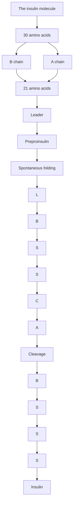
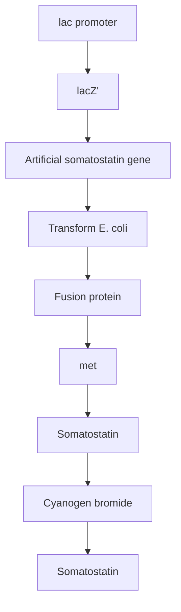
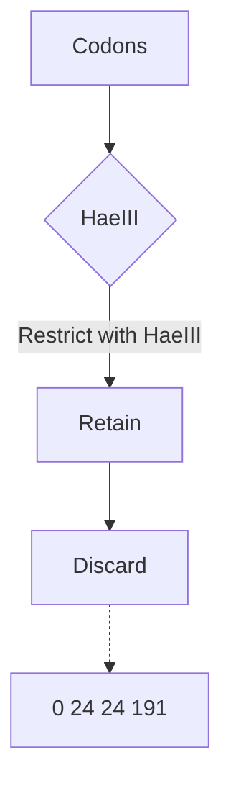
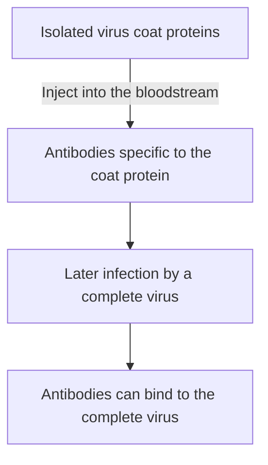
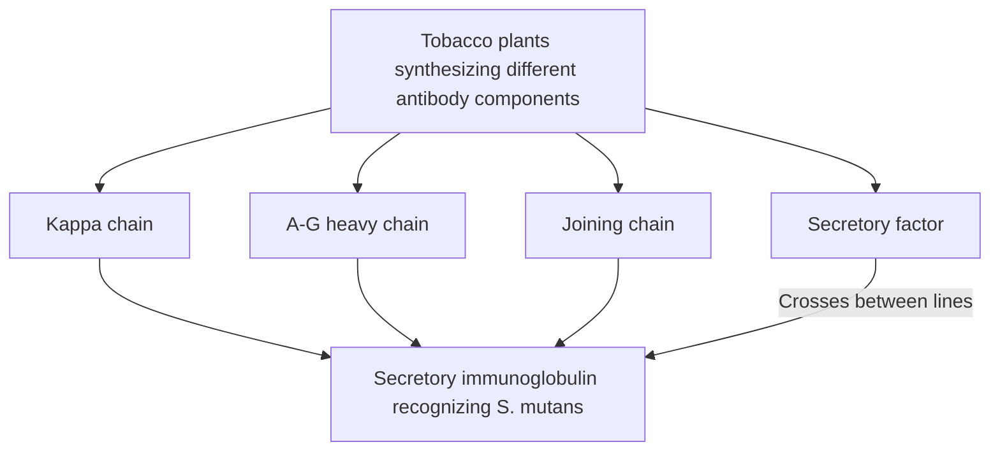
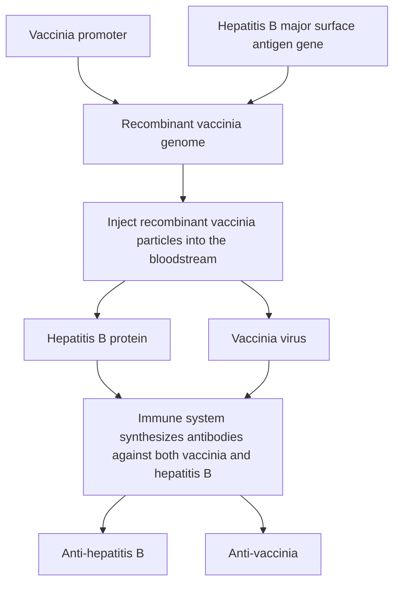
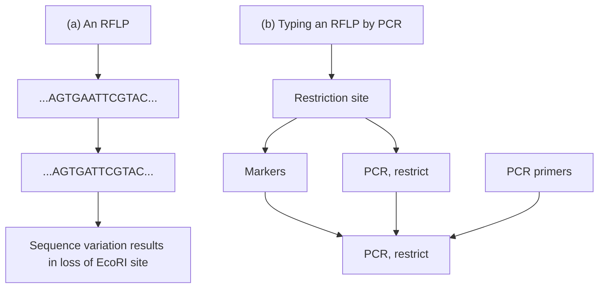
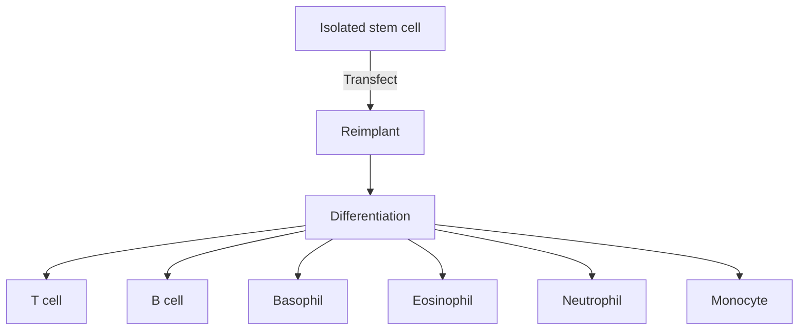
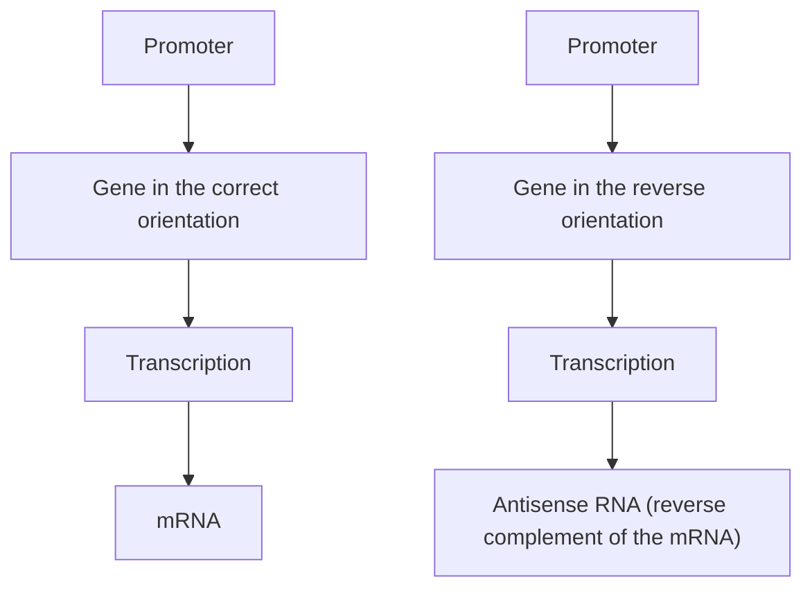
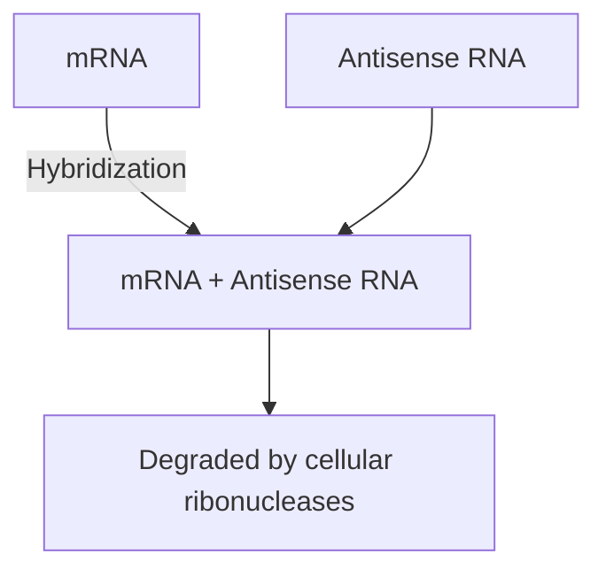

# Part III The Applications of Gene Cloning and DNA Analysis in Biotechnology / Chapter 15 Gene Cloning and DNA Analysis in Medicine

原始 PDF 第 319–344 页。

## Chapter 15

# Gene Cloning and DNA Analysis in Medicine

## Chapter contents

**15.1** Production of recombinant pharmaceuticals 301
**15.2** Identification of genes responsible for human diseases 314
**15.3** Gene therapy 321

Medicine has been and will continue to be a major beneficiary of the recombinant DNA revolution, and an entire book could be written on this topic. Later in this chapter, we will see how recombinant DNA techniques are being used to identify genes responsible for inherited diseases and to devise new therapies for these disorders. First, we will continue the theme developed in the last chapter and examine the ways in which cloned genes are being used in the production of recombinant pharmaceuticals.

## 15.1 Production of recombinant pharmaceuticals

A number of human disorders can be traced to the absence or malfunction of a protein normally synthesized in the body. Most of these disorders can be treated by supplying the patient with the correct version of the protein, but for this to be possible the relevant protein must be available in relatively large amounts. If the defect can be corrected only by administering

Gene Cloning and DNA Analysis: An Introduction, Eighth Edition. T. A. Brown.

© 2021 John Wiley & Sons Ltd. Published 2021 by John Wiley & Sons Ltd.

301

---

302

Part III The Applications of Gene Cloning and DNA Analysis in Biotechnology

the human protein, then obtaining sufficient quantities will be a major problem unless donated blood can be used as the source. Animal proteins are therefore used whenever these are effective, but there are not many disorders that can be treated with animal proteins, and there is always the possibility of side effects such as an immunogenic response.

We learned in Chapter 14 that gene cloning can be used to obtain large amounts of recombinant human proteins. How are these techniques being applied to the production of proteins for use as pharmaceuticals?

## 15.1.1 Recombinant insulin

Insulin, synthesized by the β‐cells of the islets of Langerhans in the pancreas, controls the level of glucose in the blood. An insulin deficiency manifests itself as diabetes mellitus, a complex of symptoms which may lead to death if untreated. Fortunately, many forms of diabetes can be alleviated by a continuing program of insulin injections, thereby supplementing the limited amount of hormone synthesized by the patient’s pancreas. The insulin used in this treatment was originally obtained from the pancreas of pigs and cows slaughtered for meat production. Although animal insulin is generally satisfactory, problems may arise in its use to treat human diabetes. One problem is that the slight differences between the animal and the human proteins can lead to side effects in some patients. Another is that the purification procedures are difficult, and potentially dangerous contaminants cannot always be completely removed.

Insulin displays two features that facilitate its production by recombinant DNA techniques. The first is that the human protein is not modified after translation by glycosylation, which means that recombinant insulin synthesized by a bacterium should be active. The second advantage concerns the size of the molecule. Insulin is a relatively small protein, comprising two polypeptides, one of 21 amino acids (the A chain) and one of 30 amino acids (the B chain; Figure 15.1). In humans these chains are synthesized as a precursor called preproinsulin, which contains the A and B segments linked by a third chain (C) and preceded by a leader sequence. The leader sequence is removed after translation and the C chain excised, leaving the A and B polypeptides linked to each other by two disulphide bonds.

Several strategies have been used to obtain recombinant insulin. One of the first projects, involving synthesis of artificial genes for the A and B chains followed by production of fusion proteins in E. coli, illustrates a number of the general techniques used in recombinant protein production.

## Synthesis and expression of artificial insulin genes

In the late 1970s, the idea of making an artificial gene was extremely innovative. Oligonucleotide synthesis was in its infancy at that time, and  the available methods for making artificial DNA molecules were much  more cumbersome than the present‐day automated techniques. Nevertheless, genes coding for the A and B chains of insulin were synthesized as early as 1978.

The procedure used was to synthesize trinucleotides representing all the possible codons and then join these together in the order dictated by the

---

Chapter 15 Gene Cloning and DNA Analysis in Medicine

303


<details>
<summary>flowchart</summary>


</details>

Figure 15.1

The structure of the insulin molecule and a summary of its synthesis by processing from preproinsulin.

amino acid sequences of the A and B chains. The artificial genes would not necessarily have the same nucleotide sequences as the real gene segments coding for the A and B chains, but they would still specify the correct polypeptides. Two recombinant plasmids were constructed, one carrying the artificial gene for the A chain, and one the gene for the B chain.

In each case the artificial gene was ligated to a lacZ′ reading frame pre-sent in a pBR322‐type vector (Figure 15.2a). The insulin genes were therefore under the control of the strong lac promoter (Section  14.1.1), and were expressed as fusion proteins, consisting of the first few amino acids of β‐galactosidase followed by the A or B polypeptides (Figure  15.2b). Each gene was designed so that its β‐galactosidase and insulin segments were separated by a methionine residue, so that the insulin polypeptides could be cleaved from the β‐galactosidase segments by treatment with cyanogen bromide (Section 14.1.2). The purified A and B chains were then attached to each other by disulphide bond formation in the test tube.

The final step, involving disulphide bond formation, is actually rather  inefficient. A subsequent improvement was to synthesize not the individual  A and B genes, but the entire proinsulin reading frame,

---

304

Part III The Applications of Gene Cloning and DNA Analysis in Biotechnology

Figure 15.2

The synthesis of recombinant insulin from artificial A and B chain genes.


specifying B chain–C chain–A chain (see Figure 15.1). Although this is a more daunting proposition in terms of DNA synthesis, the prohormone has the big advantage of folding spontaneously into the correct disulphidebonded structure. The C chain segment can then be excised relatively easily by proteolytic cleavage.

## 15.1.2 Synthesis of human growth hormones in E. coli

At about the same time that recombinant insulin was first being made in E. coli, other researchers were working on similar projects with the human growth hormones somatostatin and somatotrophin. These two proteins act in conjunction to control growth processes in the human body, their malfunction leading to painful and disabling disorders such as acromegaly (uncontrolled bone growth) and dwarfism.

Somatostatin was the first human protein to be synthesized in E. coli. Being a very short protein, only 14 amino acids in length, it was ideally

---

Chapter 15 Gene Cloning and DNA Analysis in Medicine

305


<details>
<summary>flowchart</summary>


</details>

Figure 15.3

Production of recombinant somatostatin.

suited for artificial gene synthesis. The strategy used was the same as described for recombinant insulin, involving insertion of the artificial gene into a lacZ′ vector (Figure 15.3), synthesis of a fusion protein, and cleavage with cyanogen bromide.

Somatotrophin presented a more difficult problem. This protein is 191 amino acids in length, equivalent to almost 600 bp of DNA, an impossible prospect for the DNA synthesis capabilities of the late 1970s. Instead, a combination of artificial gene synthesis and complementary DNA (cDNA) cloning was used to obtain a somatotrophin‐producing E. coli strain. Messenger RNA was obtained from the pituitary, the gland that produces somatotrophin in the human body, and a cDNA library prepared. The somatotrophin cDNA contained a single site for the restriction endonuclease HaeIII, which therefore cuts the cDNA into two segments (Figure 15.4a). The longer segment, consisting of codons 24–191, was retained for use in construction of the recombinant plasmid. The smaller segment was replaced by an artificial DNA molecule that reproduced the start of the somatotrophin gene and provided the correct signals for translation in E. coli (Figure 15.4b). The modified gene was then ligated into an expression vector carrying the lac promoter.

## 15.1.3 Recombinant factor VIII

Although a number of important pharmaceutical compounds have been obtained from genes cloned in E. coli, the general problems associated with using bacteria to synthesize foreign proteins (Section 14.2) have led in many cases to these organisms being replaced by eukaryotes. An example of a recombinant pharmaceutical produced in eukaryotic cells is human factor VIII, a protein that plays a central role in blood clotting. The commonest form of haemophilia in humans results from an inability to

---

306

Part III The Applications of Gene Cloning and DNA Analysis in Biotechnology

Figure 15.4

Production of recombinant somatotrophin.

(a) Preparation of the somatotrophin cDNA fragment


<details>
<summary>flowchart</summary>


</details>

(b) Expression


<details>
<summary>flowchart</summary>

```mermaid
graph TD
  A["Synthetic leader"] -->|"Insert into an expression vector"| B((" ))
  C["lac promoter"] --> B
  B --> D["Transform E. coli"]
  D --> E["Somatotrophin is synthesized"]
```
</details>

synthesize factor VIII, leading to a breakdown in the blood clotting path way and the well‐known symptoms associated with the disease.

Until recently the only way to treat haemophilia was by injection of purified factor VIII protein, obtained from human blood provided by donors. Purification of factor VIII is a complex procedure and the treatment is expensive. More critically, the purification is beset with difficulties, in particular in removing virus particles that may be present in the blood. Hepatitis and human immunodeficiency viruses can be and have been passed on to haemophiliacs via factor VIII injections. Recombinant factor VIII, free from contamination problems, would be a significant achievement for biotechnology.

The factor VIII gene is very large, over 186 kb in length, and is split into 26 exons and 25 introns (Figure 15.5a). The mRNA codes for a large polypeptide (2351 amino acids), which undergoes a complex series of posttranslational processing events, eventually resulting in a dimeric protein consisting of a large subunit, derived from the upstream region of the initial polypeptide, and a small subunit from the downstream segment (Figure 15.5b). The two subunits contain a total of 17 disulphide bonds and a number of glycosylated sites. As might be anticipated for such a large and complex protein, it has not been possible to synthesize an active version in E. coli.

---

Chapter 15 Gene Cloning and DNA Analysis in Medicine

307


Figure 15.5

The factor VIII gene and its translation product.

Initial attempts to obtain recombinant factor VIII therefore involved mammalian cells. In the first experiments to be carried out the entire cDNA was cloned in hamster cells but yields of protein were disappointingly low. This was probably because the post‐translational events, although carried out correctly in hamster cells, did not convert all the initial product into an active form, limiting the overall yield. As an alternative, two separate fragments from the cDNA were used, one fragment coding for the large subunit polypeptide, and the second for the small subunit. Each cDNA fragment was ligated into an expression vector, downstream of the Ag promoter (a hybrid between the chicken β‐actin and rabbit β‐globin sequences) and upstream of a polyadenylation signal from SV40 virus (Figure 15.6). The plasmid was introduced into a hamster cell line and recombinant protein obtained. The yields were over ten times greater than those from cells containing the complete cDNA, and the resulting factor VIII protein was indistinguishable in terms of function from the native form.

Pharming (Section 14.3.3) has also been used for production of recombinant factor VIII. The complete human cDNA has been attached to the promoter for the whey acidic protein gene of pig, leading to synthesis of human factor VIII in pig mammary tissue and subsequent secretion of the protein in the milk. The factor VIII produced in this way appears to be exactly the same as the native protein and is fully functional in blood clotting assays. Similar results have been obtained with transgenic rabbits.


<details>
<summary>text_image</summary>

Factor VIII cDNA
Ag promoter
SV40 polyadenylation
sequence
</details>

Figure 15.6

The expression signals used in production of recombinant factor VIII. The promoter is an artificial hybrid of the chicken β‐actin and rabbit β‐globin sequences, and the polyadenylation signal (needed for correct processing of the mRNA before translation into protein) is obtained from SV40 virus.

---

308

Part III The Applications of Gene Cloning and DNA Analysis in Biotechnology

## 15.1.4 Synthesis of other recombinant human proteins

The list of human proteins synthesized by recombinant technology continues to grow (Table 15.1). As well as proteins used to treat disorders by replacement or supplementation of the dysfunctional versions, the list includes a number of growth factors (e.g. interferons and interleukins) with potential uses in cancer therapy. These proteins are synthesized in very limited amounts in the body, so recombinant technology is the only viable means of obtaining them in the quantities needed for clinical purposes. Other proteins, such as serum albumin, are more easily obtained, but are needed in such large quantities that production in microorganisms is still a more attractive option.

## 15.1.5 Recombinant vaccines

The final category of recombinant protein is slightly different from the examples given in Table 15.1. A vaccine is an antigenic preparation that, after injection into the bloodstream, stimulates the immune system to synthesize antibodies that protect the body against infection. The antigenic material present in a vaccine is normally an inactivated form of the infectious agent. For example, antiviral vaccines often consist of virus particles

Table 15.1

Some of the human proteins that have been synthesized from genes cloned in bacteria and/or eukaryotic cells or by pharming.

| PROTEIN | USED IN THE TREATMENT OF |
| --- | --- |
| $\alpha_{1}$-Antitrypsin | Emphysema |
| Deoxyribonuclease | Cystic fibrosis |
| Epidermal growth factor | Ulcers |
| Erythropoietin | Anaemia |
| Factor IX | Christmas disease |
| Factor VIII | Haemophilia |
| Fibroblast growth factor | Ulcers |
| Follicle stimulating hormone | Infertility treatment |
| Granulocyte colony stimulating factor | Cancers |
| Insulin | Diabetes |
| Insulin-like growth factor 1 | Growth disorders |
| Interferon-β | Cancers, AIDS |
| Interferon-γ | Cancers, rheumatoid arthritis |
| Interferon-α | Leukaemia and other cancers |
| Interleukins | Cancers, immune disorders |
| Lung surfactant protein | Respiratory distress |
| Relaxin | Used to aid childbirth |
| Serum albumin | Used as a plasma supplement |
| Somatostatin | Growth disorders |
| Somatotrophin | Growth disorders |
| Superoxide dismutase | Free radical damage in kidney transplants |
| Tissue plasminogen activator | Heart attack |
| Tumour necrosis factor | Cancers |

---

Chapter 15 Gene Cloning and DNA Analysis in Medicine

309

that have been attenuated by heating or a similar treatment. In the past, two problems have hindered the preparation of attenuated viral vaccines:

• The inactivation process must be 100% efficient, as the presence in a vaccine of just one live virus particle could result in infection. This has been a problem with vaccines for the cattle disease foot‐and‐mouth.
• The large amounts of virus particles needed for vaccine production are usually obtained from tissue cultures. Unfortunately, some viruses do not grow in tissue culture.

## Producing vaccines as recombinant proteins

The use of gene cloning in this field centres on the discovery that virusspecific antibodies are sometimes synthesized in response not only to the whole virus particle, but also to isolated components of the virus. This is particularly true of purified preparations of the proteins present in the virus coat (Figure 15.7). If the genes coding for the antigenic proteins of a particular virus could be identified and inserted into an expression vector, the methods described above for the synthesis of animal proteins could be employed in the production of recombinant proteins that might be used as vaccines. These vaccines would have the advantages that they would be free of intact virus particles and they could be obtained in large quantities.

The first success with this approach was with hepatitis B virus. Hepatitis B is endemic in many tropical parts of the world and leads to liver disease and possibly, after chronic infection, to cancer of the liver. A person who recovers from hepatitis B is immune to future infection because their blood contains antibodies to the hepatitis B surface antigen (HBsAg), which is one of the virus coat proteins. This protein has been synthesized in both


<details>
<summary>flowchart</summary>


</details>

Figure 15.7

The principle behind the use of a preparation of isolated virus coat proteins as a vaccine.

---

310

Part III The Applications of Gene Cloning and DNA Analysis in Biotechnology

Saccharomyces cerevisiae, using a vector based on the 2 μm plasmid (Section 7.1), and in Chinese hamster ovary (CHO) cells. In both cases, the protein was obtained in reasonably high quantities, and when injected into test animals provided protection against hepatitis B.

The key to the success of recombinant HbsAg as a vaccine is provided by an unusual feature of the natural infection process for the virus. The bloodstream of infected individuals contains not only intact hepatitis B virus particles, which are 42 nm in diameter, but also smaller, 22 nm spheres made up entirely of HBsAg protein molecules. Assembly of these 22 nm spheres occurs during HbsAg synthesis in both yeast and hamster cells and it is almost certainly these spheres, rather than single HbsAg molecules, that are the effective component of the recombinant vaccine. The recombinant vaccine therefore mimics part of the natural infection process and stimulates antibody production, but as the spheres are not viable viruses the vaccine does not itself cause the disease. Both the yeast and hamster cell vaccines have been approved for use in humans, and the World Health Organization is promoting their use in national vaccination programmes.

Recombinant vaccines have also been successfully developed for human papillomavirus (HPV), different subtypes of which are responsible for a variety of cancers. The L1 coat protein gene has been expressed in S. cerevisiae, giving rise to virus‐like particles made up of aggregates of the L1 protein. Just like the HbsAg vaccines, these particles lack any nucleic acid and so are not infectious. To broaden the effectiveness of recombinant HPV vaccines, a variety of recombinant yeast strains have been produced, each synthesizing the L1 protein from a different HPV subtype. The viruslike particles from these strains are then combined to make a divalent or quadrivalent vaccine (Figure  15.8). These vaccines provide protection against cervical cancer in women and a range of sexually transmitted infections in men.

Figure 15.8

Synthesis of a quadrivalent HPV vaccine. The four recombinant yeast strains synthesize L1 proteins from HPV subtypes 6, 11, 16, and 18.


<details>
<summary>flowchart</summary>

This flowchart illustrates the progression of yeast cultures expressing L1 genes from different HPV subtypes through a virus-like vaccine to produce quadrivalent vaccines.
</details>

---

Chapter 15 Gene Cloning and DNA Analysis in Medicine

311

## Recombinant vaccines in transgenic plants

The advent of pharming (Section 14.3.3) has led to the possibility of using transgenic plants as the hosts for synthesis of recombinant vaccines. The ease with which plants can be grown and harvested means that this technology might be applicable for developing parts of the world where the more expensive approaches to recombinant protein production might be difficult to sustain. If the recombinant vaccine is effective after oral administration, then immunity could be acquired simply by eating part or all of the transgenic plant. A simpler and cheaper means of carrying out a mass vaccination programme would be hard to imagine.

The feasibility of this approach has been demonstrated by trials with vaccines such as HbsAg and the coat proteins of measles virus and respiratory syncytial virus. In each case, immunity was conferred by feeding the transgenic plant to test animals. Attempts are also being made to engineer plants that express a variety of vaccines, so that immunity against a range of diseases can be acquired from a single source. The main problem currently faced by the companies developing this technology is that the amount of recombinant protein synthesized by the plant is often insufficient to stimulate complete immunity against the target disease. To be completely effective, the vaccine needs to make up 8–10% of the soluble protein content of the part of the plant which is eaten, but in practice yields are much less than this, usually not more than 0.5%. Variability in the yields between different plants in a single crop is also a concern. A possible solution is to place the cloned gene in the chloroplast genome rather than the plant nucleus (Section  7.2.2), as this generally results in much higher yields of recombinant protein. Chloroplast synthesis of various vaccine proteins has been achieved, including ones active against anthrax, plague, smallpox, and the parasitic protozoan Entamoeba histolytica. Tobacco and lettuce chloroplasts have also been used to synthesize fusions between surface proteins from Vibrio cholerae and the malaria parasite Plasmodium falciparum. When fed to mice these plants provided protection against cholera toxin and also stimulated synthesis of antibodies that reduced the ability of P. falciparum parasites to invade human red blood cells (effectiveness against malaria could not be directed tested in mice because P. falciparum does not infect mice). Cholera and malaria are major diseases in many parts of the world, and development of an easily administered vaccine that confers dual protection would be an important advance for human health.

Plants are also being used in a radically different approach to disease protection, one in which the goal is not to make a protein that will stimulate an immune response, but instead to use the plant to synthesize the antibody that is the product of the immune response. Four transgenic tobacco lines have been engineered, each producing a different component of an antibody specific for the surface protein antigen A gene of Streptococcus mutans. After crosses between these lines, a single variety of  transgenic tobacco containing all four cloned genes was obtained (Figure 15.9). These plants assembled functional antibodies in their cells. S. mutans inhabits the human oral cavity and is a major cause of dental caries, which affects over 60% of schoolchildren in most industrialized

---

312

Part III The Applications of Gene Cloning and DNA Analysis in Biotechnology

Figure 15.9

Transgenic tobacco that synthesizes an antibody active against S. mutans.


<details>
<summary>flowchart</summary>


</details>

countries. A cheap source of S. mutans antibodies which might provide protection against caries, and which could be administered by rubbing on to the surface of the teeth rather than by injection, has been sought for many years.

## Live recombinant virus vaccines

The use of live vaccinia virus as a vaccine for smallpox dates back to 1796, when Edward Jenner first realized that this virus, harmless to humans, could stimulate immunity against the related and much more dangerous smallpox virus. The term ‘vaccine’ comes from vaccinia. Its use resulted in the worldwide eradication of smallpox in 1980.

A more recent idea is that recombinant vaccinia viruses could be used as live vaccines against other diseases. If a gene coding for a virus coat protein, for example HBsAg, is ligated into the vaccinia genome under control of a vaccinia promoter, then the gene will be expressed (Figure  15.10). After injection into the bloodstream, replication of the recombinant virus results not only in new vaccinia particles, but also in significant quantities of the major surface antigen. Immunity against both smallpox and hepatitis B would result.

This remarkable technique has considerable potential. Recombinant vaccinia viruses expressing a number of foreign genes have been constructed and shown to confer immunity against the relevant diseases in experimental animals (Table 15.2). The possibility of broad‐spectrum vaccines is raised by the demonstration that a single recombinant vaccinia, expressing the genes for influenza virus haemagglutinin, HBsAg, and herpes simplex virus glycoprotein, confers immunity against each disease in monkeys. Studies of vaccinia viruses expressing the rabies glycoprotein have shown that deletion of the vaccinia gene for the enzyme thymidine

---

Chapter 15 Gene Cloning and DNA Analysis in Medicine

313


<details>
<summary>flowchart</summary>


</details>

Figure 15.10

Table 15.2

The rationale behind the use of a recombinant vaccinia virus.

Some of the foreign genes that have been expressed in recombinant vaccinia viruses.

## GENE

## Human diseases

Plasmodium falciparum (malaria parasite) surface antigen

Influenza virus coat proteins

Hepatitis B surface antigen

Herpes simplex glycoproteins

Human immunodeficiency virus (HIV) envelope proteins

Leishmania membrane glycoprotein

Vesicular somatitis coat proteins

Sindbis virus proteins

## Animal diseases

Rabies virus G protein

Rinderpest virus F and H proteins

Feline leukaemia virus envelope protein

Newcastle disease virus F glycoprotein

---

314

Part III The Applications of Gene Cloning and DNA Analysis in Biotechnology

kinase prevents the virus from replicating. This avoids the possibility that animals treated with the live vaccine will develop any form of cowpox, the disease caused by normal vaccinia. This particular live virus vaccine is now being used in rabies control in Europe and North America.

## 15.2 Identification of genes responsible for human diseases

A second major area of medical research in which gene cloning is having an impact is in the identification and isolation of genes responsible for human diseases. A genetic or inherited disease is one that is caused by a defect in a specific gene (Table 15.3), individuals carrying the defective gene being predisposed toward developing the disease at some stage of their lives. With some inherited diseases, such as haemophilia, the gene is present on the X chromosome, so all males carrying the gene express the disease state. Females with one defective gene and one correct gene are healthy but can pass the disease on to their male offspring. Genes for other diseases are present on autosomes and in most cases are recessive, so both chromosomes of the pair must carry a defective version for the disease to occur. A few diseases, including Huntington’s chorea, are autosomal dominant, so a single copy of the defective gene is enough to lead to the disease state.

With some genetic diseases, the symptoms manifest themselves early in life, but with others the disease may not be expressed until the individual is middle‐aged or elderly. Cystic fibrosis is an example of the former, and neurodegenerative diseases such as Alzheimer’s and Huntington’s are examples of the latter. With a number of diseases that appear to have a genetic component, cancers in particular, the overall syndrome is complex with the disease remaining dormant until triggered by some metabolic or  environmental stimulus. If predisposition to these diseases can be

Table 15.3

Some of the commonest genetic diseases in the UK.

| DISEASE | SYMPTOMS | FREQUENCY (BIRTHS PER YEAR) |
| --- | --- | --- |
| Inherited breast cancer | Cancer | 1 in 300 females |
| Cystic fibrosis | Lung disease | 1 in 2000 |
| Huntington's chorea | Neurodegeneration | 1 in 2000 |
| Duchenne muscular dystrophy | Progressive muscle weakness | 1 in 3000 males |
| Haemophilia A | Blood disorder | 1 in 4000 males |
| Sickle cell anaemia | Blood disorder | 1 in 10,000 |
| Phenylketonuria | Mental retardation | 1 in 12,000 |
| β-Thalassaemia | Blood disorder | 1 in 20,000 |
| Retinoblastoma | Cancer of the eye | 1 in 20,000 |
| Haemophilia B | Blood disorder | 1 in 25,000 males |
| Tay-Sachs disease | Blindness, loss of motor control | 1 in 200,000 |

---

Chapter 15 Gene Cloning and DNA Analysis in Medicine

315

diagnosed, the risk factor can be reduced by careful management of the patient’s lifestyle to minimize the chances of the disease being triggered.

Genetic diseases have always been present in the human population, but their importance has increased in recent decades. This is because vaccination programs, antibiotics, and improved sanitation have reduced the prevalence of infectious diseases such as smallpox, tuberculosis, and cholera, which were major killers up to the mid‐20<sup>th</sup> century. The result is that a greater proportion of the population now dies from a disease that has a genetic component, especially the late‐onset diseases that are now more common because of increased life expectancies. Medical research has been successful in controlling many infectious diseases; can it be equally successful with genetic disease?

## 15.2.1 How to identify a gene for a genetic disease

There are a number of reasons why identifying the gene responsible for a genetic disease is important:

Gene identification may provide an indication of the biochemical basis to the disease, enabling therapies to be designed.
Identification of the mutation present in a defective gene can be used to devise a screening programme so that the mutant gene can be identified in individuals who are carriers or who have not yet developed the disease. Carriers can receive counselling regarding the chances of their children inheriting the disease. Early identification of individuals who have not yet developed the disease allows appropriate precautions to be taken to reduce the risk of the disease becoming expressed.
• Identification of the gene is a prerequisite for gene therapy (Section 15.3).

There is no single strategy for identification of genes that cause diseases; the best approach depends on the information that is available about the disease. To gain an understanding of the principles of this type of work, we will consider the most common and most difficult scenario. This is when all that is known about the disease is that certain people have it. Even with such an unpromising starting point, DNA techniques can locate the relevant gene.

Locating the approximate position of the gene in the human genome If there is no information about the desired gene, how can it be located in the human genome? The answer is to use basic genetics to determine the approximate position of the gene on the human genetic map. Genetic mapping is usually carried out by **linkage analysis**, in which the inheritance pattern for the target gene is compared with the inheritance patterns for genetic loci whose map positions are already known. If two loci are inherited together, they must be very close on the same chromosome (Figure  15.11a). If they are on different chromosomes, then random

---

316

Part III The Applications of Gene Cloning and DNA Analysis in Biotechnology

Inheritance patterns for linked and unlinked genes. Three families are shown, circles representing females and squares representing males. (a) Two closely linked genes are almost always inherited together. (b) Two genes on different chromosomes display random segregation. (c) Two genes that are far apart on a single chromosome are often inherited together, but recombination may unlink them.

Figure 15.11

(a) Genes are linked


<details>
<summary>flowchart</summary>


</details>

(b) Genes are on different chromosomes


<details>
<summary>flowchart</summary>


</details>

(c) Genes are on the same chromosome, but far apart


<details>
<summary>flowchart</summary>


</details>

Product of recombination

segregation during meiosis will result in the loci displaying different inheritance patterns (Figure 15.11b). If they are on the same chromosome but not close together, then recombination events will occasionally unlink them (Figure 15.11c). Demonstration of linkage with one or more mapped genetic loci is therefore the key to understanding the chromosomal position of an unmapped gene.

With humans it is not possible to carry out directed breeding programs aimed at determining the map position of a desired gene. Instead, mapping of disease genes must make use of data available from **pedigree analysis**, in which inheritance of the gene is examined in families with a high incidence of the disease being studied. It is important to be able to obtain DNA samples from at least three generations of each family, and the more family members there are the better, but unless the disease is very uncommon it is usually possible to find suitable pedigrees. Linkage is studied between the presence/absence of the disease and the inheritance of **DNA markers**. A DNA marker is simply a DNA sequence that is variable and so exists in two or more allelic forms, and whose location in the genome is known. To illustrate how linkage analysis is used with DNA markers we will look at the way in which one of the genes conferring susceptibility to human breast cancer was mapped.

## Linkage analysis of the human BRCA1 gene

The first breakthrough in mapping the human breast cancer susceptibility gene BRCA1 occurred in 1990 as a result of **restriction fragment length polymorphism (RFLP) linkage analyses**. This study showed that in families with a high incidence of breast cancer, a significant number of the women who suffered from the disease all possessed the same version of an RFLP called D17S74. An RFLP results from a DNA sequence variation that causes a change in a restriction site (Figure 15.12a). When digested with a

---

Chapter 15 Gene Cloning and DNA Analysis in Medicine

317


<details>
<summary>flowchart</summary>


</details>

Figure 15.12

Restriction fragment length polymorphisms. (a) An RFLP is a sequence variation that changes a restriction site. (b) Typing an RFLP by PCR. In the middle lane the PCR product gives two bands because it is cut by treatment with the restriction enzyme. In the right‐hand lane there is just one band because the template DNA lacks the restriction site.

restriction endonuclease the loss of the site is revealed because two fragments remain joined together. Originally, RFLPs were typed by Southern hybridization of restricted genomic DNA, but this is a time‐consuming process, so nowadays the presence or absence of the restriction site is usually determined by PCR (Figure 15.12b). The D17S74 RFLP had previously been mapped to the long arm of chromosome 17; the gene being sought  –  BRCA1  –  must therefore also be located on the long arm of chromosome 17.

This initial linkage result was extremely important, as it indicated in which region of the human genome the BRCA1 gene was to be found, but it was far from the end of the story. In fact, over 1000 genes are thought to lie in this particular stretch of chromosome 17. The next objective was therefore to carry out more linkage studies to try to pinpoint BRCA1 more accurately. This was achieved by examining the region containing BRCA1 for **short tandem repeats (STRs)**. These sequences, also called **microsatellites**, are made up of short repetitive sequences of 1–13 nucleotides in length, linked head to tail (Figure 15.13a). The number of repeats present in a particular STR varies, usually between 5 and 20. The number can be determined by carrying out a PCR using primers that anneal either side of the STR, and then examining the size of the resulting product by agarose or polyacrylamide gel electrophoresis (Figure 15.13b). STRs are useful for fine scale mapping because many of them exist in three or more allelic forms, rather than just the two alleles that are possible for an RFLP.

---

318

Part III The Applications of Gene Cloning and DNA Analysis in Biotechnology

## Figure 15.13

Short tandem repeats. (a) An STR is a repetitive sequence made up of short units 1–13 nucleotides in length. (b) Typing an STR by PCR. The PCR product in the right‐hand lane is slightly longer than that in the middle lane, because the template DNA from which it is generated contains an additional CA unit.

(a) Two versions of an STR


(b) Typing an STR by PCR


<details>
<summary>flowchart</summary>


</details>

Several  alleles of an STR might therefore be present within a single pedigree, enabling more detailed mapping to be carried out. STR linkage mapping placed BRCA1 between two STRs called D17S1321 and D17S1325, reducing the size of the BRCA1 region from 20 Mb down to just 600 kb (Figure  15.14). This approach to locating a gene is called **positional cloning**.

## Identification of candidates for the disease gene

One might imagine that once the map location of the disease gene has been determined the next step is simply to refer to the genome sequence in order to identify the gene. Unfortunately, a great deal of work still has to be done. Genetic mapping, even in its most precise form, only gives an approximate indication of the location of a gene. In the breast cancer project the researchers were fortunate in being able to narrow the search area down to just 600 kb – often 10 Mb or more of DNA sequence has to be examined. Such large stretches of DNA could contain many genes: the 600 kb breast cancer region contained over 60 genes, any one of which could have been BRCA1.

A variety of approaches can be used to identify which of the genes in a mapped region is the disease gene:

• The expression profiles of the **candidate genes** can be examined by hybridization analysis or RT–PCR of RNA from different tissues. For example, BRCA1 would be expected to hybridize to RNA prepared from breast tissue, and also to ovary tissue RNA, ovarian cancer frequently being associated with inherited breast cancer.
• The presence of homologues of the candidate gene in other mammalian species can be tested by searching their genome sequences using BLAST

---

Chapter 15 Gene Cloning and DNA Analysis in Medicine

319


<details>
<summary>text_image</summary>

Chromosome 17
(83 Mb)
D17S1321
BRCA1
D17S1325
</details>

Figure 15.14

Mapping the breast cancer susceptibility gene BRCA1. Initially the gene was mapped to a segment of the left arm of chromosome 17, between map positions q12 and q23 (highlighted region in the left drawing). Additional mapping experiments narrowed this down to a 600 kb region flanked by two STR loci, D17S1321 and D17S1325 (middle drawing). After examination of expressed sequences, a strong candidate for BRCA1 was eventually identified (right drawing).

(Section 12.1.2). The rationale is that a human gene that is important enough to cause disease when mutated will almost certainly have homologues in a range of other mammals. The same analysis can be carried out by Southern hybridization of the DNA from the related species (these are called **zoo blots**). If a homologue is present in these DNA samples then it will be detectable by hybridization with a probe designed from the human gene, even though the homologous gene has a slightly different sequence from the human version.

The gene sequences could be examined in individuals with and without the disease, to see if the genes from affected individuals contain mutations that might explain why they have the disease.
To confirm the identity of a candidate gene, it might be possible to prepare a knockout mouse (Section 12.2.2) that has an inactive version of the equivalent mouse gene. If the knockout mouse displays symptoms compatible with the human disease, then the candidate gene is almost certainly the correct one.

When applied to the region between D17S1321 and D17S1325, these analyses resulted in identification of an approximately 100 kb gene, made up of 22 exons and coding for an 1863 amino acid protein, which was a strong candidate for BRCA1. Transcripts of the gene were detectable in breast and ovary tissues, and homologues were present in mice, rats, rabbits, sheep, and pigs, but not chickens. Most importantly, the genes from five susceptible families contained mutations (such as frameshift and non-sense mutations) likely to lead to a non‐functioning protein. Although circumstantial, the evidence in support of the candidate was sufficiently overwhelming for this gene to be identified as BRCA1. Subsequent research has shown that both this gene and BRCA2, a second gene associated with

---

320

Part III The Applications of Gene Cloning and DNA Analysis in Biotechnology

susceptibility to breast cancer, are involved in transcription regulation and DNA repair, and that both act as tumour suppressor genes, inhibiting abnormal cell division.

## 15.2.2 Genetic typing of disease mutations

There are thought to be over 10 000 **monogenic** inherited diseases, ones that result from mutation of a single gene. For many of these, the underlying mutations have been identified by projects similar to the one described above for the breast cancer gene BRCA1. A typical situation is that a single disease can be caused by any one of several mutations in the causative gene, the frequency of each mutation varying in the human population as a whole. For example, cystic fibrosis can be caused by any one of 1700 different mutations in the cystic fibrosis transmembrane regulator (CFTR) gene. Each mutation affects the ability of the CFTR protein to control the movement of chloride ions into and out of cells, the resulting disruption to the physiological ion balance giving rise to cystic fibrosis. The most common of these 1700 mutations, a deletion of three nucleotides that results in loss of a single phenyalanine amino acid from the protein, accounts for approximately two‐thirds of all cystic fibrosis cases worldwide. At the other end of the spectrum there are rare CFTR mutations that are found in only a few people.

If the mutations that are responsible for a genetic disease are known, then it is straightforward to devise a test to determine if a person possesses any of those mutations. For cystic fibrosis, the standard screening method involves a series of PCRs that span the entire coding region of the CFTR gene, followed by sequencing of the PCR products to identify the nucleotides present at the mutation sites. The health services of most countries provide genetic screening for many of the commonest inherited diseases, though usually screening is only carried out when there is a definite reason for doing so. The commonest example is when the doctor wishes to carry out a diagnosis because they suspect that a patient is in the early stage of a genetic disease. Prospective parents might also be tested if there is a history of a particular disease in their families, so the risk of a child inheriting the disease can be estimated, and in similar cases prenatal screening can be performed to test the actual disease status of an unborn child. An important principle is that such testing should be accompanied by robust **genetic counselling**, so that the patient or parents fully understand the meaning of a positive test result. This is especially important in those cases where a mutation does not result in the immediate manifestation of the disease symptoms, but only increases susceptibility to the disease, which might not be expressed until late in life or not at all.

In recent years there has been a proliferation of companies that offer direct‐to‐customer genetic screening, the purchaser of the service providing a DNA sample, usually in the form of a mouth swab containing cheek cells, and in return receiving a description of their mutation status for a range of diseases. The services offered by different companies vary, but typically these include typing of the BRCA1 and BRCA2 breast cancer susceptibility genes, as well as genes associated with heart disease, anaemia,

---

Chapter 15 Gene Cloning and DNA Analysis in Medicine

321

Alzheimer’s disease, and Parkinson’s disease. The nature of these services raises the concern that the customer receives the results by mail, and so does not have immediate access to genetic counselling, as is the case when the tests are done by healthcare professionals. The companies offering the services have attempted to mitigate this problem by providing detailed written information on the interpretation of test results, along with advice regarding how to seek professional help if appropriate.

A second area of concern is the impact that genetic test results could have on the ability of an individual to purchase life insurance, or the amount of the premiums that are required if a policy is arranged. In the UK, insurance companies are allowed to use the results of diagnostic genetic testing in setting premiums for life insurance, the argument being that this type of DNA screening is equivalent to a blood test or other routine medical test. However, the results of predictive genetic testing, where the data relate to the future susceptibility of developing a disease, can only be used under certain circumstances, for example if the policy value is greater than £500 000. An exception is when a predictive test is in a person’s favour, in which case the applicant can submit evidence that they have not inherited the susceptibility mutations for a disease that runs in their family, in the hope that the insurance company will set the premium lower than would otherwise be the case. The UK Code of Genetics Testing and Insurance was first established in 2001 and is followed by all members of the Association of British Insurers. Several other countries have similar agreements.

## 15.3 Gene therapy

The final application of recombinant DNA technology in medicine that we will consider is **gene therapy**. This is the name originally given to methods that aim to cure an inherited disease by providing the patient with a correct copy of the defective gene. Gene therapy has now been extended to include attempts to cure any disease by introduction of a cloned gene into the patient. First, we will examine the techniques used in gene therapy, and then we will attempt to address the ethical issues.

## 15.3.1 Gene therapy for inherited diseases

There are two basic approaches to gene therapy: **germline therapy** and **somatic cell therapy**. In germline therapy, a fertilized egg is provided with a copy of the correct version of the relevant gene and reimplanted into the mother. If successful, the gene is present and expressed in all cells of the resulting individual. Germline therapy is usually carried out by microinjection of a somatic cell followed by nuclear transfer into an oocyte (Section  14.3.3), and theoretically could be used to treat any inherited disease.

Somatic cell therapy involves manipulation of cells, which either can be removed from the organism, transfected, and then placed back in the body, or transfected in situ without removal. The technique has most promise for

---

322

Part III The Applications of Gene Cloning and DNA Analysis in Biotechnology

Figure 15.15

Differentiation of a transfected stem cell leads to the new gene being present in all the mature blood cells.


<details>
<summary>flowchart</summary>


</details>

inherited blood diseases (e.g. haemophilia and thalassaemia), with genes being introduced into stem cells from the bone marrow, which give rise to all the specialized cell types in the blood. The strategy is to prepare a bone extract containing several billion cells, transfect these with a retrovirus‐based vector, and then reimplant the cells. Subsequent replication and differentiation of transfectants leads to the added gene being present in all the mature blood cells (Figure 15.15). The advantage of a retrovirus is that this type of vector has an extremely high transfection frequency, enabling a large proportion of the stem cells in a bone marrow extract to receive the new gene.

Somatic cell therapy also has potential in the treatment of lung diseases such as cystic fibrosis, as DNA cloned in a virus vector (Section 7.3.2) or contained in liposomes (Section 5.4.1) is taken up by the epithelial cells in the lungs after introduction into the respiratory tract via an inhaler. However, turnover of the epithelial cells means that gene expression occurs for only a few weeks, and as yet this has not been developed into an effective means of treating cystic fibrosis.

With those genetic diseases where the defect arises because the mutated gene does not code for a functional protein, all that is necessary is to provide the cell with the correct version of the gene. Removal of the defective gene is unnecessary. The situation is less easy with dominant genetic diseases, as with these it is the defective gene product itself that is responsible for the disease state, and so the therapy must include not only addition of

---

Chapter 15 Gene Cloning and DNA Analysis in Medicine

323

the correct gene but also removal of the defective version. This requires a  gene delivery system that promotes recombination between the chromosomal and vector‐borne versions of the gene, so that the defective  chromosomal copy is replaced by the gene from the vector. The technique is complex and unreliable, and broadly applicable procedures have not yet been developed.

## 15.3.2 Gene therapy and cancer

The clinical uses of gene therapy are not limited to treatment of inherited diseases. There have also been attempts to use gene cloning to disrupt the infection cycles of pathogens such as human immunodeficiency virus (HIV). However, the most intensive area of current research concerns the potential use of gene therapy as a treatment for cancer.

Most cancers result from activation of an oncogene that leads to tumour formation, or inactivation of a gene that normally suppresses formation of a tumour. In both cases a gene therapy could be envisaged to treat the cancer. Inactivation of a tumour suppressor gene could be reversed by introduction of the correct version of the gene by one of the methods described above for inherited disease. Inactivation of an oncogene would, however, require a more subtle approach, as the objective would be to prevent expression of the oncogene, not to replace it with a non‐defective copy. One possible way of doing this would be to introduce into a tumour a gene specifying an **antisense** version of the mRNA transcribed from the oncogene (Figure 15.16a). An antisense RNA is the reverse complement of a normal RNA, and can prevent synthesis of the protein coded by the gene it is directed against, probably by hybridizing to the mRNA producing a double‐stranded RNA molecule that is rapidly degraded by cellular ribonucleases (Figure 15.16b). The target is therefore inactivated.

An alternative would be to introduce a gene that selectively kills cancer cells or promotes their destruction by drugs administered in a conventional fashion. This is called **suicide gene therapy** and is looked on as an effective general approach to cancer treatment, because it does not require a detailed understanding of the genetic basis of the particular disease being treated. Many genes that code for toxic proteins are known, and there are also examples of enzymes that convert non‐toxic precursors of drugs into the toxic form. Introduction of the gene for one of these toxic proteins or enzymes into a tumour should result in the death of the cancer cells, either immediately or after drug administration. It is obviously important that the introduced gene is targeted accurately at the cancer cells, so that healthy cells are not killed. This requires a very precise delivery system, such as direct inoculation into the tumour, or some other means of ensuring that the gene is expressed only in the cancer cells. One possibility is to place the gene under control of the human telomerase promoter, which is active only in cancerous tissues.

Another approach is to use gene therapy to improve the natural killing of cancer cells by the patient’s immune system. This strategy involves engineering the patient’s lymphocytes so that they are better able to recognize and kill tumour cells. The engineered lymphocytes, called **chimeric antigen**

---

324

Part III The Applications of Gene Cloning and DNA Analysis in Biotechnology

Antisense RNA can be used to silence a cellular mRNA.

Figure 15.16

(a) Synthesis of an antisense RNA


<details>
<summary>flowchart</summary>


</details>

(b) Mode of action of antisense RNA


<details>
<summary>flowchart</summary>


</details>

**receptor T (CAR‐T) cells**, target proteins that are present on surfaces of cancer cells, but absent from the cells of normal tissues. The results of clinical trials have been promising, with high initial remission rates following CAR‐T therapy, but there are worries that the effects might temporary due to the presence of some cancer cells that lack the target protein, and hence are able to evade the CAR‐T cells and re‐establish the cancerous state. Additionally, in some trials, CAR‐T cells have induced harmful side effects including overproduction of cytokines, which can result in heart, liver, and kidney damage. There have also been cases where CAR‐T cells have not only targeted cancer cells, but also normal cells whose functions are subsequently lost or impaired. Despite these problems, CAR‐T and other types of gene therapy hold great promise in the fight against cancer.

## 15.3.3 The ethical issues raised by gene therapy

Should gene therapy be used to cure human disease? As with many ethical questions, there is no simple answer. On the one hand, there could surely be no justifiable objection to the routine application via a respiratory

---

Chapter 15 Gene Cloning and DNA Analysis in Medicine

325

inhaler of correct versions of the cystic fibrosis gene as a means of managing this disease. Similarly, if bone marrow transplants are acceptable, then it is difficult to argue against gene therapies aimed at correction of blood disorders via stem cell transfection. And cancer is such a terrible disease that the withholding of effective treatment regimens on moral grounds could itself be criticized as immoral.

Germline therapy is a more difficult issue. The problem is that the techniques used for germline correction of inherited diseases are exactly the same techniques that could be used for germline manipulation of other inherited characteristics. Indeed, the development of this technique with animals has not been prompted by any desire to cure genetic diseases, the aims being to ‘improve’ farm animals, for example by making genetic changes that result in lower fat content. This type of manipulation, where the genetic constitution of an organism is changed in a directed, heritable fashion, is considered by many people to be unacceptable in humans, and is currently banned in over 40 countries. However, it was announced in 2018 that twin children had been born following modification of a fertilized egg cell by gene editing with a programmable nuclease (Section 12.2.2) to improve resistance to HIV. The stated justification was that the male parent was HIV positive and so could conceivably pass the virus to his offspring via his sperm, although there are existing strategies not involving gene therapy to prevent father–offspring transmission of HIV. The furore generated by announcement of this work has prompted calls for a worldwide moratorium on research into human germline editing, so that the ethical issues can be fully discussed and agreement reached on the rules and regulations which must be followed if this work is to be permitted.

## Further reading

- Anguela, X.M. and High, K.A. (2019) Entering the modern era of gene therapy. Annual Review of Medicine, 70, 273–288.
- Brochier, B., Kieny, M.P., Costy, F., et al. (1991) Large‐scale eradication of rabies using recombinant vaccinia‐rabies vaccine. Nature, 354, 520–522.
- Broder, C.C. and Earl, P.L. (1999) Recombinant vaccinia viruses – design, generation, and isolation. Molecular Biotechnology, 13, 223–245.
- Caplan, A. (2019) Getting serious about the challenges of regulating germline gene therapy. PLoS Biology, 17, e3000223.
- Davoodi‐Semiromi, A., Schreiber, M., Nalapalli, S., et al. (2009) Chloroplast‐derived vaccine antigens confer dual immunity against cholera and malaria by oral or injectable delivery. Plant Biotechnology Journal, 8, 223–242.

---

326

Part III The Applications of Gene Cloning and DNA Analysis in Biotechnology

- Goeddel, D.V., Heyneker, H.L., Hozumi, T., et al. (1979) Direct expression in Escherichia coli of a DNA sequence coding for human growth hormone. Nature, 281, 544–548. [Production of recombinant somatotrophin.]
- Goeddel, D.V., Kleid, D.G., Bolivar, F., et al. (1979) Expression in Escherichia coli of chemically synthesized genes for human insulin. Proceedings of the National Academy of Sciences of the USA, 76, 106–110.
- Itakura, K., Hirose, T., Crea, R., et al. (1977) Expression in Escherichia coli of a chemically synthesized gene for the hormone somatostatin. Science, 198, 1056–1063.
- Kaufman, R.J., Wasley, L.C., and Dorner, A.J. (1988) Synthesis, processing, and secretion of recombinant human factor VIII expressed in mammalian cells. Journal of Biological Chemistry, 263, 6352–6362.
- Liu, M.A. (1998) Vaccine developments. Nature Medicine, 4, 515–519. [Describes the development of recombinant vaccines.]
- Ma, J.K.‐C., Hiatt, A., Hein, M., et al. (1995) Generation and assembly of secretory antibodies in plants. Science, 268, 716–719. [Antibodies against Streptococcus mutans.]
- Maki, J., Guiot, A.L., Aubert, M., et al. (2017) Oral vaccination of wildlife using a vaccinia‐rabies‐glycoprotein recombinant virus vaccine (RABORAL V‐RG®): a global review. Veterinary Research, 48, 57.
- Miki, Y., Swensen, J., Shattuck‐Eidens, D., et al. (1994) A strong candidate for the breast and ovarian cancer susceptibility gene BRCA1. Science, 266, 66–71.
- Oliveri, S., Ferrari, F., Manfrinati, A., and Pravettoni, G. (2018) A systematic review of the psychological implications of genetic testing: a comparative analysis among cardiovascular, neurodegenerative and cancer diseases. Frontiers in Genetics, 9, 624.
- Paleyanda, R.K., Velander, W.H., Lee, T.K., et al. (1997) Transgenic pigs produce functional human factor VIII in milk. Nature Biotechnology, 15, 971–975.
- Tiwari, S., Verma, P.C., Sing, P.K., and Tuli, R. (2009) Plants as bioreactors for the production of vaccine antigens. Biotechnology Advances, 27, 449–467.
