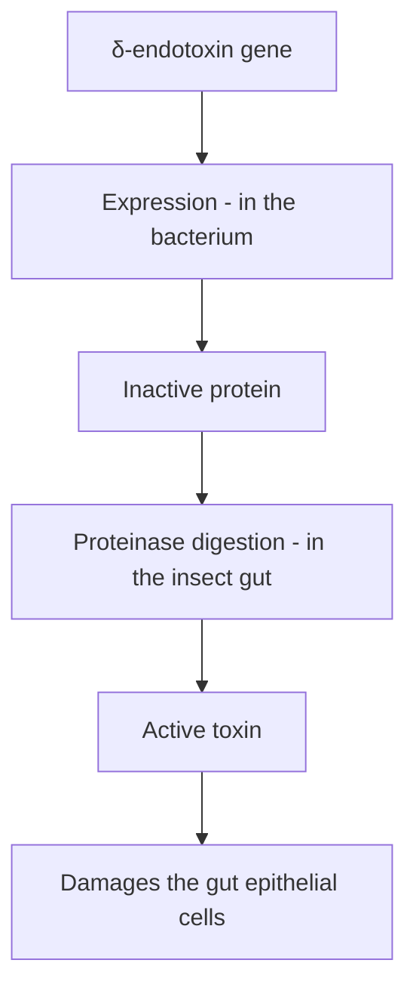
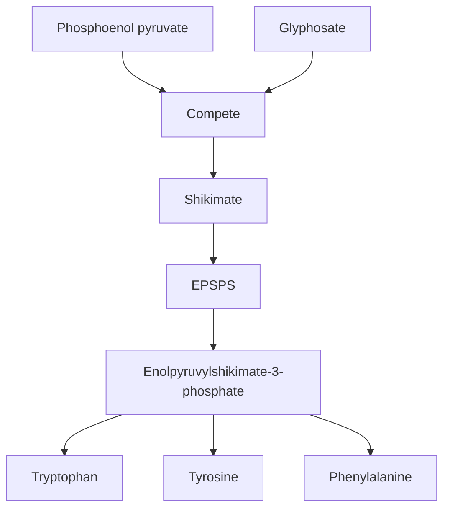
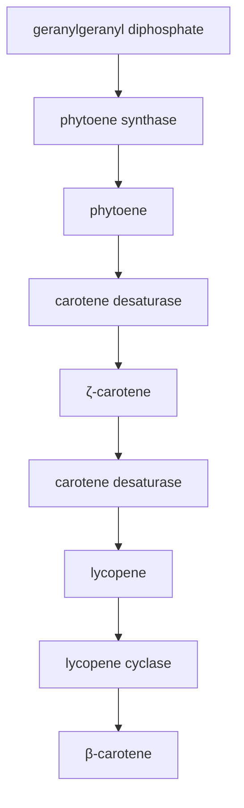
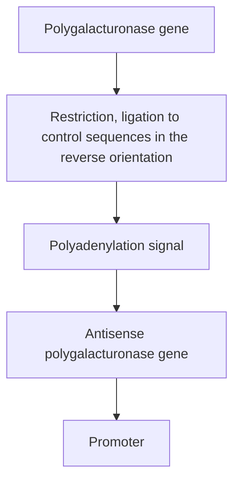
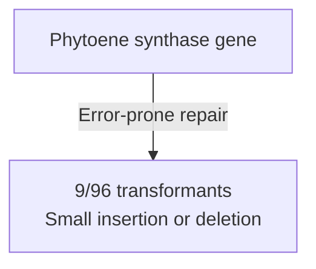
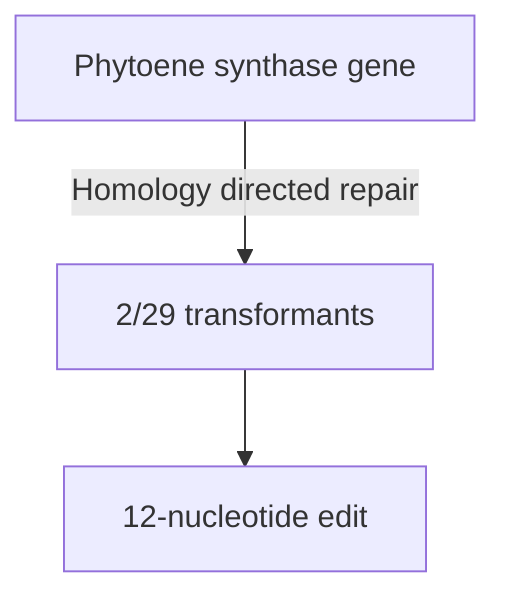
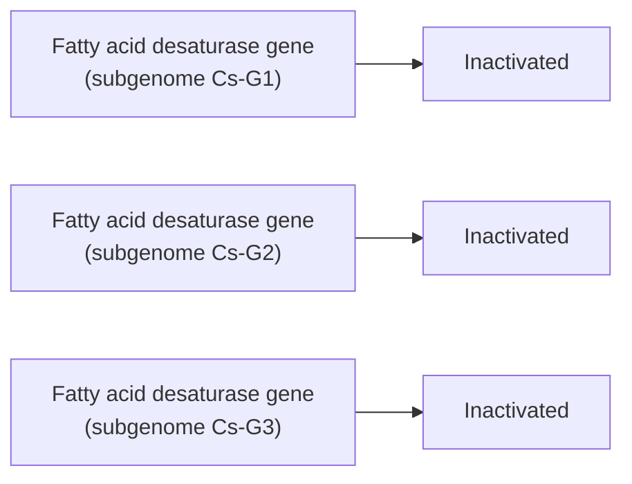
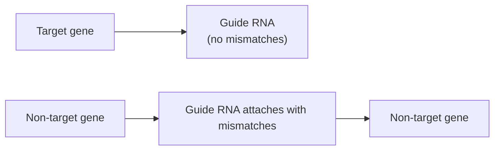
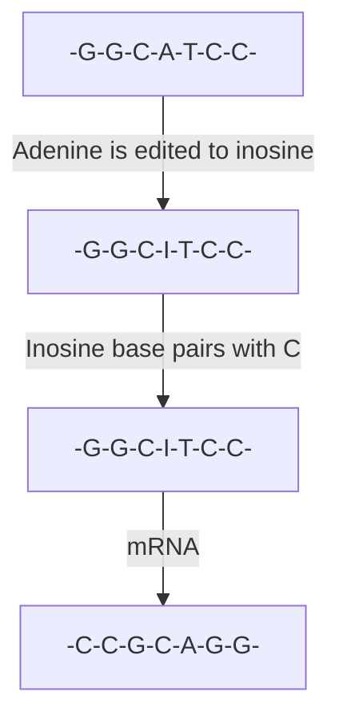
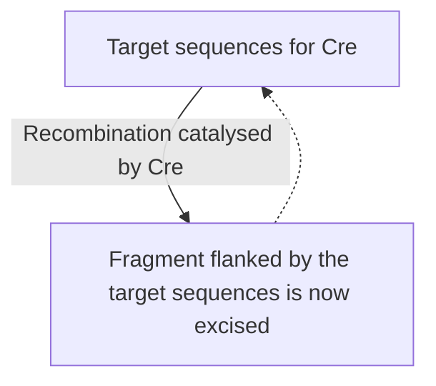

# Part III The Applications of Gene Cloning and DNA Analysis in Biotechnology / Chapter 16 Gene Cloning and DNA Analysis in Agriculture

原始 PDF 第 345–372 页。

## Chapter 16

# Gene Cloning and DNA Analysis in Agriculture

## Chapter contents

**16.1** The gene addition approach to plant genetic engineering 328
**16.2** Gene subtraction 339
**16.3** Gene editing with a programmable nuclease 344
**16.4** Are GM plants harmful to human health and the environment? 349

Agriculture, or more specifically the cultivation of plants, has an unbroken history that stretches back at least 10 000 years. Throughout this period humans have constantly searched for improved varieties of their crop plants: varieties with better nutritional qualities, higher yields, or features that aid cultivation and harvesting. During the first few millennia, crop improvements occurred in a sporadic fashion, but in recent centuries new varieties have been obtained by breeding programmes of ever‐increasing sophistication. However, the most sophisticated breeding programme still retains an element of chance, dependent as it is on the random merging of parental characteristics in the hybrid offspring that are produced. The development of a new variety of crop plant, displaying a precise combination of desired characteristics, is a lengthy and difficult process.

Gene cloning provides a new dimension to crop breeding by enabling directed changes to be made to the genotype of a plant, circumventing the

Gene Cloning and DNA Analysis: An Introduction, Eighth Edition. T. A. Brown.

© 2021 John Wiley & Sons Ltd. Published 2021 by John Wiley & Sons Ltd.

327

---

328

Part III The Applications of Gene Cloning and DNA Analysis in Biotechnology

random processes inherent in conventional breeding. Three general strategies have been used:

• **Gene addition**, in which cloning is used to alter the characteristics of a plant by providing it with one or more new genes.
**Gene subtraction**, in which genetic engineering techniques are used to inactivate one or more of the plant’s existing genes.
• **Gene editing**, in which a programmable nuclease is used to alter the sequence of one or more of the plant’s existing genes.

A number of projects are being carried out around the world, many by biotechnology companies, aimed at exploiting the potential of genetic engineering in crop improvement. In this chapter we will investigate a representative selection of these projects and look at some of the problems that must be solved if plant genetic engineering is to gain widespread acceptance in agriculture.

## 16.1 The gene addition approach to plant genetic engineering

Gene addition involves the use of cloning techniques to introduce into a plant one or more new genes coding for a useful characteristic that the plant lacks. A good example of the technique is provided by the development of plants that resist insect attack by synthesizing insecticides coded by cloned genes.

## 16.1.1 Plants that make their own insecticides

Plants are subject to predation by virtually all other types of organism – viruses, bacteria, fungi, and animals  –  but in agricultural settings the greatest problems are caused by insects. To reduce losses, crops are regularly sprayed with insecticides. Most conventional insecticides (e.g. pyrethroids and organophosphates) are relatively non‐specific poisons that kill a broad spectrum of insects, not just the ones eating the crop. Because of their high toxicity, several of these insecticides also have potentially harmful side effects for other members of the local biosphere, including in some cases humans. These problems are exacerbated by the need to apply conventional insecticides to the surfaces of plants by spraying, which means that subsequent movement of the chemicals in the ecosystem cannot be controlled. Furthermore, insects that live within the plant, or on the undersurfaces of leaves, can sometimes avoid the toxic effects altogether.

What features would be displayed by the ideal insecticide? Clearly it must be toxic to the insects against which it is targeted, but if possible, this toxicity should be highly selective, so that the insecticide is harmless to other insects and is not poisonous to animals or to humans. The insecticide should be biodegradable, so that any residues that remain after the crop is harvested, or which are carried out of the field by rainwater, do not persist

---

Chapter 16 Gene Cloning and DNA Analysis in Agriculture

329

long enough to damage the environment. And it should be possible to apply the insecticide in such a way that all parts of the crop, not just the upper surfaces of the plants, are protected against insect attack.

The ideal insecticide has not yet been discovered. The closest we have are the δ‐endotoxins produced by the soil bacterium Bacillus thuringiensis.

## The δ‐endotoxins of Bacillus thuringiensis

Insects do not only eat plants; bacteria also form an occasional part of their diet. In response, several types of bacteria have evolved defence mechanisms against insect predation, an example being B. thuringiensis which, during sporulation, forms intracellular crystalline bodies that contain an insecticidal protein called the δ‐endotoxin. The activated protein is highly poisonous to insects, some 80 000 times more toxic than organophosphate insecticides, and is relatively selective, different strains of the bacterium synthesizing proteins effective against the larvae of different groups of insects (Table 16.1).

The δ‐endotoxin protein that accumulates in the bacterium is an inactive precursor. After ingestion by the insect, this protoxin is cleaved by proteases, resulting in shorter versions of the protein that display the toxic activity. These toxins bind to the inside of the insect’s gut and damage the surface epithelium, so that the insect is unable to feed and consequently starves to death (Figure 16.1). Variation in the structure of the gut binding sites in different groups of insects is probably the underlying cause of the high specificities displayed by the different types of δ‐endotoxin.

B. thuringiensis toxins are not recent discoveries, the first patent for their use in crop protection having been granted in 1904. Over the years there have been several attempts to market them as environmentally friendly insecticides, but their biodegradability acts as a disadvantage because it means that they must be reapplied at regular intervals during the growing season, increasing the farmer’s costs. Research has therefore been aimed at developing δ‐endotoxins that do not require regular application. One approach is via protein engineering (Section 11.3.2), modifying the structure of the toxin so that it is more stable. A second approach is to engineer the crop to synthesize its own toxin.

## Cloning a δ‐endotoxin gene in maize

Maize is an example of a crop plant that is not served well by conventional insecticides. A major pest is the European corn borer (Ostrinia nubilialis),

Table 16.1

The range of insects poisoned by the various types of B. thuringiensis δ‐endotoxins.

| δ-ENDOTOXIN TYPE | EFFECTIVE AGAINST |
| --- | --- |
| CryI | Lepidoptera (moth and butterfly) larvae |
| CryII | Lepidoptera and Diptera (two-winged fly) larvae |
| CryIII | Coleoptera (beetles) |
| CryIV | Diptera larvae |
| CryV | Nematode worms |
| CryVI | Nematode worms |

---

330

Part III The Applications of Gene Cloning and DNA Analysis in Biotechnology

flowchart

which tunnels into the plant from eggs laid on the undersurfaces of leaves, thereby evading the effects of insecticides applied by spraying. The first attempt at countering this pest by engineering maize plants to synthesize δ‐endotoxin was made by plant biotechnologists in 1993, working with the CryIA(b) version of the toxin. The CryIA(b) protein is 1155 amino acids in length, with the toxic activity residing in the segment from amino acids 29–607. Rather than isolating the natural gene, a shortened version containing the first 648 codons was made by artificial gene synthesis. This strategy enabled modifications to be introduced into the gene to improve its expression in maize plants. For example, the codons that were used in the artificial gene were those known to be preferred by maize, and the overall GC content of the gene was set at 65%, compared with the 38% GC content of the native bacterial version of the gene (Figure 16.2a). The artificial gene was ligated into a cassette vector (Section 14.1.2) between a promoter and polyadenylation signal from cauliflower mosaic virus (Figure 16.2b) and introduced into maize embryos by bombardment with DNA‐coated microprojectiles (Section  5.4.1). The embryos were grown into mature plants, and transformants identified by PCR analysis of DNA extracts, using primers specific for a segment of the artificial gene (Figure 16.2c).

The next step was to use an immunological test to determine if δ‐endotoxin was being synthesized by the transformed plants. The results showed that the artificial gene was indeed active, but that the amounts of δ‐endotoxin being produced varied from plant to plant, from about 250–1750 ng of toxin per mg of total protein. These differences were probably due to **positional effects**, the level of expression of a gene cloned in a plant (or animal) often being influenced by the exact location of the gene in the host chromosomes (Figure 16.3).

Were the transformed plants able to resist the attentions of the corn borers? This was assessed by field trials in which transformed and normal

---

Chapter 16 Gene Cloning and DNA Analysis in Agriculture

331

(a) Synthesis of an articial δ-endotoxin gene

bar

| Category | Value |
| --- | --- |
| Artificial gene | 648 |
| B. thuringiensis gene | 1155 |

(b) Attachment of a promoter and polyadenylation signal

text_image

Promoter sequence
Polyadenylation sequence

(c) PCR analysis of mature plants

text_image

1
2
3
1. DNA size markers
2. Result of PCR with DNA from a transformed plant
3. Result of PCR with DNA from a non-transformed plant

Figure 16.2

Important steps in the procedure used to obtain genetically engineered maize plants expressing an artificial δ‐endotoxin gene.

maize plants were artificially infested with larvae and the effects of predation measured over a period of 6 weeks. The criteria that were used were the amount of damage suffered by the foliage of the infested plants, and the lengths of the tunnels produced by the larvae boring into the plants. In both respects the transformed plants gave better results than the normal ones. In particular, the average length of the larval tunnels was reduced from 40.7 cm for the controls to just 6.3 cm for the engineered plants. In real terms, this is a very significant level of resistance.

text_image

A
Gene inserted at point A
– poorly expressed
B
Gene inserted at point B
– highly expressed
Chromosome

Figure 16.3

Positional effects.

---

332

Part III The Applications of Gene Cloning and DNA Analysis in Biotechnology

## Cloning δ‐endotoxin genes in chloroplasts

One objection that has been raised to the use of genetically modified (GM) crops is the possibility that the cloned gene might escape from the engineered plant and become established in a weed species. From a biological viewpoint, this is an unlikely scenario as the pollen produced by a plant is usually only able to fertilize the ovary of a plant of the same species, so transfer of a gene from a crop to a weed is highly unlikely. However, one way of making such transfer totally impossible would be to place the cloned gene not in the nucleus but in the plant’s chloroplasts. A transgene located in the chloroplast genome cannot escape via pollen for the simple reason that pollen does not contain chloroplasts.

Synthesis of δ‐endotoxin protein in transgenic chloroplasts was first achieved in an experimental system with tobacco. The CryIIA(a2) gene was used, which codes for a protein that has a broader toxicity spectrum than the CryIA toxins, killing the larvae of two‐winged flies as well as lepidopterans (see Table 16.1). In the B. thuringiensis genome, the CryIIA(a2) gene is the third gene in a short operon, the first two genes of which code for proteins that help to fold and process the δ‐endotoxin (Figure 16.4). One advantage of using chloroplasts as the sites of recombinant protein synthesis is that the gene expression machinery of chloroplasts, being related to that of bacteria (because chloroplasts were once free‐living prokaryotes), is able to express all the genes in an operon. In contrast, each gene that is placed in a plant (or animal) nuclear genome must be cloned individually, with its own promoter and other expression signals, which makes it very difficult to introduce two or more genes at the same time.

The CryIIA(a2) operon was attached to a kanamycin resistance gene along with flanking chloroplast DNA sequences, and biolistics used to introduce the construct into tobacco leaf cells. Insertion into the chloroplast genome was ensured by rigorously selecting for kanamycin resistance, by placing leaf segments on agar containing kanamycin for up to 13 weeks (Section 7.2.2). Transgenic shoots growing out of the leaf segments were then placed on a medium that induced root formation, and plants grown.

The amounts of CryIIA(a2) protein produced in the tissues of these GM plants was quite remarkable, the toxin making up over 45% of the total soluble protein, more than previously achieved in any plant cloning experiment. This high level of expression almost certainly results from the combined effects of the high copy number for the transgene (there being many chloroplast genomes per cell, compared with just two copies of the nuclear genome) and the presence in the chloroplasts of the two helper proteins coded by the other genes in the CryIIA(a2) operon. As might be anticipated, the plants proved to be extremely toxic to susceptible insect larvae. Five days after being placed on the GM plants, all cotton bollworm and beet armyworm larvae were dead, with appreciable damage being visible only on the leaves of the plants exposed to armyworms, which have a relatively high natural resistance to δ‐endotoxins. The presence of large

Figure 16.4 The CryIIA(a2) operon.

text_image

Helper proteins
CryIIA(a2)

---

Chapter 16 Gene Cloning and DNA Analysis in Agriculture

333

amounts of toxin in the leaf tissues appeared not to affect the plants themselves, the GM tobacco being undistinguishable from non‐GM plants when factors such as growth rates, chlorophyll content, and level of photosynthesis were considered. Chloroplast transformation is not yet a routine procedure, but a similar project has been carried out with soybean, resulting in transgenic plants with high resistance to the velvetbean caterpillar, Anticarsia gemmatalis.

## Countering insect resistance to δ‐endotoxin crops

It has long been recognized that crops synthesizing δ‐endotoxins might become ineffective after a few seasons due to the build‐up of resistance among the insect populations feeding on the crops. This would be a natural consequence of exposing these populations to high amounts of toxins and, of course, could render the GM plants no better than the non‐GM versions after a just a few years. Various strategies have been proposed to prevent the development of δ‐endotoxin‐resistant insects. One of the first to be suggested was to develop crops expressing two or more Cry genes (Figure 16.5a), the rationale being that the different versions of these toxins are quite distinct from one another, so it would be difficult for an insect

(a) Production of two toxins

text_image

Cryl
Cryll

(b) Temporal control over toxin synthesis

text_image

toxin synthesis
— No toxin synthesis
— Toxin synthesis

(c) Mixed planting

text_image

Protected
Refuge for insects

Figure 16.5

Three strategies for countering the development of insect resistance to δ‐endotoxin crops.

---

334

Part III The Applications of Gene Cloning and DNA Analysis in Biotechnology

population to develop resistance to two toxins at the same time. Whether this is a sound argument is not yet clear. Most examples of δ‐endotoxin resistance that have been documented have had a narrow spectrum; for example, the CryIIA(a2) tobacco plants described above were equally poisonous to cotton budworms that were or were not resistant to CryIA(b). On the other hand, some strains of meal moth larvae exposed to plants containing the CryIA(c) toxin have acquired a resistance that also provides protection against the CryII toxins. The use of multi‐toxin plants is currently the most widely adopted approach to preventing the development of resistance among insects, but it is still too soon to assess how effective the strategy will be in the long term.

An alternative might be to engineer toxin production in such a way that synthesis occurs only in those parts of the plant that need protection. For example, in a crop such as maize, some damage to the non‐fruiting parts of the plant could be tolerated if this did not affect the production of cobs (Figure 16.5b). If expression of the toxin only occurred late in the plant life cycle, when the cobs are developing, then overall exposure of the insects to the toxin might be reduced without any decrease in the value of the crop. However, although this strategy might delay the onset of resistance, it is unlikely to avoid it altogether.

A third strategy is to mix GM plants with non‐GM ones, so that each field contains plants that the insects can feed on without being exposed to the toxin produced by the engineered versions (Figure 16.5c). These non‐GM plants would act as a refuge for the insects, ensuring that the insect population continually includes a high proportion of non‐resistant individuals. As all the δ‐endotoxin resistance phenotypes so far encountered are recessive, heterozygotes arising from a mating between a susceptible insect and a resistant partner would themselves be susceptible, continually diluting the proportion of resistant insects in the population. Trials have been carried out, and theoretical models have been examined, to identify the most effective mixed planting strategies. In practice, success or failure would depend to a very large extent on the farmers who grow the crops, these farmers having to adhere to the precise planting strategy dictated by the scientists, despite the resulting loss in productivity due to the damage suffered by the non‐GM plants. Again, this introduces an element of risk. The success of GM projects with plants clearly depends on much more that the cleverness of the genetic engineers.

## 16.1.2 Herbicide‐resistant crops

Although δ‐endotoxin production has been engineered in crops as diverse as maize, cotton, rice, potato, and tomato, these plants are not the most widespread GM crops grown today. In commercial terms the most important transgenic plants are those that have been engineered to withstand the herbicide glyphosate. This herbicide, which is widely used by farmers and horticulturists, is environmentally friendly, as it is non‐toxic to insects and to animals and has a short residence time in soils, breaking down over a period of a few days into harmless products. However, glyphosate kills all plants, both weeds and crop species, and so has to be

---

Chapter 16 Gene Cloning and DNA Analysis in Agriculture

335

applied to fields very carefully in order to prevent the growth of weeds without harming the crop itself. GM crops that are able to withstand the  effects of glyphosate are therefore desirable as they would enable a less rigorous and hence less expensive herbicide application regime to be followed.

## ‘Roundup Ready’ crops

The first crops to be engineered for glyphosate resistance were called ‘Roundup Ready’, reflecting the trade name of the herbicide. These plants contain a modified gene for the enzyme enolpyruvylshikimate‐3‐phosphate synthase (EPSPS), which converts shikimate and phosphoenol pyruvate (PEP) into enolpyruvylshikimate‐3‐phosphate, an essential precursor for synthesis of the aromatic amino acids tryptophan, tyrosine, and phenylalanine (Figure  16.6). Glyphosate competes with PEP for binding to the enzyme surface, thereby inhibiting synthesis of enolpyruvylshikimate‐3‐ phosphate and preventing the plant from making the three amino acids. Without these amino acids, the plant quickly dies.

Initially, genetic engineering was used to generate plants that made greater than normal amounts of EPSPS, in the expectation that these would be able to withstand higher doses of glyphosate than non‐engineered plants. However, this approach was unsuccessful because, although engineered plants that made up to 80 times the normal amount of EPSPS were obtained, the resulting increase in glyphosate tolerance was not sufficient to protect these plants from herbicide application in the field.

A search was therefore carried out for an organism whose EPSPS enzyme is resistant to glyphosate inhibition and whose EPSPS gene might therefore be used to confer resistance on a crop plant. After testing the genes from various bacteria, as well as mutant forms of Petunia that displayed glyphosate resistance, the EPSPS gene from Agrobacterium strain CP4 was chosen, because of its combination of high catalytic activity and high resistance to the herbicide. EPSPS is located in the plant chloroplasts, so the Agrobacterium EPSPS gene was cloned in a Ti vector as a fusion protein with a leader sequence that would direct the enzyme across the chloroplast membrane and into the organelle. Biolistics was used to introduce the recombinant vector into soybean callus culture. After regeneration, the GM plants were found to have a threefold increase in herbicide resistance.

flowchart

Figure 16.6

Glyphosate competes with phosphoenol pyruvate in the EPSPS‐catalysed synthesis of enolpyruvylshikimate‐3‐phosphate, and hence inhibits synthesis of tryptophan, tyrosine, and phenylalanine.

---

336

Part III The Applications of Gene Cloning and DNA Analysis in Biotechnology

## A new generation of glyphosate‐resistant crops

Roundup Ready versions of a variety of crops have been produced in recent years, and several of these, in particular soybean and maize, are grown routinely in the USA and other parts of the world. However, these plants do not actually destroy glyphosate, which means that the herbicide can accumulate in the plant tissues. Glyphosate is not poisonous to humans or other animals, so the use of such plants as food or forage should not be a concern, but accumulation of the herbicide can interfere with reproduc tion of the plant.

Until recently, there has been only a few scattered reports of organisms capable of actively degrading glyphosate. However, searches of microbial collections have revealed that this property is relatively common among bacteria of the genus Bacillus, which possess an enzyme, now called glyphosate N‐acetyltransferase (GLYAT), which detoxifies glyphosate by attaching an acetyl group to the herbicide molecule (Figure  16.7a). The most active detoxifier known is a strain of B. licheniformis, but even this bacterium detoxifies glyphosate at rates that are too low to be of value if transferred to a GM crop.

Is it possible to increase the activity of the GLYAT synthesized by B. licheniformis? The discovery that the bacterium possesses three related genes for this enzyme pointed a way forward. A type of **directed evolution** called **multigene shuffling** was used. Multigene shuffling involves taking segments of each member of a multigene family and reassembling the segments to create new gene variants. At each stage of the process, the most active genes are identified by cloning all variants in E. coli and assaying the recombinant colonies for GLYAT activity. The most active genes are then used as the substrates for the next round of shuffling. After 11 rounds, a gene specifying a GLYAT with 10 000 times the activity of the enzymes present in the original B. licheniformis strain was obtained (Figure 16.7b). This gene was introduced into maize, and the resulting GM plants were found to tolerate levels of glyphosate six times higher than the amount normally used by farmers to control weeds, without any reduction in the

Figure 16.7

Use of glyphosate N‐acetyltransferase to generate plants that detoxify glyphosate. (a) GLYAT detoxifies glyphosate by adding an acetyl group (shown in blue). (b) Creation of a highly active GLYAT enzyme by multigene shuffling.

---

Chapter 16 Gene Cloning and DNA Analysis in Agriculture

337

productivity of the plant. This new way of engineering glyphosate resistance is being exploited in the development of herbicide‐resistant soybean, canola, and cotton.

## 16.1.3 Improving the nutritional quality of plants by gene addition

As well as engineering crops to improve their resistance to insects and herbicides, gene addition can also be used to enhance their nutritional properties. One of the most important of these projects has resulted in a version of rice that has been engineered so that the grains produce β‐carotene, which humans use as a precursor for vitamin A synthesis. Almost half a million children every year become blind because they do not have enough vitamin A in their diet, so there would be considerable social and health value in having a variety of rice containing β‐carotene for use in those parts of the world where there is a high incidence of vitamin A deficiency. Rice is able to synthesize β‐carotene from a precursor compound called geranylgeranyl diphosphate (Figure 16.8), but only in the photosynthetic parts of the plant, not in the endosperm, the part of the grain that provides the nutritional content. This is because the two enzymes that are required to catalyse the first three steps in the pathway, phytoene synthase and carotene desaturase, are absent in the endosperm of unmodified rice plants.

To engineer a variety of rice that produces β‐carotene in the grain, the daffodil gene for phytoene synthase and the carotene desaturase from the bacterium Pantoea ananas (formerly called Erwinia uredovora) were each ligated downstream of an endosperm‐specific promoter and inserted into the Agrobacterium vector pBIN19 (Figure 16.9). The modified plants produced β‐carotene in the grain, but in quantities that were too low to be effective in combating vitamin A deficiency. To increase the yield, biochemical studies of the synthesis pathway were carried out, which revealed that the rate limiting step was the conversion of geranylgeranyl diphosphate to phytoene, by phytoene synthase. When the daffodil gene for phytoene synthase used in the initial experiments was replaced with the equivalent maize gene, β‐carotene synthesis increased 25‐fold, to the extent that the daily requirement for this compound could be met by consuming 75 g of

flowchart

Figure 16.8

The pathway leading from geranylgeranyl diphosphate to β‐carotene.

---

338

Part III The Applications of Gene Cloning and DNA Analysis in Biotechnology

text_image

Endosperm-specific
promoter
Carotene desaturase
(Pantoea ananas)
Phytoene synthase
(daffodil or maize)
Endosperm-specific
promoter

Figure 16.9

The construct used to engineer a variety of rice that produces β‐carotene in the grain.

rice. The higher β‐carotene content gives the grains a yellow colour, and the GM variety is called ‘golden rice’.

A similar strategy has been used to increase the β‐carotene content of cassava, by transferring the genes for phytoene synthase from the bacterium Pantoea agglomerans (formerly called Erwinia herbicola) and deoxyxylulose‐5‐phosphate synthase from Arabidopsis thaliana. The iron and protein contents of cassava have also been increased, the former by introducing a metal transporter protein from Chlamydomonas reinhardtii, and the latter with a protein called sporazein. The sporazein gene is a fusion between sporamin, a protein from sweet potato tubers, and zein from maize kernels, designed to combine the best nutritional qualities of the sweet potato and maize proteins. Cassava is a staple crop in many parts of sub‐Saharan Africa, but dependency on unmodified cassava leads to vitamin A and iron deficiencies, especially among children. Development of a biofortified version of cassava could therefore have a significant impact on nutrition and health in parts of Africa. In an analogous project, biofortified maize with improved β‐carotene, ascorbate (vitamin C), and folate (vitamin B) contents has been engineered by transfer of genes from rice and the bacteria Escherichia coli and Pantoea ananatis.

## 16.1.4 Other gene addition projects

GM crops that synthesize δ‐endotoxins, glyphosate resistance enzymes, or enzymes that enhance nutritional quality are by no means the only examples of plants engineered by gene addition. Examples of other gene addition projects are listed in Table 16.2. These projects include an alternative means of conferring insect resistance, using genes coding for proteinase inhibitors, small polypeptides that disrupt the activities of enzymes in the insect gut, preventing or slowing growth. Proteinase inhibitors are produced naturally by several types of plant, notably legumes such as cowpeas and common beans, and their genes have been successfully transferred to other crops which do not normally make significant amounts of these proteins. The inhibitors are particularly effective against beetle larvae that feed on seeds, and so may be a better alternative than δ‐endotoxin for plants whose seeds are stored for long periods.

Other projects are exploring the use of genetic modification to improve the drought tolerance of crop plants, a vitally important objective if crop productivity to be maintained during global warming. Finally, in a

---

Chapter 16 Gene Cloning and DNA Analysis in Agriculture

339

Table 16.2

Examples of gene addition projects with plants.

| GENE FOR | SOURCE ORGANISM | MODIFIED CHARACTERISTIC |
| --- | --- | --- |
| 1-Aminocyclopropane-1-carboxylic acid deaminase | Various | Fruit ripening |
| 2′-5′-Oligoadenylate synthetase | Rat | Virus resistance |
| Acyl carrier protein thioesterase | Umbellularia californica | Fat and oil content |
| Acyl-coenzyme A binding protein | Arabidopsis thaliana | Drought tolerance |
| Barnase ribonuclease inhibitor | Bacillus amyloliquefaciens | Male sterility |
| Carotene desaturase | various bacteria | β-carotene content |
| Chitinase | Rice | Fungal resistance |
| Dehydroascorbate reductase | Rice | Ascorbate content |
| Delta-12 desaturase | Glycine max | Fat and oil content |
| Deoxyxylulose-5-phosphate synthase | Arabidopsis thaliana | β-carotene content |
| Dihydroflavanol reductase | Various flowering plants | Flower colour |
| Enolpyruvylshikimate-3-phosphate synthase | Agrobacterium spp. | Herbicide tolerance |
| FEA1 metal transporter | Chlamydomonas reinhardtii | Iron content |
| Flavonoid hydroxylase | Various flowering plants | Flower colour |
| Glucanase | Alfalfa | Fungal resistance |
| Glyphosate N-acetyltransferase | B. licheniformis | Herbicide tolerance |
| Glyphosate oxidoreductase | Ochrobactrum anthropi | Herbicide tolerance |
| GTP cyclohydrolase | Escherichia coli | Folate content |
| Methionine-rich protein | Brazil nuts | Sulphur content |
| Monellin, thaumatin | Thaumatococcus danielli | Sweetness |
| Nitrilase | Klebsiella ozaenae | Herbicide tolerance |
| Ornithine carbamyltransferase | Pseudomonas syringae | Bacterial resistance |
| Phosphinothricin acetyltransferase | Streptomyces spp. | Herbicide tolerance |
| Phytoene synthase | Various plants and bacteria | β-carotene content |
| Proteinase inhibitors | Various legumes | Insect resistance |
| Sporazein | Maize and sweet potato | Protein content |
| Vacuolar pyrophosphatase | Arabidopsis thaliana | Drought tolerance |
| Virus coat proteins, satellite RNAs | Various viruses | Virus resistance |
| δ-Endotoxin | B. thuringiensis | Insect resistance |

different sphere of commercial activity, ornamental plants with unusual flower colours are being produced by transferring genes for enzymes involved in pigment production from one species to another.

## 16.2 Gene subtraction

The second way of changing the genotype of a plant is by gene subtraction. This term is a misnomer, as the modification does not involve the actual removal of a gene, merely its inactivation. There are several possible

---

340

Part III The Applications of Gene Cloning and DNA Analysis in Biotechnology

strategies for inactivating a single, chosen gene in a living plant, the most successful so far in practical terms being the use of antisense RNA (Section 15.3.2).

## 16.2.1 Antisense RNA and the engineering of fruit ripening in tomato

To illustrate how antisense RNA has been used in plant genetic engineering, we will examine how tomatoes with delayed ripening have been produced. This is an important example of plant genetic modification as it resulted in one of the first GM foodstuffs to be approved for sale to the general public.

Commercially grown tomatoes and other soft fruits are usually picked before they are completely ripe, to allow time for the fruits to be transported to the marketplace before they begin to spoil. This is essential if the process is to be economically viable, but there is a problem in that most immature fruits do not develop their full flavour if they are removed from the plant before they are completely ripe. The result is that mass‐produced tomatoes often have a bland taste, which makes them less attractive to the consumer. Antisense technology has been used in two ways to genetically engineer tomato plants so that the fruit ripening process is slowed down. This enables the grower to leave the fruits on the plant until they ripen to the stage where the flavour has fully developed, there still being time to transport and market the crop before spoilage sets in.

## Using antisense RNA to inactivate the polygalacturonase gene

The timescale for development of a fruit is measured as the number of days or weeks after flowering. In tomato, this process takes approximately eight weeks from start to finish, with the colour and flavour changes associated with ripening beginning after about six weeks. At this time a number of genes involved in the later stages of ripening are switched on, including one coding for the polygalacturonase enzyme (Figure 16.10). This enzyme slowly breaks down the polygalacturonic acid component of the cell walls in the fruit pericarp, resulting in a gradual softening. The softening makes

Figure 16.10

The increase in polygalacturonase gene expression seen during the later stages of tomato fruit ripening.

line

| Weeks after flowering | Relative amount of polygalacturonase gene expression |
| --- | --- |
| ~6.1 | ~7 |
| ~6.3 | ~10 |
| ~6.5 | ~38 |
| ~6.9 | ~75 |
| ~7.4 | ~95 |
| ~7.7 | ~99 |

---

Chapter 16 Gene Cloning and DNA Analysis in Agriculture

341

flowchart

Figure 16.11

Construction of an antisense polygalacturonase gene.

the fruit palatable, but if taken too far results in a squashy, spoilt tomato, attractive only to students with limited financial resources.

Partial inactivation of the polygalacturonase gene should increase the time between flavour development and spoilage of the fruit. To test this hypothesis, a 730 bp restriction fragment was obtained from the 5′ region of the normal polygalacturonase gene, representing just under half of the coding sequence (Figure  16.11). The orientation of the fragment was reversed, a cauliflower mosaic virus promoter ligated to the start of the sequence, and a plant polyadenylation signal attached to the end. The construction was then inserted into the Ti plasmid vector pBIN19 (see Figure 7.14). Once inside the plant, transcription from the cauliflower mosaic virus promoter should result in synthesis of an antisense RNA complementary to the first half of the polygalacturonase mRNA. Previous experiments with antisense RNA had suggested that this would be sufficient to reduce or even prevent translation of the target mRNA.

Transformation was carried out by introducing the recombinant pBIN19 molecules into Agrobacterium tumefaciens bacteria and then allowing the bacteria to infect tomato stem segments. Small amounts of callus material collected from the surfaces of these segments were tested for their ability to grow on an agar medium containing kanamycin (remember that pBIN19 carries a gene for kanamycin resistance). Resistant transformants were identified and allowed to develop into mature plants.

The effect of antisense RNA synthesis on the amount of polygalacturonase mRNA in the cells of ripening fruit was determined by northern hybridization with a single‐stranded DNA probe specific for the sense mRNA. These experiments showed that ripening fruit from transformed plants contained less polygalacturonase mRNA than the fruits from normal plants. The amounts of polygalacturonase enzyme produced in the ripening fruits of transformed plants were then estimated from the intensities of the relevant bands after separation of fruit proteins by polyacrylamide gel electrophoresis, and by directly measuring the enzyme activities in the fruits. The results showed that less enzyme was synthesized in transformed fruits (Figure  16.12). Most importantly, the transformed fruits, although undergoing a gradual softening, could be stored for a prolonged period before beginning to spoil. This indicated that the antisense RNA had not completely inactivated the polygalacturonase gene but had

---

342

Part III The Applications of Gene Cloning and DNA Analysis in Biotechnology

## Figure 16.12

The differences in polygalacturonase activity in normal tomato fruits and in fruits expressing the antisense polygalacturonase gene.

line

| Weeks after flowering | Normal plants | Transformed plants |
| --- | --- | --- |
| ~6.1 | ~7 | ~4 |
| ~6.3 | ~10 | ~7 |
| ~6.5 | ~36 | ~11 |
| ~6.8 | ~75 | ~12 |
| ~7.3 | ~94 | ~12 |
| ~7.7 | ~98 | ~13 |

nonetheless produced a sufficient reduction in gene expression to delay the ripening process as desired. The GM tomatoes – marketed under the trade name ‘FlavrSavr’ – were one of the first genetically engineered plants to be approved for sale to the public, first appearing in supermarkets in 1994.

## Using antisense RNA to inactivate ethylene synthesis

The main trigger that switches on the genes involved in the later stages of tomato ripening is ethylene which, despite being a gas, acts as a hormone in many plants. A second way of delaying fruit ripening would therefore be to engineer plants so that they do not synthesize ethylene. Fruits on these plants would develop as normal for the first six weeks but would be unable to complete the ripening process. The unripe fruit could therefore be transported to the marketplace without any danger of the crop spoiling. Before selling to the consumer, or conversion into paste or some other product, artificial ripening would be induced by spraying the tomatoes with ethylene.

The penultimate step in the ethylene synthesis pathway is conversion of S‐adenosylmethionine to 1‐aminocyclopropane‐1‐carboxylic acid (ACC), which is the immediate precursor for ethylene. This step is catalysed by an enzyme called ACC synthase. As with polygalacturonase, ACC synthase inactivation was achieved by cloning into tomato a truncated version of the normal ACC synthase gene, inserted into the cloning vector in the reverse orientation, so that the construct would direct synthesis of an antisense version of the ACC synthase mRNA. After regeneration, the engineered plants were grown to the fruiting stage and found to make only 2% of the amount of ethylene produced by non‐engineered plants. This reduction was more than sufficient to prevent the fruit from completing the ripening process. These tomatoes have been marketed as the ‘Endless Summer’ variety.

## 16.2.2 Other examples of the use of antisense RNA in plant genetic engineering

In general terms, the applications of gene subtraction in plant genetic engineering are less broad than those of gene addition. It is easier to think of useful characteristics that a plant lacks which might be introduced by gene

---

Chapter 16 Gene Cloning and DNA Analysis in Agriculture

343

Table 16.3

Examples of gene subtraction projects with plants.

| TARGET GENE | MODIFIED CHARACTERISTIC |
| --- | --- |
| 1-Aminocyclopropane-1-carboxylic acid synthase | Modified fruit ripening in tomato |
| 1D-myo-inositol 3-phosphate synthase | Reduction of indigestible phosphorus content of rice grains |
| Chalcone synthase | Modification of flower colour in various decorative plants |
| Delta-12 oleate desaturase | High oleic acid content in soybean |
| DET1 photomorphogenesis regulatory gene | Improved carotenoid and flavonoid content in tomato |
| Lycopene epsilon cyclase | Enhanced carotenoid content of potato |
| 5-Methylcytosine DNA glycosylase | Reduced immunogenicity of wheat seed proteins |
| Polygalacturonase | Delay of fruit spoilage in tomato |
| Polyphenol oxidase | Prevention of discoloration in fruits and vegetables |
| Solanidine glucosyl transferase | Reduction of steroidal glycoalkaloid content of potato |
| Starch synthase | Reduction of starch content in vegetables |

addition, than it is to identify disadvantageous traits that the plant already possesses which could be removed by gene subtraction. There are, however, a growing number of plant biotechnology projects based on gene subtraction (Table 16.3). Several of these are aimed at reducing spoilage by delaying the ripening process, as described above for tomato. Other gene subtraction projects are making more direct improvements to the nutritional quality of plants by increasing the content of useful compounds such as carotenoids and flavonoids in tomato, potato, canola, and rice. These compounds are important antioxidants thought to reduce the risk of coronary disease, and the carotenoids include β‐carotene which, as we learnt above, has a specific role in vitamin A synthesis. Gene subtraction has been used to disrupt regulatory pathways that limit the synthesis of carotenoids and flavonoids and also to inactivate enzymes involved in the turnover of these compounds in the edible parts of the crop.

Similar approaches have been used in complementary projects where gene subtraction has resulted in reduced synthesis of compounds that are less useful in the human diet. Potatoes, for example, contain steroidal glycoalkaloids which help to protect the plants against insect pests, but which are toxic to humans and other animals. Potato tubers for human consumption must have a glycoalkaloid content of less than 200 mg $\mathbf { k g } ^ { - 1 }$ , and under normal circumstances this limit is easily met. However, the glycoalkaloid content can increase above this level if the growth or storage conditions are not ideal, in which case the crop cannot be sold to consumers and has to be destroyed. Maintaining a low glycoalkaloid content is also an issue in breeding programmes between cultivated and wild potatoes, aimed at introducing desirable traits from the wild species into the crop. Wild potatoes have a naturally high glycoalkaloid content, and it can be difficult to

---

344

Part III The Applications of Gene Cloning and DNA Analysis in Biotechnology

avoid transferring this undesirable feature to the progeny alongside the more desirable traits. Gene subtraction directed at enzymes involved in glycoalkaloid synthesis can circumvent many of these problems by generating cultivated varieties with very low glycoalkaloid content.

## 16.3 Gene editing with a programmable nuclease

During the last decade, the gene addition and gene subtraction approaches to the production of GM crops have been supplemented by gene editing methods, using programmable nucleases such as the CRISPR system. We studied this technique in Section 12.2.2, in the context of genome annotation, where gene editing is used to introduce a short insertion or deletion into a target gene, so that the gene is inactivated, the resulting change in phenotype being used to deduce the function of the gene. This is, of course, equivalent to the gene subtraction method described above, and CRISPR and related editing procedures have indeed been used for this purpose in plant genetic engineering. However, the great potential of gene editing lies not with its ability to inactivate a target gene, but with the possibility of introducing changes to the coding sequence of a gene, via the homologydirected repair process (see Figure 12.14). Gene editing therefore enables plant genetic engineering to progress beyond the simple addition or subtraction of a gene activity, by making it possible to alter the nucleotide sequence of a plant gene, and hence also the amino acid sequence of the encoded protein, in a highly directed manner so that precise phenotypic changes can be achieved.

## 16.3.1 Gene editing of phytoene desaturase in rice

The first use of CRISPR in plant genetic engineering was reported in 2013. One of these initial projects was directed at the phytoene desaturase gene of rice. Phytoene desaturase is one of the two enzymes needed to convert geranylgeranyl diphosphate to lycopene, at the start of the metabolic pathway that gives rise to β‐carotene, the precursor of vitamin A (see Figure 16.8), as well as the other carotenoids that are important antioxidants in the human diet. Editing of the phytoene desaturase gene could therefore improve the nutritional quality of rice. Additionally, phytoene desaturase is the target for a herbicide called norflurazon, so editing of this gene provides another possible way of obtaining herbicide‐resistant crop plants (Section 16.1.2).

To test the utility of gene editing with rice, attempts were first made to inactivate the rice phytoene desaturase gene with a guide RNA sequence designed to induce the error‐prone repair system that leads to an insertion or deletion being placed in the target gene. The first step was to obtain a Cas9 endonuclease gene that would function inside rice cells. This endonuclease is normally found in bacteria (Section 12.2.2), so its gene requires

---

Chapter 16 Gene Cloning and DNA Analysis in Agriculture

345

text_image

Cas9 endonuclease
(codons favoured by rice)
Nuclear localization
signals

Figure 16.13

A modified Cas9 gene designed to function inside rice cells.

some modification in order to be expressed efficiently inside a plant. To this end, an artificial gene was synthesized, based on the sequence of the Streptomyces pyogenes Cas9 gene but using the codons favoured by rice, and extended at both the start and end so that the Cas9 endonuclease would have a pair of nuclear localization signals. These are short amino acid sequences that ensure that the protein, following synthesis by a ribosome in the cytoplasm, is imported into the nucleus (Figure 16.13). Import of the endonuclease into the nucleus is, of course, essential as it is within the nucleus that gene editing takes place. The artificial gene was then placed downstream of the cauliflower mosaic virus promoter, so that it would be expressed within the plant cell.

The Cas9 gene was introduced into rice callus cells by microprojectile bombardment, along with DNA sequences specifying two guide RNAs directed at adjacent parts of the phytoene desaturase gene. Transformed cells were grown into whole plants and these tested for phytoene desaturase activity. Nine out of 96 plants had inactivated phytoene desaturase genes, the majority having single‐nucleotide insertions at the target site (Figure 16.14a). In six of these plants, only one of the pair of phytoene desaturase genes in the diploid chromosome set had been inactivated, but three plants were homozygotes with both genes inactivated.

Having demonstrated that the error‐prone system could be used to inactivate the phytoene desaturase gene, the next step was to test the possibility of introducing specific changes by the homology‐directed repair version of gene editing. A template DNA for homology‐directed repair was designed to alter a 12‐nucleotide segment of the gene, so that a Pst1 site was replaced by a Kpn1 and an EcoR1 site. Successful editing could therefore be checked

(a) Error-prone editing

flowchart

(b) Homology-directed editing

flowchart

Figure 16.14

Editing of the rice phytoene desaturase gene. (a) Gene inactivation by the error‐prone repair process. (b) Editing of a 12‐nucleotide sequence by the homology‐directed process.

---

346

Part III The Applications of Gene Cloning and DNA Analysis in Biotechnology

by restriction endonuclease treatment of a PCR product spanning the edited site. Protoplasts were then transformed with the Cas9 gene, the template DNA, and the guide RNA sequence. Examination of genomic DNA samples from the transformants showed that two out of 29 had undergone the expected editing (Figure  16.14b). This lower success rate compared with error‐prone editing is in agreement with other gene editing projects, not just with plants, which have shown that homology‐directed repair is the less efficient of the two systems.

## 16.3.2 Editing of multiple genes in a single plant

Even if gene editing is used solely in the error‐prone mode to inactivate a gene, this approach has benefits compared to the use of antisense RNA and other methods that are used to achieve gene subtraction. One important advantage is the ease with which gene editing can be carried out, which means that it is feasible to make two or more edits to a single plant cell. In one project, three genes involved in grain yield in rice were inactivated by gene editing. Previous studies had shown that each of these genes has a negative effect on yield, one limiting the overall size of the rice grains, the second affecting grain weight, and the third negatively regulating grain number. Following editing of the three genes, an increase of up to 68% in grain yield per plant was obtained. In a second project, three copies of a fatty acid desaturase gene were inactivated in the oilseed crop plant, Camelina sativa, leading to variations in the oleic acid content of the oil. The notable feature with this experiment is that C. sativa has a hexaploid genome, and the three genes were homeologues – the equivalent genes on each of the three subgenomes making up the hexaploid chromosome set (Figure  16.15). Several important crop plants have polyploid genomes  –  examples are bread wheat, which is a hexaploid, and some types of cultivated cotton, which are tetraploid – and gene editing of these crops will often require that equivalent alterations are made in homeologous genes.

Multiple gene editing has also been used to obtain improved tomato varieties, but not by using the domesticated tomato Solanum lycopersicum

flowchart

Figure 16.15

Editing of the homeologous fatty acid desaturase genes on the three subgenomes of Camelina sativa.

---

Chapter 16 Gene Cloning and DNA Analysis in Agriculture

347

as the starting material. Despite its many attractions, the tomato we grow today has lost several valuable attributes possessed by the wild ancestral species, Solanum pimpinellifolium, which is more resistant to some of the common diseases that afflict the tomato crop, and also has greater tolerance to salt stress. However, the wild tomato has very small fruits, giving rise to one of its common names, currant tomato. Rather than attempting to engineer disease resistance and stress tolerance back into cultivated tomato, gene editing has been used to provide S. pimpinellifolium with a set of ‘domestication traits’, features such as increased fruit size and number, as well as changes to the plant architecture to give more bushy plants, and disruption of the circadian response so the plant flowers earlier in the season. Similar projects are underway aimed at obtaining domesticated versions of other wild plant species.

## 16.3.3 Future developments in gene editing of plants

Since the initial demonstration of successful gene editing in plants in 2013, there has been a rapid increase in the use of this technology in experiments aimed at the development of new types of GM crop (Table 16.4). The phenotypes that are being modified by gene editing are ones that we are familiar with from our studies of gene addition and subtraction, including increased resistance to diseases and herbicides, improved nutritional content, and modification of the fruit ripening process.

Although the majority of the projects carried out so far make use of the error‐prone system to achieve gene inactivation, an increasing understanding of homology‐directed repair is leading to more prevalent use of this method to make precise sequence changes in the targeted genes. Two key issues have been to increase the efficiency of homology‐directed repair, so

Table 16.4

Examples of gene editing projects with plants.

<table><tr><td>TARGET GENE</td><td>MODIFIED CHARACTERISTIC</td></tr><tr><td colspan="2">Error-prone repair (gene inactivation)</td></tr><tr><td>Auxin-responsive protein IAA9</td><td>Seedless tomatoes</td></tr><tr><td>Ethylene responsive factor</td><td>Resistance to Magnaporthe oryzae (blast fungus) in rice</td></tr><tr><td>Fruit ripening transcription factor RIN</td><td>Control of fruit ripening in tomato</td></tr><tr><td>Mildew resistance locus proteins</td><td>Powdery mildew resistance in bread wheat</td></tr><tr><td>Peroxiredoxin</td><td>Potassium deficiency tolerance in rice</td></tr><tr><td colspan="2">Homology-directed repair (directed sequence alteration)</td></tr><tr><td>Acetolactase synthase</td><td>Herbicide resistance in potato</td></tr><tr><td>Auxin regulated gene ARGOS8</td><td>Improved grain yield in maize under drought conditions</td></tr><tr><td>Enolpyruvylshikimate-3-phosphate synthase</td><td>Glyphosate resistance in cassava</td></tr><tr><td>Phytoene desaturase</td><td>Improved carotenoid content in rice and cassava</td></tr><tr><td>Vacuolar iron transporter</td><td>Biofortification of iron content of wheat flour</td></tr></table>

---

348

Part III The Applications of Gene Cloning and DNA Analysis in Biotechnology

flowchart

Figure 16.16

Off‐target editing.

that a greater proportion of the transformants become edited, and to reduce ‘off‐target’ effects, where editing occurs at additional, undesired positions in a genome. Off‐target editing can occur because the guide RNA does not require complete complementarity in order to bind to a DNA sequence, and so can attach not only to the target site but also to sites where there are one or a few mismatches (Figure 16.16). Editing of these additional sites could lead to unwanted changes being made to non‐target genes. To address these issues, programmable nucleases other than Cas9 have been tested, such as the Cpf1 or Cas12a nuclease, from the Prevotella and Francisella genera of bacteria, which works in a similar fashion to Cas9 but appears to carry out homology‐directed repair with greater efficiency.

Other developments include the creation of fusions between a programmable nuclease and a **base editor**, an enzyme capable of changing one nucleotide to another within a DNA molecule. An example is the adenine deaminase of Escherichia coli, which converts adenine nucleotides to inosine during the synthesis of tRNAs. When fused to the Cas9 nuclease, adenine deaminase carries out the adenine to inosine conversion within the region specified by the guide RNA (Figure 16.17). There is no strand breakage or repair and the editing is therefore achieved without the need for a template DNA. After editing, the inosine base pairs with cytosine when the gene is transcribed or replicated, so in effect an A‐to‐G edit has been made. Base editors that convert C to T have also been designed. Both types have been used with some success with crops including wheat, rice, and potato.

Finally, progress is being made in designing gene editing systems that do not involve the introduction of DNA into the plant that is being edited. This is important because the conventional method for gene editing results in the Cas9 gene and other editing constructs becoming semi‐permanent components of the plant genome. The plants are therefore classed as ‘genetically modified’ and are subject to the restrictions and controls imposed on GM crops by different national agencies. If, on the other hand, at the end of the process the only alteration to the genome is the insertion,

Figure 16.17

Adenine base editing. The base editor converts an adenine to an inosine. The latter base pairs with C when the DNA is transcribed into mRNA.

flowchart

---

Chapter 16 Gene Cloning and DNA Analysis in Agriculture

349

deletion, or point mutation resulting from the editing process, then the plants would be no different from those obtained by any other mutagenesis method, and hence, logically, should not be subject to GM regulations. In this context, an important recent discovery is that error‐prone editing occurs after transformation of protoplasts not with DNA, but with a ribonucleoprotein complex comprising the Cas9 endonuclease protein and the guide RNA. In an initial trial of this DNA‐free system with Brassica species, up to 25% of transformants displayed edits in the targeted genes.

## 16.4 Are GM plants harmful to human health and the environment?

Ripening‐delayed tomatoes produced by gene subtraction were among the first GM whole foods to be approved for marketing. Partly because of this, plant genetic engineering has provided the battleground on which biotechnologists and other interested parties have fought over the safety and ethical issues that arise from our ability to alter the genetic make‐up of living organisms. A number of the most important questions do not directly concern genes and the expertise needed to answer them will not be found in this book. For example, we cannot discuss in an authoritative fashion the possible impact, good or otherwise, that GM crops might have on local farming practices in the developing world. However, we can, and should, look at the biological issues.

## 16.4.1 Safety concerns with selectable markers

One of the main areas of concern to emerge from the debate over GM tomatoes was the possible harmful effects of the marker genes used with plant cloning vectors. Most plant vectors carry a copy of a gene for resistance to kanamycin or hygromycin, enabling transformed plants to be identified during the cloning process. The resistance genes are bacterial in origin and code for the enzymes neomycin phosphotransferase II and hygromycin phosphotransferase II. The gene and its enzyme product are present in all cells of an engineered plant. The fear that the phosphotransferases might be toxic to humans has been allayed by tests with animal models, but two other safety issues remain:

• Could the resistance gene contained in a GM foodstuff be passed to bacteria in the human gut, making these resistant to the antibiotic?
• Could the resistance gene be passed to other organisms in the environment, and would this result in damage to the ecosystem?

Most scientists agree that there is no evidence that the antibiotic resistance gene in a GM food can be passed to other bacteria, either in the human gut or in the wider environment. Digestive processes would destroy all the resistance genes before they could reach the bacterial flora of the gut, and even if a gene did avoid destruction, the chances of it being

---

350

Part III The Applications of Gene Cloning and DNA Analysis in Biotechnology

Figure 16.18

DNA excision by the Cre recombinase enzyme.

flowchart

transferred to a bacterium would be very small. Nevertheless, the risk factor is not zero. These fears have prompted biotechnologists to devise ways of removing the antibiotic resistance genes from plant DNA after the transformation event has been verified. One of the strategies makes use of an enzyme from bacteriophage P1, called Cre, which catalyses a recombination event that excises DNA fragments flanked by specific 34 bp recognition sequences (Figure 16.18). To use this system the plant is transformed with two cloning vectors, the first carrying the gene being added to the plant along with the antibiotic resistance gene, the latter flanked by the Cre target sequences, and the second carrying the Cre gene. After transformation, expression of the Cre gene results in excision of the antibiotic resistance gene from the plant DNA.

What if the Cre gene is itself hazardous in some way? This is immaterial as the two vectors used in the transformation would probably integrate their DNA fragments into different chromosomes, so random segregation during sexual reproduction would result in first‐generation plants that contained one integrated fragment but not the other. A plant that contains neither the Cre gene nor the antibiotic resistance gene, but does contain the important gene that we wished to add to the plant’s genome, can therefore be obtained.

## 16.4.2 The possibility of harmful effects on the environment

A second area of concern regarding GM plants is that their new gene combinations might harm the environment in some way. These concerns have to be addressed individually for each type of GM crop, as different engineered genes might have different impacts. We will examine the work that has been carried out to assess whether it is possible that herbicide‐resistant plants, one of the examples of gene addition that we studied earlier in this chapter, can have a harmful effect. As these are the most widely grown GM crops, they have been subject to some of the most comprehensive environmental studies. In particular, in 1999, the UK Government commissioned an independent investigation into how herbicide‐resistant crops, whose growth in the UK was not at that time permitted, might affect the abundance and diversity of farmland wildlife.

After delays due to activists attempting to prevent the work from being carried out, the UK research team reported their findings in 2003.

---

Chapter 16 Gene Cloning and DNA Analysis in Agriculture

351

The  study involved 273 field trials throughout England, Wales, and Scotland, and included glyphosate‐resistant sugar beet as well as maize and spring rape engineered for resistance to a second herbicide, glufosinate‐ammonium. The results, as summarized in the official report (see Burke [2003] in Further Reading), were as follows:

The team found that there were differences in the abundance of wildlife between GM crop fields and conventional crop fields. Growing conventional beet and spring rape was better for many groups of wildlife than growing GM beet and spring rape. There were more insects, such as butterflies and bees, in and around the conventional crops because there were more weeds to provide food and cover. There were also more weed seeds in conventional beet and spring rape crops than in their GM counterparts. Such seeds are important in the diets of some animals, particularly some birds. In contrast, growing GM maize was better for many groups of wildlife than conventional maize. There were more weeds in and around the GM crops, more butterflies and bees around at certain times of the year, and more weed seeds. The researchers stress that the differences they found do not arise just because the crops have been genetically modified. They arise because these GM crops give farmers new options for weed control. That is, they use different herbicides and apply them differently. The results of this study suggest that growing such GM crops could have implications for wider farmland biodiversity. However, other issues will affect the medium‐ and long‐term impacts, such as the areas and distribution of land involved, how the land is cultivated and how crop rotations are managed. These make it hard for researchers to predict the medium‐ and large‐scale effects of GM cropping with any certainty. In addition, other management decisions taken by farmers growing conventional crops will continue to impact on wildlife.

The interpretations that have been drawn from the above and similar studies of other types of GM crop vary from country to country. In many parts of the world, a GM crop is considered safe to eat and harmless to the environment providing that it passes the safety assessments laid down by national legislation. In 2015, GM crops accounted for 70.9 million hectares of cultivation in the USA, 44.2 million hectares in Brazil, 24.5 million hectares in Argentina, and were also grown in other parts of North and South America, and in India, Pakistan, China, and South Africa. In other countries, notably the members of the European Union, there is virtually no cultivation of GM crops.

## Further reading

Burke, M. (2003) GM crops: effects on farmland wildlife. Produced by the Farmscale Evaluations Research Team and the Scientific Steering Committee. ISBN: 0‐85521‐035‐4. [For a more detailed description of this work see Philosophical Transactions of the Royal Society, Biological Sciences, 358, 1775–1913 (2003).]

---

352

Part III The Applications of Gene Cloning and DNA Analysis in Biotechnology

- Castle, L.A., Siehl, D.L., Gorton, R., et al. (2004) Discovery and directed evolution of a glyphosate tolerance gene. Science, 304, 1151–1154. [Cloning the GLYAT gene in maize.]
- Christiansen, A.T., Andersen, M.M., and Kappel, K. (2019) Are current EU policies on GMOs justified? Transgenic Research, 28, 267–286.
- De Cosa, B., Moar, W., Lee, S.B., et al. (2001) Overexpression of the Bt cry2Aa2 operon in chloroplasts leads to formation of insecticidal crystals. Nature Biotechnology, 19, 71–74.
- Fischhoff, D.A., Bowdish, K.S., Perlak, F.J., et al. (1987) Insect‐tolerant transgenic tomato plants. Biotechnology, 5, 807–813. [The first transfer of a δ‐endotoxin gene to a plant.]
- Halford, N.G. (2019) Legislation governing genetically modified and genome‐edited crops in Europe: the need for change. Journal of the Science of Food and Agriculture, 99, 8–12.
- Koziel, M.G., Beland, G.L., Bowman, C., et al. (1993) Field performance of elite transgenic maize plants expressing an insecticidal protein derived from Bacillus thuringiensis. Nature Biotechnology, 11, 194–200. [Cloning a δ‐endotoxin gene in maize.]
- Li, T., Yang, X., Yu, Y., et al. (2018) Domestication of wild tomato accelerated by genome editing. Nature Biotechnology, 36, 1160–1163.
- Miki, B. and McHugh, S. (2003) Selectable marker genes in transgenic plants: applications, alternatives and biosafety. Journal of Biotechnology, 107, 193–232.
- Morineau, C., Bellec, Y., Tellier, F., et al. (2017) Selective gene dosage by CRISPR‐Cas9 genome editing in hexaploid Camelina sativa. Plant Biotechnology Journal, 15, 729–739.
- Murovec, J., Guček, K., Bohanec, B., et al. (2018) DNA‐free genome editing of Brassica oleracea and B. rapa protoplasts using CRISPR‐Cas9 ribonucleoprotein complexes. Frontiers in Plant Science, 9, 1594.
- Paine, J.A., Shipton, C.A., Chaggar, S., et al. (2005) Improving the nutritional value of Golden Rice through increased pre‐vitamin A content. Nature Biotechnology, 23, 482–487.
- Sayre, R., Beeching, J.R., Cahoon, E.B., et al. (2011) The BioCassava plus program: biofortification of cassava for sub‐Saharan Africa. Annual Review of Plant Biology, 62, 251–272.
- Shan, Q., Wang, Y., Li, J., et al. (2013) Targeted genome modification of crop plants using a CRISPR‐Cas system. Nature Biotechnology, 31, 686–688. [Editing the rice phytoene desaturase gene.]
- Smith, C.J.S., Watson, C.F., Ray, J., et al. (1988) Antisense RNA inhibition of polygalacturonase gene expression in transgenic tomatoes. Nature, 334, 724–726.
- Tabashnik, B.E., Brévault, T., and Carrière, Y. (2013) Insect resistance to Bt crops: lessons from the first billion acres. Nature Biotechnology, 31, 510–521.

---

Chapter 16 Gene Cloning and DNA Analysis in Agriculture

353

- Wolter, F., Schindele, P., and Puchta, H. (2019) Plant breeding at the speed of light: the power of CRISPR/Cas to generate directed genetic diversity at multiple sites. BMC Plant Biology, 19, 176.
- Zhang, Y., Malzahn, A.A., Sretenovic, S., and Qi, Y. (2019) The emerging and uncultivated potential of CRISPR technology in plant science. Nature Plants, 5, 778–794.
- Zhou, J., Xin, X., and He, Y. (2019) Multiplex QTL editing of grain‐related genes improves yield in elite rice varieties. Plant Cell Reports, 38, 475–485.

---

