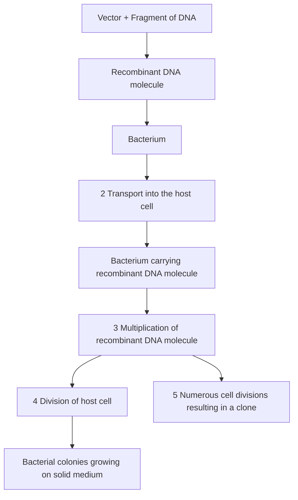
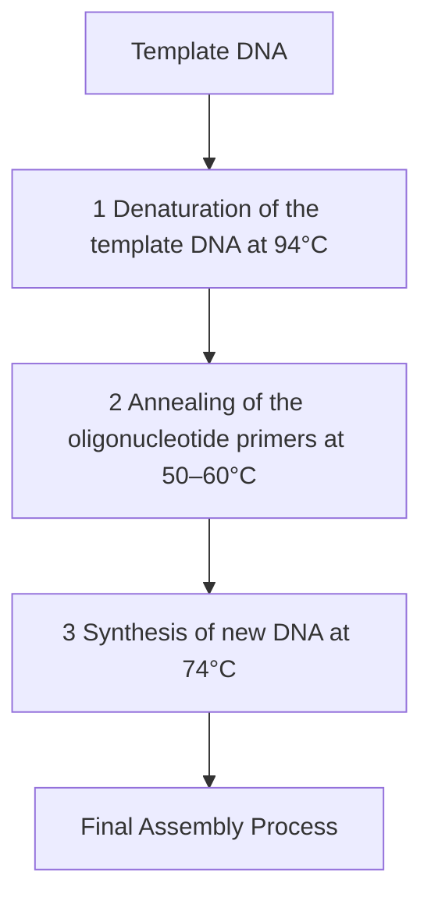
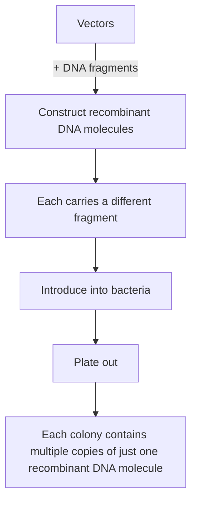
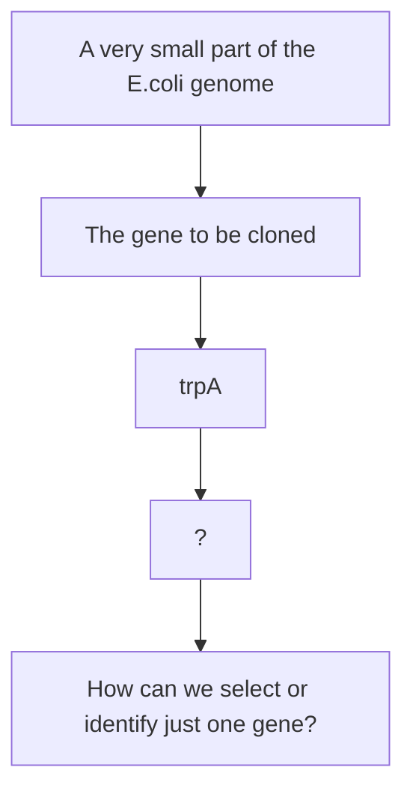

# Preface to the Eighth Edition

he main development in DNA technology since publication of the Seventh Edition of Gene Cloning has been the increased use of gene editing as a tool in both research and biotechnology. The basic methodology for CRISPR editing is now described in Chapter 12 and the applications of the method are explored, in the context of plant genetic engineering, in Chapter  16. Elsewhere, the continuing evolution of next‐generation DNA sequencing is reflected by a reorganization of this part of Chapter 10, and to deal with the further proliferation of methods for studying transcriptomes and proteomes (albeit not strictly DNA Analysis) I have created a new chapter devoted to these methods. Other additions include new sections on melt curve analysis of real‐time PCR products and genetic typing of human disease mutations.

I wrote the First Edition of Gene Cloning in 1985, shortly after gaining my first academic appointment. I fondly remember that small, yellow‐covered book, even though I no longer have a copy and have been unable to track one down. I have written this latest Edition during the months immediately following my retirement from academia. I would like to thank the many colleagues, students, and email contacts who, over those 35 years have made comments and suggestions about the content of the book and the way the material is presented. In particular, I would like to thank Mehdi Evazalipour of Guilan Medical University and Salman Odooli of University of Isfahan for pointing out a couple of longstanding errors in the Seventh Edition.

Finally, the one constant throughout the 35 years of Gene Cloning has been my wife and research partner Keri, who has provided unending support and encouragement for my writing ventures.

**T. A. Brown**

University of Manchester

## PART I

# The Basic Principles of Gene Cloning and DNA Analysis

1 | Why Gene Cloning and DNA Analysis are Important 3
2 | Vectors for Gene Cloning: Plasmids and Bacteriophages 15
3 | Purification of DNA from Living Cells 29
4 | Manipulation of Purified DNA 53
5 | Introduction of DNA into Living Cells 83
6 | Cloning Vectors for E. coli 101
7 | Cloning Vectors for Eukaryotes 121
8 | How to Obtain a Clone of a Specific Gene 145
9 | The Polymerase Chain Reaction 169

## Chapter 1

# Why Gene Cloning and DNA Analysis are Important

## Chapter contents

**1.1** The early development of genetics 4
**1.2** The advent of gene cloning and the polymerase chain reaction 4
**1.3** What is gene cloning? 5
**1.4** What is PCR? 5
**1.5** Why gene cloning and PCR are so important 8
**1.6** How to find your way through this book 11

In the middle of the $1 9 ^ { \mathrm { t h } }$ century, Gregor Mendel formulated a set of rules to explain the inheritance of biological characteristics. The basic assumption of these rules is that each heritable property of an organism is controlled by a factor, called a **gene**, that is a physical particle present somewhere in the cell. The rediscovery of Mendel’s laws in 1900 marks the birth of **genetics**, the science aimed at understanding what these genes are and exactly how they work.

## 1.1 The early development of genetics

For the first 30 years of its life, this new science grew at an astonishing rate. The idea that genes reside on **chromosomes** was proposed by W. Sutton in 1903, and received experimental backing from T.H. Morgan in 1910. Morgan and his colleagues then developed the techniques for **gene mapping**, and by 1922 had produced a comprehensive analysis of the relative positions of over 2000 genes on the four chromosomes of the fruit fly, Drosophila melanogaster.

Despite the brilliance of these classical genetic studies, there was no real understanding of the molecular nature of the gene until the 1940s. Indeed, it was not until the experiments of Avery, MacLeod, and McCarty in 1944, and of Hershey and Chase in 1952, that anyone believed that deoxyribonucleic acid (DNA) is the genetic material. Up until then it was widely thought that genes were made of protein. The discovery of the role of DNA was a tremendous stimulus to genetic research, and many famous biologists (Delbrück, Chargaff, Crick, and Monod were among the most influential) contributed to the second great age of genetics. In the 14 years between 1952 and 1966, the structure of DNA was elucidated, the genetic code cracked, and the processes of transcription and translation described.

## 1.2 The advent of gene cloning and the polymerase chain reaction

These years of activity and discovery were followed by a lull, a period of anticlimax, when it seemed to some molecular biologists (as the new generation of geneticists styled themselves) that there was little of fundamental importance that was not understood. In truth there was a frustration that the experimental techniques of the late 1960s were not sophisticated enough to allow genes to be studied in any greater detail.

Then, in the years 1971–1973 genetic research was thrown back into gear by what at the time was described as a revolution in experimental biology. A whole new methodology was developed, enabling previously impossible experiments to be planned and carried out, if not with ease, then at least with success. These methods, referred to as **recombinant DNA technology** or **genetic engineering**, and having at their core the process of **gene cloning**, sparked another great age of genetics. They led to rapid and efficient **DNA sequencing** techniques that enabled the structures of individual genes to be determined, reaching a culmination at the turn of the century with the massive genome sequencing projects, including the human project which was completed in 2000. They led to procedures for studying the regulation of individual genes, which have allowed molecular biologists to understand how aberrations in gene activity can result in human diseases such as cancer. The techniques spawned modern **biotechnology**, which puts genes to work in production of proteins and other compounds needed in medicine and industrial processes.

During the 1980s, when the excitement engendered by the gene cloning revolution was at its height, it hardly seemed possible that another, equally novel and equally revolutionary process was just around the corner. According to DNA folklore, Kary Mullis invented the **polymerase chain reaction (PCR)** during a drive along California State Route 128 from Berkeley to Mendocino one Friday evening in 1983. His brainwave was an exquisitely simple technique that acts as a perfect complement to gene cloning. PCR has made easier many of the techniques that were possible but difficult to carry out when gene cloning was used on its own. It has extended the range of DNA analysis and enabled molecular biology to find new applications in areas of endeavour outside of its traditional range of medicine, agriculture, and biotechnology. Archaeogenetics, molecular ecology, and DNA forensics are just three of the new disciplines that have become possible as a direct consequence of the invention of PCR, enabling molecular biologists to ask questions about human evolution and the impact of environmental change on the biosphere, and to bring their powerful tools to bear in the fight against crime. Fifty years have passed since the dawning of the age of gene cloning, but we are still riding the rollercoaster and there is no end to the excitement in sight.

## 1.3 What is gene cloning?

What exactly is gene cloning? The easiest way to answer this question is to follow through the steps in a gene cloning experiment (Figure 1.1):

1 A fragment of DNA, containing the gene to be cloned, is inserted into a circular DNA molecule called a **vector**, to produce a **recombinant DNA molecule**.
2 The vector transports the gene into a host cell, which is usually a bacterium, although other types of living cell can be used.
3 Within the host cell the vector multiplies, producing numerous identical copies, not only of itself but also of the gene that it carries.
4 When the host cell divides, copies of the recombinant DNA molecule are passed to the progeny and further vector replication takes place.
5 After a large number of cell divisions, a colony, or **clone**, of identical host cells is produced. Each cell in the clone contains one or more copies of the recombinant DNA molecule. The gene carried by the recombinant molecule is now said to be cloned.

## 1.4 What is PCR?

The polymerase chain reaction is very different from gene cloning. Rather than a series of manipulations involving living cells, PCR is carried out in a single test tube simply by mixing DNA with a set of reagents and placing the tube in a thermal cycler, a piece of equipment that enables the mixture to be incubated at a series of temperatures that are varied in a preprogrammed manner. The basic steps in a PCR experiment are as follows (Figure 1.2):

Figure 1.1

The basic steps in gene cloning.

Construction of a recombinant DNA molecule

flowchart

1 The mixture is heated to $9 4 ^ { \circ } \mathrm { C } ,$ at which temperature the hydrogen bonds that hold together the two strands of the double‐stranded DNA molecule are broken, causing the molecule to **denature**.
2 The mixture is cooled down to $5 0  –  6 0 ^ { \circ } \mathrm { C }$ . The two strands of each molecule could join back together at this temperature, but most do not because the mixture contains a large excess of short DNA molecules, called **oligonucleotides** or **primers**, which **anneal** to the DNA molecules at specific positions.
3 The temperature is raised to $7 4 ^ { \circ } \mathrm { C } ,$ This is a good working temperature for the **Taq DNA polymerase** that is present in the mixture. We will learn more about **DNA polymerases** in Section 4.1.3. All we need to understand at this stage is that the Taq DNA polymerase attaches to one end of each primer and synthesizes new strands of DNA, complementary to the **template** DNA molecules, during this step of the PCR. Now we have four stands of DNA instead of the two that there were to start with.

flowchart

Repeat the cycle 25–30 times

Figure 1.2

The basic steps in the polymerase chain reaction.

4 The temperature is increased back to $9 4 ^ { \circ } \mathrm { C } ,$ The double‐stranded DNA molecules, each of which consists of one strand of the original molecule and one new strand of DNA, denature into single strands. This begins a second cycle of denaturation–annealing–synthesis, at the end of which there are eight DNA strands. By repeating the cycle 30 times the double‐stranded molecule that we began with is converted into over 130 million new double‐stranded molecules, each one a copy of the region of the starting molecule delineated by the annealing sites of the two primers.

## 1.5 Why gene cloning and PCR are so important

As you can see from Figures 1.1 and 1.2, gene cloning and PCR are relatively straightforward procedures. Why, then, have they assumed such importance in biology? The answer is largely because both techniques can provide a pure sample of an individual gene, separated from all the other genes in the cell.

## 1.5.1 Obtaining a pure sample of a gene by cloning

To understand exactly how cloning can provide a pure sample of a gene, consider the basic experiment from Figure 1.1, but drawn in a slightly different way (Figure 1.3). In this example the DNA fragment to be cloned is one member of a mixture of many different fragments, each carrying a different

Figure 1.3

Cloning allows individual fragments of DNA to be purified.

flowchart

gene or part of a gene. This mixture could indeed be the entire genetic complement of an organism – a human, for instance. Each of these fragments becomes inserted into a different vector molecule to produce a family of recombinant DNA molecules, one of which carries the gene of interest. Usually only one recombinant DNA molecule is transported into any single host cell, so that although the final set of clones may contain many different recombinant DNA molecules, each individual clone contains multiple copies of just one molecule. The gene is now separated away from all the other genes in the original mixture, and its specific features can be studied in detail.

In practice, the key to the success or failure of a gene cloning experiment is the ability to identify the particular clone of interest from the many different ones that are obtained. If we consider the **genome** of the bacterium Escherichia coli, which contains just over 4000 different genes, we might at first despair of being able to find just one gene among all the possible clones (Figure 1.4). The problem becomes even more overwhelming when we remember that bacteria are relatively simple organisms and that the human genome contains about five times as many genes. However, as explained in Chapter  8, a variety of different strategies can be used to ensure that the correct gene can be obtained at the end of the cloning experiment. Some of these strategies involve modifications to the basic cloning procedure, so that only cells containing the desired recombinant DNA molecule can divide and the clone of interest is automatically **selected**. Other methods involve techniques that enable the desired clone to be identified from a mixture of lots of different clones.

flowchart

Figure 1.4 The problem of selection.

Once a gene has been cloned there is almost no limit to the information that can be obtained about its structure and expression. The availability of cloned material has stimulated the development of many different analytical methods for studying genes, with new techniques being introduced all the time. Methods for studying the structure and expression of a cloned gene are described in Chapters 10 and 11, respectively.

## 1.5.2 PCR can also be used to purify a gene

The polymerase chain reaction can also be used to obtain a pure sample of a gene. This is because the region of the starting DNA molecule that is copied during PCR is the segment whose boundaries are marked by the annealing positions of the two oligonucleotide primers. If the primers anneal either side of the gene of interest, many copies of that gene will be synthesized (Figure 1.5). The outcome is the same as with a gene cloning experiment, although the problem of selection does not arise because the desired gene is automatically ‘selected’ as a result of the positions at which the primers anneal.

A PCR experiment can be completed in a few hours, whereas it takes weeks if not months to obtain a gene by cloning. Why then is gene cloning still used? This is because PCR has two limitations:

In order for the primers to anneal to the correct positions, on either side of the gene of interest, the sequences of these annealing sites must be known. It is easy to synthesize a primer with a predetermined sequence (see Figure 8.15), but if the sequences of the annealing sites are unknown then the appropriate primers cannot be made. This means that PCR cannot be used to isolate genes that have not been studied before – that has to be done by cloning.

Figure 1.5

Gene isolation by PCR.

flowchart

This diagram illustrates the polymerase chain reaction process, showing how various protein domains (pyrF, dnaL, etc.) are converted into a complex structure that is then transformed into a final polymerase chain.

There is a limit to the length of DNA sequence that can be copied by PCR. Five kilobases (kb) can be copied fairly easily, and segments up to forty kb can be dealt with by using specialized techniques, but this is shorter than the lengths of many genes, especially those of humans and other vertebrates. Cloning must be used if an intact version of a long gene is required.

Gene cloning is therefore the only way of isolating long genes or those that have never been studied before. But PCR still has many important applications. For example, even if the sequence of a gene is not known, it may still be possible to determine the appropriate sequences for a pair of primers, based on what is known about the sequence of the equivalent gene in a different organism. A gene that has been isolated and sequenced from, say, mouse could therefore be used to design a pair of primers for isolation of the equivalent gene from humans.

In addition, there are many applications where it is necessary to isolate or detect genes whose sequences are already known. A PCR of human globin genes, for example, is used to test for the presence of mutations that might cause the blood disease called thalassaemia. Design of appropriate primers for this PCR is easy because the sequences of the human globin genes are known. After the PCR, the gene copies are sequenced or studied in some other way to determine if any of the thalassaemia mutations are present.

Another clinical application of PCR involves the use of primers specific for the DNA of a disease‐causing virus. A positive result indicates that a sample contains the virus and that the person who provided the sample should undergo treatment to prevent onset of the disease. The polymerase chain reaction is tremendously sensitive, a carefully set up reaction yielding detectable amounts of DNA even if there is just one DNA molecule in the starting mixture. This means that the technique can detect viruses at the earliest stages of an infection, increasing the chances of treatment being successful. This great sensitivity means that PCR can also be used with DNA from forensic material such as hairs and dried bloodstains, or even from the bones of long‐dead humans (Chapter 17).

## 1.6 How to find your way through this book

This book explains how gene cloning, PCR, and other DNA analysis techniques are carried out and describes the applications of these techniques in modern biology. The applications are covered in the second and third parts of the book. Part II describes how genes and genomes are studied and Part III gives accounts of the broader applications of gene cloning and PCR in biotechnology, medicine, agriculture, and forensic science.

In Part I we deal with the basic principles. Most of the nine chapters in Part I are devoted to gene cloning because this technique is more complicated than PCR. When you have understood how cloning is carried out you will have understood many of the basic principles of how DNA is analyzed. In Chapter 2 we look at the central component of a gene cloning experiment – the vector – which transports the gene into the host cell and is responsible for its replication. To act as a cloning vector a DNA molecule must be capable of entering a host cell and, once inside, replicating to produce multiple copies of itself. Two naturally occurring types of DNA molecule satisfy these requirements:

• **Plasmids**, which are small circles of DNA found in bacteria and some other organisms. Plasmids can replicate independently of the host cell chromosome.
• **Virus chromosomes**, in particular the chromosomes of **bacteriophages**, which are viruses that specifically infect bacteria. During infection the bacteriophage DNA molecule is injected into the host cell where it undergoes replication.

Chapter 3 describes how DNA is purified from living cells – both the DNA that will be cloned and the vector DNA – and Chapter 4 covers the various techniques for handling purified DNA molecules in the laboratory. There are many such techniques, but two are particularly important in gene cloning. These are the ability to cut the vector at a specific point and then to repair it in such a way that the gene is inserted (see Figure 1.1). These and other DNA manipulations were developed as an offshoot of basic research into DNA synthesis and modification in living cells, and most of the manipulations make use of purified enzymes. The properties of these enzymes, and the way they are used in DNA studies, are described in Chapter 4.

Once a recombinant DNA molecule has been constructed, it must be introduced into the host cell so that replication can take place. Transport into the host cell makes use of natural processes for uptake of plasmid and viral DNA molecules. These processes and the ways they are utilized in gene cloning are described in Chapter 5, and the most important types of cloning vector are introduced, and their uses examined, in Chapters 6 and 7. To conclude the coverage of gene cloning, in Chapter 8 we investigate the problem of selection (see Figure  1.4), before returning in Chapter  9 to a more detailed description of PCR and its related techniques.

## Further reading

- Backman, K. (2001) The advent of genetic engineering. Trends in Biochemical Science, 26, 268–270. [An account of the early days of gene cloning.]
- Brock, T.D. (1990) The Emergence of Bacterial Genetics. Cold Spring Harbor Laboratory Press, New York. [Details the discovery of plasmids and bacteriophages.]
- Brown, T.A. (2017) Genomes, 4th edn. Garland Science, London. [An introduction to modern genetics and molecular biology.]
- Cherfas, J. (1982) Man Made Life. Pantheon, New York. [A history of the early years of genetic engineering.]
- Cohen, S.N. (2013) DNA cloning: a personal view after 40 years. Proceedings of the National Academy of Sciences, USA, 110, 15521–15529. [The author is one of the scientists who carried out the first gene cloning experiments in the early 1970s.]
- Judson, H.F. (1996) Eighth Day of Creation: Makers of the Revolution in Biology. Cold Spring Harbor Laboratory Press, New York. [A very readable account of the development of molecular biology in the years before the gene cloning revolution.]
- Mullis, K.B. (1990) The unusual origins of the polymerase chain reaction. Scientific American, 262(4), 56–65. [An entertaining account of how PCR was invented.]