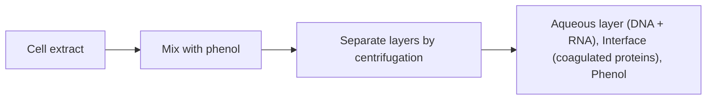
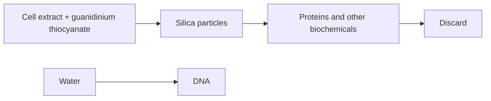
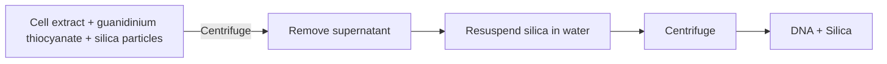
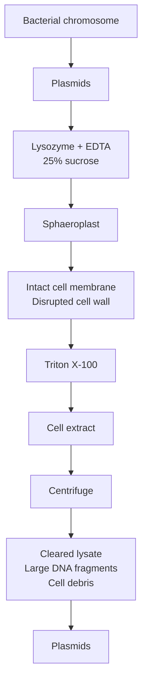
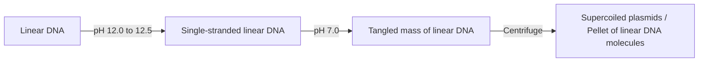
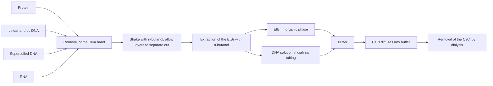
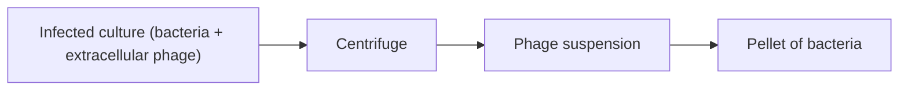

Table 3.1

The composition of two typical media for the growth of bacterial cultures.

<table><tr><td>MEDIUM</td><td>COMPONENT</td><td>g  $I^{-1}$  OF MEDIUM</td></tr><tr><td rowspan="7">M9 medium</td><td> $Na_{2}HPO_{4}$ </td><td>6.0</td></tr><tr><td> $KH_{2}PO_{4}$ </td><td>3.0</td></tr><tr><td>NaCl</td><td>0.5</td></tr><tr><td> $NH_{4}Cl$ </td><td>1.0</td></tr><tr><td> $MgSO_{4}$ </td><td>0.5</td></tr><tr><td>Glucose</td><td>2.0</td></tr><tr><td> $CaCl_{2}$ </td><td>0.015</td></tr><tr><td rowspan="3">LB (Luria-Bertani medium)</td><td>Tryptone</td><td>10.0</td></tr><tr><td>Yeast extract</td><td>5.0</td></tr><tr><td>NaCl</td><td>10.0</td></tr></table>

provides the nitrogen requirements, along with sugars and inorganic and organic nutrients. Complex media such as LB need no further supplementation and support the growth of a wide range of bacterial species.

Defined media must be used when the bacterial culture has to be grown under precisely controlled conditions. However, this is not necessary when the culture is being grown simply as a source of DNA, and under these circumstances a complex medium is appropriate. In LB medium at $3 7 ^ { \circ } \mathrm { C } _ { 1 }$ aerated by shaking at 150–250 rpm on a rotary platform, E. coli cells divide once every 20 minutes or so until the culture reaches a maximum density of about $2 – 3   \times   1 0 ^ { 9 }$ cells $\mathbf { m } ^ { \mathrm { { l - 1 } } }$ . The growth of the culture can be monitored by reading the **optical density (OD)** at 600 nm (Figure 3.2), at which wavelength 1 OD unit corresponds to about $0 . 8 \times 1 0 ^ { 9 }$ cells ml–1.

In order to prepare a cell extract, the bacteria must be obtained in as small a volume as possible. Harvesting is therefore performed by spinning the culture in a centrifuge (Figure  3.3). Fairly low centrifugation speeds will pellet the bacteria at the bottom of the centrifuge tube, allowing the culture medium to be poured off. Bacteria from a 1000 ml culture at maximum cell density can then be resuspended into a volume of 10 ml or less.

## 3.1.2 Preparation of a cell extract

The bacterial cell is enclosed in a cytoplasmic membrane and surrounded by a rigid cell wall. With some species, including E. coli, the cell wall may itself be enveloped by a second, outer membrane. All of these barriers have to be disrupted to release the cell components.

Techniques for breaking open bacterial cells can be divided into physical methods, in which the cells are disrupted by mechanical forces, and chemical methods, where cell lysis is brought about by exposure to chemical agents that affect the integrity of the cell barriers. Chemical methods are most commonly used with bacterial cells when the object is DNA preparation.

Chemical lysis generally involves one agent attacking the cell wall and another disrupting the cell membrane (Figure 3.4a). The chemicals that are used depend on the species of bacterium involved, but with E. coli and related organisms, weakening of the cell wall is usually brought about by

(a) Measurement of optical density

flowchart

Estimation of cell number(b) from a calibration curve

line

| Cell number (x 10^9) per ml | Optical density at 600 nm |
| --- | --- |
| 0 | 0 |
| 0.8 | 1.0 |

Figure 3.2

Estimation of bacterial cell number by measurement of optical density (OD). (a) A sample of the culture is placed in a glass cuvette and light with a wavelength of 600 nm shone through. The amount of light that passes through the culture is measured and the OD (also called the absorbance) calculated as:

$$
1 \text {OD unit} = \log_ {1 0} \frac {\text {intensity of transmitted light}}{\text {intensity of incident light}}
$$

The operation is performed with a spectrophotometer. (b) The cell number corresponding to the OD reading is calculated from a calibration curve. This curve is plotted from the OD values of a series of cultures of known cell density. For E. coli, $100\  min  = 0.8 \times 10^{9}$ cells ml–1.

flowchart

Figure 3.3

Harvesting bacteria by centrifugation.

Figure 3.4

Preparation of a cell extract. (a) Cell lysis. (b) Centrifugation of the cell extract to remove insoluble debris.

**lysozyme**, ethylenediamine tetraacetate (EDTA), or a combination of both. Lysozyme is an enzyme that is present in egg white and in secretions such as tears and saliva, and which digests the polymeric compounds that give the cell wall its rigidity. EDTA removes calcium and magnesium ions that are essential for preserving the overall structure of the cell wall, and also inhibits cellular enzymes that could degrade DNA. Under some conditions, weakening the cell wall with lysozyme or EDTA is sufficient to cause bacterial cells to burst, but usually a detergent such as sodium dodecyl sulphate (SDS) is also added. Detergents aid the process of lysis by removing lipid molecules and thereby cause disruption of the cell membranes.

Having lysed the cells, the final step in preparation of a cell extract is removal of insoluble cell debris. Components such as partially digested cell wall fractions can be pelleted by centrifugation (Figure 3.4b), leaving the cell extract as a reasonably clear supernatant.

## 3.1.3 Purification of DNA from a cell extract

In addition to DNA, a bacterial cell extract contains significant quantities of protein and RNA. A variety of methods can be used to purify the DNA from this mixture. One approach is to treat the mixture with reagents which degrade the contaminants, leaving a pure solution of DNA (Figure 3.5a). Other methods use **chromatography** or some other fractionation process to separate the mixture into its various components, so the DNA is isolated from the proteins and RNA in the extract (Figure 3.5b).

Removing contaminants by organic extraction and enzyme digestion The standard way to deproteinize a cell extract is to add phenol or a 1 : 1 mixture of phenol and chloroform. These organic solvents precipitate proteins but leave the nucleic acids (DNA and RNA) in aqueous solution. The result is that if the cell extract is mixed gently with the solvent, and the layers then separated by centrifugation, precipitated protein molecules are left as a white coagulated mass at the interface between the aqueous and organic layers (Figure 3.6). The aqueous solution of nucleic acids can then be removed with a pipette.

With some cell extracts the protein content is so great that a single phenol extraction is not sufficient to completely purify the nucleic acids. This problem could be solved by carrying out several phenol extractions

Figure 3.5

Two approaches to DNA purification. (a) Treating the mixture with reagents which degrade the contaminants, leaving a pure solution of DNA. (b) Separating the mixture into different fractions, one of which is pure DNA.

(a) Degradation of contaminants

flowchart

(b) Separation of DNA from contaminants

flowchart

one after the other, but this is undesirable as each mixing and centrifugation step results in a certain amount of breakage of the DNA molecules. The answer is to treat the cell extract with a **protease** such as pronase or  proteinase K before phenol extraction. These enzymes break polypeptides down into smaller units, which are more easily removed by phenol.

Some RNA molecules, especially **messenger RNA (mRNA)**, are removed by phenol treatment, but most remain with the DNA in the aqueous layer. The only effective way to remove the RNA is with the enzyme **ribonuclease**, which rapidly degrades these molecules into ribonucleotide subunits.

Using ion‐exchange chromatography to purify DNA from a cell extract Biochemists have devised various methods for using differences in electrical charge to separate mixtures of chemicals into their individual components. One of these methods is **ion‐exchange chromatography**, which separates molecules according to how tightly they bind to electrically charged particles present in a chromatographic matrix or **resin**. DNA and RNA are both negatively charged, as are some proteins, and so bind to a positively charged resin. The electrostatic attachment is disrupted by salt (Figure 3.7a), removal of the more tightly bound molecules requiring higher concentrations of salt.

Figure 3.6

Removal of protein contaminants by phenol extraction.

flowchart

(a) Attachment of DNA to ion-exchange particles

chemical

Diagram showing ion-exchange particles and DNA molecules reacting with salt to form a complex structure

(b) DNA purication by ion-exchange chromatography

Figure 3.7

DNA purification by ion‐exchange chromatography. (a) Attachment of DNA to ionexchange particles. (b) DNA is purified by column chromatography. The solutions passing through the column can be collected by gravity flow or by the spin column method, in which the column is placed in a low‐speed centrifuge.

flowchart

By gradually increasing the salt concentration, different types of molecule can be detached from the resin one after another.

The simplest way to carry out ion‐exchange chromatography is to place the resin in a glass or plastic column and then add the cell extract to the top (Figure 3.7b). The extract passes through the column, and because this extract contains very little salt all the negatively charged molecules bind to the resin and are retained in the column. If a salt solution of gradually increasing concentration is now passed through the column, the different types of molecule will **elute** (i.e. become unbound) in the sequence protein, RNA, and finally DNA. However, such careful separation is usually not needed so just two salt solutions are used: one whose concentration is sufficient to elute the protein and RNA, leaving just the DNA bound, followed by a second solution of a higher concentration which elutes the DNA, now free from protein and RNA contaminants.

Figure 3.8

DNA purification by the guanidinium thiocyanate and silica method.

flowchart

## Using silica to purify DNA from a cell extract

A second type of fractionation method for DNA purification makes use of silica particles. In the presence of guanidinium thiocyanate, DNA binds tightly to silica particles, providing an easy way of recovering the DNA from a cell extract. As with the ion‐exchange method, silica purification can be carried out in a chromatography column. The silica is placed in the column and the cell extract, to which guanidinium thiocyanate has been added, is passed through (Figure  3.8). DNA binds to the silica and is retained in the column, whereas the other biochemicals are immediately eluted. After washing away the last contaminants with guanidinium thiocyanate solution, the DNA is recovered by adding water, which destabilizes the interactions between the DNA molecules and the silica.

Alternatively, the silica and guanidinium thiocyanate can be added directly to the cell extract. After DNA binding, the sample is centrifuged to collect the silica particles (Figure 3.9a). The pellet is then resuspended in water to release the DNA. Another centrifugation re‐pellets the silica, leaving the DNA in solution. A clever modification of this method makes use of magnetic beads that are coated with silica. Rather than centrifugation, the beads are collected at the bottom of the test tube with a magnet (Figure 3.9b).

Magnetic collection has two advantages compared with the other types of fractionation method used to purify DNA. First, it is quicker, as time is not lost waiting for solutions to pass through a chromatography column or waiting for the centrifuge to complete its run. Second, magnetic collection is easier to automate. Using special equipment, many DNA purifications can be carried out in parallel, 96 in the simplest format but much higher numbers with the more sophisticated systems. This is an important consideration in applied settings such as clinical microbiology laboratories, where high throughput is needed so that many DNA samples can be processed as quickly as possible. The first types of magnetic beads to be used were simply particles of iron oxide, but nowadays the beads are made of synthetic polymer that contains a small amount of iron oxide to provide the magnetic properties. As well as silica coatings, synthetic polymers can be designed so they have electrically charged surfaces, so DNA is bound by electrostatic interactions and removed from the beads by changing the salt content or pH of the solution.

(a) Silica particles added directly to the cell extract

flowchart

(b) Silica-coated magnetic beads

text_image

Cell extract + guanidinium thiocyanate + silica-coated magnetic beads
Silica-coated magnetic beads + DNA
Magnet

Figure 3.9

Alternative methods of using silica to purify DNA from a cell extract. (a) Silica particles are added directly to a cell extract and, after DNA binding, collected by centrifugation. (b) Silica‐coated magnetic beads are collected with a magnet.

## 3.1.4 Concentration of DNA samples

Organic extraction often results in a very thick solution of DNA that does not need to be concentrated any further. Other purification methods give more dilute solutions and it is therefore important to consider methods for increasing the DNA concentration.

The most frequently used method of concentration is **ethanol precipitation**. In the presence of salt (strictly speaking, monovalent cations such as sodium ions, Na+), and at a temperature of $- 2 0 ^ { \circ } \mathrm { C }$ or less, absolute ethanol efficiently precipitates polymeric nucleic acids. With a thick solution of

text_image

Glass rod
DNA fibres
Ethanol
Concentrated
DNA solution

(a)

text_image

Ethanol
Precipitated
DNA, collected
by centrifugation

(b)

Figure 3.10

Collecting DNA by ethanol precipitation. (a) Absolute ethanol is layered on top of a concentrated solution of DNA. Fibres of DNA can be withdrawn with a glass rod. (b) For less concentrated solutions ethanol is added (at a ratio of 2.5 volumes of absolute ethanol to 1 volume of DNA solution) and precipitated DNA collected by centrifugation.

DNA, the ethanol can be layered on top of the sample, causing molecules to precipitate at the interface. A spectacular trick is to push a glass rod through the ethanol into the DNA solution. When the rod is removed, DNA molecules adhere and can be pulled out of the solution in the form of a long fibre (Figure  3.10a). Alternatively, if ethanol is mixed with a dilute DNA solution, the precipitate can be collected by centrifugation (Figure 3.10b), and then redissolved in an appropriate volume of water. Ethanol precipitation has the added advantage of leaving short‐chain and monomeric nucleic acid components in solution. Ribonucleotides produced by ribonuclease treatment are therefore lost at this stage.

## 3.1.5 Measurement of DNA concentration

It is crucial to know exactly how much DNA is present in a solution when carrying out a gene cloning experiment. Fortunately, DNA concentrations can be accurately measured by **ultraviolet (UV) absorbance spectrophotometry** (Figure 3.11a). The amount of UV radiation absorbed by a solution of DNA is directly proportional to the amount of DNA in the sample. Usually absorbance is measured at 260 nm, at which wavelength an absorbance $( \mathrm { A } _ { 2 6 0 } )$ of 1.0 corresponds to 50 μg of double‐stranded DNA per ml. Measurements of as little as 1 μl of a DNA solution can be carried out in spectrophotometers designed especially for this purpose.

Ultraviolet absorbance can also be used to check the purity of a DNA preparation. With a pure sample of DNA, the ratio of the absorbances at 260 and 280 nm $( \mathrm { A } _ { _ { 2 6 0 } } ^ { ^ - } / \mathrm { A } _ { _ { 2 8 0 } } )$ is 1.8. Ratios of less than 1.8 indicate that the preparation is contaminated, either with protein or with phenol.

The DNA concentration can also be measured by **fluorescent dye tagging**. This method makes use of a **fluorophore**, an organic compound that emits fluorescent light when stimulated with light of a different wavelength (Figure  3.11b). An example is the compound called PicoGreen, which emits green light of approximately 520 nm wavelength when excited with blue light of 480 nm wavelength. The fluorescent emission only occurs when the dye is bound to DNA, so the amount of fluorescence is a measure of the DNA concentration of the solution. Fluorescent dye tagging is more sensitive than UV absorbance spectrophotometry, and so can measure the concentrations of very dilute DNA solutions. It is also more accurate if the DNA sample is contaminated with RNA. This is because RNA absorbs UV at 260 nm and so will contribute to the absorbance reading when the UV method is used. In contrast, the dyes used in DNA quantification are designed so they do not bind to RNA, so the fluorescence method gives an accurate reading of just the DNA concentration of a solution.

Figure 3.11

Measuring the concentration of DNA in a solution. (a) UV absorbance spectrometry. (b) Fluorescent dye tagging.

## 3.1.6 Other methods for the preparation of total cell DNA

Bacteria are not the only organisms from which DNA may be required. Total cell DNA from, for example, plants or animals will be needed if the aim of the genetic engineering project is to clone genes from these organisms. Although the basic steps in DNA purification are the same whatever the organism, some modifications may have to be introduced to take account of the special features of the cells being used.

Obviously, growth of cells in liquid medium is appropriate only for bacteria, other microorganisms, and plant and animal cell cultures. The major modifications, however, are likely to be needed at the cell breakage stage. The chemicals used for disrupting bacterial cells do not usually work with other organisms: lysozyme, for example, has no effect on plant cells. Specific degradative enzymes are available for most cell wall types, but physical techniques, such as grinding frozen material with a mortar and pestle, are often more efficient. On the other hand, most animal cells have no cell wall at all, and can be disrupted simply by treating with detergent.

flowchart

Figure 3.12

The CTAB method for purification of plant DNA.

Animal tissue is also disrupted by guanidinium thiocyanate, the compound used in the silica method for DNA purification. Guanidinium thiocyanate is a **chaotropic agent**, which means that it interferes with the hydrogen bonding that normally holds water molecules together. This in turn destabilizes membranes and causes proteins and other biochemicals to denature. Guanidinium thiocyanate can therefore be used to release DNA from any type of cell or tissue that is not enclosed in a protective cell wall. The silica binding procedure, possibly in its automated magnetic bead format, is therefore a very popular method for DNA purification from clinical material such as blood samples.

Another important consideration is the biochemical content of the cells from which DNA is being extracted. With most bacteria the main biochemicals present in a cell extract are protein, DNA, and RNA, so phenol extraction and/or protease treatment, followed by removal of RNA with ribonuclease, leaves a pure DNA sample. These treatments may not, however, be sufficient to give pure DNA if the cells also contain significant quantities of other biochemicals. Plant tissues are particularly difficult in this respect as they often contain large amounts of carbohydrates that are not removed by phenol extraction. Instead a different approach must be used. One method makes use of a detergent called cetyltrimethylammonium bromide (CTAB), which forms an insoluble complex with nucleic acids. When CTAB is added to a plant cell extract the nucleic acid–CTAB complex precipitates, leaving carbohydrate, protein, and other contaminants in the supernatant (Figure 3.12). The precipitate is then collected by centrifugation and resuspended in 1 M sodium chloride, which causes the complex to break down. The nucleic acids can now be concentrated by ethanol precipitation and the RNA removed by ribonuclease treatment.

## 3.2 Preparation of plasmid DNA

Purification of plasmids from a culture of bacteria involves the same general strategy as preparation of total cell DNA. A culture of cells, containing plasmids, is grown in liquid medium, harvested, and a cell extract prepared. The protein and RNA are removed, and the DNA probably concentrated by ethanol precipitation. However, there is an important distinction between plasmid purification and preparation of total cell DNA. In a plasmid preparation it is always necessary to separate the plasmid DNA from the large amount of bacterial chromosomal DNA that is also present in the cells.

Separating the two types of DNA can be very difficult, but is nonetheless essential if the plasmids are to be used as cloning vectors. The presence of the smallest amount of contaminating bacterial DNA in a gene cloning experiment can easily lead to undesirable results. Fortunately, several methods are available for removal of bacterial DNA during plasmid purification, and the use of these methods, individually or in combination, can result in isolation of very pure plasmid DNA.

The methods are based on the various physical differences between plasmid DNA and bacterial DNA, the most obvious of which is size. The largest plasmids are only 8% of the size of the E. coli chromosome, and most are much smaller than this. Techniques that can separate small DNA molecules from large ones should therefore effectively purify plasmid DNA.

In addition to size, plasmids and bacterial DNA differ in **conformation**. When applied to a polymer such as DNA, the term conformation refers to the overall spatial configuration of the molecule, with the two simplest conformations being linear and circular. Plasmids and the bacterial chromosome are circular, but during preparation of the cell extract the large bacterial chromosome does not remain intact and becomes broken to give linear fragments. A method for separating circular from linear molecules will therefore result in pure plasmids.

## 3.2.1 Separation on the basis of size

The usual stage at which size fractionation is performed is during preparation of the cell extract. If the cells are lysed under very carefully controlled conditions, only a minimal amount of chromosomal DNA breakage occurs. The resulting DNA fragments are still very large  –  much larger than the plasmids – and can be removed with the cell debris by centrifugation. This process is aided by the fact that the bacterial chromosome is physically attached to the cell envelope, so fragments of the chromosome sediment with the cell debris if these attachments are not broken.

Cell disruption must therefore be carried out very gently to prevent wholesale breakage of the bacterial DNA. For E. coli and related species, controlled lysis is performed as shown in Figure  3.13. Treatment with EDTA and lysozyme is carried out in the presence of sucrose, which pre-vents the cells from bursting immediately. Instead, **sphaeroplasts** are formed, cells with partially degraded cell walls that retain an intact cytoplasmic membrane. Cell lysis is now induced by adding a non‐ionic detergent such as Triton X‐100 (ionic detergents, such as SDS, cause chromosomal breakage). This method causes very little breakage of the bacterial DNA, so centrifugation leaves a **cleared lysate**, consisting almost entirely of plasmid DNA.

A cleared lysate will, however, invariably retain some chromosomal DNA. Furthermore, if the plasmids themselves are large molecules, they may also sediment with the cell debris. Size fractionation is therefore rarely sufficient on its own, and we must consider alternative ways of removing the bacterial DNA contaminants.

Figure 3.13

Preparation of a cleared lysate.

flowchart

## 3.2.2 Separation on the basis of conformation

Before considering the ways in which conformational differences between plasmids and bacterial DNA can be used to separate the two types of DNA, we must look more closely at the overall structure of plasmid DNA. It is not strictly correct to say that plasmids have a circular conformation, because double‐stranded DNA circles can take up one of two quite distinct configurations. Most plasmids exist in the cell as **supercoiled** molecules (Figure 3.14a). Supercoiling occurs because the double helix of the plasmid DNA is partially unwound during the plasmid replication process by enzymes called topoisomerases (Section 4.3.4). The supercoiled conformation can be maintained only if both polynucleotide strands are intact, hence the more technical name of **covalently closed‐circular (ccc) DNA**. If one of the polynucleotide strands is broken the double helix reverts to its normal relaxed state, and the plasmid takes on the alternative conformation, called **open‐circular (oc)** (Figure 3.14b).

Figure 3.14

Two conformations of circular doublestranded DNA. (a) Supercoiled – both strands are intact. (b) Open‐circular – one or both strands are nicked.

Supercoiling is important in plasmid preparation because supercoiled molecules can be fairly easily separated from non‐supercoiled DNA. Two different methods are commonly used. Both can purify plasmid DNA from crude cell extracts, although in practice best results are obtained if a cleared lysate is first prepared.

## Alkaline denaturation

The basis of this technique is that there is a narrow pH range at which non‐supercoiled DNA is denatured, whereas supercoiled plasmids are not. If sodium hydroxide is added to a cell extract or cleared lysate, so that the pH is adjusted to 12.0–12.5, then the hydrogen bonding in non‐supercoiled DNA molecules is broken, causing the double helix to unwind and the two polynucleotide chains to separate (Figure  3.15). If acid is now added, these denatured bacterial DNA strands reaggregate into a tangled mass. The insoluble network can be pelleted by centrifugation, leaving plasmid DNA in the supernatant. An additional advantage of this procedure is that, under some circumstances (specifically cell lysis by SDS and neutralization with sodium acetate), most of the protein and RNA also becomes insoluble and can be removed by the centrifugation step. Further purification by organic extraction or column chromatography may therefore not be needed if the alkaline denaturation method is used.

## Ethidium bromide–caesium chloride density gradient centrifugation

This is a specialized version of the more general technique of equilibrium or **density gradient centrifugation**. A density gradient is produced by centrifuging a solution of caesium chloride (CsCl) at a very high speed (Figure  3.16a). Macromolecules present in the CsCl solution when it is centrifuged form bands at distinct points in the gradient (Figure  3.16b). Exactly where a particular molecule forms its band depends on its **buoyant**

flowchart

Figure 3.15

Plasmid purification by the alkaline denaturation method.

Figure 3.16

Caesium chloride density gradient centrifugation. (a) A CsCl density gradient produced by high‐speed centrifugation. (b) Separation of protein, DNA, and RNA in a density gradient.

**density**. DNA has a buoyant density of about $1 . 7 0 ~ \mathrm { g ~ c m ^ { - 3 } } ,$ , and therefore migrates to the point in the gradient where the CsCl density is also $1 . 7 0   \mathrm { ~ g ~ }   \mathrm { { c m } ^ { - 3 } }$ . In contrast, protein molecules have much lower buoyant densities, and so float at the top of the tube, whereas RNA forms a pellet at the bottom (Figure 3.16b). Density gradient centrifugation can therefore separate DNA, RNA, and protein and is an alternative to organic extraction or column chromatography for DNA purification.

More importantly, density gradient centrifugation in the presence of **ethidium bromide (EtBr)** can be used to separate supercoiled DNA from non‐supercoiled molecules. Ethidium bromide binds to DNA molecules by intercalating between adjacent base pairs, causing partial unwinding of the double helix (Figure  3.17). This unwinding results in a decrease in the buoyant density, by as much as 0.125 g cm–3 for linear DNA. However, supercoiled DNA, with no free ends, has very little freedom to unwind, and can only bind a limited amount of EtBr. The decrease in buoyant density of a supercoiled molecule is therefore much less, only about $0 . 0 8 5 \; \mathrm { g } \; \mathrm { c m } ^ { - 3 }$ . As a consequence, supercoiled molecules form a band in an EtBr–CsCl gradient at a different position to linear and open‐circular DNA (Figure 3.18a).

Ethidium bromide–caesium chloride density gradient centrifugation is a very efficient method for obtaining pure plasmid DNA. When a cleared lysate is subjected to this procedure, plasmids band at a distinct point, separated from the linear bacterial DNA, with the protein floating on the top of the gradient and RNA pelleted at the bottom. The position of the DNA bands can be seen by shining ultraviolet radiation on the tube, which causes the bound EtBr to fluoresce. The pure plasmid DNA is removed by puncturing the side of the tube and withdrawing a sample with a syringe (Figure 3.18b). The EtBr bound to the plasmid DNA is extracted with n‐butanol (Figure 3.18c) and the CsCl removed by dialysis (Figure 3.18d). The resulting plasmid preparation is virtually 100% pure and ready for use as a cloning vector.

## 3.2.3 Plasmid amplification

Preparation of plasmid DNA can be hindered by the fact that plasmids make up only a small proportion of the total DNA in the bacterial cell. The yield of DNA from a bacterial culture may therefore be disappointingly low. **Plasmid amplification** offers a means of increasing this yield.

Figure 3.17

Partial unwinding of the DNA double helix by EtBr intercalation between adjacent base pairs. The normal DNA molecule shown on the left is partially unwound by taking up four EtBr molecules, resulting in the “stretched” structure on the right.

flowchart

Figure 3.18

Purification of plasmid DNA by EtBr–CsCl density gradient centrifugation.

text_image

Multicopy plasmids
(copy number 20+)
Bacterial
DNA
Incubate in the
presence of
chloramphenicol
Plasmids present at
a copy number of 1000+

Figure 3.19

Plasmid amplification.

The aim of amplification is to increase the copy number of a plasmid. Some **multicopy plasmids** (those with copy numbers of 20 or more) have the useful property of being able to replicate in the absence of protein synthesis. This contrasts with the main bacterial chromosome, which cannot replicate under these conditions. This property can be utilized during the growth of a bacterial culture for plasmid DNA purification. After a satisfactory cell density has been reached, an inhibitor of protein synthesis (e.g. chloramphenicol) is added, and the culture incubated for a further 12 hours. During this time the plasmid molecules continue to replicate, even though chromosome replication and cell division are blocked (Figure 3.19). The result is that plasmid copy numbers of several thousand may be attained. Amplification is therefore a very efficient way of increasing the yield of multicopy plasmids.

## 3.3 Preparation of bacteriophage DNA

The key difference between phage DNA purification and the preparation of either total cell DNA or plasmid DNA is that for phages the starting material is not normally a cell extract. This is because bacteriophage particles can be obtained in large numbers from the extracellular medium of an infected bacterial culture. When such a culture is centrifuged, the bacteria are pelleted, leaving the phage particles in suspension (Figure 3.20). The phage particles are then collected from the suspension and their DNA extracted by a single deproteinization step to remove the phage capsid.

This overall process is more straightforward than the procedure used  to prepare total cell or plasmid DNA. Nevertheless, successful

Figure 3.20

Preparation of a phage suspension from an infected culture of bacteria.

flowchart

