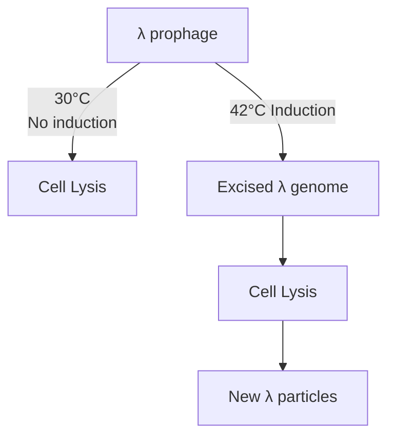
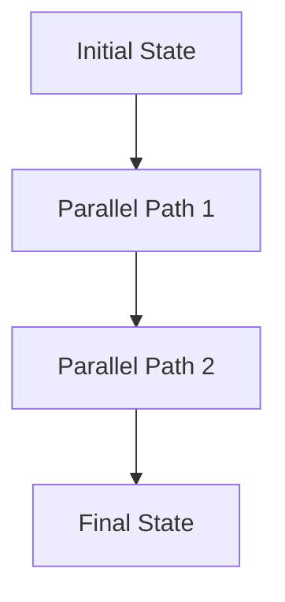
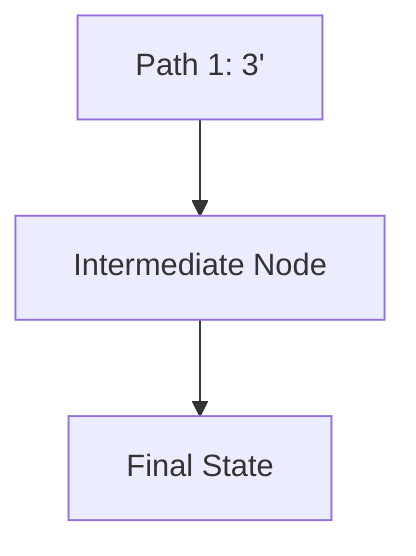
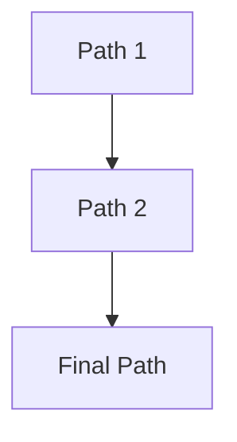
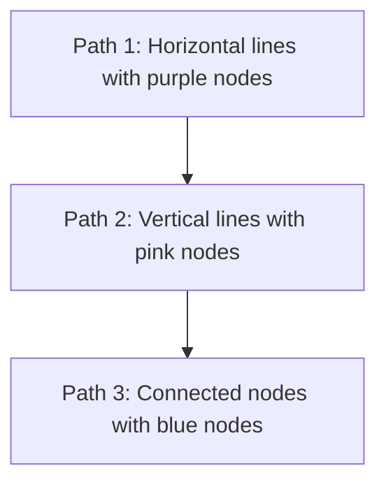

purification of significant quantities of phage DNA is subject to several pitfalls. The main difficulty, especially with λ, is growing an infected culture in such a way that the extracellular phage titre (the number of phage particles per ml of culture) is sufficiently high. In practical terms, the maximum titre that can reasonably be expected for $\lambda$ is $1 0 ^ { 1 0 }$ per ml; yet $1 0 ^ { 1 0 }   \lambda$ particles will yield only 500 ng of DNA. Large culture volumes, in the range of 500–1000 ml, are therefore needed if substantial quantities of λ DNA are to be obtained.

## 3.3.1 Growth of cultures to obtain a high λ titre

Growing a large volume culture is no problem (bacterial cultures of 100 litres and over are common in biotechnology) but obtaining the maximum phage titre requires a certain amount of skill. The naturally occurring λ phage is lysogenic (Section 2.2.2), and an infected culture consists mainly of cells carrying the prophage integrated into the bacterial DNA (see Figure 2.7). The extracellular λ titre is extremely low under these circumstances.

To get a high yield of extracellular λ, the culture must be **induced**, so that all the bacteria enter the lytic phase of the infection cycle, resulting in cell death and release of λ particles into the medium. Induction is normally very difficult to control, but most laboratory strains of λ carry a **temperature‐sensitive (ts) mutation** in the cI gene. This is one of the genes that are responsible for maintaining the phage in the integrated state. If inactivated by a mutation, the cI gene no longer functions correctly and the switch to lysis occurs. In the cIts mutation, the cI gene is functional at $3 0 ^ { \circ } \mathrm { C } ,$ at which temperature normal lysogeny can occur. But at $4 2 ^ { \circ } \mathrm { C } _ { \circ }$ the cIts gene product does not work properly, and lysogeny cannot be maintained. A culture of E. coli infected with a λ phage carrying the cIts mutation can therefore be induced to produce extracellular phages by transferring from $3 0 ^ { \circ } \mathrm { C }$ to $4 2 ^ { \circ } \mathrm { C }$ (Figure 3.21).

## 3.3.2 Preparation of non‐lysogenic λ phages

Although most λ strains are lysogenic, many cloning vectors derived from λ are modified, by deletions of the cI and other genes, so that lysogeny never occurs. These phages cannot integrate into the bacterial genome and can infect cells only by a lytic cycle (Section 2.2.1).

With these phages the key to obtaining a high titre lies in the way in which the culture is grown, in particular the stage at which the cells are infected by adding phage particles. If phages are added before the cells are dividing at their maximal rate, then all the cells are lysed very quickly, resulting in a low titre (Figure 3.22a). On the other hand, if the cell density is too high when the phages are added, then the culture will never be completely lysed, and again the phage titre will be low (Figure 3.22b). The ideal situation is when the age of the culture, and the size of the phage inoculum, are balanced such that the culture continues to grow, but eventually all the cells are infected and lysed (Figure 3.22c). As can be imagined, skill and experience are needed to judge the matter to perfection.

flowchart

Figure 3.21

Induction of a λ cIts lysogen by transferring from $3 0 ^ { \circ } 0$ to $4 2 ^ { \circ } \complement ,$

Figure 3.22

Achieving the right balance between culture age and inoculum size when preparing a sample of a non‐lysogenic phage.

## 3.3.3 Collection of phages from an infected culture

The remains of lysed bacterial cells, along with any intact cells that are inadvertently left over, can be removed from an infected culture by centrifugation, leaving the phage particles in suspension (see Figure 3.20). The problem now is to reduce the size of the suspension to 5 ml or less, a manageable size for DNA extraction.

Phage particles are so small that they are pelleted only by very highspeed centrifugation. Collection of phages is therefore usually achieved by precipitation with **polyethylene glycol (PEG)**. This is a long‐chain polymeric compound which, in the presence of salt, absorbs water, thereby causing macromolecular assemblies such as phage particles to precipitate. The precipitate can then be collected by centrifugation, and redissolved in a suitably small volume (Figure 3.23).

## 3.3.4 Purification of DNA from λ phage particles

Deproteinization of the redissolved PEG precipitate with a protease enzyme, followed by fractionation of the DNA by ion‐exchange chromatography, is often sufficient to extract the DNA from the phage particles. Alternatively, the phage capsids can be disrupted with guanidinium thiocyanate and the DNA recovered by silica binding. However, for the highest quality preparations the λ phages are subjected to an intermediate purification step. This is necessary because the PEG precipitate also contains a certain amount of bacterial debris, possibly including unwanted cellular DNA. These contaminants can be separated from the λ particles by CsCl density gradient centrifugation. The λ particles band in a CsCl gradient at $1.45-1.50\ g\ cm^{-3}$ (Figure 3.24) and can be withdrawn from the gradient as described previously for DNA bands (see Figure 3.18). Removal of CsCl by dialysis then leaves a phage preparation from which high‐purity DNA can be extracted.

## 3.3.5 Purification of M13 DNA causes few problems

Most of the differences between the M13 and λ infection cycles are to the advantage of the molecular biologist wishing to prepare M13 DNA. First, the double‐stranded replicative form of M13 (see Figure 2.11), which behaves like a high copy number plasmid, is very easily purified by the

flowchart

Figure 3.23

Collection of phage particles by polyethylene glycol (PEG) precipitation.

Figure 3.24

Purification of λ phage particles by CsCl density gradient centrifugation.

bar

| Component | CsCl density (g \(cm^{-3})\) |
| --- | --- |
| \(\lambda\) phage particles | ~1.44 |

standard procedures for plasmid preparation. A cell extract is prepared from cells infected with M13, and the replicative form separated from bacterial DNA by alkaline denaturation or EtBr–CsCl density gradient centrifugation.

However, the single‐stranded form of the M13 genome, contained in the extracellular phage particles, is frequently required. In this respect the big advantage compared with λ is that high titres of M13 are very easy to obtain. As infected cells continually secrete M13 particles into the medium (see Figure 2.8), with lysis never occurring, a high M13 titre is achieved simply by growing the infected culture to a high cell density. In fact, titres of $\stackrel { - } { 1 0 ^ { 1 2 } }$ per ml and above are quite easy to obtain without any special tricks being used. Such high titres mean that significant amounts of singlestranded M13 DNA can be prepared from cultures of small volume – 5 ml or less. Furthermore, as the infected cells are not lysed, there is no problem with cell debris contaminating the phage suspension.

In summary, a typical method for single‐stranded M13 DNA preparation involves growth of a small volume of infected culture, centrifugation to pellet the bacteria, precipitation of the phage particles with PEG, phenol extraction to remove the phage protein coats, and ethanol precipitation to concentrate the resulting DNA (Figure 3.25).

flowchart

Figure 3.25

Preparation of single‐stranded M13 DNA from an infected culture of bacteria.

## Further reading

- Berensmeier, S. (2006) Magnetic particles for the separation and purification of nucleic acids. Applied Microbiology and Biotechnology, 73, 495–504.
- Birnboim, H.C. and Doly, J. (1979) A rapid alkaline extraction procedure for screening recombinant plasmid DNA. Nucleic Acids Research, 7, 1513–1523. [A method for preparing plasmid DNA.]
- Boom, R., Sol, C.J., Salimans, M.M., et al. (1990) Rapid and simple method for purification of nucleic acids. Journal of Clinical Microbiology, 28, 495–503 [The guanidinium thiocyanate and silica method for DNA purification.]
- Clewell, D.B. (1972) Nature of ColE1 plasmid replication in Escherichia coli in the presence of chloramphenicol. Journal of Bacteriology, 110, 667–676 [The biological basis of plasmid amplification.]
- Marmur, J. (1961) A procedure for the isolation of deoxyribonucleic acid from microorganisms. Journal of Molecular Biology, 3, 208–218 [Genomic DNA preparation.]
- Radloff, R., Bauer, W., and Vinograd, J. (1967) A dye‐buoyant‐density method for the detection and isolation of closed‐circular duplex DNA. Proceedings of the National Academy of Sciences USA, 57, 1514–1521 [The original description of ethidium bromide density gradient centrifugation.]
- Rogers, S.O. and Bendich, A.J. (1985) Extraction of DNA from milligram amounts of fresh herbarium and mummified plant tissues. Plant Molecular Biology, 5, 69–76 [The CTAB method.]
- Yamamoto, K.R., Alberts, B.M., Benzinger, R., et al. (1970) Rapid bacteriophage sedimentation in the presence of polyethylene glycol and its application to large scale virus preparation. Virology, 40, 734–744 [Preparation of λ DNA.]
- Zinder, N.D. and Boeke, J.D. (1982) The filamentous phage (Ff) as vectors for recombinant DNA. Gene, 19, 1–10 [Methods for M13 phage growth and DNA preparation.]

## Chapter 4

# Manipulation of Purified DNA

## Chapter contents

**4.1** The range of DNA manipulative enzymes 55
**4.2** Enzymes for cutting DNA – restriction endonucleases 59
**4.3** Ligation – joining DNA molecules together 72

Once pure samples of DNA have been prepared, the next step in a gene cloning experiment is construction of the recombinant DNA molecule (see Figure 1.1). To produce this recombinant molecule, the vector, as well as the DNA to be cloned, must be cut at specific points and then joined together in a controlled manner. Cutting and joining are two examples of DNA manipulative techniques, a wide variety of which have been developed over the past few years. As well as being cut and joined, DNA molecules can be shortened, lengthened, copied into RNA or into new DNA molecules, and modified by the addition or removal of specific chemical groups. These manipulations, all of which can be carried out in the test tube, provide the foundation not only for gene cloning, but also for studies of DNA biochemistry, genome organization, gene structure, and the control of gene expression.

Almost all DNA manipulative techniques make use of purified enzymes. Within the cell these enzymes participate in essential processes such as DNA replication and transcription, breakdown of unwanted or foreign DNA (e.g. invading virus DNA), repair of mutated DNA, and **recombination** between different DNA molecules. After purification from cell extracts, many of these enzymes can be persuaded to carry out their natural reactions, or something closely related to them, under artificial conditions. Although these enzymatic reactions are often straightforward, most are absolutely impossible to perform by standard chemical methods. Purified enzymes are therefore crucial to genetic engineering and an important industry has sprung up around their preparation, characterization, and marketing. Commercial suppliers of high‐purity enzymes provide an essential service to the molecular biologist.

Figure 4.1 The reactions catalysed by the two different kinds of nuclease. (a) An exonuclease, which removes nucleotides from the end of a DNA molecule. (b) An endonuclease, which breaks internal phosphodiester bonds.

The cutting and joining manipulations that underlie gene cloning are carried out by enzymes called **restriction endonucleases** (for cutting) and **ligases** (for joining). Most of this chapter will be concerned with the ways in which these two types of enzyme are used. First, however, we must consider the whole range of DNA manipulative enzymes, to see exactly what types of reaction can be performed. Many of these enzymes will be mentioned in later chapters when procedures that make use of them are described.

## 4.1 The range of DNA manipulative enzymes

DNA manipulative enzymes can be grouped into four broad classes, depending on the type of reaction that they catalyse:

• **Nucleases** are enzymes that cut, shorten, or degrade nucleic acid molecules.
• **Ligases** join nucleic acid molecules together.
• **Polymerases** make copies of molecules.
• **Modifying enzymes** remove or add chemical groups.

Before considering in detail each of these classes of enzyme, two points should be made. The first is that, although most enzymes can be assigned to a particular class, a few display multiple activities that span two or more classes. Most importantly, many polymerases combine their ability to make new DNA molecules with an associated DNA degradative (i.e. nuclease) activity.

Second, it should be appreciated that, as well as the DNA manipulative enzymes, many similar enzymes able to act on RNA are known. The ribonuclease used to remove contaminating RNA from DNA preparations (Section  3.1.3) is an example of such an enzyme. Although some RNA manipulative enzymes have applications in gene cloning and will be mentioned in later chapters, we will in general restrict our thoughts to those enzymes that act on DNA.

## 4.1.1 Nucleases

Nucleases degrade DNA molecules by breaking the phosphodiester bonds that link one nucleotide to the next in a DNA strand. There are two different kinds of nuclease (Figure 4.1):

• **Exonucleases** remove nucleotides one at a time from the end of a DNA molecule.
• **Endonucleases** are able to break internal phosphodiester bonds within a DNA molecule.

The main distinction between different exonucleases lies in the number of strands that are degraded when a double‐stranded molecule is attacked. The enzyme called Bal31 (purified from the bacterium Alteromonas espejiana) is an example of an exonuclease that removes nucleotides from both strands of a double‐stranded molecule (Figure 4.2a). The greater the length of time that Bal31 is allowed to act on a group of DNA molecules, the shorter the resulting DNA fragments will be. In contrast, enzymes such as  E. coli exonuclease III degrade just one strand of a double‐stranded molecule, leaving single‐stranded DNA as the product (Figure 4.2b).

(a) Bal31

flowchart

(b) Exonuclease III

flowchart

Figure 4.2

The reactions catalysed by different types of exonuclease. (a) Bal31, which removes nucleotides from both strands of a double‐stranded molecule. (b) Exonuclease III, which removes nucleotides only from the 3′ terminus.

The same criterion can be used to classify endonucleases. S1 endonuclease (from the fungus Aspergillus oryzae) only cleaves single strands (Figure 4.3a), whereas deoxyribonuclease I (DNase I), which is prepared from cow pancreas, cuts both single‐ and double‐stranded molecules (Figure 4.3b). DNase I is non‐specific in that it attacks DNA at any internal phosphodiester bond, so the end result of prolonged DNase I action is a mixture of mononucleotides and very short oligonucleotides. On the other hand, the special group of enzymes called restriction endonucleases cleave double‐stranded DNA only at a limited number of specific recognition sites (Figure 4.3c). These important enzymes are described in detail in Section 4.2.

The reactions catalysed by different types of endonuclease. (a) S1 nuclease, which cleaves only single‐stranded DNA, including single‐stranded nicks in mainly doublestranded molecules. (b) DNase I, which cleaves both single‐ and double‐stranded DNA. (c) A restriction endonuclease, which cleaves double‐stranded DNA, but only at a limited number of sites.

Figure 4.3

(a) S1 nuclease

flowchart

chemical

Diagram showing a nickel-nick molecular chain transformation with labeled 'A nick' and electron density distribution

(b) DNase I

flowchart

flowchart

(c) A restriction endonuclease

chemical

Diagram showing a structural transformation or polymer chain with pink and blue spheres connected by bonds, indicating a transformation or transformation process.

Figure 4.4

The two reactions catalysed by DNA ligase. (a) Repair of a discontinuity – a missing phosphodiester bond in one strand of a double‐stranded molecule. (b) Joining two molecules together.

## 4.1.2 Ligases

In the cell the function of DNA ligase is to repair single‐stranded breaks (‘discontinuities’) that arise in double‐stranded DNA molecules during, for example, DNA replication. DNA ligases from most organisms can also join together two individual fragments of double‐stranded DNA (Figure  4.4). The role of these enzymes in construction of recombinant DNA molecules is described in Section 4.3.

## 4.1.3 Polymerases

DNA polymerases are enzymes that synthesize a new strand of DNA complementary to an existing DNA or RNA template (Figure  4.5a). Most polymerases can function only if the **template** possesses a double‐stranded region that acts as a **primer** for initiation of polymerization.

Four types of DNA polymerase are used routinely in genetic engineering. The first is DNA polymerase I, which is usually prepared from E. coli. This enzyme attaches to a short single‐stranded region (or **nick**) in a mainly double‐stranded DNA molecule, and then synthesizes a completely new strand, degrading the existing strand as it proceeds (Figure  4.5b). DNA polymerase I is therefore an example of an enzyme with a dual activity: DNA polymerization and DNA degradation.

The polymerase and nuclease activities of DNA polymerase I are controlled by different parts of the enzyme molecule. The nuclease activity is contained in the first 323 amino acids of the polypeptide, so removal of this segment leaves a modified enzyme that retains the polymerase function but is unable to degrade DNA. This modified enzyme, called the **Klenow fragment**, can still synthesize a complementary DNA strand on a single‐stranded template, but as it has no nuclease activity it cannot continue the synthesis once the nick is filled in (Figure  4.5c). Several other enzymes – natural polymerases and modified versions – have similar properties to the Klenow fragment. For many years, these polymerases were used in DNA sequencing. They have now been largely superseded in this role, but still have important applications, for example in DNA labelling (Section 8.4.2)

The Taq DNA polymerase used in the **polymerase chain reaction (PCR)** (see Figure 1.2) is the DNA polymerase I enzyme of the bacterium Thermus aquaticus. This organism lives in hot springs, and many of its enzymes,

(a) The basic reaction

chemical

DNA sequence diagram showing primer and template with nucleotide positions

Newly synthesized

chemical

DNA strand diagram showing complementary strands with labeled positions 3' and 5'

(b) DNA polymerase I

Existing nucleotides

(c) The Klenow fragment

Only the nick

chemical

Chemical structure showing functional group changes with fill-in and replacement conditions

(d) Reverse transcriptase

New strand of DNA

Figure 4.5

The reactions catalysed by DNA polymerases. (a) The basic reaction: a new DNA strand is synthesized in the $5 ^ { \prime }   { \mathfrak { t } } 0   3 ^ { \prime }$ direction. (b) DNA polymerase I, which initially fills in nicks but then continues to synthesize a new strand, degrading the existing one as it proceeds. (c) The Klenow fragment, which only fills in nicks. (d) Reverse transcriptase, which uses a template of RNA.

including the Taq DNA polymerase, are thermostable, meaning that they are resistant to denaturation by heat treatment. This is the special feature of Taq DNA polymerase that makes it suitable for PCR, because if it was not thermostable it would be inactivated when the temperature of the reaction is raised to $9 4 ^ { \circ } \mathrm { C }$ to denature the DNA.

The final type of DNA polymerase that is important in genetic engineering is **reverse transcriptase**, an enzyme involved in the replication of several kinds of virus. Reverse transcriptase is unique in that it uses as a template not DNA but RNA (Figure 4.5d). The ability of this enzyme to synthesize a DNA strand complementary to an RNA template is central to the technique called complementary DNA (cDNA) synthesis (see Figure 8.7).

## 4.1.4 DNA modifying enzymes

There are numerous enzymes that modify DNA molecules by addition or removal of specific chemical groups. The most important are as follows:

• **Alkaline phosphatase** (from E. coli, calf intestinal tissue, or arctic shrimp), which removes the phosphate group present at the $5 ^ { \prime }$ **terminus** of a DNA molecule (Figure 4.6a).

## Figure 4.6

The reactions catalysed by DNA modifying enzymes. (a) Alkaline phosphatase, which removes 5′‐phosphate groups. (b) Polynucleotide kinase, which attaches 5′‐phosphate groups. (c) Terminal deoxynucleotidyl transferase, which attaches deoxyribonucleotides to the 3′ termini of polynucleotides in either single‐ or double‐stranded molecules.

• **Polynucleotide kinase** (from E. coli infected with T4 phage), which has the reverse effect to alkaline phosphatase, adding phosphate groups onto free $5 ^ { \prime }$ termini (Figure 4.6b).
**Terminal deoxynucleotidyl transferase** (from calf thymus tissue), which adds one or more deoxyribonucleotides onto the $3 ^ { \prime }$ **terminus** of a DNA molecule (Figure 4.6c).

## 4.2 Enzymes for cutting DNA – restriction endonucleases

Gene cloning requires that DNA molecules be cut in a very precise and reproducible fashion. This is illustrated by the way in which the vector is cut during construction of a recombinant DNA molecule (Figure  4.7a). Each vector molecule must be cleaved at a single position, to open up the circle so that new DNA can be inserted. A molecule that is cut more than once will be broken into two or more separate fragments and will be of no use as a cloning vector. Furthermore, each vector molecule must be cut at exactly the same position on the circle – as will become apparent in later chapters, random cleavage is not satisfactory. It should be clear that a very special type of nuclease is needed to carry out this manipulation.

Often it is also necessary to cleave the DNA that is to be cloned (Figure 4.7b). There are two reasons for this. First, if the aim is to clone a single gene, which may consist of only 2 or 3 kb of DNA, then that gene will have to be cut out of the large (often greater than 80 kb) DNA molecules

The need for very precise cutting manipulations in a gene cloning experiment.

Figure 4.7

(a) Vector molecules

text_image

Cut sites

Each vector molecule must be cut once, each at the same position

(b) The DNA molecule containing the gene to be cloned

text_image

Gene
Cut sites
Large DNA molecule
Fragments small enough
to be cloned

produced by skilful use of the preparative techniques described in Chapter 3. Second, large DNA molecules may have to be broken down simply to produce fragments small enough to be carried by the vector. Most cloning vectors exhibit a preference for DNA fragments that fall into a particular size range: most plasmid‐based vectors, for example, are very inefficient at cloning DNA molecules more than 8 kb in length.

Purified restriction endonucleases allow the molecular biologist to cut DNA molecules in the precise, reproducible manner required for gene cloning. The discovery of these enzymes, which led to Nobel Prizes for W. Arber, H. Smith, and D. Nathans in 1978, was one of the key breakthroughs in the development of genetic engineering.

## 4.2.1 The discovery and function of restriction endonucleases

The initial observation that led to the eventual discovery of restriction endonucleases was made in the early 1950s, when it was shown that some strains of bacteria are immune to bacteriophage infection, a phenomenon referred to as **host‐controlled restriction**.

The mechanism of restriction is not very complicated, even though it took over 20 years to be fully understood. Restriction occurs because the bacterium produces an enzyme that degrades the phage DNA before it has time to replicate and direct synthesis of new phage particles (Figure 4.8a). The bacterium’s own DNA, the destruction of which would of course be lethal, is protected from attack because it carries additional methyl groups that block the degradative enzyme action (Figure 4.8b).

Figure 4.8

The function of a restriction endonuclease in a bacterial cell. (a) Phage DNA is cleaved, but (b) bacterial DNA is not.

These degradative enzymes are called restriction endonucleases and are synthesized by many, perhaps all, species of bacteria. Over 4000 different ones have been isolated and more than 600 are available for use in the laboratory. Four different classes of restriction endonuclease are recognized, each distinguished by a slightly different mode of action. Types I, III, and IV are rather complex and have only a limited role in genetic engineering. Type II restriction endonucleases, on the other hand, are the cutting enzymes that are so important in gene cloning.

## 4.2.2 Type II restriction endonucleases cut DNA at specific nucleotide sequences

The central feature of type II restriction endonucleases (which will be referred to simply as ‘restriction endonucleases’ from now on) is that each enzyme has a specific recognition sequence at which it cuts a DNA molecule. A particular enzyme cleaves DNA at the recognition sequence and nowhere else. For example, the restriction endonuclease called PvuI (isolated from Proteus vulgaris) cuts DNA only at the hexanucleotide CGATCG. In contrast, a second enzyme from the same bacterium, called PvuII, cuts at a different hexanucleotide, in this case CAGCTG.

Table 4.1

The recognition sequences for some of the most frequently used restriction endonucleases.

| ENZYME | ORGANISM | RECOGNITION SEQUENCE$^{a}$ | BLUNT OR STICKY END |
| --- | --- | --- | --- |
| EcoRI | Escherichia coli | GAATTC | Sticky |
| BamHI | Bacillus amyloliquefaciens | GGATCC | Sticky |
| BgIII | Bacillus globigii | AGATCT | Sticky |
| Pvul | Proteus vulgaris | CGATCG | Sticky |
| Pvull | Proteus vulgaris | CAGCTG | Blunt |
| HindIII | Haemophilus influenzae $R_{d}$ | AAGCTT | Sticky |
| Smal | Serratia marcescens | CCCGGG | Blunt |
| Hinfl | Haemophilus influenzae $R_{f}$ | GANTC | Sticky |
| Sau3A | Staphylococcus aureus | GATC | Sticky |
| Alul | Arthrobacter luteus | AGCT | Blunt |
| TaqI | Thermus aquaticus | TCGA | Sticky |
| HaeIII | Haemophilus aegyptius | GGCC | Blunt |
| Notl | Nocardia otitidis-caviarum | GCGGCCGC | Sticky |
| Sfil | Streptomyces fimbriatus | GGCCNNNNNGGCC | Sticky |

a The sequence shown is that of one strand, given in the 5´ to 3´ direction. ‘N’ indicates any nucleotide. Note that almost all recognition sequences are palindromes: when both strands are considered they read the same in each direction, for example:

$$
\begin{array}{c c} & 5 ^ {\prime} \text {-GAATTC-3^{\prime}} \\ \text {EcoRI} & | | | | | | \\ & 3 ^ {\prime} \text {-CTTAAG-5^{\prime}} \end{array}
$$

Many restriction endonucleases recognize hexanucleotide target sites, but others cut at four, five, eight, or even longer nucleotide sequences. Sau3A (from Staphylococcus aureus strain 3A) recognizes GATC, and AluI (Arthrobacter luteus) cuts at AGCT. There are also examples of restriction endonucleases with degenerate recognition sequences, meaning that they cut DNA at any one of a family of related sites. HinfI (Haemophilus influenzae strain $\begin{array} { r } { \left. \mathbf { R } _ { \mathrm { { f } } } \right\rangle _ { 1 } } \end{array}$ , for instance, recognizes GANTC, so cuts at GAATC, GATTC, GAGTC, and GACTC. The recognition sequences for some of the most frequently used restriction endonucleases are listed in Table 4.1.

## 4.2.3 Blunt ends and sticky ends

The exact nature of the cut produced by a restriction endonuclease is of considerable importance in the design of a gene cloning experiment. Many restriction endonucleases make a simple double‐stranded cut in the middle of the recognition sequence (Figure 4.9a), resulting in **blunt end** or **flush end**. PvuII and AluI are examples of blunt end cutters.

Other restriction endonucleases cut DNA in a slightly different way. With these enzymes the two DNA strands are not cut at exactly the same position. Instead the cleavage is staggered, usually by two or four nucleotides, so that the resulting DNA fragments have short single‐stranded overhangs at each end (Figure 4.9b). These are called sticky or cohesive ends, as base pairing between them can stick the DNA molecule back together again (recall that sticky ends were encountered in Section 2.2.2 during the description of λ phage replication). One important feature of sticky end enzymes is that restriction endonucleases with different recognition