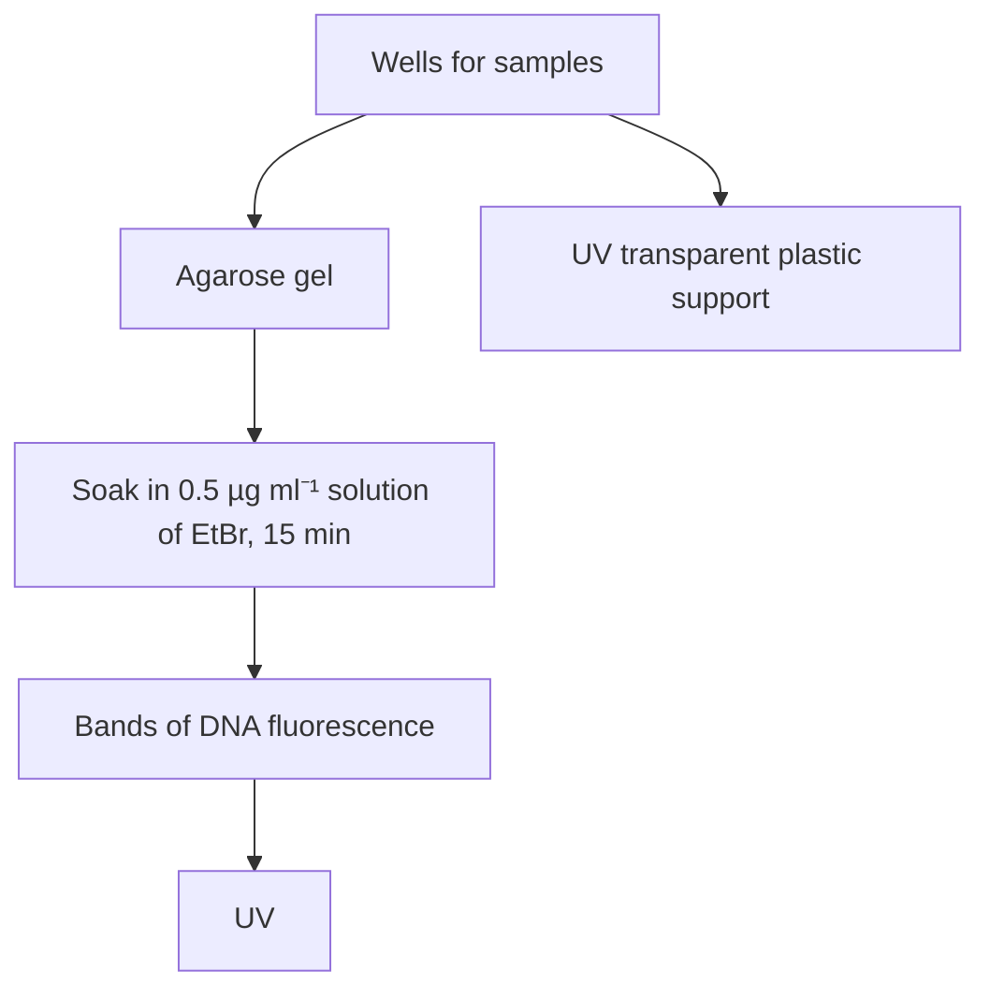
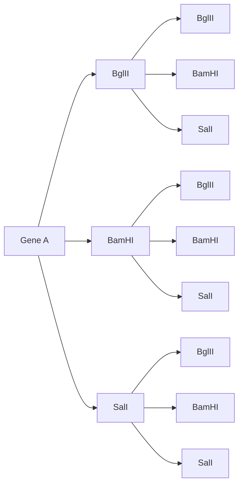
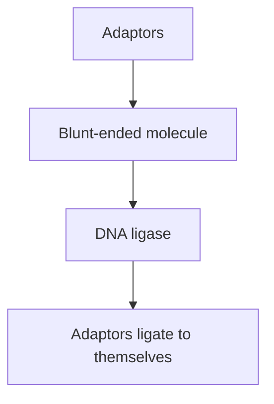

Figure 4.9

The ends produced by cleavage of DNA with different restriction endonucleases. (a) A blunt end produced by AluI. (b) A sticky end produced by EcoRI. (c) The same sticky ends produced by BamHI, BglII, and Sau3A.

sequences may produce the same sticky ends. BamHI (recognition sequence GGATCC) and BglII (AGATCT) are examples  –  both produce GATC sticky ends (Figure 4.9c). The same sticky end is also produced by Sau3A, which recognizes only the tetranucleotide GATC. Fragments of DNA produced by cleavage with either of these enzymes can be joined to each other, as each fragment carries a complementary sticky end.

## 4.2.4 The frequency of recognition sequences in a DNA molecule

The number of recognition sequences for a particular restriction endonuclease in a DNA molecule of known length can be calculated mathematically. A tetranucleotide sequence (e.g. GATC) should occur once every 44 = 256 nucleotides, and a hexanucleotide (e.g. GGATCC) once every $4 ^ { 6 } = 4 0 9 6$ nucleotides. These calculations assume that the nucleotides are ordered in a random fashion and that the four different nucleotides are pre-sent in equal proportions (i.e. the GC content = 50%). In practice, neither of these assumptions is entirely valid. For example, the λ DNA molecule, at 49 kb, should contain about 12 sites for a restriction endonuclease with a hexanucleotide recognition sequence. In fact, many of these recognition sites occur less frequently (e.g. six for BglII, five for BamHI, and only two for SalI), a reflection of the fact that the GC content for λ is rather less than 50% (Figure 4.10a).

Furthermore, restriction sites are generally not evenly spaced out along a DNA molecule. If they were, then digestion with a particular restriction endonuclease would give fragments of roughly equal sizes. Figure 4.10b shows the fragments produced by cutting λ DNA with BglII, BamHI, and SalI. In each case there is a considerable spread of fragment sizes, indicating that in λ DNA the nucleotides are not randomly ordered.

(a) Cleavage sites on λ DNA

dendrogram

| Protein | Fragment Size |
| :--- | :--- |
| BglII | 22 010 |
| BglII | 13 286 |
| BglII | 9688 |
| BglII | 2392 |
| BglII | 651 |
| BglII | 415 |
| BglII | 60 |
| BamHI | 16 841 |
| BamHI | 7233 |
| BamHI | 6770 |
| BamHI | 6527 |
| BamHI | 5626 |
| BamHI | 5505 |
| SalI | 15 258 |
| SalI | 499 |
| SalI | 32 745 |

Figure 4.10

Restriction of the λ DNA molecule. (a) The positions of the recognition sequences for BglII, BamHI, and SalI. (b) The fragments produced by cleavage with each of these restriction endonucleases. The numbers are the fragment sizes in base pairs.

The lesson to be learned from Figure 4.10 is that although mathematics may give an idea of how many restriction sites to expect in a given DNA molecule, only experimental analysis can provide the true picture. We must therefore move on to consider how restriction endonucleases are used in the laboratory.

## 4.2.5 Performing a restriction digest in the laboratory

As an example, we will consider how to digest a sample of λ DNA (concentration 125 μg ml–1) with BglII.

First, the required amount of DNA must be pipetted into a test tube. The amount of DNA that will be restricted depends on the nature of the experiment. In this case we will digest 2 μg of λ DNA, which is contained in 16 μl of the sample (Figure 4.11a). Very accurate micropipettes will therefore be needed. The other main component in the reaction will be the restriction endonuclease, obtained from a commercial supplier as a pure solution of known concentration. But before adding the enzyme, the solution containing the DNA must be adjusted to provide the correct conditions to ensure maximal activity of the enzyme. Most restriction endonucleases function adequately at pH 7.4, but different enzymes vary in their requirements for ionic strength, usually provided by sodium chloride (NaCl) and magnesium $( \mathrm { M g } ^ { 2 + } )$ concentration (all type II restriction endonucleases require $\mathbf { M g } ^ { 2 + }$ in order to function). It is also advisable to add a reducing agent, such as dithiothreitol (DTT), which stabilizes the enzyme and prevents its inactivation. Providing the right conditions for the enzyme is very important – incorrect NaCl or $\mathbf { M g } ^ { 2 + }$ concentrations not only decrease the activity of the restriction endonuclease, they might also cause changes in the specificity of the enzyme, so that DNA cleavage occurs at additional, non‐standard recognition sequences.

flowchart

Figure 4.11

Performing a restriction digest in the laboratory.

The composition of a suitable buffer for BglII is shown in Table 4.2. This buffer is ten times the working concentration and is diluted by being added to the reaction mixture. In our example, a suitable final volume for the reaction mixture would be $2 0   \mu \mathrm { l } _ { \mathrm { i } }$ so we add $2 \; \mu \mathrm { l }$ $1 0 \times B g l \mathrm { I I }$ buffer to the 16 μl of DNA already present (Figure 4.11b).

The restriction endonuclease can now be added. By convention, 1 unit of enzyme is defined as the quantity needed to cut 1 μg of DNA in 1 hour, so we need 2 units of BglII to cut 2 μg of λ DNA. BglII is frequently obtained at a concentration of 4 units/μl, so 0.5 μl is sufficient to cleave the DNA. The final ingredients in the reaction mixture are therefore 0.5 μl BglII + 1.5 μl water, giving a final volume of 20 μl (Figure 4.11c).

The last factor to consider is incubation temperature. Most restriction endonucleases, including BglII, work best at $3 7 ^ { \circ } \mathrm { C } _ { 2 }$ but a few have different requirements. TaqI, for example, is a restriction enzyme from Thermus aquaticus and, like Taq DNA polymerase, has a high working temperature. Restriction digests with TaqI must be incubated at $6 5 ^ { \circ } \mathrm { C }$ to obtain maximum enzyme activity.

After one hour the restriction should be complete (Figure 4.11d). If the DNA fragments produced by restriction are to be used in cloning experiments, the enzyme must somehow be destroyed so that it does not accidentally digest other DNA molecules that may be added at a later stage.

Table 4.2

A 10 × buffer suitable for restriction of DNA with BglII.

| COMPONENT | CONCENTRATION (mM) |
| --- | --- |
| Tris-HCl, pH 7.4 | 500 |
| $MgCl_{2}$ | 100 |
| NaCl | 500 |
| Dithiothreitol | 10 |

Figure 4.12

(a) Standard electrophoresis does not separate DNA fragments of different sizes, whereas (b) gel electrophoresis does.

There are several ways of ‘killing’ the enzyme. For many a short incubation at $7 0 ^ { \circ } \mathrm { C }$ is sufficient, for others phenol extraction or the addition of **ethylenediamine tetraacetate (EDTA)**, which binds $\mathbf { M g } ^ { 2 + }$ ions preventing restriction endonuclease action, is used (Figure 4.11e).

## 4.2.6 Analysing the result of restriction endonuclease cleavage

A restriction digest results in a number of DNA fragments, the sizes of which depend on the exact positions of the recognition sequences for the  endonuclease in the original molecule (see Figure  4.10). A way of determining the number and sizes of the fragments is needed if restriction endonucleases are to be of use in gene cloning. Whether or not a DNA molecule is cut at all can be determined fairly easily by testing the viscosity of the solution. Larger DNA molecules result in a more viscous solution than smaller ones, so cleavage is associated with a decrease in viscosity. However, working out the number and sizes of the individual cleavage products is more difficult. In fact, for several years this was one of the most tedious aspects of experiments involving DNA. Eventually the problems were solved in the early 1970s when the technique of **gel electrophoresis** was developed.

## Separation of molecules by gel electrophoresis

**Electrophoresis**, like ion‐exchange chromatography (Section  3.1.3), is a technique that uses differences in electrical charge to separate the molecules in a mixture. DNA molecules have negative charges, and so when placed in an electric field they migrate towards the positive pole (Figure 4.12a). The rate of migration of a molecule depends on two factors, its shape and its charge‐to‐mass ratio. Unfortunately, most DNA molecules are the same shape, and all have very similar charge‐to‐mass ratios. Fragments of different sizes cannot therefore be separated by standard electrophoresis.

The size of the DNA molecule does, however, become a factor if the electrophoresis is performed in a gel. A gel, which is usually made of agarose, polyacrylamide, or a mixture of the two, comprises a complex network of pores, through which the DNA molecules must travel to reach the positive electrode. The smaller the DNA molecule, the faster it can migrate through the gel. Gel electrophoresis therefore separates DNA molecules according to their size (Figure 4.12b).

In practice the composition of the gel determines the sizes of the DNA molecules that can be separated. A 0.5 cm thick slab of 0.5% agarose, which has relatively large pores, would be used for molecules in the size range 1–30 kb, allowing, for example, molecules of 10 and 12 kb to be clearly distinguished. At the other end of the scale, a very thin (0.3 mm) 40% polyacrylamide gel, with extremely small pores, would be used to  separate much smaller DNA molecules, in the range of 1–300 bp, and  could distinguish molecules differing in length by just a single nucleotide.

## Visualizing DNA molecules in an agarose gel

The easiest way to see the results of a gel electrophoresis experiment is to stain the gel with a compound that makes the DNA visible. Ethidium bromide (EtBr), already described in Section 3.2.2 as a means of visualizing DNA in caesium chloride gradients, is also routinely used to stain DNA in agarose and polyacrylamide gels (Figure 4.13). Bands showing the positions of the different size classes of DNA fragment are clearly visible under ultraviolet irradiation after EtBr staining, so long as sufficient DNA is present.

Unfortunately, this procedure is very hazardous because EtBr is a powerful mutagen. Another disadvantage is that EtBr staining also has limited sensitivity, and if a band contains less than about 10 ng of DNA then it might not be visible after staining. For these reasons, non‐mutagenic dyes that stain DNA green, red, or blue are now used in many laboratories. Most of these dyes can be used either as a post‐stain after electrophoresis, as illustrated in Figure 4.13 for EtBr, or alternatively, because they are non‐hazardous, they can be included in the buffer solution in which the agarose or polyacrylamide is dissolved when the gel is prepared. Some of these dyes require ultraviolet irradiation in order to make the bands visible, but others are visualized by illumination at other wavelengths, for example under blue light, removing a second hazard as ultraviolet radiation can cause severe burns. The most sensitive dyes are able to detect bands that contain less than 1 ng DNA.

Figure 4.13

Visualizing DNA bands in an agarose gel by EtBr staining and ultraviolet (UV) irradiation.

flowchart

## 4.2.7 Estimation of the sizes of DNA molecules

Gel electrophoresis separates different‐sized DNA molecules, with the smallest molecules travelling the greatest distance toward the positive electrode. If several DNA fragments of varying sizes are present (the result of a successful restriction digest, for example), then a series of bands appears in the gel. How can the sizes of these fragments be determined?

The most accurate method is to make use of the mathematical relationship that links migration rate to molecular mass. The relevant formula is:

$$
D = a - b (\log M)
$$

where D is the distance moved, M is the molecular mass, and a and b are constants that depend on the electrophoresis conditions.

Because extreme accuracy in estimating DNA fragment sizes is not always necessary, a much simpler though less precise method is more generally used. A standard restriction digest, comprising fragments of known size, is usually included in each electrophoresis gel that is run. Restriction digests of λ DNA are often used in this way as size markers. For example, HindIII cleaves λ DNA into eight fragments, ranging in size from 125 bp for the smallest to over 23 kb for the largest. As the sizes of the fragments in this digest are known, the fragment sizes in the experimental digest can be estimated by comparing the positions of the bands in the two tracks (Figure  4.14). Special mixtures of DNA fragments called **DNA ladders**, whose sizes are multiples of 100 bp or of 1 kb, can also be used as size markers. Although not precise, size estimation by comparison with DNA markers can be performed with as little as a 5% error, which is satisfactory for most purposes.

(a) Rough estimation by eye

bar

| Variant | HindIII \(\lambda\) (bp) | Unknown (bp) |
| --- | --- | --- |
| 1 | — | c. 5000 bp |
| 2 | — | c. 3200 bp |
| 3 | — | c. 2000 bp |

Figure 4.14

Estimation of the sizes of DNA fragments in an agarose gel. (a) A rough estimate of fragment size can be obtained by eye. (b) A more accurate measurement of fragment size is gained by using the mobilities of the HindIII–λ fragments to construct a calibration curve. The sizes of the unknown fragments can then be determined from the distances they have migrated.

(b) Accurate graphical estimation

line

| Distance migrated (cm) | Size of DNA (kb) |
| --- | --- |
| ~0.8 | ~9.2 |
| ~1.3 | ~6.8 |
| ~1.8 | ~4.3 |
| ~2.9 | ~2.6 |
| ~3.3 | ~2.2 |
| ~4.8 | ~1.5 |

## 4.2.8 Mapping the positions of different restriction sites in a DNA molecule

So far, we have considered how to determine the number and sizes of the DNA fragments produced by restriction endonuclease cleavage. The next step in **restriction analysis** is to construct a map showing the relative positions in the DNA molecule of the recognition sequences for a number of different enzymes. Only when a **restriction map** is available can the correct restriction endonucleases be selected for the particular cutting manipulation that is required (Figure 4.15).

To construct a restriction map, a series of restriction digests must be performed. First, the number and sizes of the fragments produced by each restriction endonuclease must be determined by gel electrophoresis followed by comparison with size markers (Figure 4.16). This information must then be supplemented by a series of **double digestions**, in which the DNA is cut by two restriction endonucleases at once. It might be possible to perform a double digestion in one step if both enzymes have similar requirements for pH, Mg2+ concentration, etc. Alternatively, the two digestions may have to be carried out one after the other, adjusting the reaction mixture after the first digestion to provide a different set of conditions for the second enzyme.

Comparing the results of single and double digests will allow many, if not all, of the restriction sites to be mapped (Figure 4.16). Ambiguities can usually be resolved by **partial digestion**, carried out under conditions that result in cleavage of only a limited number of the restriction sites on any DNA molecule. Partial digestion is usually achieved by reducing the

Using a restriction map to work out which restriction endonucleases should be used to obtain DNA fragments containing individual genes.

Figure 4.15

Genetic map

flowchart

To obtain gene B, digest with Bglll

text_image

Diagram showing four labeled components (A, B, C, D) connected by lines with circular motion indicators, likely illustrating a physics or physics concept.

To obtain gene D, digest with BamHl + Sall

text_image

A
B
C
D

incubation period, so the enzyme does not have time to cut all the restriction sites, or by incubating at a low temperature (e.g. 4°C rather than 37°C), which limits the activity of the enzyme.

The result of a partial digestion is a complex pattern of bands in an electrophoresis gel. As well as the standard fragments, produced by total digestion, additional sizes are seen. These are molecules that comprise two adjacent restriction fragments, separated by a site that has not been cleaved. Their sizes indicate which restriction fragments in the complete digest are next to one another in the uncut molecule (Figure 4.16).

## 4.2.9 Special gel electrophoresis methods for separating larger molecules

During agarose gel electrophoresis, a DNA fragment migrates at a rate that is proportional to its size, but this relationship is not a direct one. The formula that links migration rate to molecular mass has a logarithmic component (Section 4.2.7), which means that the difference in migration rates become increasingly small for larger molecules (Figure 4.17). In practice, molecules larger than about 50 kb cannot be resolved efficiently by standard gel electrophoresis.

This size limitation is not usually a problem when the restriction fragments being studied have been obtained by cutting the DNA with an enzyme with a tetranucleotide or hexanucleotide recognition sequence. Most, if not all, of the fragments produced in this way will be less than 30 kb in length and easily resolved by agarose gel electrophoresis.

Single and double digestions

| Enzyme | Number of fragments | Sizes (kb) |
| --- | --- | --- |
| Xbal | 2 | 24.0, 24.5 |
| Xhol | 2 | 15.0, 33.5 |
| KpnI | 3 | 1.5, 17.0, 30.0 |
| Xbal + Xhol | 3 | 9.0, 15.0, 24.5 |
| Xbal + KpnI | 4 | 1.5, 6.0, 17.0, 24.0 |

## Conclusions:

(1) As λ DNA is linear, the number of restriction sites for each enzyme is XbaI 1, XhoI 1, KpnI 2.
(2) The XbaI and XhoI sites can be mapped:

dendrogram

| Category | Value |
| --- | --- |
| XbaI fragments | 24.0 |
| XbaI - XhoI fragments | 9.0 |
| XhoI fragments | 15.0 |
| The only possibility is: (XhoI) | 15.0 |
| The only possibility is: (XbaI) | 9.0 |
| The only possibility is: (XbaI) | 24.5 |

(3) All the Kpnl sites fall in the 24.5 kb Xbal fragment, as the 24.0 kb fragment is intact after Xbal–Kpnl double digestion. The order of the Kpnl fragments can be determined only by partial digestion.

Partial digestion

| Enzyme | Fragment sizes (kb) |
| --- | --- |
| KpnI – limiting conditions | 1.5, 17.0, 18.5, 30.0, 31.5, 48.5 |

## Conclusions:

(1) 48.5 kb fragment = uncut λ.
(2) 1.5, 17.0 and 30.0 kb fragments are products of complete digestion.
(3) 18.5 and 31.5 kb fragments are products of partial digestion.

other

| Step | Value |
| --- | --- |
| The KpnI map must be: | 30.0 |
| The KpnI map must be: | 1.5 |
| The KpnI map must be: | 17.0 |
| Therefore the complete map is: | 15.0 |
| Therefore the complete map is: | 9.0 |
| Therefore the complete map is: | 6.0 |
| Therefore the complete map is: | 1.5 |
| Therefore the complete map is: | 17.0 |

## Figure 4.16

Restriction mapping. This example shows how the positions of the XbaI, XhoI, and KpnI sites on the λ DNA molecule can be determined.

Difficulties might arise, however, if an enzyme with a longer recognition sequence is used, such as NotI, which cuts at an eight‐nucleotide sequence (see Table 4.1). NotI would be expected, on average, to cut a DNA molecule once every $4 ^ { 8 } = 6 5$ 536 bp. It is therefore unlikely that NotI fragments will be separated by standard gel electrophoresis.

The limitations of standard gel electrophoresis can be overcome if a more complex electric field is used. The simplest of these systems is **orthogonal field alternation gel electrophoresis (OFAGE)**. Instead of being applied directly along the length of the gel, as in the standard method (Figure 4.18a), the electric field now alternates between two pairs of electrodes, each pair set at an angle of $4 5 ^ { \circ }$ to the length of the gel (Figure 4.18b). The result is a pulsed field, with the DNA molecules in the gel having to continually

Figure 4.17

The influence of DNA size on migration rate during conventional gel electrophoresis.

line

| Distance travelled (x hours) | Length of DNA molecule |
| --- | --- |
| Low | High |
| Medium | Medium |
| High | Low |

change direction in accordance with the pulses. As the two fields alternate in a regular fashion, the net movement of the DNA molecules in the gel is still from one end to the other, in more or less a straight line. However, with every change in field direction, each DNA molecule has to realign through $\dot { 9 } 0 ^ { \circ }$ before its migration can continue. This is the key point, because a short molecule can realign faster than a long one, allowing the short molecule to progress toward the bottom of the gel more quickly. This added dimension increases the resolving power of the gel quite dramatically, so that molecules up to several thousand kilobases in length can be separated.

This size range includes not only restriction fragments but also the intact chromosomal molecules of many lower eukaryotes, including yeast, several important filamentous fungi, and protozoans such as the malaria parasite Plasmodium falciparum. OFAGE and other **pulsed‐field gel electrophoresis (PFGE)** techniques such as **contour‐clamped homogeneous electric fields (CHEF)** and **field inversion gel electrophoresis (FIGE)** can therefore be used to prepare gels showing the separated chromosomes of these organisms (Figure 4.18c), enabling DNA from these individual chromosomes to be purified.

## 4.3 Ligation – joining DNA molecules together

The final step in construction of a recombinant DNA molecule is the joining together of the vector molecule and the DNA to be cloned (Figure 4.19). This process is referred to as ligation, and the enzyme that catalyses the reaction is called DNA ligase.

## 4.3.1 The mode of action of DNA ligase

All living cells produce DNA ligases, but the enzyme used in genetic engineering is usually purified from E. coli bacteria that have been infected with T4 phage. Within the cell the enzyme carries out the very important function of repairing any discontinuities that may arise in one of the strands of a double‐stranded molecule (see Figure 4.4a). A discontinuity is quite simply a position where a phosphodiester bond between adjacent

(a) Conventional agarose gel electrophoresis

text_image

Migration

text_image

(b) OFAGE

(c) Separation of yeast chromosomes by OFAGE

text_image

Chromosome number
IV, XII
VII, XV
XIII, XVI
II
XIV
X
XI
VIII, V
IX
III
VI
200 kb
700 kb
500 kb

Figure 4.18

The difference between conventional gel electrophoresis and orthogonal field alternation gel electrophoresis (OFAGE).

nucleotides is missing (contrast this with a nick, where one or more nucleotides are absent). Although discontinuities may arise by chance breakage of the cell’s DNA molecules, they are also a natural result of processes such as DNA replication and recombination. Ligases therefore play several vital roles in the cell.

In the test tube, purified DNA ligases, as well as repairing single‐strand discontinuities, can also join together individual DNA molecules or the two ends of the same molecule. The chemical reaction involved in ligating

flowchart

Figure 4.19

Ligation: the final step in construction of a recombinant DNA molecule.

Ligating blunt ends

flowchart

Figure 4.20

Ligation of blunt‐ended DNA molecules by DNA ligase.

two molecules is exactly the same as discontinuity repair, except that two phosphodiester bonds must be made, one for each strand (Figure 4.20).

## 4.3.2 Sticky ends increase the efficiency of ligation

The ligation reaction in Figure  4.20 shows two blunt‐ended fragments being joined together. Although this reaction can be carried out in the test tube, it is not very efficient. This is because the ligase is unable to ‘catch hold’ of the molecule to be ligated, and has to wait for chance associations to bring the ends together. If possible, blunt‐end ligation should be performed at high DNA concentrations, to increase the chances of the ends of the molecules coming together in the correct way.

In contrast, ligation of complementary sticky ends is much more efficient. This is because compatible sticky ends can base pair with one another by hydrogen bonding (Figure 4.21), forming a relatively stable structure for the enzyme to work on. If the phosphodiester bonds are not synthesized fairly quickly then the sticky ends fall apart again. These transient, base‐paired structures do, however, increase the efficiency of ligation by increasing the length of time the ends are in contact with one another.

## 4.3.3 Putting sticky ends onto a blunt‐ended molecule

For the reasons detailed in the preceding section, compatible sticky ends are desirable on the DNA molecules to be ligated together in a gene cloning experiment. Often these sticky ends can be provided by digesting both the vector and the DNA to be cloned with the same restriction endonuclease,

Ligating sticky ends

flowchart

Figure 4.21

Ligation of sticky‐ended molecules.

or with different enzymes that produce the same sticky end, but it is not always possible to do this. A common situation is where the vector molecule has sticky ends, but the DNA fragments to be cloned are blunt‐ended. Under these circumstances, one of three methods can be used to put the correct sticky ends onto the DNA fragments.

## Linkers

The first of these methods involves the use of **linkers**. These are short pieces of double‐stranded DNA, of known nucleotide sequence, that are synthesized in the test tube. A typical linker is shown in Figure 4.22a. It is bluntended, but contains a restriction site, BamHI in the example shown. DNA ligase can attach linkers to the ends of larger blunt‐ended DNA molecules. Although a blunt‐end ligation, this particular reaction can be performed very efficiently because synthetic oligonucleotides, such as linkers, can be made in very large amounts and added into the ligation mixture at a high concentration.

More than one linker will attach to each end of the DNA molecule, producing the chain structure shown in Figure 4.22b. Digestion with BamHI cleaves the chains at the recognition sequences, producing a large number of cleaved linkers and the original DNA fragment, now carrying BamHI sticky ends. This modified fragment is ready for ligation into a cloning vector restricted with BamHI.

## Adaptors

There is one potential drawback with the use of linkers. Consider what would happen if the blunt‐ended molecule shown in Figure  4.22b contained one or more BamHI recognition sequences. If this was the case, the

Figure 4.22

Linkers and their use. (a) The structure of a typical linker. (b) The attachment of linkers to a blunt‐ended molecule.

Figure 4.23

A possible problem with the use of linkers. Compare this situation with the desired result of BamHI restriction, as shown in Figure 4.22b.

text_image

BamHI
Cleavage due to
internal BamHI sites

restriction step needed to cleave the linkers and produce the sticky ends would also cleave the blunt‐ended molecule (Figure 4.23). The resulting fragments will have the correct sticky ends, but that is no consolation if the  gene contained in the blunt‐ended fragment has now been broken into pieces.

The second method of attaching sticky ends to a blunt‐ended molecule is designed to avoid this problem. **Adaptors**, like linkers, are short synthetic oligonucleotides. But unlike linkers, an adaptor is synthesized so that it already has one sticky end (Figure 4.24a). The idea is of course to ligate the blunt end of the adaptor to the blunt ends of the DNA fragment, to produce a new molecule with sticky ends. This may appear to be a simple method but in practice a new problem arises. The sticky ends of individual adaptor molecules could base pair with each other to form dimers (Figure 4.24b), so that the new DNA molecule is still blunt‐ended (Figure 4.24c). The sticky ends could be recreated by digestion with a restriction endonuclease, but that would defeat the purpose of using adaptors in the first place.

The answer to the problem lies in the precise chemical structure of the ends of the adaptor molecule. Normally the two ends of a polynucleotide strand are chemically distinct, a fact that is clear from a careful examination of the polymeric structure of DNA (Figure 4.25a). One end, referred to as the 5′ terminus, carries a phosphate group (5′–P); the other, the 3′ terminus, has a hydroxyl group (3′–OH). In the double helix the two

Figure 4.24

Adaptors and the potential problem with their use. (a) A typical adaptor. (b) Two adaptors could ligate to one another to produce a molecule similar to a linker, so that (c) after ligation of adaptors a blunt‐ended molecule is still blunt‐ended, and the restriction step is still needed.

(a) A typical adaptor

chemical

Chemical structure of BamHI sticky end with labeled carbon chain segments

(b) Adaptors could ligate to one another

text_image

C-C-G-G G-A-T-C-C-C-G-G
| | | |
G-G-C-C-C-T-A-G G-G-C-C

(c) The new DNA molecule is still blunt-ended

flowchart

The structure of a polynucleotide strand showing the chemical(a) distinction between the 5’-P and 3’-OH termini

chemical

Chemical structure of a nucleotide-based polymer chain with repeating units and labeled base groups

(b) In the double helix the polynucleotide strands are antiparallel

text_image

5'
3'
3'
5'

(c) Ligation takes place between 5’-P and 3’-OH termini

chemical

Diagram showing molecular or atomic structure transformation with labeled nodes and arrows indicating transformation

Figure 4.25

The distinction between the 5′ and 3′ termini of a polynucleotide.

strands are antiparallel (Figure 4.25b), so each end of a double‐stranded molecule consists of one $5 ^ { \prime } \mathrm { - P }$ terminus and one $3 ^ { \prime } \mathrm { - O H }$ terminus. Ligation takes place between the $5 ^ { \prime } \mathrm { - P }$ and $3 ^ { \prime } \mathrm { - O H }$ ends (Figure 4.25c).

Adaptor molecules are synthesized so that the blunt end is the same as ‘natural’ DNA, but the sticky end is different. The $3 ^ { \prime } \mathrm { - O H }$ terminus of the sticky end is the same as usual, but the $5 ^ { \prime } \mathrm { - P }$ terminus is modified: it lacks the phosphate group and is in fact a $5 ^ { \prime } \mathrm { - O H }$ terminus (Figure  4.26a).

## Figure 4.26

The use of adaptors. (a) The actual structure of an adaptor, showing the modified 5′–OH terminus. (b) Conversion of blunt ends to sticky ends through the attachment of adaptors.

(a) The precise structure of an adaptor

chemical

Chemical structure of a modified 5'-OH terminus with labeled hydroxyl and phosphate groups

(b) Ligation using adaptors

flowchart

DNA ligase is unable to form a phosphodiester bridge between 5′–OH and 3′–OH ends. The result is that, although base pairing is always occurring between the sticky ends of adaptor molecules, the association is never stabilized by ligation (Figure 4.26b).

Adaptors can therefore be ligated to a blunt‐ended DNA molecule but not to themselves. After the adaptors have been attached, the abnormal 5′–OH terminus is converted to the natural 5′–P form by treatment with the enzyme polynucleotide kinase (Section 4.1.4), producing a sticky‐ended fragment that can be inserted into an appropriate vector.

## Producing sticky ends by homopolymer tailing

The technique of **homopolymer tailing** offers a radically different approach to the production of sticky ends on a blunt‐ended DNA molecule. A  homopolymer is simply a polymer in which all the subunits are the same. A DNA strand made up entirely of, say, deoxyguanosine is an example of a homopolymer, and is referred to as polydeoxyguanosine or poly(dG).

Tailing involves using the enzyme terminal deoxynucleotidyl transferase (Section 4.1.4) to add a series of nucleotides onto the 3′–OH termini of a double‐stranded DNA molecule. If this reaction is carried out in the presence of just one deoxyribonucleotide, a homopolymer tail is produced (Figure  4.27a). Of course, in order for two tailed molecules to be able to  ligate to one another, the homopolymers must be complementary. Frequently polydeoxycytosine (poly(dC)) tails are attached to the vector and poly(dG) to the DNA to be cloned. Base pairing between the two occurs when the DNA molecules are mixed (Figure 4.27b).

In practice, the poly(dG) and poly(dC) tails are not usually exactly the same length, and the base‐paired recombinant molecules that result have nicks as well as discontinuities (Figure 4.27c). Repair is therefore a twostep process, using Klenow polymerase to fill in the nicks followed by DNA ligase to synthesize the final phosphodiester bonds. This repair