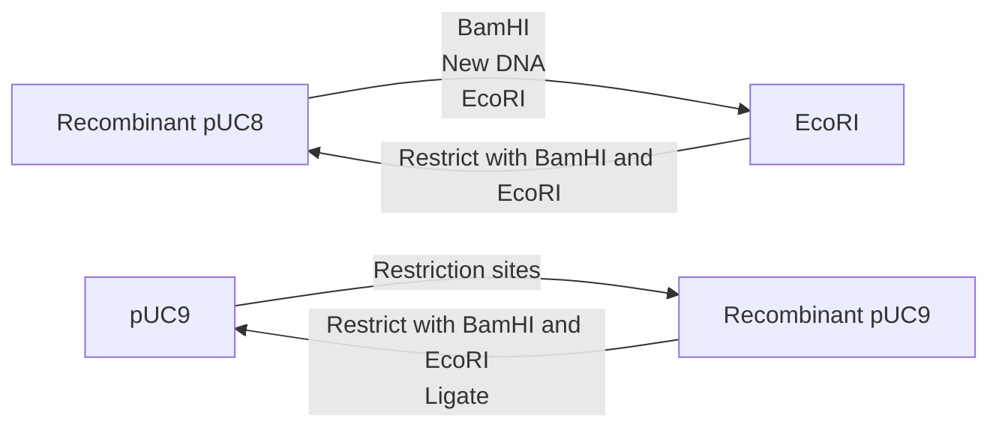
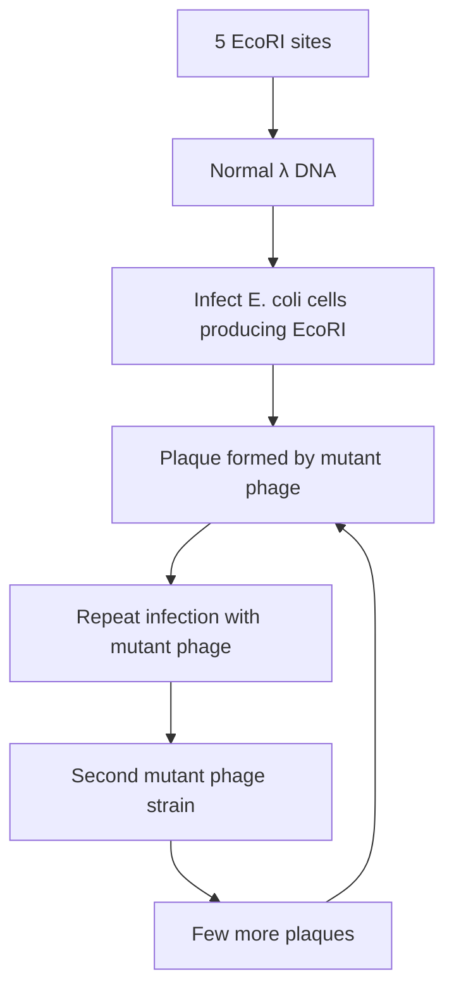

(a) Plaques on a lawn of bacteria

text_image

Lawn of confluent
bacterial growth
A plaque - a
zone of clearing

(b) Lytic plaques

text_image

Plaque - all the bacteria are lysed, leading to a high titre of bacteriophages
Lawn of bacteria

(c) M13 plaques

text_image

Plaques contain slow-growing bacteria and M13 phage particles

Figure 5.12

Bacteriophage plaques. (a) The appearance of plaques on a lawn of bacteria. (b) Plaques produced by a phage that lyses the host cell (e.g. λ in the lytic infection cycle); the plaques contain lysed cells plus many phage particles. (c) Plaques produced by M13; these plaques contain slow‐growing bacteria plus many M13 phage particles.

from a single transfected or infected cell and therefore contains identical phage particles. These may contain self‐ligated vector molecules, or they may be recombinants.

## 5.3.4 Identification of recombinant phages

A variety of ways of distinguishing recombinant plaques have been devised, the following being the most important.

## Insertional inactivation of a lacZ′ gene carried by the phage vector

All M13 cloning vectors, as well as several λ vectors, carry a copy of the lacZ′ gene. Insertion of new DNA into this gene inactivates β‐galactosidase synthesis, just as with the plasmid vector pUC8. Recombinants are distinguished by plating cells onto X‐gal agar. Plaques comprising normal phages are blue; recombinant plaques are clear (Figure 5.13a).

## Insertional inactivation of the λ cl gene

With several types of λ cloning vector, the new DNA is inserted into a restriction site in the cI gene. Inactivation of this gene causes a change in plaque morphology. Normal plaques appear ‘turbid’, whereas recombinants with a disrupted cI gene are ‘clear’ (Figure 5.13b). The difference is readily apparent to the experienced eye.

## Selection using the Spi phenotype

λ phages cannot normally infect E. coli cells that already possess an integrated form of a related phage called P2. λ is therefore said to be Spi+

(a) Insertional activation of the lacZ’ gene

text_image

Agar + X-gal + IPTG
Clear plaque = recombinant
Blue plaque = non-recombinant

(b) Insertional activation of the λ cl gene

text_image

Clear plaque = recombinant
Turbid plaque = non-recombinant

(c) Selection using the Spi phenotype

text_image

Only recombinant λ
phage can infect
Non-recombinant λ
- cannot infect
P2 prophage

(d) Selection on the basis of λ genome size

text_image

Correct size
for packaging
Too small
to package
λ concatemer

Figure 5.13

Strategies for the selection of recombinant phage.

(sensitive to P2 prophage inhibition). Some λ cloning vectors are designed so that insertion of new DNA causes a change from Spi+ to Spi−, enabling the recombinants to infect cells that carry P2 prophages. Such cells are used as the host for cloning experiments with these vectors. Only recombinants are Spi− so only recombinants form plaques (Figure 5.13c).

## Selection on the basis of λ genome size

The λ packaging system, which assembles the mature phage particles, can only insert DNA molecules of between 37 and 52 kb into the head structure. Anything less than 37 kb is not packaged. Many λ vectors have been constructed by deleting large segments of the λ DNA molecule and so are less than 37 kb in length. These can only be packaged into mature phage particles after extra DNA has been inserted, bringing the total genome size up to 37 kb or more (Figure  5.13d). Therefore, with these vectors only recombinant phages are able to replicate.

## 5.4 Introduction of DNA into non‐bacterial cells

Ways of introducing DNA into yeast, fungi, animals, and plants are also needed if these organisms are to be used as the hosts for gene cloning. Strictly speaking, these processes are not ‘transformation’ or ‘transfection’, as those terms have specific meanings that apply only to uptake of DNA by bacteria. However, molecular biologists have forgotten this over the years and ‘transformation’ is now used to describe uptake of DNA by any organism, and ‘transfection’ is the accepted term for introduction of DNA into animal cells.

In general terms, soaking cells in salt is effective only with a few species of bacteria, although treatment with lithium chloride or lithium acetate does enhance DNA uptake by yeast cells and is frequently used in the transformation of Saccharomyces cerevisiae. However, for most higher organisms, more sophisticated methods are needed.

## 5.4.1 Transformation of individual cells

With most organisms the main barrier to DNA uptake is the cell wall. Cultured animal cells, which usually lack cell walls, can be transformed simply by precipitating the DNA onto the cell surface with calcium phosphate (Figure 5.14a). Alternatively, more efficient uptake can be achieved if the DNA is enclosed in **liposomes** that fuse with the cell membrane (Figure 5.14b), or if the cells are subjected to a short electrical pulse, which is thought to induce the transient formation of pores in the cell membrane, through which DNA molecules are able to enter the cell. The last method is called **electroporation**; similar results can be achieved by **optical transfection**, in which the pores are created by brief exposure to a laser, and **sonoporation**, which uses ultrasound.

For other types of cells, the answer is often to remove the cell wall. Enzymes that degrade yeast, fungal, and plant cell walls are available, and under the right conditions intact **protoplasts** can be obtained (Figure 5.14c). Protoplasts generally take up DNA quite readily, but transformation can be stimulated by one of the poration methods.

In contrast to the transformation systems described so far, there are two more direct methods by which DNA can be introduced into a eukaryotic cell. The first of these is **microinjection**, which makes use of a very fine pipette to inject DNA molecules directly into the nucleus of the cells to be transformed (Figure 5.15a). This technique was initially applied to animal cells but has subsequently been successful with plant cells. The second method involves bombardment of the cells with high‐velocity

(a) Precipitation of DNA on to animal cells

text_image

Calcium phosphate solution
DNA precipitated onto the cell surface
Monolayer of animal cells

(b) Fusion with DNA-containing liposomes

flowchart

(c) Transformation of plant protoplasts

flowchart

Figure 5.14

Strategies for introducing new DNA into animal and plant cells. (a) Precipitation of DNA on to animal cells. (b) Introduction of DNA into animal cells by liposome fusion. (c) Transformation of plant protoplasts.

Figure 5.15

Two physical methods for introducing DNA into cells.

microprojectiles, usually particles of gold or tungsten that have been coated with DNA. These microprojectiles are fired at the cells from a particle gun (Figure 5.15b). This unusual technique is termed **biolistics** and has been used with a number of different types of cell.

## 5.4.2 Transformation of whole organisms

With animals and plants, the desired end product might not be transformed cells, but a transformed organism. Plants are relatively easy to regenerate from cultured cells, though problems have been experienced in developing regeneration procedures for monocotyledonous species such as cereals and grasses. A single transformed plant cell can therefore give rise to a transformed plant, which carries the cloned DNA in every cell, and passes the cloned DNA on to its progeny following flowering and seed formation. Animals, of course, cannot be regenerated from cultured cells, so obtaining transformed animals requires a rather more subtle approach. One technique with mammals such as mice is to remove fertilized eggs from the oviduct, to microinject DNA, and then to reimplant the transformed cells into the mother’s reproductive tract. We will look more closely at these methods for obtaining transformed animals in Section 14.3.3.

## Further reading

- Aich, P., Patra, M., Chatterjee, A.K., et al. (2012) Calcium chloride made E. coli competent for uptake of extraneous DNA through overproduction of OmpC protein. Protein Journal, 31, 366–373. [Describes the effect of calcium chloride on E. coli cells and how this treatment might stimulate DNA uptake.]
- Calvin, N.M. and Hanawalt, P.C. (1988) High efficiency transformation of bacterial cells by electroporation. Journal of Bacteriology, 170, 2796–2801.
- Capecchi, M.R. (1980) High efficiency transformation by direct microinjection of DNA into cultured mammalian cells. Cell, 22, 479–488.
- Hammer, R.E., Pursel, V.G., Rexroad, C.E., et al. (1985) Production of transgenic rabbits, sheep and pigs by microinjection. Nature, 315, 680–683.
- Hohn, B. (1979) In vitro packaging of lambda and cosmid DNA. Methods in Enzymology, 68, 299–309.
- Kaestner, L., Scholz, A., and Lipp, P. (2015) Conceptual and technical aspects of transfection and gene delivery. Bioorganic and Medicinal Chemistry Letters, 25, 1171–1176. [Details of all the various methods that can be used to introduce DNA into animal cells.]
- Klein, T.M., Wolf, E.D., Wu, R., and Sanford, J.C. (1987) High velocity microprojectiles for delivering nucleic acids into living cells. Nature, 327, 70–73. [Biolistics.]
- Lederberg, J. and Lederberg, E.M. (1952) Replica plating and indirect selection of bacterial mutants. Journal of Bacteriology, 63, 399–406.
- Mandel, M. and Higa, A. (1970) Calcium‐dependent bacteriophage DNA infection. Journal of Molecular Biology, 53, 159–162. [The first description of the use of calcium chloride to prepare competent E. coli cells.]
- Rosenberg, S.M., Stahl, M.M., Kobayashi, I., et al. (1985) Improved in vitro packaging of coliphage lambda DNA: a one‐strain system free from endogenous phage. Gene, 38, 165–175.

## Chapter 6

# Cloning Vectors for E. coli

## Chapter contents

**6.1** Cloning vectors based on E. coli plasmids 102
**6.2** Cloning vectors based on λ bacteriophage 108
**6.3** Cloning vectors for synthesis of single‐stranded DNA 115
**6.4** Vectors for other bacteria 118

The basic experimental techniques involved in gene cloning have now been described. In chapters 3, 4, and 5 we have seen how DNA is purified from cell extracts, how recombinant DNA molecules are constructed in the test tube, how DNA molecules are reintroduced into living cells, and how recombinant clones are distinguished. Now we must look more closely at the cloning vector itself, in order to consider the range of vectors available to the molecular biologist, and to understand the properties and uses of each individual type.

The greatest variety of cloning vectors exists for use with E. coli as the host organism. This is not surprising in view of the central role that this bacterium has played in basic research over the past 60 years. The tremendous wealth of information that exists concerning the microbiology, biochemistry, and genetics of E. coli has meant that virtually all fundamental studies of gene structure and function were initially carried out with this bacterium as the experimental organism. Even when a eukaryote is being studied, E. coli is still used for construction of recombinant genes that will subsequently be placed back in the eukaryotic host in order to study their function and expression. In recent years, gene cloning and molecular biological research have become mutually synergistic – breakthroughs in gene cloning have acted as a stimulus to research, and the needs of research have spurred on the development of new, more sophisticated cloning vectors.

In this chapter the most important types of E. coli cloning vector will be described, and their specific uses outlined. In Chapter 7, cloning vectors for yeast, fungi, plants, and animals will be considered.

## 6.1 Cloning vectors based on E. coli plasmids

The simplest cloning vectors, and the ones most widely used in gene cloning, are those based on small bacterial plasmids. A large number of different plasmid vectors are available for use with E. coli, many obtainable from commercial suppliers. They combine ease of purification with desirable properties such as high transformation efficiency, convenient selectable markers for transformants and recombinants, and the ability to clone reasonably large (up to about 8 kb) pieces of DNA. Most routine gene cloning experiments make use of one or other of these plasmid vectors.

One of the first vectors to be developed was pBR322, which was introduced in Chapter  5 to illustrate the general principles of transformant selection and recombinant identification. Although pBR322 lacks the more sophisticated features of the newest cloning vectors, and so is no longer used extensively in research, it still illustrates the important, fundamental properties of any plasmid cloning vector. We will therefore begin our study of E. coli vectors by looking more closely at pBR322.

## 6.1.1 The nomenclature of plasmid cloning vectors

The name ‘pBR322’ conforms with the standard rules for vector nomenclature:

• ‘p’ indicates that this is indeed a plasmid.
• ‘BR’ identifies the laboratory in which the vector was originally constructed (BR stands for Bolivar and Rodriguez, the two researchers who developed pBR322).
• ‘322’ distinguishes this plasmid from others developed in the same laboratory (there are also plasmids called pBR325, pBR327, pBR328, etc.).

## 6.1.2 The useful properties of pBR322

The genetic and physical map of pBR322 (Figure 6.1) gives an indication of why this plasmid was such a popular cloning vector.

The first useful feature of pBR322 is its size. In Chapter 2 it was stated that a cloning vector ought to be less than 10 kb in size, to avoid problems such as DNA breakdown during purification. pBR322 is 4361 bp, which means that not only can the vector itself be purified with ease, but so too can recombinant DNA molecules constructed with it. Even with 6 kb of additional DNA, a recombinant pBR322 molecule is still a manageable size.

donut

| Region | Subunit/Region |
| --- | --- |
| Inner Ring | EcoRI |
| Inner Ring | HindIII |
| Inner Ring | BamHI |
| Inner Ring | tetR |
| Inner Ring | SalI |
| Outer Ring | ori |
| Outer Ring | PstI |
| Outer Ring | Pvul |
| Outer Ring | Scal |
| Outer Ring | ampR |

Figure 6.1

A map of pBR322 showing the positions of the ampicillin resistance (ampR) and tetracycline resistance (tetR) genes, the origin of replication (ori), and some of the most important restriction sites.

The second feature of pBR322 is that, as described in Chapter 5, it carries two sets of antibiotic resistance genes. Either ampicillin or tetracycline resistance can be used as a selectable marker for cells containing the plasmid, and each marker gene contains single‐copy restriction sites that can be used in cloning experiments. Insertion of new DNA into pBR322 that has been restricted with PstI, PvuI, or ScaI inactivates the ampR gene, and insertion using any one of eight restriction endonucleases (notably BamHI and HindIII) inactivates tetracycline resistance. This great variety of restriction sites that can be used for insertional inactivation means that pBR322 can be used to clone DNA fragments with any of several kinds of sticky end.

A third advantage of pBR322 is that it has a reasonably high copy number. Generally, there are about 15 molecules present in a transformed E. coli cell, but this number can be increased, up to 1000–3000, by plasmid amplification in the presence of a protein synthesis inhibitor such as chloramphenicol (Section 3.2.3). An E. coli culture therefore provides a good yield of recombinant pBR322 molecules.

## 6.1.3 The pedigree of pBR322

The remarkable convenience of pBR322 as a cloning vector did not arise by chance. The plasmid was in fact designed in such a way that the final construct would possess these desirable properties. An outline of the scheme used to construct pBR322 is shown in Figure 6.2a. It can be seen that its production was a tortuous business that required full and skilful use of the DNA manipulative techniques described in Chapter 4. A summary of the result of these manipulations is provided in Figure 6.2b, from which it can be seen that pBR322 comprises DNA derived from three different naturally occurring plasmids:

• The $a m p ^ { R }$ gene originally resided on the plasmid R1, a typical antibiotic resistance plasmid that occurs in natural populations of E. coli (Section 2.1.3).
• The $t e t ^ { R }$ gene is derived from R6‐5, a second antibiotic resistance plasmid.

flowchart

This diagram illustrates the genetic construct of pBR322, showing how various plasmids (R1, ColE1, R6-5, pSC101, pMB9, pMB8, pMB1, pBR312, pBR313) are reorganized into EcoRI and TetR regions, with rearrangements resulting in two distinct fragments.

Figure 6.2

The pedigree of pBR322. (a) The manipulations involved in construction of pBR322. The $a m p ^ { R }$ gene was obtained from Tn3, a type of **transposable element** carried by the R1 plasmid. The $t e t ^ { R }$ gene was excised from pSC101 by treatment with EcoR1 in a low salt solution, which decreases the specificity of the enzyme so that, as well as cutting at its standard GAATTC recognition sequence, it also cuts at related sequences such TAATTC. This is called **star activity**, and the related sequences are referred to as EcoRI\* sites. (b) A summary of the origins of pBR322.

The replication origin of pBR322, which directs multiplication of the vector in host cells, is originally from pMB1, which is closely related to the colicin‐producing plasmid ColE1 (Section 2.1.3).

## 6.1.4 More sophisticated E. coli plasmid cloning vectors

pBR322 was developed in the late $1 9 7 0 s _ { 2 }$ the first research paper describing its use being published in 1977. Since then, many other plasmid cloning vectors have been constructed, the majority of these derived from pBR322 by manipulations similar to those summarized in Figure 6.2a. One of the first of these was pBR327, which was produced by removing a 1089 bp segment from pBR322. This deletion left the $a m p ^ { R }$ and $t e t ^ { R }$ genes intact, but changed the replicative and conjugative abilities of the resulting plasmid. This was an important step in the development of more sophisticated vectors, for two reasons:

The change in the replicative function means that pBR327 has a higher copy number than pBR322, being present at about 30–45 molecules per E. coli cell. This is not of great relevance as far as plasmid yield is concerned, as both plasmids can be amplified to copy numbers greater than 1000. However, the higher copy number of pBR327 in normal cells makes this vector more suitable if the aim of the experiment is to study the function of the cloned gene. In these cases, gene dosage becomes important, because the more copies there are of a cloned gene, the more likely it is that the effect of the cloned gene on the host cell will be detectable.
• The deletion also destroys the conjugative ability of pBR322, making pBR327 a non‐conjugative plasmid that cannot direct its own transfer to other E. coli cells. This is important for **biological containment**, averting the possibility of a recombinant pBR327 molecule escaping from the test tube and colonizing bacteria in the gut of a careless molecular biologist. In contrast, pBR322 could theoretically be passed to natural populations of E. coli by conjugation, though in fact pBR322 also has safeguards (though less‐comprehensive ones) to minimize the chances of this happening.

Although pBR327, like pBR322, is no longer widely used, its properties have been inherited by most of today’s modern plasmid vectors. There are a great number of these, and it would be pointless to attempt to describe them all. Two additional examples will suffice to illustrate the most important features.

## pUC8 – a Lac selection plasmid

This vector was mentioned in Section 5.2.2 when identification of recombinants by insertional inactivation of the β‐galactosidase gene was described. pUC8 (Figure 6.3a) is descended from pBR322, although only the replication origin and the ampR gene remain. The nucleotide sequence of the ampR gene has been changed so that it no longer contains the singlecopy restriction sites. All these cloning sites are now clustered into a short segment of the lacZ′ gene carried by pUC8.

pUC8 has two important advantages that have led to it becoming one of the most popular E. coli cloning vectors. The first of these was fortuitous. The manipulations involved in construction of pUC8 were accompanied by a chance mutation, within the origin of replication, which results in the plasmid having a copy number of 500–700 even before amplification. This has a significant effect on the yield of cloned DNA obtainable from E. coli cells transformed with recombinant pUC8 plasmids.

The second advantage is that identification of recombinant cells can be achieved by a single‐step process, by plating onto agar medium containing ampicillin plus X‐gal (Section  5.2.2). With both pBR322 and pBR327, selection of recombinants is a two‐step procedure, requiring replica plating from one antibiotic medium to another (see Figure 5.8). A cloning

(a) pUC8

text_image

ampR
2665 bp
ori
lacZ'
Cluster of sites

(b) Restriction sites in pUC8

text_image

pUC8
lacZ'
HindIII
PstI
Sall, Accl, HincII
BamHI
Smal, Xmal
EcoRI

(c) Shuttling a DNA fragment from pUC8 to pUC9

flowchart

(d) Restriction sites in pUC18

text_image

pUC18
lacZ'
HindIII
SphI
PstI
SalI, Accl, HincII
XbaI
BamHI
Smal, Xmal
KpnI
SacI
EcoRI

Figure 6.3

The pUC plasmids. (a) The structure of pUC8. (b) The restriction site cluster in the lacZ′ gene of pUC8. (c) Shuttling a DNA fragment between pUC8 and pUC9, which enables the fragment to be cloned in two different directions. (d) The restriction site cluster in pUC18.

experiment with pUC8 can therefore be carried out in half the time needed with pBR322 or pBR327.

The cluster of cloning sites are contained in a short artificial oligonucleotide, called a **polylinker**, which was inserted into the lacZ′ gene when the first pUC8 plasmid was created. The polylinker is designed so that it does not totally disrupt the lacZ′ gene, the reading frame being maintained throughout the polylinker, so that a functional, though altered, β‐galactosidase enzyme is still produced. The polylinker in pUC8 contains nine restriction sites that are not found elsewhere in the vector (Figure 6.3b). Because these sites are clustered, a DNA fragment with two different sticky ends (say, EcoRI at one end and BamHI at the other) can be cloned without resorting to additional manipulations such as linker attachment.

pUC8 is one of a family of vectors, differing only in the identity of the cloning sites. A second member of the family, pUC9, has the same polylinker as pUC8, but inserted into the lacZ′ gene in the opposite orientation. This pair of vectors can therefore be used to clone a DNA fragment in both the forward and reverse directions (Figure  6.3c), which enables **antisense RNA** to be prepared (Section 15.3.2). Other pUC vectors carry different combinations of restriction sites and provide even greater flexibility in the types of DNA fragment that can be cloned (Figure 6.3d).

## pGEM3Z – in vitro transcription of cloned DNA

pGEM3Z (Figure 6.4a) is very similar to a pUC vector. It carries the ampR and lacZ′ genes, the latter containing a cluster of restriction sites, and it is almost exactly the same size. The distinction is that pGEM3Z has two additional short pieces of DNA, each of which acts as the recognition site for attachment of an RNA polymerase enzyme. These two **promoter** sequences lie on either side of the cluster of restriction sites used for introduction of new DNA into the pGEM3Z molecule. This means that if a recombinant pGEM3Z molecule is mixed with purified RNA polymerase in the test tube, transcription occurs, and RNA copies of the cloned fragment are synthesized (Figure 6.4b). The RNA that is produced could be used as a hybridization probe (Section  8.4.2) or might be required for experiments aimed at studying RNA processing (e.g. the removal of introns) or protein synthesis.

Figure 6.4

pGEM3Z. (a) Map of the vector. ‘R’ indicates a polylinker containing restriction sites for EcoRI, SacI, KpnI, AvaI, SmaI, BamHI, XbaI, SalI, AccI, HincII, PstI, SphI, and HindIII. (b) In vitro RNA synthesis from the T7 promoter.

The promoters carried by pGEM3Z and other vectors of this type are not the standard sequences recognized by the E. coli RNA polymerase. Instead, one of the promoters is specific for the RNA polymerase coded by T7 bacteriophage and the other for the RNA polymerase of SP6 phage. These RNA polymerases are synthesized during infection of E. coli with one or other of the phages and are responsible for transcribing the phage genes. They are chosen for in vitro transcription as they are very active enzymes  –  remember that the entire lytic infection cycle takes only 20 minutes (Section 2.2.1), so the phage genes must be transcribed very quickly. These polymerases are able to synthesize 5–10 μg of RNA from 1 μg of DNA, substantially more than can be produced by the standard E. coli enzyme.

## 6.2 Cloning vectors based on λ bacteriophage

As well as plasmid cloning vectors, a variety of vectors based on λ bacteriophage have been developed for cloning DNA in E. coli. The primary use of these vectors is to clone large pieces of DNA, from 5 to 25 kb, most of which are too big to be handled by plasmid vectors.

## 6.2.1 Natural selection was used to isolate modified λ that lack certain restriction sites

An essential requirement for a cloning vector is the presence of restriction sites into which new DNA can be cloned. Unfortunately, the λ genome is so large that it has more than one recognition sequence for virtually every restriction endonuclease. Restriction cannot therefore be used to cleave the normal λ molecule in a way that will allow insertion of new DNA, because the molecule would be cut into several small fragments that would be very unlikely to re‐form a viable λ genome on religation (Figure 6.5). This is a problem that is often encountered when a new vector is being developed. If just one or two sites need to be removed, then in vitro mutagenesis (Section  11.3.2) can be used to change their sequences. For example, an EcoRI site, GAATTC, could be changed to GGATTC, which is not recognized by the enzyme. However, in vitro mutagenesis was in its infancy when the first λ vectors were under development, and even today would not be an efficient means of changing more than a few sites in a single molecule.

Instead, natural selection was used to provide strains of λ that lack the unwanted restriction sites. Natural selection can be brought into play by using as a host an E. coli strain that produces EcoRI. Most λ DNA molecules that invade the cell are destroyed by this restriction endonuclease, but a few survive and produce plaques. These are mutant phages, from which one or more EcoRI sites have been lost spontaneously (Figure 6.6). Several cycles of infection will eventually result in λ molecules that lack all or most of the EcoRI sites.

## 6.2.2 Segments of the λ genome can be deleted without impairing viability

The second problem that had to be solved when λ cloning vectors were first developed was the capacity of the phage capsid. The λ DNA molecule can be increased in size by only about 5%, representing the addition of

Figure 6.5

λ DNA has multiple recognition sites for almost all restriction endonucleases.

flowchart

flowchart

Figure 6.6

Using natural selection to isolate λ phage lacking EcoRI restriction sites.

only 3 kb of new DNA. If the total size of the molecule is more than 52 kb, then it cannot be packaged into the λ head structure and infective phage particles are not formed. This severely limits the size of a DNA fragment that can be inserted into an unmodified λ vector (Figure 6.7).

One way to solve this problem would be to remove one or more segments from the λ genome, to reduce its length so that larger pieces of new DNA can be inserted without exceeding the size limit for packaging. It is, of course, important that the segments that are removed do not contain genes that are essential for replication of the cloning vector, which in the case of λ includes all of the genes involved in assembly of the phage protein coat as well as those genes coding for DNA replicative enzymes. Fortunately, the genes in the λ genome are clustered together according to function; for example, all of the genes for the capsid proteins are located in the left‐hand part of the genome (as drawn in Figure 6.8), and all the genes coding for

Figure 6.7

The size limitation placed on the λ genome by the need to package it into the phage head.

flowchart

Figure 6.8

The λ genetic map, showing the position of the main non‐essential region that can be deleted without affecting the ability of the phage to follow the lytic infection cycle. There are other, much shorter non‐essential regions in other parts of the genome. See Figure 2.9 for the complete map of the λ genome.

enzymes needed for the lytic infection cycle are in the right‐hand part. In between is a central region that contains most of the genes involved in integration and excision of the λ prophage from the E. coli chromosome. Removal of this segment therefore destroys the ability of the phage to follow its lysogenic infection cycle, but the lytic cycle is unaffected. The phage are still able to replicate, and loss of the lysogenic cycle is in fact an advantage as it means induction is not needed before plaques are formed (Section 3.3.1).

This ‘non‐essential region’ lies between positions 20 and 35 on the map shown in Figure 6.8. Its removal decreases the size of the resulting λ molecule by up to 15 kb, which means that as much as 18 kb of new DNA can now be added before the cut‐off point for packaging is reached.

## 6.2.3 Insertion and replacement vectors

Once the problems posed by the multiple restriction sites and the packaging constraints had been solved, the way was open for the development of different types of λ‐based cloning vectors. The first two classes of vector to be produced were λ **insertion** and λ **replacement** (or substitution) vectors.

## Insertion vectors

With an insertion vector (Figure 6.9a), a large segment of the non‐essential region has been deleted, and the two arms ligated together. An insertion vector possesses at least one single‐copy restriction site into which new DNA can be inserted. The size of the DNA fragment that an individual

λ insertion vectors. P = polylinker in the lacZ′ gene of λZAPII, containing restriction sites for SacI, NotI, XbaI, SpeI, EcoRI, and XhoI.

Figure 6.9

(a) Construction of a λ insertion vector

flowchart

(b) λgt10

(c) λZAPII

