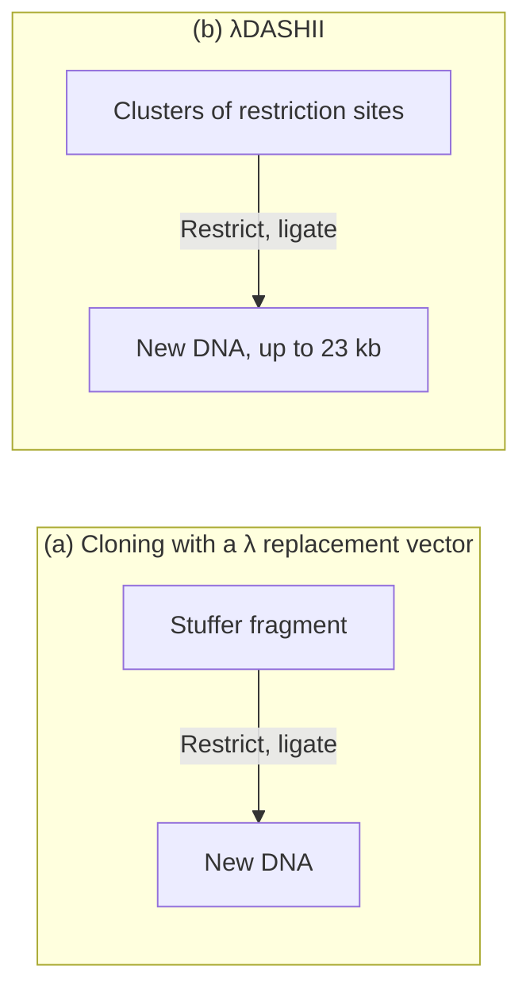
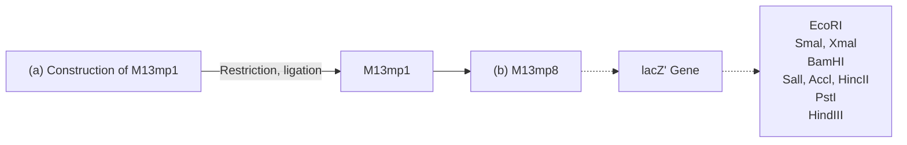
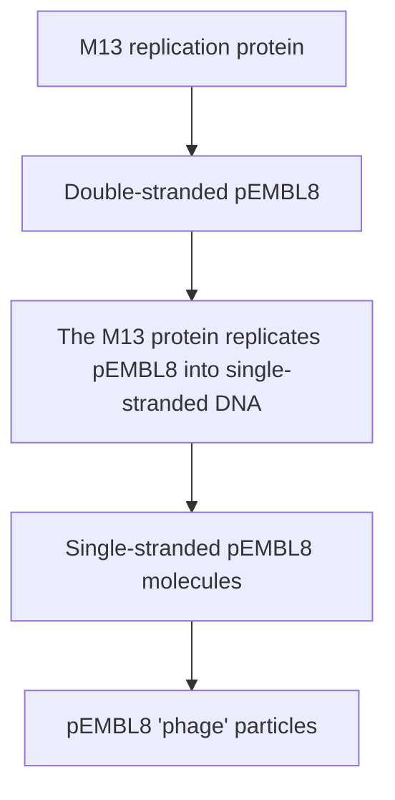
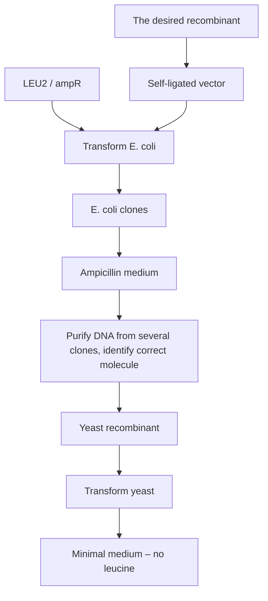
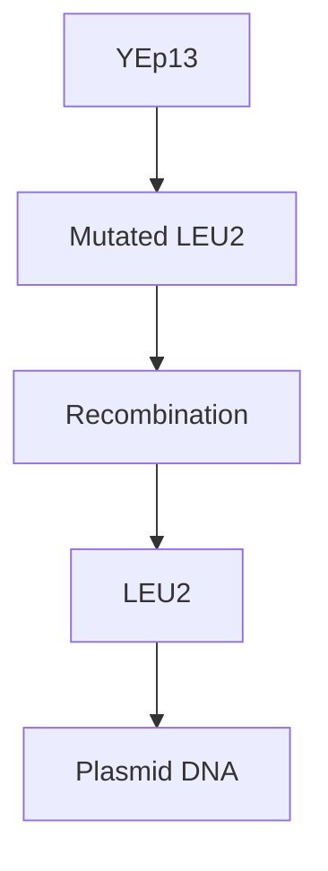

vector can carry depends, of course, on the extent to which the non‐essential region has been deleted. Two popular insertion vectors are:

λ**gt10** (Figure 6.9b), which can carry up to 8 kb of new DNA, inserted into a unique EcoRI site located in the cI gene. Insertional inactivation of this gene means that recombinants are distinguished as clear rather than turbid plaques (Section 5.3.4).
**λZAPII** (Figure 6.9c), with which insertion of up to 10 kb DNA into any of six restriction sites within a polylinker inactivates the lacZ′ gene carried by the vector. Recombinants give clear rather than blue plaques on X‐gal agar.

## Replacement vectors

A λ replacement vector has two recognition sites for the restriction endonuclease used for cloning. These sites flank a segment of DNA that is replaced by the DNA to be cloned (Figure 6.10a). Often the replaceable fragment (called the **stuffer fragment**) carries additional restriction sites that can be used to cut it up into small pieces, so that its own reinsertion during a cloning experiment is very unlikely. Replacement vectors are generally designed to carry larger pieces of DNA than insertion vectors can handle. Recombinant selection is often on the basis of size, with non‐recombinant vectors being too small to be packaged into λ phage heads (Section 5.3.4).

An example of a replacement vector is:

λDASHII (Figure 6.10b), which can carry inserted DNA of between 9 and 23 kb by replacing a segment flanked by various restriction sites, any of which can be used to remove the stuffer fragment, so DNA fragments with a variety of sticky ends can be cloned. Recombinant selection with λDASHII can be on the basis of size or can utilize the Spi phenotype (Section 5.3.4). The inserted DNA is flanked by the promoter sequences of T3 and T7 phage, so RNA copies can be obtained in the same way as for pGEM3Z.

flowchart

Figure 6.10

λ replacement vectors. (a) Cloning with a λ replacement vector. (b) Cloning with λDASHII.

## 6.2.4 Cloning experiments with λ insertion or replacement vectors

A cloning experiment with a λ vector can proceed along the same lines as with a plasmid vector – the λ molecules are restricted, new DNA is added, the mixture is ligated, and the resulting molecules used to transfect a competent E. coli host (Figure 6.11a). This type of experiment requires that the vector be in its circular form, with the cos sites hydrogen bonded to each other.

Although satisfactory for many purposes, a procedure based on transfection is not particularly efficient. A greater number of recombinants will be obtained if one or two refinements are introduced. The first is to use the linear form of the vector. When the linear form of the vector is digested with the relevant restriction endonuclease, the left and right arms are released as separate fragments. A recombinant molecule can be constructed by mixing together the DNA to be cloned with the vector arms. Ligation results in several molecular arrangements, including concatemers comprising left arm–DNA–right arm repeated many times (Figure 6.11b). If the inserted DNA is the correct size, then the cos sites that separate these structures will be the right distance apart for in vitro packaging (Section 5.3.2).

Figure 6.11

Different strategies for cloning with a λ vector. (a) Using the circular form of λ as a plasmid. (b) Using the left and right arms of the λ vector, plus in vitro packaging, to achieve a greater number of recombinant plaques.

Recombinant phage are therefore produced in the test tube and can be used to infect an E. coli culture. This strategy, in particular the use of in vitro packaging, results in a large number of recombinant plaques.

## 6.2.5 Long DNA fragments can be cloned using a cosmid

The final and most sophisticated type of λ‐based vector is the **cosmid**. Cosmids are hybrids between a phage DNA molecule and a bacterial plasmid, and their design centres on the fact that the enzymes that package the λ DNA molecule into the phage protein coat need only the cos sites in order to function. The in vitro packaging reaction works not only with λ genomes, but also with any molecule that carries cos sites separated by 37–52 kb of DNA.

A cosmid is basically a plasmid that carries a cos site (Figure 6.12a). It also needs a selectable marker, such as the ampicillin resistance gene, and a plasmid origin of replication, as cosmids lack all the λ genes and so do

Figure 6.12

A typical cosmid and the way it is used to clone long fragments of DNA.

not produce plaques. Instead colonies are formed on selective media, just as with a plasmid vector.

A cloning experiment with a cosmid is carried out as follows (Figure 6.12b). The cosmid is opened at its unique restriction site and new DNA fragments inserted. These fragments are usually produced by partial digestion with a restriction endonuclease, as total digestion almost invariably results in fragments that are too small to be cloned with a cosmid. Ligation is carried out so that concatemers are formed. Providing the inserted DNA is the right size, in vitro packaging cleaves the cos sites and places the recombinant cosmids in mature phage particles. These λ phage are then used to infect an E. coli culture, though of course plaques are not formed. Instead, infected cells are plated onto a selective medium, and antibiotic‐resistant colonies are grown. All colonies are recombinants, as non‐recombinant linear cosmids are too small to be packaged into λ heads.

## 6.2.6 λ and other high‐capacity vectors enable genomic libraries to be constructed

The main use of λ‐based vectors is to clone DNA fragments that are too long to be handled by plasmid vectors. A replacement vector, such as λDASHII, can carry up to 23 kb of new DNA, and some cosmids can manage fragments up to 40 kb. This compares with a maximum insert size of about 8 kb for most plasmids.

The ability to clone such long DNA fragments means that **genomic libraries** can be generated. A genomic library is a set of recombinant clones that contains all of the DNA present in an individual organism. An E. coli genomic library, for example, contains all the E. coli genes, so any desired gene can be withdrawn from the library and studied. Genomic libraries can be retained for many years and propagated so that copies can be sent from one research group to another.

The big question is how many clones are needed for a genomic library? The answer can be calculated with the formula:

$$
N = \frac {\ln (1 - p)}{\ln \left(1 - \frac {a}{b}\right)}
$$

where N is the number of clones that are required, p is the probability that any given gene will be present, a is the average size of the DNA fragments inserted into the vector, and b is the total size of the genome.

Table 6.1 shows the number of clones needed for genomic libraries of a variety of organisms, constructed using a λ replacement vector or a cosmid. For humans and other mammals, several hundred thousand clones are required. It is by no means impossible to obtain several hundred thousand clones, and the methods used to identify a clone carrying a desired gene (Chapter 8) can be adapted to handle such large numbers, so genomic libraries of these sizes are by no means unreasonable. However, ways of reducing the number of clones needed for mammalian genomic libraries are continually being sought.

Table 6.1

Number of clones needed for genomic libraries of a variety of organisms.

<table><tr><td rowspan="2">SPECIES</td><td rowspan="2">GENOME SIZE (bp)</td><td colspan="2">NUMBER OF CLONES $^{a}$ </td></tr><tr><td>17 kb FRAGMENTS $^{b}$ </td><td>35 kb FRAGMENTS $^{c}$ </td></tr><tr><td>E. coli</td><td> $4.6 \times 10^{6}$ </td><td>810</td><td>390</td></tr><tr><td>Saccharomyces cerevisiae</td><td> $1.2 \times 10^{7}$ </td><td>2115</td><td>1030</td></tr><tr><td>Drosophila melanogaster</td><td> $1.8 \times 10^{8}$ </td><td>31 700</td><td>15 400</td></tr><tr><td>Rice</td><td> $4.3 \times 10^{8}$ </td><td>75 800</td><td>36 800</td></tr><tr><td>Human</td><td> $3.2 \times 10^{9}$ </td><td>564 000</td><td>274 000</td></tr><tr><td>Wheat</td><td> $1.7 \times 10^{10}$ </td><td>2 996 000</td><td>1 456 000</td></tr></table>

a Calculated for a probability (p) of 95% that any particular gene will be present in the library.

b Fragments suitable for a replacement vector such as λDASHII.

c Fragments suitable for a cosmid.

One solution is to develop new cloning vectors able to handle longer DNA inserts. The most popular of these vectors are **bacterial artificial chromosomes (BACs)**, which are based on the F plasmid (Section 2.1.3). The F plasmid is relatively large, and vectors derived from it have a higher capacity than normal plasmid vectors. BACs can handle DNA inserts up to 300 kb in size, reducing the size of the human genomic library to just 30  000 clones. Other high‐capacity vectors have been constructed from bacteriophage P1, which has the advantage over λ of being able to squeeze 110 kb of DNA into its capsid structure. Cosmid‐type vectors based on P1 have been designed and used to clone DNA fragments ranging in size from 75 to 100 kb. Vectors that combine the features of P1 vectors and BACs, called **P1‐derived artificial chromosomes (PACs)**, also have a capacity of up to 300 kb.

## 6.3 Cloning vectors for synthesis of single‐stranded DNA

Cloning vectors able to provide single‐stranded versions of cloned DNA were extremely important for many years as the DNA sequencing methods used for most of the 1980s and 1990s required single‐stranded DNA as the starting material. Those sequencing methods have now been superseded by ones that use double‐stranded DNA, but the special vectors designed in the 1980s and 1990s for synthesis of single‐stranded DNA are still important because this type of DNA is also needed for specialist applications such as in vitro mutagenesis (Section 11.3.2) and phage display (Section 13.2.2).

## 6.3.1 Vectors based on M13 bacteriophage

The first single‐stranded DNA vectors were based on M13 bacteriophage. The normal M13 genome is 6.4 kb in length, with most of the DNA taken up by ten closely packed genes (Figure  6.13), each essential for the

Figure 6.13

The M13 genome, showing the positions of genes I to X and the intergenic sequence (IS).

text_image

IS
ori
II
X
V
VII
IX
VIII
III
6407 bp
IV
I
VI

replication of the phage. There is only a single 508‐nucleotide intergenic sequence into which new DNA could be inserted without disrupting one of these genes, and this region includes the replication origin which must itself remain intact. This means that there is only limited scope for modifying the M13 genome.

The first step in construction of an M13 cloning vector was to introduce the lacZ′ gene into the intergenic sequence. This gave rise to M13mp1, which forms blue plaques on X‐gal agar (Figure 6.14a). Polylinkers were then inserted into the lacZ′ gene to create a series of M13 vectors with different sets of cloning sites (Figure  6.14b). The polylinkers are the same ones used in the pUC vectors, which means that the cloned DNA can be shuttled between the equivalent M13 and pUC plasmids, so single‐ and double‐stranded versions can be obtained.

A cloning experiment with an M13 vector simply involves inserting the new DNA into one of the restriction sites in the polylinker, and then transfecting competent E. coli cells. After plating out on X‐gal agar, recombinant plaques are identified by the blue‐white colour test.

flowchart

Figure 6.14

M13 vectors. (a) Construction of M13mp1. (b) M13mp8, which contains the same set of restriction sites as pUC8.

(a) pEMBL8

donut

| Category | Value |
| --- | --- |
| ampR | ~25% |
| lacZ' | ~10% |
| Cluster of sites (see fig. 6.3b) | ~10% |
| M13 DNA fragment | ~25% |

(b) Conversion of pEMBL8 into single-stranded DNA

flowchart

Figure 6.15

pEMBL8: a hybrid plasmid– M13 vector that can be converted into single‐stranded DNA.

## 6.3.2 Hybrid plasmid–M13 vectors

Although M13 vectors are very useful for the production of single‐stranded versions of cloned genes, they do suffer from one disadvantage. There is a limit to the size of DNA fragment that can be cloned with an M13 vector, with 1500 bp generally being looked on as the maximum capacity, though fragments up to 3 kb have occasionally been cloned. To get around this problem a number of hybrid vectors (**phagemids**) have been developed by combining a part of the M13 genome with plasmid DNA.

An example is provided by pEMBL8 (Figure 6.15a), which was made by transferring into pUC8 a 1300 bp fragment of the M13 genome. This piece of M13 DNA contains the signal sequence recognized by the enzymes that convert the normal double‐stranded M13 molecule into single‐stranded DNA before secretion of new phage particles. This signal sequence is still functional even though detached from the rest of the M13 genome, so pEMBL8 molecules are also converted into single‐stranded DNA and secreted as defective phage particles (Figure 6.15b). All that is necessary is that the E. coli cells used as hosts for a pEMBL8 cloning experiment are also infected with normal M13 to act as a **helper phage**, providing the necessary replicative enzymes and phage coat proteins.

pEMBL8, being derived from pUC8, has the polylinker cloning sites within the lacZ′ gene, so recombinant plaques can be identified in the standard way on agar containing X‐gal. With pEMBL8, single‐stranded versions of cloned DNA fragments up to 10 kb in length can be obtained, greatly extending the range of the M13 cloning system.

## 6.4 Vectors for other bacteria

Cloning vectors have also been developed for several other species of bacteria, including Streptomyces, Bacillus, and Pseudomonas. These vectors are used for basic studies of gene function and activity in these species, and also for the production of **recombinant protein**. A recombinant protein is a protein synthesized from a cloned gene, cloning being used in this way to obtain large quantities of important proteins, such as insulin, which are used as pharmaceuticals to treat human disorders (Chapter  14). Some recombinant proteins cannot be synthesized efficiently in E. coli, so other species, both bacterial and eukaryotic, are also used for recombinant protein synthesis.

Some cloning vectors for these other types of bacteria are based on plasmids specific to the host species, and some on **broad host range plasmids** that are able to replicate in a variety of bacteria. The origin of replication of the RK2 plasmid, for example, functions in most Gram‐negative bacteria, and is used in cloning vectors that replicate in Pseudomonas species as well as E. coli. A cloning vector that carries the RK2 origin is therefore a type of **shuttle vector**, one that can be used in two different species. Shuttle vectors are useful because the initial stages of a gene cloning experiment, up to the point when the correct recombinant DNA molecule has been identified, are usually easier to carry out with E. coli as the host. Once the desired clone has been obtained, the broad host range properties of the shuttle vector can then be exploited to transfer the molecule to the second species.

Bacteriophages have also been used as cloning vectors for bacteria other than E. coli. An example is the SV1 phage of Streptomyces venezuelae, which has been developed into a set of cloning vectors for Streptomyces species. SV1 is a lysogenic phage, but rather than deleting the genes responsible for the lysogenic infection cycle, vectors based on SV1 retain this function so that the cloned gene is inserted into the Streptomyces genome. This results in a very stable transformant, with little possibility of the cloned gene being lost from the host even after many cycles of bacterial replication. Stability is an important consideration if the aim of the gene cloning project is to obtain a recombinant bacterial strain that makes a valuable pharmaceutical protein.

## Further reading

- Bolivar, F., Rodriguez, R.L., Green, P.J., et al. (1977) Construction and characterization of new cloning vectors. II. A multipurpose cloning system. Gene, 2, 95–113. [pBR322.]
- Choi, K.‐H., Trunck, L.A., Kumar, A., et al. (2008) Genetic tools for Pseudomonas. In: Pseudomonas Genomics and Molecular Biology (ed. Cornells, P.). Caister Academic Press, Norfolk, pp.65–86. [Describes cloning vectors for Pseudomonas.]
- Fayed, B., Younger, E., Taylor, G., et al. (2014) A novel Streptomyces spp. integration vector, derived from the S. venezuelae phage, SV1. BMC Biotechnology, 14, 51.
- Iouannou, P.A., Amemiya, C.T., Garnes, J., et al. (1994) P1‐derived vector for the propagation of large human DNA fragments. Nature Genetics, 6, 84–89.
- Melton, D.A., Krieg, P.A., Rebagliati, M.R., et al. (1984) Efficient in vitro synthesis of biologically active RNA and RNA hybridization probes from plasmids containing a bacteriophage SP6 promoter. Nucleic Acids Research, 12, 7035–7056. [RNA synthesis from DNA cloned in a plasmid such as pGEM3Z.]
- Sanger, F., Coulson, A.R., Barrell, B.G., et al. (1980) Cloning in singlestranded bacteriophage as an aid to rapid DNA sequencing. Journal of Molecular Biology, 143, 161–178. [M13 vectors.]
- Shiyuza, H., Birren, B., Kim, U.J., et al. (1992) Cloning and stable maintenance of 300 kilobase‐pair fragments of human DNA in Escherichia coli using an F‐factor‐based vector. Proceedings of the National Academy of Sciences of the USA, 89, 8794–8797. [The first description of a BAC.]
- Sternberg, N.L. (1992) Cloning high molecular weight DNA fragments by the bacteriophage P1 system. Trends in Genetics, 8, 11–16.
- Yanisch‐Perron, C., Vieira, J., and Messing, J. (1985) Improved M13 phage cloning vectors and host strains: nucleotide sequences of the M13mp18 and pUC19 vectors. Gene, 33, 103–119.

## Chapter 7

# Cloning Vectors for Eukaryotes

## Chapter contents

**7.1** Vectors for yeast and other fungi 121
**7.2** Cloning vectors for higher plants 129
**7.3** Cloning vectors for animals 138

Most cloning experiments are carried out with E. coli as the host, and the widest variety of cloning vectors are available for this organism. E. coli is particularly popular when the aim of the cloning experiment is to study the basic features of molecular biology such as gene structure and function. However, under some circumstances it may be desirable to use a eukaryotic host for a gene cloning experiment. This is especially true in biotechnology (Chapter 14), where the aim may not be to study a gene, but to use cloning to obtain recombinant protein, or to change the properties of an organism (e.g. to introduce herbicide resistance into a crop plant). We must therefore consider cloning vectors for eukaryotes.

## 7.1 Vectors for yeast and other fungi

The yeast Saccharomyces cerevisiae is one of the most important organisms in biotechnology. As well as its role in brewing and breadmaking, yeast is used as a host organism for the production of important pharmaceuticals from cloned genes (Section 14.3.1). Development of cloning vectors for yeast was initially stimulated by the discovery of a plasmid that is

## Figure 7.1

The yeast 2 μm plasmid. REP1 and REP2 are involved in replication of the plasmid, and FLP codes for a protein that can convert the A form of the plasmid (shown here) to the B form, in which the gene order has been rearranged by intramolecular recombination. The function of gene D is not exactly known.

donut

| Category | Value |
| --- | --- |
| FLP | ~20% |
| REP1 | ~20% |
| D | ~15% |
| ori | ~40% |
| REP2 | ~15% |

present in most strains of S. cerevisiae (Figure 7.1). The **2 μm plasmid**, as it is called, is one of only a very limited number of plasmids found in eukaryotic cells.

## 7.1.1 Selectable markers for the 2 μm plasmid

The 2 μm plasmid is an excellent basis for a cloning vector. It is 6.3 kb in size, which is ideal for a vector, and has a copy number of about 60 in most yeast cells. Replication makes use of a plasmid origin, several enzymes provided by the host cell, and the proteins coded by the REP1 and REP2 genes carried by the plasmid.

However, all is not perfectly straightforward in using the 2 μm plasmid as a cloning vector. First, there is the question of a selectable marker. Some yeast cloning vectors carry genes conferring resistance to inhibitors such as methotrexate and copper, but most of the popular yeast vectors make use of a radically different type of selection system. In practice, a normal yeast gene is used, generally one that codes for an enzyme involved in amino acid biosynthesis. An example is the gene LEU2, which codes for β‐isopropylmalate dehydrogenase, one of the enzymes involved in the conversion of pyruvic acid to leucine.

In order to use LEU2 as a selectable marker, a special kind of host organism is needed. The host must be an **auxotrophic** mutant that has a non‐functional LEU2 gene. Such a leu2− yeast is unable to synthesize leucine and can survive only if this amino acid is supplied as a nutrient in the growth medium (Figure 7.2a). Selection is possible because transformants contain a plasmid‐borne copy of the LEU2 gene, and so are able to grow in the absence of the amino acid. In a cloning experiment, cells are plated out onto **minimal medium**, which contains no added amino acids. Only transformed cells are able to survive and form colonies (Figure 7.2b).

## 7.1.2 Vectors based on the 2 μm plasmid – yeast episomal plasmids

Vectors derived from the 2 μm plasmid are called **yeast episomal plasmids (YEps)**. Some YEps contain the entire 2 μm plasmid; others include just the 2 μm origin of replication. An example of the latter type is YEp13 (Figure 7.3).

Figure 7.2

Using the LEU2 gene as a selectable marker in a yeast cloning experiment.

As well as the 2 μm origin of replication and the selectable LEU2 gene, YEp13 also includes the entire pBR322 sequence. YEp13 is therefore a shuttle vector, and can replicate and be selected for in both yeast and E. coli. Most yeast cloning vectors are shuttle vectors because it is sometimes difficult to recover the recombinant DNA molecule from a transformed yeast colony. This is not such a problem with YEps, which are present in yeast cells primarily as plasmids, but with other yeast vectors, which may integrate into one of the yeast chromosomes, purification might be impossible. This is a disadvantage because in many cloning experiments purification of recombinant DNA is essential in order for the correct construct to be identified by, for example, DNA sequencing.

The standard procedure when cloning in yeast is therefore to perform the initial cloning experiment with E. coli, and to select recombinants in this organism. Recombinant plasmids can then be purified, characterized, and the correct molecule introduced into yeast (Figure 7.4).

donut

| Category | Value |
| --- | --- |
| ampR | N/A |
| tetR | N/A |
| ori | N/A |
| LEU2 | N/A |

Figure 7.3

A yeast episomal plasmid, YEp13.

Figure 7.4

Cloning with an E. coli–yeast shuttle vector such as YEp13.

Recombinant YEp13 molecules

flowchart

## 7.1.3 A YEp may insert into yeast chromosomal DNA

The word ‘episomal’ indicates that a YEp can replicate as an independent plasmid, but also implies that integration into one of the yeast chromosomes can occur (see the definition of ‘episome’ in Section 2.1). Integration occurs because the gene carried on the vector as a selectable marker is very similar to the mutant version of the gene present in the yeast chromosomal DNA. With YEp13, for example, **homologous recombination** can occur between the plasmid LEU2 gene and the yeast mutant LEU2 gene, resulting in insertion of the entire plasmid into one of the yeast chromosomes (Figure 7.5). The plasmid may remain integrated, or a later recombination event may result in it being excised again.

## 7.1.4 Other types of yeast cloning vector

In addition to YEps, there are several other types of cloning vector for use with S. cerevisiae. Three important ones are as follows:

**Yeast integrative plasmids (YIps)** are basically bacterial plasmids carrying a yeast gene. An example is YIp5, which is pBR322 with an inserted URA3 gene (Figure 7.6a). This gene codes for orotidine‐5′‐ phosphate decarboxylase (an enzyme that catalyses one of the steps in the biosynthesis pathway for pyrimidine nucleotides) and is used as a selectable marker in exactly the same way as LEU2. A YIp cannot

flowchart

Figure 7.5

Recombination between the plasmid and chromosomal LEU2 genes can integrate YEp13 into yeast chromosomal DNA. After integration there are two copies of the LEU2 gene. Usually one of these copies is functional, and the other mutated.

replicate independently as it does not contain any parts of the 2 μm plasmid, and instead depends for its survival on integration into yeast chromosomal DNA. Integration occurs just as described for a YEp (see Figure 7.5).

**Yeast replicative plasmids (YRps)** are able to multiply as independent plasmids because they carry a chromosomal DNA sequence that includes an origin of replication. Replication origins are known to be located very close to several yeast genes, including one or two which can be used as selectable markers. YRp7 (Figure 7.6b) is an example of a replicative plasmid. It is made up of pBR322 plus the yeast gene TRP1. This gene, which is involved in tryptophan biosynthesis, is located adjacent to a chromosomal origin of replication. The yeast DNA fragment present in YRp7 contains both TRP1 and the origin.

Figure 7.6

Three types of yeast cloning vector. (a) YIp5; (b) YRp7; (c) YCp50.

**Yeast centromeric plasmids (YCps)** contain a replication origin and also a **centromere** sequence that binds yeast proteins to form a **kinetochore**, the structure that acts as the attachment point for the microtubules that draw chromosomes into the daughter nuclei during cell division. A YCp is therefore non‐integrative and behaves like a minichromosome. An example is YCp50 (Figure 7.6c), which contains the URA3 gene as the selective marker, as well as a DNA fragment from yeast chromosome 4 containing the CEN4 sequence (the centromere from yeast chromosome 4), and an adjacent origin of replication.

Three factors come into play when deciding which type of yeast vector is most suitable for a particular cloning experiment. The first of these is **transformation frequency**, a measure of the number of transformants that can be obtained per microgram of plasmid DNA. A high transformation frequency is necessary if a large number of recombinants are needed, or if the starting DNA is in short supply. YEps have the highest transformation frequency, providing between 10 000 and 100 000 transformed cells per μg. YRps and YCps are also quite productive, giving between 1000 and 10 000 transformants per μg, but a YIp yields less than 1000 transformants per μg, and only 1–10 unless special procedures are used. The low transformation frequency of a YIp reflects the fact that the rather rare chromosomal integration event is necessary before the vector can be retained in a yeast cell.

The second important factor is copy number. YEps and YRps have the highest copy numbers: 20–50 and 5–100, respectively. In contrast, a YCp or YIp is usually present at just one copy per cell. These figures are important if the objective is to obtain protein from the cloned gene, as the more copies there are of the gene the greater the expected yield of the protein product.

So why would one ever wish to use a YIp? With such a low transformation frequency yielding just one vector copy per cell, a YIp might appear to be a bad choice for any cloning experiment. The answer is because YIps produce very stable recombinants, as loss of a YIp that has become integrated into a chromosome occurs at only a very low frequency. In contrast, when a YCp is used, some of the daughter cells  –  about one in every 100 – will be non‐recombinant because they will fail to receive a YCp vector molecule when the parent cell divides. YRp recombinants are even more unstable, the plasmids tending to congregate in the mother cell when a daughter cell buds off, so the daughter cell does not receive any vectors. YEp recombinants suffer from similar problems, though an improved understanding of the biology of the 2 μm plasmid has enabled more stable YEps to be developed in recent years. Nevertheless, a YIp is the vector of choice if the needs of the experiment dictate that the recombinant yeast cells must retain the cloned gene for long periods in culture.

## 7.1.5 Artificial chromosomes can be used to clone long pieces of DNA in yeast

The final type of yeast cloning vector to consider is the **yeast artificial chromosome (YAC)**, which presents a totally different approach to gene cloning. The development of YACs was a spin‐off from fundamental