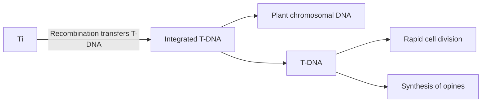

text_image

Telomere
Centromere
Telomere
Positions of origins
of replication

Figure 7.7 Chromosome structure.

research into the structure of eukaryotic chromosomes, work that has identified the key components of a chromosome as being (Figure 7.7):

• The centromere, which is required for the chromosome to be distributed correctly to daughter cells during cell division.
Two telomeres, the structures at the ends of a chromosome, which are needed in order for the ends to be replicated correctly and which also prevent the chromosome from being nibbled away by exonucleases.
• The origins of replication, which are the positions along the chromosome at which DNA replication initiates, similar to the origin of replication of a plasmid.

Once chromosome structure had been defined in this way, the possibility arose that the individual components might be isolated by recombinant DNA techniques and then joined together again in the test tube, creating an artificial chromosome. As the DNA molecules present in natural yeast chromosomes are several hundred kilobases in length, it might be possible with an artificial chromosome to clone long pieces of DNA.

## The structure and use of a YAC vector

Several YAC vectors have been developed but each one is constructed along the same lines, with pYAC3 being a typical example (Figure 7.8a). At first glance, pYAC3 does not look much like an artificial chromosome, but on closer examination its unique features become apparent. pYAC3 is essentially a pBR322 plasmid into which a number of yeast sequences have been inserted. Two of these are the genes, URA3 and TRP1, that we have encountered already as the selectable markers for YIp5 and YRp7, respectively. As in YRp7, the DNA fragment that carries TRP1 also contains an origin of replication, but in pYAC3 this fragment is extended even further to include CEN4, the centromeric DNA sequence also carried by YCp50. The TRP1–origin–CEN4 fragment therefore contains two of the three components of the artificial chromosome.

The third component, the telomeres, is provided by the two sequences called TEL. These are not themselves complete telomere sequences, but once inside the yeast nucleus they act as seeding sequences onto which telomeres will be built. This just leaves one other part of pYAC3 that has not been mentioned: SUP4, which is the selectable marker into which new DNA is inserted during the cloning experiment.

The cloning strategy with pYAC3 is as follows (Figure 7.8b). The vector is first restricted with a combination of BamHI and SnaBI, cutting the molecule into three fragments. The fragment flanked by BamHI sites is discarded, leaving two arms, each bounded by one TEL sequence and one

Figure 7.8

A YAC vector and the way it is used to clone large pieces of DNA.

SnaBI site. The DNA to be cloned, which must have blunt ends (SnaBI is a blunt end cutter, recognizing the sequence TACGTA), is ligated between the two arms, producing the artificial chromosome. Protoplast transformation (Section 5.4.1) is then used to introduce the artificial chromosome into S. cerevisiae. The yeast strain that is used is a double auxotrophic mutant, $t r p 1 ^ { - } u r a 3 ^ { - }$ , which is converted to $t r p 1 ^ { + } u r a 3 ^ { + }$ by the two markers on the artificial chromosome. Transformants are therefore selected by plating onto minimal medium, on which only cells containing a correctly constructed artificial chromosome are able to grow. Any cell transformed with an incorrect artificial chromosome, containing two left or two right arms rather than one of each, is not able to grow on minimal medium as one of the markers is absent. The presence of the insert DNA in the vector can be checked by testing for insertional inactivation of SUP4, which is carried out by a simple colour test. Red colonies are recombinants, white colonies are not.

## Applications for YAC vectors

The initial stimulus in designing artificial chromosomes came from yeast geneticists who wanted to use them to study various aspects of chromosome structure and behaviour, for instance to examine the segregation of chromosomes during meiosis. These experiments established that artificial chromosomes are stable during propagation in yeast cells and raised the possibility that they might be used as vectors for genes that are too long to be cloned as a single fragment in an E. coli vector. In fact, YACs are the highest‐capacity cloning vectors that have so far been developed, routinely being used to clone fragments between 200 and 500 kb in length, and even being able to handle DNA inserts as long as 1000 kb. Several important mammalian genes are greater than 100 kb in length (e.g. the human cystic fibrosis gene is 250 kb), beyond the capacity of all but the most sophisticated E. coli cloning systems (Section 6.2.6), but well within the range of a YAC vector. Yeast artificial chromosomes therefore opened the way to studies of the functions and modes of expression of genes that had previously been intractable to analysis by recombinant DNA techniques. A new dimension to these experiments was provided by the discovery that under some circumstances YACs can be propagated in mammalian cells, enabling the functional analysis to be carried out in the organism in which the gene normally resides.

Yeast artificial chromosomes are equally important in the production of genomic libraries. Recall that with fragments of 300 kb, the maximum insert size for the highest capacity E. coli vector, some 30 000 clones are needed for a human gene library (Section 6.2.6). With a YAC vector carrying 500 kb fragments, the size of a human genomic library is reduced to just 19 000 clones. Unfortunately, YACs have run into problems with insert stability, the cloned DNA sometimes becoming rearranged by intramolecular recombination. Nevertheless, YACs have been of immense value in providing long pieces of cloned DNA for use in large‐scale DNA sequencing projects.

## 7.1.6 Vectors for other yeasts and fungi

Cloning vectors for other species of yeast and fungi are needed for basic studies of the molecular biology of these organisms and to extend the possible uses of yeasts and fungi in biotechnology. Episomal plasmids based on the S. cerevisiae 2 μm plasmid are able to replicate in a few other types of yeast, but the range of species is not broad enough for 2 μm vectors to be of general value. Replicative, centromeric and integrative plasmids, similar in design to YRps, YCps, and YIps, have been designed for a second type of yeast, Pichia pastoris, and integrative vectors are available for filamentous fungi such as Aspergillus nidulans and Neurospora crassa. We will look at these vectors in more detail when we study the use of yeasts and fungi in recombinant protein production (Section 14.3.1).

## 7.2 Cloning vectors for higher plants

Cloning vectors for higher plants were developed in the 1980s and their use has led to the **genetically modified (GM) crops** that are in the headlines today. We will examine the genetic modification of crops and other plants in Chapter 16. Here we look at the cloning vectors and how they are used.

Three types of vector system have been used with varying degrees of success with higher plants:

• Vectors based on the Ti plasmid of Agrobacterium tumefaciens.
• Direct gene transfer using various types of plasmid DNA.
• Vectors based on plant viruses.

## 7.2.1 Agrobacterium tumefaciens – nature’s smallest genetic engineer

Although no naturally occurring plasmids are known in higher plants, one bacterial plasmid is of great importance in gene cloning. This is the Ti plasmid of Agrobacterium tumefaciens. The species is now called Rhizobium rhizogenes by microbiologists, but we will use the old‐fashioned name that is familiar to plant genetic engineers.

A. tumefaciens is a soil microorganism that causes crown gall disease in many species of dicotyledonous plants. Crown gall occurs when a wound on the stem allows A. tumefaciens bacteria to invade the plant. After infection the bacteria cause a cancerous proliferation of the stem tissue in the region of the crown (Figure 7.9).

The ability to cause crown gall disease is associated with the presence of the Ti (tumour inducing) plasmid within the bacterial cell. This is a large (greater than 200 kb) plasmid that carries numerous genes involved in the infective process (Figure  7.10a). A remarkable feature of the Ti plasmid is that, after infection, part of the molecule is integrated into the  plant chromosomal DNA (Figure  7.10b). This segment, called the **T‐DNA**, is between 15 and 30 kb in size, depending on the strain. It is maintained in a stable form in the plant cell and is passed on to daughter cells as an integral part of the chromosomes. But the most remarkable feature of the Ti plasmid is that the T‐DNA contains eight or so genes that are expressed in the plant cell and are responsible for the cancerous properties of the transformed cells. These genes also direct synthesis of unusual compounds, called opines, that the bacteria use as nutrients (Figure  7.10c). In short, A. tumefaciens genetically engineers the plant cell for its own purposes.

flowchart

Figure 7.9

Crown gall disease.

donut

| Region | Description |
| --- | --- |
| Top | T-DNA (oncogenes) |
| Bottom Left | Virulence region |
| Bottom Right | Host specificity region |

Figure 7.10

The Ti plasmid and its integration into the plant chromosomal DNA after A. tumefaciens infection.

flowchart

## Using the Ti plasmid to introduce new genes into a plant cell

It was realized very quickly that the Ti plasmid could be used to transport new genes into plant cells. All that would be necessary would be to insert the new genes into the T‐DNA and then the bacterium could do the hard work of integrating them into the plant chromosomal DNA. In practice this has proved a tricky proposition, mainly because the large size of the Ti plasmid makes manipulation of the molecule very difficult.

The main problem is, of course, that it is very unlikely that there would be any single‐copy restriction sites in a plasmid 200 kb in size, and modifying the plasmid to change all but one of the, for example, BamHI sites would be impracticable. Novel strategies therefore had to be developed for inserting new DNA into the plasmid. Two are in general use:

• The **binary vector strategy** (Figure 7.11) is based on the observation that the T‐DNA does not need to be physically attached to the rest of

Figure 7.11

The binary vector strategy. Plasmids A and B complement each other when present together in the same A. tumefaciens cell. The T‐DNA carried by plasmid B is transferred to the plant chromosomal DNA by proteins coded by genes carried by plasmid A.

text_image

Virulence
region
Host
specificity
region
Plasmid A
~170 kb

text_image

Unique
restriction site
T-DNA
Plasmid B
~20 kb

the Ti plasmid. A two‐plasmid system, with the T‐DNA on a relatively small molecule, and the rest of the plasmid in normal form, is just as effective at transforming plant cells. In fact, some strains of A. tumefaciens, and related agrobacteria, have natural binary plasmid systems. The T‐DNA plasmid is small enough to have single‐copy restriction sites and to be manipulated using standard techniques.

The **co‐integration strategy** (Figure 7.12) uses an entirely new plasmid, based on an E. coli vector, but carrying a small portion of the T‐DNA. The homology between the new molecule and the Ti plasmid means that if both are present in the same A. tumefaciens cell, recombination

Figure 7.12

The co‐integration strategy.

(a) Wound infection by recombinant A. tumefaciens

text_image

Apply recombinant
bacteria
Cloned gene only
present in the
crown gall

(b) Transformation of cultured plant cells

flowchart

Figure 7.13

Transformation of plant cells by recombinant A. tumefaciens. (a) Infection of a wound: transformed plant cells are present only in the crown gall. (b) Transformation of a cell suspension: all the cells in the resulting plant are transformed.

can integrate the E. coli plasmid into the T‐DNA region. The gene to be cloned is therefore inserted into a restriction site on the small E. coli plasmid, introduced into A. tumefaciens cells carrying a Ti plasmid, and the natural recombination process left to integrate the new gene into the T‐DNA. Infection of the plant leads to insertion of the new gene, along with the rest of the T‐DNA, into the plant chromosomes.

## Production of transformed plants with the Ti plasmid

If A. tumefaciens bacteria that contain an engineered Ti plasmid are introduced into a plant in the natural way, by infection of a wound in the stem, then only the cells in the resulting crown gall will possess the cloned gene (Figure  7.13a). This is obviously of little value to the biotechnologist. Instead, a way of introducing the new gene into every cell in the plant is needed.

There are several solutions, the simplest being to infect not the mature plant but a culture of plant cells or protoplasts (Section  5.4.1) in liquid medium (Figure 7.13b). Plant cells and protoplasts whose cell walls have re‐formed can be treated in the same way as microorganisms. In particular, they can be plated onto a selective medium in order to isolate transformants. A mature plant regenerated from transformed cells will contain the cloned gene in every cell and will pass the cloned gene to its offspring.

Figure 7.14

The binary Ti vector pBIN19. kanR = kanamycin resistance gene.

donut

| Category | Value |
| --- | --- |
| Left repeat | N/A |
| lacZ' | N/A |
| ranR | N/A |
| Right repeat | N/A |

However, regeneration of a transformed plant can occur only if the Ti vector has been ‘**disarmed**’ so that the transformed cells do not display cancerous properties. Disarming is possible because the cancer genes, all of which lie in the T‐DNA, are not needed for the infection process, infectivity being controlled mainly by the virulence region of the Ti plasmid. In fact, the only parts of the T‐DNA that are involved in infection are two 25 bp repeat sequences found at the left and right borders of the region integrated into the plant DNA. Any DNA placed between these two repeat sequences will be treated as T‐DNA and transferred to the plant. It is therefore possible to remove all the cancer genes from the normal T‐DNA and replace them with an entirely new set of genes, without disturbing the infection process.

A number of disarmed Ti cloning vectors are now available, a typical example being the binary vector pBIN19 (Figure 7.14). The left and right T‐DNA borders present in this vector flank a copy of the lacZ′ gene, containing a number of cloning sites, as well as a kanamycin resistance gene that functions after integration of the vector sequences into the plant chromosome. As with a yeast shuttle vector, the initial manipulations that result in insertion of the gene to be cloned into pBIN19 are carried out in E. coli, the correct recombinant pBIN19 molecule then being transferred to A. tumefaciens and thence into the plant. Transformed plant cells are selected by plating onto agar medium containing kanamycin.

## Limitations of cloning with the Ti plasmid

Higher plants are divided into two broad categories: the monocotyledons (monocots) and the dicotyledons (dicots). Several factors have combined to make it much easier to use the Ti plasmid to clone genes in dicots such as tomato, tobacco, potato, peas, and beans, but much more difficult to obtain the same results with monocots. This has been frustrating because monocots include wheat, barley, rice, and maize, which are the most important crop plants and hence the most desirable targets for genetic engineering projects.

One difficulty stems from the fact that in nature A. tumefaciens only infects dicotyledonous plants. Monocots are therefore outside of the normal host range. At one time it was thought that this natural barrier was insurmountable and that monocots were totally resistant to transformation with Ti vectors, but eventually techniques for achieving T‐DNA transfer were devised. However, this was not the end of the story. Transformation with an Agrobacterium vector normally involves regeneration of an intact plant from a transformed protoplast, cell, or callus culture. The ease with which a plant can be regenerated depends very much on the particular species involved and, once again, the most difficult plants are the monocots. With monocots, callus derived from embryos is often used, as it is easier to regenerate plants from embryogenic callus than it is from callus derived from somatic tissues. An embryo is first soaked in a solution containing recombinant A. tumefaciens, and then placed on an agar medium that induces callus formation (Figure 7.15). Not all of the cells in the embryo become transformed, so pieces of callus are cultured on a selective medium on which only the transformants can grow. Mature plants are then regenerated from the transformed callus. The approach has been successful with maize, wheat, barley, and several other important monocots.

flowchart

Figure 7.15

Embryo transformation.

## 7.2.2 Cloning genes in plants by direct gene transfer

Although the Ti plasmid has always been looked on as the most promising system for cloning genes in plants, the limitations with the natural host range of A. tumefaciens has stimulated the search for alternative methods for introducing new DNA into plant cells. **Direct gene transfer** is one such method.

## Direct gene transfer into the nucleus

Direct gene transfer is based on the observation, first made in 1984, that a supercoiled bacterial plasmid, although unable to replicate in a plant cell on its own, can become integrated by recombination into one of the plant chromosomes. The recombination event is poorly understood but is almost certainly distinct from the processes responsible for T‐DNA integration.

Figure 7.16 Direct gene transfer.

flowchart

It  is also distinct from the chromosomal integration of a yeast vector (Section 7.1.3), as there is no requirement for a region of similarity between the bacterial plasmid and the plant DNA. Integration appears to occur randomly at any position in any of the plant chromosomes (Figure 7.16).

Direct gene transfer therefore makes use of supercoiled plasmid DNA, possibly a simple bacterial plasmid, into which an appropriate selectable marker (e.g. a kanamycin resistance gene) and the gene to be cloned have been inserted. Biolistics (Section 5.4.1) is frequently used to introduce the plasmid DNA into plant embryos, which are then regenerated as described above for Agrobacterium transformation. Alternatively, if the species being engineered can be regenerated from protoplasts or single cells, then other strategies, possibly more efficient than biolistics, are possible. One such method involves resuspending protoplasts in a viscous solution of polyethylene glycol. This is a polymeric, negatively charged compound that is thought to precipitate DNA onto the surfaces of the protoplasts and to induce uptake by endocytosis (Figure  7.17). Electroporation is also sometimes used to increase transformation frequency. After treatment, protoplasts are left for a few days in a solution that encourages regeneration of the cell walls. The cells are then spread onto selective medium to identify transformants and to provide callus cultures from which intact plants can be grown.

Figure 7.17

Direct gene transfer by precipitation of DNA onto the surfaces of protoplasts.

text_image

DNA
Plant protoplasts

## Transfer of genes into the chloroplast genome

If biolistics is used to introduce DNA in a plant embryo, then some particles may penetrate one or more of the chloroplasts present in the cells. Chloroplasts contain their own genomes, distinct from (and much shorter) than the DNA molecules in the nucleus, and under some circumstances, plasmid DNA can become integrated into this chloroplast genome. Unlike the integration of DNA into nuclear chromosomes, integration into the chloroplast genome will not occur randomly. Instead the DNA to be cloned must be flanked by sequences similar to the region of the chloroplast genome into which the DNA is to be inserted, so that insertion can take place by homologous recombination (Section 7.1.3). Each of these flanking sequences must be 500 bp or so in length. A low level of chloroplast transformation can also be achieved after PEG‐induced DNA delivery into protoplasts if the plasmid that is taken up carries these flanking sequences.

A plant cell contains tens of chloroplasts, but probably only one per cell becomes transformed, so the inserted DNA must carry a selectable marker such as the kanamycin resistance gene, and the embryos must be treated with the antibiotic for a considerable period to ensure that the transformed genomes propagate within the cell. Although this means that chloroplast transformation is a difficult method to carry out successfully, it is becoming an important adjunct to the more traditional methods for obtaining GM crops. As each cell has many chloroplasts, but only one nucleus, a gene inserted into the chloroplast genome is likely to be expressed at a higher level than one placed in the nucleus. This is particularly important when the engineered plants are to be used for production of pharmaceutical proteins (Section  15.1.5). So far, the  approach has been most successful with tobacco, but chloroplast transformation has also been achieved with more useful crops such as soybean and cotton.

## 7.2.3 Attempts to use plant viruses as cloning vectors

Modified versions of λ and M13 bacteriophages are important cloning vectors for E. coli (Chapter 6). Most plants are subject to viral infection, so could viruses be used to clone genes in plants? If they could, then they would be much more convenient to use than other types of vector, because with many viruses, transformation can be achieved simply by rubbing the virus nucleic acid onto the surface of a leaf. The natural infection process then spreads the virus throughout the plant.

The potential of plant viruses as cloning vectors has been explored for several years but without great success. One problem is that the vast majority of plant viruses have genomes not of DNA but of RNA. RNA viruses are not so useful as potential cloning vectors because manipulations with RNA are more difficult to carry out. Only two classes of DNA virus are known to infect higher plants, the **caulimoviruses** and **geminiviruses**, and neither is ideally suited for gene cloning.

## Caulimovirus vectors

Although one of the first successful plant genetic engineering experiments, back in 1984, used a caulimovirus vector to clone a new gene into turnip plants, two general difficulties with these viruses have limited their usefulness.

The first is that the total size of a caulimovirus genome is, like that of λ, constrained by the need to package it into its protein coat. Even after deletion of non‐essential sections of the virus genome, the capacity for carrying inserted DNA is still very limited. Recent research has shown that it might be possible to circumvent this problem by adopting a helper virus strategy, similar to that used with phagemids (Section  6.3.2). In this strategy, the cloning vector is a **cauliflower mosaic virus (CaMV)** genome that lacks several of the essential genes, which means that it can carry a large DNA insert but cannot by itself direct infection. Plants are inoculated with the vector DNA along with a normal CaMV genome. The normal viral genome provides the genes needed for the cloning vector to be packaged into virus proteins and spread through the plant.

This approach has considerable potential, but does not solve the second problem, which is the extremely narrow host range of caulimoviruses. This restricts cloning experiments to just a few plants, mainly brassicas such as turnips, cabbages, and cauliflowers. Caulimoviruses have, however, been important in genetic engineering as the source of highly active promoters that work in all plants and that are used to obtain expression of genes introduced by Ti plasmid cloning or direct gene transfer.

## Geminivirus vectors

What of the geminiviruses? These are particularly interesting because their natural hosts include plants such as maize and wheat, and they could therefore be potential vectors for these and other monocots. But geminiviruses have presented their own set of difficulties, one problem being that during the infection cycle the genomes of some geminiviruses undergo rearrangements and deletions, which would scramble up any additional DNA that has been inserted, an obvious disadvantage for a cloning vector. Research over the years has addressed these problems, and geminiviruses are beginning to find some specialist applications in plant gene cloning. One of these is in **virus‐induced gene silencing (VIGS)**, a technique used to investigate the functions of individual plant genes. This method exploits one of the natural defence mechanisms that plants use to protect themselves against viral attack. This method, called RNA silencing, results in degradation of viral mRNAs. If one of the viral RNAs is transcribed from a cloned gene contained within a geminivirus genome, then not only the viral transcripts but also the cellular mRNAs derived from the plant’s copy of the gene are degraded (Figure 7.18). The plant gene therefore becomes silenced and the effect of its inactivation on the phenotype of the plant can be studied.

## 7.3 Cloning vectors for animals

Considerable effort has been put into the development of vector systems for cloning genes in animal cells. These vectors are needed in biotechnology for the synthesis of recombinant protein from genes that are not expressed correctly when cloned in E. coli or yeast (Chapter  14), and methods for cloning in humans are being sought by clinical molecular biologists attempting to devise techniques for **gene therapy** (Section 15.3), in which a disease is treated by introduction of a cloned gene into the patient.

Figure 7.18

The use of a geminivirus vector to silence a plant gene via virus‐induced gene silencing.

The clinical aspect has meant that most attention has been directed at cloning systems for mammals, but important progress has also been made with insects. Cloning in insects is interesting because it makes use of a novel type of vector that we have not met so far. We will therefore examine insect vectors before concluding the chapter with an overview of the cloning methods used with mammals.

## 7.3.1 Cloning vectors for insects

The fruit fly, Drosophila melanogaster, has been and still is one of the most important model organisms used by biologists. Its potential was first recognized by the famous geneticist Thomas Hunt Morgan, who in 1910 started to carry out genetic crosses between fruit flies with different eye colours, body shapes, and other inherited characteristics. These experiments led to the techniques still used today for gene mapping in insects and other animals. More recently, the discovery that the homeotic selector genes of Drosophila – the genes that control the overall body plan of the fly  –  are closely related to equivalent genes in mammals, has led to D. melanogaster being used as a model for the study of human developmental processes. The importance of the fruit fly in modern biology makes it imperative that vectors for cloning genes in this organism are available.

## P elements as cloning vectors for Drosophila

The development of cloning vectors for Drosophila has taken a different route to that followed with bacteria, yeast, plants, and mammals. No plasmids are known in Drosophila and although fruit flies are, like all organisms, susceptible to infection with viruses, these have not been used as the basis for cloning vectors. Instead, cloning in Drosophila makes use of a **transposon** called the **P element**.

Transposons are common in all types of organism. They are short pieces of DNA (usually less than 10 kb in length) that can move from one position

Figure 7.19

Cloning in Drosophila with a P element vector. (a) The structure of a P element. (b) Transposition of a P element from a plasmid to a fly chromosome. (c) The structure of a P element cloning vector. The left‐hand P element contains a cloning site (R) that disrupts its transposase gene. The right‐hand P element has an intact transposase gene but cannot itself transpose because it is ‘wings‐clipped’ – it lacks terminal inverted repeats.

(a) The structure of a P element

text_image

Genes
Terminal inverted repeat

(b) P element transposition

flowchart

(c) The structure of a P element cloning vector

text_image

R
'Wings-clipped' element
Inverted repeats
Plasmid DNA

to another in the chromosomes of a cell. P elements, which are one of several types of transposon in Drosophila, are 2.9 kb in length and contain three genes flanked by short inverted repeat sequences at either end of the element (Figure 7.19a). The genes code for transposase, the enzyme that carries out the transposition process, and the inverted repeats form the recognition sequences that enable the enzyme to identify the two ends of the inserted transposon.

As well as moving from one site to another within a single chromosome, P elements can also jump between chromosomes, or between a plasmid carrying a P element and one of the fly’s chromosomes (Figure 7.19b). The latter is the key to the use of P elements as cloning vectors. The vector is a plasmid that carries two P elements, one of which contains the insertion site for the DNA that will be cloned. Insertion of the new DNA into this P element results in disruption of its transposase gene, so this element is inactive. The second P element carried by the plasmid is therefore one that has an intact version of the transposase gene. Ideally this second element should not itself be transferred to the Drosophila chromosomes, so it has its ‘wings clipped’, which means that its inverted repeats are removed so that the transposase does not recognize it as being a real P element (Figure 7.19c). Once the gene to be cloned has been inserted into the vector, the plasmid DNA is microinjected into fruit fly embryos. The transposase from the wings‐clipped P element directs transfer of the engineered P element into one of the fruit fly chromosomes. If this happens within a germline nucleus, then the adult fly that develops from the embryo will carry copies of the cloned gene in all its cells. P element cloning was first developed in the 1980s and has made a number of important contributions to Drosophila genetics.

## Cloning vectors based on insect viruses

Although virus vectors have not been developed for cloning genes in Drosophila, one type of virus, the **baculovirus**, has played an important role in gene cloning with other insects. The main use of baculovirus vectors is in the production of recombinant protein, and we will return to them when we consider this topic in Section 14.3.2.

## 7.3.2 Cloning in mammals

At present, gene cloning in mammals is carried out for one of three reasons:

• To achieve a **gene knockout**, which is an important technique used to help determine the function of an unidentified gene (Section 12.2.2). These experiments are usually carried out with rodents such as mice.
For production of recombinant protein in a mammalian cell culture, and in the related technique of **pharming**, which involves genetic engineering of a farm animal so that it synthesizes an important protein such as a pharmaceutical, often in its milk (Section 14.3.3).
• In **gene therapy**, in which human cells are engineered in order to treat a disease (Section 15.3).

## Viruses as cloning vectors for mammals

For many years it was thought that viruses would prove to be the key to cloning in mammals. This expectation has only partially been realized. The first cloning experiment involving mammalian cells was carried out in 1979 with a vector based on simian virus 40 (SV40). This virus is capable of infecting several mammalian species, following a lytic cycle in some hosts and a lysogenic cycle in others. The genome is 5.2 kb in size (Figure 7.20a) and contains two sets of genes: the ‘early’ genes, expressed early in the infection cycle and coding for proteins involved in viral DNA replication, and the ‘late’ genes, coding for viral capsid proteins. SV40 suffers from the same problem as λ and the plant caulimoviruses, in that

Figure 7.20

SV40 and an example of its use as a cloning vector. To clone the rabbit β‐globin gene the HindIII to BamHI restriction fragment was deleted (resulting in SVGT‐5) and replaced with the rabbit gene.

packaging constraints limit the amount of new DNA that can be inserted into the genome. Cloning with SV40 therefore involves replacing one or more of the existing genes with the DNA to be cloned. In the original experiment a segment of the late gene region was replaced (Figure 7.20b), but early gene replacement is also an option.

In the years since 1979, a number of other types of virus have been used to clone genes in mammals. These include:

• **Adenoviruses**, which enable DNA fragments of up to 8 kb to be cloned, longer than is possible with an SV40 vector, though adenoviruses are more difficult to handle because their genomes are bigger.
**Papillomaviruses**, which also have a relatively high capacity for inserted DNA. Bovine papillomavirus (BPV), which causes warts on cattle, is particularly attractive because it has an unusual infection cycle in mouse cells, taking the form of a multicopy plasmid with about 100 molecules present per cell. It does not cause the death of the mouse cell, and BPV molecules are passed to daughter cells on cell division, giving rise to a permanently transformed cell line. Shuttle vectors consisting of BPV and E. coli sequences, and capable of replication in both mouse and bacterial cells, have been used for the production of recombinant proteins in mouse cell lines.
**Adeno‐associated virus (AAV)**, which is unrelated to adenovirus but often found in the same infected tissues, because AAV makes use of some of the proteins synthesized by adenovirus in order to complete its replication cycle. In the absence of this helper virus, the AAV genome inserts into its host’s DNA. With most integrative viruses this is a random event, but AAV has the unusual property of always inserting at the same position, within human chromosome 19. Knowing exactly where the cloned gene will be in the host genome is important if the outcome of the cloning experiment must be checked rigorously, as is the case in applications such as gene therapy. AAV vectors are therefore looked on as having major potential in this area.
• **Retroviruses**, which are the most commonly used vectors for gene therapy. Although they insert at random positions, the resulting integrants are very stable, which means that the therapeutic effects of the cloned gene will persist for some time. We will return to gene therapy in Section 15.3.

## Gene cloning without a vector

One of the reasons why virus vectors have not become widespread in mammalian gene cloning is because it was discovered in the early 1990s that the most effective way of transferring new genes into mammalian cells is by microinjection. Although a difficult procedure to carry out, microinjection of bacterial plasmids, or linear DNA copies of genes, into mammalian nuclei results in the DNA being inserted into the chromosomes, possibly as multiple copies in a tandem, head‐to‐tail arrangement (Figure 7.21). This procedure is generally looked on as more satisfactory than the use of a viral vector because it avoids the possibility that viral DNA will infect the cells and cause defects of one kind or another.