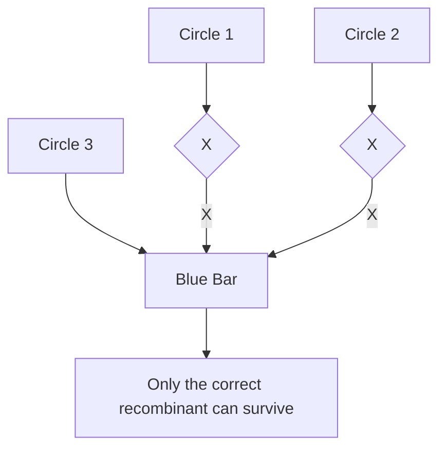
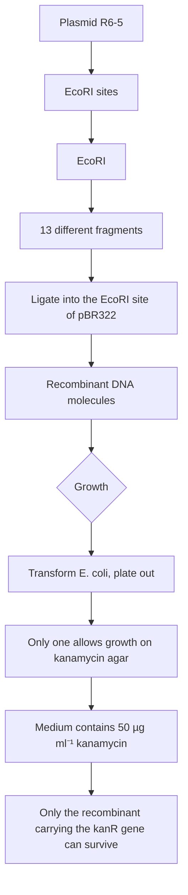
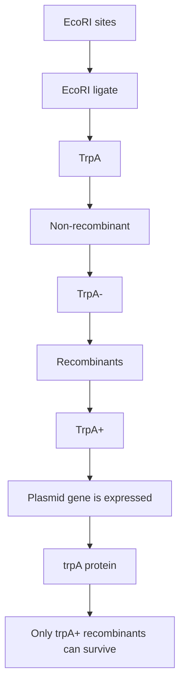
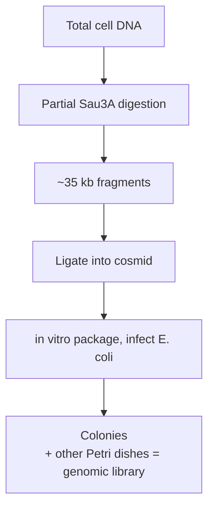
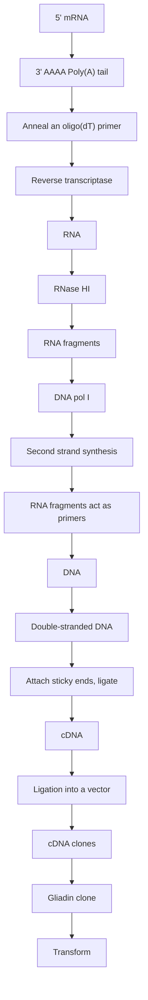
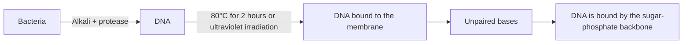
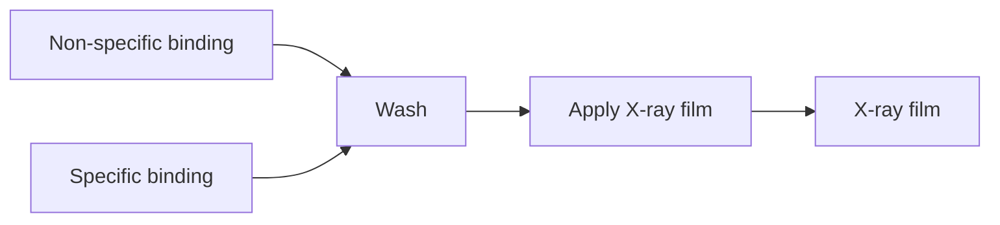
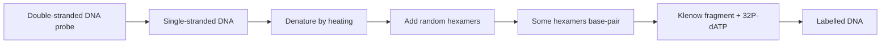

text_image

Multiple copies of the cloned DNA
Chromosomal DNA

Figure 7.21

Multiple copies of cloned DNA molecules inserted as a tandem array in a chromosomal DNA molecule.

Microinjection of DNA is the basis to creation of a **transgenic animal**, one that contains a cloned gene in all of its cells. A transgenic mouse can be generated by microinjection of a fertilized egg cell which is subsequently cultured in vitro for several cell divisions and then implanted into a foster mother. Alternatively, an **embryonic stem (ES) cell** can be used. These are obtained from within an early embryo and, unlike most mammalian cells, are **totipotent**, meaning that their developmental pattern is not preset and cells descended from them can form many different structures in the adult mouse. After microinjection, the ES cell is placed back in an embryo which is implanted into the foster mother. The resulting mouse is a **chimera**, comprising a mixture of engineered and non‐engineered cells, because the embryo that receives the ES cell also contains a number of ordinary cells that contribute, along with the ES cell, to the make‐up of the adult mouse. Non‐chimeric mice, which contain the cloned gene in all their cells, are obtained by allowing the chimera to reproduce, as some of the offspring will be derived from egg cells that contain the cloned gene.

## Further reading

- Bock, R. (2015) Engineering plastid genomes: methods, tools, and applications in basic research and biotechnology. Annual Review of Plant Biology, 66, 211–241. [Information on and context for chloroplast transformation.]
- Brisson, N., Paszkowski, J., Penswick, J.R., et al. (1984) Expression of a bacterial gene in plants by using a viral vector. Nature, 310, 511–114. [The first cloning experiment with a caulimovirus.]
- Burke, D.T., Carle, G.F., and Olson, M.V. (1987) Cloning of large segments of exogenous DNA into yeast by means of artificial chromosome vectors. Science, 236, 806–812.
- Carrillo‐Tripp, J., Shimada‐Beltrán, H., and Rivera‐Bustamante, R. (2006) Use of geminiviral vectors for functional genomics. Current Opinion in Plant Biology, 9, 209–215. [Virus‐induced gene silencing.]
- Chan, K.M., Liu, Y.T., Ma, C.H., et al. (2013) The 2 micron plasmid of Saccharomyces cerevisiae: a miniaturized selfish genome with optimized functional competence. Plasmid, 70, 2–17. [Reviews the features of the 2 μm plasmid.]
- Colosimo, A., Goncz, K.K., Holmes, A.R., et al. (2000) Transfer and expression of foreign genes in mammalian cells. Biotechniques, 29, 314–321.
- Crystal, R.G. (2014) Adenovirus: the first effective in vivo gene delivery vector. Human Gene Therapy, 25, 3–11.
- Evans, M. (2011) Discovering pluripotency: 30 years of mouse embryonic stem cells. Nature Reviews Molecular Cell Biology, 12, 680–686.
- Gnügge, R. and Rudolf, F. (2017) Saccharomyces cerevisiae shuttle vectors. Yeast, 34, 205–221. [Details of different yeast cloning vectors.]
- Gordon, J.E. and Christie, P.J. (2014) The Agrobacterium Ti plasmids. Microbiology Spectrum, 2, 6.
- Hamer, D.H. and Leder, P. (1979) Expression of the chromosomal mouse β‐maj‐globin gene cloned in SV40. Nature, 281, 35–40.
- Hayta, S., Smedley, M.A., Demir, S.U., et al. (2019) An efficient and reproducible Agrobacterium‐mediated transformation method for hexaploid wheat (Triticum aestivum L.). Plant Methods, 15, 121. [Describes the transformation of wheat embryos.]
- Lee, L.‐Y. and Gelvin, S.B. (2008) T‐DNA binary vectors and systems. Plant Physiology, 146, 325–332.
- Nakamura, Y., Nishi, T., Noguchi, R., et al. (2018) A stable, autonomously replicating plasmid vector containing Pichia pastoris centromeric DNA. Applied and Environmental Microbiology, 84, e02882–17.
- Păcurar, D.I., Thordal‐Christensen, H., Păcurer, M.L., et al. (2011) Agrobacterium tumefaciens: from crown gall tumors to genetic transformation. Physiological and Molecular Plant Pathology, 76, 76–81.
- Paszkowski, J., Shillito, R.D., Saul, M., et al. (1984) Direct gene transfer to plants. EMBO Journal, 3, 2717–2722.
- Rubin, G.M. and Spradling, A.C. (1982) Genetic transformation of Drosophila with transposable element vectors. Science, 218, 348–353. [Cloning with P elements.]

## Chapter 8

# How to Obtain a Clone of a Specific Gene

## Chapter contents

**8.1** The problem of selection 146
**8.2** Direct selection 147
**8.3** Identification of a clone from a gene library 150
**8.4** Methods for clone identification 153

In the preceding chapters we have examined the basic methodology used to clone genes and surveyed the range of vector types that are used with bacteria, yeast, plants, and animals. Now we must look at the methods available for obtaining a clone of an individual, specified gene. This is the critical test of a gene cloning experiment, success or failure often depending on whether or not a strategy can be devised by which clones of the desired gene can be selected directly, or alternatively, distinguished from other recombinants. Once this problem has been resolved, and a clone has been obtained, the molecular biologist is able to make use of a wide variety of different techniques that will extract information about the gene. The most important of these will be described in Chapters 10 and 11.

## 8.1 The problem of selection

The problem faced by the molecular biologist wishing to obtain a clone of a single, specified gene was illustrated in Figure 1.4. Even the simplest organisms, such as E. coli, contain several thousand genes, and a restriction digest of total cell DNA produces not only the fragment carrying the desired gene, but also many other fragments carrying all the other genes (Figure 8.1a). During the ligation reaction there is no selection for an individual fragment, with numerous different recombinant DNA molecules being produced, all containing different pieces of DNA (Figure 8.1b). Consequently, a variety of recombinant clones are obtained after transformation and plating out (Figure 8.1c). Somehow the correct one must be identified.

## 8.1.1 There are two basic strategies for obtaining the clone you want

Although there are many different procedures by which the desired clone can be obtained, all are variations on two basic themes:

**Direct selection for the desired gene** (Figure 8.2a), which means that the cloning experiment is designed in such a way that the only clones

Figure 8.1

The problem of selection.

(a) Direct selection

flowchart

Figure 8.2

The basic strategies that can be used to obtain a particular clone. (a) Direct selection. (b) Identification of the desired recombinant from a clone library.

(b) Clone identication

text_image

A clone
library
Correct clone

that are obtained are clones of the required gene. Almost invariably, selection occurs at the plating out stage.

**Identification of the clone from a gene library** (Figure 8.2b), which entails an initial **shotgun** cloning experiment, to produce a clone library representing all or most of the genes present in the cell, followed by analysis of the individual clones to identify the correct one.

In general terms, direct selection is the preferred method, as it is quick and usually unambiguous. However, as we shall see, it is not applicable to all genes, and techniques for clone identification are therefore very important.

## 8.2 Direct selection

To be able to select for a cloned gene it is necessary to plate the transformants onto an agar medium on which only the desired recombinants, and no others, can grow. The only colonies that are obtained will therefore be ones that comprise cells containing the desired recombinant DNA molecule.

The simplest example of direct selection occurs when the desired gene specifies resistance to an antibiotic. As an example, we will consider an experiment to clone the gene for kanamycin resistance from plasmid R6‐5. This plasmid carries genes for resistances to four antibiotics: kanamycin,

Figure 8.3

Direct selection for the cloned R6‐5 kanamycin resistance (kanR) gene.

flowchart

chloramphenicol, streptomycin, and sulphonamide. The kanamycin resistance gene lies within one of the 13 fragments produced when R6‐5 is digested with EcoRI (Figure 8.3a). To clone this gene, the EcoRI fragments of R6‐5 could be inserted into the EcoRI site of a vector such as pBR322. The ligated mix will comprise many copies of 13 different recombinant DNA molecules, one set of which carries the gene for kanamycin resistance (Figure 8.3b).

Insertional inactivation cannot be used to select recombinants when the EcoRI site of pBR322 is used. This is because this site does not lie in either the ampicillin or the tetracycline resistance genes of this plasmid (see Figure 6.1). But this is immaterial for cloning the kanamycin resistance gene because in this case the cloned gene can be used as the selectable marker. Transformants are plated onto kanamycin agar, on which the only cells able to survive and produce colonies are those recombinants that contain the cloned kanamycin resistance gene (Figure 8.3c).

flowchart

Figure 8.4

Direct selection for the trpA gene cloned in a trpA strain of E. coli.

## 8.2.1 Marker rescue extends the scope of direct selection

Direct selection would be very limited indeed if it could be used only for cloning antibiotic resistance genes. Fortunately, the technique can be extended by making use of mutant strains of E. coli as the hosts for transformation.

As an example, consider an experiment to clone the gene trpA from E. coli. This gene codes for the enzyme tryptophan synthase, which is involved in biosynthesis of the essential amino acid tryptophan. A mutant strain of E. coli that has a non‐functional trpA gene is called trpA− and is able to survive only if tryptophan is added to the growth medium. E. coli trpA− is therefore another example of an auxotroph (Section 7.1.1).

The E. coli trpA− auxotroph can be used to clone the correct version of the trpA gene. Total DNA is first purified from a normal (wild‐type) strain of the bacterium. Digestion with a restriction endonuclease, followed by ligation into a vector, produces numerous recombinant DNA molecules, one of which may, with luck, carry an intact copy of the trpA gene (Figure 8.4a). This is, of course, the functional gene, as it has been obtained from the wild‐type strain.

The ligation mixture is now used to transform the auxotrophic E. coli trpA− cells (Figure 8.4b). The vast majority of the resulting transformants will still be auxotrophic, but a few now have the plasmid‐borne copy of the correct trpA gene. These recombinants are non‐auxotrophic; they no longer require tryptophan as the cloned gene is able to direct production of tryptophan synthase (Figure  8.4c). Direct selection is therefore performed by plating transformants onto minimal medium, which lacks any added supplements, and in particular has no tryptophan (Figure  8.4d). Auxotrophs cannot grow on minimal medium, so the only colonies to appear are recombinants that contain the cloned trpA gene.

## 8.2.2 The scope and limitations of marker rescue

Although marker rescue can be used to obtain clones of many genes, the technique is subject to two limitations:

• A mutant strain must be available for the gene in question.
• A medium on which only the wild type can survive is needed.

Marker rescue is applicable for most genes that code for biosynthetic enzymes, as clones of these genes can be selected on minimal medium in the manner described for trpA. The technique is not limited to E. coli or even bacteria. Auxotrophic strains of yeast and filamentous fungi are also available, and marker rescue has been used to select genes cloned into these organisms.

In addition, E. coli auxotrophs can be used as hosts for the selection of some genes from other organisms. Often there is sufficient similarity between equivalent enzymes from different bacteria, or even from yeast, for the foreign enzyme to function in E. coli, so that the cloned gene is able to transform the host to wild type.

## 8.3 Identification of a clone from a gene library

Although marker rescue is a powerful technique, it is not all‐embracing and there are many important genes that cannot be selected by this method. Many bacterial mutants are not auxotrophs, so the mutant and wild type strains cannot be distinguished by plating onto minimal or any other special medium. In addition, neither marker rescue nor any other direct selection method is of much use in providing bacterial clones of genes from animals or plants, as in these cases the differences are usually so great that the foreign enzymes do not function in the bacterial cell.

The alternative strategy must therefore be considered. This is where a large number of different clones are obtained and the desired one identified in some way.

## 8.3.1 Gene libraries

Before looking at the methods used to identify individual clones, the library itself must be considered. A genomic library (Section 6.2.6) is a collection of clones sufficient in number to be likely to contain every single gene pre-sent in a particular organism. Genomic libraries are prepared by purifying total cell DNA, and then making a partial restriction digest, resulting in fragments that can be cloned into a suitable vector (Figure 8.5), usually a λ replacement vector, a cosmid, or possibly a yeast artificial chromosome (YAC), bacterial artificial chromosome (BAC), or P1 vector.

## Not all genes are expressed at the same time

For bacteria, yeast, and fungi, the number of clones needed for a complete genomic library is not so large as to be unmanageable (see Table 6.1). For plants and animals though, a complete library contains so many different clones that identification of the desired one may prove a mammoth task. With these multicellular organisms a second type of library, specific not to the whole organism but to a particular cell type, might be more useful. Each cell contains the same complement of genes, but in different cell types different sets of genes are switched on, while others are silent (Figure 8.6). Only those genes that are being expressed are transcribed into messenger RNA (mRNA), so if mRNA is used as the starting material then the resulting clones would comprise only a selection of the total number of genes in the cell.

A cloning method that uses mRNA would be particularly useful if the  desired gene is expressed at a high rate in an individual cell type.

flowchart

Figure 8.5

Preparation of a genomic library in a cosmid vector.

Figure 8.6

Different genes are expressed in different types of cell.

For  example, the gene for gliadin, one of the nutritionally important proteins present in wheat, is expressed at a very high level in the cells of developing wheat seeds. In these cells over 30% of the total mRNA specifies gliadin. Clearly, if we could clone the mRNA from wheat seeds, we would obtain a large number of clones specific for gliadin.

## mRNA can be cloned as complementary DNA

Messenger RNA cannot itself be ligated into a cloning vector. However, mRNA can be converted into DNA by **complementary DNA (cDNA)** synthesis. The key to this method is the enzyme reverse transcriptase (Section 4.1.3) which synthesizes a DNA polynucleotide complementary to an existing RNA strand (Figure 8.7a). Once the cDNA strand has been synthesized the RNA member of the hybrid molecule can be partially degraded by treating with ribonuclease HI (Figure 8.7b). The remaining RNA fragments then serve as primers for DNA polymerase I, which synthesizes the second cDNA strand (Figure  8.7c), resulting in a doublestranded DNA fragment that can be ligated into a vector and cloned (Figure 8.7d).

The resulting cDNA clones are representative of the mRNA present in the original preparation. In the case of mRNA prepared from wheat seeds, the cDNA library would contain a large proportion of clones representing gliadin mRNA (Figure 8.7e). Other clones will also be present, but locating the cloned gliadin cDNA is a much easier process than identifying the equivalent gene from a complete wheat genomic library.

(a) First strand synthesis

flowchart

Figure 8.7

One possible scheme for cDNA cloning. First strand synthesis is primed by oligo(dT), a short oligonucleotide made up entirely of deoxythymidine nucleotides, which base pairs to the poly(A) tail present at the 3′ end of a eukaryotic mRNA.

## 8.4 Methods for clone identification

Once a suitable library has been prepared, a number of procedures can be employed to attempt identification of the desired clone. Although a few of these procedures are based on detection of the translation product of the cloned gene, it is usually easier to identify directly the correct recombinant DNA molecule. This can be achieved by the important technique of **hybridization probing**.

## 8.4.1 Complementary nucleic acid strands hybridize to each other

Any two single‐stranded nucleic acid molecules have the potential to form base pairs with one another. With most pairs of molecules, the resulting hybrid structures are unstable, as only a small number of individual interstrand bonds are formed (Figure 8.8a). However, if the polynucleotides are complementary, extensive base pairing can occur to form a stable doublestranded molecule (Figure 8.8b). Not only can this occur between singlestranded DNA molecules to form the DNA double helix, but also between a pair of single‐stranded RNA molecules or between combinations of one DNA strand and one RNA strand (Figure  8.8c). Pairing between singlestranded molecules, which is called **nucleic acid hybridization**, can be used to identify a particular recombinant clone if a DNA or RNA probe, complementary to the desired gene, is available. The exact nature of the probe will be discussed later in this chapter. First, we must consider the technique itself.

## 8.4.2 Colony and plaque hybridization probing

Hybridization probing can be used to identify recombinant DNA molecules contained in either bacterial colonies or bacteriophage plaques. First the colonies or plaques are transferred to a nitrocellulose or nylon membrane (Figure 8.9a) and then treated to remove all contaminating material, leaving just DNA (Figure 8.9b). Usually this treatment also results in denaturation of the DNA molecules, so that the hydrogen bonds between individual strands in the double helix are broken. These single‐stranded molecules can then be bound tightly to the membrane by a short period at $8 0 ^ { \circ } \mathrm { C }$ if a nitrocellulose membrane is being used, or with a nylon membrane by ultraviolet irradiation. The molecules become attached to the

(a) An unstable hybrid

natural_image

Simple line drawing of a wavy, segmented object resembling a worm or worm-like structure (no text or symbols)

(b) A stable hybrid

text_image

A stable hybrid
Short non-complementary regions
do not affect overall stability

(c) A DNA–RNA hybrid

Figure 8.8

Nucleic acid hybridization.

(a) An unstable hybrid molecule formed between two nonhomologous DNA strands.
(b) A stable hybrid formed between two complementary strands. (c) A DNA–RNA hybrid, such as may be formed between a gene and its transcript.

(a) Transfer colonies to nitrocellulose or nylon

flowchart

(b) Degrade cells, purify DNA

flowchart

(c) Probe with labelled DNA

flowchart

(d) The resulting autoradiograph

text_image

Positive
hybridization

Figure 8.9

Colony hybridization probing. In this example, the probe is labelled with a radioactive marker and hybridization detected by autoradiography, but other types of label and detection system can also be used.

membrane through their sugar–phosphate backbones, so the bases are free to pair with complementary nucleic acid molecules.

The probe must now be **labelled** with a radioactive or other type of marker, denatured by heating, and applied to the membrane in a solution of chemicals that promote nucleic acid hybridization (Figure 8.9c). After a period to allow hybridization to take place, the filter is washed to remove unbound probe, dried, and the label detected in order to identify the colonies or plaques to which the probe has become bound (Figure 8.9d).

## Labelling with a radioactive marker

A DNA molecule can be labelled by incorporating nucleotides that carry a radioactive isotope of phosphorus, 32P (Figure 8.10). Several methods are available, including:

## Figure 8.10

The structure of α‐32P‐deoxyadenosine triphosphate ([α‐32P]dATP).

chemical

Chemical structure of a phosphonate derivative with radioactive 32P ligand and a pyridine ring

Nick translation. Most purified samples of DNA contain some nicked molecules, however carefully the preparation has been carried out. This means that DNA polymerase I is able to attach to the DNA and catalyse a strand replacement reaction (Figure 8.11a). This reaction requires a supply of nucleotides. If one of these is radioactively labelled, then the DNA molecule will itself become labelled. Nick translation can be used to label any DNA molecule but might under some circumstances also cause DNA cleavage.
**End filling** is a gentler method than nick translation and rarely causes breakage of the DNA, but unfortunately can only be used to label DNA molecules that have sticky ends. The enzyme used is the Klenow fragment (Section 4.1.3), which ‘fills in’ a sticky end by synthesizing the complementary strand (Figure 8.11b). As with nick translation, if the end filling reaction is carried out in the presence of labelled nucleotides, the DNA becomes labelled.
**Random priming** results in a probe with higher activity and therefore able to detect smaller amounts of membrane‐bound DNA. The denatured DNA is mixed with a set of hexameric oligonucleotides of random sequence. By chance, these random hexamers will contain a few molecules that will base pair with the probe and prime new DNA synthesis. The Klenow fragment is used as this enzyme lacks the nuclease activity of DNA polymerase I and so only fills in the gaps between adjacent primers (Figure 8.11c). Labelled nucleotides are incorporated into the new DNA that is synthesized.

(a) Labelling by nick translation

flowchart

(b) Labelling by end-lling

flowchart

(c) Labelling by random priming

flowchart

Figure 8.11

Methods for labelling DNA.

After hybridization, the location of the bound probe can be detected by **autoradiography**. A sheet of X‐ray‐sensitive photographic film is placed over the membrane. The radioactive DNA exposes the film, which is developed to reveal the positions of the colonies or plaques to which the probe has hybridized (see Figure 8.9d). Alternatively, the radioactive signal can be detected with a **phosporimager**. This is a device that contains a plate coated with phosphor particles which emit light when stimulated with radioactive emissions. The emitted light is detected with a scanner and recorded electronically.

## Non‐radioactive labelling

Radioactive labelling methods are starting to fall out of favour, partly because of the hazard to the researcher and partly because of the problems associated with disposal of radioactive waste. As an alternative, the hybridization probe can be labelled in a non‐radioactive manner. One possibility is to use a nucleotide that has been covalently linked to a fluorescent compound, often a derivative of rhodamine or fluorescein. After hybridization, the fluorescent signal is recorded on normal photographic film in a manner analogous to autoradiography.

There are also indirect detection methods, which use labels that do not themselves emit a recordable signal, but whose positions on a membrane can be detected by some type of post‐treatment. One of these indirect methods makes use of deoxyuridine triphosphate (dUTP) nucleotides modified by reaction with **biotin**, an organic molecule that has a high affinity for a protein called **avidin**. After hybridization, the positions of the bound biotinylated probe can be determined by washing with avidin coupled to a fluorescent marker (Figure  8.12a). This method is as sensitive as radioactive probing and is becoming increasingly popular. The same is true for a second indirect procedure, in which the probe DNA is complexed with the enzyme **horseradish peroxidase**, and is detected through the enzyme’s ability to degrade luminol with the emission of chemiluminescence (Figure 8.12b).

## 8.4.3 Examples of the practical use of hybridization probing

Clearly, the success of colony or plaque hybridization as a means of identifying a particular recombinant clone depends on the availability of a DNA molecule that can be used as a probe. This probe must share at least a part of the sequence of the cloned gene. If the gene itself is not available (which presumably is the case if the aim of the experiment is to provide a clone of it), then what can be used as the probe?

In practice, the nature of the probe is determined by the information available about the desired gene. We will consider three possibilities:

Where the desired gene is expressed at a high level in a cell type from which a cDNA clone library has been prepared.
Where the amino acid sequence of the protein coded by the gene is completely or partially known.
• Where the equivalent gene from a related organism is available.

Figure 8.12

Two indirect detection methods used with non‐radioactive DNA probes.

## Abundancy probing to analyse a cDNA library

As described earlier in this chapter, a cDNA library is often prepared in order to obtain a clone of a gene expressed at a relatively high level in a particular cell type. In the example of a cDNA library from developing wheat seeds, a large proportion of the clones are copies of the mRNA transcripts of the gliadin gene (see Figure 8.7e).

Identification of the gliadin clones is simply a case of using individual cDNA clones from the library to probe all the other members of the library (Figure 8.13). A clone is selected at random and the recombinant DNA molecule is purified, labelled, and used to probe the remaining clones. This is repeated with different clones as probes until one that hybridizes to a large proportion of the library is obtained. This abundant cDNA is considered a possible gliadin clone and analysed in greater detail (e.g. by DNA sequencing and isolation of the translation product) to confirm the identification.