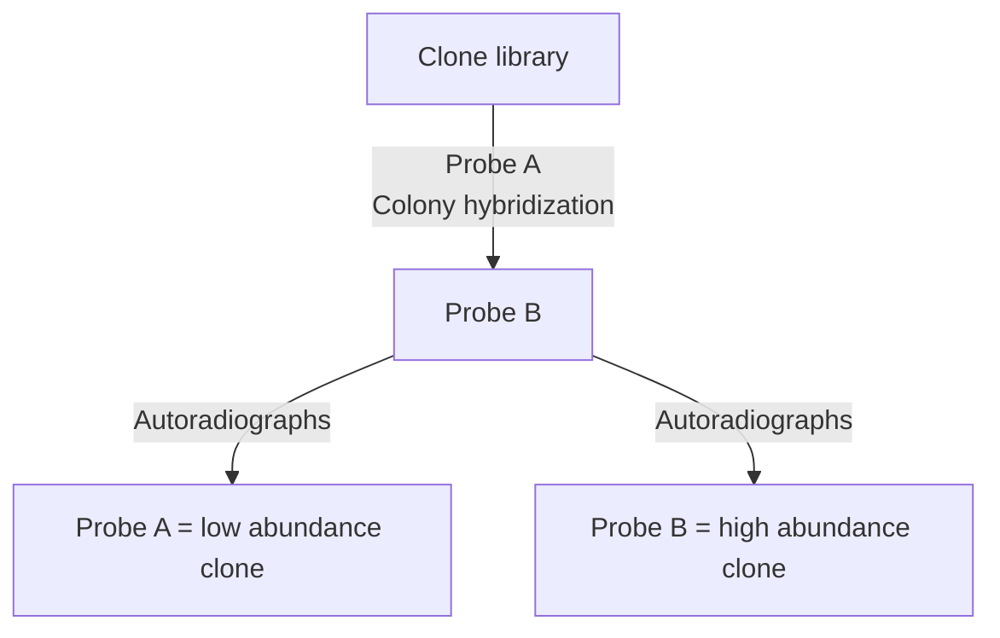
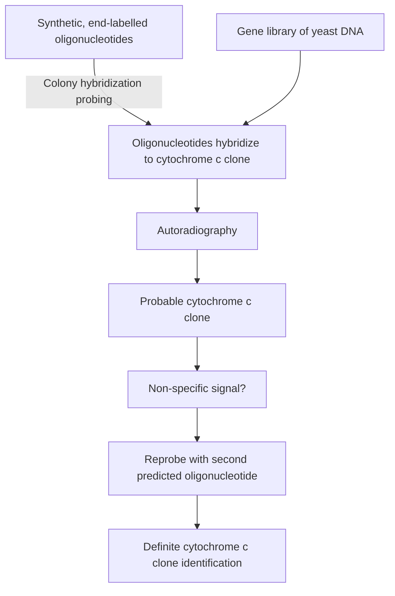
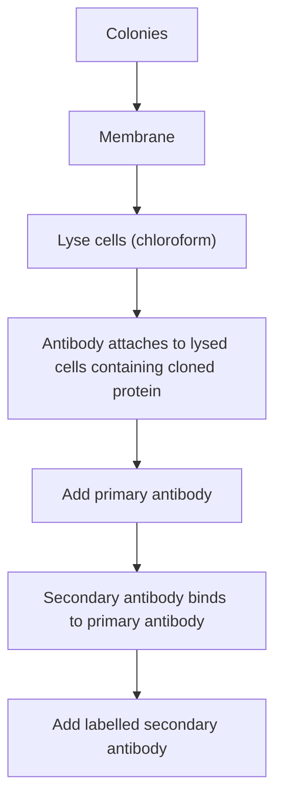
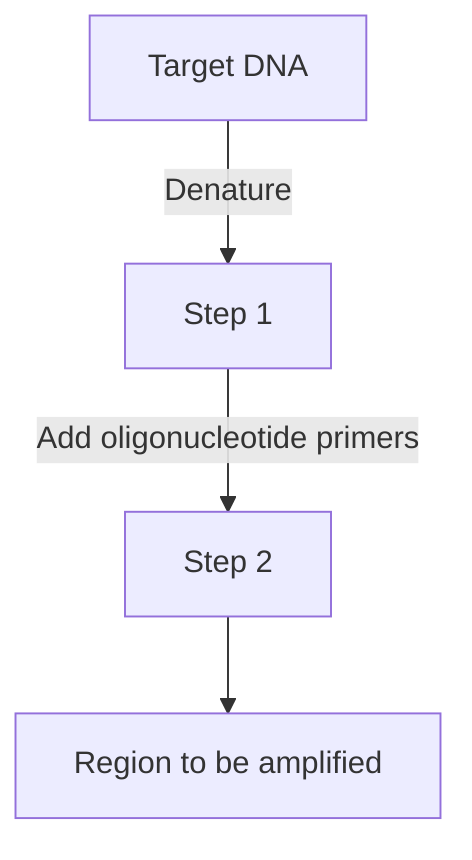
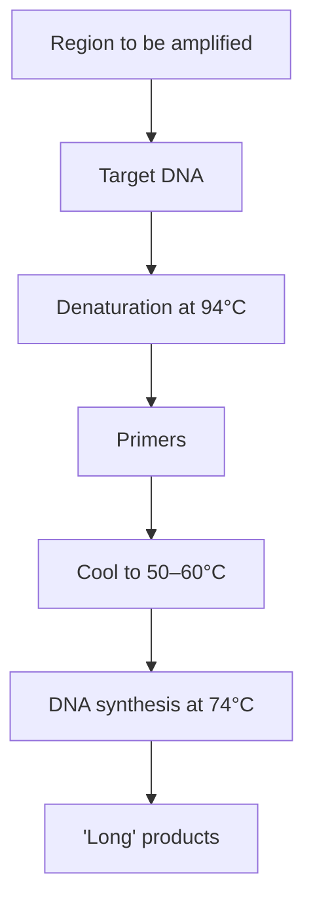
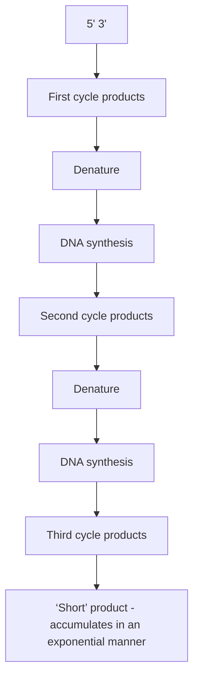

<details>
<summary>flowchart</summary>


</details>

Figure 8.13

Probing within a library to identify an abundant clone.

## Oligonucleotide probes for genes whose translation products have been characterized

Often the gene to be cloned codes for a protein that has already been studied in some detail. In particular, the amino acid sequence of the protein might have been determined. If the amino acid sequence is known, then it is possible to use the genetic code to predict the nucleotide sequence of the relevant gene. This prediction is always an approximation, as only methionine and tryptophan can be assigned unambiguously to triplet codons, all other amino acids being coded by at least two codons each. Nevertheless, in most cases, the different codons for an individual amino acid are related. Alanine, for example, is coded by GCA, GCC, GCG, and GCT, so two out of the three nucleotides of the triplet coding for alanine can be predicted with certainty.

As an example to show how these predictions are made, consider cytochrome c, a protein that plays an important role in the respiratory chain of all aerobic organisms. The cytochrome c protein from yeast was sequenced in 1963, with the result shown in Figure 8.14. This sequence

```txt
15
GLY-SER-ALA-LYS-LYS-GLY-ALA-THR-LEU-PHE-LYS-THR-ARG-CYS-GLU-
30
LEU-CYS-HIS-THR-VAL-GLU-LYS-GLY-GLY-PRO-HIS-LYS-VAL-GLY-PRO-
45
ASN-LEU-HIS-GLY-ILE-PHE-GLY-ARG-HIS-SER-GLY-GLN-ALA-GLN-GLY-
60
TYR-SER-TYR-THR-ASP-ALA-ASN-ILE-LYS-LYS-ASN-VAL-LEU-TRP-ASP-
75
GLU-ASN-ASN-MET-SER-GLU-TYR-LEU-THR-ASN-PRO-LYS-LYS-TYR-ILE-
90
PRO-GLY-THR-LYS-MET-ALA-PHE-GLY-GLY-LEU-LYS-LYS-GLU-LYS-ASP-
103
ARG-ASN-ASP-LEU-ILE-THR-TYR-LEU-LYS-LYS-ALA-CYS-GLU
```

Figure 8.14

The amino acid sequence of yeast cytochrome c. The hexapeptide that is highlighted red is the one used to illustrate how a nucleotide sequence can be predicted from an amino acid sequence.

Figure 8.15

A simplified scheme for oligonucleotide synthesis. Each nucleotide is modified by attachment of an activating group to the 3′ carbon and a protecting group to the 5′ carbon. The activating group enables the normally inefficient process of nucleotide joining to proceed much more rapidly. The protecting group ensures that individual nucleotides cannot attach to one another, and instead react only with the terminal 5′ group of the growing oligonucleotide, this 5′ group being deprotected by chemical treatment at the appropriate point in each synthesis cycle.


5ʹ-protecting group, e.g. dimethoxytrityl

3ʹ-activating group, e.g. diisopropyl phosphoramidite

contains a segment, starting at amino acid 59, that runs Trp–Asp–Glu– Asn–Asn–Met. The genetic code states that this hexapeptide is coded by $\mathrm { T G G } \mathrm { - G A ^ { T } / _ { C } \mathrm { - G A ^ { A } / _ { G } \mathrm { - A A ^ { T } / _ { C } \mathrm { - A A ^ { T } / _ { C } \mathrm { - A T G } } } } }$ . Although this represents a total of 16 different possible sequences, 14 of the 18 nucleotides can be predicted with certainty.

Oligonucleotides of up to about 150 nucleotides in length can easily be synthesized in the laboratory (Figure 8.15). An oligonucleotide probe could therefore be constructed according to the predicted nucleotide sequence, and this probe might be able to identify the gene coding for the protein in question. In the example of yeast cytochrome c, the 16 possible oligonucleotides that can code for Trp–Asp–Glu–Asn–Asn–Met would be synthesized, either separately or as a pool, and then used to probe a yeast genomic or cDNA library (Figure 8.16). One of the oligonucleotides in the probe will have the correct sequence for this region of the cytochrome c gene, and its hybridization signal will indicate which clones carry this gene. The result can be checked by carrying out a second probing with a mixture of oligonucleotides whose sequences are predicted from a different segment of the cytochrome c protein. However, the segment of the protein used for nucleotide sequence prediction must be chosen with care. The hexapeptide Ser– Glu–Tyr–Leu–Thr–Asn, which immediately follows our first choice, could be coded by several thousand different 18‐nucleotide sequences, clearly an unsuitable choice for a synthetic probe.


<details>
<summary>flowchart</summary>


</details>

Figure 8.16

The use of synthetic, endlabelled oligonucleotides to identify a clone of the yeast cytochrome c gene. An oligonucleotide can be 5′‐end labelled with radioactive phosphate by treating with polynucleotide kinase (Section 4.1.4).

## Heterologous probing allows related genes to be identified

Often a substantial amount of nucleotide similarity is seen when two genes for the same protein, but from different organisms, are compared, a reflection of the conservation of gene structure during evolution. Frequently, two genes from related organisms are sufficiently similar for a singlestranded probe prepared from one gene to form a stable hybrid with the second gene. Although the two molecules are not entirely complementary, enough base pairs are formed to produce a stable structure (Figure 8.17a).


Figure 8.17

Heterologous probing.

**Heterologous probing** makes use of hybridization between related sequences for clone identification. For example, the yeast cytochrome c gene, identified in the previous section by oligonucleotide probing, could itself be used as a hybridization probe to identify cytochrome c genes in clone libraries of other organisms. A probe prepared from the yeast gene would not be entirely complementary to the gene from, say, the fungus Neurospora crassa, but sufficient base pairing should occur for a hybrid to be formed (Figure 8.17b).

## Southern hybridization enables a specific restriction fragment containing a gene to be identified

As well as colony and plaque hybridization analysis, there are also occasions when it is necessary to use hybridization probing to identify which of a series of restriction fragments contains a gene of interest. As an example, we will return to the genomic clone of the yeast cytochrome c gene, which we identified by oligonucleotide hybridization probing. Let us imagine that this particular genomic library was prepared by partial restriction of yeast DNA with BamHI followed by cloning in the cosmid vector pJB8 (see Figure 6.12). The cloned fragment containing the cytochrome c gene will therefore be approximately 40 kb in length, and will probably contain about ten BamHI fragments, remembering that the hexanucleotide recognition site for this enzyme will be present, on average, once every $4 ^ { 6 } = 4 0 9 6$ bp.

The cytochrome c protein has 103 amino acids (see Figure 8.14). There are very few introns in the yeast genome, so we can predict that the cytochrome c gene is just 309 bp in length, and therefore makes up less than 1% of the cloned DNA. This means that it is quite possible that other genes that we are not interested in are also present in the cloned DNA (Figure 8.18). The method called **Southern hybridization** enables the individual restriction fragment containing the cytochrome c gene to be identified.


<details>
<summary>text_image</summary>

Cytochrome c gene
Other genes
</details>

Figure 8.18

A long cloned DNA fragment may contain several genes in addition to the one in which we are interested. B = BamHI restriction site.

The first step in using Southern hybridization for this purpose would be to digest the clone with BamHI and then separate the restriction fragments by electrophoresis in an agarose gel (Figure 8.19a). The aim is to use the oligonucleotide probe for cytochrome c to identify the fragment that contains the gene. This can be attempted while the restriction fragments are still contained in the electrophoresis gel, but the results are usually not very good, as the gel matrix causes a lot of spurious background hybridization that obscures the specific hybridization signal. Instead, the DNA bands in the agarose gel are transferred to a nitrocellulose or nylon membrane, providing a much cleaner environment for the hybridization experiment.

Transfer of DNA bands from an agarose gel to a membrane makes use of the technique perfected in 1975 by Professor E.M. Southern and referred to as **Southern transfer**. The membrane is placed on the gel, and buffer

Southern hybridization.

Figure 8.19

(a) Electrophorese BamHI-restricted DNA


<details>
<summary>text_image</summary>

BamHI fragments
</details>

(b) Southern transfer


<details>
<summary>text_image</summary>

Modern transfer
Wick
Buffer
Paper towels
Nitrocellulose or
nylon membrane
Gel
Support
</details>

(c) Result of hybridization probing


<details>
<summary>text_image</summary>

Positive signal
</details>

allowed to soak through, carrying the DNA from the gel to the membrane where the DNA is bound. Sophisticated pieces of apparatus can be purchased to assist this process, but many molecular biologists prefer a homemade set‐up incorporating a lot of paper towels and considerable balancing skills (Figure 8.19b). The same method can also be used for the transfer of RNA molecules (**northern transfer**) or proteins (**western transfer**).

Southern transfer results in a membrane that carries a replica of the DNA bands from the agarose gel. If the labelled probe is now applied, hybridization occurs and autoradiography (or the equivalent detection system for a non‐radioactive probe) reveals which restriction fragment contains the cloned gene (Figure 8.19c).

## 8.4.4 Identification methods based on detection of the translation product of the cloned gene

Hybridization probing is usually the preferred method for identification of a particular recombinant from a clone library. The technique is easy to perform and, with modifications introduced in recent years, can be used to check up to 10 000 recombinants per experiment, allowing large genomic libraries to be screened in a reasonably short time. Nevertheless, the requirement for a probe that is at least partly complementary to the desired gene sometimes makes it impossible to use hybridization in clone identification. On these occasions a different strategy is needed.

The main alternative to hybridization probing is **immunological screening**. The distinction is that, whereas with hybridization probing the cloned DNA fragment is itself directly identified, an immunological method detects the protein coded by the cloned gene. Immunological techniques therefore presuppose that the cloned gene is being expressed, so that the protein is being made, and that this protein is not normally present in the host cells.

## Antibodies are required for immunological detection methods

If a purified sample of a protein is injected into the bloodstream of a rabbit, the immune system of the animal responds by synthesizing antibodies that bind to and help degrade the foreign molecule (Figure 8.20a). This is a version of the natural defence mechanism that the animal uses to deal with invasion by bacteria, viruses, and other infective agents.

Once a rabbit is challenged with a protein, the levels of antibody present in its bloodstream remain high enough over the next few days for substantial quantities to be purified. It is not necessary to kill the rabbit, because as little as 10 ml of blood provides a considerable amount of antibody (Figure 8.20b). This purified antibody binds only to the protein with which the animal was originally challenged.

## Using a purified antibody to detect protein in recombinant colonies

There are several versions of immunological screening, but the most useful method is a direct counterpart of colony hybridization probing. Recombinant colonies are transferred to a polyvinyl or nitrocellulose membrane, the cells are lysed, and a solution containing the specific antibody is added

(a) Antibodies bind to foreign molecules


<details>
<summary>text_image</summary>

Foreign molecule,
e.g. protein
Antibodies
</details>

(b) Antibody puri	cation


<details>
<summary>flowchart</summary>


</details>

Figure 8.20

Antibodies. (a) Antibodies in the bloodstream bind to foreign molecules and help degrade them. (b) Purified antibodies can be obtained from a small volume of blood taken from a rabbit injected with the foreign protein.

(Figure  8.21a). In the original methods, either the antibody itself was labelled, or the membrane was subsequently washed with a solution of labelled protein $\mathrm { A } , \mathrm { a }$ bacterial protein that specifically binds to the immunoglobulins that antibodies are made of. In the more modern methods, the bound antibody – the **primary antibody** – is detected by washing the


<details>
<summary>flowchart</summary>


</details>


<details>
<summary>text_image</summary>

(b) The resulting autoradiograph
Positive signal = recombinant synthesizing cloned protein
</details>

Figure 8.21

Using a purified antibody to detect protein in recombinant colonies. Instead of using a secondary antibody, the primary antibody itself can be labelled, or the antibody can be detected with labelled protein A.

membrane with a labelled **secondary antibody**, which binds specifically to the primary antibody. The secondary antibody is prepared by injecting the primary antibody into an animal, of a different species to the one from which the primary antibody was prepared. So, for example, if the primary antibody was prepared in a rabbit, then the secondary antibody could be obtained by injecting a sample of the primary antibody into a goat. The goat’s immune system will look on the primary antibody as a foreign protein antigen and synthesize the secondary antibody to bind to it.

Several secondary antibody molecules can bind to a single primary antibody molecule, increasing the amount of signal that is produced and enabling a clearer detection of each positive colony. In all three methods, the label can be a radioactive one, in which case the colonies that bind the label are detected by autoradiography (Figure 8.21b), or non‐radioactive labels resulting in a fluorescent or chemiluminescent signal can be used.

## The problem of gene expression

Immunological screening depends on the cloned gene being expressed so that the protein translation product is present in the recombinant cells. However, as will be discussed in greater detail in Chapter 14, a gene from one organism is often not expressed in a different organism. In particular, it is very unlikely that a cloned animal or plant gene will be expressed in E. coli cells. This problem can be circumvented by using a special type of vector, called an **expression vector** (Section 14.1), designed specifically to promote expression of the cloned gene in a bacterial host. Immunological screening of recombinant E. coli colonies carrying animal genes cloned into expression vectors has been very useful in identifying genes for several important hormones.

## Further reading

- Benton, W.D. and Davis, R.W. (1977) Screening λgt recombinant clones by hybridization to single plaques in situ. Science, 196, 180–182.
- Feinberg, A.P. and Vogelstein, B. (1983) A technique for labelling DNA restriction fragments to high specific activity. Analytical Biochemistry, 132, 6–13. [Random priming labelling.]
- Grunstein, M. and Hogness, D.S. (1975) Colony hybridization: a method for the isolation of cloned cDNAs that contain a specific gene. Proceedings of the National Academy of Sciences of the USA, 72, 3961–3965.
- Gubler, U. and Hoffman, B.J. (1983) A simple and very efficient method for generating cDNA libraries. Gene, 25, 263–269.
- Southern, E.M. (2000) Blotting at 25. Trends in Biochemical Science, 25, 585–588. [The origins of Southern hybridization.]
- Thorpe, G.H.G., Kricka, L.J., Moseley, S.B., and Whitehead, T.P. (1985) Phenols as enhancers of the chemiluminescent horseradish peroxidase–luminol–hydrogen peroxide reaction: application in luminescence‐monitored enzyme immunoassays. Clinical Chemistry, 31, 1335–1341. [Describes the basis to a non‐radioactive labelling method.]
- Young, R.A. and Davis, R.W. (1983) Efficient isolation of genes by using antibody probes. Proceedings of the National Academy of Sciences of the USA, 80, 1194–1198.

## Chapter 9

# The Polymerase Chain Reaction

## Chapter contents

**9.1** PCR in outline 170
**9.2** PCR in more detail 172
**9.3** After the PCR: studying PCR products 176
**9.4** Real‐time PCR 180

As a result of the last eight chapters we have become familiar not only with the basic principles of gene cloning, but also with fundamental molecular biology techniques such as restriction analysis, gel electrophoresis, DNA labelling, and DNA–DNA hybridization. To complete our basic education in DNA analysis we must now return to the second major technique for studying genes, the polymerase chain reaction (PCR). PCR is a very uncomplicated technique. All that happens is that a short region of a DNA molecule, a single gene for instance, is copied many times by a DNA polymerase enzyme (see Figure 1.2). This might seem a rather trivial exercise, but it has a multitude of applications in genetics research and in broader areas of biology.

We begin this chapter with an outline of PCR in order to understand exactly what it achieves. Then we will look at the key issues that determine whether or not an individual PCR experiment is successful, before examining some of the methods that have been devised for studying the amplified DNA fragments that are obtained.

## 9.1 PCR in outline

The polymerase chain reaction results in the selective amplification of a chosen region of a DNA molecule. Any region of any DNA molecule can be chosen, so long as the sequences at the borders of the region are known. The border sequences must be known because in order to carry out a PCR, two short oligonucleotides must hybridize to the DNA molecule, one to each strand of the double helix (Figure 9.1). These oligonucleotides, which act as primers for the DNA synthesis reactions, delimit the region that will be amplified.

Amplification is usually carried out by the DNA polymerase I enzyme from Thermus aquaticus. As mentioned in Section  4.1.3, this organism lives in hot springs, and many of its enzymes, including Taq polymerase, are thermostable, meaning that they are resistant to denaturation by heat treatment. As will be apparent in a moment, the thermostability of Taq polymerase is an essential requirement in PCR methodology.

To carry out a PCR experiment, the target DNA is mixed with Taq polymerase, the two oligonucleotide primers, and a supply of nucleotides. The amount of target DNA can be very small because PCR is extremely sensitive and will work with just a single starting molecule. The reaction is initiated by heating the mixture to $9 4 ^ { \circ } \mathrm { C } ,$ At this temperature the hydrogen bonds that hold together the two polynucleotides of the double helix are broken, so the target DNA becomes denatured into single‐stranded molecules (Figure  9.2). The temperature is then reduced to $50{-}60^{\circ} C _{3}$ which results in some rejoining of the single strands of the target DNA, but also allows the primers to attach to their annealing positions. DNA synthesis can now begin, so the temperature is raised to $7 4 ^ { \circ } \mathrm { C } _ { 2 }$ just below the optimum for Taq polymerase. In this first stage

Figure 9.1

Hybridization of the oligonucleotide primers to the template DNA at the beginning of a PCR.


<details>
<summary>flowchart</summary>


</details>


<details>
<summary>flowchart</summary>


</details>

Figure 9.2

The first stage of a PCR, resulting in synthesis of the long products.

of the PCR, ‘long products’ are synthesized from each strand of the target DNA. These polynucleotides have identical 5′ ends but random 3′ ends, the latter representing positions where DNA synthesis terminates by chance.

The cycle of denaturation–annealing–synthesis is now repeated (Figure 9.3). The long products denature and the four resulting strands are copied during the DNA synthesis stage. This gives four double‐stranded molecules, two of which are identical to the long products from the first cycle and two of which are made entirely of new DNA. During the third cycle, the latter give rise to ‘short products’, the 5′ and 3′ ends of which are both set by the primer annealing positions. In subsequent cycles, the number of short products accumulates in an exponential fashion (doubling during each cycle) until one of the components of the reaction becomes depleted. This means that after 30 cycles, there will be over 130 million short products derived from each starting molecule. In real terms, this equates to several micrograms of PCR product from a few nanograms or less of target DNA.

At the end of a PCR a sample of the reaction mixture is usually analysed by agarose gel electrophoresis, sufficient DNA having been produced for the amplified fragment to be visible as a discrete band after staining with ethidium bromide or some other DNA‐binding dye. This may by itself provide useful information about the DNA region that has been amplified, or alternatively the PCR product can be examined by techniques such as DNA sequencing.


<details>
<summary>flowchart</summary>


</details>

Figure 9.3

The second and third cycles of a PCR, during which the first short products are synthesized.

## 9.2 PCR in more detail

Although PCR experiments are very easy to set up, they must be planned carefully if the results are to be of any value. The sequences of the primers are critical to the success of the experiment, as are the precise temperatures used in the heating and cooling stages of the reaction cycle.

## 9.2.1 Designing the oligonucleotide primers for a PCR

The primers are the key to the success or failure of a PCR experiment. If the primers are designed correctly the experiment results in amplification of a single DNA fragment, corresponding to the target region of the


<details>
<summary>text_image</summary>

Size markers
1 2 3 4
</details>

Figure 9.4

The results of PCRs with well‐designed and poorly designed primers. Lane 1 shows a single amplified fragment of the expected size, the result of a well‐designed experiment. In lane 2 there is no amplification product, suggesting that one or both of the primers were unable to hybridize to the template DNA. Lanes 3 and 4 show, respectively, an amplification product of the wrong size, and a mixture of products (the correct product plus two wrong ones). Both results are due to hybridization of one or both of the primers to non‐target sites on the template DNA molecule.

template molecule. If the primers are incorrectly designed the experiment will fail, possibly because no amplification occurs, or possibly because the wrong fragment, or more than one fragment, is amplified (Figure  9.4). Clearly a great deal of thought must be put into the design of the primers.

Working out appropriate sequences for the primers is not a problem: they must correspond with the sequences flanking the target region on the template molecule. Each primer must, of course, be complementary (not identical) to its template strand in order for hybridization to occur, and the 3′ ends of the hybridized primers should point toward one another (Figure 9.5). The DNA fragment to be amplified should not be greater than about 5 kb in length and ideally less than 1 kb. Fragments up to 10 kb can be amplified by standard PCR techniques, but the longer the fragment the less efficient the amplification and the more difficult it is to obtain consistent results. Amplification of very long fragments – up to 40 kb – is possible, but requires special methods.

The first important issue to address is the length of the primers. If the primers are too short, they might hybridize to non‐target sites and give


<details>
<summary>text_image</summary>

Human α-globin gene
100 bp
3'... GTGTCTGAGTCTCTCTTGGGTGG ...
AGACTCAGAGAGAACCC
5' ... CACAGACTCAGAGAGAACCCACC ...
... ATGGGGGCACCAGAAACTTATTT ... 5'
3' ... TACCCCCCGTGGTCTTTGAATAAA ... 3'
GGGGCACCAGAAACTTA
</details>

Figure 9.5

A pair of primers designed to amplify the human α ‐globin gene. The exons of the gene are shown as red boxes, the introns as grey boxes.

Figure 9.6

The lengths of the primers are critical for the specificity of the PCR.

(a) PCR of human DNA with 8-mer primers


<details>
<summary>text_image</summary>

Hybridization sites
3' →
5'
→
→
→
→
5'
→
3'
← ← ← ← ← ← ← ← ← ← ← ← ← ← ← ← ← ← ← ← ← ← ← ← ← ← ← ← ← ← ← ← ← ← ← ← ← ← ← ← ← ← ← ← ← ← ← ← ← ← ← ← ← ← ← ← ← ← ← ← ← ← ← ← ← ← ← ← ← ← ← ← ← ← ← ← ← ← ← ← ← ← ← ← ← ← ← ← ← ← ← ← ← ← ← ← ← ← ← ← ← →
Several primer pairs can
give amplification products
1 Kb
</details>

(b) PCR of human DNA with 17-mer primers


<details>
<summary>text_image</summary>

3'
5'
Only the desired
fragment is amplified
5'
3'
</details>

undesired amplification products. To illustrate this point, imagine that total human DNA is used in a PCR experiment with a pair of primers eight nucleotides in length (in PCR jargon, these are called ‘8‐mers’). The likely result is that a number of different fragments will be amplified. This is because attachment sites for these primers are expected to occur, on average, once every $4 ^ { 8 } = 6 5 ~ 5 3 6$ bp, giving approximately 49 000 possible sites in the 3 200 000 kb of nucleotide sequence that makes up the human genome. This means that it would be very unlikely that a pair of 8‐mer primers would give a single, specific amplification product with human DNA (Figure 9.6a).

What if the 17‐mer primers shown in Figure 9.5 are used? The expected frequency of a 17‐mer sequence is once every $4 ^ { 1 7 }   =   1 7     1 7 9$ 869 184 bp. This figure is over five times greater than the length of the human genome, so a 17‐mer primer would be expected to have just one hybridization site in total human DNA. A pair of 17‐mer primers should therefore give a single, specific amplification product (Figure 9.6b).

Why not simply make the primers as long as possible? The length of the primer influences the rate at which it hybridizes to the template DNA, long primers hybridizing at a slower rate. The efficiency of the PCR, measured by the number of amplified molecules produced during the experiment, is therefore reduced if the primers are too long, as complete hybridization to the template molecules cannot occur in the time allowed during the reaction cycle. In practice, primers longer than 30‐mer are rarely used.

## 9.2.2 Working out the correct temperatures to use

During each cycle of a PCR, the reaction mixture is transferred between three temperatures (Figure 9.7):

• The denaturation temperature, usually $9 4 ^ { \circ } \mathrm { C } ,$ which breaks the base pairs and releases single‐stranded DNA to act as templates in the next round of DNA synthesis.