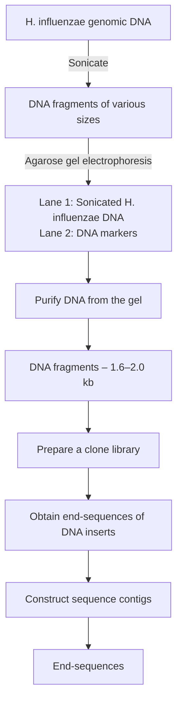
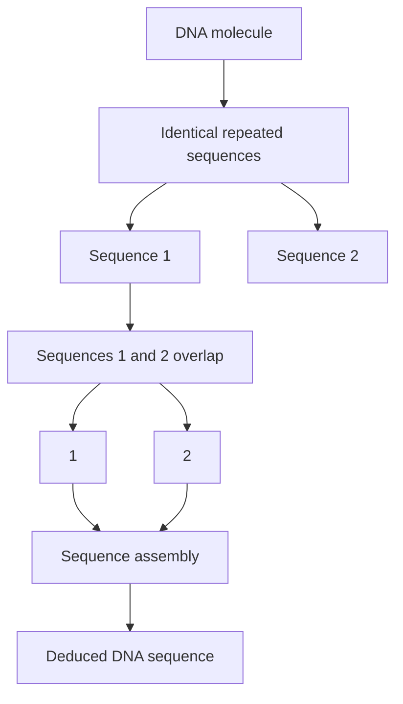
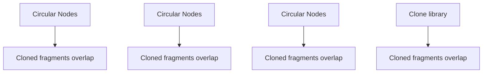
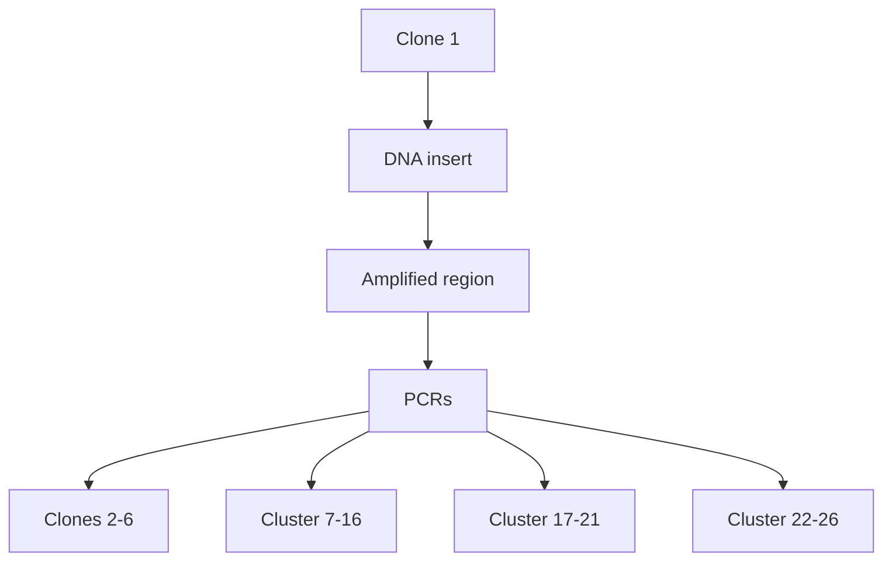
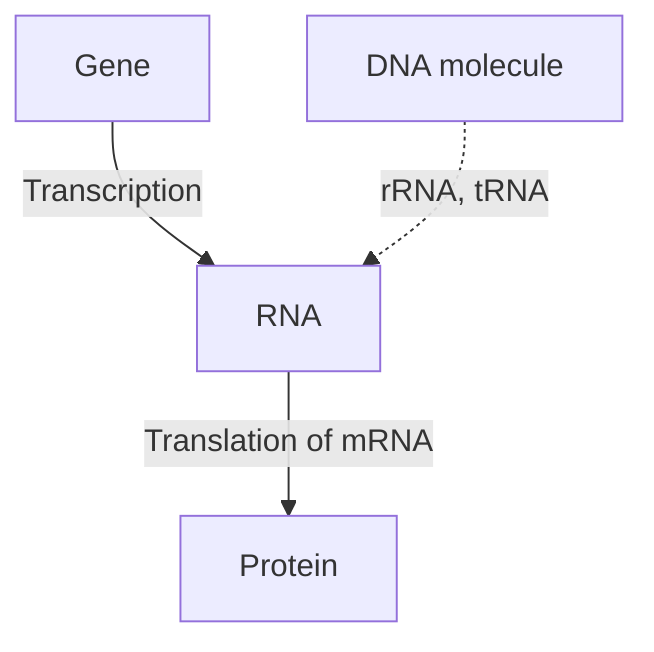
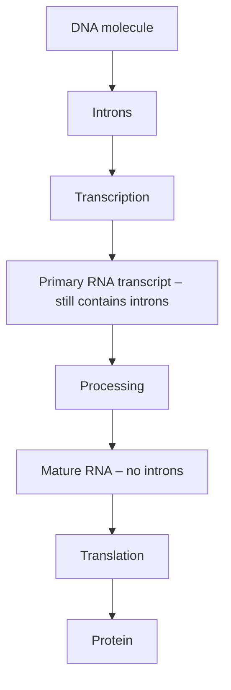
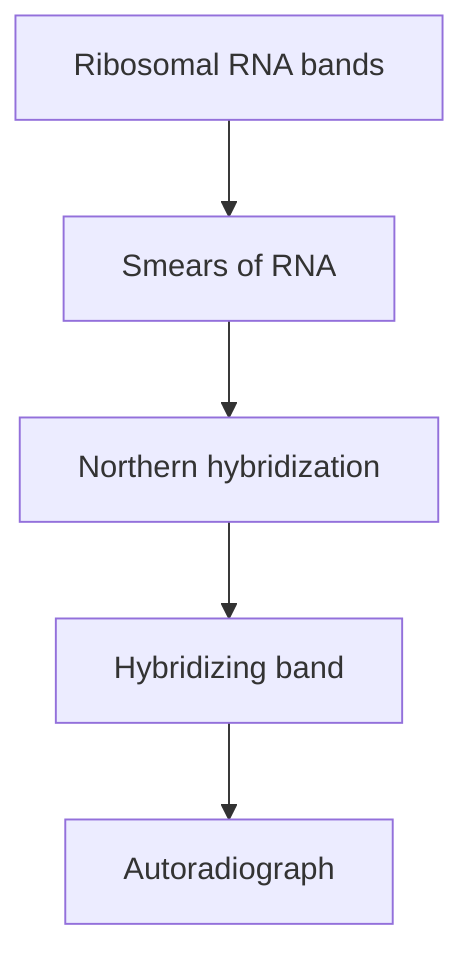
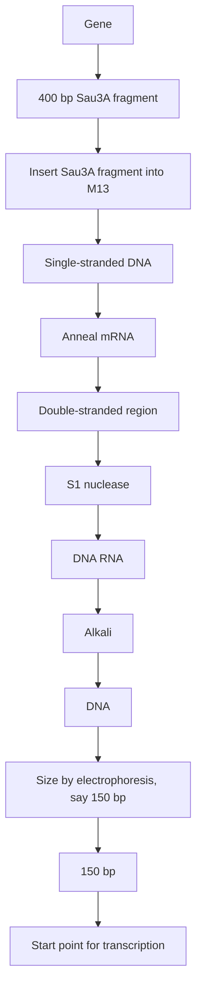

flowchart

Figure 10.20

A schematic of the key steps in the H. influenzae genome sequencing project.

Figure 10.21

Using oligonucleotide hybridization to close gaps in the H. influenzae genome sequence. Oligonucleotides 2 and 5 both hybridize to the same λ clone, indicating that contigs I and III are adjacent. The gap between them can be closed by sequencing the appropriate part of the λ clone.

(a) Prepare oligonucleotide probes

bar

| Contig | Probe Set 1 | Probe Set 2 |
| --- | --- | --- |
| Contig I | 1 | 2 |
| Contig II | 3 | 4 |
| Contig III | 5 | 6 |

(b) Probe a genomic library

text_image

Probe with
oligonucleotide 2
Probe with
oligonucleotide 5
Conclusion:
I	III	Contigs I and III
1	2	5	6	are adjacent in
the genome

λ clone, indicating that the two contig ends represented by those oligonucleotides lay adjacent to one another in the genome. The gap between these two ends could then be closed by sequencing the appropriate part of the λ clone.

## Shotgun sequencing of other prokaryotic genomes

Shotgun sequencing has been successful with many prokaryotic genomes, the short lengths of these genomes meaning that the computational requirements for finding sequence overlaps are not too great. If a next‐generation sequencing method is used then gap closure is less of an issue, because a single experiment can easily generate sequence reads whose total length is several hundred times that of the genome.

Many prokaryotic genomes are assembled by **de novo sequencing**, as described above for H. influenzae, with the genome sequence worked out solely by finding overlaps between individual sequence reads. However, as the genomes of more and more species become available, a second approach to assembly is sometimes possible. This is when an existing sequence is used as **reference genome** for assembly of a related genome. Rather than just looking for overlaps among the sequence reads for the genome that is being assembled, individual reads and short contigs are also mapped onto the reference sequence by looking for regions of sequence similarity (Figure 10.22). The rationale is that if the reference genome comes from a related species, or from a different strain of the same species, then the sequences of the two genomes will be similar, and the reference can therefore direct assembly of the new genome.

text_image

Reads
Reference genome

Figure 10.22

Using a reference genome to aid sequence assembly.

The reference genome approach makes sequence assembly quicker and more accurate, but care has to be taken to identify any regions in the new genome where the gene order has been changed by recombination (Figure 10.23). This kind of rearrangement does not alter the sequence of the segment that moves, it merely places that segment at a different position in the genome. The only difference between the sequences will be at the boundaries of the segments that have been rearranged. If the sequence reads do not span these boundaries, then reliance on the reference genome might lead to the rearrangement not being recognized in the genome being assembled.

## 10.3.2 Sequencing of eukaryotic genomes

As well as their small size, prokaryotic genomes have a second advantage that aids sequence assembly by the shotgun method. Prokaryotic genomes contain few or no repetitive DNA sequences. These are sequences, from a few base pairs to several kilobases, which are repeated at two or more places in a genome. They cause problems for the shotgun approach because sequences that lie partly or wholly within one repeat element might accidentally be assigned an overlap with the identical sequence present in a different repeat element (Figure 10.24). This could lead to a part of the genome sequence being placed at the incorrect position or left out entirely.

Although absent from most bacterial genomes, repetitive sequences are common in eukaryotes, and in some species make up more than 50% of the genome. For this reason, it was initially thought that a eukaryotic genome could not be assembled entirely by shotgun sequencing.

## The hierarchical shotgun approach

The first eukaryotic genomes, including the human genome, were sequenced by a modification of the shotgun approach called **hierarchical shotgun**

text_image

A B C D E F G H I
Reference genome
A D E F G B C H I
Genome being
sequenced
Critical regions

Figure 10.23

One potential problem when using a reference genome. In this example, the positions of genes B and C are different in the reference compared with the genome being sequenced. If the sequence coverage does not include the critical regions at the boundaries for this recombination event, then the fact that the gene order is different in the genome being sequenced will not be recognized.

flowchart

Figure 10.24

One problem with the shotgun approach. An incorrect overlap is made between two sequences that both terminate within a repeated element. The result is that a segment of the DNA molecule is absent from the DNA sequence.

**sequencing**. This approach involves a pre‐sequencing phase during which the genome is broken into large fragments, typically 300 kb in length, and  these fragments cloned into a high‐capacity vector such as a BAC (Section  6.2.6). Clones that contain overlapping fragments of DNA are then identified, enabling a contiguous series – a **clone contig** – to be built up (Figure 10.25). Each piece of cloned DNA is then broken into smaller fragments and these are sequenced and assembled by the shotgun method. The sequence of each cloned fragment can then be placed at its appropriate position in the series of clones in order to gradually build up the overlapping genome sequence. The confusion caused by repetitive DNA now arises only if two or more copies of the same repeat are present in the same cloned fragment, and even then it might be possible to identify errors in the assembly by examining the sequences of clones that overlap with the one containing the repeats (Figure 10.26).

The problem with the hierarchical approach is that identifying clones that contain overlapping inserts is a massive task. One technique that can be used is **chromosome walking**. To begin a chromosome walk, a clone is selected at random from the library, labelled, and used as a hybridization

flowchart

Figure 10.25

A set of clones whose fragments overlap.

flowchart

This diagram illustrates a hierarchical process for generating repeat sequences using circular nodes connected by directional arrows.

Figure 10.26

Hierarchical shotgun sequencing can avoid problems with repeat sequences. The positions of repeat sequences in clones 2 and 3 from Figure 10.25 are shown. Sequence assembly of the reads from clone 2 could result in the segment between the two repeats being lost. However, the sequence of clone 3 enables the mistake to be recognized and corrected.

probe against all the other clones in the library (Figure  10.27a). Those clones that give hybridization signals are ones that overlap with the probe. One of these overlapping clones is now labelled and a second round of probing carried out. More hybridization signals are seen, some of these indicating additional overlaps (Figure 10.27b). Gradually the clone contig is built up in a step‐by‐step fashion. This method suffers from the drawback that if the probe contains a repeat sequence, then it will hybridize not only to overlapping clones but also to nonoverlapping ones whose inserts contain copies of the repeat. An alternative approach that avoids this problem is to design primers that will amplify a segment at the end of a clone insert and then use these primers in attempted PCRs with all the other

(a) Probe the library with clone A1

flowchart

Figure 10.27

Chromosome walking, using individual clones as hybridization probes.

(b) Probe the library with clone I4

text_image

A B C D E F G H I J
1
2
3
4
5
6
→
A1
F2
B4
I4

flowchart

Figure 10.28

Chromosome walking by PCR. The two PCR primers will amplify the end region of the insert in clone 1. They are used in attempted PCRs with all the other clones in the library. Only clone 15 gives a PCR product, showing that the inserts in clones 1 and 15 overlap. The walk would be continued by designing primers that would amplify the other end of clone 15, and using these in a new set of attempted PCRs with all the other clones.

clones in the library. A second clone that gives a PCR product of the correct size must contain an insert that overlaps with that of the original clone (Figure  10.28). To speed up the process, rather than performing a PCR  with  each individual clone, a combinatorial process can be used (see Figure 9.12).

The weakness of chromosome walking is that it begins at a fixed starting point and builds up the series of overlapping clones one by one, and hence slowly, from that fixed point. More rapid techniques do not use a fixed starting point and instead aim to identify pairs of overlapping clones. When enough overlapping pairs have been identified the series of clones is revealed (Figure 10.29). The various techniques that can be used to identify overlaps are collectively known as **clone fingerprinting**. These techniques are based on the identification of sequence features that are shared by a pair of clones. If two clones contain this feature, then clearly they must overlap. A sequence feature of this type is called a **sequence tagged site (STS)**. Often an STS is a gene that has been sequenced in an earlier project. As the sequence is known, a pair of PCR primers that are specific for that gene can be designed and used to identify which members of a clone library contain the gene. The STS does not have to be a gene and can be any short piece of DNA sequence, the only requirement being that it occurs just once in the genome.

text_image

F2
G6
A1
I4
H7
B4
I4
F2
I4
B4
A1
H7
B4
A1
I4
F2
G6
Overlaps identified by clone fingerprinting
Deduced overlapping series

Figure 10.29

Building up a series of overlapping clones by a clone fingerprinting technique.

## Shotgun sequencing of eukaryotic genomes

Identification of a series of overlapping clones is a time‐consuming process, and there would be major advantages if this stage could be sidestepped and a eukaryotic genome sequenced entirely by the shotgun approach. Eukaryotic genomes are of course much longer than prokaryotic ones – 3 200 Mb for the human genome compared with 1.83 Mb for H. influenzae  –  so a correspondingly larger number of sequence reads would have to be examined in order to build up lengthy sequence contigs. This is a computational issue, and has been solved by the development of sophisticated algorithms for sequence assembly, concurrent with the increase in processor power for laboratory computers. But what about the problems that repetitive DNA poses for sequence assembly?

Several possible ways of avoiding errors when repetitive DNA regions are assembled have been explored. The most successful strategy is to use two or more sequencing libraries, with one of the libraries containing fragments that are longer than the longest repeat sequences in the genome being studied. For example, one of the clone libraries used when this method was applied to the Drosophila melanogaster genome contained inserts with an average size of 10 kb, because most Drosophila repeat sequences are 8 kb or shorter in length. The two ends of each of these longer fragments were sequenced, to give **paired‐end reads**. Jumps during the sequence assembly, from one repeat sequence to another, were avoided by ensuring that the paired‐end reads of each 10‐kb fragment were at their appropriate positions in the master sequence (Figure 10.30).

Paired‐end reads can also be used to identify sequence contigs that are adjacent to one another in the genome. The initial result of sequence assembly is therefore a series of **scaffolds**, each scaffold comprising a set of sequence contigs separated by gaps which lie between paired‐end reads (Figure 10.31). As more sequences are added in to the dataset, longer and longer scaffolds are built up. The accuracy of sequence assembly can be further checked by obtaining paired‐end reads from fragments of 100 kb or more that have been cloned in a high‐capacity vector such as a BAC.

The scaffold strategy was initially used with chain‐termination sequencing, with short fragments of DNA cloned into a plasmid vector, and the longer fragments obtained as λ or BAC clones. With the advent of

text_image

Repeat sequences
Both end-sequences of this 10-kb
fragment are positioned correctly
on the master sequence

Figure 10.30

The strategy used to ensure that repetitive DNA regions were assembled correctly when the Drosophila melanogaster genome was sequenced. Two identical 8‐kb repeats are adjacent in the genome. The end‐sequences of the 10‐kb fragment that spans one of these repeats can be checked against the master sequence to ensure that the segment between the two repeats has not been lost.

text_image

Sequence contigs
1
2
3
Short reads
Scaffold
Paired-end reads of long fragments

Figure 10.31

A scaffold. The paired‐end reads of the long fragments are used to place the sequence contigs in their correct order.

next‐generation sequencing, a hybrid approach was adopted, with the next‐generation method being used to generate reads from short fragments, and the chain‐termination method retained for obtaining the paired‐end reads of large fragment clones. In 2010 the first successful genome assembly based entirely on next‐generation sequencing was reported, for the giant panda. This project used fragment libraries of 150 bp, 500 bp, 2 kb, 5 kb, and 10 kb, along with the ability of modern nextgeneration machines to sequence both ends of a fragment and hence obtain paired‐end reads without recourse to chain‐termination sequencing.

## What do we mean by ‘genome sequence’?

It is important to recognize that a ‘complete’ genome sequence – one in which every nucleotide is sequenced, with no errors, and every segment placed at its correct position – is currently an impossibility for a eukaryotic genome. The development of the Human Genome Project illustrates this point. The initial version of the human genome obtained by the hierarchical shotgun method, published in 2001, was a draft that covered just 90% of the genome. The missing 320 Mb was located predominantly in constitutive heterochromatin, regions of chromosomes in which the DNA is very tightly packaged and which are thought to contain few, if any genes. Within the 90% of the genome that was covered, each part had been sequenced at least four times, providing an ‘acceptable’ level of accuracy, but only 25% had been sequenced the 8–10 times deemed necessary before the sequence could be considered to be ‘finished’. Furthermore, this draft sequence had approximately 150 000 gaps, and some segments had probably not been ordered correctly. Even the ‘finished’ sequence, achieved in 2005, was not entirely complete, the standard being that at least 95% of the euchromatin, the part of genome in which most of the genes are located, should be sequenced with a predicted error rate of less than one in 104 nucleotides, and all except the most refractory gaps filled.

Since 2005, a number of statistics have been devised to measure the degree of completeness of a genome sequence. One of these is the **N50 size**, which can be applied to either sequence contigs or scaffolds. A contig N50 size is worked out as follows:

1 First, the total length of all the sequence contigs added together is calculated.

2 The contigs are then ordered by length from the longest to the shortest.
3 Beginning with the longest contig, the individual contig lengths are added together until their combined length is equal to half the total length of all the contigs.
4 The N50 value is the length of the last, and hence shortest contig, whose addition makes the combined length greater than 50% of the total.

A higher N50 value therefore indicates a more complete assembly. The same approach can be used with scaffolds rather than contigs.

A different value, the **NG50 size**, is based not on the total length of contigs or scaffolds, but on the actual genome size. The NG50 value therefore enables direct comparisons to be made between genome assemblies for different species.

## Further reading

- Ekblom, R. and Wolf, J.B.W. (2014) A field guide to whole‐genome sequencing, assembly and annotation. Evolutionary Applications, 7, 1026–1042.
- Fleischmann, R.D., Adams, M.D., White, O., et al. (1995) Whole genome random sequencing and assembly of Haemophilus influenzae Rd. Science, 269, 496–512. [The first complete bacterial genome sequence to be published.]
- Head, S.R., Komori, H.K., LaMere, S.A., et al. (2018) Library construction for next‐generation sequencing: overviews and challenges. Biotechniques, 56, 61–77.
- Levy, S.E. and Myers, R.M. (2016) Advancements in next‐generation sequencing. Annual Review of Genomics and Human Genetics, 17, 95–115.
- Li, R., Fan, W., Tian, G., et al. (2010) The sequence and de novo assembly of the giant panda genome. Nature, 463, 311–317. [Genome sequencing based entirely on next‐generation methods.]
- Loman, N.J., Constantinidou, C., Chan, J.Z.M., et al. (2012) High‐throughput bacterial genome sequencing: an embarrassment of choice, a world of opportunity. Nature Reviews Microbiology, 10, 599–606.
- Miller, J.R., Koren, S., and Sutton, G. (2010) Assembly algorithms for next‐generation sequencing data. Genomics, 95, 313–327.
- Prober, J.M., Trainor, G.L., Dam, R.J., et al. (1987) A system for rapid DNA sequencing with fluorescent chain‐terminating dideoxynucleotides. Science, 238, 336–341. [The current methodology for chain‐termination sequencing.]
- Rothberg, J.M., Hinz, W., Rearick, T.M., et al. (2011) A integrated semiconductor device enabling non‐optical genome sequencing. Nature, 475, 348–352. [Ion semiconductor sequencing.]
- Sanger, F., Nicklen, S., and Coulson, A.R. (1977) DNA sequencing with chain‐terminating inhibitors. Proceedings of the National Academy of Sciences of the USA, 74, 5463–5467. [The first description of chaintermination sequencing.]
- Schatz, M.C., Delcher, A.L., and Salzberg, S.L. (2010) Assembly of large genomes using second‐generation sequencing. Genome Research, 20, 1165–1173.
- Sears, L.E., Moran, L.S., Kissinger, C., et al. (1992) CircumVent thermal cycle sequencing and alternative manual and automated DNA sequencing protocols using the highly thermostable Vent (exo–) DNA polymerase. Biotechniques, 13, 626–633. [Thermal cycle sequencing.]
- van Dijk, E.L., Jaszczyszyn, Y., Naquin, D., and Thermes, C. (2018) The third revolution in sequencing technology. Trends in Genetics, 9, 666–681. [Describes SMRT sequencing.]

## Chapter 11

# Studying Gene Expression and Function

## Chapter contents

**11.1** Studying the RNA transcript of a gene 218
**11.2** Studying the regulation of gene expression 224
**11.3** Identifying and studying the translation product of a cloned gene 232

All genes have to be expressed in order to function. The first step in expression is transcription of the gene into a complementary RNA strand (Figure  11.1a). For some genes, such as those coding for transfer RNA (tRNA) and ribosomal RNA (rRNA) molecules, the transcript itself is the functionally important molecule. For other genes, the transcript is translated into a protein molecule.

To understand how a gene is expressed, the RNA transcript must be studied. In particular, the molecular biologist will want to know whether the transcript is a faithful copy of the gene, or whether segments of the gene, called introns, are missing from the transcript (Figure 11.1b). In addition to introns, the exact locations of the start and end points of transcription are important. Most transcripts are copies not only of the gene itself, but also of the nucleotide regions either side of it (Figure 11.1c). The signals that determine the start and finish of the transcription process are only partly understood, and their positions must be located if the expression of a gene is to be studied.

In this chapter we will begin by looking at the methods used for **transcript analysis**. These methods can be used to map the positions

Some fundamentals of gene expression.

Figure 11.1

(a) Genes are expressed by transcription and translation

flowchart

(b) Some genes contain introns

flowchart

(c) RNA transcripts include regions either side of the gene

text_image

Gene
DNA
Start signal for
transcription
RNA
End signal

of  the start and end points for transcription and also to determine if a gene contains introns. Then we will briefly consider a few of the numerous techniques developed in recent years for examining how expression of a gene is regulated. These techniques are important as aberrations in gene regulation underlie many clinical disorders. Finally, we will tackle the difficult problem of how to identify the translation product of a gene.

## 11.1 Studying the RNA transcript of a gene

Over the years a variety of techniques have been devised for studying RNA transcripts. These include methods for detecting the presence of a transcript and measuring its length, as well as more advanced techniques that enable the start and end of the transcript to be mapped and the positions of introns to be located.

## 11.1.1 Detecting the presence of a transcript in an RNA sample

When the expression of a cloned gene is studied, often the first question that is asked is whether the gene is expressed all the time, or only in certain tissues, at certain development stages, or in response to particular stimuli. This question can be answered by **northern hybridization**, which is the RNA equivalent of Southern hybridization (see Figure 8.19).

To carry out a northern hybridization experiment, an RNA extract is electrophoresed in an agarose gel, using a denaturing electrophoresis buffer (e.g. one containing formaldehyde) to ensure that the RNAs do not form inter‐ or intramolecular base pairs, as base pairing would affect the rate at which the molecules migrate through the gel. After electrophoresis, the gel is blotted onto a nylon or nitrocellulose membrane and hybridized with a  labelled probe (Figure  11.2). If the probe is a cloned gene, and the

flowchart

Figure 11.2

Northern hybridization. Three RNA extracts from different tissues have been electrophoresed in an agarose gel. The extracts are made up of many RNAs of different lengths so each extract gives a smear of RNA, but two distinct bands are seen in the gel, one for each of the abundant ribosomal RNAs. The gel is transferred to a membrane, probed with a cloned gene, and the results visualized, for example by autoradiography if the probe has been radioactively labelled. Only lane 1 gives a band, showing that the cloned gene is expressed only in the tissue from which this RNA extract was obtained.

transcript of that gene is present in the RNA sample, then a band will appear in the autoradiograph.

Northern hybridization also enables the length of a transcript to be measured. RNA molecules of known length can be run alongside the RNA extract in the agarose gel, to act as size markers in exactly the same way as the DNA markers in a DNA gel (Section  4.2.7). Many RNA extracts also  contain relatively large quantities of the small and large rRNA molecules that make up ribosomes. The lengths of these rRNAs are known (e.g. 1.9 kb and 5.1 kb for humans), so they can be used as internal size markers. The length of the transcript will indicate if the cloned gene contains one or more introns, as introns are removed soon after an mRNA is transcribed from its gene and will be absent in the vast majority of the mRNAs present in the extract. If the transcript is shorter than the gene, then the presence of introns can be inferred. The length of the transcript in different RNA samples will also indicate if the gene expression process involves alternative splicing pathways, during which different combinations of exons are joined together to give a variety of mRNAs of different lengths, all derived from a single gene. Alternative splicing is quite common in vertebrates, and the transcripts of over 75% of all human protein‐coding genes are thought to be processed in this way.

## 11.1.2 Transcript mapping by hybridization between gene and RNA

The approximate length of a transcript can be measured by northern hybridization, but this method does not allow the start and end positions of the RNA molecule to be mapped onto the DNA sequence of the cloned gene. More direct methods of transcript analysis are needed to obtain this information. One of these methods is based on examination of the hybridization product formed between a cloned gene and its RNA.

Nucleic acid hybridization occurs just as readily between complementary DNA and RNA strands as between single‐stranded DNA molecules. The resulting hybrid is called a **heteroduplex**. If a heteroduplex is formed between a DNA strand, containing a gene, and its mRNA, then the boundaries between the double‐ and single‐stranded regions will mark the start and end points of the mRNA (Figure 11.3a). Introns, which are present in the DNA but not in the mRNA, will ‘loop out’ as additional single‐stranded regions.

Now consider the result of treating the DNA–RNA hybrid with a singlestrand specific nuclease such as S1 (Section 4.1.1). S1 nuclease degrades single‐stranded DNA or RNA polynucleotides, including single‐stranded regions at the ends of or within predominantly double‐stranded molecules, but has no effect on double‐stranded DNA or on DNA–RNA heteroduplexes. S1 nuclease will therefore digest the non‐hybridized single‐stranded DNA regions at each end of the DNA–RNA hybrid, along with any looped‐out introns (Figure 11.3b). Those parts of the DNA polynucleotide that were protected from S1 nuclease digestion can then be recovered if the RNA strand is degraded by treatment with alkali.

Figure 11.3

A DNA‐mRNA heteroduplex and the effect of treating this heteroduplex with a single‐strand‐specific nuclease such as S1.

Unfortunately, the manipulations shown in Figure  11.3 are not very informative. The sizes of the protected DNA fragments could be measured by gel electrophoresis, but this does not allow their order or relative positions in the DNA sequence to be determined. However, a few subtle modifications to the technique allow the precise start and end points of the transcript and of any introns it contains to be mapped onto the DNA sequence. This procedure is called **S1 nuclease mapping**, and an example of how it is used to locate the start point of a transcript is shown in Figure 11.4. Here, a Sau3A fragment that contains 100 bp of coding region, along with 300 bp of the leader sequence preceding the gene, has been cloned into an M13 vector and obtained as a single‐stranded molecule. A sample of the RNA transcript is added and allowed to anneal to the DNA molecule. The DNA molecule is still primarily single‐stranded but now has a small region protected by the RNA transcript. All but this protected region is digested by S1 nuclease and the RNA is degraded with alkali, leaving a short singlestranded DNA fragment. If these manipulations are examined closely it will become clear that the size of this single‐stranded fragment corresponds to the distance between the transcription start point and the right‐hand Sau3A site. The size of the single‐stranded fragment is therefore determined by gel electrophoresis and this information is used to locate the transcription start point on the DNA sequence. Exactly the same strategy could locate the end point of transcription and the junction points between introns and exons. The only difference would be the position of the restriction site chosen to delimit one end of the protected single‐stranded DNA fragment.

Figure 11.4

Locating a transcription start point by S1 nuclease mapping.

flowchart

## 11.1.3 Transcript analysis by primer extension

S1 nuclease analysis is a powerful technique that allows both the $S ^ { \prime }$ and $3 ^ { \prime }$ termini of a transcript, as well as the positions of intron–exon boundaries, to be identified. The second method of transcript analysis that we will consider – **primer extension** – is less adaptable, because it can only identify the $S ^ { \prime }$ end of an RNA. It is, nonetheless, an important technique that is frequently used to check the results of S1 analyses.

Primer extension can only be used if at least part of the sequence of the transcript is known. This is because a short oligonucleotide primer must be annealed to the RNA at a known position, ideally within 100–200 nucleotides of the $5 ^ { \prime }$ end of the transcript. Once annealed, the primer is extended by reverse transcriptase (Section  4.1.3). The resulting cDNA synthesis reaction continues until the end of the RNA transcript is reached (Figure 11.5). The $3 ^ { \prime }$ end of the newly synthesized strand of DNA therefore corresponds with the $S ^ { \prime }$ terminus of the transcript. Locating the position of this terminus on the DNA sequence is achieved simply by