

flowchart

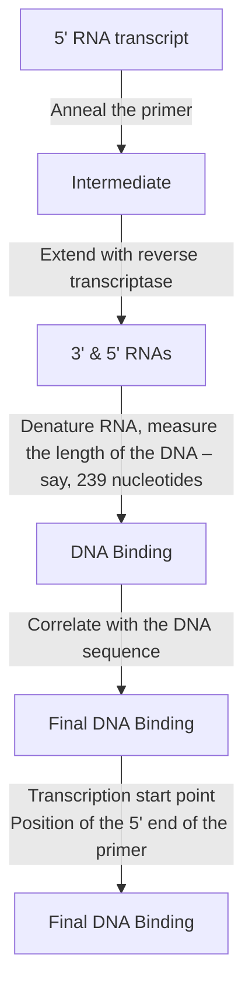

Figure 11.5

Locating a transcription start point by primer extension.

determining the length of the single‐stranded DNA molecule and correlating this information with the annealing position of the primer.

## 11.1.4 Transcript analysis by PCR

We have already studied the way in which reverse transcriptase PCR is used to quantify the amount of a particular RNA in an extract (Section  9.4.2). The standard reverse transcriptase PCR procedure provides a copy of the internal region of an RNA molecule but does not give any information about the ends of the molecule. A modified version called **rapid amplification of cDNA ends (RACE)** can be used to identify the $5 ^ { \prime }$ and $3 ^ { \prime }$ termini of RNA molecules and so, like S1 analysis, can be used to map the ends of transcripts.

There are several variations to the RACE method. Here we will consider how the $5 ^ { \prime }$ end of an RNA molecule can be mapped (Figure 11.6). This procedure uses a primer that is specific for an internal region of the RNA molecule. The primer attaches to the RNA and directs the first, reverse transcriptase catalysed, stage of the process, during which a single‐stranded cDNA is made. As in the primer extension method, the $3 ^ { \prime }$ end of the cDNA corresponds with the $S ^ { \prime }$ end of the RNA. Terminal deoxynucleotidyl transferase (Section 4.1.4) is now used to attach a series of $\mathrm { A }$ nucleotides to the $3 ^ { \prime }$ end of the cDNA, forming the priming site for a second PCR primer, which is made up entirely of Ts and hence anneals to the poly(A) tail created by terminal transferase. Now the standard PCR begins, first converting the single‐stranded cDNA into a double‐stranded molecule, and then amplifying this molecule as the PCR proceeds. The PCR product is then sequenced to reveal the precise position of the start of the transcript.

Figure 11.6 One version of RACE.

flowchart

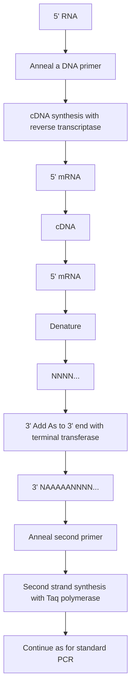

## 11.2 Studying the regulation of gene expression

Few genes are expressed all the time. Most are subject to regulation and are switched on only when their gene product is required by the cell. The simplest gene regulation systems are found in bacteria such as E. coli, which can regulate expression of genes for biosynthetic and metabolic processes, so that gene products that are not needed are not synthesized. For instance, the genes coding for the enzymes involved in tryptophan biosynthesis can be switched off when there are abundant amounts of tryptophan in the cell, and switched on again when tryptophan levels drop. Similarly, genes for the utilization of sugars such as lactose are activated only when the relevant sugar is there to be metabolized. In higher organisms, gene regulation is more complex because there are many more genes to control. Differentiation of cells involves wholesale changes in gene expression patterns, and the process of development from fertilized egg cell to adult requires coordination between different cells as well as time‐dependent changes in gene expression.

Figure 11.7

Possible positions for control sequences in the region upstream of a gene.

text_image

Control sequences
Promoter
Gene
200 bp

Many of the problems in gene regulation require a classical genetic approach. Genetics enables genes that control regulation to be located, allows the biochemical signals that influence gene expression to be identified, and can explore the interactions between different genes and gene families. It is for this reason that most of the breakthroughs in understanding gene regulation in higher organisms have started with genetic studies of model species such as the fruit fly Drosophila melanogaster. Gene cloning and DNA analysis complement classical genetics as they provide much more detailed information on the molecular events involved in regulating the expression of a single gene.

We now know that a gene subject to regulation has one or more control sequences in its upstream region (Figure 11.7), and that the gene is switched on and off by the attachment of regulatory proteins to these sequences. A regulatory protein may repress gene expression, in which case the gene is switched off when the protein is bound to the control sequence, or alternatively the protein may have a positive or enhancing role, switching on or increasing expression of the target gene. In this section we will examine methods for locating control sequences and determining their roles in regulating gene expression.

## 11.2.1 Identifying protein binding sites on a DNA molecule

A control sequence is a region of DNA that can bind a regulatory protein. It should therefore be possible to identify control sequences upstream of a gene by searching the relevant region for protein binding sites. There are three different ways of doing this.

## Gel retardation of DNA–protein complexes

Proteins are quite substantial structures and a protein attached to a DNA molecule results in a large increase in overall molecular mass. If this increase can be detected, a DNA fragment containing a protein binding site

Figure 11.8

A bound protein decreases the mobility of a DNA fragment during gel electrophoresis.

text_image

1
2
Agarose gel
Lane 1: DNA fragment
Lane 2: DNA fragment + bound protein

will have been identified. In practice a DNA fragment carrying a bound protein is identified by gel electrophoresis, as it has a lower mobility than the uncomplexed DNA molecule (Figure 11.8). The procedure is referred to as **gel retardation** or the **electrophoretic mobility shift assay (EMSA)**.

In a gel retardation experiment (Figure  11.9), the region of DNA upstream of the gene being studied is digested with a restriction endonuclease and then mixed with the regulatory protein $\mathbf { o r } _ { \flat }$ if the protein has not yet been purified, with an unfractionated extract of nuclear protein (remember that gene regulation occurs in the nucleus). The restriction fragment containing the control sequence forms a complex with the regulatory protein, and all the other fragments remain as ‘naked’ DNA. The location of the control sequence is then determined by finding the position on the restriction map of the fragment that is retarded during gel electrophoresis. The precision with which the control sequence can be located depends on how conveniently placed the restriction sites are. A single control sequence may be less than 10 bp in size, so gel retardation is rarely able to pinpoint

Figure 11.9

Carrying out a gel retardation experiment.

flowchart

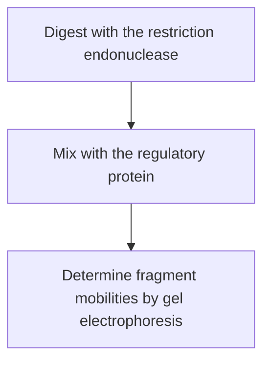

flowchart

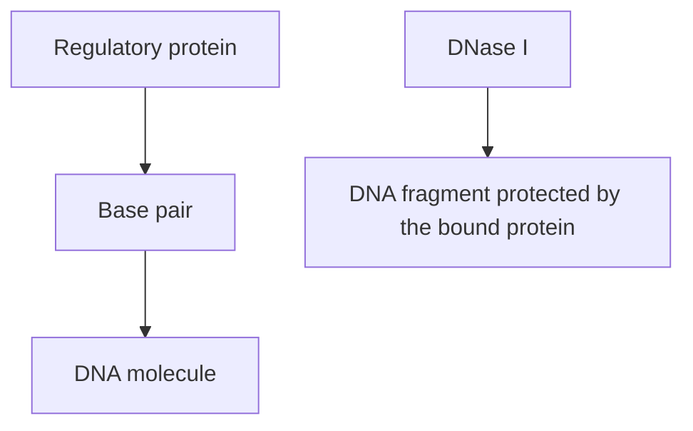

Figure 11.10

A bound protein protects a region of a DNA molecule from degradation by a nuclease such as DNase I.

it exactly. More precise techniques are therefore needed to delineate the position of the control sequence within the fragment identified by gel retardation.

## Footprinting with DNase I

The procedure generally called **footprinting** enables a control region to be positioned within a restriction fragment that has been identified by gel retardation. Footprinting works on the basis that the interaction with a regulatory protein protects the DNA in the region of a control sequence from the degradative action of an endonuclease such as DNase I (Figure 11.10). This phenomenon can be used to locate the protein binding site on the DNA molecule.

The DNA fragment being studied is first labelled at one end, and then complexed with the regulatory protein (Figure 11.11a). Then DNase I is added, but the amount used is limited so that complete degradation of the DNA fragment does not occur. Instead the aim is to cut each molecule at just a single phosphodiester bond (Figure 11.11b). If the DNA fragment has no protein attached to it, the result of this treatment is a family of labelled fragments, differing in size by just one nucleotide each.

After removal of the bound protein and separation on a polyacrylamide gel, the family of labelled fragments appears as a ladder of bands (Figure 11.11c). However, the bound protein protected certain phosphodiester bonds from being cut by DNase I, meaning that in this case the family of fragments is not complete, as the fragments resulting from cleavage within the control sequence are absent. Their absence shows up as a ‘footprint’, clearly seen in Figure 11.11c. The region of the DNA molecule containing the control sequence can now be worked out from the sizes of the fragments on either side of the footprint.

## Modification interference assays

Gel retardation analysis and footprinting enable control sequences to be  located, but do not give information about the interaction between the  binding protein and the DNA molecule. The more precise of these two  techniques  –  footprinting  –  only reveals the region of DNA that is protected by the bound protein. Proteins are relatively large compared with a DNA double helix, and can protect several tens of base pairs when bound to a control sequence that is just a few base pairs in length (Figure 11.12). Footprinting therefore does not delineate the control region itself, only the region within which it is located.

Figure 11.11

DNase I footprinting.

flowchart

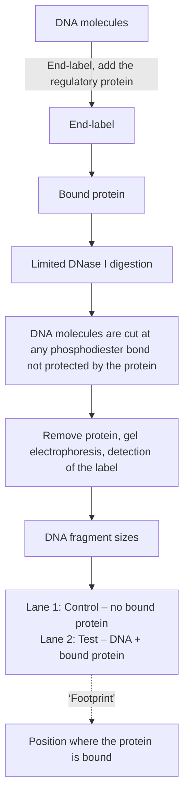

Nucleotides that actually form attachments with a bound protein can be identified by the **modification interference assay**. As in footprinting, the DNA fragments must first be labelled at one end. Then they are treated with a chemical that modifies specific nucleotides, an example being dimethyl sulphate, which attaches methyl groups to guanine nucleotides (Figure 11.13). This modification is carried out under limiting conditions so an average of just one nucleotide per DNA fragment is modified. Now the DNA is mixed with the protein extract. The key to the assay is that the binding protein will probably not attach to the DNA if one of the guanines within the control region is modified, because methylation of a nucleotide interferes with the specific chemical reaction that enables it to form an attachment with a protein.

text_image

Control sequence
DNA
Binding protein
Protected region

Figure 11.12

A bound protein can protect a region of DNA that is much longer than the control sequence.

flowchart

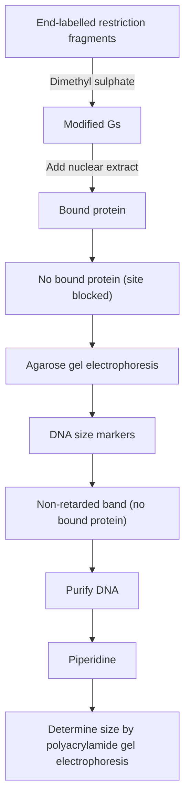

Figure 11.13

A modification interference assay.

How is the absence of protein binding monitored? If the DNA and protein mixture is examined by agarose gel electrophoresis two bands will be seen, one comprising the DNA–protein complex and one containing DNA with no bound protein – in essence, this part of the procedure is a gel retardation assay (as shown in Figure 11.13). The band made up of unbound DNA is purified from the gel and treated with piperidine, a chemical which cleaves DNA molecules at methylated nucleotides. The products of piperidine treatment are now separated in a polyacrylamide gel and the labelled bands visualized. The sizes of the bands that are seen indicate the position in the DNA fragment of guanines whose methylation prevented protein binding. These guanines lie within the control sequence. The modification assay can now be repeated with chemicals that target A, T, or C nucleotides to determine the precise position of the control sequence.

## 11.2.2 Identifying control sequences by deletion analysis

Gel retardation, footprinting, and modification interference assays are able to locate possible control sequences upstream of a gene, but they provide no information on the function of the individual sequences. **Deletion analysis** is a totally different approach that not only can locate control sequences (though only with the precision of gel retardation), but importantly also can indicate the function of each sequence.

The technique depends on the assumption that deletion of the control sequence will result in a change in the way in which expression of a cloned gene is regulated (Figure 11.14). For instance, deletion of a sequence that represses expression of a gene should result in that gene being expressed at a higher level. Similarly, tissue‐specific control sequences can be identified as their deletion results in the target gene being expressed in tissues other than the correct one.

flowchart

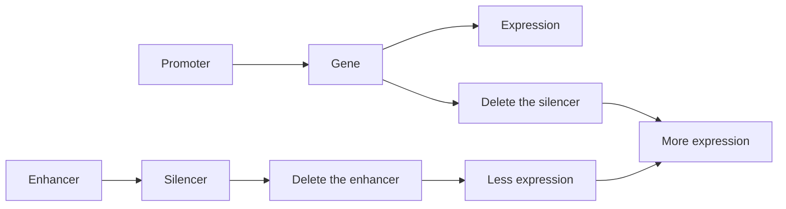

Figure 11.14

The principle behind deletion analysis.

flowchart

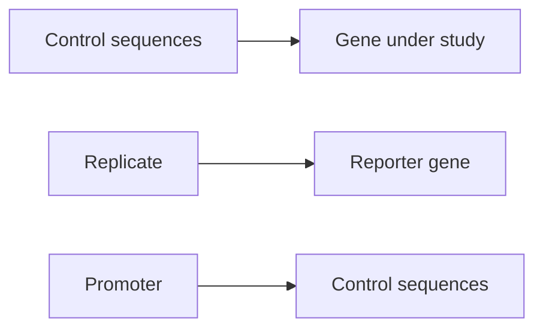

Figure 11.15

A reporter gene.

## Reporter genes

Before carrying out a deletion analysis, a way must be found to assay the effect of a deletion on expression of the cloned gene. The effect will probably only be observed when the gene is cloned into the species from which it was originally obtained – it would be no use attempting to assay the light regulation of a plant gene if the gene is cloned in a bacterium.

Cloning vectors have now been developed for most organisms (Chapter 7), so cloning the gene that is being studied back into its host should not cause a problem. The difficulty is that in most cases the host will already possess a copy of the gene within its chromosomes. How can changes in the expression pattern of the cloned gene be distinguished from the normal pattern of expression displayed by the chromosomal copy of the gene? The answer is to use a **reporter gene**. This is a test gene that is fused to the upstream region of the cloned gene (Figure 11.15), replacing the latter. When cloned into the host organism, the expression pattern of the reporter gene should exactly mimic that of the original gene, as the reporter gene is under the influence of exactly the same control sequences as the original gene.

The reporter gene must be chosen with care. The first criterion is that the reporter gene must code for a phenotype not already displayed by the host organism. The phenotype of the reporter gene must also be relatively easy to detect after it has been cloned into the host, and ideally it should be possible to assay the phenotype quantitatively. These criteria have not proved difficult to meet and a variety of different reporter genes have been used in studies of gene regulation. A few examples are listed in Table 11.1.

Table 11.1

A few examples of reporter genes used in studies of gene regulation in higher organisms.

| GENE$^{a}$ | GENE PRODUCT | ASSAY |
| --- | --- | --- |
| lacZ | β-Galactosidase | Histochemical test |
| neo | Neomycin phosphotransferase | Kanamycin resistance |
| cat | Chloramphenicol acetyltransferase | Chloramphenicol resistance |
| dhfr | Dihydrofolate reductase | Methotrexate resistance |
| aphIV | Hygromycin resistance | Hygromycin resistance |
| lux | Luciferase | Bioluminescence |
| GFP | Green fluorescent protein | Fluorescence |
| uidA | β-Glucuronidase | Histochemical test |

a All of these genes are obtained from E. coli, except for: lux, which has three sources, the luminescent bacteria Vibrio harveyii and V. fischeri, and the firefly Photinus pyralis; and GFP, which is obtained from the jellyfish Aequorea victoria.

Figure 11.16

Deletion analysis. A reporter gene has been attached to the upstream region of a seed‐specific gene from a plant. Removal of the restriction fragment bounded by the sites R deletes the control sequence that mediates seed‐specific gene expression, so that the reporter gene is now expressed in all tissues of the plant.

flowchart

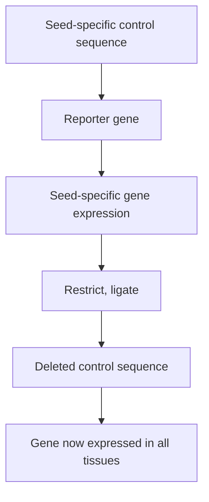

## Carrying out a deletion analysis

Once a reporter gene has been chosen and the necessary construction made, carrying out a deletion analysis is fairly straightforward. Deletions can be made in the upstream region of the construct by any one of several strategies, a simple example being shown in Figure 11.16. The effect of the deletion is then assessed by cloning the deleted construct into the host organism and determining the pattern and extent of expression of the reporter gene. An increase in expression will imply that a repressing or silencing sequence has been removed, a decrease will indicate removal of an activator or enhancer, and a change in tissue specificity (as shown in Figure 11.16) will pinpoint a tissue‐responsive control sequence.

The results of a deletion analysis project have to be interpreted very carefully. Complications may arise if a single deletion removes two closely linked control sequences with different regulatory functions or, as is fairly common, two different control sequences that are some distance apart cooperate to produce a single response. Despite these potential difficulties, deletion analyses, in combination with studies of protein binding sites, have provided important information about how the expression of individual genes is regulated, and have supplemented and extended the more broadly based genetic analyses of differentiation and development.

## 11.3 Identifying and studying the translation product of a cloned gene

Over the years, gene cloning has become increasingly useful in the study not only of genes themselves but also of the proteins coded by cloned genes. Investigations into protein structure and function have benefited greatly from the development of techniques that allow mutations to be introduced at specific points in a cloned gene, resulting in directed changes in the structure of the encoded protein.

Before considering these procedures, we should first look at the more mundane problem of how to isolate the protein coded by a cloned gene. In many cases this analysis will not be necessary, as the protein will have been characterized long before the gene cloning experiment is performed, and pure samples of the protein will already be available. On the other hand, there are occasions when the translation product of a cloned gene has not been identified. A method for isolating the protein is then needed.

## 11.3.1 HRT and HART can identify the translation product of a cloned gene

Two related techniques, **hybrid‐release translation (HRT)** and **hybrid‐arrest translation (HART)**, are used to identify the translation product encoded by a cloned gene. Both depend on the ability of purified mRNA to direct synthesis of proteins in **cell‐free translation systems**. These are cell extracts, usually prepared from germinating wheat seeds or from rabbit reticulocyte cells, both of which are exceptionally active in protein synthesis. The extracts contain ribosomes, tRNAs, and all the other molecules needed for protein synthesis. The mRNA sample is added to the cell‐free translation system, along with a mixture of the 20 amino acids found in proteins, one of which is labelled (often 35S‐methionine is used). The mRNA molecules are translated into a mixture of radioactive proteins (Figure 11.17), which can be separated by gel electrophoresis and visualized by autoradiography. Each band represents a single protein coded by one of the mRNA molecules present in the sample.

flowchart

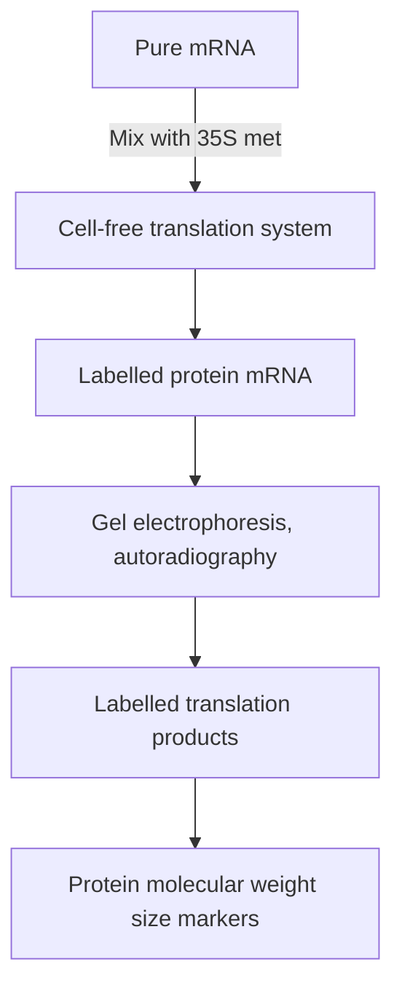

Figure 11.17

Cell‐free translation.

Figure 11.18

Hybrid‐release translation.

flowchart

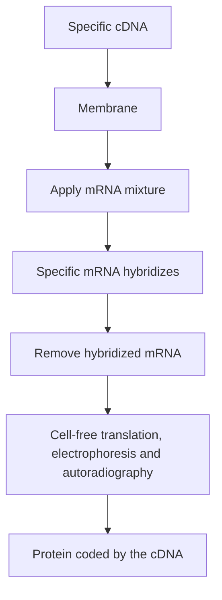

Both HRT and HART work best when the gene being studied has been obtained as a cDNA clone. For HRT the cDNA is denatured, immobilized on a nitrocellulose or nylon membrane, and incubated with the mRNA sample (Figure  11.18). The specific mRNA counterpart of the cDNA hybridizes and remains attached to the membrane. After discarding the unbound molecules, the hybridized mRNA is recovered and translated in a cell‐free system. This provides a pure sample of the protein coded by the cDNA.

Hybrid‐arrest translation is slightly different in that the denatured cDNA is added directly to the mRNA sample (Figure 11.19). Hybridization again occurs between the cDNA and its mRNA counterpart, but in this case the unbound mRNA is not discarded. Instead the entire sample is translated in the cell‐free system. The hybridized mRNA is unable to direct translation, so all the proteins except the one coded by the cloned gene are synthesized. The cloned gene’s translation product is therefore identified as the protein that is absent from the autoradiograph.

## 11.3.2 Analysis of proteins by in vitro mutagenesis

Although HRT and HART can identify the translation product of a cloned gene, these techniques tell us little about the protein itself. Some of the major questions asked by the molecular biologist today centre on the relationship between the structure of a protein and its mode of activity. The best way of tackling these problems is to induce a mutation in the gene coding for the protein and then to determine what effect the change in amino acid sequence has on the properties of the translation product (Figure  11.20). Under normal circumstances mutations occur randomly and a large number might have to be screened before one that gives useful information is found. A solution to this problem is provided by **in vitro** or **site‐directed mutagenesis**, a technique that enables a directed mutation to be made at a specific point in a cloned gene.

flowchart

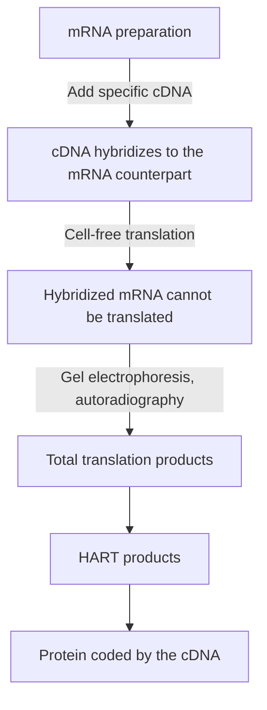

Figure 11.19

Hybrid‐arrest translation.

flowchart

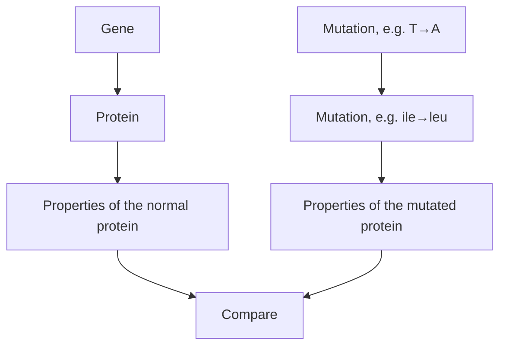

Figure 11.20

A mutation may change the amino acid sequence of a protein, possibly affecting its properties.

## Different types of in vitro mutagenesis techniques

An almost unlimited variety of DNA manipulations can be used to introduce mutations into cloned genes. The following are the simplest:

• A restriction fragment can be deleted (Figure 11.21a).
The gene can be opened at a unique restriction site, a few nucleotides removed with a double‐strand‐specific exonuclease such as Bal31 (Section 4.1.1), and the gene religated (Figure 11.21b).
A short double‐stranded oligonucleotide can be inserted at a restriction site (Figure 11.21c). The sequence of the oligonucleotide can be such that the additional stretch of amino acids inserted into the protein produces, for example, a new structure such as an α‐helix, or destabilizes an existing structure.

Although potentially useful, these manipulations depend on the fortuitous occurrence of a restriction site at the area of interest in the cloned gene. **Oligonucleotide‐directed mutagenesis** is a more versatile technique that can create a mutation at any point in the gene.

(a) Restriction fragment deletion

flowchart

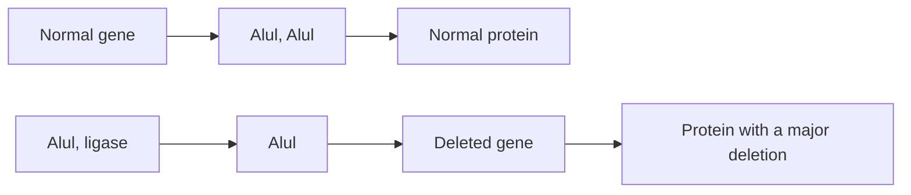

(b) Nucleotide removal at restriction site

flowchart

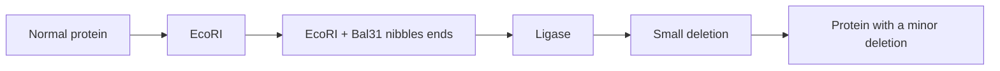

(c) Insertion of an oligonucleotide

flowchart

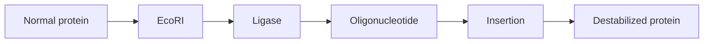

Figure 11.21

Various in vitro mutagenesis techniques.

Using an oligonucleotide to create a point mutation in a cloned gene There are a number of different ways of carrying out oligonucleotidedirected mutagenesis. We will consider one of the simplest of these methods. The gene to be mutated must be obtained in a single‐stranded form and so is generally cloned into an M13 or phagemid vector. A short oligonucleotide is synthesized that is complementary to the region to be mutated, and which contains the desired nucleotide alteration (Figure  11.22a). Despite this mismatch the oligonucleotide will anneal to the single‐stranded DNA and act as a primer for complementary strand synthesis by a DNA polymerase (Figure  11.22b). This strand synthesis reaction is continued

(a) The oligonucleotide

flowchart

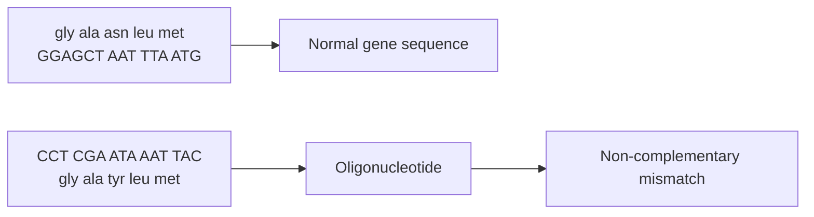

(b) Complementary strand synthesis

flowchart

(c) Isolation of phage carrying the mutation

flowchart

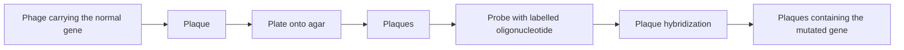

Figure 11.22

One method for oligonucleotide‐directed mutagenesis.

until an entire new strand is made and the recombinant molecule is completely double‐stranded.

After introduction, by transfection, into competent E. coli cells, DNA replication produces numerous copies of the recombinant DNA molecule. The semi‐conservative nature of DNA replication means that half the double‐stranded molecules that are produced are unmutated in both strands, whereas half are mutated in both strands. Similarly, half the resulting phage progeny carry copies of the unmutated molecule and half carry the mutation. The phages produced by the transfected cells are plated onto solid agar so that plaques are produced. Half the plaques should contain the original recombinant molecule, and half the mutated version. Which are which is determined by plaque hybridization, using the oligonucleotide as the probe, and employing very strict conditions so that only the completely base‐paired hybrid is stable.

Cells infected with M13 or phagemid vectors do not lyse, but instead continue to divide (see Figure 2.8). The mutated gene can therefore be expressed in the host E. coli cells, resulting in production of recombinant protein. The protein coded by the mutated gene can be purified from the recombinant cells and its properties studied. The effect of a single base pair mutation on the activity of the protein can therefore be assessed.

## Other methods of creating a point mutation in a cloned gene

The oligonucleotide‐directed procedure illustrated in Figure  11.22 is an effective way of creating a single point mutation in a cloned gene. But what if the objective is to make a number of changes to the sequence of the gene? The oligonucleotide procedure could, of course, be repeated several times, introducing a new mutation at each stage, but this would be a very lengthy process.

An alternative would be to construct the gene in the test tube, placing mutations at all the desired positions. This approach is feasible now that oligonucleotides of 150 units and longer can be made by chemical synthesis (see Figure 8.15). The gene is constructed by synthesizing a series of partially overlapping oligonucleotides, the sequences of these oligonucleotides making up the desired sequence for the gene. The overlaps can be partial, rather than complete, because the gaps can be filled in with a DNA polymerase, and the final phosphodiester bonds synthesized with DNA ligase, to create the completed, double‐stranded gene (Figure  11.23). If restriction sites are included in the end‐sequences of the gene, then treatment with the appropriate enzyme will produce sticky ends that allow the gene to be ligated into a cloning vector. This procedure is called **artificial** or **de novo gene synthesis**. It is now a routine method for synthesis of genes up to 1.2 kb in length, and much longer genes, 5 kb or more, can be made using specialized techniques.

PCR can also be used to create mutations in cloned genes, though like oligonucleotide‐directed mutagenesis, only one mutation can be created per experiment. Various procedures have been devised, one of which is shown in Figure  11.24. In this example, the starting DNA molecule is amplified by two PCRs. In each of these, one primer is normal and forms a fully base‐paired hybrid with the template DNA, but the second is