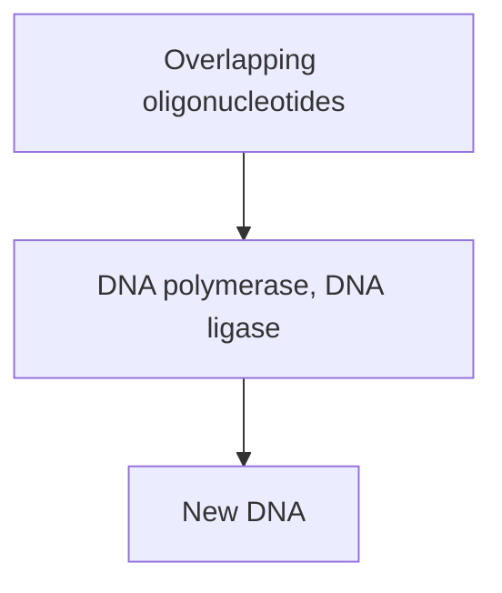
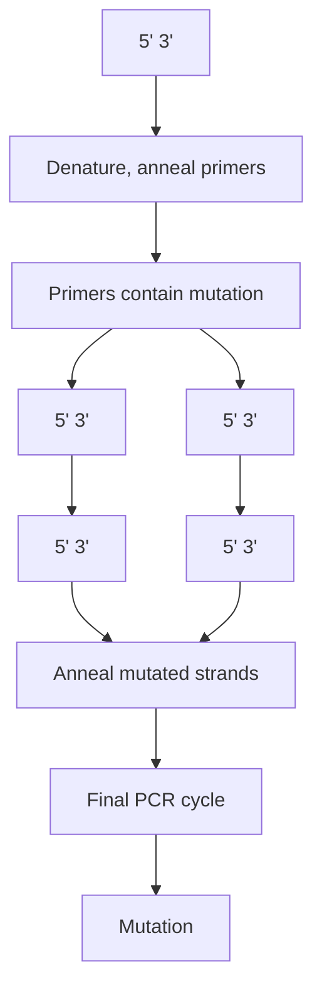
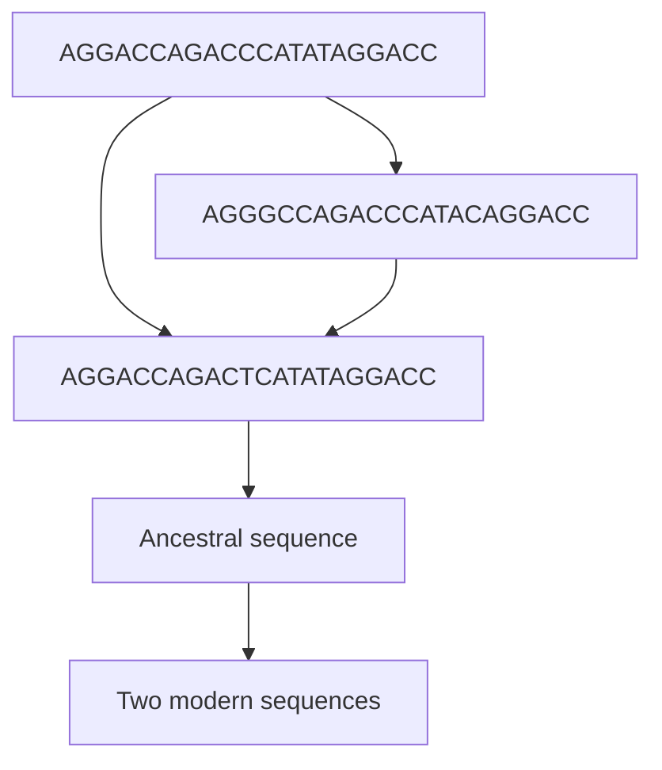
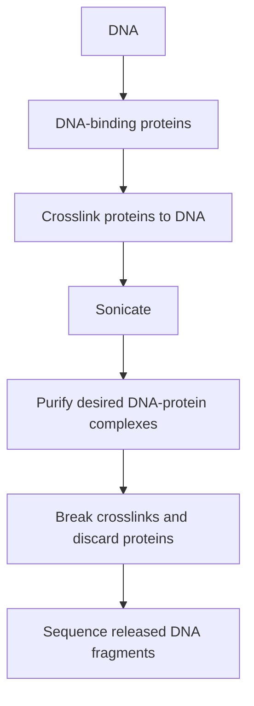
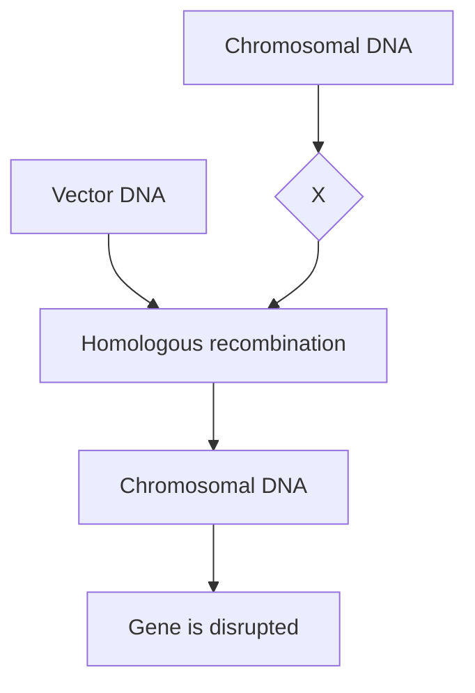
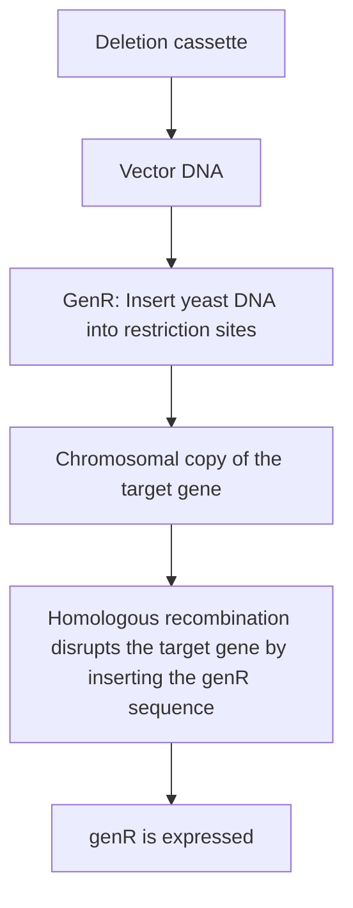

flowchart

Figure 11.23

Artificial gene synthesis.

mutagenic, as it contains a single base‐pair mismatch corresponding to the mutation that we wish to introduce into the DNA sequence. This mutation is therefore present in the two PCR products, each of which represents one half of the starting DNA molecule. The two PCR products are mixed together, and a final PCR cycle carried out. In this cycle, the overlapping regions from the two products anneal to one another and are then extended by the polymerase, producing the full‐length, mutated DNA molecule.

flowchart

Figure 11.24

One method for using PCR to create a directed mutation.

## The potential of in vitro mutagenesis

In vitro mutagenesis has remarkable potential, both for pure research and for applied biotechnology. For example, the biochemist can now ask very specific questions about the way that protein structure affects the action of an enzyme. In the past, it has been possible through biochemical analysis to gain some idea of the identity of the amino acids that provide the substrate binding and catalytic functions of an enzyme molecule. Mutagenesis techniques provide a much more detailed picture by enabling the role of each individual amino acid to be assessed by replacing it with an alternative residue and determining the effect this has on the enzymatic activity.

The ability to manipulate enzymes in this way has resulted in dramatic advances in our understanding of biological catalysis and has led to the new field of **protein engineering**, in which mutagenesis techniques are used to develop new enzymes for biotechnological purposes. For example, careful alterations to the amino acid sequence of subtilisin, an enzyme used in biological washing powders, have resulted in engineered versions with greater resistances to the thermal and bleaching (oxidative) stresses encountered in washing machines.

## Further reading

- Berk, A.J. (1989) Characterization of RNA molecules by S1 nuclease analysis. Methods in Enzymology, 180, 334–347.
- Carrigan, P.E., Ballar, P., and Tuzman, S. (2011) Site‐directed mutagenesis. Methods in Molecular Biology, 700, 107–124.
- Frohman, M.A., Dush, D.K., and Martin, G.R. (1988) Rapid production of full length cDNAs from rare transcripts: amplification using a single gene‐specific oligonucleotide primer. Proceedings of the National Academy of Sciences of the USA, 85, 8998–9002. [An example of RACE.]
- Galas, D.J. and Schmitz, A. (1978) DNase footprinting: a simple method for the detection of protein–DNA binding specificity. Nucleic Acids Research, 5, 3157–3170.
- Goldberg, M.L., Lifton, R.P., Stark, G.R., and Williams, J.G. (1979) Isolation of specific RNAs using DNA covalently linked to diazobenzyloxymethyl cellulose or paper. Methods in Enzymology, 68, 206–220. [Hybrid‐release translation.]
- Hellman, L.M. and Fried, M.G. (2007) Electrophoretic mobility shift assay (EMSA) for detecting protein‐nucleic acid interactions. Nature Protocols, 2, 1849–1861. [Gel retardation.]
- Hendrickson, W. and Schleif, R. (1985) A dimer of AraC protein contacts three adjacent major groove regions at the ara1 DNA site.
- Proceedings of the National Academy of Sciences of the USA, 82, 3129–3133. [An example of the modification interference assay.]
- Kunkel, T.A. (1985) Rapid and efficient site‐specific mutagenesis without phenotypic selection. Proceedings of the National Academy of Sciences of the USA, 82, 488–492. [Oligonucleotide‐directed mutagenesis.]
- Matzke, A.J.M., Stöger, E.M., Schernthaner, J.P., and Matzke, M.A. (1990) Deletion analysis of a zein gene promoter in transgenic tobacco plants. Plant Molecular Biology, 14, 323–332.
- Paterson, B.M., Roberts, B.E., and Kuff, E.L. (1977) Structural gene identification and mapping by DNA.mRNA hybrid‐arrested cell‐free translation. Proceedings of the National Academy of Sciences of the USA, 74, 4370–4374. [Hybrid‐arrest translation.]
- Pellé, R. and Murphy, N.B. (1993) Northern hybridization: rapid and simple electrophoretic conditions. Nucleic Acids Research, 21, 2783–2784.
- Tsien, R.Y. (1998) The green fluorescent protein. Annual Reviews of Biochemistry, 67, 509–544. [A reporter gene system.]

## Chapter 12

# Studying Genomes

## Chapter contents

**CHAPTER CONTENTS**

**12.1** Locating the genes in a genome sequence 244
**12.2** Determining the function of an unknown gene 251
**12.3** Genome browsers 256

At the start of the $2 1 ^ { \mathrm { s t } }$ century, the emphasis in molecular biology shifted from the study of individual genes to the study of entire genomes. This change in emphasis was prompted by the development during the 1990s of methods for sequencing large genomes. Genome sequencing predates the 1990s – we learned in Chapter 10 how the first genome, that of the phage ϕX174, was completed in 1975 – but it was not until 20 years later, in 1995, that the first genome of a free‐living organism, the bacterium Haemophilus influenzae, was completely sequenced. The next five years were a watershed, with the genome sequences of almost 50 other bacteria published, along with complete sequences for the much larger genomes of yeast, fruit fly, Caenorhabditis elegans (a nematode worm), Arabidopsis thaliana (a plant), and humans. Today, the sequencing of bacterial and archaeal genomes has become routine, with several thousand completed, and over 300 eukaryotic genomes have also been sequenced.

Genome sequencing has led to the development of a new area of DNA research, loosely called **post‐genomics** or **functional genomics**. Post‐genomics includes the use of computer systems in **genome annotation**, the process by which the genes, control sequences, and other interesting features are identified in a genome sequence, as well as computer‐based and experimental techniques aimed at determining the functions of any unknown genes that are discovered.

Post‐genomics also encompasses techniques designed to identify which genes are expressed in a particular type of cell or tissue, and how this pattern of genome expression changes over time. This work has led to the invention of two new terms:

• The **transcriptome**, which is the RNA content of a cell, and which reflects the overall pattern of gene expression in that cell.
• The **proteome**, which is the protein content of a cell and which reflects its biochemical capability.

In this chapter we will look at the methods used to locate the genes in a genome sequence and to assign functions to those newly discovered genes. In Chapter 13 we will complete our examination of post‐genomics by considering how the contents of transcriptomes and proteomes are studied.

## 12.1 Locating the genes in a genome sequence

Identifying the positions of genes is usually the first step in the annotation of a new genome sequence. Unlike most of the DNA analysis methods that we have studied so far, gene location is carried out largely by computer methods rather than laboratory experiments. Gene location is therefore one of the ways in which **bioinformatics**, sometimes referred to as molecular biology in silico, is proving of major value as an adjunct to conventional research.

## 12.1.1 Locating protein‐coding genes by scanning a genome sequence

Locating a protein‐coding gene in a genome sequence is easy if the amino acid sequence of the protein product is known, allowing the nucleotide sequence of the gene to be predicted, or if the corresponding cDNA has been previously sequenced. But for many genes there is no prior information that enables the correct DNA sequence to be recognized. How can these genes be located in a genome sequence?

## Searching for open reading frames

The DNA sequence of a protein‐coding gene is an **open reading frame (ORF)**, a series of nucleotide triplets beginning with an initiation codon (usually but not always ATG) and ending in a termination codon (TAA, TAG, or TGA in most genomes). Searching a genome sequence for ORFs, by eye or more usually by computer, is therefore the first step in gene location. When carrying out the search it is important to remember that each DNA sequence has six reading frames, three in one direction and three in the reverse direction on the complementary strand (Figure 12.1).

text_image

1 G A C →
2 T G A →
3 A T G →
5' - A T G A C C A A T G A C A T G C A A T A A -3'
3' - T A C T G G T T A C T G T A C G T T A T T -5'
← A T T 4
← T A T 5
← T T A 6
100 bp

Figure 12.1

A double‐stranded DNA molecule has six reading frames.

Figure 12.2

The typical result of a search for ORFs in a prokaryotic genome. The arrows indicate the directions in which the genes and spurious ORFs run.

The key to the success of **ORF scanning** (also called **ab initio gene pre-diction)** is the frequency with which termination codons appear in the DNA sequence. If the DNA has a random sequence and a GC content of 50%, then each of the three termination codons will appear, on average, once every $4 ^ { 3 }   =   6 4$ bp. This means that there should not be many ORFs longer than 30–40 codons in random DNA, and not all of these ORFs will start with ATG. Most genes are much longer than this: the average lengths are 300–350 codons for bacterial genes and approximately 450 codons for humans. ORF scanning therefore, in its simplest form, takes a figure of 100 codons as the shortest length of a putative gene and records positive hits for all ORFs longer than this.

With prokaryotic genomes, simple ORF scanning is an effective way of locating most of the genes in a DNA sequence. Most prokaryotic genes are much longer than 100 codons in length and so are easily recognized (Figure 12.2). With prokaryotes, the analysis is further simplified by the fact that most genes are closely spaced with very little intergenic DNA between them. If we assume that the real genes do not overlap, which is true for most prokaryotic genomes, then it is only in these short intergenic regions that there is a possibility of mistaking a spurious ORF for a real gene.

## Simple ORF scans are less effective at locating genes in eukaryotic genomes

Although ORF scans work well for prokaryotic genomes, they are less effective for locating genes in eukaryotic genomes. This is partly because there is substantially more intergenic DNA in a eukaryotic genome, increasing the chances of finding spurious ORFs, but the main problem is the presence of introns (see Figure 11.1). If a gene contains one or more introns, then it does not appear as a continuous ORF in the genome sequence. Many exons are shorter than 100 codons, and some have fewer than 50 codons. Continuing the reading frame into an intron usually leads to a termination sequence that appears to close the ORF (Figure  12.3).

text_image

Exon
Intron
Exon
ATGGGCAATGCAAGGTACGGTGAGCAGTGAAGTGATTAATGCATTTCTCGCAGTGGCTAGACGATGCATAG
M G N A R Y G E Q .... W L D D A *
M G N A R Y G E Q V S D *

Figure 12.3

ORF scans are complicated by introns. The nucleotide sequence of a short gene containing a single intron is shown. The correct amino acid sequence of the protein translated from the gene is given immediately below the nucleotide sequence, using the single‐letter amino acid abbreviations. In this sequence the intron has been left out, because it is removed from the transcript before the mRNA is translated into protein. In the lower line, the sequence has been translated without recognizing that an intron is present. As a result of this error, the amino acid sequence appears to terminate within the intron.

In other words, many of the genes in a eukaryotic genome are not fulllength, uninterrupted ORFs, and simple ORF scanning cannot locate them. Finding ways of locating genes by inspection of a eukaryotic sequence is a major challenge in bioinformatics. Two approaches are being followed:

**Codon bias** can be taken into account. Not all codons are used equally frequently in the genes of a particular organism. For example, leucine is specified by six codons (TTA, TTG, CTT, CTC, CTA, and CTG), but in human genes leucine is most frequently coded by CTG and is only rarely specified by TTA or CTA. Similarly, of the four valine codons, human genes use GTG four times more frequently than GTA. The biological reason for codon bias is not understood, but all organisms have a bias, which is different in different species. Real exons display this bias, whereas chance series of triplets usually do not.
**Exon–intron boundaries** can be searched for as these have distinctive sequence features, although unfortunately the distinctiveness of these sequences is not so great as to make their location a trivial task. In vertebrates, the sequence of the upstream exon–intron boundary is usually described as $5'-AG\downarrow GTAAGT-3'$ and the downstream one as $\mathrm { S ^ { \prime } \mathrm { - P y P y P y P y P y P y N C A G } \downarrow - 3 ^ { \prime } }$ , where “Py” means one of the pyrimidine nucleotides (T or $\mathrm { C ) ,   `` N ^ { \prime \prime } }$ is any nucleotide, and the arrow shows the precise location of the boundary (Figure 12.4). These are **consensus sequences**, the averages of a large number of related but non‐identical

text_image

Exon
Intron
Exon
5' 3'
A G↓G T A A G T
Py Py Py Py Py Py N C A G↓

Figure 12.4

The consensus sequences for the upstream and downstream exon–intron boundaries of vertebrate introns. Py = pyrimidine nucleotide (C or T), N = any nucleotide. The arrows indicate the boundary positions.

sequences, so the search has to include not just the sequences shown but also at least the most common variants. Despite these problems, this type of search can predict the locations of the exon–intron boundaries with an accuracy of 60–70%.

These two extensions of simple ORF scanning, despite their limitations, are generally applicable to all higher eukaryotic genomes. Additional strategies are also possible with individual organisms based on the special features of their genomes. For example, vertebrate genomes contain **CpG islands** upstream of many genes, these being sequences of approximately 1 kb in which the GC content is greater than the average for the genome as a whole. Some 40–50% of human genes have an upstream CpG island. These sequences are distinctive and when one is located in vertebrate DNA, a strong assumption can be made that a gene begins in the region immediately downstream.

## 12.1.2 Gene location is aided by homology searching

Tentative identification of a gene is often followed by a **homology search**. This is an analysis, carried out by computer, in which the sequence of the gene is compared with all the gene sequences present in the international DNA databases, not just known genes of the organism under study but also genes from all other species. If the test sequence is part of a gene that has already been sequenced by someone else, then an identical match will be found, but this is not the point of a homology search. Instead, the rationale is that two genes from different organisms that have similar functions will have similar sequences, reflecting their common evolutionary histories (Figure 12.5). The main use of homology searching is to assign functions to newly discovered genes, and we will therefore return to it when we deal with this aspect of genome analysis later in the chapter (Section 12.2.1). The technique is also central to gene identification because it enables the authenticity of tentative exon sequences located by ORF scanning to be tested. If the tentative exon sequence gives one or more positive matches after a homology search, then it is probably a real exon.

To carry out a homology search, the nucleotide sequence of the tentative gene is usually translated into an amino acid sequence, as this allows a

flowchart

Figure 12.5

Homology between two sequences that share a common ancestor. The two sequences have acquired mutations during their evolutionary histories, but their sequence similarities indicate that they are homologues.

text_image

G A P G M W L R L A A G S F Q H A G
Sequence 1 GGTGCACCCGGTATGTGGCTGCGATTAGCAGCGGGATCATTT CAGCATGCAGGG
* * * * * * * * * * * * * * * * * * * * * * *
Sequence 2 GATACACCCCGTATTTGGCAGCAATTTCGAGGGGGATTATTGCACCATGGAGCG
D T P R I W Q Q F A G G L L H H G A

## Figure 12.6

Lack of homology between two sequences is often more apparent when comparisons are made at the amino acid level. Two nucleotide sequences are shown, with nucleotides that are identical in the two sequences given in red and non‐identities given in blue. The two nucleotide sequences are 76% identical, as indicated by the asterisks. This might be taken as evidence that the sequences are homologous. However, when the sequences are translated into amino acids, the identity decreases to 28%, suggesting that the genes are not homologous, and that the similarity at the nucleotide level was fortuitous. Identical amino acids are shown in brown, and non‐identities in green. The amino acid sequences have been written using the one‐letter abbreviations.

more sensitive search. This is because there are twenty different amino acids but only four nucleotides, so there is less chance of two amino acid sequences appearing to be similar purely by chance (Figure  12.6). The analysis is carried out through the internet, by logging on to the website of one of the DNA databases and using a search program such as **BLAST** (Basic Local Alignment Search Tool). If the test sequence is over 200 amino acids in length and has 30% or greater identity with a sequence in the database (i.e. at 30 out of 100 positions the same amino acid occurs in both sequences), then the two can be considered possible homologues, and the ORF under study looked on as a possible gene.

A more precise version of homology searching is possible when genome sequences are available for two or more related species. Related species have genomes that share similarities inherited from their common ancestor, overlaid with species‐specific differences that have arisen since the two species began to evolve independently. Because of natural selection, the sequence similarities between related genomes is greatest within the genes and least in the intergenic regions. Therefore, when related genomes are compared, homologous genes are easily identified because they have high sequence similarity, and any ORF that does not have a clear homologue in the related genome can be discounted as almost certainly being a chance sequence and not a genuine gene.

This type of homology analysis  –  called **comparative genomics**  –  has proved very valuable for locating genes in the Saccharomyces cerevisiae genome, as complete sequences are available not only for this yeast but also for several related species, such as Saccharomyces paradoxus, Saccharomyces mikatae, and Saccharomyces bayanus. Comparisons between these genomes confirmed the authenticity of a number of ORFs that had been tentatively identified in the S. cerevisiae genome sequence, and also enabled almost 500 other putative ORFs to be discounted on the grounds that they have no equivalents in the related genomes. The gene maps of these yeasts are very similar, and although each genome has undergone its own species‐specific rearrangements, there are still substantial regions where the gene order in the S. cerevisiae genome is the same as in one or more of the related genomes. Conservation of gene order is called **synteny**, and it makes it very easy to identify homologous genes. More importantly, a spurious ORF, especially a short one, can be discarded with

text_image

Genome being studied
Real genes
Short ORF
Related genome
ORF is absent

Figure 12.7

Using comparisons between the genomes of related species to test the authenticity of a short ORF. In this example, the questionable ORF is not present at the expected position in the related genome and so is probably not a real gene.

confidence, because its expected location in a related genome can be searched in detail to ensure that no equivalent is present (Figure 12.7).

## 12.1.3 Locating genes for noncoding RNA transcripts

Not all of the genes present in a genome sequence code for proteins. Other genes specify noncoding RNAs such as tRNAs, rRNAs and the various other types of short and long RNA molecules that have diverse functions in living cells. The genes for noncoding RNA do not contain open reading frames, so the ORF scanning methods described above cannot be used to locate them in a genome sequence. Noncoding RNA molecules do, however, have their own distinctive features, which can aid identification of their genes in a genome sequence.

The most important of these features is the presence in many noncoding RNAs of short sequences that can form intramolecular base pairs so that the RNA adopts a **stem‐loop** structure (Figure 12.8). In some noncoding RNAs, a series of stem‐loops can be formed to give the RNA a complex structure, such as the cloverleaf structure of a tRNA. Computer programmes that scan DNA sequences for those regions which, when transcribed into RNA, could form a stem‐loop can therefore be used to identify positions where noncoding RNA genes might be present. These programmes incorporate thermodynamic rules that enable the stability of a stem‐loop to be estimated, taking into account features such as the size of the loop, the number of base pairs in the stem, and the proportion of G–C base pairs. A putative stem‐loop structure with an estimated stability above a chosen limit is considered a possible indicator of the presence of a noncoding RNA gene.

chemical

RNA secondary structure diagram showing nucleotide bases and their complementary base pairing

Figure 12.8

A typical RNA stem‐loop structure.

## 12.1.4 Identifying the binding sites for regulatory proteins in a genome sequence

Genome annotation can be enhanced by identification of regulatory sequences that act as binding sites for proteins such as transcription factors. These regulatory sequences are usually positioned upstream of the genes whose expression they control, so identifying them can indicate regions of the genome where genes are present and can also help to confirm the authenticity of a questionable ORF.

Regulatory sequences have distinctive features that they possess in order to carry out their role as recognition signals for the DNA binding proteins involved in gene expression. As with exon–intron boundaries, the regulatory sequences are variable, and it is difficult to locate them simply by scanning a genome sequence. These sequences are more easily located by **ChIP‐seq (chromatin immunoprecipitation sequencing)**, which identifies the positions where individual DNA‐binding proteins attach to a genome. To perform a ChIP‐seq experiment, **chromatin** – the complex of DNA and bound proteins present in the nucleus – is extracted and treated with formaldehyde to crosslink the proteins to the DNA (Figure 12.9). Next, the DNA is sonicated to break it into fragments. Because of the crosslinking, the bound proteins are not lost and remain attached to their DNA fragments. Those fragments attached to a particular transcription factor or other interesting DNA‐binding protein can therefore be purified with an antibody specific for that protein. The purified fragments are then heated overnight at $6 5 ^ { \circ } \mathrm { C }$ to break the crosslinks and detach the proteins. The released DNA fragments are sequenced by a next‐generation method and the reads mapped onto the genome sequence in order to locate the binding sites for the protein being studied.

Figure 12.9

ChIP‐seq (chromatin immunoprecipitation sequencing).

flowchart

Only those binding sites that are occupied by the protein will be represented in the reads obtained by a ChIP‐seq experiment. In any particular tissue, some sites will be occupied and others empty, depending on which genes are active in that tissue. ChIP‐seq therefore provides information not only on the locations of the binding sites for a transcription factor, but also on the expression profiles of the genes controlled by that factor. This information, in turn, enables genome annotation to move beyond the simple mapping of gene positions within a genome, and to encompass information on the expression of the genome.

## 12.2 Determining the function of an unknown gene

To a true DNA enthusiast, simply locating a new gene in a genome sequence is a thrill and an end in itself. But to understand the genome sequence in greater detail we must attempt to assign a function to every gene that is identified. This is an important area of DNA analysis because sequencing projects are revealing many new genes, even in organisms that were extensively studied by conventional genetic analysis before their genomes were sequenced. For example, 38% of the 4288 protein‐coding genes in the initial annotation of the Escherichia coli genome had no known function. Attempts to assign functions to these **orphans** make use of a combination of computer analysis and laboratory experiments.

## 12.2.1 Assigning gene functions by computer analysis

A homology search (Section 12.1.2) is often used to test whether or not an ORF is a genuine gene. A positive result, with a match being found between the ORF and a homologous gene already in the databases, can also give an indication of the function of the newly discovered gene. The rationale is that if a new gene has a similar sequence to a known gene, then the two genes are likely to have similar biochemical roles. Almost 2000 of the genes in the yeast genome were assigned functions in this way. However, the results of homology searching must be treated with care. A growing problem is the presence in the databases of genes whose stated functions are incorrect. If one of these genes is identified as a homologue of the query sequence, then the incorrect function will be passed on to this new sequence, adding to the problem. There are also cases where homologous genes have quite different biological functions, an example being the crystallins of the eye lens, some of which are homologous to metabolic enzymes. Homology between a query sequence and a crystallin therefore does not mean that the query sequence is a crystallin, and similarly, homology between a query sequence and a metabolic enzyme might not mean that the query sequence is a metabolic enzyme. It is also possible that a homology search will only reveal matches to other orphan genes whose functions have not yet been identified.

**Structural bioinformatics**, which attempts to predict the structure of a protein from its amino acid sequence, can provide at least an insight into the function of an orphan gene. For some time, it has been possible to use the amino acid sequence specified by a gene to predict the positions of α‐helices and β‐sheets in the encoded protein. Although this method has limited accuracy, the resulting structural information can sometimes be used to make inferences about the function of the protein. Proteins that attach to membranes can often be identified because they possess α‐helical arrangements that span the membrane, and DNA‐binding motifs such as zinc fingers can also be recognized.

The ultimate goal of structural bioinformatics is to go beyond the pre-diction of secondary structural units such as α‐helices and β‐sheets, and instead to predict the complete three‐dimensional structure of a protein from its amino acid sequence. Knowing the three‐dimensional structure would enable the likely function of the protein to be assigned with much greater confidence. Developments in this area are advancing on two fronts. First, biochemists are acquiring greater amounts of information on the chemical interactions that underlie the folding of a polypeptide into its three‐dimensional structure. This information is being used to design more powerful algorithms for predicting the three‐dimensional conformations that can be adopted by segments of an amino acid sequence. In the second approach, proteins whose structures have been determined by X‐ray crystallography are used as templates for predicting the structure likely to be taken up by a polypeptide with a similar amino acid sequence. In other words, if a homology search reveals that a new gene has homologues in the databases, and one or more of those homologues codes for a protein whose structure is known, then the homologous protein can be used as a template for working out the structure of the protein encoded by the newly discovered gene.

## 12.2.2 Assigning gene function by experimental analysis

Experimental identification of the function of an unknown gene is proving to be one of the biggest challenges in genomics research. The problem is that the objective – to plot a course from gene to function – is the reverse of the route normally taken by genetic analysis, in which the starting point is a phenotype and the objective is to identify the underlying gene or genes (Figure 12.10). In conventional genetic analysis, the genetic basis of a phenotype is usually studied by searching for mutant organisms in which the phenotype has become altered. The mutants might be obtained experimentally, for example by treating a population, such as a culture of bacteria, with ultraviolet radiation or a mutagenic chemical, or the mutants might be present in a natural population. The gene or genes that have been altered in the mutant organism are then studied by genetic crosses, which can locate the position of a gene in a genome and also determine if the gene is the same as one that has already been characterized. The gene can then be studied further by molecular biology techniques such as cloning and sequencing.

Figure 12.10

Forward and reverse genetics.

(a) Forward genetics

flowchart

(b) Reverse genetics

The general principle of this conventional analysis – **forward genetics** – is that the genes responsible for a phenotype can be identified by determining which genes are inactivated in organisms that display a mutant version of the phenotype. If the starting point is the gene, rather than the phenotype, then the equivalent strategy – **reverse genetics** – would be to mutate the gene and identify the phenotypic change that results. This is the basis of most of the techniques used to assign functions to unknown genes.

## Specific genes can be inactivated by homologous recombination

One way to inactivate a specific gene is to disrupt it with an unrelated segment of DNA (Figure 12.11). This can be achieved by homologous recombination between the chromosomal copy of the gene and a second piece of DNA that shares some sequence identity with the target gene.

How is gene inactivation carried out in practice? We will consider two examples, the first with Saccharomyces cerevisiae. This technique makes use of a **deletion cassette**, which carries a gene for antibiotic resistance (Figure 12.12). The gene is not a normal component of the yeast genome, but it will work if transferred into a yeast chromosome, giving rise to a transformed yeast cell that is resistant to the antibiotic geneticin. Before using the deletion cassette, new segments of DNA are attached as tails to either end. These segments have sequences identical to parts of the yeast gene that is going to be inactivated. After the modified cassette is introduced into a yeast cell, homologous recombination occurs between the DNA tails and the chromosomal copy of the yeast gene, replacing the latter with the antibiotic resistance gene. The target gene therefore becomes inactivated. Cells which have undergone the replacement are selected by plating the culture onto agar medium containing geneticin, and their phenotypes examined to gain some insight into the function of the gene.

The second example of gene inactivation uses an analogous process, but with mice rather than yeast. The mouse is frequently used as a model organism for humans because the mouse genome contains many of the

flowchart

Figure 12.11

Gene disruption by homologous recombination.

Figure 12.12

The use of a yeast deletion cassette.

flowchart

same genes. Identifying the functions of unknown human genes is therefore being carried out by inactivating the equivalent genes in mice. The homologous recombination part of the procedure is identical to that described for yeast and once again results in a cell in which the target gene has been inactivated. The problem is that we do not want just one mutant cell, we want a whole mutant mouse, as only with the complete organism can we make a full assessment of the effect of the gene inactivation on the phenotype. To achieve this, the vector carrying the deletion cassette is initially microinjected into an embryonic stem cell (Section 7.3.2). The eventual result is a **knockout mouse**, whose phenotype will, with luck, provide the desired information on the function of the gene being studied.

## Gene inactivation with a programmable nuclease

An alternative method for gene inactivation uses a special type of endonuclease, called a **programmable nuclease**, which can be directed to a specific site in a genome where it will make a double‐stranded cut. The cut stimulates a natural repair process, called non‐homologous end‐joining in eukaryotes, which joins the DNA strands together again, but in an errorprone manner that usually results in a short insertion or deletion occurring at the repair site. If the repair is within a gene, then the insertion or deletion will inactivate the gene. This process is called **gene editing**.