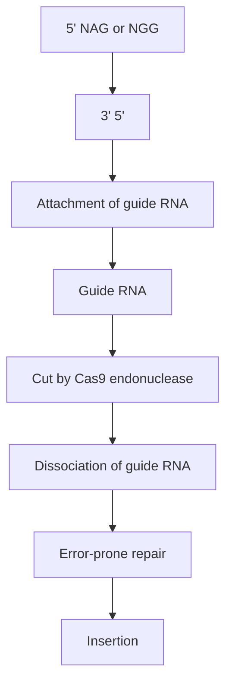
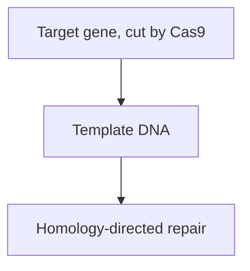
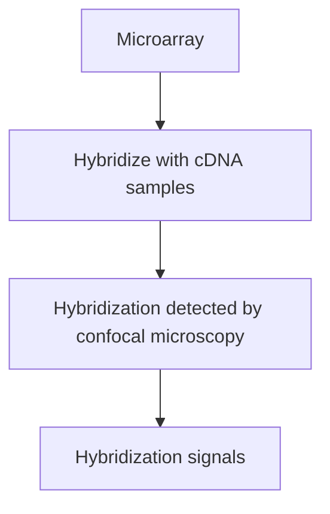
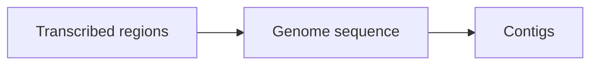
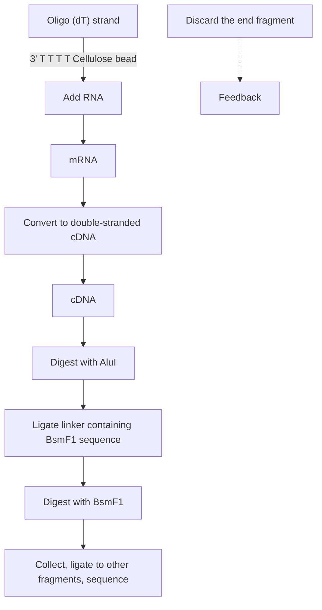
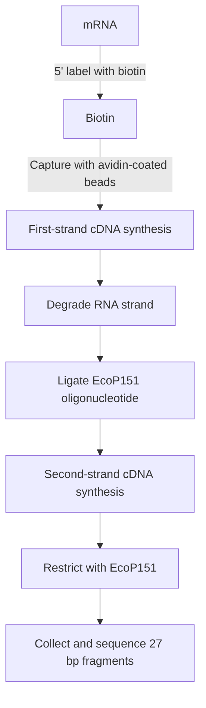
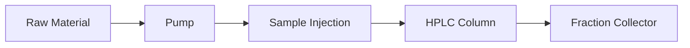
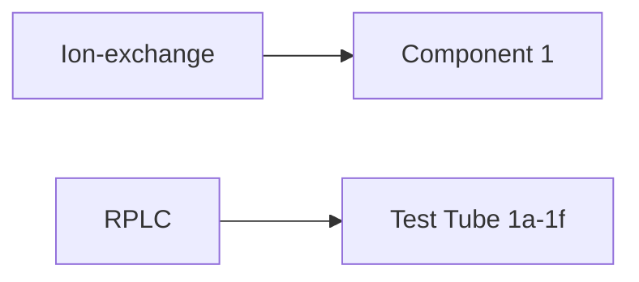

flowchart

Figure 12.13

CRISPR gene editing by the error‐prone pathway. The guide RNA attaches adjacent to a 5´–NGG–3´ or 5´–NAG–3´ triplet. Repair of the resulting double‐strand break by non‐homologous end‐joining results in a short insertion, as shown here, or a deletion.

Several types of programmable nuclease are known, but the one that has become most important in gene editing is the **Cas9 endonuclease**, a natural component of the prokaryotic immune system called **clustered regularly interspaced short palindromic repeats (CRISPR)**. This enzyme forms a complex with a guide RNA which contains a 20‐nucleotide segment that binds to the target site in a DNA molecule, which must always be immediately upstream of a 5´–NGG–3´ or $5^{\prime}-NAG-3^{\prime}$ triplet (Figure 12.13). The expected frequency of a 20‐nucleotide motif in a DNA sequence is once every $4 ^ { 2 0 } = 1 . 1 \times 1 0 ^ { 1 2 }   \mathrm { { \tt b p } } ,$ so it is highly likely that the guide RNA will bind only to its specific target and not elsewhere in even the most complex eukaryotic genome.

In order to carry out a gene editing experiment, a eukaryotic cell must be engineered to synthesize both the nuclease and the guide RNA. One approach is to use virus vectors to clone the Cas9 gene from Streptococcus pyogenes into the cell line being studied and then to introduce one or more guide RNA sequences via a second cloning experiment. Alternatively, both the endonuclease gene and the guide RNA sequence can be introduced together.

In a second version of gene editing, the repair process is directed by a short template DNA molecule that is introduced into the cell along with the endonuclease gene and the guide RNA sequence. When the template DNA is present the non‐homologous repair process does not occur, and instead a version of homologous recombination replaces the two broken

flowchart

Figure 12.14

CRISPR gene editing by homology‐directed repair. The template DNA has the same sequence, except for a single base pair difference, as the target gene, and spans the position where the double‐strand break has been made by the Cas9 endonuclease. After homology‐directed repair, the target gene contains the sequence variation.

DNA ends with the intact template sequence. If the sequence of the template DNA is identical to that of the target site then the break is repaired, without insertion or deletion, and the original sequence is restored. However, the template DNA is able to participate in the recombination event even if its sequence is slightly different to that of the target site. If this is the case, then after repair the target sequence will contain the  variations that were originally in the template DNA (Figure  12.14). This type of gene editing, called **homology‐directed repair**, is therefore able to introduce directed mutations into the unknown gene, adding another dimension to the experiments that can be used to study the function of that gene.

Gene editing has gained immense importance during the last few years, and has many applications in addition to its use in the functional analysis of unknown genes. In particular, gene editing is one of the methods being used to obtain modified versions of crop plants. We will therefore examine gene editing in more detail when we study this aspect of plant biotechnology in Section 16.3.

## 12.3 Genome browsers

Genome annotation projects produce a wealth of information about the locations of genes in a genome sequence and the possible functions of those genes. Other computer‐based surveys of a genome sequence can reveal the positions and identities of repetitive DNA elements and other interesting features. All of this information must be assembled and made available to other researchers who are studying the same genome or a related one, or who for some other reason wish to mine the data that is available about the genome sequence.

A genome annotation is usually displayed in graphical form with each chromosome displayed as a linear map and boxes, and other symbols used to mark the positions of genes and other features. The map is produced and displayed by a computer programme called a **genome browser**. The browser enables the map to be viewed at different degrees of magnification, so at one level the annotation of an entire chromosome can be viewed, or by zooming in a region comprising just a few kilobases of sequence can be examined in detail.

A genome browser is usually used online, so that the annotation is available to other researchers even as it is being assembled. Two of the most widely used online browsers are Ensembl, which is maintained by the European Bioinformatics Institute and the UK Sanger Institute, and the UCSC Genome Browser of the University of California, Santa Cruz. Both Ensembl and the UCSC Genome Browser hold annotations of the human genome along with those of several other vertebrates and invertebrates. There are also more specialized online genome browsers, such as the Plant GDB, which holds plant genome annotations.

## Further reading

- Adli, M. (2018) The CRISPR tool kit for genome editing and beyond. Nature Communications, 9, 1911.
- Alföldi, J. and Lindblad‐Toh, K. (2013) Comparative genomics as a tool to understand evolution and disease. Genome Research, 23, 1063–1068.
- Altschul, S.F., Gish, W., Miller, W., et al. (1990) Basic local alignment search tool. Journal of Molecular Biology, 215, 403–410. [The BLAST program.]
- Guigó, R., Flicek, P., Abril, J.F., et al. (2006) EGASP: the human ENCODE Genome Annotation Assessment Project. Genome Biology, 7, S2, doi:10.1186/gb‐2006‐7‐s1‐s2. [Comparison of the accuracy of different computer programs for gene location.]
- Kellis, M., Patterson, N., Endrizzie, M., et al. (2003) Sequencing and comparison of yeast species to identify genes and regulatory elements. Nature, 423, 241–254. [Using comparative genomics to annotate the yeast genome sequence.]
- Kuhlman, B. and Bradley, P. (2019) Advances in protein structure prediction and design. Nature Reviews Molecular Cell Biology, 20, 681–697.
- Lee, D., Redfern, O., and Orengo, C. (2007) Predicting protein function from sequence and structure. Nature Reviews Molecular Cell Biology, 8, 995–1005.
- Park, P.J. (2009) ChIP‐seq: advantages and challenges of a maturing technology. Nature Reviews Genetics, 10, 669–680.
- Pavesi, G., Mauri, G., Stefani, M., and Pesole, G. (2004) RNAProfile: an algorithm for finding conserved secondary structure motifs in unaligned RNA sequences. Nucleic Acids Research, 32, 3258–3269. [Locating noncoding RNA genes.]
- Quax, T.E.F., Claassens, N.J., Söll, D., and van de Oost, J. (2015) Codon bias as a means to fine‐tune gene expression. Molecular Cell, 59, 149–161. [Explains the important of codon bias in gene structure and expression.]
- Tandell, M. and Ence, D. (2012) A beginner’s guide to eukaryotic genome annotation. Nature Reviews Genetics, 13, 329–342.
- Wach, A., Brachat, A., Pöhlmann, R., and Philippsen, P. (1994) New heterologous modules for classical or PCR‐based gene disruptions in Saccharomyces cerevisiae. Yeast, 10, 1793–1808. [Gene inactivation by homologous recombination.]
- Yandell, M. and Ence, D. (2012) A beginner’s guide to eukaryotic genome annotation. Nature Reviews Genetics, 13, 329–342.

## Chapter 13

# Studying Transcriptomes and Proteomes

## Chapter contents

## CHAPTER CONTENTS

**13.1** Studying transcriptomes 259
**13.2** Studying proteomes 265

In Chapter 12 we considered those post‐genomics methods that are used to annotate a genome sequence by locating the genes that it contains and  assigning functions to those genes. Now we will look at the ways in which the expression products of the genome – the transcriptome and proteome – are studied.

## 13.1 Studying transcriptomes

Transcriptomes can have highly complex compositions, containing hundreds or thousands of different RNAs, each making up a different fraction of the overall population. To characterize a transcriptome, it is therefore necessary to identify the RNAs that it contains and, ideally, to determine their relative abundances.

## 13.1.1 Studying transcriptomes by microarray or chip analysis

Techniques that enable accurate comparisons to be made between the amounts of individual mRNAs in a transcriptome were first developed as part of the yeast post‐genomics project. In essence, these techniques involve a sophisticated type of hybridization analysis. Every yeast gene – all 6000 of them – was obtained as an individual clone and samples spotted onto glass slides in arrays of $8 0 \times 8 0$ spots. This is called a microarray. To determine which genes are active in yeast cells grown under particular conditions, mRNA was extracted from the cells, converted to cDNA, and the cDNA labelled and hybridized to the microarrays (Figure 13.1). Fluorescent labels were used, and hybridization was detected by examining the microarrays by confocal microscopy. Those spots that gave a signal indicated genes that were active under the conditions being studied, and the intensities of the hybridization signals revealed the relative amounts of the mRNAs in the transcriptome. Changes in gene expression, when the yeast were transferred to different growth conditions (e.g. oxygen starvation), could be monitored by repeating the experiment with a second cDNA preparation.

Modern microarrays differ from the original design in two ways. First, rather than using DNA clones as the hybridization targets, microarrays are nowadays prepared with immobilized oligonucleotides whose sequences match those of the genes being studied. Second, rather than making each oligonucleotide separately and then spotting them individually onto the slide, the oligonucleotides are synthesized directly on the slide surface. This requires a modified type of oligonucleotide synthesis. In the normal synthesis method, the sequence of the oligonucleotide is determined by the order in which the nucleotides are added to the reaction mixture (see Figure 8.15). This means that every oligonucleotide has the same sequence, whereas in a microarray the oligonucleotides must obviously have different sequences. To enable different oligonucleotides to be synthesized in parallel, nucleotide substrates that have to be light‐activated before they will attach to the end of a growing oligonucleotide are used. The nucleotides are added one after another to the surface of the slide, and **photolithography** used to direct pulses of light onto individual positions in the array. Only the oligonucleotides that are light‐activated will be extended by the nucleotide that is present at any particular step (Figure 13.2). This method enables microarrays with up to 300 000 oligonucleotides per square centimetre to be prepared, each one with a different sequence. These high‐density arrays are called **DNA chips** and are often prepared on a silica rather than a glass support.

flowchart

Figure 13.1

Microarray analysis. The microarray shown here has been hybridized to two different cDNA preparations, each labelled with a fluorescent marker. The clones which hybridize with the cDNAs are identified by confocal microscopy.

flowchart

Figure 13.2

Photolithography.

As well as identifying the presence of particular transcripts in a transcriptome, microarray analysis can also provide quantitative information on the relative amounts of each RNA. The expression levels of individual genes in the cells from which the transcriptome has been obtained can therefore be assessed. Quantification is carried out simply by measuring the amount of fluorescence emitted at each position on the microarray. However, it is very difficult to achieve a high degree of reproducibility between two different microarray experiments, because factors such as the efficiency of cDNA labelling and the effectiveness of the hybridization step cannot be controlled with precision. To counter this problem, when two transcriptomes are being compared the microarrays must include one or more positive controls that should give identical signals in both transcriptomes. For vertebrate transcriptomes, the actin gene is often used as a positive control, as its expression level tends to be fairly constant in a particular tissue, regardless of the developmental stage or disease state. The amount of signal obtained from the actin gene can therefore be used to calibrate the two microarrays and hence make adjustments for experimental variations.

Alternatively, two transcriptomes can be directly compared in a single analysis. This is carried out by labelling the two cDNA preparations with different fluorescent probes and then scanning the array at the appropriate wavelengths to determine the relative intensities of the two fluorescent signals at each position. From the relative intensities, the differences between the RNA contents of the two transcriptomes can be measured.

## 13.1.2 Studying transcriptomes by RNA sequencing

The most direct way to characterize a transcriptome would be to sequence the RNA molecules that it contains, and then to use the sequence data to search the genome annotation for the genes from which the RNAs have been transcribed. This might appear to be a straightforward approach to transcriptome analysis, but in practice a number of issues have to be dealt with in order for it to be successful.

## Sequencing a transcriptome by RNA‐seq

Next‐generation sequencing can easily be adapted for sequencing RNA as well as DNA. All that is necessary in order to carry out **RNA‐seq** is to convert the RNA into cDNA prior to preparation of the sequencing library. However, if the entire transcriptome is sequenced in this way, then the sequence reads will be dominated by ribosomal RNA and other noncoding RNA sequences, which make up the major component of the transcriptomes of most cells and tissues. The mRNA content, comprising the transcripts of protein‐coding genes, is rarely more than 5% of the total RNA. If the entire transcriptome is sequenced, then a huge amount of computational work will be needed to filter out the noncoding RNA sequences, and some of the less‐abundant mRNAs might not be sequenced at all.

It is therefore necessary to separate a transcriptome into its individual components before attempting to study any one of those components by RNA‐seq. For example, an initial fractionation step can be carried out to purify the mRNA component of the transcriptome. The RNA extract is mixed with magnetic beads coated with oligo(dT), to which the mRNAs hybridize via their poly(A) tails (Figure 13.3). Very few noncoding RNAs have a poly(A) tail, so this capture method is very specific for mRNA. After purification, the mRNAs are released from the beads and mixed with short oligonucleotides of random sequences, some of which will anneal at various positions on the RNA, priming synthesis of the first cDNA strand by reverse transcriptase. The RNA is partially degraded with RNase H and the second cDNA strand synthesized as in the standard method for preparing cDNA (see Figure 8.7). Once double‐stranded cDNA has been made, library preparation can proceed exactly as for DNA sequencing (Section  10.2.1). Modified versions of the initial fractionation step can direct the sequencing at other RNA types; for example, the small regulatory microRNAs can be sequenced after size fractionation of the RNA sample so that only transcripts with lengths between 17 and 25 nucleotides are retained.

As is the case when DNA is sequenced by a next‐generation method, RNA‐seq yields many millions of individual RNA sequences. Each of these reads represents a segment of one of the transcripts in the fractionated transcriptome sample. The reads can be mapped directly onto a genome sequence, where they will form clusters revealing the genes that were being transcribed in the tissue from which the RNA sample was obtained (Figure  13.4a). Alternatively, the sequence reads can be assembled into

## Figure 13.3

Capture of mRNA with oligo(dT)‐coated magnetic beads.

text_image

Oligo (dT)
mRNA
Magnetic bead
Poly(A) tail

(a) Map RNA-seq reads directly onto the genome sequence

text_image

RNA-seq reads
Genome sequence
Transcribed regions

(b) Construct contigs and map these onto the genome sequence

flowchart

Figure 13.4

Two approaches to mapping RNA‐seq reads onto a genome sequence. (a) Direct mapping of reads onto the genome sequence. (b) Initial assembly of RNA‐seq contigs, followed by mapping of the contigs onto the genome.

contigs, by finding overlaps between pairs of reads, and the assembled contigs then mapped on to the genome sequence (Figure  13.4b). The advantage with the latter approach is that many genes are members of multigene families, the members of which display sequence similarity. If short reads are mapped directly onto the genome sequence, it might not be possible to distinguish to which member of a multigene family a particular read belongs. This problem can be avoided if contigs are built up prior to mapping onto the genome, because the contigs, being longer sequences, are more likely to include the variations that distinguish between multigene family members.

If the assignment of reads to genes is performed accurately, then the numbers of reads that are obtained for each gene will be proportional to the relative amounts of the transcripts in the transcriptome. RNA‐seq, like microarray analysis, can therefore provide quantitative as well as qualitative information on the transcriptome.

## Studying a transcriptome by SAGE

Even if the transcriptome is fractionated prior to sequencing, the mapping of RNA‐seq data onto a genome sequence, either by direct mapping of reads of after construction of contigs, is computationally intensive. Can any shortcuts be used to obtain the vital sequence information more quickly?

**Serial analysis of gene expression (SAGE)** was the first method developed for the rapid identification of the mRNAs in a transcriptome. SAGE yields short sequences, as little as 12 bp in length, each of which represents a single mRNA. The basis of the technique is that these 12 bp sequences, despite their shortness, are sufficient in many cases to enable the gene that codes for the mRNA to be identified.

The first step in generating the 12 bp sequences is to immobilize the mRNA in a chromatography column by annealing the poly(A) tails to oligo(dT) strands that have been attached to cellulose beads (Figure 13.5).

Figure 13.5

Serial analysis of gene expression (SAGE).

flowchart

The mRNA is converted into double‐stranded cDNA and then treated with a restriction enzyme that recognizes a 4 bp target site, such as AluI, and so cuts frequently in each cDNA. The terminal restriction fragment of each cDNA remains attached to the cellulose beads, enabling all the other fragments to be eluted and discarded. A short linker is now attached to the free end of each of the terminal cDNA fragments, this linker containing a recognition sequence for BsmFI. This is an unusual restriction enzyme because rather than cutting within its recognition sequence, it cuts 10–14 nucleotides downstream. Treatment with BsmFI therefore removes a fragment with an average length of 12 bp from the end of each cDNA. The fragments are collected, ligated head‐to‐tail to produce a concatemer, and sequenced. In the original method, the concatemers were cloned and sequenced by the chain‐termination method, but they can also be sequenced by a nextgeneration approach. The individual mRNA sequences can be  identified within each concatemer, because they are separated by BsmFI sites.

## CAGE follows a similar principle to SAGE but is more suited for RNA‐seq

SAGE was originally developed in the 1990s as a means of studying the RNA content of a tissue by chain‐termination sequencing. The concatemers that are produced by SAGE can easily be sequenced by a next‐generation method, but the need to deconstruct the resulting reads to give the sequences of the individual BsmFI fragments that were ligated together introduces an additional computation burden. A second problem is that these fragments represent internal regions of a transcript, close to but a variable distance away from the start of the poly(A) tail. Mapping the fragments onto the genome sequence will identify the genes that are active in a tissue but provides no other information on the transcripts.

**Cap analysis gene expression (CAGE)** is an alternative method, related to SAGE, but less computationally intense, and with the added advantage that it enables the precise start point of the transcript to be located on the genome sequence. In Section 11.1, we studied the various methods that can be used to identify the start points for individual transcripts on a genome sequence, so why would we wish to obtain similar information when a transcriptome is being studied? The answer is that many genes have alternative transcription starts sites, each of these sites under a different regulatory regime. The human dystrophin gene, for example, which has been extensively studied because defects in it give rise to Duchenne muscular dystrophy, has seven alternative transcription start sites, each of which is used in a different tissue. The complete characterization of a transcriptome should therefore include not only information on the identities of the genes contributing to the transcriptome, but additionally an understanding of which transcription starts sites are being used in the tissue being studied.

The CAGE technique makes use of the **cap structure**, which is present at the $S ^ { \prime }$ end of every mRNA. The cap includes a modified nucleotide, 7‐ methylguanosine, that is attached to the mRNA, after transcription, by formation of an unusual $5 ^ { \prime } { - } 5 ^ { \prime }$ phosphodiester bond (remember that in the rest of the mRNA the links are $5 ^ { \prime } { - } 3 ^ { \prime }$ phosphodiester bonds). The unusual $5 ^ { \prime } { - } 5 ^ { \prime }$ bond forms a chemical structure called a diol, which enables the mRNA to be end‐labelled with biotin. As with SAGE, the first step of a CAGE experiment is to fractionate the transcriptome so that the mRNA component is purified, in the case of CAGE by binding the cap structure, via its biotin label, to a magnetic bead coated with avidin, the egg‐white protein that has a high affinity for biotin (Figure 13.6). The mRNA is converted to cDNA, and a short oligonucleotide containing an EcoP151 restriction site attached to the start of the molecule. Like BsmF1, the EcoP151 enzyme cuts downstream of its recognition sequence, but in this case 27 bp downstream, yielding a fragment that can be sequenced by a next‐generation method without prior ligation into a concatemer. The key point is that one end of each sequence read corresponds precisely to the 5′‐end of the mRNA, enabling identification of the transcription start sites that were active in the tissue from which the transcriptome was obtained.

## 13.2 Studying proteomes

The proteome is the entire collection of proteins in a cell. Proteome studies (also called **proteomics**) provide additional information that is not obtainable simply by examining the transcriptome. Examination of the transcriptome gives an accurate indication of which genes are active in a particular cell but gives a less accurate indication of the proteins that are present. This is because the factors that influence protein content include not only the amount of each mRNA that is available, but also the rate at which an mRNA is translated into protein and the rate at which the protein is degraded.

Figure 13.6

Cap analysis gene expression (CAGE).

flowchart

The method used to identify the constituents of a proteome is called **protein profiling** or **expression proteomics**. This is a two‐step process:

1 First, the proteins in the proteome are separated from one another.
2 Next, the individual proteins are identified, usually by **mass spectrometry**.

## 13.2.1 Protein profiling

In order to characterize a proteome, it is first necessary to prepare pure samples of its constituent proteins. A mammalian cell may contain 10 000–20 000 different proteins, so a highly discriminating separation system is needed.

flowchart

Figure 13.7

Two‐dimensional gel electrophoresis.

## Separating the proteins in a proteome by polyacrylamide gel electrophoresis

**Protein electrophoresis**, in a polyacrylamide gel, is the standard method for separating the proteins in a mixture. Depending on the composition of the gel and the conditions under which the electrophoresis is carried out, different chemical and physical properties of proteins can be used as the basis for their separation. The most popular technique makes use of the detergent called sodium dodecyl sulphate, which denatures proteins and confers a negative charge that is roughly equivalent to the length of the unfolded polypeptide. Under these conditions, the proteins separate according to their molecular masses, the smallest proteins migrating more quickly toward the positive electrode. Alternatively, proteins can be separated by **isoelectric focusing** in a gel that contains chemicals which establish a pH gradient when the electrical charge is applied. In this type of gel, a protein migrates to its **isoelectric point**, the position in the gradient where its net charge is zero.

In protein profiling, these methods are combined in **two‐dimensional gel electrophoresis**. In the first dimension, the proteins are separated by isoelectric focusing. The gel is then soaked in sodium dodecyl sulphate, rotated by 90°, and a second electrophoresis, separating the proteins according to their sizes, is carried out at right angles to the first (Figure  13.7). This approach can separate several thousand proteins in a single gel. After electrophoresis, staining the gel reveals a complex pattern of spots, each one containing a different protein. When two gels are compared, differences in the pattern and intensities of the spots indicate differences in the identities and relative amounts of individual proteins in the two proteomes that are being studied. Interesting spots can therefore be targeted for the second stage of profiling during which actual protein identities are determined.

## Separating proteins by column chromatography

Two‐dimensional gel electrophoresis is the most powerful method for separating large numbers of proteins from a complex proteome, but cutting thousands of protein spots out of the gel is clearly a laborious business. Gel electrophoresis is therefore used when one or a few interesting proteins are being studied, such as those that are present at different amounts in different proteomes. If the aim of the profiling project is to identify as many of the proteins as possible in a proteome, then a different separation method is needed.

Column chromatography provides an alternative. Proteins can be separated on the basis of their electric charges by ion‐exchange chromatography (Section 3.1.3), or by **reverse‐phase liquid chromatography (RPLC)**, which separates according to surface hydrophobicity. To be of use in protein profiling, the column chromatography system must have sufficient resolving power to separate the thousands of proteins present in a proteome. **High‐performance liquid chromatography (HPLC)** is therefore used, with a capillary column whose internal diameter is less than 1 mm, as this enables proteins with very similar chromatographic properties to be separated. If the proteome is not too complex, fractions containing one or just a few proteins can be collected as they elute from the HPLC column (Figure  13.8). No further purification is needed, unlike with gel electrophoresis where the proteins must be extracted from the gel matrix. Further resolution can be achieved by linking together two different chromatography systems, so that each fraction collected from, say, an ion‐exchange system, is subsequently fractionated further by RPLC (Figure 13.9).

flowchart

Figure 13.8

A typical high‐performance liquid chromatography (HPLC) system.

## Identifying the individual proteins after separation

The second stage of protein profiling is to identify the individual proteins that have been separated from the starting mixture. Although intact proteins can be examined by mass spectrometry, it is more usual in protein

Figure 13.9

A linked chromatography system. Each fraction from the ion‐exchange column is run individually through the RPLC column.

flowchart

Figure 13.10

The use of MALDI‐TOF in mass spectrometry. Ionized peptides are injected into the mass spectrometer and their mass‐to‐charge ratios measured and displayed as a spectrum.

profiling to cleave the individual proteins into fragments with a sequencespecific protease, such as trypsin, which cuts proteins immediately after arginine or lysine residues. With most proteins, this results in a series of peptides 5–75 amino acids in length.

Mass spectrometry was originally designed as a means of identifying a compound from the mass‐to‐charge ratios of the ionized forms that are produced when molecules of the compound are exposed to a high‐energy field. The standard technique could not be used with proteins because they are too large to be ionized effectively, but **matrix‐assisted laser desorption ionization time‐of‐flight (MALDI‐TOF)**, gets around this problem, at least with peptides of up to 50 amino acids in length.

The method is called **peptide mass fingerprinting**. Once ionized, the mass‐to‐charge ratio of a peptide is determined from its ‘time of flight’ within the mass spectrometer as it passes from the ionization source to the detector (Figure 13.10). The mass‐to‐charge ratio enables the molecular mass of the peptide to be worked out, which in turn allows its amino acid composition to be deduced. If a number of peptides from a single protein are analysed, then the resulting compositional information can be related to the genome sequence to identify the gene that specifies that protein.

bar

| Mass-to-charge ratio | 12C-labelled peptide (Relative intensity %) | 13C-labelled peptide (Relative intensity %) |
| --- | --- | --- |
| ~1200 | ~85 | ~65 |
| ~1350 | ~75 | ~55 |
| ~1550 | ~20 | ~15 |
| ~1600 | ~45 | ~35 |
| ~1700 | ~20 | ~15 |

Figure 13.11

Analysing two proteomes by ICAT. In the MALDI‐TOF spectrum, peaks resulting from peptides containing $^ { 1 2 } \complement$ atoms are shown in red, and those from peptides containing $^ { 1 3 } \complement$ are shown in blue. The protein under study is approximately 1.5 times more abundant in the proteome that has been labelled with 12C.

## Comparing the contents of two proteomes

Often the aim of a protein profiling project is not to identify every protein in a single proteome but to understand the differences between the protein contents of two different proteomes. If the differences are relatively large, then they will be apparent simply by looking at the stained gels after twodimensional electrophoresis. However, important changes in the biochemical properties of a proteome can result from relatively minor changes in the amounts of individual proteins, and methods for detecting small changes are therefore essential.

One possibility is to label the constituents of the two proteomes with different fluorescent markers, and then run them together in a single twodimensional gel. Visualization of the two‐dimensional gel at different wavelengths enables the intensities of equivalent spots to be judged more easily than is possible when two separate gels are compared.

A more accurate alternative is to label each proteome with an **isotope coded affinity tag (ICAT)**. These are chemical markers that can be attached to a peptide. In one system, the tags are short hydrocarbon chains that contain either the common $^ { 1 2 } \mathrm { C }$ isotope of carbon or the less common $^ { 1 3 } \mathrm { C }$ isotope. The proteins are separated in the normal manner, and equivalent proteins from each proteome are recovered and treated with trypsin. One set of peptides is then labelled with $^ { 1 2 } \mathrm { C }$ tags and the other with $^ { 1 3 } \mathrm { C }$ tags. Because the $^ { 1 2 } \mathrm { C }$ and $^ { 1 3 } \mathrm { C }$ tags have different masses, they can be distinguished by mass spectrometry. The peptides from the two proteomes are therefore run through the mass spectrometer together. A pair of identical peptides (one from each proteome) will occupy slightly different positions in the resulting mass spectrum (Figure  13.11). Comparison of the peak heights allows the relative amounts of each peptide to be estimated.

## 13.2.2 Studying protein–protein interactions

Important information on a proteome can also be obtained by identifying pairs or groups of proteins that work together. Within living cells, few if any proteins act in total isolation. Instead, proteins interact with one