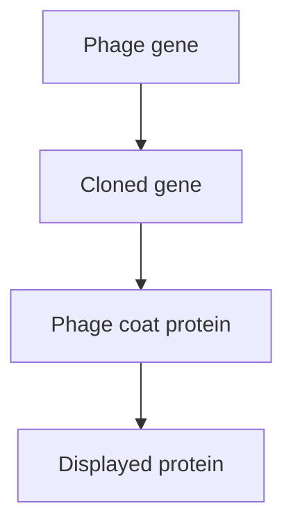
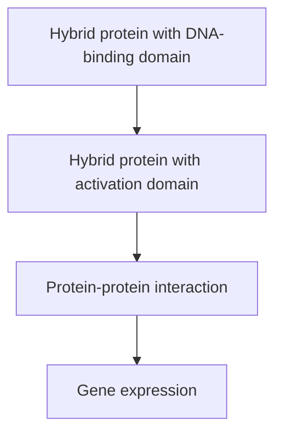
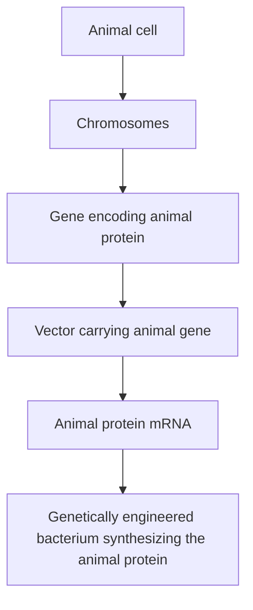
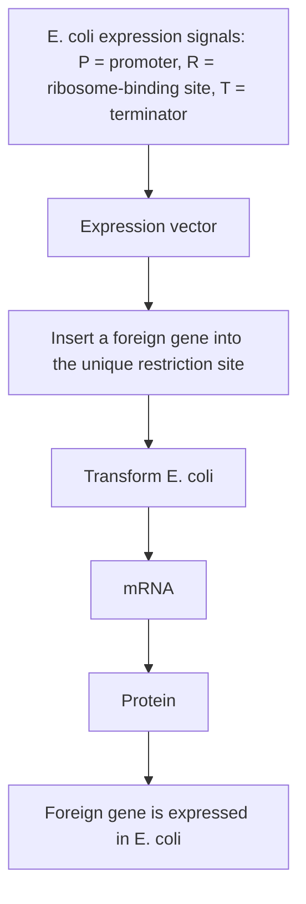
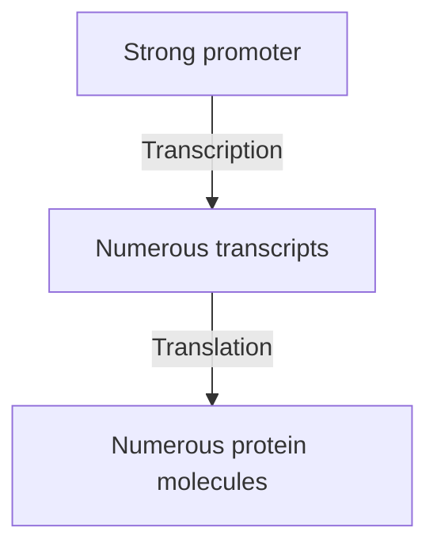
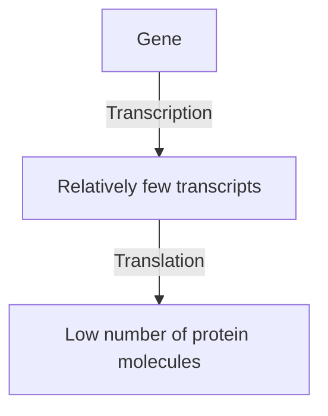
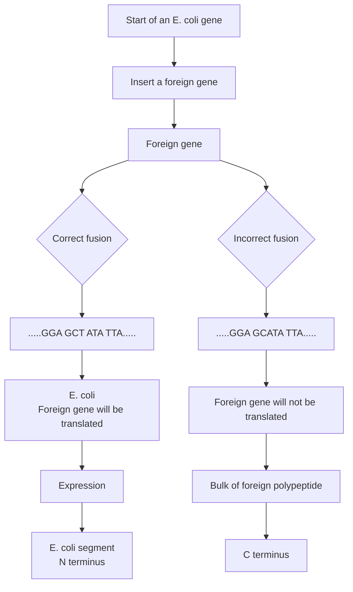

another in biochemical pathways and in multiprotein complexes. Three techniques, **phage display**, the **yeast two‐hybrid system**, and the use of a **functional protein array**, enable these protein–protein interactions to be examined.

## Phage display

This technique is called phage display because it involves the ‘display’ of proteins on the surface of a bacteriophage, usually M13 (Figure 13.12a). This is achieved by cloning the gene for the protein in a special type of M13 vector, one that results in the cloned gene becoming fused with a gene for a phage coat protein (Figure 13.12b). After transfection of E. coli, this gene fusion directs synthesis of a hybrid protein, made up partly of the coat protein and partly of the product of the cloned gene. With luck this hybrid protein will be inserted into the phage coat so that the product of the cloned gene is now located on the surface of the phage particles.

Normally this technique is carried out with a **phage display library** made up of many recombinant phages, each displaying a different protein. Large libraries can be prepared by cloning a mixture of cDNAs from a particular tissue or, less easily, by cloning genomic DNA fragments. The library

(a) Protein display on the surface of a phage

text_image

Displayed proteins

(b) Fusion between the cloned gene and a coat protein gene

flowchart

(c) Using a phage display library

flowchart

Figure 13.12

Phage display. (a) Display of proteins on the surface of a recombinant filamentous phage. (b) The gene fusion used to display a protein. (c) One way of detecting interactions between a test protein and phages from within a display library.

consists of phages displaying a range of different proteins and is used to identify those that interact with a test protein. This test protein could be a pure protein or one that is itself displayed on a phage surface. The protein is immobilized in the wells of a microtitre tray or on particles that can be  used in an affinity chromatography column, and then mixed with the phage display library (Figure 13.12c). Phages that are retained in the microtitre tray or within the column after a series of washes are ones that display proteins that interact with the immobilized test protein.

## The yeast two‐hybrid system

The yeast two‐hybrid system is very different to phage display. This procedure is based on research into the way in which regulatory proteins called transcription factors control gene expression in eukaryotic cells. A  transcription factor binds to the DNA upstream of a gene and then interacts with the RNA polymerase enzyme in order to activate transcription (Figure 13.13a). The two functions – DNA binding and polymerase activation  –  are specified by different parts of the transcription factor. Some transcription factors can be cut into two segments, one containing the DNA‐binding activity and the other containing the activation domain. In order to work in the cell, these two transcription factor segments must interact in some way.

## Figure 13.13

The yeast two‐hybrid system. (a) A typical yeast transcription factor has a DNA‐binding domain and an activation domain. (b) After the first cloning experiment, a hybrid protein that is part DNA‐binding domain is synthesized, but this cannot activate transcription. (c) After the second cloning experiment, a hybrid protein that is part activation domain is synthesized. If the two hybrid proteins can interact, then gene expression will occur

(a) A transcription factor

flowchart

(b) Result of the first cloning experiment

flowchart

(c) Result of the second cloning experiment

flowchart

The two‐hybrid system makes use of a Saccharomyces cerevisiae strain that lacks a transcription factor for a reporter gene. This gene is therefore switched off. To use the system, two yeast cloning experiments must be carried out. The first cloning experiment involves the gene for the target protein, the one whose interactions we wish to examine. This gene can come from any organism, not just yeast. The gene is ligated to a sequence specifying the DNA‐binding domain of a transcription factor, and the construct inserted into a suitable vector and cloned in yeast. Expression of the cloned gene gives rise to a hybrid protein, part target protein and part transcription factor. However, the recombinant yeasts that are produced are still not able to express the reporter gene, because this hybrid protein can only bind to the DNA upstream of the gene, it cannot activate the RNA polymerase (Figure 13.13b).

In the second cloning experiment, a second hybrid gene is constructed, this hybrid comprising the gene for a test protein (one that we think might interact with the target) ligated to a sequence coding for the activation domain of the transcription factor. This second construct is cloned into the yeast cells. If the target and test proteins are able to interact, then the DNA‐binding and polymerase activation components of the transcription factor become linked, and the reporter gene is expressed (Figure 13.13c). The second cloning experiment can involve a library of recombinants representing many different proteins, so that the interactions between the target protein and a variety of test proteins can be assayed in one experiment.

## Functional protein arrays

A protein array is similar to a DNA microarray (Section 13.1.1), the difference being that the immobilized molecules are proteins rather than oligonucleotides. A functional protein array is one specifically designed to enable protein interactions to be studied. A fluorescently labelled version of the test protein is applied to the array, and the positions of the resulting signals used to indicate those proteins on the array that interact with the test protein.

A functional protein array might appear to provide a straightforward means of identifying interactions between a test protein and a broad range of other proteins, but this is not yet a widely used method. One problem is that protein arrays are difficult to fabricate. There is no quick procedure for synthesizing proteins directly on to the array surface, equivalent to the construction of a DNA microarray by photolithography (see Figure 13.2). Each protein therefore has to be prepared, separated, and individually spotted onto the array. Also, some immobilized proteins have low stability, so the array must be stored carefully and used soon after preparation. For these reasons, phage display and the two-hybrid system remain the methods of choice for studying protein–protein interactions. Protein arrays are, however, popular for testing interactions between proteins and DNA fragments, for example to identify proteins that bind to a particular DNA sequence, and to identify proteins that bind to small molecules such as drugs. For these applications, there are no rapid alternatives equivalent to phage display and two‐hybrid testing.

## Further reading

- Aslam, B., Basit, M., Nisar, M.A., et al. (2017) Proteomics: technologies and their applications. Journal of Chromatographic Science, 55, 182–196. [Reviews all aspects of proteomics.]
- Bumgarner, R. (2013) DNA microarrays: types, applications and their future. Current Protocols in Molecular Biology, 22, Unit 22.1.
- Görg, A., Weiss, W., and Dunn, M.J. (2004) Current two‐dimensional electrophoresis technology for proteomics. Proteomics, 4, 3665–3685.
- Hu, S., Xie, Z., Qian, J., et al. (2011) Functional protein microarray technology. Wiley Interdisciplinary Reviews. Systems Biology and Medicine, 3, 255–268.
- Lowe, R., Shirley, N., Bleackley, M., et al. (2017) Transcriptomics technologies. PLoS Computational Biology, 13, e1005457. [Reviews all aspects of transcriptome analysis.]
- Mann, M., Hendrickson, R.C., and Pandey, A. (2001) Analysis of proteins and proteomes by mass spectrometry. Annual Reviews of Biochemistry, 70, 437–473.
- Pande, J., Szewczyk, M.M., and Grover, A.K. (2010) Phage display: concept, innovations, applications and future. Biotechnology Advances, 28, 849–858.
- Parrish, J.R., Gulyas, K.D., and Finley, R.L. (2006) Yeast two‐hybrid contributions to interactome mapping. Current Opinion in Biotechnology, 17, 387–393.
- Shiraki, T., Kondo, S., Katayama, S., et al. (2003) Cap analysis gene expression for high‐throughput analysis of transcriptional starting point and identification of promoter usage. Proceedings of the National Academy of Sciences, USA, 100, 15776–15781.
- Stark, R., Grzelak, M., and Hadfield, J. (2019) RNA sequencing: the teenage years. Nature Reviews Genetics, 20, 631–656.
- Stoughton, R.B. (2005) Applications of DNA microarrays in biology. Annual Review of Biochemistry, 74, 53–82.
- Sutandy, F.X.R., Qian, J., Chen, C.‐S., and Zhu, H. (2013) Overview of protein microarrays. Current Protocols in Protein Science, 27, Unit 27.1.
- Velculescu, V.E., Vogelstein, B., and Kinzler, K.W. (2000) Analysing uncharted transcriptomes with SAGE. Trends in Genetics, 16, 423–425.
- Wang, Z., Gerstein, M., and Snyder, M. (2009) RNA‐Seq: a revolutionary tool for transcriptomics. Nature Reviews Genetics, 10, 57–63.
- Zhang, Y., Fonslow, B.R., Shan, B., et al. (2013) Protein analysis by shotgun/bottom-up proteomics. Chemical Reviews, 113, 2343–2394. [Peptide mass fingerprinting.]

# PART III

The Applications of Gene Cloning and DNA Analysis in Biotechnology

**14** | Production of Protein from Cloned Genes 277
**15** |   Gene Cloning and DNA Analysis in Medicine 301
**16** |   Gene Cloning and DNA Analysis in Agriculture 327
**17** |   Gene Cloning and DNA Analysis in Forensic Science and Archaeology 355

## Chapter 14

# Production of Protein from Cloned Genes

## Chapter contents

## CHAPTER CONTENTS

**14.1** Special vectors for expression of foreign genes in E. coli 280
**14.2** General problems with the production of recombinant protein in E. coli 287
**14.3** Production of recombinant protein by eukaryotic cells 290

Now that we have covered the basic techniques involved in gene cloning and DNA analysis and examined how these techniques are used in research, we can move on to consider how recombinant DNA technology is being applied in biotechnology. This is not a new subject, although biotechnology has received far more attention during recent years than it ever has in the past. Biotechnology can be defined as the use of biological processes in industry and technology. According to archaeologists, the British biotechnology industry dates back 4000 years, to the late Neolithic period, when fermentation processes that make use of living yeast cells to produce ale and mead were first introduced into this country. Certainly, brewing was well established by the time of the Roman invasion.

During the $2 0 ^ { \mathrm { t h } }$ century, biotechnology expanded with the development of a variety of industrial uses for microorganisms. The discovery by Alexander Fleming in 1929 that the mould Penicillium synthesizes a potent

Figure 14.1

Two different systems for the growth of microorganisms.

(a) Batch culture.

(b) Continuous culture.

antibacterial agent led to the use of fungi and bacteria in the large‐scale production of antibiotics. At first the microorganisms were grown in large culture vessels from which the antibiotic was purified after the cells had been removed (Figure  14.1a), but this **batch culture** method has been largely supplanted by **continuous culture** techniques, making use of a **fermenter**, from which samples of medium can be continuously drawn off, providing a non‐stop supply of the product (Figure 14.1b). This type of process is not limited to antibiotic production and has also been used to obtain large amounts of other compounds produced by microorganisms (Table 14.1).

One of the reasons why biotechnology has received so much attention over the past three decades is because of gene cloning. Although many useful products can be obtained from microbial culture, the list in the past has been limited to those compounds naturally synthesized by microorganisms. Many important pharmaceuticals, which are produced not by microbes but by higher organisms, could not be obtained in this way. This has been changed by the application of gene cloning to biotechnology. The ability to clone genes means that a gene for an important animal or plant protein can now be taken from its normal host, inserted into a cloning vector, and introduced into a bacterium (Figure 14.2). If the manipulations are performed correctly the gene will be expressed and the **recombinant protein** synthesized by the bacterial cell. It may then be possible to obtain large amounts of the protein.

Of course, in practice the production of recombinant protein is not as easy as it sounds. Special types of cloning vector are needed, and satisfactory yields of recombinant protein are often difficult to obtain. In this chapter we will look at cloning vectors for recombinant protein synthesis and examine some of the problems associated with their use.

Table 14.1

Some of the compounds produced by industrial‐scale culture of microorganisms.

<table><tr><td>COMPOUND</td><td>MICROORGANISM</td></tr><tr><td colspan="2">Antibiotics</td></tr><tr><td>Cephalosporins</td><td>Cephalosporium spp.</td></tr><tr><td>Chloramphenicol, streptomycin</td><td>Streptomyces spp.</td></tr><tr><td>Gramicidins, polymixins</td><td>Bacillus spp.</td></tr><tr><td>Penicillins</td><td>Penicillium spp.</td></tr><tr><td colspan="2">Enzymes</td></tr><tr><td>Invertase</td><td>Saccharomyces cerevisiae</td></tr><tr><td>Proteases, amylases</td><td>Bacillus spp., Aspergillus spp.</td></tr><tr><td colspan="2">Other compounds</td></tr><tr><td>Acetone, butanol</td><td>Clostridium spp.</td></tr><tr><td>Alcohol</td><td>S. cerevisiae, Saccharomyces carlsbergensis</td></tr><tr><td>Butyric acid</td><td>Butyric acid bacteria</td></tr><tr><td>Citric acid</td><td>Aspergillus niger</td></tr><tr><td>Dextran</td><td>Leuconostoc spp.</td></tr><tr><td>Glycerol</td><td>S. cerevisiae</td></tr><tr><td>Vinegar</td><td>S. cerevisiae, acetic acid bacteria</td></tr></table>

flowchart

Figure 14.2

A possible scheme for the production of an animal protein by a bacterium.

## 14.1 Special vectors for expression of foreign genes in E. coli

If a foreign (i.e. non‐bacterial) gene is simply ligated into a standard vector and cloned in E. coli, it is very unlikely that a significant amount of recombinant protein will be synthesized. This is because expression is dependent on the gene being surrounded by a collection of signals that can be recognized by the bacterium. These signals, which are short sequences of nucleotides, advertise the presence of the gene and provide instructions for the transcriptional and translational apparatus of the cell. The three most important signals for E. coli genes are as follows (Figure 14.3):

• The **promoter**, which marks the point at which transcription of the gene should start. In E. coli, the promoter is recognized by the σ subunit of the transcribing enzyme RNA polymerase.
• The **terminator**, which marks the point at the end of the gene where transcription should stop. A terminator is usually a nucleotide sequence that can base pair with itself to form a stem‐loop structure.
• The **ribosome‐binding site**, a short nucleotide sequence recognized by the ribosome as the point at which it should attach to the mRNA molecule. The initiation codon of the gene is always a few nucleotides downstream of this site.

The genes of higher organisms are also surrounded by expression signals, but their nucleotide sequences are not the same as the E. coli versions. This is illustrated by comparing the promoters of E. coli and animal genes (Figure 14.4). There are similarities, but it is unlikely that an E. coli RNA polymerase would be able to attach to an animal promoter. A foreign gene is inactive in E. coli, simply because the bacterium does not recognize its expression signals.

text_image

Promoter
Ribosome-binding site
Gene
Terminator
DNA
RNA transcript
Point at which a ribosome binds to the mRNA

Figure 14.3

The three most important signals for gene expression in E. coli.

A solution to this problem would be to insert the foreign gene into the vector in such a way that it is placed under control of a set of E. coli expression signals. If this can be achieved, then the gene should be transcribed and translated (Figure  14.5). Cloning vectors that provide these signals, and can therefore be used in the production of recombinant protein, are called **expression vectors**.

Figure 14.4

Typical promoter sequences for E. coli and animal genes.

## 14.1.1 The promoter is the critical component of an expression vector

The promoter is the most important component of an expression vector. This is because the promoter controls the very first stage of gene expression (attachment of an RNA polymerase enzyme to the DNA) and determines the rate at which mRNA is synthesized. The amount of recombinant protein obtained therefore depends to a great extent on the nature of the promoter carried by the expression vector.

## The promoter must be chosen with care

The two sequences shown in Figure 14.4a are consensus sequences, averages of all the E. coli promoter sequences that are known. Although most

flowchart

The use of an expression vector to achieve expression of a foreign gene in E. coli.

(a) A strong promoter

flowchart

(b) A weak promoter

flowchart

Figure 14.6

Strong and weak promoters.

E. coli promoters do not differ much from these consensus sequences (e.g. TTTACA instead of TTGACA), a small variation may have a major effect on the efficiency with which the promoter can direct transcription. **Strong promoters** are those that can sustain a high rate of transcription, and usually control genes whose translation products are required in large amounts by the cell (Figure  14.6a). In contrast, **weak promoters**, which are relatively inefficient, direct transcription of genes whose products are needed in only small amounts (Figure 14.6b). Clearly an expression vector should carry a strong promoter, so that the cloned gene is transcribed at the highest possible rate.

A second factor to be considered when constructing an expression vector is whether it will be possible to regulate the promoter in any way. Two major types of gene regulation are recognized in E. coli – **induction** and **repression**. An inducible gene is one whose transcription is switched on by addition of a chemical to the growth medium. Often this chemical is one of the substrates for the enzyme coded by the inducible gene (Figure 14.7a). In contrast, a repressible gene is switched off by addition of the regulatory chemical (Figure 14.7b).

Gene regulation is a complex process that only indirectly involves the promoter itself. However, many of the sequences important for induction and repression lie in the region surrounding the promoter and are therefore also present in an expression vector. It may therefore be possible to extend the regulation to the expression vector, so that the chemical that induces or represses the gene normally controlled by the promoter is also able to regulate expression of the cloned gene. This can be a distinct advantage in the production of recombinant protein. For example, if the recombinant protein has a harmful effect on the bacterium, then its synthesis must be carefully monitored to prevent accumulation of toxic levels. This can be achieved by judicious use of the regulatory chemical to control expression of the cloned gene. Even if the recombinant protein has no harmful effects on the host cell, regulation of the cloned gene is still desirable, as a continuously high level of transcription may affect the ability of the recombinant plasmid to replicate, leading to its eventual loss from the culture.

Figure 14.7

Examples of the two major types of gene regulation that occur in bacteria. (a) An inducible gene.

(b) A repressible gene.

## Examples of promoters used in expression vectors

Several E. coli promoters combine the desired features of strength and ease of regulation. Those most frequently used in expression vectors are as follows:

• The **lac promoter** (Figure 14.8a) is the sequence that controls transcription of the lacZ gene coding for β‐galactosidase (and also the lacZ′ gene fragment carried by the pUC and M13mp vectors; Section 5.2.2). The lac promoter is induced by isopropylthiogalactoside (IPTG), so addition of this chemical into the growth medium switches on transcription of a gene inserted downstream of the lac promoter carried by an expression vector.
• The **trp promoter** (Figure 14.8b) is normally upstream of the cluster of genes coding for several of the enzymes involved in biosynthesis of the amino acid tryptophan. The trp promoter is repressed by tryptophan but is more easily induced by 3‐β‐indoleacrylic acid.
• The **tac promoter** (Figure 14.8c) is a hybrid between the trp and lac promoters. It is stronger than either, but still induced by IPTG.
• The $\lambda P _ { _ { L } }$ **promoter** (Figure 14.8d) is one of the promoters responsible for transcription of the λ DNA molecule. $\lambda \mathrm { P _ { L } }$ is a very strong promoter

Figure 14.8

Five promoters frequently used in expression vectors. The lac and trp promoters are shown upstream of the genes that they normally control in E. coli.

that is recognized by the E. coli RNA polymerase, which is subverted by λ into transcribing the bacteriophage DNA. The promoter is repressed by the product of the λcI gene. Expression vectors that carry the $\lambda \mathrm { P _ { L } }$ promoter are used with a mutant E. coli host that synthesizes a temperature‐sensitive form of the cI protein (Section 3.3.1). At a low temperature (less than $3 0 ^ { \circ } \mathrm { C } )$ this mutant cI protein is able to repress the $\lambda \mathrm { P _ { L } }$ promoter, but at higher temperatures the protein is inactivated, resulting in transcription of the cloned gene.

• The **T7 promoter** (Figure 14.8e) is specific for the RNA polymerase coded by T7 bacteriophage. This RNA polymerase is much more active than the E. coli RNA polymerase, which means that a gene inserted downstream of the T7 promoter will be expressed at a high level. The gene for the T7 RNA polymerase is not normally present in the E. coli genome, so a special strain of E. coli is needed, one which is lysogenic for T7 phage. Remember that a lysogen contains an inserted copy of the phage DNA in its genome (Section 2.2.2). In this particular strain of E. coli, the phage DNA has been altered by placing a copy of the lac promoter upstream of its gene for the T7 RNA polymerase. Addition of IPTG to the growth medium therefore switches on synthesis of the T7 RNA polymerase, which in turn leads to activation of the gene carried by the T7 expression vector.

flowchart

Figure 14.9

A typical cassette vector and the way it is used. P = promoter, R = ribosome binding site, T = terminator.

## 14.1.2 Cassettes and gene fusions

An efficient expression vector requires not only a strong, regulatable promoter, but also an E. coli ribosome binding sequence and a terminator. In most vectors these expression signals form a cassette, so called because the foreign gene is inserted into a single‐copy restriction site present in the middle of the expression signal cluster (Figure 14.9). Ligation of the foreign gene into the cassette therefore places it in the ideal position relative to the expression signals.

With some cassette vectors the cloning site is not immediately adjacent to the ribosome binding sequence, but instead is preceded by a segment from the beginning of an E. coli gene (Figure 14.10). Insertion of the foreign gene into this restriction site must be performed in such a way as to fuse the two reading frames, producing a hybrid gene that starts with the  E. coli segment and progresses without a break into the codons of

flowchart

Figure 14.10

The construction of a hybrid gene and the synthesis of a fusion protein.

## Figure 14.11

A problem caused by secondary structure at the start of an mRNA.

text_image

Ribosome binding
site is obscured
Base-pairing
5'
3'

the foreign gene. The product of gene expression is therefore a hybrid or **fusion protein**, consisting of the short peptide coded by the E. coli reading frame fused to the amino‐terminus of the foreign protein. This fusion system has four advantages:

Efficient translation of the mRNA produced from the cloned gene depends not only on the presence of a ribosome‐binding site but is also affected by the nucleotide sequence at the start of the coding region. This is probably because secondary structures resulting from intrastrand base pairs could interfere with attachment of the ribosome to its binding site (Figure 14.11). This possibility is avoided if the pertinent region is made up entirely of natural E. coli sequences.
• The presence of the bacterial peptide at the start of the fusion protein may stabilize the molecule and prevent it from being degraded by the host cell. In contrast, foreign proteins that lack a bacterial segment are often destroyed by the host.
The bacterial segment may constitute a signal peptide, responsible for directing the E. coli protein to its correct position in the cell. If the signal peptide is derived from a protein that is exported by the cell (e.g. the products of the ompA or malE genes), the recombinant protein may itself be exported, either into the culture medium or into the periplasmic space between the inner and outer cell membranes. Export is desirable because it simplifies the problem of purification of the recombinant protein from the culture.
• The bacterial segment may also aid purification by enabling the fusion protein to be recovered by **affinity chromatography**. For example, fusions involving the E. coli glutathione‐S‐transferase protein can be purified by adsorption onto agarose beads carrying bound glutathione (Figure 14.12).

The disadvantage with a fusion system is that the presence of the E. coli segment may alter the properties of the recombinant protein. Methods for removing the bacterial segment are therefore needed. Usually this is achieved by treating the fusion protein with a chemical or enzyme that cleaves the polypeptide chain at or near the junction between the two components. For example, if a methionine is present at the junction, the fusion protein can be cleaved with cyanogen bromide, which cuts polypeptides specifically at methionine residues (Figure 14.13). Alternatively, enzymes such as thrombin (which cleaves adjacent to arginine residues) or factor Xa (which cuts after the arginine of Gly–Arg) can be used. The important consideration is that recognition sequences for the cleavage agent must not occur within the recombinant protein.