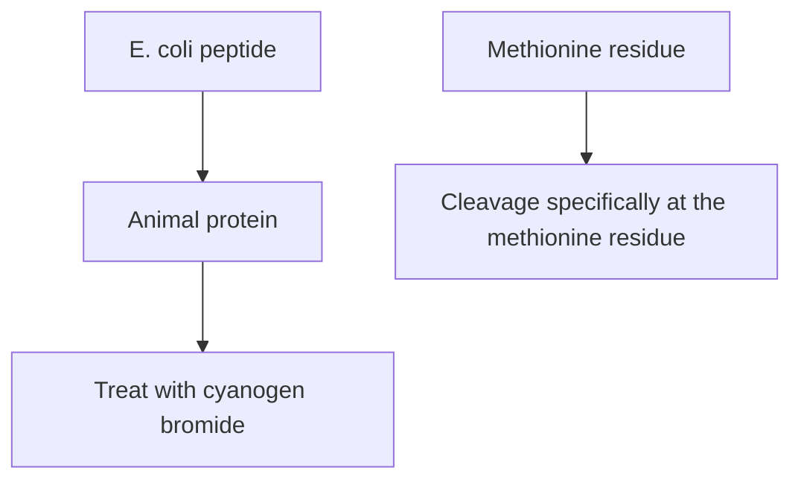
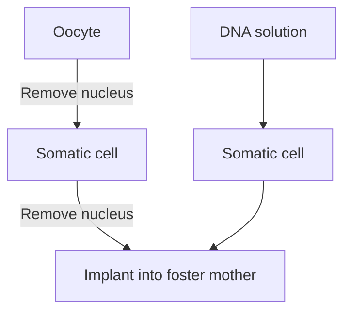
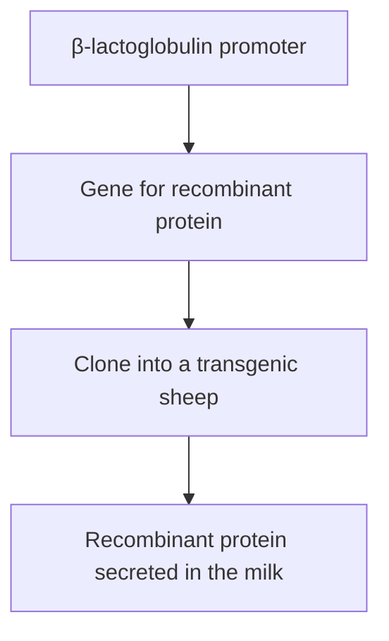

flowchart

Figure 14.12

The use of affinity chromatography to purify a glutathione‐S‐transferase fusion protein.

## 14.2 General problems with the production of recombinant protein in E. coli

Despite the development of sophisticated expression vectors, there are still numerous difficulties associated with the production of protein from foreign genes cloned in E. coli. These problems can be grouped into two categories: those that are due to the sequence of the foreign gene, and those that are due to the limitations of E. coli as a host for recombinant protein synthesis.

flowchart

Figure 14.13

One method for the recovery of the foreign polypeptide from a fusion protein. The methionine residue at the fusion junction must be the only one present in the entire polypeptide. If others are present cyanogen bromide will cleave the fusion protein into more than two fragments.

## 14.2.1 Problems resulting from the sequence of the foreign gene

There are three ways in which the nucleotide sequence might prevent efficient expression of a foreign gene cloned in E. coli:

• The foreign gene might contain introns. This would be a major problem, as E. coli genes do not contain introns and therefore the bacterium does not possess the necessary machinery for removing introns from transcripts (Figure 14.14a).

## Figure 14.14

Three of the problems that could be encountered when foreign genes are expressed in E. coli. (a) Introns are not removed in E. coli. (b) Premature termination of transcription. (c) A problem with codon bias.

• The foreign gene might contain sequences that act as termination signals in E. coli (Figure 14.14b). These sequences are perfectly innocuous in the normal host cell, but in the bacterium result in premature termination and a loss of gene expression.
The codon bias of the gene may not be ideal for translation in E. coli. As described in Section 12.1.1, although virtually all organisms use the same genetic code, each organism has a bias toward preferred codons. This bias reflects the efficiency with which the tRNA molecules in the organism are able to recognize the different codons. If a cloned gene contains a high proportion of disfavoured codons, the E. coli tRNAs may encounter difficulties in translating the gene, reducing the amount of protein that is synthesized (Figure 14.14c).

These problems can usually be solved, although the necessary manipulations may be time‐consuming and costly (an important consideration in an industrial project). If the gene contains introns then its complementary DNA (cDNA), prepared from the mRNA (Section 8.3.1) and so lacking introns, might be used as an alternative. In vitro mutagenesis could then be employed to change the sequences of possible terminators and to replace disfavoured codons with those preferred by E. coli. An alternative if the gene not too long is to make an artificial version (Section 11.3.2). This involves synthesizing a set of overlapping oligonucleotides that are ligated together, the sequences of the oligonucleotides being designed to ensure that the resulting gene contains preferred E. coli codons and that terminators are absent.

## 14.2.2 Problems caused by E. coli

Some of the difficulties encountered when using E. coli as the host for recombinant protein synthesis stem from inherent properties of the bacterium. For example:

E. coli might not process the recombinant protein correctly. The proteins of most organisms are processed after translation, by chemical modification of amino acids within the polypeptide. Often these processing events are essential for the correct biological activity of the protein. Unfortunately, the proteins of bacteria and higher organisms are not processed identically. In particular, some animal proteins are glycosylated, meaning that they have chains of sugar groups, called glycans, attached to them after translation. Glycosylation is extremely uncommon in bacteria and recombinant proteins synthesized in E. coli are never glycosylated correctly.
E. coli might not fold the recombinant protein correctly, and generally is unable to synthesize the disulphide bonds present in many animal proteins. If the protein does not take up its correctly folded tertiary structure, then usually it is insoluble and forms an **inclusion body** within the bacterium (Figure 14.15). Recovery of the protein from the inclusion body is not a problem but converting the protein into its correctly folded form can be difficult or impossible in the test tube. Under these circumstances the protein is, of course, inactive.

Figure 14.15 Inclusion bodies.

text_image

E. coli cell
Inclusion body
Nucleoid

• E. coli might degrade the recombinant protein. Exactly how E. coli can recognize the foreign protein, and thereby subject it to preferential turnover, is not known.

These problems are less easy to solve than the sequence problems described in the previous section but can be alleviated to a certain extent by using special E. coli strains.

Degradation of recombinant proteins can be reduced by using a mutant E. coli strain that is deficient in one or more of the proteases responsible for protein degradation. Correct folding of recombinant proteins can also be promoted by choosing a special host strain, in this case one that oversynthesizes the chaperone proteins thought to be responsible for protein folding in the cell. But the main drawback is the absence of glycosylation. Attempts have been made to solve this problem with E. coli strains that contain cloned genes for enzymes that carry out glycosylation in other organisms. These include Campylobacter jejuni, one of the few bacteria that has any glycosylation activity. Although initial results with these glycosylation‐competent E. coli strains have been promising, it will be some time before they can be used routinely for the production of recombinant protein.

## 14.3 Production of recombinant protein by eukaryotic cells

The problems associated with obtaining high yields of active recombinant proteins from genes cloned in E. coli have led to the development of expression systems for other organisms. There have been a few attempts to use other bacteria as the hosts for recombinant protein synthesis, and some progress has been made with Lactococcus lactis and with Bacillus and Pseudomonas species, but the main alternatives to E. coli are microbial eukaryotes. The argument is that a microbial eukaryote, such as a yeast or filamentous fungus, is more closely related to an animal, and so may be able to deal with recombinant protein synthesis more efficiently than E. coli. Yeasts and fungi can be grown just as easily as bacteria in continuous culture and might express a cloned gene from a higher organism, and process the resulting protein, in a manner more akin to that occurring in the higher organism itself.

## 14.3.1 Recombinant protein from yeast and filamentous fungi

To a large extent the potential of microbial eukaryotes has been realized and these organisms are now being used for the routine production of several animal proteins. Expression vectors are still required because it turns out that the promoters and other expression signals for animal genes do not, in general, work efficiently in these lower eukaryotes. The vectors themselves are based on those described in Section 7.1.

Saccharomyces cerevisiae as the host for recombinant protein synthesis The yeast Saccharomyces cerevisiae is currently the most popular microbial eukaryote for recombinant protein production. Cloned genes are often placed under the control of the GAL10 promoter (Figure 14.16), which is normally upstream of the gene for UDP‐galactose epimerase, an enzyme involved in the metabolism of galactose. The GAL10 promoter is induced by galactose, providing a straightforward system for regulating expression of a cloned foreign gene. Other useful promoters are PHO5, which is regulated by the phosphate level in the growth medium, and CUP1, which is induced by copper. Most yeast expression vectors also carry a termination sequence from an S. cerevisiae gene, because animal termination signals do not work effectively in yeast.

Yields of recombinant protein are relatively high, but the use of S. cerevisiae does not fully solve the glycosylation problem. The organism is capable of carrying out glycosylation, but the glycans that it makes do not have the same structure as those found on human proteins. One problem is that yeast glycans are hyperglycosylated – they contain many more sugar units than a mammalian glycan (Figure 14.17). This is a critical problem as a hyperglycosylated protein is likely to be recognized as foreign if injected into an animal and will therefore cause an immunogenic reaction. This problem has stimulated extensive research into the biochemistry and genetics of the glycosylation pathways in S. cerevisiae, and the resulting information has been used to create mutant strains that lack the enzymes responsible for hyperglycosylation, and hence make glycans that more closely resemble the mammalian versions. Further fine‐tuning of glycan structure has been achieved by cloning human genes, specifying the enzymes responsible for the final steps of the mammalian glycosylation pathway, into yeast.

Despite these drawbacks, S. cerevisiae remains the most frequently used microbial eukaryote for recombinant protein synthesis. This is partly because S. cerevisiae is accepted as a safe organism for production of proteins for use in medicines or in foods, and partly because of the wealth of knowledge built up over the years regarding the biochemistry and genetics of S. cerevisiae, which means that it is relatively easy to devise strategies for minimizing those difficulties that arise.

flowchart

Figure 14.16

The GAL10 promoter.

chemical

Diagram showing Asn- and S. cerevisiae genetic structures with sugar binding sites

Figure 14.17

Comparison between a typical glycosylation structure found on an animal protein and the hyperglycosylated structure synthesized by S. cerevisiae.

## Other yeasts and fungi

Although S. cerevisiae retains the loyalty of many molecular biologists, there are other microbial eukaryotes that might be equally if not more effective in recombinant protein synthesis. In particular, Pichia pastoris, a second species of yeast, is able to synthesize large amounts of recombinant protein, up to 30% of the total cell protein under ideal conditions. As with S. cerevisiae, the glycosylation process in P. pastoris is dissimilar to that in mammalian cells, but again this is being addressed with mutant strains and ones that contain cloned genes for mammalian glycosylation enzymes. Expression vectors for P. pastoris make use of the alcohol oxidase (AOX) promoter (Figure 14.18a), which is induced by methanol. The only significant problem with P. pastoris is that it sometimes degrades recombinant proteins before they can be purified, but this can be controlled by using special growth media. Other yeasts that have been used for recombinant protein synthesis include Hansenula polymorpha, Yarrowia lipolytica, and Kluveromyces lactis. The last of these has the attraction that it can be grown on waste products from the food industry.

A general problem with the use of yeast species for recombinant protein production is that most of these organisms lack an efficient system for secreting proteins into the growth medium. In the absence of secretion, recombinant proteins are retained in the cell and consequently are less easy to purify. This has led to interest in the filamentous fungi, as many of these have strong natural secretory properties. The most popular filamentous fungi for recombinant protein production are the Aspergillus species and  the wood‐rot fungus Trichoderma reesei. Expression vectors for

Figure 14.18

Three promoters frequently used in expression factors for microbial eukaryotes.

A.  nidulans usually carry the glucoamylase promoter (Figure  14.18b), induced by starch and repressed by xylose. Those for T. reesei make use of  the cellobiohydrolase promoter (Figure  14.18c), which is induced by cellulose.

## 14.3.2 Using animal cells for recombinant protein production

The difficulties inherent in synthesis of a fully active animal protein in a microbial host have prompted biotechnologists to explore the possibility of using animal cells for recombinant protein synthesis. For proteins with complex and essential glycosylation structures, an animal cell might be the only type of host within which the active protein can be synthesized.

## Protein production in mammalian cells

Culture systems for animal cells have been around since the early 1960s, but only during the past 25 years have methods for large‐scale continuous culture become available. A problem with some animal cell lines is that they require a solid surface on which to grow, adding complications to the design of the culture vessels. One solution is to fill the inside of the vessel with plates, providing a large surface area, but this has the disadvantage that complete and continuous mixing of the medium within the vessel becomes very difficult. A second possibility is to use a standard vessel but to provide the cells with small inert particles (e.g. cellulose beads) on which to grow. However, these issues are becoming less important as suspensionadapted versions of the most popular mammalian cell lines have been developed. The biochemical and physiological changes underlying this adaptation have not been fully identified but appear to involve changes in cell‐to‐cell signalling pathways and production of extracellular proteins that hold the nonadapted cells together when they grow as a tissue. The adapted cells are able to grow in suspension without solid supports. Rates of growth and maximum cell densities are much less than can be achieved with microorganisms, limiting the yield of recombinant protein, but this can be tolerated if a mammalian cell line is the only way of obtaining the active protein.

Of course, gene cloning may not be necessary in order to obtain an animal protein from an animal cell culture. Nevertheless, expression vectors and cloned genes are still used to maximize yields, by placing the gene under control of a promoter that is stronger than the one to which it is normally attached. This promoter is often obtained from viruses such as SV40 (Section  7.3.2), cytomegalovirus (CMV), or Rous sarcoma virus (RSV). Mammalian cell lines derived from humans or hamsters have been used in synthesis of several recombinant proteins, and in most cases these proteins have been processed correctly and are indistinguishable from the non‐recombinant versions. However, this is the most expensive approach to recombinant protein production, especially as the possible co‐purification of viruses with the protein means that rigorous quality control procedures must be employed to ensure that the product is safe.

## Protein production in insect cells

Insect cells provide an alternative to mammalian cells for animal protein production. Insect cells do not behave in culture any differently to mammalian cells, but they have the great advantage that, thanks to a natural expression system, they can provide high yields of recombinant protein.

The expression system is based on the **baculoviruses**, a group of viruses that are common in insects but do not normally infect vertebrates. The baculovirus genome includes the polyhedrin gene, whose product accumulates in the insect cell as large nuclear inclusion bodies toward the end of the infection cycle (Figure  14.19). The product of this single gene frequently makes up over 50% of the total cell protein. Similar levels of protein production also occur if the polyhedrin gene is replaced by one for a recombinant protein. Baculovirus vectors have been successfully used in production of a number of mammalian proteins, but unfortunately the resulting proteins are not glycosylated correctly. In this regard the baculovirus system does not offer any advantages compared with S. cerevisiae or P. pastoris. However, the deficiencies in the insect glycosylation process can be circumvented by using a modified baculovirus that carries a mammalian promoter to express genes directly in mammalian cells. The infection is not **productive**, meaning that the virus genome is unable to replicate, but genes cloned into one of the **BacMam** vectors, as they are called, are maintained stably in mammalian cells for enough time for expression to

Figure 14.19

Crystalline inclusion bodies in the nuclei of insect cells infected with a baculovirus.

text_image

Cytoplasm
Nuclear
membrane
Inclusion
bodies

occur. This expression is accompanied by the mammalian cell’s own posttranslational processing activities, so the recombinant protein is correctly glycosylated and therefore should be fully active.

Of course, in nature baculoviruses infect living insects, not cell cultures. For example, one of the most popular baculoviruses used in cloning is the Bombyx mori nucleopolyhedrovirus (BmNPV), which is a natural pathogen of the silkworm. There is a huge conventional industry based on the culturing of silkworms for silk production, and this expertise is now being harnessed for production of recombinant proteins, using expression vectors based on the BmNPV genome. As well as being an easy and cheap means of obtaining proteins, silkworms have the additional advantage of not being infected by viruses that are pathogenic to humans. The possibility that dangerous viruses are co‐purified with the recombinant protein is therefore avoided.

## 14.3.3 Pharming – recombinant protein from live animals and plants

The use of silkworms for recombinant protein production is an example of the process often referred to as **pharming**, where a **transgenic** organism acts as the host for protein synthesis. Pharming is a recent and controversial innovation in gene cloning.

## Pharming in animals

A transgenic animal is one that contains a cloned gene in all of its cells. Knockout mice (Section 12.2.2), used to study the function of human and other mammalian genes, are examples of transgenic animals. With mice, a transgenic animal can be produced by microinjection of the gene to be cloned into a fertilized egg cell (Section  5.4.2). Although this technique works well with mice, injection of fertilized cells is inefficient or impossible with many other mammals, and generation of transgenic animals for recombinant protein production usually involves a more sophisticated procedure called **nuclear transfer** (Figure 14.20). This involves microinjection of the

flowchart

Figure 14.20

Transfer of the nucleus from a transgenic somatic cell to an oocyte.

Figure 14.21

Recombinant protein production in the milk of a transgenic sheep.

flowchart

recombinant protein gene into a somatic cell, which is a more efficient process than injection into a fertilized egg. Because the somatic cell will not itself differentiate into an animal, its nucleus, after microinjection, must be transferred to an oocyte whose own nucleus has been removed. After implantation into a foster mother, the engineered cell retains the ability of the original oocyte to divide and differentiate into an animal, one that will contain the transgene in every cell. This is a lengthy procedure and transgenic animals are therefore expensive to produce, but the technology is cost‐effective because once a transgenic animal has been made it can reproduce and pass its cloned gene to its offspring according to standard Mendelian principles.

Although proteins have been produced in the blood of transgenic animals, and in the eggs of transgenic chickens, the most successful approach has been to use farm animals such as sheep or pigs, with the cloned gene attached to the promoter for the animal’s β‐lactoglobulin gene. This promoter is active in the mammary tissue, which means that the recombinant protein is secreted in the milk (Figure 14.21). Milk production can be continuous during the animal’s adult life, resulting in a high yield of the protein. For example, the average cow produces some 8000 litres of milk per year, yielding 40–80 kg of protein. Because the protein is secreted, purification is relatively easy. Most importantly, sheep and pigs are mammals and so human proteins produced in this way are correctly modified. Production of pharmaceutical proteins in farm animals therefore offers considerable promise for synthesis of correctly modified human proteins for use in medicine.

## Recombinant proteins from plants

Plants provide the final possibility for production of recombinant protein. Plants and animals have similar protein processing activities, although there are slight differences in the glycosylation pathways. Plant cell culture is a well‐established technology that is already used in the commercial synthesis of natural plant products. Alternatively, intact plants can be grown to a high density in fields. The latter approach to recombinant protein production has been used with a variety of crops, such as maize, tobacco, rice, and sugarcane. One possibility is to place the transgene next to the promoter of a seed‐specific gene such as β‐phaseolin, which codes for the main seed protein of the bean Phaseolus vulgaris. The recombinant protein is therefore synthesized specifically in the seeds, which naturally accumulate large quantities of proteins and are easy to harvest and to process. Recombinant proteins have also been synthesized in the leaves of tobacco and alfalfa and the tubers of potatoes. In all of these cases, the protein has to be purified from the complex biochemical mixture that is produced when the seeds, leaves, or tubers are crushed.

One way of avoiding this problem is to express the recombinant protein as a fusion with a signal peptide that directs secretion of the protein by the roots. Although this requires the plants to be grown in hydroponic systems rather than in fields, the decrease in yield is at least partly offset by the low cost of purification. One promising system involves infection of the transgenic plant with Rhizobium rhizogenes, a soil bacterium that is closely related to Agrobacterium tumefaciens (Section  7.2.1) and until recently was called Agrobacterium rhizogenes. Infection with R. rhizogenes results in hairy root disease, typified by a massive proliferation of a highly branched root system that can be grown at high density in liquid culture, increasing significantly the yield of a recombinant protein that is being secreted by the roots of a transgenic plant.

Whichever production system is used, plants offer a cheap and low‐technology means of mass production of recombinant proteins. A range of proteins have been produced in experimental systems, including important pharmaceuticals such as interleukins and antibodies. This is an area of intensive research at the present time, with a number of plant biotechnology companies developing systems that have reached or are nearing commercial production. One very promising possibility is that plants could be used to synthesize vaccines, providing the basis to a cheap and efficient vaccination program (Section 15.1.5).

## Ethical concerns raised by pharming

With our discussion of pharming we have entered one of the areas of gene cloning that causes concern among the public. No student of gene cloning and DNA analysis should ignore the controversies raised by the genetic manipulation of animals and plants but, equally, no textbook on the subject should attempt to teach the ‘correct’ response to these ethical concerns. You must make up your own mind on such matters.

With transgenic animals, one of the fears is that the procedures used might cause suffering. These concerns do not centre on the recombinant protein, but on the manipulations that result in production of the transgenic animal. Animals produced by nuclear transfer suffer a relatively high frequency of birth defects, and some of those that survive do not synthesize the required protein adequately, meaning that this type of pharming is accompanied by a high ‘wastage’. Even the healthy animals appear to suffer from premature aging, as was illustrated most famously by ‘Dolly the sheep’ who, although not transgenic, was the first animal to be produced by nuclear transfer. Most sheep of her breed live for up to 12 years, but Dolly developed arthritis at the age of 5 years and was euthanized one year later because she was found to be suffering from terminal lung disease, which is normally found only in old sheep. It has been speculated that this premature aging was related to the age of the somatic cell whose nucleus gave rise to Dolly, as this cell came from a six‐year‐old sheep and so Dolly was effectively aged six when she was born. Although the technology has moved on dramatically since Dolly was born in 1997, the welfare issues regarding transgenic animals have not been resolved, and the broader issues concerning the use of nuclear transfer to clone animals (i.e. to produce identical offspring, rather than to clone individual genes) remain at the forefront of public awareness.

Pharming in plants raises a completely different set of ethical concerns, relating in part to the impact that genetically manipulated (GM) crops might have on human health and the environment. These concerns apply to all GM crops, not just those used for pharming, and we will return to them in Section 16.4 after we have examined the more general uses of gene cloning in agriculture.

## Further reading

- Ahmad, M., Hirz, M., Pichler, H., and Schwab, H. (2014) Protein expression in Pichia pastoris: recent achievements and perspectives for heterologous protein production. Applied Microbiology and Biotechnology, 98, 5301–5317.
- Çelik, E. and Çalik, P. (2012) Production of recombinant proteins by yeast cells. Biotechnology Advances, 30, 1108–1118.
- Chen, R. (2012) Bacterial expression systems for recombinant protein production: E. coli and beyond. Biotechnology Advances, 30, 1102–1107. [Includes information on recombinant production in bacteria other than E. coli.]
- de Boer, H.A., Comstock, L.J., and Vasser, M. (1983) The tac promoter: a functional hybrid derived from the trp and lac promoters. Proceedings of the National Academy of Sciences of the USA, 80, 21–25.
- Drugmand, J.‐C., Schneider, Y.‐J., and Agathos, S.N. (2012) Insect cells as factories for biomanufacturing. Biotechnology Advances, 30, 1140–1157.
- Egelkrout, E., Rajan, V., and Howard, J.A. (2012) Overproduction of recombinant proteins in plants. Plant Science, 184, 83–101.
- Gomes, A.M.V., Carmo, T.S., Carvalho, L.S., et al. (2018) Comparison of yeasts as hosts for recombinant protein production. Microorganisms, 6, 38.
- Guillon, S., Trémouillaux‐Guiller, J., Pati, P.K., et al. (2006) Hairy root research: recent scenario and exciting prospects. Current Opinion in Plant Biology, 9, 341–346. [Applications of Rhizobium rhizogenes in biotechnology.]
- Houdebine, L.‐M. (2009) Production of pharmaceutical proteins by transgenic animals. Comparative Immunology, Microbiology and Infectious Diseases, 32, 107–121.
- Huang, C.‐J., Lin, H., and Yang, X. (2012) Industrial production of recombinant therapeutics in Escherichia coli and its recent advancements. Journal of Industrial Microbiology and Biotechnology, 39, 383–399.
- Hunter, M., Yuan, P., Vavilala, D., and Fox, M. (2018) Optimization of protein expression in mammalian cells. Current Protocols in Protein Science, 95, e77.
- Kost, T.A., Condreay, J.P., and Jarvis, D.L. (2005) Baculovirus as versatile vectors for protein expression in insect and mammalian cells. Nature Biotechnology, 23, 567–575.
- Nevalainen, H. and Peterson, R. (2014) Making recombinant proteins in filamentous fungi – are we expecting too much? Frontiers in Microbiology, 5, 75.
- Remaut, E., Stanssens, P., and Fiers, W. (1981) Plasmid vectors for high‐efficiency expression controlled by the P promoter of coliphage. Gene, 15, 81–93. [Construction of an expression vector.]
- Rosano, G.L. and Ceccarelli, E.A. (2014) Recombinant protein expression in Escherichia coli: advances and challenges. Frontiers in Microbiology, 5, 172.
- Schillberg, S., Raven, N., Spiegel, H., et al. (2019) Critical analysis of the commercial potential of plants for the production of recombinant proteins. Frontiers in Plant Science, 10, 720.
- Ward, O.P. (2012) Production of recombinant proteins by filamentous fungi. Biotechnology Advances, 30, 1119–1139.
- Wildt, S. and Gerngross, T.U. (2005) The humanization of N‐glycosylation pathways in yeast. Nature Reviews Microbiology, 3, 119–128.
- Wilmut, I., Schnieke, A.E., McWhir, J., et al. (1997) Viable offspring derived from fetal and adult mammalian cells. Nature, 385, 810–813. [The method used to produce Dolly the sheep.]
- Xu, J., Dolan, M., Medrano, G., et al. (2012) Green factory: plants as bioproduction platforms for recombinant proteins. Biotechnology Advances, 30, 1171–1184.
- Yang, Z. and Zhang, Z. (2018) Engineering strategies for enhanced production of protein and bio‐products in Pichia pastoris: a review. Biotechnology Advances, 36, 182–195.
- Zhu, J. (2012) Mammalian cell protein expression for biopharmaceutical production. Biotechnology Advances, 30, 1158–1170.

## Chapter 15

# Gene Cloning and DNA Analysis in Medicine

## Chapter contents

**15.1** Production of recombinant pharmaceuticals 301
**15.2** Identification of genes responsible for human diseases 314
**15.3** Gene therapy 321

Medicine has been and will continue to be a major beneficiary of the recombinant DNA revolution, and an entire book could be written on this topic. Later in this chapter, we will see how recombinant DNA techniques are being used to identify genes responsible for inherited diseases and to devise new therapies for these disorders. First, we will continue the theme developed in the last chapter and examine the ways in which cloned genes are being used in the production of recombinant pharmaceuticals.

## 15.1 Production of recombinant pharmaceuticals

A number of human disorders can be traced to the absence or malfunction of a protein normally synthesized in the body. Most of these disorders can be treated by supplying the patient with the correct version of the protein, but for this to be possible the relevant protein must be available in relatively large amounts. If the defect can be corrected only by administering the human protein, then obtaining sufficient quantities will be a major problem unless donated blood can be used as the source. Animal proteins are therefore used whenever these are effective, but there are not many disorders that can be treated with animal proteins, and there is always the possibility of side effects such as an immunogenic response.

We learned in Chapter 14 that gene cloning can be used to obtain large amounts of recombinant human proteins. How are these techniques being applied to the production of proteins for use as pharmaceuticals?

## 15.1.1 Recombinant insulin

Insulin, synthesized by the β‐cells of the islets of Langerhans in the pancreas, controls the level of glucose in the blood. An insulin deficiency manifests itself as diabetes mellitus, a complex of symptoms which may lead to death if untreated. Fortunately, many forms of diabetes can be alleviated by a continuing program of insulin injections, thereby supplementing the limited amount of hormone synthesized by the patient’s pancreas. The insulin used in this treatment was originally obtained from the pancreas of pigs and cows slaughtered for meat production. Although animal insulin is generally satisfactory, problems may arise in its use to treat human diabetes. One problem is that the slight differences between the animal and the human proteins can lead to side effects in some patients. Another is that the purification procedures are difficult, and potentially dangerous contaminants cannot always be completely removed.

Insulin displays two features that facilitate its production by recombinant DNA techniques. The first is that the human protein is not modified after translation by glycosylation, which means that recombinant insulin synthesized by a bacterium should be active. The second advantage concerns the size of the molecule. Insulin is a relatively small protein, comprising two polypeptides, one of 21 amino acids (the A chain) and one of 30 amino acids (the B chain; Figure 15.1). In humans these chains are synthesized as a precursor called preproinsulin, which contains the A and B segments linked by a third chain (C) and preceded by a leader sequence. The leader sequence is removed after translation and the C chain excised, leaving the A and B polypeptides linked to each other by two disulphide bonds.

Several strategies have been used to obtain recombinant insulin. One of the first projects, involving synthesis of artificial genes for the A and B chains followed by production of fusion proteins in E. coli, illustrates a number of the general techniques used in recombinant protein production.

## Synthesis and expression of artificial insulin genes

In the late 1970s, the idea of making an artificial gene was extremely innovative. Oligonucleotide synthesis was in its infancy at that time, and  the available methods for making artificial DNA molecules were much  more cumbersome than the present‐day automated techniques. Nevertheless, genes coding for the A and B chains of insulin were synthesized as early as 1978.

The procedure used was to synthesize trinucleotides representing all the possible codons and then join these together in the order dictated by the