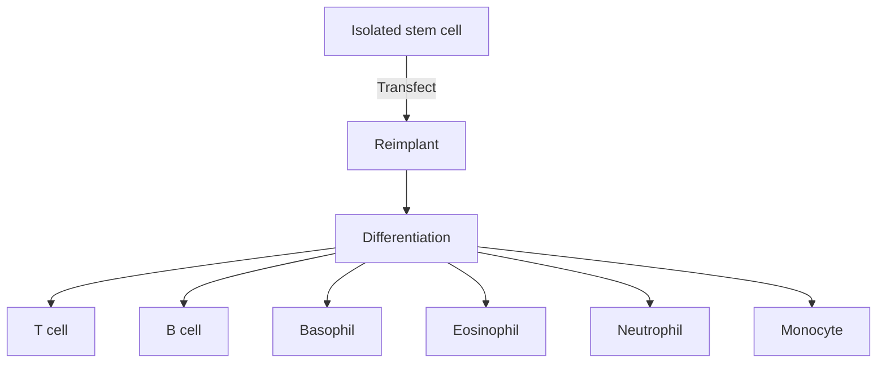
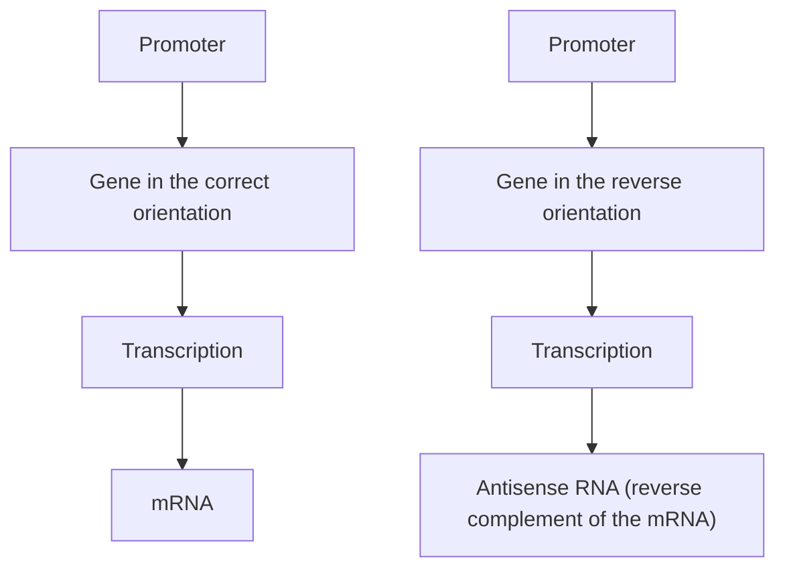
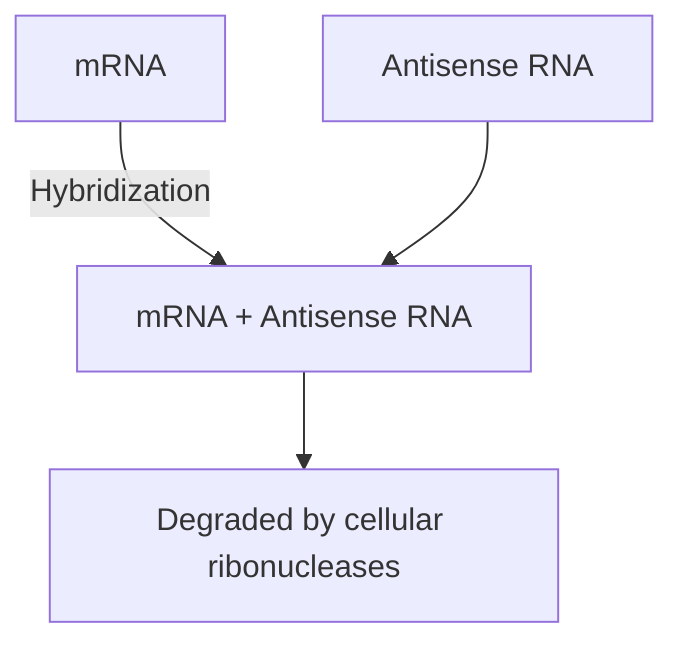
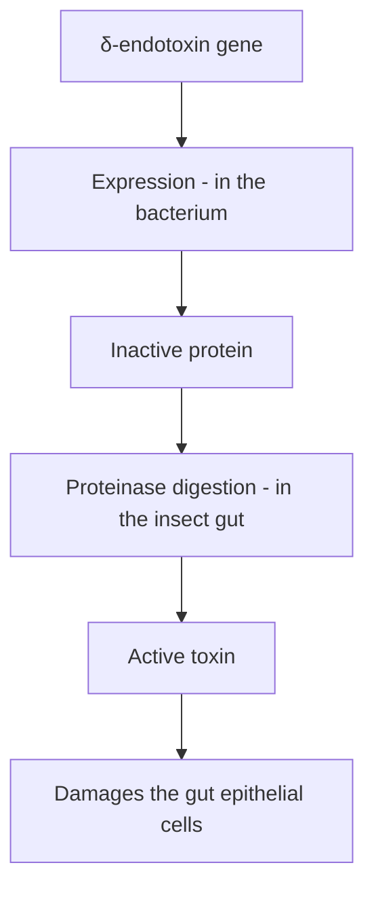

text_image

Chromosome 17
(83 Mb)
D17S1321
BRCA1
D17S1325

Figure 15.14

Mapping the breast cancer susceptibility gene BRCA1. Initially the gene was mapped to a segment of the left arm of chromosome 17, between map positions q12 and q23 (highlighted region in the left drawing). Additional mapping experiments narrowed this down to a 600 kb region flanked by two STR loci, D17S1321 and D17S1325 (middle drawing). After examination of expressed sequences, a strong candidate for BRCA1 was eventually identified (right drawing).

(Section 12.1.2). The rationale is that a human gene that is important enough to cause disease when mutated will almost certainly have homologues in a range of other mammals. The same analysis can be carried out by Southern hybridization of the DNA from the related species (these are called **zoo blots**). If a homologue is present in these DNA samples then it will be detectable by hybridization with a probe designed from the human gene, even though the homologous gene has a slightly different sequence from the human version.

The gene sequences could be examined in individuals with and without the disease, to see if the genes from affected individuals contain mutations that might explain why they have the disease.
To confirm the identity of a candidate gene, it might be possible to prepare a knockout mouse (Section 12.2.2) that has an inactive version of the equivalent mouse gene. If the knockout mouse displays symptoms compatible with the human disease, then the candidate gene is almost certainly the correct one.

When applied to the region between D17S1321 and D17S1325, these analyses resulted in identification of an approximately 100 kb gene, made up of 22 exons and coding for an 1863 amino acid protein, which was a strong candidate for BRCA1. Transcripts of the gene were detectable in breast and ovary tissues, and homologues were present in mice, rats, rabbits, sheep, and pigs, but not chickens. Most importantly, the genes from five susceptible families contained mutations (such as frameshift and non-sense mutations) likely to lead to a non‐functioning protein. Although circumstantial, the evidence in support of the candidate was sufficiently overwhelming for this gene to be identified as BRCA1. Subsequent research has shown that both this gene and BRCA2, a second gene associated with susceptibility to breast cancer, are involved in transcription regulation and DNA repair, and that both act as tumour suppressor genes, inhibiting abnormal cell division.

## 15.2.2 Genetic typing of disease mutations

There are thought to be over 10 000 **monogenic** inherited diseases, ones that result from mutation of a single gene. For many of these, the underlying mutations have been identified by projects similar to the one described above for the breast cancer gene BRCA1. A typical situation is that a single disease can be caused by any one of several mutations in the causative gene, the frequency of each mutation varying in the human population as a whole. For example, cystic fibrosis can be caused by any one of 1700 different mutations in the cystic fibrosis transmembrane regulator (CFTR) gene. Each mutation affects the ability of the CFTR protein to control the movement of chloride ions into and out of cells, the resulting disruption to the physiological ion balance giving rise to cystic fibrosis. The most common of these 1700 mutations, a deletion of three nucleotides that results in loss of a single phenyalanine amino acid from the protein, accounts for approximately two‐thirds of all cystic fibrosis cases worldwide. At the other end of the spectrum there are rare CFTR mutations that are found in only a few people.

If the mutations that are responsible for a genetic disease are known, then it is straightforward to devise a test to determine if a person possesses any of those mutations. For cystic fibrosis, the standard screening method involves a series of PCRs that span the entire coding region of the CFTR gene, followed by sequencing of the PCR products to identify the nucleotides present at the mutation sites. The health services of most countries provide genetic screening for many of the commonest inherited diseases, though usually screening is only carried out when there is a definite reason for doing so. The commonest example is when the doctor wishes to carry out a diagnosis because they suspect that a patient is in the early stage of a genetic disease. Prospective parents might also be tested if there is a history of a particular disease in their families, so the risk of a child inheriting the disease can be estimated, and in similar cases prenatal screening can be performed to test the actual disease status of an unborn child. An important principle is that such testing should be accompanied by robust **genetic counselling**, so that the patient or parents fully understand the meaning of a positive test result. This is especially important in those cases where a mutation does not result in the immediate manifestation of the disease symptoms, but only increases susceptibility to the disease, which might not be expressed until late in life or not at all.

In recent years there has been a proliferation of companies that offer direct‐to‐customer genetic screening, the purchaser of the service providing a DNA sample, usually in the form of a mouth swab containing cheek cells, and in return receiving a description of their mutation status for a range of diseases. The services offered by different companies vary, but typically these include typing of the BRCA1 and BRCA2 breast cancer susceptibility genes, as well as genes associated with heart disease, anaemia,

Alzheimer’s disease, and Parkinson’s disease. The nature of these services raises the concern that the customer receives the results by mail, and so does not have immediate access to genetic counselling, as is the case when the tests are done by healthcare professionals. The companies offering the services have attempted to mitigate this problem by providing detailed written information on the interpretation of test results, along with advice regarding how to seek professional help if appropriate.

A second area of concern is the impact that genetic test results could have on the ability of an individual to purchase life insurance, or the amount of the premiums that are required if a policy is arranged. In the UK, insurance companies are allowed to use the results of diagnostic genetic testing in setting premiums for life insurance, the argument being that this type of DNA screening is equivalent to a blood test or other routine medical test. However, the results of predictive genetic testing, where the data relate to the future susceptibility of developing a disease, can only be used under certain circumstances, for example if the policy value is greater than £500 000. An exception is when a predictive test is in a person’s favour, in which case the applicant can submit evidence that they have not inherited the susceptibility mutations for a disease that runs in their family, in the hope that the insurance company will set the premium lower than would otherwise be the case. The UK Code of Genetics Testing and Insurance was first established in 2001 and is followed by all members of the Association of British Insurers. Several other countries have similar agreements.

## 15.3 Gene therapy

The final application of recombinant DNA technology in medicine that we will consider is **gene therapy**. This is the name originally given to methods that aim to cure an inherited disease by providing the patient with a correct copy of the defective gene. Gene therapy has now been extended to include attempts to cure any disease by introduction of a cloned gene into the patient. First, we will examine the techniques used in gene therapy, and then we will attempt to address the ethical issues.

## 15.3.1 Gene therapy for inherited diseases

There are two basic approaches to gene therapy: **germline therapy** and **somatic cell therapy**. In germline therapy, a fertilized egg is provided with a copy of the correct version of the relevant gene and reimplanted into the mother. If successful, the gene is present and expressed in all cells of the resulting individual. Germline therapy is usually carried out by microinjection of a somatic cell followed by nuclear transfer into an oocyte (Section  14.3.3), and theoretically could be used to treat any inherited disease.

Somatic cell therapy involves manipulation of cells, which either can be removed from the organism, transfected, and then placed back in the body, or transfected in situ without removal. The technique has most promise for

Figure 15.15

Differentiation of a transfected stem cell leads to the new gene being present in all the mature blood cells.

flowchart

inherited blood diseases (e.g. haemophilia and thalassaemia), with genes being introduced into stem cells from the bone marrow, which give rise to all the specialized cell types in the blood. The strategy is to prepare a bone extract containing several billion cells, transfect these with a retrovirus‐based vector, and then reimplant the cells. Subsequent replication and differentiation of transfectants leads to the added gene being present in all the mature blood cells (Figure 15.15). The advantage of a retrovirus is that this type of vector has an extremely high transfection frequency, enabling a large proportion of the stem cells in a bone marrow extract to receive the new gene.

Somatic cell therapy also has potential in the treatment of lung diseases such as cystic fibrosis, as DNA cloned in a virus vector (Section 7.3.2) or contained in liposomes (Section 5.4.1) is taken up by the epithelial cells in the lungs after introduction into the respiratory tract via an inhaler. However, turnover of the epithelial cells means that gene expression occurs for only a few weeks, and as yet this has not been developed into an effective means of treating cystic fibrosis.

With those genetic diseases where the defect arises because the mutated gene does not code for a functional protein, all that is necessary is to provide the cell with the correct version of the gene. Removal of the defective gene is unnecessary. The situation is less easy with dominant genetic diseases, as with these it is the defective gene product itself that is responsible for the disease state, and so the therapy must include not only addition of the correct gene but also removal of the defective version. This requires a  gene delivery system that promotes recombination between the chromosomal and vector‐borne versions of the gene, so that the defective  chromosomal copy is replaced by the gene from the vector. The technique is complex and unreliable, and broadly applicable procedures have not yet been developed.

## 15.3.2 Gene therapy and cancer

The clinical uses of gene therapy are not limited to treatment of inherited diseases. There have also been attempts to use gene cloning to disrupt the infection cycles of pathogens such as human immunodeficiency virus (HIV). However, the most intensive area of current research concerns the potential use of gene therapy as a treatment for cancer.

Most cancers result from activation of an oncogene that leads to tumour formation, or inactivation of a gene that normally suppresses formation of a tumour. In both cases a gene therapy could be envisaged to treat the cancer. Inactivation of a tumour suppressor gene could be reversed by introduction of the correct version of the gene by one of the methods described above for inherited disease. Inactivation of an oncogene would, however, require a more subtle approach, as the objective would be to prevent expression of the oncogene, not to replace it with a non‐defective copy. One possible way of doing this would be to introduce into a tumour a gene specifying an **antisense** version of the mRNA transcribed from the oncogene (Figure 15.16a). An antisense RNA is the reverse complement of a normal RNA, and can prevent synthesis of the protein coded by the gene it is directed against, probably by hybridizing to the mRNA producing a double‐stranded RNA molecule that is rapidly degraded by cellular ribonucleases (Figure 15.16b). The target is therefore inactivated.

An alternative would be to introduce a gene that selectively kills cancer cells or promotes their destruction by drugs administered in a conventional fashion. This is called **suicide gene therapy** and is looked on as an effective general approach to cancer treatment, because it does not require a detailed understanding of the genetic basis of the particular disease being treated. Many genes that code for toxic proteins are known, and there are also examples of enzymes that convert non‐toxic precursors of drugs into the toxic form. Introduction of the gene for one of these toxic proteins or enzymes into a tumour should result in the death of the cancer cells, either immediately or after drug administration. It is obviously important that the introduced gene is targeted accurately at the cancer cells, so that healthy cells are not killed. This requires a very precise delivery system, such as direct inoculation into the tumour, or some other means of ensuring that the gene is expressed only in the cancer cells. One possibility is to place the gene under control of the human telomerase promoter, which is active only in cancerous tissues.

Another approach is to use gene therapy to improve the natural killing of cancer cells by the patient’s immune system. This strategy involves engineering the patient’s lymphocytes so that they are better able to recognize and kill tumour cells. The engineered lymphocytes, called **chimeric antigen**

Antisense RNA can be used to silence a cellular mRNA.

Figure 15.16

(a) Synthesis of an antisense RNA

flowchart

(b) Mode of action of antisense RNA

flowchart

**receptor T (CAR‐T) cells**, target proteins that are present on surfaces of cancer cells, but absent from the cells of normal tissues. The results of clinical trials have been promising, with high initial remission rates following CAR‐T therapy, but there are worries that the effects might temporary due to the presence of some cancer cells that lack the target protein, and hence are able to evade the CAR‐T cells and re‐establish the cancerous state. Additionally, in some trials, CAR‐T cells have induced harmful side effects including overproduction of cytokines, which can result in heart, liver, and kidney damage. There have also been cases where CAR‐T cells have not only targeted cancer cells, but also normal cells whose functions are subsequently lost or impaired. Despite these problems, CAR‐T and other types of gene therapy hold great promise in the fight against cancer.

## 15.3.3 The ethical issues raised by gene therapy

Should gene therapy be used to cure human disease? As with many ethical questions, there is no simple answer. On the one hand, there could surely be no justifiable objection to the routine application via a respiratory inhaler of correct versions of the cystic fibrosis gene as a means of managing this disease. Similarly, if bone marrow transplants are acceptable, then it is difficult to argue against gene therapies aimed at correction of blood disorders via stem cell transfection. And cancer is such a terrible disease that the withholding of effective treatment regimens on moral grounds could itself be criticized as immoral.

Germline therapy is a more difficult issue. The problem is that the techniques used for germline correction of inherited diseases are exactly the same techniques that could be used for germline manipulation of other inherited characteristics. Indeed, the development of this technique with animals has not been prompted by any desire to cure genetic diseases, the aims being to ‘improve’ farm animals, for example by making genetic changes that result in lower fat content. This type of manipulation, where the genetic constitution of an organism is changed in a directed, heritable fashion, is considered by many people to be unacceptable in humans, and is currently banned in over 40 countries. However, it was announced in 2018 that twin children had been born following modification of a fertilized egg cell by gene editing with a programmable nuclease (Section 12.2.2) to improve resistance to HIV. The stated justification was that the male parent was HIV positive and so could conceivably pass the virus to his offspring via his sperm, although there are existing strategies not involving gene therapy to prevent father–offspring transmission of HIV. The furore generated by announcement of this work has prompted calls for a worldwide moratorium on research into human germline editing, so that the ethical issues can be fully discussed and agreement reached on the rules and regulations which must be followed if this work is to be permitted.

## Further reading

- Anguela, X.M. and High, K.A. (2019) Entering the modern era of gene therapy. Annual Review of Medicine, 70, 273–288.
- Brochier, B., Kieny, M.P., Costy, F., et al. (1991) Large‐scale eradication of rabies using recombinant vaccinia‐rabies vaccine. Nature, 354, 520–522.
- Broder, C.C. and Earl, P.L. (1999) Recombinant vaccinia viruses – design, generation, and isolation. Molecular Biotechnology, 13, 223–245.
- Caplan, A. (2019) Getting serious about the challenges of regulating germline gene therapy. PLoS Biology, 17, e3000223.
- Davoodi‐Semiromi, A., Schreiber, M., Nalapalli, S., et al. (2009) Chloroplast‐derived vaccine antigens confer dual immunity against cholera and malaria by oral or injectable delivery. Plant Biotechnology Journal, 8, 223–242.
- Goeddel, D.V., Heyneker, H.L., Hozumi, T., et al. (1979) Direct expression in Escherichia coli of a DNA sequence coding for human growth hormone. Nature, 281, 544–548. [Production of recombinant somatotrophin.]
- Goeddel, D.V., Kleid, D.G., Bolivar, F., et al. (1979) Expression in Escherichia coli of chemically synthesized genes for human insulin. Proceedings of the National Academy of Sciences of the USA, 76, 106–110.
- Itakura, K., Hirose, T., Crea, R., et al. (1977) Expression in Escherichia coli of a chemically synthesized gene for the hormone somatostatin. Science, 198, 1056–1063.
- Kaufman, R.J., Wasley, L.C., and Dorner, A.J. (1988) Synthesis, processing, and secretion of recombinant human factor VIII expressed in mammalian cells. Journal of Biological Chemistry, 263, 6352–6362.
- Liu, M.A. (1998) Vaccine developments. Nature Medicine, 4, 515–519. [Describes the development of recombinant vaccines.]
- Ma, J.K.‐C., Hiatt, A., Hein, M., et al. (1995) Generation and assembly of secretory antibodies in plants. Science, 268, 716–719. [Antibodies against Streptococcus mutans.]
- Maki, J., Guiot, A.L., Aubert, M., et al. (2017) Oral vaccination of wildlife using a vaccinia‐rabies‐glycoprotein recombinant virus vaccine (RABORAL V‐RG®): a global review. Veterinary Research, 48, 57.
- Miki, Y., Swensen, J., Shattuck‐Eidens, D., et al. (1994) A strong candidate for the breast and ovarian cancer susceptibility gene BRCA1. Science, 266, 66–71.
- Oliveri, S., Ferrari, F., Manfrinati, A., and Pravettoni, G. (2018) A systematic review of the psychological implications of genetic testing: a comparative analysis among cardiovascular, neurodegenerative and cancer diseases. Frontiers in Genetics, 9, 624.
- Paleyanda, R.K., Velander, W.H., Lee, T.K., et al. (1997) Transgenic pigs produce functional human factor VIII in milk. Nature Biotechnology, 15, 971–975.
- Tiwari, S., Verma, P.C., Sing, P.K., and Tuli, R. (2009) Plants as bioreactors for the production of vaccine antigens. Biotechnology Advances, 27, 449–467.

## Chapter 16

# Gene Cloning and DNA Analysis in Agriculture

## Chapter contents

**16.1** The gene addition approach to plant genetic engineering 328
**16.2** Gene subtraction 339
**16.3** Gene editing with a programmable nuclease 344
**16.4** Are GM plants harmful to human health and the environment? 349

Agriculture, or more specifically the cultivation of plants, has an unbroken history that stretches back at least 10 000 years. Throughout this period humans have constantly searched for improved varieties of their crop plants: varieties with better nutritional qualities, higher yields, or features that aid cultivation and harvesting. During the first few millennia, crop improvements occurred in a sporadic fashion, but in recent centuries new varieties have been obtained by breeding programmes of ever‐increasing sophistication. However, the most sophisticated breeding programme still retains an element of chance, dependent as it is on the random merging of parental characteristics in the hybrid offspring that are produced. The development of a new variety of crop plant, displaying a precise combination of desired characteristics, is a lengthy and difficult process.

Gene cloning provides a new dimension to crop breeding by enabling directed changes to be made to the genotype of a plant, circumventing the random processes inherent in conventional breeding. Three general strategies have been used:

• **Gene addition**, in which cloning is used to alter the characteristics of a plant by providing it with one or more new genes.
**Gene subtraction**, in which genetic engineering techniques are used to inactivate one or more of the plant’s existing genes.
• **Gene editing**, in which a programmable nuclease is used to alter the sequence of one or more of the plant’s existing genes.

A number of projects are being carried out around the world, many by biotechnology companies, aimed at exploiting the potential of genetic engineering in crop improvement. In this chapter we will investigate a representative selection of these projects and look at some of the problems that must be solved if plant genetic engineering is to gain widespread acceptance in agriculture.

## 16.1 The gene addition approach to plant genetic engineering

Gene addition involves the use of cloning techniques to introduce into a plant one or more new genes coding for a useful characteristic that the plant lacks. A good example of the technique is provided by the development of plants that resist insect attack by synthesizing insecticides coded by cloned genes.

## 16.1.1 Plants that make their own insecticides

Plants are subject to predation by virtually all other types of organism – viruses, bacteria, fungi, and animals  –  but in agricultural settings the greatest problems are caused by insects. To reduce losses, crops are regularly sprayed with insecticides. Most conventional insecticides (e.g. pyrethroids and organophosphates) are relatively non‐specific poisons that kill a broad spectrum of insects, not just the ones eating the crop. Because of their high toxicity, several of these insecticides also have potentially harmful side effects for other members of the local biosphere, including in some cases humans. These problems are exacerbated by the need to apply conventional insecticides to the surfaces of plants by spraying, which means that subsequent movement of the chemicals in the ecosystem cannot be controlled. Furthermore, insects that live within the plant, or on the undersurfaces of leaves, can sometimes avoid the toxic effects altogether.

What features would be displayed by the ideal insecticide? Clearly it must be toxic to the insects against which it is targeted, but if possible, this toxicity should be highly selective, so that the insecticide is harmless to other insects and is not poisonous to animals or to humans. The insecticide should be biodegradable, so that any residues that remain after the crop is harvested, or which are carried out of the field by rainwater, do not persist long enough to damage the environment. And it should be possible to apply the insecticide in such a way that all parts of the crop, not just the upper surfaces of the plants, are protected against insect attack.

The ideal insecticide has not yet been discovered. The closest we have are the δ‐endotoxins produced by the soil bacterium Bacillus thuringiensis.

## The δ‐endotoxins of Bacillus thuringiensis

Insects do not only eat plants; bacteria also form an occasional part of their diet. In response, several types of bacteria have evolved defence mechanisms against insect predation, an example being B. thuringiensis which, during sporulation, forms intracellular crystalline bodies that contain an insecticidal protein called the δ‐endotoxin. The activated protein is highly poisonous to insects, some 80 000 times more toxic than organophosphate insecticides, and is relatively selective, different strains of the bacterium synthesizing proteins effective against the larvae of different groups of insects (Table 16.1).

The δ‐endotoxin protein that accumulates in the bacterium is an inactive precursor. After ingestion by the insect, this protoxin is cleaved by proteases, resulting in shorter versions of the protein that display the toxic activity. These toxins bind to the inside of the insect’s gut and damage the surface epithelium, so that the insect is unable to feed and consequently starves to death (Figure 16.1). Variation in the structure of the gut binding sites in different groups of insects is probably the underlying cause of the high specificities displayed by the different types of δ‐endotoxin.

B. thuringiensis toxins are not recent discoveries, the first patent for their use in crop protection having been granted in 1904. Over the years there have been several attempts to market them as environmentally friendly insecticides, but their biodegradability acts as a disadvantage because it means that they must be reapplied at regular intervals during the growing season, increasing the farmer’s costs. Research has therefore been aimed at developing δ‐endotoxins that do not require regular application. One approach is via protein engineering (Section 11.3.2), modifying the structure of the toxin so that it is more stable. A second approach is to engineer the crop to synthesize its own toxin.

## Cloning a δ‐endotoxin gene in maize

Maize is an example of a crop plant that is not served well by conventional insecticides. A major pest is the European corn borer (Ostrinia nubilialis), which tunnels into the plant from eggs laid on the undersurfaces of leaves, thereby evading the effects of insecticides applied by spraying. The first attempt at countering this pest by engineering maize plants to synthesize δ‐endotoxin was made by plant biotechnologists in 1993, working with the CryIA(b) version of the toxin. The CryIA(b) protein is 1155 amino acids in length, with the toxic activity residing in the segment from amino acids 29–607. Rather than isolating the natural gene, a shortened version containing the first 648 codons was made by artificial gene synthesis. This strategy enabled modifications to be introduced into the gene to improve its expression in maize plants. For example, the codons that were used in the artificial gene were those known to be preferred by maize, and the overall GC content of the gene was set at 65%, compared with the 38% GC content of the native bacterial version of the gene (Figure 16.2a). The artificial gene was ligated into a cassette vector (Section 14.1.2) between a promoter and polyadenylation signal from cauliflower mosaic virus (Figure 16.2b) and introduced into maize embryos by bombardment with DNA‐coated microprojectiles (Section  5.4.1). The embryos were grown into mature plants, and transformants identified by PCR analysis of DNA extracts, using primers specific for a segment of the artificial gene (Figure 16.2c).

Table 16.1

The range of insects poisoned by the various types of B. thuringiensis δ‐endotoxins.

| δ-ENDOTOXIN TYPE | EFFECTIVE AGAINST |
| --- | --- |
| CryI | Lepidoptera (moth and butterfly) larvae |
| CryII | Lepidoptera and Diptera (two-winged fly) larvae |
| CryIII | Coleoptera (beetles) |
| CryIV | Diptera larvae |
| CryV | Nematode worms |
| CryVI | Nematode worms |

flowchart

The next step was to use an immunological test to determine if δ‐endotoxin was being synthesized by the transformed plants. The results showed that the artificial gene was indeed active, but that the amounts of δ‐endotoxin being produced varied from plant to plant, from about 250–1750 ng of toxin per mg of total protein. These differences were probably due to **positional effects**, the level of expression of a gene cloned in a plant (or animal) often being influenced by the exact location of the gene in the host chromosomes (Figure 16.3).

Were the transformed plants able to resist the attentions of the corn borers? This was assessed by field trials in which transformed and normal

(a) Synthesis of an articial δ-endotoxin gene

bar

| Category | Value |
| --- | --- |
| Artificial gene | 648 |
| B. thuringiensis gene | 1155 |

(b) Attachment of a promoter and polyadenylation signal

text_image

Promoter sequence
Polyadenylation sequence

(c) PCR analysis of mature plants

text_image

1
2
3
1. DNA size markers
2. Result of PCR with DNA from a transformed plant
3. Result of PCR with DNA from a non-transformed plant

Figure 16.2

Important steps in the procedure used to obtain genetically engineered maize plants expressing an artificial δ‐endotoxin gene.

maize plants were artificially infested with larvae and the effects of predation measured over a period of 6 weeks. The criteria that were used were the amount of damage suffered by the foliage of the infested plants, and the lengths of the tunnels produced by the larvae boring into the plants. In both respects the transformed plants gave better results than the normal ones. In particular, the average length of the larval tunnels was reduced from 40.7 cm for the controls to just 6.3 cm for the engineered plants. In real terms, this is a very significant level of resistance.

text_image

A
Gene inserted at point A
– poorly expressed
B
Gene inserted at point B
– highly expressed
Chromosome

Figure 16.3

Positional effects.

## Cloning δ‐endotoxin genes in chloroplasts

One objection that has been raised to the use of genetically modified (GM) crops is the possibility that the cloned gene might escape from the engineered plant and become established in a weed species. From a biological viewpoint, this is an unlikely scenario as the pollen produced by a plant is usually only able to fertilize the ovary of a plant of the same species, so transfer of a gene from a crop to a weed is highly unlikely. However, one way of making such transfer totally impossible would be to place the cloned gene not in the nucleus but in the plant’s chloroplasts. A transgene located in the chloroplast genome cannot escape via pollen for the simple reason that pollen does not contain chloroplasts.

Synthesis of δ‐endotoxin protein in transgenic chloroplasts was first achieved in an experimental system with tobacco. The CryIIA(a2) gene was used, which codes for a protein that has a broader toxicity spectrum than the CryIA toxins, killing the larvae of two‐winged flies as well as lepidopterans (see Table 16.1). In the B. thuringiensis genome, the CryIIA(a2) gene is the third gene in a short operon, the first two genes of which code for proteins that help to fold and process the δ‐endotoxin (Figure 16.4). One advantage of using chloroplasts as the sites of recombinant protein synthesis is that the gene expression machinery of chloroplasts, being related to that of bacteria (because chloroplasts were once free‐living prokaryotes), is able to express all the genes in an operon. In contrast, each gene that is placed in a plant (or animal) nuclear genome must be cloned individually, with its own promoter and other expression signals, which makes it very difficult to introduce two or more genes at the same time.

The CryIIA(a2) operon was attached to a kanamycin resistance gene along with flanking chloroplast DNA sequences, and biolistics used to introduce the construct into tobacco leaf cells. Insertion into the chloroplast genome was ensured by rigorously selecting for kanamycin resistance, by placing leaf segments on agar containing kanamycin for up to 13 weeks (Section 7.2.2). Transgenic shoots growing out of the leaf segments were then placed on a medium that induced root formation, and plants grown.

The amounts of CryIIA(a2) protein produced in the tissues of these GM plants was quite remarkable, the toxin making up over 45% of the total soluble protein, more than previously achieved in any plant cloning experiment. This high level of expression almost certainly results from the combined effects of the high copy number for the transgene (there being many chloroplast genomes per cell, compared with just two copies of the nuclear genome) and the presence in the chloroplasts of the two helper proteins coded by the other genes in the CryIIA(a2) operon. As might be anticipated, the plants proved to be extremely toxic to susceptible insect larvae. Five days after being placed on the GM plants, all cotton bollworm and beet armyworm larvae were dead, with appreciable damage being visible only on the leaves of the plants exposed to armyworms, which have a relatively high natural resistance to δ‐endotoxins. The presence of large amounts of toxin in the leaf tissues appeared not to affect the plants themselves, the GM tobacco being undistinguishable from non‐GM plants when factors such as growth rates, chlorophyll content, and level of photosynthesis were considered. Chloroplast transformation is not yet a routine procedure, but a similar project has been carried out with soybean, resulting in transgenic plants with high resistance to the velvetbean caterpillar, Anticarsia gemmatalis.

Figure 16.4 The CryIIA(a2) operon.

text_image

Helper proteins
CryIIA(a2)

## Countering insect resistance to δ‐endotoxin crops

It has long been recognized that crops synthesizing δ‐endotoxins might become ineffective after a few seasons due to the build‐up of resistance among the insect populations feeding on the crops. This would be a natural consequence of exposing these populations to high amounts of toxins and, of course, could render the GM plants no better than the non‐GM versions after a just a few years. Various strategies have been proposed to prevent the development of δ‐endotoxin‐resistant insects. One of the first to be suggested was to develop crops expressing two or more Cry genes (Figure 16.5a), the rationale being that the different versions of these toxins are quite distinct from one another, so it would be difficult for an insect

(a) Production of two toxins

text_image

Cryl
Cryll

(b) Temporal control over toxin synthesis

text_image

toxin synthesis
— No toxin synthesis
— Toxin synthesis

(c) Mixed planting

text_image

Protected
Refuge for insects

Figure 16.5

Three strategies for countering the development of insect resistance to δ‐endotoxin crops.

population to develop resistance to two toxins at the same time. Whether this is a sound argument is not yet clear. Most examples of δ‐endotoxin resistance that have been documented have had a narrow spectrum; for example, the CryIIA(a2) tobacco plants described above were equally poisonous to cotton budworms that were or were not resistant to CryIA(b). On the other hand, some strains of meal moth larvae exposed to plants containing the CryIA(c) toxin have acquired a resistance that also provides protection against the CryII toxins. The use of multi‐toxin plants is currently the most widely adopted approach to preventing the development of resistance among insects, but it is still too soon to assess how effective the strategy will be in the long term.

An alternative might be to engineer toxin production in such a way that synthesis occurs only in those parts of the plant that need protection. For example, in a crop such as maize, some damage to the non‐fruiting parts of the plant could be tolerated if this did not affect the production of cobs (Figure 16.5b). If expression of the toxin only occurred late in the plant life cycle, when the cobs are developing, then overall exposure of the insects to the toxin might be reduced without any decrease in the value of the crop. However, although this strategy might delay the onset of resistance, it is unlikely to avoid it altogether.

A third strategy is to mix GM plants with non‐GM ones, so that each field contains plants that the insects can feed on without being exposed to the toxin produced by the engineered versions (Figure 16.5c). These non‐GM plants would act as a refuge for the insects, ensuring that the insect population continually includes a high proportion of non‐resistant individuals. As all the δ‐endotoxin resistance phenotypes so far encountered are recessive, heterozygotes arising from a mating between a susceptible insect and a resistant partner would themselves be susceptible, continually diluting the proportion of resistant insects in the population. Trials have been carried out, and theoretical models have been examined, to identify the most effective mixed planting strategies. In practice, success or failure would depend to a very large extent on the farmers who grow the crops, these farmers having to adhere to the precise planting strategy dictated by the scientists, despite the resulting loss in productivity due to the damage suffered by the non‐GM plants. Again, this introduces an element of risk. The success of GM projects with plants clearly depends on much more that the cleverness of the genetic engineers.

## 16.1.2 Herbicide‐resistant crops

Although δ‐endotoxin production has been engineered in crops as diverse as maize, cotton, rice, potato, and tomato, these plants are not the most widespread GM crops grown today. In commercial terms the most important transgenic plants are those that have been engineered to withstand the herbicide glyphosate. This herbicide, which is widely used by farmers and horticulturists, is environmentally friendly, as it is non‐toxic to insects and to animals and has a short residence time in soils, breaking down over a period of a few days into harmless products. However, glyphosate kills all plants, both weeds and crop species, and so has to be