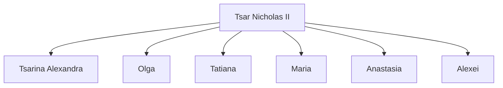
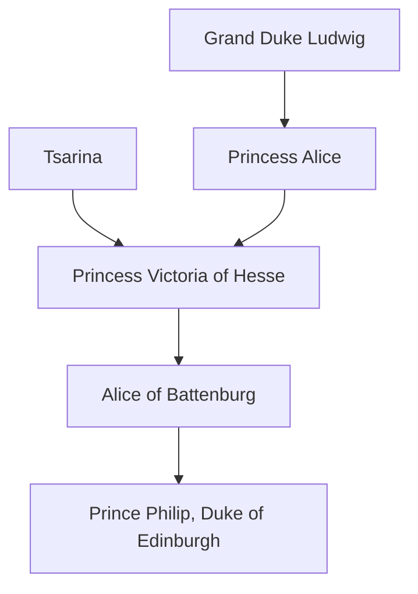
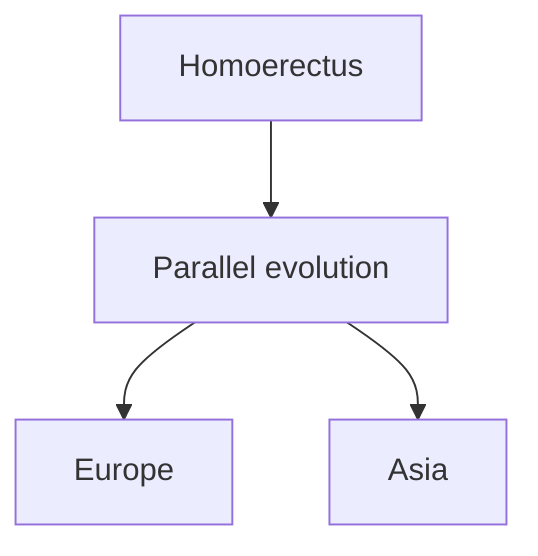

The  study involved 273 field trials throughout England, Wales, and Scotland, and included glyphosate‐resistant sugar beet as well as maize and spring rape engineered for resistance to a second herbicide, glufosinate‐ammonium. The results, as summarized in the official report (see Burke [2003] in Further Reading), were as follows:

The team found that there were differences in the abundance of wildlife between GM crop fields and conventional crop fields. Growing conventional beet and spring rape was better for many groups of wildlife than growing GM beet and spring rape. There were more insects, such as butterflies and bees, in and around the conventional crops because there were more weeds to provide food and cover. There were also more weed seeds in conventional beet and spring rape crops than in their GM counterparts. Such seeds are important in the diets of some animals, particularly some birds. In contrast, growing GM maize was better for many groups of wildlife than conventional maize. There were more weeds in and around the GM crops, more butterflies and bees around at certain times of the year, and more weed seeds. The researchers stress that the differences they found do not arise just because the crops have been genetically modified. They arise because these GM crops give farmers new options for weed control. That is, they use different herbicides and apply them differently. The results of this study suggest that growing such GM crops could have implications for wider farmland biodiversity. However, other issues will affect the medium‐ and long‐term impacts, such as the areas and distribution of land involved, how the land is cultivated and how crop rotations are managed. These make it hard for researchers to predict the medium‐ and large‐scale effects of GM cropping with any certainty. In addition, other management decisions taken by farmers growing conventional crops will continue to impact on wildlife.

The interpretations that have been drawn from the above and similar studies of other types of GM crop vary from country to country. In many parts of the world, a GM crop is considered safe to eat and harmless to the environment providing that it passes the safety assessments laid down by national legislation. In 2015, GM crops accounted for 70.9 million hectares of cultivation in the USA, 44.2 million hectares in Brazil, 24.5 million hectares in Argentina, and were also grown in other parts of North and South America, and in India, Pakistan, China, and South Africa. In other countries, notably the members of the European Union, there is virtually no cultivation of GM crops.

## Further reading

Burke, M. (2003) GM crops: effects on farmland wildlife. Produced by the Farmscale Evaluations Research Team and the Scientific Steering Committee. ISBN: 0‐85521‐035‐4. [For a more detailed description of this work see Philosophical Transactions of the Royal Society, Biological Sciences, 358, 1775–1913 (2003).]

- Castle, L.A., Siehl, D.L., Gorton, R., et al. (2004) Discovery and directed evolution of a glyphosate tolerance gene. Science, 304, 1151–1154. [Cloning the GLYAT gene in maize.]
- Christiansen, A.T., Andersen, M.M., and Kappel, K. (2019) Are current EU policies on GMOs justified? Transgenic Research, 28, 267–286.
- De Cosa, B., Moar, W., Lee, S.B., et al. (2001) Overexpression of the Bt cry2Aa2 operon in chloroplasts leads to formation of insecticidal crystals. Nature Biotechnology, 19, 71–74.
- Fischhoff, D.A., Bowdish, K.S., Perlak, F.J., et al. (1987) Insect‐tolerant transgenic tomato plants. Biotechnology, 5, 807–813. [The first transfer of a δ‐endotoxin gene to a plant.]
- Halford, N.G. (2019) Legislation governing genetically modified and genome‐edited crops in Europe: the need for change. Journal of the Science of Food and Agriculture, 99, 8–12.
- Koziel, M.G., Beland, G.L., Bowman, C., et al. (1993) Field performance of elite transgenic maize plants expressing an insecticidal protein derived from Bacillus thuringiensis. Nature Biotechnology, 11, 194–200. [Cloning a δ‐endotoxin gene in maize.]
- Li, T., Yang, X., Yu, Y., et al. (2018) Domestication of wild tomato accelerated by genome editing. Nature Biotechnology, 36, 1160–1163.
- Miki, B. and McHugh, S. (2003) Selectable marker genes in transgenic plants: applications, alternatives and biosafety. Journal of Biotechnology, 107, 193–232.
- Morineau, C., Bellec, Y., Tellier, F., et al. (2017) Selective gene dosage by CRISPR‐Cas9 genome editing in hexaploid Camelina sativa. Plant Biotechnology Journal, 15, 729–739.
- Murovec, J., Guček, K., Bohanec, B., et al. (2018) DNA‐free genome editing of Brassica oleracea and B. rapa protoplasts using CRISPR‐Cas9 ribonucleoprotein complexes. Frontiers in Plant Science, 9, 1594.
- Paine, J.A., Shipton, C.A., Chaggar, S., et al. (2005) Improving the nutritional value of Golden Rice through increased pre‐vitamin A content. Nature Biotechnology, 23, 482–487.
- Sayre, R., Beeching, J.R., Cahoon, E.B., et al. (2011) The BioCassava plus program: biofortification of cassava for sub‐Saharan Africa. Annual Review of Plant Biology, 62, 251–272.
- Shan, Q., Wang, Y., Li, J., et al. (2013) Targeted genome modification of crop plants using a CRISPR‐Cas system. Nature Biotechnology, 31, 686–688. [Editing the rice phytoene desaturase gene.]
- Smith, C.J.S., Watson, C.F., Ray, J., et al. (1988) Antisense RNA inhibition of polygalacturonase gene expression in transgenic tomatoes. Nature, 334, 724–726.
- Tabashnik, B.E., Brévault, T., and Carrière, Y. (2013) Insect resistance to Bt crops: lessons from the first billion acres. Nature Biotechnology, 31, 510–521.
- Wolter, F., Schindele, P., and Puchta, H. (2019) Plant breeding at the speed of light: the power of CRISPR/Cas to generate directed genetic diversity at multiple sites. BMC Plant Biology, 19, 176.
- Zhang, Y., Malzahn, A.A., Sretenovic, S., and Qi, Y. (2019) The emerging and uncultivated potential of CRISPR technology in plant science. Nature Plants, 5, 778–794.
- Zhou, J., Xin, X., and He, Y. (2019) Multiplex QTL editing of grain‐related genes improves yield in elite rice varieties. Plant Cell Reports, 38, 475–485.

## Chapter 17

# Gene Cloning and DNA Analysis in Forensic Science and Archaeology

## Chapter contents

**17.1** DNA analysis in the identification of crime suspects 356
**17.2** Studying kinship by DNA profiling 359
**17.3** Sex identification by DNA analysis 363
**17.4** Archaeogenetics – using DNA to study human prehistory 365

Forensic science is the final area of biotechnology that we will consider. Hardly a week goes by without a report in the national press of another high‐profile crime that has been solved thanks to DNA analysis. The applications of molecular biology in forensics centre largely on the ability of DNA analysis to identify an individual from hairs, bloodstains, and other items recovered from the crime scene. In the popular media, these techniques are called **genetic fingerprinting**, though the more accurate term for the procedures used today is **DNA profiling**. We begin this chapter by examining the methods used in genetic fingerprinting and DNA profiling, including their use both in identification of individuals and in establishing if individuals are members of a single family. This will lead us into an exploration of the ways in which genetic techniques are being used in archaeology.

## 17.1 DNA analysis in the identification of crime suspects

It is probably impossible for a person to commit a crime without leaving behind a trace of his or her DNA. Hairs, spots of blood, and even conventional fingerprints contain traces of DNA, enough to be studied by the polymerase chain reaction (PCR). The analysis does not have to be done immediately, and in recent years a number of past crimes – so‐called ‘cold cases’ – have been solved and the criminal brought to justice because of DNA testing that has been carried out on archived material. So how do these powerful methods work?

The basis to genetic fingerprinting and DNA profiling is that identical twins are the only individuals who have identical copies of the human genome. Of course, the human genome is more or less the same in everybody  –  the same genes will be in the same order with the same stretches of intergenic DNA between them. But the human genome, as well as those of other organisms, contains many **polymorphisms**, positions where the nucleotide sequence is not the same in every member of the population. We have already encountered the most important of these polymorphic sites, because these variable sequences are the same ones that are used as DNA markers in positional cloning of disease susceptibility genes (Section  15.2.1). They include restriction fragment length polymorphisms (RFLPs), short tandem repeats (STRs), and **single nucleotide polymorphisms (SNPs)**, the latter being positions in the genome where either of two different nucleotides can occur. All three types of polymorphism can occur within genes as well as in intergenic regions, and altogether there are several million of these polymorphic sites in the human genome, with SNPs being the most common.

## 17.1.1 Genetic fingerprinting by hybridization probing

The first method for using DNA analysis to identify individuals was developed in the mid‐1980s by Sir Alec Jeffreys of Leicester University. This technique was not based on any of the types of polymorphic site listed above, but on a different kind of variation in the human genome called a **hypervariable dispersed repetitive sequence**. As the name indicates, this is a repeated sequence that occurs at various positions (‘dispersed’) in the human genome. The key feature of these sequences is that they are located at different positions in the genomes of different people (Figure 17.1a).

The particular repeat that was initially used in genetic fingerprinting contains the sequence GGGCAGGANG (where ‘N’ is any nucleotide). To prepare a fingerprint, a sample of genomic DNA is digested with a restriction endonuclease, the fragments separated by agarose gel electrophoresis, and a Southern blot prepared (see Figure 8.19). Hybridization to the blot of a labelled probe containing the repeat sequence reveals a series of bands, each one representing a restriction fragment that contains the repeat (Figure 17.1b). Because the insertion sites of the repeat sequence are variable, the same procedure carried out with a DNA sample from a second person will give a different pattern of bands. These are the genetic fingerprints for those two individuals.

(a) Polymorphic repeat sequences in the human genome

text_image

Chromosomal
DNA segments
First person
Second person
Positions of
repeat sequences

(b) Two genetic ngerprints

text_image

1
2

Lanes 1 and 2: DNA from two individuals

Figure 17.1

Genetic fingerprinting. (a) The positions of polymorphic repeats, such as hypervariable dispersed repetitive sequences, in the genomes of two individuals. In the chromosome segment shown, the second person has an additional repeat sequence. (b) An autoradiograph showing the genetic fingerprints of two individuals.

## 17.1.2 DNA profiling by PCR of short tandem repeats

Strictly speaking, genetic fingerprinting refers only to hybridization analysis of hypervariable dispersed repetitive sequences. This technique has been valuable in forensic work but suffers from three limitations:

• A relatively large amount of DNA is needed because the technique depends on hybridization analysis. Fingerprinting cannot be used with the minute amounts of DNA in hair and bloodstains.
Interpretation of the fingerprint can be difficult because of variations in the intensities of the hybridization signals. In a court of law, minor differences in band intensity between a test fingerprint and that of a suspect can be sufficient for the suspect to be acquitted.
Although the insertion sites of the repeat sequences are hypervariable, there is a limit to this variability and therefore a small chance that two unrelated individuals could have the same, or at least very similar, fingerprints. Again, this consideration can lead to acquittal when a case is brought to court.

The more powerful technique of DNA profiling avoids these problems. Profiling makes use of the polymorphic sequences called STRs. As described

(a) Two alleles of an STR

$$
\begin{array}{l} \dots \text {CACACACACA} \dots \quad n = 5 \\ \dots \text {CACACACACACA} \dots n = 6 \\ \end{array}
$$

(b) The results of PCR

text_image

1 DNA size markers
2, 3 PCRs of a single STR
in two individuals
4 Multiplex PCR of three
STRs (A–C)

(c) Analysis of multiplex PCR results by capillary gel electrophoresis

violin

| Series | Peak Size (bp) |
| --- | --- |
| A | ~185 |
| B | ~160 |
| C | ~120 |

Figure 17.2

DNA profiling. (a) DNA profiling makes use of STRs which have variable repeat units. (b) A gel obtained after DNA profiling. In lanes 2 and 3 the same STR has been examined in two individuals. These two people have different profiles but have a band in common. Lane 4 shows the result of a multiplex PCR in which three STRs have been typed in a single PCR. (c) Capillary gel electrophoresis can be used to determine the sizes of multiplex PCR products.

in Section 15.2.1, an STR is a short sequence, 1–13 nucleotides in length, which is repeated several times in a tandem array. In the human genome, the most common type of STR is the dinucleotide repeat [CA] , where ‘n’, the number of repeats, is usually between 5 and 20 (Figure 17.2a).

The number of repeats in a particular STR is variable because repeats can be added or, less frequently, removed by errors that occur during DNA replication. In the population as a whole, there might be as many as ten different versions of a particular STR, each of the alleles characterized by a different number of repeats. In DNA profiling, the alleles of a selected number of different STRs are identified. This can be achieved quickly and with very small amounts of DNA by PCRs with primers that anneal to the DNA sequences either side of a repeat (see Figure 15.13). After the PCR, the products can be examined by agarose gel electrophoresis. The size of the band or bands that are seen in the gel indicate the allele or alleles pre-sent in the DNA sample that has been tested (Figure 17.2b). Two alleles of an STR can be present in a single DNA sample because there are two copies of each STR, one on the chromosome inherited from the mother and one on the chromosome from the father.

Because PCR is used, DNA profiling is very sensitive and enables results to be obtained with hairs and other specimens that contain trace amounts of DNA. The results are unambiguous, and a match between DNA profiles is usually accepted as evidence in a trial. The current methodology, called CODIS (Combined DNA Index System), makes use of 20 STRs with sufficient variability to give only a one in $1 0 ^ { 1 8 }$ chance that two individuals, other than identical twins, have the same profile. As the world population is around $7 . 7   \times   1 0 ^ { 9 } ,$ the statistical likelihood of two individuals on the planet sharing the same profile is so low as to be considered implausible when DNA evidence is presented in a court of law. Each STR is typed by PCRs with primers that are fluorescently labelled, and which anneal either side of the variable repeat region. The alleles present at the STR are then typed by determining the sizes of the amplified fragments by capillary gel electrophoresis. Two or more STRs can be typed together in a **multiplex PCR** if their product sizes do not overlap, or if the individual primer pairs are labelled with different fluorescent markers, enabling the products to be distinguished in the capillary gel (Figure 17.2c).

## 17.2 Studying kinship by DNA profiling

As well as identification of criminals, DNA profiling can also be used to infer if two or more individuals are members of the same family. This type of study is called **kinship analysis** and its main day‐to‐day application is in paternity testing.

## 17.2.1 Related individuals have similar DNA profiles

Your DNA profile, like all other aspects of your genome, is inherited partly from your mother and partly from your father. Relationships within a family therefore become apparent when the alleles of a particular STR are marked on the family pedigree (Figure 17.3). In this example, we see that 3 of the 4 children have inherited the 12‐repeat allele from the father. This observation in itself is not sufficient to deduce that these three children are siblings, though the statistical chance would be quite high if the 12‐repeat allele was uncommon in the population as a whole. To increase the degree of certainty, more STRs would have to be typed but, as with identification of individuals, the analysis need not be endless, because a comparison of 20 STRs gives an acceptable probability that relationships that are observed are real.

Figure 17.3

Inheritance of the alleles of an STR within a family.

## 17.2.2 DNA profiling and the remains of the Romanovs

An interesting example of the use of DNA profiling in a kinship study is provided by work carried out during the 1990s on the bones of the Romanovs, the last members of the Russian ruling family. The Romanovs and their descendants ruled Russia from the early 17th century until the time of the Russian Revolution, when Tsar Nicholas II was deposed and he and his wife, the Tsarina Alexandra, and their five children imprisoned. On 17 July, 1918, all seven, along with their doctor and three servants, were murdered and their bodies disposed of in a shallow roadside grave near Yekaterinburg in the Urals. In 1991, after the fall of communism, the remains were recovered with the intention that they should be given a more fitting burial.

## STR analysis of the Romanov bones

Although it was suspected that the bones recovered were indeed those of the Romanovs, the possibility that they belonged to some other unfortunate group of people could not be discounted. Nine skeletons had been found in the grave – six adults and three children – with examination of the bones suggesting that four of the adults were male and two female, and the three children were all female. If these were the remains of the Romanovs, then their son Alexei and one of their daughters were, for some, reason, absent. The bodies showed signs of violence, consistent with reports of their treatment during and after death, and at least some of the remains were clearly aristocratic as their teeth were filled with porcelain, silver, and gold, dentistry well beyond the means of the average Russian of the early 20th century.

DNA was extracted from the bones of each individual and five STRs typed by PCR to test the hypothesis that the three children were siblings and that two of the adults were their parents, as would be the case if indeed these were the Romanovs. The results immediately showed that the three children could be siblings, as they have identical genotypes for the STRs called VWA/31 and FES/FPS and share alleles at each of the three other loci (Figure 17.4). The THO1 data show that female adult 2 cannot be the mother of the children because she only possesses allele 6, which none of the children have. Female adult 1, however, has allele 8, which all three children have. Examination of the other STRs confirms that she could be the mother of each of the children, and so she is identified as the Tsarina. The THO1 data exclude male adult 4 as a possible father of the children, and the VWA/31 results exclude male adults 1 and 2. When all the STRs are taken into account, male adult 3 could be the father of the  children and therefore is identified as the Tsar. Note that all these

(a) The Romanov family tree

flowchart

(b) The STR analysis

<table><tr><td rowspan="2">(b) The STR analysis</td><td colspan="5">STRs</td></tr><tr><td>VWA/31</td><td>THO1</td><td>F13A1</td><td>FES/FPS</td><td>ACTBP2</td></tr><tr><td>Child 1</td><td>15, 16</td><td>8, 10</td><td>5, 7</td><td>12, 13</td><td>11, 32</td></tr><tr><td>Child 2</td><td>15, 16</td><td>7, 8</td><td>5, 7</td><td>12, 13</td><td>11, 36</td></tr><tr><td>Child 3</td><td>15, 16</td><td>8, 10</td><td>3, 7</td><td>12, 13</td><td>32, 36</td></tr><tr><td>Female adult 1</td><td>15, 16</td><td>8, 8</td><td>3, 5</td><td>12, 13</td><td>32, 36</td></tr><tr><td>Female adult 2</td><td>16, 17</td><td>6, 6</td><td>6, 7</td><td>11, 12</td><td>not done</td></tr><tr><td>Male adult 1</td><td>14, 20</td><td>9, 10</td><td>6, 16</td><td>10, 11</td><td>not done</td></tr><tr><td>Male adult 2</td><td>17, 17</td><td>6, 10</td><td>5, 7</td><td>10, 11</td><td>11, 30</td></tr><tr><td>Male adult 3</td><td>15, 16</td><td>7, 10</td><td>7, 7</td><td>12, 12</td><td>11, 32</td></tr><tr><td>Male adult 4</td><td>15, 17</td><td>6, 9</td><td>5, 7</td><td>8, 10</td><td>not done</td></tr></table>

## Figure 17.4

Short tandem repeat analysis of the Romanov bones. (a) The Romanov family tree. (b) The results of the STR analysis. Data taken from Gill et al. (1994) (see Further Reading).

conclusions can be drawn simply from the THO1 and VWA/31 results: the other STR data simply provide corroborating evidence.

## Mitochondrial DNA was used to link the Romanov skeletons with living relatives

The STR analysis showed that the skeletons included a family group, as expected if these were indeed the bones of the Romanovs. But could they be the remains of some other group of people? To address this problem, the DNA from the bones was compared with DNA samples from living relatives of the Romanovs. This work included studies of **mitochondrial DNA**, the small 16‐kb circles of DNA contained in the energy‐generating mitochondria of cells. Mitochondrial DNA contains polymorphisms that can be used to infer relationships between individuals, but the degree of variability is not as great as displayed by STRs, so mitochondrial DNA is rarely used for kinship studies among closely related people such as those of a single family group. But mitochondrial DNA has the important property of being inherited solely through the female line, the father’s mitochondrial DNA being lost during fertilization and not contributing to the

Figure 17.5

Family tree showing the matrilineal relationship between Prince Philip, Duke of Edinburgh, and Princess Victoria of Hesse, the Tsarina’s sister. Males are shown as blue boxes and females as red circles.

flowchart

son or daughter’s DNA content. This maternal inheritance pattern makes it easier to distinguish relationships when the individuals being compared are more distantly related, as was the case with the living relatives of the Romanovs.

Comparisons were therefore made between mitochondrial DNA sequences obtained from the skeletons and that of Prince Philip, the Duke of Edinburgh, whose maternal grandmother was Princess Victoria of Hesse, the Tsarina Alexandra’s sister (Figure  17.5). The mitochondrial DNA sequences from four of the female skeletons – the three children and the adult female identified as the Tsarina – were exactly the same as that of Prince Philip, strong evidence that the four females were members of the same lineage. Comparisons were also made with two living matrilineal descendants of Tsar Nicholas’s grandmother, Louise of Hesse‐Cassel. This analysis was more complicated, as two sequences were present among the clones of the PCR product obtained from the adult male thought to be the Tsar. These sequences differed at a single position which was either a C or a T, the former four times more frequent than the latter. This could indicate that the sample was contaminated with somebody else’s DNA, but instead was interpreted as showing that the Tsar’s mitochondrial DNA was **heteroplasmic**, an infrequent situation where two different mitochondrial DNAs co‐exist within the same cells. The two descendants of the Tsar’s grandmother both had the mitochondrial DNA version with a T at this position, suggesting that the mutation producing the C variant had occurred very recently in the Tsar’s lineage. Support for this hypothesis was subsequently provided by analysis of DNA from the Tsar’s brother, Grand Duke George Alexandrovich, who died in 1899, which showed that he also displayed heteroplasmy at the same position in his mitochondrial DNA. On balance, the evidence suggested that the Tsar’s remains had been correctly identified.

## The missing children

Only three children were found in the Romanovs’ grave. Alexei, the only boy, and one of the four girls were missing. During the middle decades of the $2 0 ^ { \mathrm { t h } }$ century, several women claimed to be a Romanov princess, because even before the bones were recovered there had been rumours that one of the girls, Anastasia, had escaped the clutches of the Bolsheviks and fled to the West. One of the most famous of these claimants was Anna Anderson, whose case was first widely publicized in the 1920s. Anna Anderson died in 1984 but she left an archived tissue sample whose mitochondrial DNA does not match the Tsarina’s. There have also been various people claiming to be descended from Tsarevich Alexei. But these stories are almost certainly romances, as the partially cremated bodies of two other children found near Yekaterinburg in 2007 have now been shown to have mitochondrial DNA sequences that suggest that they are the missing Romanov children.

## 17.3 Sex identification by DNA analysis

DNA analysis can also be used to identify the sex of an individual. The genetic difference between the sexes is the possession of a Y chromosome by males, so detection of DNA specific for the Y chromosome would enable males and females to be distinguished. Forensic scientists occasionally have to deal with bodies that are so badly damaged that DNA analysis is the only way of identifying their sex.

DNA tests can also be used to identify the sex of an unborn child. Finding out if a foetus is a boy or a girl is usually delayed until the anatomical differences have developed and the sex can be identified by scanning, but under some circumstances an earlier indication of sex is desirable. An example is when the pedigree of the family indicates that an unborn male might suffer from an inherited disease and the parents wish to make an early decision about whether to continue the pregnancy.

A third application of DNA‐based sex identification, and the one that has been responsible for many of the developments in this field, is in the analysis of archaeological specimens. Male and female skeletons can be distinguished if key bones such as the skull or the pelvis are intact, but with fragmentary remains, or those of young children, there are not enough sex‐specific anatomical differences for a confident identification to be made. If **ancient DNA** is preserved in the bones, a DNA‐based method can tell the archaeologists if they are dealing with a male or a female.

## 17.3.1 PCRs directed at Y chromosome‐specific sequences

The simplest way to use DNA analysis to identify sex is to design a PCR specific for a region of the Y chromosome. The PCR has to be designed with care, because the X and Y chromosomes are not completely different, some segments being shared between the two. But there are many unique regions within the Y chromosome. In particular, there are several repeated sequences that are only located in the Y chromosome, these repeated sequences acting as multiple targets for the PCR and hence giving greater sensitivity, an important consideration if you are dealing with a badly damaged body or an ancient bone.

Figure 17.6

Sex identification by PCR of a Y‐specific DNA sequence. Male DNA gives a PCR product (lane 2), but female DNA does not (lane 3). The problem is that a failed PCR (lane 4) gives the same result as female DNA.

text_image

1 DNA markers
2 Male DNA
3 Female DNA
4 Failed PCR

A PCR directed at Y‐specific DNA sequences would give a product with male DNA but no band if the sample comes from a female (Figure 17.6). This is a clear distinction between the two alternatives and hence a perfectly satisfactory system for most applications. But what if the sample did not contain any DNA, or if the DNA was too degraded to work in the PCR, or if the sample also contained inhibitors of Taq polymerase that prevented the enzyme from carrying out the PCR? All of these possibilities could occur with archaeological specimens, especially those that have been buried in the ground and become contaminated with humic acids and other compounds known to inhibit many of the enzymes used in molecular biology research. Now the test becomes ambiguous because a specimen that is unable to give a PCR product for one of these reasons could mistakenly be identified as female. The result would be exactly the same: there would be no band in the gel.

## 17.3.2 PCR of the amelogenin gene

The lack of discrimination between ‘female’ and ‘failed PCR’ that occurs when Y‐specific sequences are studied has led to the development of more sophisticated DNA tests for sex identification, ones that give unambiguous results for both males and females. The most widely used of these involves PCRs that amplify the amelogenin gene.

The amelogenin gene codes for a protein found in tooth enamel. It is one of the few genes that are present on the Y chromosome and, like many of these genes, there is also a copy on the X chromosome. But the two copies are far from identical, and when the nucleotide sequences are aligned a number of **indels**, positions where a segment of DNA has either been inserted into one sequence or deleted from the other sequence, are seen (Figure 17.7a). If the primers for a PCR anneal either side of an indel, the products obtained from the X and Y chromosomes would have different sizes. Female DNA would give a single band when the products are examined, because females only have the X chromosome, whereas males would give two bands, one from the X chromosome and one from the Y (Figure 17.7b). If the sample contains no DNA or the PCR fails for some other reason, no bands will be obtained. There is no confusion between a failure and a male or female result.

(a) Part of the amelogenin gene

text_image

Y chromosome
X chromosome
6 bp deletion in
the X chromosome
sequence

(b) Results of PCR

text_image

1
2
3
4
1 DNA markers
2 Male DNA
3 Female DNA
4 Failed PCR

Figure 17.7

Sex identification by PCR of part of the amelogenin gene. (a) An indel in the amelogenin gene. (b) The results of PCRs spanning the indel. Male DNA gives two PCR products, of 106 and 112 bp in one of the standard systems used in forensics and biomolecular archaeology. Female DNA gives just the smaller product. A failed PCR gives no products and so is clearly distinguishable from the two types of positive result.

The development of the amelogenin system for sex identification is having an important impact in archaeology. No longer is it necessary to assign sex to buried bones on the basis of vague differences in the structures of the bones. The greater confidence that DNA‐based sex testing allows is resulting in some unexpected discoveries. In particular, archaeologists are now reviewing their preconceptions about the meaning of the objects buried in a grave along with the body. It was thought that if a body was accompanied by a sword then it must be male, or if the grave contained beads then the body was female. DNA testing has shown that these stereotypes are not always correct and that archaeologists must take a broader view of the link between grave goods and sex.

## 17.4 Archaeogenetics – using DNA to study human prehistory

Sex identification and kinship studies are not the only ways in which gene cloning and DNA analysis are being applied in archaeology. By examining DNA sequences in living and dead humans, archaeologists have begun to understand the evolutionary origins of modern humans, and the routes followed by prehistoric people as they colonized the planet. This area of research is called **archaeogenetics**.

## 17.4.1 The origins of modern humans

Palaeontologists believe that humans originated in Africa because it is here that all of the oldest pre‐human fossils have been found. The fossil evidence reveals that humans first migrated out of Africa over one million

## Figure 17.8

The multiregional hypothesis for the origins of modern humans.

flowchart

Modern Homo sapiens

years ago, but these were not members of our own species. Instead they were an earlier type called Homo erectus, who were the first humans to become geographically dispersed, eventually spreading to most parts of the Old World.

The events that followed the dispersal of H. erectus are controversial. From studies of fossils, many palaeontologists believe that the H. erectus populations which became located in different parts of the Old World gave rise to the modern Homo sapiens populations found in those areas today (Figure  17.8). This process is called **multiregional evolution**. There may have been a certain amount of interbreeding between humans from different geographical regions but, to a large extent, these various populations remained separate throughout their evolutionary history.

## DNA analysis has challenged the multiregional hypothesis

Doubts about the multiregional hypothesis were raised in 1987 when geneticists first started using DNA analysis to ask questions about human evolution. In one of the very first archaeogenetics projects, RFLPs were typed in mitochondrial DNA samples taken from 147 humans, from all parts of the world. The resulting data were then used to construct a phylogenetic tree showing the evolutionary relationships between different human populations. From this tree, various deductions were made:

The root of the tree represents a woman (remember, mitochondrial DNA is inherited only through the female line) whose mitochondrial genome is ancestral to all the 147 modern mitochondrial DNAs that were tested. This woman has been called **mitochondrial Eve**. Of course, she was not equivalent to the Biblical character and was by no means the only woman alive at the time. She simply was the person who carried the ancestral mitochondrial DNA that gave rise to all the mitochondrial DNAs in existence today.
• Mitochondrial Eve lived in Africa. This was deduced because the ancestral sequence split the tree into two segments, one of which was composed solely of African mitochondrial DNAs. Because of this split, it was inferred that the ancestor was also located in Africa.
• Mitochondrial Eve lived between 140 000 and 290 000 years ago. This conclusion was drawn by applying the **molecular clock** to the