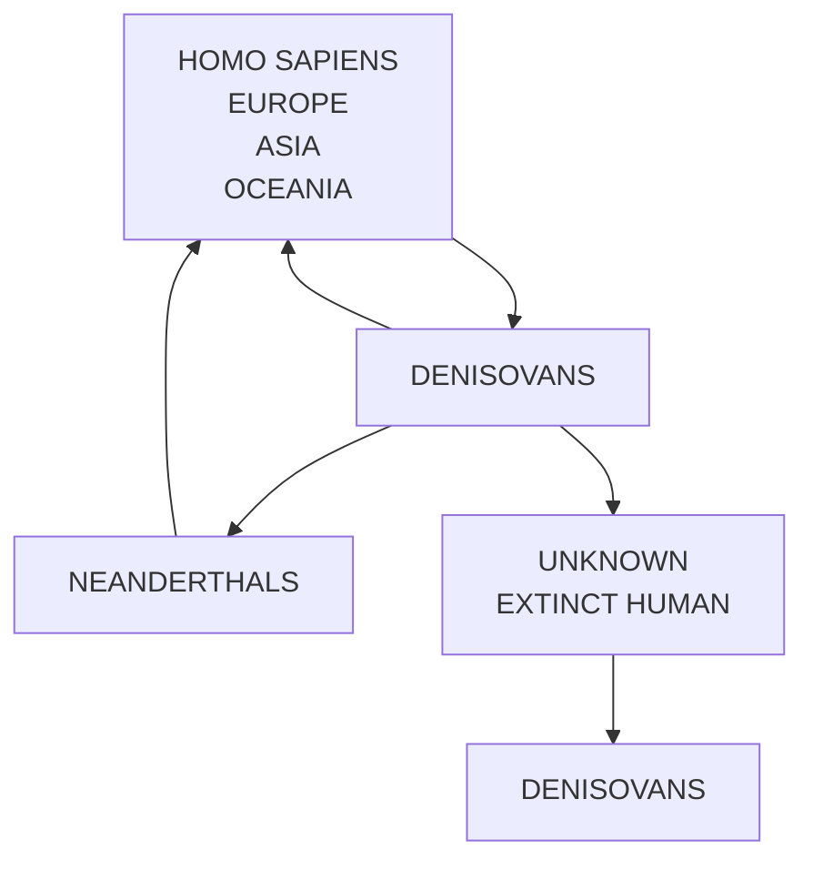
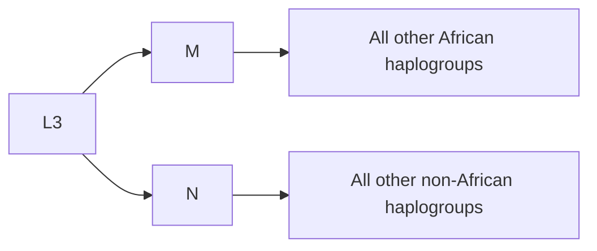

text_image

Europe
Africa
Asia
Homo
erectus
Displacement
Displacement

Modern Homo sapiens

Figure 17.9

The Out of Africa hypothesis for the origins of modern humans.

phylogenetic tree. The molecular clock is a measure of the speed at which evolutionary change occurs in mitochondrial DNA sequences and is calibrated from the rate at which mutations are known to accumulate in mitochondrial DNA. By comparing the sequence inferred for Eve’s mitochondrial DNA with the sequences of the 147 modern DNAs, the number of years needed for all of the necessary evolutionary changes to take place was calculated.

The key finding was that mitochondrial Eve lived in Africa no earlier than 290 000 years ago, because this does not agree with the suggestion that we are all descended from H. erectus populations who left Africa over a million years ago. A new hypothesis for human origins was therefore devised, called **Out of Africa**. According to this hypothesis, modern humans – H. sapiens – evolved specifically from those H. erectus populations that remained in Africa. Modern humans then moved into the rest of the Old World, displacing the descendants of H. erectus that they encountered (Figure 17.9).

At first, the mitochondrial Eve results were heavily criticized. It became apparent that the computer analysis used to construct the phylogenetic tree was flawed, mainly because the algorithms used to compare the RFLP data were not sufficiently robust to deal with this huge amount of information. However, the criticisms died away as the results of more extensive mitochondrial DNA studies, using actual DNA sequences rather than RFLPs and analysed using more powerful computers, confirmed the findings of the first project. To take one example, when the complete mitochondrial DNA sequences of 53 people, again from all over the world, were compared, a date of 120 000–220 000 years for mitochondrial Eve was obtained. An interesting complement was provided by studies of the Y chromosome which, of course, descends exclusively through the male line. This work revealed that ‘Y chromosome Adam’ also lived in Africa, between 200 000 and 300 000 years ago.

## DNA analysis shows that Neanderthals are not the direct ancestors of modern Europeans

Neanderthals are an extinct type of human who lived in Europe between 200 000 and 30 000 years ago. According to the Out of Africa hypothesis, they were displaced when modern humans reached Europe. Therefore, one prediction of the Out of Africa hypothesis is that Neanderthals are not the ancestors of modern Europeans. Analysis of ancient DNA from Neanderthal bones has been used to test this prediction.

Figure 17.10

Phylogenetic analysis of ancient DNA suggests that modern humans are not directly descended from Neanderthals. (a) The first comparison between Neanderthal and H. sapiens mitochondrial DNA. The H. sapiens mitochondrial sequences were obtained from various African and non‐African groups. (b) Comparison based on a complete Neanderthal mitochondrial DNA sequence. The human sequences are from populations associated with different parts of the world. ‘Human CRS’ refers to the ‘Cambridge Reference Sequence’, which was the first human mitochondrial sequence to be obtained, and was from a person of European origin.

The first Neanderthal specimen selected for study was the type specimen, which had been found in Germany in the 19th century. This fossil has not been precisely dated but is between 30 000 and 100 000 years old. A short part of the mitochondrial DNA of this individual was sequenced by carrying out nine overlapping PCRs, each one amplifying less than 170 bp of DNA but together giving a total length of 377 bp. A phylogenetic tree was then constructed to compare the sequence obtained from the Neanderthal bone with the sequences of other mitochondrial DNA variants (called **haplogroups**) pre-sent in H. sapiens. The Neanderthal sequence was positioned on a branch of its own, connected to the root of the tree but not linked directly to any of the modern human sequences (Figure 17.10a). This was the first evidence suggesting that Neanderthals are not ancestral to modern Europeans.

The first study of Neanderthal mitochondrial DNA was published in 1997. The results were confirmed in 2008 when a complete mitochondrial DNA sequence was obtained from three small pieces of Neanderthal bone, dating to 38 000 years ago, found in a cave at Vindija in Croatia. The phylogenetic tree constructed from the complete DNA sequence again places Neanderthals on a branch of their own, separate from modern humans (Figure  17.10b). The Neanderthal mitochondrial genome therefore falls outside the H. sapiens range, the expected result if Neanderthals are not the ancestors of modern Europeans. The results therefore provide an independent proof of the Out of Africa hypothesis, and show that, at least for Europe, the multiregional model is incorrect.

The Neanderthal genome sequence suggests there was interbreeding with H. sapiens

One of the great achievements of next‐generation sequencing (Section 10.2) has been the complete sequence of the Neanderthal genome, obtained from ancient DNA preserved in small pieces of a bone from a cave in the Altai mountains of Siberia. The genome sequence has raised the intriguing possibility that there might have been interbreeding between Neanderthals and modern humans. Homo sapiens became widespread in Europe about 45 000 years ago, and Neanderthals did not become extinct until about 30 000 years ago, so they must have lived in the same regions for several thousand years. Prior to the genome sequence becoming available, tentative evidence for interbreeding had been obtained from archaeological work. In 1998, the skeleton of a 4‐year‐old child was found at Abrigo do Lagar Velho in Portugal. This skeleton seems to have both Neanderthal and modern human features, but its status as a hybrid is doubtful because the burial has been dated to 24 500 years ago, about 5000 years after Neanderthals are thought to have become extinct.

Much stronger evidence of interbreeding was obtained when comparisons were made between the Neanderthal genome and the genomes of H. sapiens from Europe and Africa. If there had been no interbreeding, then modern Europeans and Africans should be indistinguishable when compared with Neanderthals. However, the degree of divergence between Neanderthals and modern Europeans was slightly less than that between Neanderthals and modern Africans, suggesting that some Neanderthal DNA has found its way into the genomes of modern Europeans (Figure 17.11). This indicates that there was a small amount of interbreeding between Neanderthals and H. sapiens during the 15 000 years or so that they were co‐resident in Europe.

Ancient DNA sequencing has also identified a new type of human that was present in Eurasia around 40 000 years ago. Sequencing of ancient DNA from a finger bone from Denisova cave in Siberia revealed an unusual mitochondrial DNA variant whose features were unlike those of Neanderthals or modern humans, suggesting that the finger bone might have come from an unknown species, who were called the ‘Denisovans’. However, the complete Denisovan genome sequence shows a closer affinity with Neanderthals than indicated by the mitochondrial DNA, so possibly Denisovans were an Asian version of Neanderthals. The Denisovan genome sequence gave additional evidence for interbreeding with H. sapiens, in this case specifically with the ancestors of modern inhabitants of Oceania. The most recent estimates suggest that 2–3% of the DNA of modern

bar

| Category | % divergence |
| --- | --- |
| Neanderthal-African | 4.81% |
| Neanderthal-European | 4.57% |

Figure 17.11

Comparison between the Neanderthal genome and the genomes of modern‐day Africans and Europeans. There is less divergence between Neanderthal and European genomes, suggesting that the ancestors of modern Europeans interbred with Neanderthals.

Figure 17.12

Interbreeding between H. sapiens and extinct types of human. The arrows indicate the direction in which DNA has been transferred.

flowchart

humans from outside of Africa is of Neanderthal origin, and about 1% of the genomes of modern inhabitants of Oceania is derived from Denisovans. There is also evidence for interbreeding between Neanderthals and Denisovans, and between Denisovans and an unidentified extinct type of human (Figure 17.12).

## 17.4.2 DNA can also be used to study prehistoric human migrations

As well as establishing that our common ancestor lived in Africa relatively recently, DNA sequencing is also helping to trace and date the migrations by which our species colonized the rest of the planet. This leads us to the increasingly controversial question of when modern humans – members of H. sapiens – first left Africa.

## Modern humans may have migrated from Ethiopia to Arabia

When we examine a map of the world, it might seem obvious that humans travelling from Africa to Asia would walk across the physical link that exists in the area of modern Suez. In fact, it is more likely that the first modern human migration out of Africa left from further south, from Ethiopia. This hypothesis is based partly on archaeological evidence and partly on analysis of mitochondrial DNA sequences. Over 270 mitochondrial DNA haplogroups are known in the modern human population, all of which can be linked together in a large network displaying their sequence relationships. Within this network, all of the haplogroups that are common today in Africa are clustered together, with just two links connecting them with the remainder of the network. These two links are between haplogroup L3 on the African side and M and N on the non‐African side (Figure 17.13). Archaeogeneticists believe that these two links reveal that the first migration of H. sapiens out of Africa was from Ethiopia to southern Arabia. The argument is as follows:

• Haplogroups M and N are found mainly in Asia, suggesting that the initial migration was into Asia.
• The modern Africans whose L3 mitochondrial DNAs have the greatest similarity to M and N live in or close to Ethiopia, so the migration probably originated in the area we now call Ethiopia.

flowchart

African haplogroup

Figure 17.13

Non-African haplogroup

The two links between the African haplogroup L3 and haplogroups M and N in the non‐African part of the human mitochondrial DNA network.

• There is a direct route from Ethiopia to Asia across the entrance of the Red Sea to the southern coast of Arabia (Figure 17.14).

Applying the molecular clock suggests that haplogroups M and N both originated between 50 000 and 70 000 years ago, suggesting that the migration from Africa began around that time. The archaeological record indicates that modern humans reached Australia by 50 000–60 000 years ago, so the hypothesis is that the descendants of the first migration out of Africa moved along the southern Asian coast and then island hopped all  the way to Australia. The rate of migration would have been about 0.7–4.0 km per year.

The DNA evidence suggests that this migration resulted eventually in the human colonization of the planet. For example, in a second project,

text_image

ASIA
AFRICA

Figure 17.14

The route from Ethiopia to southern Arabia, thought to be the trajectory for the first migration of H. sapiens from Africa to Asia.

4  million SNPs were compared in present‐day human genomes from Australia, Africa, Europe, and East Asia, and the combined dataset compared with the Neanderthal and Denisovan genomes. The conclusion was that non‐Africans originate from a single population that left Africa approximately 72 000 years ago, with subsequent divergence between Aboriginal Australians and Eurasians some 59 000 years ago and a split between Europeans and East Asians 42 000 years ago.

The two DNA studies, with mitochondrial and nuclear DNA, are therefore in agreement, and suggest that our ancestors first left Africa about 70 000 years ago. However, the palaeontological evidence gives a different picture, and indicates that at least some humans were living in Asia and Europe much earlier than this. A skeleton that has been identified as H. sapiens was recently found in a cave in Greece, dating to more than 210 000 years ago, and other H. sapiens fossils have been found at sites in the Levant and elsewhere in Asia, from 100 000 to 130 000 years ago. However, the migrations that took these people to Europe and Asia at such an early period have left no record in modern human DNA. One possibility is that those populations of H. sapiens died out, leaving the migration from Ethiopia some 70 000 years ago as the productive event that led to modern humans becoming permanent residents in Asia and Europe.

## Colonization of the New World

As well as Europe and Asia, humans also migrated to the Americas. The most likely point of entry is across the Bering Strait, which separates Siberia from Alaska (Figure  17.15). The Bering Strait is quite shallow and if the sea level dropped by 50 metres it would be possible to walk across from one continent to the other. It is believed that this ‘Beringian

Figure 17.15

The Bering Strait between modern Siberia and Alaska.

text_image

Arctic Ocean
Arctic Circle
Alaska
Siberia
Bering Strait
Aleutian Islands
North Pacific Ocean

text_image

Cordilleran
ice sheet
Laurentide
ice sheet
Ice-free
corridor

Figure 17.16

The ice‐free corridor leading from Beringia to central North America.

land bridge’ was the route taken by the first humans to venture into the New World.

The sea was 50 metres or more below its current level for most of the last Ice Age, between about 60 000 and 11 000 years ago, but for a large part of this time the route would have been impassable because of the build‐up of ice, not on the land bridge itself but in the areas that are now Alaska and northwest Canada. In addition, the glacier‐free parts of northern America would have been arctic during much of this period, providing few game animals for the migrants to hunt and very little wood with which they could make fires. Only for a brief period between 14 000 and 12 000 years ago was the Beringian land bridge open, at a time when the climate was warming and the glaciers were receding. During these 2000 years there was an ice‐free corridor leading from Beringia to central North America (Figure 17.16). The implication is that the first modern humans might have reached the Americas by migrating through this corridor about 13 000 years ago.

The vast majority of Native Americans have one of four mitochondrial DNA haplogroups, namely A, B, C, and D, all of which are common in east Asia, suggesting that east Asia is the source of the populations that colonized the Americas. The New World versions of these four haplogroups originated between 24 000 and 14 000 years ago, implying that the initial migration into the New World occurred during this period. This is not quite what would be expected if the migration was through the ice‐free corridor between 14 000 and 12 000 years ago. The dates do not quite match up.

Some archaeologists believe that there is evidence of human occupation in the Americas earlier than 13 000 years ago. Ancient DNA sequencing has added to this evidence. Coprolites – fossilized excrement – dating to more than 14 000 years ago were discovered in a cave in Oregon. Judging by the size, shape, and colour of the coprolites they could be human in origin, or they might be from wild dogs. Excrement contains DNA from the animal or person that deposited the material, and coprolites have pre-viously been shown to be a good source of ancient DNA, so DNA was sequenced from these specimens to determine whether they were human or canine in origin. The sequences were clearly human mitochondrial DNA, belonging to haplogroups A and B. This discovery pushes the date for the first migration into the Americas back to 15 000 years or so.

Archaeogenetics truly illustrates how broad ranging an impact gene cloning and DNA analysis have had on science.

## Further reading

- Brown, T.A. (2010) Stranger from Siberia. Nature, 464, 838–839. [The discovery of the Denisovans.]
- Cann, R.L., Stoneking, M., and Wilson, A.C. (1987) Mitochondrial DNA and human evolution. Nature, 325, 31–36. [The first paper to propose the mitochondrial Eve hypothesis.]
- Coble, M.D., Loreille, O.M., Wadhams, M.J., et al. (2009) Mystery solved: the identification of the two missing Romanov children using DNA analysis. PLoS ONE, 4(3), e4838.
- Gilbert, M.T.P., Jenkins, D.L., Götherstrom, A., et al. (2008) DNA from Pre‐Clovis human coprolites in Oregon, North America. Science, 320, 786–789.
- Gill, P., Ivanov, P.L., Kimpton, C., et al. (1994) Identification of the remains of the Romanov family by DNA analysis. Nature Genetics, 6, 130–135.
- Green, R.E., Malaspinas, A.S., Krause, J., et al. (2008) A complete Neandertal mitochondrial genome sequence determined by highthroughput sequencing. Cell, 134, 416–426.
- Harvati, K., Röding, C., Bosman, A.M., et al. (2019) Apidima Cave fossils provide earliest evidence of Homo sapiens in Eurasia. Nature, 571, 500–504. [Evidence that humans were in Europe more than 210 000 years ago.]
- Jeffreys, A.J., Wilson, V., and Thein, L.S. (1985) Individual‐specific fingerprints of human DNA. Nature, 316, 76–79. [Genetic fingerprinting by analysis of dispersed repeats.]
- Jobling, M.A., and Gill, P. (2004) Encoded evidence: DNA in forensic analysis. Nature Reviews Genetics, 5, 739–751.
- Krings, M., Stone, A., Schmitz, R.W., et al. (1997) Neandertal DNA sequences and the origin of modern humans. Cell, 90, 19–30.
- Llamas, B., Willerslev, E., and Orlando, L. (2017) Human evolution: a tale from ancient genomes. Philosophical Transactions of the Royal Society, Biological Sciences, 372, 20150484.
- Malaspinas, A.S., Westaway, M.C., Muller, C., et al. (2016) A genomic history of Aboriginal Australia. Nature, 538, 207–214. [Deductions regarding the first human migrations out of Africa.]
- Mellars, P., Gori, K.C., Carr, M., et al. (2013) Genetic and archaeological perspectives on the initial modern human colonization of southern Asia. Proceedings of the National Academy of Sciences USA, 110, 10699–10704.
- Nakahori, Y., Hamano, K., Iwaya, M., and Nakagome, Y. (1991) Sex identification by polymerase chain reaction using X–Y homologous primer. American Journal of Medical Genetics, 39, 472–473. [The amelogenin method.]
- Prüfer, K., Racimo, F., Patterson, N., et al. (2014) The complete genome sequence of a Neanderthal from the Altai Mountains. Nature, 505, 43–49.
- Wolf, A.B. and Akey, J.M. (2018) Outstanding questions in the study of archaic hominin admixture. PLoS Genetics, 14(5), e1007349.

# Glossary

# GLOSSARY

**2 μm plasmid** A plasmid found in the yeast Saccharomyces cerevisiae and used as the basis for a series of cloning vectors.
**3′ terminus** One of the two ends of a polynucleotide: that which carries the hydroxyl group attached to the 3′ position of the sugar.
**5′ terminus** One of the two ends of a polynucleotide: that which carries the phosphate group attached to the 5′ position of the sugar.
**Ab initio gene prediction** Identification of putative genes by ORF scanning of a DNA sequence.
**Adaptor** A synthetic, double‐stranded oligonucleotide used to attach sticky ends to a blunt‐ended molecule.
**Adeno‐associated virus (AAV)** A virus that is unrelated to adenovirus but which is often found in the same infected tissues, because AAV makes use of some of the proteins synthesized by adenovirus in order to complete its replication cycle.
**Adenovirus** An animal virus, derivatives of which have been used to clone genes in mammalian cells.
**Affinity chromatography** A chromatography method that makes use of a ligand that binds a specific protein and which can therefore be used to aid purification of that protein.
**Agrobacterium tumefaciens** The soil bacterium which, when containing the Ti plasmid, is able to form crown galls on a number of dicotyledonous plant species.
**Ancient DNA** Preserved DNA from an archaeological or fossil specimen.
**Annealing** Attachment of an oligonucleotide to a single‐stranded DNA molecule by hybridization.
**Antisense RNA** An RNA molecule that is the reverse complement of a naturally occurring mRNA, and which can be used to prevent translation of that mRNA in a transformed cell.
**Archaeogenetics** The use of DNA analysis to study the human past.
**Artificial gene synthesis** Construction of an artificial gene from a series of overlapping oligonucleotides.
**Autoradiography** A method of detecting radioactively labelled molecules through exposure of an X‐ray‐sensitive photographic film.
**Auxotroph** A mutant microorganism that grows only when supplied with a nutrient not required by the wild type.

**Avidin** A protein that has a high affinity for biotin and is used in a detection system for biotinylated probes.

**BacMam vector** A modified baculovirus that carries a mammalian promoter and so is able to express a cloned gene directly in a mammalian cell.

**Bacterial artificial chromosome (BAC)** A cloning vector based on the F plasmid, used for cloning relatively large fragments of DNA in E. coli.

**Bacteriophage or phage** A virus whose host is a bacterium. Bacteriophage DNA molecules are often used as cloning vectors.

**Baculovirus** A virus that has been used as a cloning vector for the production of recombinant protein in insect cells.

**Baits** The oligonucleotides used to capture DNA fragments during target enrichment, prior to preparation of a next‐generation DNA sequencing library.

**Base editor** An enzyme capable of changing one nucleotide to another within a DNA molecule.

**Batch culture** Growth of bacteria in a fixed volume of liquid medium in a closed vessel, with no additions or removals made during the period of incubation.

**Bioinformatics** The use of computer methods in studies of genomes.

**Biolistics** A means of introducing DNA into cells that involves bombardment with high‐velocity microprojectiles coated with DNA.

**Biological containment** One of the precautionary measures taken to prevent the replication of recombinant DNA molecules in microorganisms in the natural environment. Biological containment involves the use of vectors and host organisms that have been modified so that they will not survive outside the laboratory.

**Biotechnology** The use of biological processes in industry and technology.

**Biotin** A molecule that can be incorporated into dUTP and used as a nonradioactive label for a DNA probe.

**BLAST** An algorithm frequently used in homology searching.

**Blunt end** or **flush end** An end of a DNA molecule at which both strands terminate at the same nucleotide position with no single‐stranded extension.

**Broad host range plasmid** A plasmid that can replicate in a variety of host species.

**Broth culture** Growth of microorganisms in a liquid medium.

**Buoyant density** The density possessed by a molecule or particle when suspended in an aqueous salt or sugar solution.

**Candidate gene** A gene, identified by positional cloning, that might be a disease‐causing or disease‐susceptibility gene.

**Cap analysis gene expression (CAGE)** A method for studying the composition of a transcriptome.

**Capsid** The protein coat that encloses the DNA or RNA molecule of a bacteriophage or virus.

**Cap structure** The chemical modification at the 5´‐end of most eukaryotic mRNA molecules.

**Cas9 endonuclease** A programmable nuclease that is directed to its target site by a 20‐nucleotide guide RNA.

**Cassette** A DNA sequence consisting of promoter–ribosome‐binding site– single‐copy restriction site–terminator (or for a eukaryotic host, promoter– single‐copy restriction site–polyadenylation sequence) carried by certain types of expression vector. A foreign gene inserted into the restriction site is placed under control of the expression signals.

**Cauliflower mosaic virus (CaMV)** The best studied of the caulimoviruses, used in the past as a cloning vector for some species of higher plant. Cauliflower mosaic virus is the source of strong promoters used in other types of plant cloning vector.

**Caulimoviruses** One of the two groups of DNA viruses to infect plants, the members of which have potential as cloning vectors for some species of higher plant.

**Cell extract** A preparation consisting of a large number of broken cells and their released contents.

**Cell‐free translation system** A cell extract containing all the components required for protein synthesis (i.e. ribosomal subunits, tRNAs, amino acids, enzymes, and cofactors) and able to translate added mRNA molecules.

**Centromere** The constricted region of a chromosome that is the position at which the pair of chromatids is held together.

**Chaotropic agent** A chemical that interferes with the hydrogen bonding that normally holds water molecules together

**Chimera** (1) A recombinant DNA molecule made up of DNA fragments from more than one organism, named after the mythological beast. (2) The initial product of cloning using embryonic stem cells: an animal made up of a mixture of cells with different genotypes.

**ChIP‐seq** A method for identifying the positions where individual DNA‐binding proteins attach to a genome.

**Chromatin** The DNA‐protein complex found in the nuclei of eukaryotic cells.

**Chromatin immunoprecipitation sequencing (ChiP‐seq)** A method for identifying the positions where individual DNA‐binding proteins attach to a genome.

**Chromatography** A group of techniques which achieve separation of substances by virtue of differential partitioning between mobile and stationary phases.

**Chromosome** One of the DNA–protein structures that contains part of the nuclear genome of a eukaryote. Less accurately, the DNA molecule(s) that contains a prokaryotic genome.

**Chromosome walking** A technique that can be used to construct a clone contig by identifying overlapping fragments of cloned DNA.

**Cleared lysate** A cell extract that has been centrifuged to remove cell debris, subcellular particles, and possibly chromosomal DNA.

**Cleaved amplified polymorphic sequence (CAPS) analysis** Restriction fragment length polymorphism analysis applied to a PCR product.

**Clone** A population of identical cells, generally those containing identical recombinant DNA molecules.

**Clone contig** A collection of clones whose DNA fragments overlap.

**Clone fingerprinting** Any one of a variety of techniques that compares cloned DNA fragments in order to identify ones that overlap.

**Clustered regularly interspaced short palindromic repeats (CRISPR)** A prokaryotic immune system that forms the basis to gene editing.

**Codon bias** The fact that not all codons are used equally frequently in the genes of a particular organism.

**Combinatorial screening** A technique that reduces the number of PCRs or other analyses that must be performed by combining samples in an ordered fashion, so that a sample giving a particular result can be identified even though that sample is not individually examined.

**Comparative genomics** A research strategy that uses information obtained from the study of one genome to make inferences about the map positions and functions of genes in a second genome.

**Compatibility** The ability of two different types of plasmid to coexist in the same cell.

**Competent** A culture of bacteria that has been treated to enhance their ability to take up DNA molecules.

**Complementary** Two polynucleotides that can base pair to form a doublestranded molecule.

**Complementary DNA (cDNA) cloning** A cloning technique involving conversion of purified mRNA to DNA before insertion into a vector.

**Conformation** The spatial organization of a molecule. Linear and circular are two possible conformations of a polynucleotide.

**Conjugation** Physical contact between two bacteria, usually associated with transfer of DNA from one cell to the other.

**Consensus sequence** A nucleotide sequence used to describe a large number of related though non‐identical sequences. Each position of the consensus sequence represents the nucleotide most often found at that position in the real sequences.

**Continuous culture** The culture of microorganisms in liquid medium under controlled conditions, with additions to and removals from the medium over a lengthy period of time.

**Contour clamped homogeneous electric fields (CHEF)** An electrophoresis technique for the separation of large DNA molecules.

**Copy number** The number of molecules of a plasmid contained in a single cell.

**Cosmid** A cloning vector consisting of the λ cos site inserted into a plasmid, used to clone DNA fragments up to 40 kb in size.

**cos site** One of the cohesive, single‐stranded extensions present at the ends of the DNA molecules of certain strains of λ phage.

**Covalently closed‐circular DNA (cccDNA)** A completely double‐stranded circular DNA molecule, with no nicks or discontinuities, usually with a supercoiled conformation.

**Coverage** The average number of reads that cover each nucleotide position in a DNA sequence obtained by a next-generation method.

**CpG island** A GC‐rich DNA region located upstream of 40–50% of the genes in the human genome.

**Defined medium** A bacterial growth medium in which all the components are known.

**Deletion analysis** The identification of control sequences for a gene by determining the effects on gene expression of specific deletions in the upstream region.

**Deletion cassette** A segment of DNA that is transferred to a yeast chromosome by homologous recombination in order to create a deleted version of a target gene, in order to inactivate that gene and identify its function.

**Denaturation** Of nucleic acid molecules: breakdown by chemical or physical means of the hydrogen bonds involved in base pairing.

**De novo gene synthesis** Construction of an artificial gene from a series of overlapping oligonucleotides.

**De novo sequencing** A strategy in which a genome sequence is assembled solely by finding overlaps between individual sequence reads.

**Density gradient centrifugation** Separation of molecules and particles on the basis of buoyant density, by centrifugation in a concentrated sucrose or caesium chloride solution.

**Deoxyribonuclease** An enzyme that degrades DNA.

**Dideoxynucleotide** A modified nucleotide that lacks the 3′ hydroxyl group and so prevents further chain elongation when incorporated into a growing polynucleotide.

**Directed evolution** A set of experimental techniques that is used to obtain novel genes with improved products.

**Direct gene transfer** A cloning process that involves transfer of a gene into a chromosome without the use of a cloning vector able to replicate in the host organism.

**Disarmed plasmid** A Ti plasmid that has had some or all of the T‐DNA genes removed, so it is no longer able to promote cancerous growth of plant cells.

**DNA chip** A wafer of silicon carrying a high‐density array of oligonucleotides used in transcriptome and other studies.

**DNA ladder** A mixture of DNA fragments, whose sizes are multiples of 100 bp or of 1 kb, used as size markers during gel electrophoresis.

**DNA ligase** An enzyme that, in the cell, repairs single‐stranded discontinuities in double‐stranded DNA molecules. Purified DNA ligase is used in gene cloning to join DNA molecules together.

**DNA marker** A DNA sequence that exists as two or more alleles and which can therefore be used in genetic mapping.

**DNA polymerase** An enzyme that synthesizes DNA on a DNA or RNA template.

**DNA profiling** A PCR technique that determines the alleles present at different STR loci within a genome in order to use DNA information to identify individuals.

**DNA sequencing** Determination of the order of nucleotides in a DNA molecule.

**Double digestion** Cleavage of a DNA molecule with two different restriction endonucleases, either concurrently or consecutively.

**Electrophoresis** Separation of molecules on the basis of their charge‐to‐mass ratio.

**Electrophoretic mobility shift assay (EMSA)** A technique that identifies a DNA fragment that has a bound protein by virtue of its decreased mobility during gel electrophoresis.

**Electroporation** A method for increasing DNA uptake by protoplasts through prior exposure to a high voltage, which results in the temporary formation of small pores in the cell membrane.

**Elution** The unbinding of a molecule from a chromatography column.

**Embryonic stem (ES) cell** A totipotent cell from the embryo of a mouse or other organism, used in construction of a transgenic animal such as a knockout mouse.

**End filling** Conversion of a sticky end to a blunt end by enzymatic synthesis of the complement to the single‐stranded extension.

**Endonuclease** An enzyme that breaks phosphodiester bonds within a nucleic acid molecule.

**Episome** A plasmid capable of integration into the host cell’s chromosome.

**Ethanol precipitation** Precipitation of nucleic acid molecules by ethanol plus salt, used primarily as a means of concentrating DNA.

**Ethidium bromide** A fluorescent chemical that intercalates between base pairs in a double‐stranded DNA molecule, used in the detection of DNA.

**Exonuclease** An enzyme that sequentially removes nucleotides from the ends of a nucleic acid molecule.

**Expression proteomics** The methodology used to identify the proteins in a proteome.

**Expression vector** A cloning vector designed so that a foreign gene inserted into the vector is expressed in the host organism.

**Fermenter** A vessel used for the large‐scale culture of microorganisms.

**Field inversion gel electrophoresis (FIGE)** An electrophoresis technique for the separation of large DNA molecules.

**Fluorescent dye tagging** A method for measuring DNA concentration with a DNA‐binding fluorophore.

**Fluorophore** An organic compound that emits fluorescent light when stimulated with light of a different wavelength.

**Footprinting** The identification of a protein‐binding site on a DNA molecule by determining which phosphodiester bonds are protected from cleavage by deoxyribonuclease I.

**Forward genetics** The strategy by which the genes responsible for a phenotype are identified by determining which genes are inactivated in organisms that display a mutant version of that phenotype.

**Forward sequence** One of the two directions in which a double‐stranded DNA molecule can be sequenced.

**Functional genomics** Studies aimed at identifying all the genes in a genome and determining their expression patterns and functions.

**Functional protein array** A protein array designed to enable protein interactions to be studied.

**Fusion protein** A recombinant protein that carries a short peptide from the host organism at its amino or, less commonly, carboxyl terminus.

**Gel electrophoresis** Electrophoresis performed in a gel matrix so that molecules of similar electric charge can be separated on the basis of size.

**Gel retardation** A technique that identifies a DNA fragment that has a bound protein by virtue of its decreased mobility during gel electrophoresis.

**Geminivirus** One of the two groups of DNA viruses that infect plants, the members of which have potential as cloning vectors for some species of higher plants.

**Gene** A segment of DNA that codes for an RNA and/or polypeptide molecule.

**Gene addition** A genetic engineering strategy that involves the introduction of a new gene or group of genes into an organism.

**Gene cloning** Insertion of a fragment of DNA, carrying a gene, into a cloning vector, and subsequent propagation of the recombinant DNA molecule in a host organism. Also used to describe those techniques that achieve the same result without the use of a cloning vector (e.g. direct gene transfer).

**Gene editing** A method that enables directed changes to be made in a target gene.

**Gene knockout** A technique that results in inactivation of a gene, as a means of determining the function of that gene.