# Introduction to bioinformat_

MinerU 4.0.12 Advanced；FULL 视图保留页眉、页脚、页码和边栏。


<details>
<summary>bubble</summary>

| Node Type | Color |
| --- | --- |
| Nodes | Dark Blue, Light Blue, Green, Yellow |
</details>

# Introduction to Bioinformatics

Fourth Edition

Arthur M. Lesk

---


<details>
<summary>bubble</summary>

| Entity | Connection Type |
| --- | --- |
| Oxford | Network Graph |
</details>

# Introduction to Bioinformatics

Fourth Edition

Arthur M. Lesk

2

---

Introduction to Bioinformatics

3

---

## INTRODUCTION TO BIOINFORMATICS

**FOURTH EDITION**

Arthur M. Lesk

The Pennsylvania State University

In nature’s infinite book of secrecy A little I can read.

Antony and Cleopatra

OXFORD UNIVERSITY PRESS

4

---

## OXFORD

## UNIVERSITY PRESS

Great Clarendon Street, Oxford, OX2 6DP, United Kingdom

Oxford University Press is a department of the University of Oxford. It furthers the University’s objective of excellence in research, scholarship, and education by publishing worldwide. Oxford is a registered trade mark of Oxford University Press in the UK and in certain other countries

© Arthur M. Lesk 2014

The moral rights of the author have been asserted

First Edition copyright 2002

Second Edition copyright 2005

Third Edition copyright 2008

Impression: 1

All rights reserved. No part of this publication may be reproduced, stored in a retrieval system, or transmitted, in any form or by any means, without the prior permission in writing of Oxford University Press, or as expressly permitted by law, by licence or under terms agreed with the appropriate reprographics rights organization. Enquiries concerning reproduction outside the scope of the above should be sent to the Rights Department, Oxford University Press, at the address above

You must not circulate this work in any other form and you must impose this same condition on any acquirer

British Library Cataloguing in Publication Data

Data available

ISBN 978–0–19–965156–6

Printed in Italy by L.E.G.O. S.p.A—Lavis TN

Links to third party websites are provided by Oxford in good faith and for information only. Oxford disclaims any responsibility for the materials contained in any third party website referenced in this work.

5

---

Dedicated to Eda, with whom I have merged my genes.

6

---

## CONTENTS

**Preface to the first edition**

**Preface to the second edition**

**Preface to the third edition**

**Preface to the fourth edition**

**Plan of the book**

**Introduction to bioinformatics on the web**

**Acknowledgements**

## 1 Introduction

**Life in space and time**

**Phenotype = genotype + environment + life history + epigenetics**

**Evolution is the change over time in the world of living things**

**Dogmas: central and peripheral**

Statics and dynamics

Networks

**Observables and data archives**

A database without effective modes of access is merely a data graveyard

Information flow in bioinformatics

Curation, annotation, and quality control

**The world-wide web**

**Electronic publication**

**Computers and computer science**

Programming

**Biological classification and nomenclature**

**Use of sequences to determine phylogenetic relationships**

Use of SINES and LINES to derive phylogenetic relationships

**Searching for similar sequences in databases: PSI-BLAST**

**Introduction to protein structure**

**The hierarchical nature of protein architecture**

7

---

**Classification of protein structures**

**Protein structure prediction and engineering**

Critical Assessment of Structure Prediction

Protein engineering

**Proteomics and transcriptomics**

DNA microarrays

Transcriptomics and RNA sequencing

Mass spectrometry

**Systems biology**

**Clinical implications**

The future

**Recommended reading**

**Exercises and problems**

## 2 Genome organization and evolution

**Genomes, transcriptomes, and proteomes**

Genes

Proteomics and transcriptomics

**Eavesdropping on the transmission of genetic information**

Identification of genes associated with inherited diseases

Mappings between the maps

**High-resolution maps**

**Genome-wide association studies**

**Picking out genes in genomes**

**Genome-sequencing projects**

**Genomes of prokaryotes**

The genome of the bacterium Escherichia coli

The genome of the archaeon Methanococcus jannaschii

The genome of one of the simplest organisms: Mycoplasma genitalium

**Metagenomics: the collection of genomes in a coherent environmental sample**

The human microbiome

**Genomes of eukarya**

Gene families

The genome of Saccharomyces cerevisiae (baker's yeast)

The genome of Caenorhabditis elegans

The genome of Drosophila melanogaster

8

---

The genome of Arabidopsis thaliana

## The genome of Homo sapiens (the human genome)

Protein-coding genes

Repeat sequences

RNA

Single-nucleotide polymorphisms and haplotypes

Systematic measurements and collections of single-nucleotide polymorphisms

Ethical, legal, and social issues

## Genetic diversity in anthropology

DNA sequences and languages

Genetic diversity and personal identification

## Evolution of genomes

Please pass the genes: horizontal gene transfer

## Comparative genomics of eukarya

## Recommended Reading

## Exercises and problems

## 3 Scientific publications and archives: media, content, and access

## The scientific literature

## Economic factors governing access to scholarly publications

Open access

The Public Library of Science

## Traditional and digital libraries

How to populate a digital library

## The information explosion

The web: higher dimensions

New media: video, sound

Searching the literature

Bibliography management

## Databases

Database contents

The literature as a database

Database organization

Annotation

Database quality control

Database access

Links

9

---

Database interoperability

Data mining

## Programming languages and tools

Traditional programming languages

Scripting languages

Program libraries specialized for molecular biology

Java: computing over the web

Markup languages

## Natural language processing

Natural language processing and mining the biomedical literature

Applications of text mining

## Recommended reading

## Exercises and problems

## 4 Archives and information retrieval

## Database indexing and specification of search terms

Follow-up questions

Analysis and processing of retrieved data

## The archives

Nucleic acid sequence databases

Genome databases and genome browsers

Protein sequence databases

Databases of protein families

Databases of structures

Classifications of protein structures

Accuracy and precision of protein structure determinations

Specialized, or ‘boutique’, databases

Expression and proteomics databases

Bibliographic databases

Surveys of molecular biology databases and servers

## Gateways to archives

Access to databases in molecular biology

ENTREZ

The Protein Identification Resource

ExPASy: Expert Protein Analysis System

## Where do we go from here?

## Recommended reading

10

---

**Exercises and problems**

## 5 Alignments and phylogenetic trees

**Introduction to sequence alignment**

**The dotplot**

**Dotplots and sequence alignments**

**Measures of sequence similarity**

Scoring schemes

Derivation of substitution matrices: PAM and BLOSUM matrices

## Computing the alignment of two sequences

Variations and generalizations

Approximate methods for quick screening of databases

## The dynamic-programming algorithm for optimal pairwise sequence alignment

**Significance of alignments**

**Multiple sequence alignment**

## Applications of multiple sequence alignments and database searching

Profiles

PSI-BLAST

Hidden Markov models

## Phylogeny

Determination of taxonomic relationships from molecular properties

## Phylogenetic trees

Clustering methods

Cladistic methods

Reconstruction of ancestral sequences

## The problem of varying rates of evolution

Are trees the correct way to present phylogenetic relationships?

Computational considerations

## Putting it all together

## Recommended reading

## Exercises and problems

## 6 Structural bioinformatics and drug discovery

## Introduction

## Protein stability and folding

11

---

The Sasisekharan–Ramakrishnan–Ramachandran plot describes allowed mainchain conformations

The sidechains

Protein stability and denaturation

## Protein folding

## Applications of hydrophobicity

Coiled-coiled proteins

## Superposition of structures, and structural alignments

DALI and MUSTANG

## Evolution of protein structures

Classifications of protein structures

## Protein structure prediction and modelling

A priori and empirical methods

Critical Assessment of Structure Prediction

Secondary structure prediction

Homology modelling

Fold recognition

Conformational energy calculations and molecular dynamics

## Assignment of protein structures to genomes

## Prediction of protein function

Divergence of function: orthologues and paralogues

## Drug discovery and development

The lead compound

Improving on the lead compound: quantitative structure-activity relationships

Bioinformatics in drug discovery and development

Molecular modelling in drug discovery

## Recommended reading

## Exercises and problems

## 7 Introduction to systems biology

## Introduction

## Networks and graphs

Connectivity in networks

## Dynamics, stability, and robustness

## Some sources of ideas for systems biology

Complexity of sequences

Computational complexity

12

---

Static and dynamic complexity

Chaos and predictability

**Recommended reading**

**Exercises and problems**

## 8 Metabolic pathways

**Classification and assignment of protein function**

The Enzyme Commission

The Gene Ontology Consortium protein function classification

**Catalysis by enzymes**

**Active sites**

Cofactors

**Protein–ligand binding equilibria**

**Enzyme kinetics**

**Measures of effectiveness of enzymes**

**How do proteins evolve new functions?**

Control over enzyme activity

Structural mechanisms of evolution of altered or novel protein functions

**Protein evolution at the level of domain assembly**

**Databases of metabolic pathways**

EcoCyc

The Kyoto Encyclopedia of Genes and Genomes

**Evolution and phylogeny of metabolic pathways**

Pathway comparison

**Alignment of metabolic pathways**

Comparing linear metabolic pathways

Comparing nonlinear metabolic pathways: the pentose phosphate pathway and the Calvin–Benson cycle

**Dynamics of metabolic networks**

Robustness of metabolic networks

Dynamic modelling of metabolism

**Recommended reading**

**Exercises and problems**

## 9 Gene expression and regulation

**DNA microarrays**

Microarray data are quantitative but imprecise

13

---

Analysis of microarray data

## Mass spectrometry

Identification of components of a complex mixture
Protein sequencing by mass spectrometry
Measuring deuterium exchange in proteins
Genome sequence analysis by mass spectrometry

## Protein complexes and aggregates

Properties of protein–protein complexes

## Protein interaction networks

## Regulatory networks

Signal transduction and transcriptional control
Structures of regulatory networks
Structural biology of regulatory networks

## The genetic switch of bacteriophage λ

What are the characteristics of the switch that must be implemented by DNA–protein interactions?

The materials

How to ’throw’ the switch

## The genetic regulatory network of Saccharomyces cerevisiae

Adaptability of the yeast regulatory network

## Recommended reading

## Exercises and problems

## Conclusion

## Index

14

---

# PREFACE TO THE FIRST EDITION

On June 26, 2000, the sciences of biology and medicine changed forever. Prime Minister of the United Kingdom Tony Blair and President of the United States Bill Clinton held a joint press conference, linked via satellite, to announce the completion of the draft of the Human Genome. The New York Times ran a banner headline: ‘Genetic Code of Human Life is Cracked by Scientists’. The sequence of 3 billion bases was the culmination of over a decade of work, during which the goal was always clearly in sight and the only questions were how fast the technology could progress and how generously the funding would flow. The Table shows some of the landmarks along the way.

Next to the politicians stood the scientists. John Sulston, Director of the Wellcome Trust Sanger Institute in the UK, had been a key player since the beginning of high-throughput sequencing methods. He had grown with the project from the earliest ‘one man and a dog’ stages to the current international consortium. In the US, appearing with President Clinton were Francis Collins, director of the US National Human Genome Research Institute, representing the US publicly-funded efforts; and J. Craig Venter, President and Chief Scientific Officer of Celera Genomics Corporation, representing the commercial sector. It is difficult to introduce these two without thinking, ‘In this corner … and in this corner …’. Although never actually coming to blows, there was certainly intense competition, in the later stages a race.

The race was more than an effort to finish first and receive scientific credit for priority. Indeed, it was a race after which the contestants would be tested not for whether they had taken drugs, but whether they and others could discover them. Clinical applications were a prime motive for support of the Human Genome Project. Once the courts had held that gene sequences were patentable—with enormous potential payoffs for drugs based on them—the commercial sector rushed to submit patents on sets of sequences that they determined, and the academic groups rushed to place each bit of sequence that they determined into the public domain to prevent Celera—or anyone else—from applying for patents.

The academic groups lined up against Celera were a collaborating group of laboratories primarily but not exclusively in the UK and USA. These included the Wellcome Trust Sanger Institute in England, Washington University in St. Louis, Missouri, the Whitehead Institute at the Massachusetts Institute of Technology in Cambridge, Massachusetts, Baylor College of Medicine in Houston, Texas, the Joint Genome Institute at Lawrence Livermore National Laboratory in Livermore, California, and the RIKEN Genomic Sciences Center, now in Yokahama, Japan.

Both sides could dip into deep pockets. Celera had its original venture capitalists; its current parent company, PE Corporation; and, after going public, anyone who cared to take a flutter. The Wellcome Trust Sanger Institute was supported by the UK Medical Research Council and The Wellcome Trust. The US academic labs were supported by the US National Institutes of Health and Department of Energy.

On June 26, 2000 the contestants agreed to declare the race a tie, or at least a carefully out-of-focus photo finish.

**Landmarks in the Human Genome Project**

15

---

| 1953 | Watson–Crick structure of DNA published. |
| --- | --- |
| 1975 | F. Sanger, and independently A. Maxam and W. Gilbert, develop methods for sequencing DNA. |
| 1977 | Bacteriophage $\phi$X-174 sequenced: first ‘complete genome’. |
| 1980 | US Supreme Court holds that genetically-modified bacteria are patentable. This decision was the original basis for patenting of genes. |
| 1981 | Human mitochondrial DNA sequenced: 16 569 base pairs. |
| 1984 | Epstein–Barr virus genome sequenced: 172 281 base pairs |
| 1990 | International Human Genome Project launched: target horizon 15 years. |
| 1991 | J. Craig Venter and colleagues identify active genes via expressed sequence tags, sequences of initial portions of DNA complementary to messenger RNA. |
| 1992 | Complete low-resolution linkage map of the human genome. |
| 1992 | Beginning of the Caenorhabditis elegans sequencing project. |
| 1992 | Wellcome Trust and UK Medical Research Council establish the Sanger Centre for large-scale genomic sequencing, directed by J. Sulston. |
| 1992 | J. Craig Venter forms the Institute for Genome Research (TIGR), associated with plans to exploit sequencing commercially through gene identification and drug discovery. |
| 1995 | First complete sequence of a bacterial genome, Haemophilus influenzae, by TIGR. |
| 1996 | High-resolution map of human genome: markers spaced by ≈600 000 base pairs. |
| 1996 | Completion of yeast genome, first eukaryotic genome sequence. |
| May 1998 | Celera claims to be able to finish human genome by 2001. Wellcome responds by increasing funding to Sanger Centre. |
| 1998 | Caenorhabditis elegans sequence published. |
| September 1, 1999 | Drosophila melanogaster genome sequence announced, by Celera Genomics; released Spring 2000. |
| 1999 | Human Genome Project states goal: working draft of human genome by 2001 (90% of genes sequenced to >95% accuracy). |
| December 1, 1999 | Sequence of first complete human chromosome published. |
| June 26, 2000 | Joint announcement of complete draft sequence of human genome. |
| 2003 | Fiftieth anniversary of discovery of the structure of DNA. Announcement of completion of human genome sequence. |

The human genome is only one of the many complete genome sequences known. Taken together, genome sequences from organisms distributed widely among the branches of the tree of life give us a sense, only hinted at before, of the very great unity in detail of all life on Earth. They have changed our perceptions, much as the first pictures of the Earth from space engendered a unified view of our planet.

The sequencing of the human genome sequence ranks with the Manhattan project that produced atomic weapons during the Second World War, and the space program that sent people to the Moon, as one of the great bursts of technological achievement of the last century. These projects share a grounding in fundamental science, and large-scale and expensive engineering development and support. For biology, neither the attitudes nor the budgets will ever be the same. Soon a ‘one man and a dog project’ will refer only to an afternoon’s undergraduate practical experiment in sequencing and comparison of two mammalian genomes.

The human genome is fundamentally about information, and computers were essential both for the determination of the sequence and for the applications to biology and medicine that are already flowing from it. Computing contributed not only the raw capacity for processing and storage of data, but also the mathematically-sophisticated methods required to achieve the results. The marriage of biology and computer science has created a new field called bioinformatics.

Today bioinformatics is an applied science. We use computer programs to make inferences from

16

---

the data archives of modern molecular biology, to make connections among them, and to derive useful and interesting predictions.

This book is aimed at students and practising scientists who need to know how to access the data archives of genomes and proteins, the tools that have been developed to work with these archives, and the kinds of questions that these data and tools can answer. In fact, there are a lot of sources of this information. Sites treating topics in bioinformatics are sprawled out all over the Web. The challenge is to select an essential core of this material and to describe it clearly and coherently, at an introductory level.

It is assumed that the reader already has some knowledge of modern molecular biology, and some facility at using a computer. The purpose of this book is to build on and develop this background. It is suitable as a textbook for advanced undergraduates or beginning postgraduate students. Many worked-out examples are integrated into the text, and references to useful web sites and recommended reading are provided.

Problems test and consolidate understanding, provide opportunities to practise skills, and explore additional subjects. Three types of problems appear at the ends of chapters. Exercises are short and straightforward applications of material in the text. Problems also require no information not contained in the text, but require lengthier answers or in some cases calculations. The third category, ‘Weblems,’ require access to the Worldwide Web. Weblems are designed to give readers practice with the tools required for further study and research in the field.

What has made it possible to try to write such a book now is the extent to which the Worldwide Web has made easily accessible both the archives themselves and the programs that deal with them. In the past, it was necessary to install programs and data on one’s own system, and run calculations locally. Of course this meant that everything was dependent on the facilities available. Now it is possible to channel all the work through an interface to the Web. The web site linked with this book will ease the transition. To ensure that readers will be able freely to pursue discussions in the book onto the Web, descriptions of and references to commercial software have been avoided, although many commercial packages are of very high quality.

A serious problem with the web is its volatility. Sites come and go, leaving trails of dead links in their wake. There are so many sites that it is necessary to try to find a few gateways that are stable: not only continuing to exist but also kept up-to-date in both their contents and links. I have suggested some such sites, but many others are just as good. The problem is not to create a long list of useful sites—this has been done many times, and is relatively easy—but to create a short one—this is much harder!

Some computing is introduced in this book based on the widely available language PERL. Examples of simple PERL programs appear in the context of biological problems. Many simple PERL tasks are assigned as exercises or problems at the ends of the chapters.

Where might the reader turn next? This book is designed as a companion volume—in current parlance, a ‘prequel’—to Introduction to Protein Architecture: the Structural Biology of Proteins (Oxford University Press, 2000), and that title is of course recommended. Other books on sequence analysis range from those oriented towards biology to others in the field of computer science. The goal is that each reader will come to recognize his or her own interests, and be equipped to follow them up.

17

---

# PREFACE TO THE SECOND EDITION

Bioinformatics has grown since the first edition of this book appeared.

The most striking change has been a refocus on integration; that is, of trying to see life processes as unified systems. As I wrote at the end of Introduction to Protein Science: Architecture, Function and Genomics, ‘During the last century, molecular biologists have been taking living things apart. Our task now is to understand how to put them back together.’ We have had large amounts of data. Now we are trying to see how they interrelate. At the heart of life processes, are complicated patterns of interaction among the components, in space and in time. To understand these patterns the field has moved towards combining information into networks, and trying to understand their structures and dynamics.

Supporting this venture are the growing streams of data. The human genome, available in draft form when the first edition appeared, is now complete. It is joined by the complete genomes of 18 archaea, 155 bacteria, over 30 eukarya, and many other organelle and viral sequences. These genomes illuminate each other. One story that they tell is about unsuspected underlying unities of all living things, despite the obvious and profound differences in morphology and lifestyle.

Genomic sequences are supplemented by other data streams, notably the proteome. Knowing patterns of gene expression, and networks of regulatory interactions, shows how cells and organisms implement the information in the DNA. The potential for the life of an organism is contained in its genome, but it would be impossible to deduce a biography from it. Genomes are not formulas or scripts. It is in the proteins, and their interactions with themselves and with DNA, that we must seek the set of activities, contingent on and responsive to, the environment. Proteomics is giving us the information we need to see how the system works.

Research and applications require that the data be available in useful form. It is not enough to make the data public. The information must be subjected to quality control, annotation, and a logical structure must be imposed on it to make information retrieval possible. For this we are indebted to the institutions that archive, curate, organize and distribute the data. A recent trend has seen mergers of these groups into collaborative projects spanning the continents. In accord with the need to integrate the study of different types of data, we are moving in the direction of a single biological data repository. Individual scientists will be able to define ‘virtual databanks’ tailoring access to the information to suit particular needs and interests.

A gratifying consequence of academic bioinformatics is its contributions to applications in medicine, agriculture and technology. A better understanding of life processes empowers us to deal with them when they go wrong.

18

---

# PREFACE TO THE THIRD EDITION

Major changes in molecular biology since the second edition most prominently involve the great growth in new complete genome sequences that have become available. These are results of enhancements in methods of sequence determination. The extension to metagenomics—the survey of distributions of sequences in a region of the earth or ocean—is new.

Major changes in information distribution involve the accelerating transition from paper to electronic libraries. A new chapter treating this subject, appears in this edition. The implications for scientific research are only a part of the great social revolution that has flowed from the development of the Web; comparable to, if not exceeding, the one impelled by the printing press 500 years ago.

There are many different possible points of view from which to present molecular biology. Bioinformatics is one of them. I have also written about genomics, and about proteins, in companion volumes also published by Oxford University Press: Introduction to Protein Science: Architecture, Function and Genomics and Introduction to Genomics. As a result, this book is focussed more tightly on the applied science of bioinformatics. Readers are urged to put the books together for a more rounded appreciation of the pageant and mechanisms of life.

19

---

# PREFACE TO THE FOURTH EDITION

The natural habitat of bioinformatics is the web. Previous versions of this book recognized this, to some extent, with an Online Resource Centre supplementing the text. With this edition, the online material assumes a full partnership.

To learn bioinformatics means to understand basic concepts and principles, and to develop a set of skills. The paper text contains an exposition of the concepts and principles; the Online Resource Centre is the equivalent of a ‘laboratory’ or ‘practical’ component of the course. An icon in the text indicates the appearance in the Online Resource Centre of material related to current discussion.

The data of bioinformatics are accessible on the web. Programs to analyse them are available on the web. Indeed, many authors of programs provide web servers for remote access to the calculations. Links from databases to servers streamline the passage from data retrieval to data analysis. Such facilities supersede the old procedure of ‘download the data onto your computer, install the program on your computer, and run it locally’.

All research in contemporary molecular biology depends on data, and programs to retrieve and analyse them. There is consensus that all biomedical scientists must achieve a minimum of programming skills, but there is vigorous debate over what this minimum level should be. The point of view expressed in this book is that molecular biologists based primarily in a ‘wet’ lab must dip no more than their toes into the stream; those based primarily at a computer must wade in up to their waist perhaps; but only those specializing in computer science and software development must undergo total immersion.

Indeed, one of the arguments for the suggestion that sophisticated programming skills are not generally required is the great panoply of freely available programs, written by acknowledged professionals. What is essential is developing skill in using these programs, and in intelligent interpretion of the results that they produce.

This is the goal of the problems and projects in the Online Resource Centre. Many of them are ‘weblems’ based on data and facilities on the web. Some are programming exercises, based on the PERL language. PERL is a relatively simple but extremely effective programming language. It is one of the languages popular in the bioinformatics community. Similar languages include PYTHON and RUBY; each of these has its adherents. For PERL (and for the other languages), an extensive repertoire of utilizable program components is available, both general (see, e.g. T. Christiansen and N. Torkington, Perl Cookbook, 2nd edn, O'Reilly Media, Sebastopol, CA, 2003) and specialized ([www.bioperl.org](http://www.bioperl.org)).

Some of the PERL exercises in the Online Resource Centre involve modifying programs. Such challenges can be more focused than writing programs from scratch. Some of the exercises, problems, and weblems, although not requiring any programming, can be solved more easily by writing short PERL programs. Readers are encouraged to try this approach whenever appropriate.

In addition to PERL, the minimal computing skills essential for a biomedical scientist would include facility with using social media for communication (it is assumed that readers are familiar with Facebook and YouTube, but there are others that are in use for communication among scientists), and the ability to create a website. Studying from this book and the Online Resource

20

---

Centre affords an opportunity to practise these skills. You might, for instance, ‘turn in’ the answers to homework assignments by gathering them into a web page. Questions about statements that you and the other students found unclear in your instructor's lectures—or, conceivably, even in this book could be shared and discussed in a blog. Indeed, there is now a trend to integrating websites and social media. However, there are security issues. Your instructor might be unhappy if everyone copied the answers to the exercises from the first student to post them. A class taught from this book would afford a fine opportunity to explore the possibilities and challenges.

21

---

# PLAN OF THE BOOK

Chapter 1 sets the stage and introduces all of the major players: DNA and protein sequences and structures, genomes and proteomes, databases and information retrieval, the worldwide web, computer programming. Before developing individual topics in detail it is important to see the framework of their interactions.
• Chapter 2 presents the nature of individual genomes, including the human genome, and the relationships among them, from the biological point of view.
Chapter 3 describes the current state of the scientific literature as it makes the transition from paper to electronic form. This transition has many consequences, both intellectual and practical. It has had profound effects on research in bioinformatics.
Chapter 4 imparts basic skills in using the web in bioinformatics. It describes archival databanks and leads the reader through sample sessions involving information retrieval from some of the major archival databases in molecular biology.
Chapter 5 treats the analysis of relationships among sequences: alignments and phylogenetic trees. These methods underlie some of the major computational challenges of bioinformatics: detecting distant relatives, understanding relationships among genomes of different organisms, and tracing the course of evolution at the species and molecular levels.
Chapter 6 moves into three dimensions, treating protein structure and folding. Sequence and structure must be seen as full partners, with bioinformatics developing methods for moving back and forth between them as fluently as possible. Understanding protein structures in detail is essential for determining their mechanisms of action, and for clinical and pharmacological applications.
Chapter 7 introduces systems biology. The key idea of systems biology is integration: how do all the pieces fit together? How do they interact? How do the individual molecules and processes together create a whole that so far transcends the pieces in self-sufficiency?
Chapter 8 describes metabolic pathways. The activities of individual enzymes are the subject matter of classical biochemistry. Understanding their controls has been a goal of molecular biology, revealing a variety of mechanisms at the levels of transcription, translation, post-translational modifications, and the interaction of inhibitors and allosteric effectors with enzymes themselves. The integration of these controls is a development of systems biology, as a continuation of Chapter 7.
Chapter 9 deals with gene expression, another development of systems biology. Gene expression is of course a component of metabolism, but gene expression exerts comprehensive control over cell structure and function. Gene expression is involved in responses to stimuli and changes in the cell’s environment, and governs short- and long-term developmental processes.

22

---

## INTRODUCTION TO BIOINFORMATICS ON THE WEB

Bioinformatics is intimately bound up with the worldwide web. This book is closely coordinated with its own website: [http://www.oxfordtextbooks.co.uk/orc/leskbioinf4e/](http://www.oxfordtextbooks.co.uk/orc/leskbioinf4e/).

This site contains:

1. References to all sites mentioned in the book, in context, so that the reader can link to them directly instead of needing to type their locations.
2. In previous editions, the weblems appeared in the text. These are now in the Online Resource Centre. They have been developed and now feature challenges with a range of difficulties, from relatively straightforward exercises to extended projects.
3. Higher-quality graphics than could be reproduced in the book, including coloured animations of structural diagrams.
4. Worldwide web resources, to supplement treatments of specific topics. Some of these sites implement methods, such as sequence alignment, or homology modelling of protein structures. Others provide curated lists of links to other websites specialized to particular subjects, such as expression databases.
5. In general, all material from the book that the reader would find useful to have in computerreadable form, including data for exercises and problems, and all programs, now appear in the Online Resource Centre.

23

---

## ACKNOWLEDGEMENTS

I am grateful to many colleagues for discussions and advice during the preparation of this book, and to the universities of Uppsala, Umeå, Rome ‘Tor Vergata’, and Cambridge for the opportunity to try out this material.

I thank S. Adhya, D.J. Abraham, S. Aparicio, M.M. Babu, T. Baglin, D. Baker, S. Balaji, M. Bashton, A. Bateman, A. Bench, J.M. Bollinger, V. Bonazzi, M. Brand, A. Brazma, A. Buckle, C. Cantor, R.W. Carrell, C. Chothia, D. Crowther, T. Dafforn, I. Dodd, R.B. Eckhardt, J.G. Ferry, R. Foley, A. Friday, M.B. Gerstein, T. Gibson, J. Irving, B. Jorden, J. Karn, K. Karplus, P. Klappa, A.S. Konagurthu, E.V. Koonin, M. Krichevsky, P. Lawrence, E.L. Lesk, M.E. Lesk, V.E. Lesk, V.I. Lesk, A. Lister, L. Lo Conte, D.A. Lomas, A.D. MacKerell Jr, T. Madden, J. Magré, M. McFall-Ngai, J. McInerney, P. Miller, C. Mitchell, J. Moult, E. Nacheva, C. Notredame, C. Ouzounis, H. Parfrey, D. Parkinson, A. Pastore, M. Peitsch, D. Penny, J. Pettitt, C.A. Praul, F.W. Roberts, G.D. Rose, P.B. Rosenthal, B. Rost, E.J. Simon, M. Segal, O. Skovegaard, E.L. Sonnhammer, R. Srinivasan, R. Staden, J. Sulston, I. Tickle, A. Tramontano, A.A. Travers, A.R. Venkitaraman, G. Vriend, P. Welsch, J.C. Whisstock, M. Wildersten, A.S. Wilkins, S.H. White, V.E. Womble, and E.B. Ziff for advice and critical reading.

A.M.L.

July 2013

24

---

Introduction

## LEARNING GOALS

• To gain an overview of the subject: the topics, the questions, the point of view, and examples of specific problems and how to solve them. Many of the topics introduced in this chapter are developed elsewhere in the book.
• To review and assemble the general principles of molecular biology necessary for dealing with data on sequences, structures, interactions, metabolism, and regulation.
• To appreciate the very high capacity of the data streams that are producing data for molecular biology, notably but not limited to fast full-genome sequencing. The challenge of giving a manageable form to these data is the province of bioinformatics.
• To understand the essential characteristics of a database: its coverage, its organization, and the access routes to retrieve the information it contains.
• To appreciate the importance of quality control and annotation in data curation.
• To understand the role of computer hardware and software in the infrastructure of bioinformatics. To evaluate your own talents, skills, and interest, and to decide to what extent you want to create programs, and the extent to which you want no more than to develop expertise in their use.
• To know the basic principles of protein structure, and the extent to which protein structures can be predicted from amino acid sequences.
• To be familiar with the type of questions that the fields of transcriptomics and proteomics address, and the methods used to collect and analyse the data required to answer them.
• To appreciate the clinical implications of discoveries in molecular biology, and the role of bioinformatics in forging links between laboratory bench and clinical practice.
• To distinguish between ‘static’ data—for instance, the DNA sequence in a cell—and ‘dynamic’ data, such as patterns of transcription, and to recognize that underlying the dynamic data are extensive and complex control mechanisms.

Biology has traditionally been an observational rather than a deductive science. Although recent developments have not altered this basic orientation, the nature of the data has changed radically. It is arguable that until recently most biological observations were fundamentally anecdotal, although admittedly with varying degrees of precision, some of which were very high indeed. However, in the most recent generation the data have become not only much more quantitative and precise, in the case of nucleotide and amino acid sequences they have become discrete. It is possible to determine the genome sequence of an individual organism or clone not only completely, but in principle exactly. Experimental error can never be avoided entirely, but the quality of modern genomic sequencing methods is extremely high. Not that this has converted biology into a deductive science. Life does obey principles of physics and chemistry, but for now life is too complex, and too dependent on historical contingency, for us to deduce its detailed properties from basic principles.

A second obvious property of the data of bioinformatics is their very, very large amount. Currently the nucleotide sequence databases contain $6 \times 1 0 ^ { 1 1 }$ bases (abbreviated to 600 Gbp, or gigabasepairs). If we use the approximate size of the human genome— $- 3 \times 1 0 ^ { 9 }$ letters—as a unit, this amounts to 200

25

---

human genome equivalents (or 200 huges, an apt name; for a comprehensible standard of comparison, 1 huge is comparable to the number of characters appearing in six complete years of issues of the New York Times). The database of macromolecular structures contains over 100 000 entries, containing the full three-dimensional coordinates of proteins, nucleic acids, and their complexes, of typical length ≈400 residues. Not only are the individual databases large, but their sizes are increasing at a very high rate. Figure 1.1 shows the growth over the past decade of the nucleotide sequence data banks (which archive nucleic acid sequences) and the Worldwide Protein Data Bank (which archives macromolecular structures). It would be precarious to extrapolate.

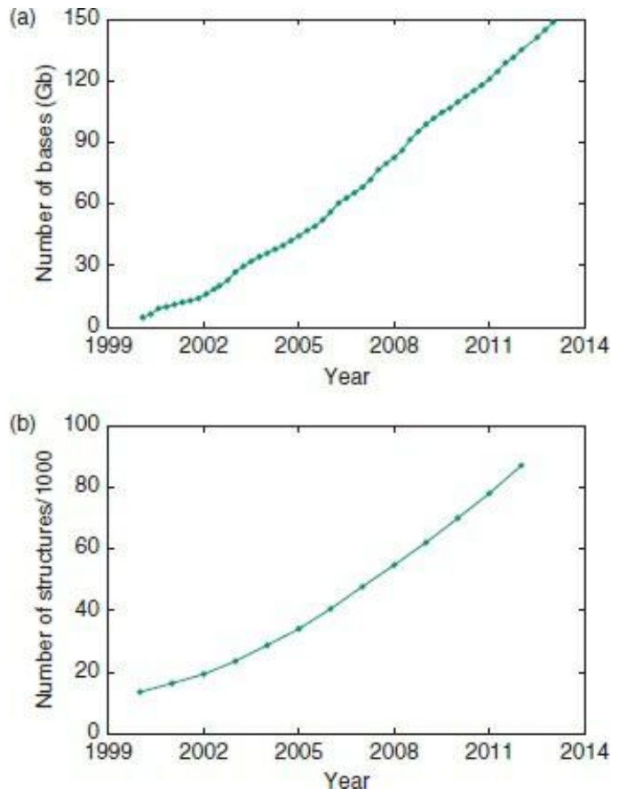

Figure 1.1 (a) Growth of the nucleotide sequence data banks. (b) Growth of Protein Data Bank, archive of threedimensional biological macromolecular structures, from the wwPDB, a collaboration between groups in the USA, Europe, and Japan. (Note the inconsistency with the text: the growth is so fast that these graphs are already out of date.)

In addition to the continuing archives of nucleic acid sequences, amino acid sequences of proteins, and structures of proteins and protein–nucleic acid complexes, there has been a proliferation of biological databases. The Nucleic Acids Research online Molecular Biology Database Collection contains 1380 databases! These databases reflect both novel data streams and different specialist approaches. The challenge to bioinformatics is correspondingly increased.


## See Weblem 1.1

The growing quality, quantity, and variety of data have encouraged scientists to aim at commensurately ambitious goals:

• to have it said that they ‘saw life clearly and saw it whole’; that is, to understand integrated aspects of the biology of organisms, viewed as coherent complex organizations, at microscopic and macroscopic levels;
• to curate, annotate, and impose a structure on the available data, and to provide avenues for access and distribution;
• to interrelate sequence, three-dimensional structure, expression pattern, interaction, and function

26

---

of individual proteins, nucleic acids, and protein–nucleic acid complexes;

• to integrate the data on the different aspects of the life of a cell or organism into a ‘systems’ description of its structure and dynamics;
to use data on contemporary organisms as a basis for travel backward and forward in time: back to deduce events in evolutionary history, forward to achieve greater deliberate scientific modification of biological systems;
• to support applications to medicine, agriculture, and technology.

Indeed, biology has been an applied science throughout human history. Now, as much as ever, human society faces many extremely serious problems. Some have potential scientific solutions, including:

improvement of the health of humans, animals, and plants. Possible contributions include identifying lifestyles that prevent, or at least lower the risk of, disease, and treatment of illnesses when they do arise. There is consensus that bioinformatics will play an essential role; for example, analysis of genome sequence data can identify risks, aid diagnosis and prognosis of disease, and guide treatments tailored to the patient (pharmacogenomics);
• providing adequate nutrition to a growing population;
providing energy to run industries, transportation, communications, and personal appliances such as computers, telephones, music players, etc.;
• development of novel materials;
• identifying the causes and effects of climate change, and developing ways to slow it down;
guiding conservation efforts, especially the preservation of endangered species.


## See Weblems 1.2 and 1.3

A generation or two ago, physics represented the hope for technical solutions to our problems, notably through the provision of cheap, clean energy. Now it is biology’s turn. Even more than physics, biology is data-driven. Given the data streams—or, perhaps better, data floods—analysis has become ever more challenging.

Not only has bioinformatics developed powerful tools, but its methods are becoming more deeply integrated into the biomedical enterprise. Major genome centres typically have as many computational specialists as ‘wet’ laboratory scientists. Moreover, computing is not exclusively the province of specialists. Courses in bioinformatics are a common component of university curricula. This book has as its readership scientists who do not intend to become computational specialists, but find that the contribution of bioinformatics to their research is an essential one.

## Life in space and time

It is difficult to define life, and it may be necessary to modify its definition as computers grow in power and the silicon–life interface grows more intimate. For now, try this: a biological organism is a naturally occurring self-reproducing device that effects controlled manipulations of matter, energy, and information.

From the most distant perspective, life on Earth is a complex, self-perpetuating, evolving system distributed in space and time. It is of the greatest significance that it is largely composed of discrete individual organisms, each with a finite lifetime and—except for clonal populations—with unique

27

---

## features.

Spatially, starting far away and zooming in progressively, one can distinguish, within the biosphere, local ecosystems, stable until their environmental conditions change or they are invaded. Each species within an ecosystem is composed of organisms carrying out individual if not independent activities. Organisms are composed of cells. Every cell is an intimate local ecosystem, not isolated from its environment but interacting with it in specific and controlled ways. Eukaryotic cells contain a complex internal structure of their own, including nuclei and other subcellular organelles, and a cytoskeleton. And finally we come down to the level of molecules.

Life is extended not only in space but in time. We see today a snapshot of one stage in the history of life that extends back in time for at least 3.5 billion <sup>1</sup> years. The theory of natural selection has been extremely successful in rationalizing the process of life’s development. However, historical accident plays too dominant a role in determining the course of events to allow much detailed prediction. DNA from extinct organisms affords only limited access to the historical record at the molecular level. Instead, we must try to read the past in contemporary genomes. US Supreme Court Justice Felix Frankfurter once wrote that ‘… the American constitution is not just a document, it is a historical stream.’ This is also true of genomes, which contain records of their own past.

## Phenotype = genotype + environment + life history + epigenetics

To what extent do the contents of our genomes determine who we are?

Each reader of this book is an individual, with physical, biochemical, and psychological characteristics. (Do not be surprised if these distinctions become more and more tenuous during your lifetime!) Each of you has a general form and metabolism that is common to all humans, and, at the molecular level, much in common with other species as well. But there is considerable variation within our species, to give you individual appearance and character. You are in a state of health somewhere along the spectrum between robust good health and morbid disease. You are currently in some psychological state, and in some mood, reflecting your personality and current activities.

Your genotype is your DNA sequence, both nuclear and mitochondrial. (For plants, include also the sequence of the chloroplast DNA). The genotype is inherited from your parents.
Your phenotype is the collection of your observable traits, other than your genotype. These include macroscopic properties such as height, weight, and eye and hair colour; and microscopic ones such as whether you suffer from sickle-cell anaemia, and your major histocompatibility complex (MHC) locus haplotype.
Your life history includes the integrated total of your experiences, and the physical and psychological environment within which you developed. Your nutritional history has influenced your physical development. For many, a nurturing environment and educational opportunities have influenced your psychological development. What is perhaps less obvious than most aspects of your life history is the growing recognition of the importance of your in utero environment in determining your development curve and even your adult characteristics.
At the interface between the genome and life experience are epigenetic factors. It is largely true that all cells of your body, except sperm or egg cells, erythrocytes, and cells of the immune system, have virtually the same DNA sequence. Yet your tissues are differentiated, with different sets of genes expressed or silenced in liver, brain, etc. Some of these regulatory signals survive cell division. (When a liver cell divides, it divides into two liver cells.) Your parents’ own life

28

---

histories might have altered the epigenetic patterns in their cells, and the fertilized egg from which you were subsequently formed contained some of these ‘predifferentiation’ signals. Via epigenetics, inheritance of acquired characteristics has re-entered respectable mainstream biology.

The relative importance of these factors in determining your phenotype varies from trait to trait. Some are determined exclusively by your alleles for single, specific genes. Others depend on complex interactions between your genes and your life history, and epigenetic signals from your parents.

## Evolution is the change over time in the world of living things

The processes of evolution change distributions of genotypes and phenotypes in successive generations. The genotype is an organism’s genetic information, the sequence of its genome. All other observable features of an organism—macroscopic and biochemical—comprise its phenotype. The genotype is inherited from a parent or parents, subject to modification by mutation or by lateral transfer of genetic material. The phenotype depends on the genotype, including epigenetic signals, which control the development of the organism under the influence of its environment.

The asymmetry between genotype and phenotype is the engine of evolution.

Changes in genotypes are inheritable. Effects on the phenotype, of the environment or lifestyle— for instance, better nutrition leading to larger body size, or debilitating effects of disease or injury are not directly inheritable.
• During the development of any organism, genotype constrains phenotype. Phenotype does not influence genotype.
• Many genotypes can create the same phenotype. For example:

• many mutations in genes coding for proteins leave amino acid sequences unchanged, or make modifications with no apparent effect on function;
• alleles are different forms (sequences) of the same gene. Any organism that contains two copies of a gene at equivalent positions in the genome can have, at that site, two copies of the same allele (homozygosity) or two different alleles (heterozygosity). (In mammals ≈20% of loci are heterozygous.) Homozygotes and heterozygotes have different genotypes, but if a single gene has exclusive control over a trait, and one allele is dominant, homozygotes and heterozygotes may have the same phenotype.

At what levels does evolution operate? Most life consists of discrete organisms. A population is a group of similar organisms that interact. Populations of sexually reproducing organisms interbreed; individuals in all populations compete for resources. The processes of evolution alter the composition and distribution of the gene pools and phenotypes in populations. It is arguable that the population is the true unit of evolutionary activity. (There is nothing like a deme.)

What is the mechanism of evolution? Within a population, individuals with a variety of genotypes arise, displaying a corresponding variety of phenotypes. Although selection has no direct leverage on genotype, individuals with different phenotypes show differential success at reproduction. As a result, the new generation may have an altered distribution of genotypes and phenotypes. Natural selection—enhanced reproduction by ‘fitter’ individuals—is the most important mechanism of evolution. Another mechanism of evolution is genetic drift, the random change in allelic frequencies, which is not in response to selection. Genetic drift is especially important in small, isolated

29

---

populations.

Mechanisms that produce genetic variety create the potential for evolution:

mutations, such as point substitutions, insertions and deletions, and transpositions. Rates of generation of point mutations are estimated to be about $1 0 ^ { - 1 2 } – 1 0 ^ { - 1 0 }$ per base pair per generation (this is not the same as the rate of allelic replacement in a population; mutations only propose candidates for evolutionary change);
• recombination can bring different loci together, or split them apart. Recombination within a gene can create a new allele, whereas recombination outside of genes can affect the relationship between genes and regulatory elements;
• gene duplication, followed by divergence;
gene loss, either by deletion or by mutations that destroy expression or function;
• gene flow from mixing of populations, or gene transfer between species.

Evolution can increase or decrease the variety in gene pools. If a novel mutation confers selective advantage only in the homozygous state, the gene may spread throughout a population. Adoption of the allele by all members of a population can decrease the variety in the gene pool. If a gene arises that confers selective advantage in the heterozygous state only, the gene pool may move towards greater variety. Some mutations create recessive alleles that are deleterious only in the homozygous state. These are harder to remove from a population, especially if heterozygotes have some compensating advantage. An example is the gene for sickle-cell anaemia, which confers on heterozygotes an enhanced resistance to malaria.

Microevolution refers to relatively small changes in a few genes, leading in most cases to relatively small changes in phenotypes. Microevolution affects the individuals within a population. Modern techniques allow us to follow microevolution at the molecular level, through measurements of genome sequences and patterns of RNA transcription and protein expression. Macroevolution refers to larger-scale changes in populations as a whole, including formation of new species. The fossil record provides a partial history of macroevolution, revealing phylogenetic relationships, using geological methods to date events. Comparative anatomy and physiology, and embryology, provide additional clues.

Observations of micro- and macroevolution illuminate each other. Genome sequences help in the classification of species. The fossil record permits dating of past events that have had consequences on the molecular scale, which we can observe now. A major challenge to modern biology is to understand how large-scale events such as the development of new species can occur as a composite result of microevolutionary events.

## Dogmas: central and peripheral

The information archive in each organism—the repertoire for potential development and activity—is the genetic material: DNA $\mathbf { 0 } \mathbf { \Gamma } _ { \mathbf { \Sigma } }$ in some viruses, RNA. DNA and RNA molecules are long, linear, chain molecules containing a message in a four-letter alphabet (see Box 1.1). Even for microorganisms the message is long, typically ${ \approx } 1 0 ^ { 6 }$ characters. Implicit in the structure of the DNA are mechanisms for self-replication

## Box 1.1 The components of nucleic acids and proteins

30

---

## The four naturally occurring nucleotides in DNA (RNA)

| a | Adenine | g | Guanine | c | Cytosine | t | Thymine | (u Uracil) |
| --- | --- | --- | --- | --- | --- | --- | --- | --- |

## The twenty naturally occurring amino acids in proteins

Nonpolar amino acids

| G | Glycine | A | Alanine | P | Proline | V | Valine |
| --- | --- | --- | --- | --- | --- | --- | --- |
| I | Isoleucine | L | Leucine | F | Phenylalanine | M | Methionine |

Polar amino acids

| S | Serine | C | Cysteine | T | Threonine | N | Asparagine |
| --- | --- | --- | --- | --- | --- | --- | --- |
| Q | Glutamine | H | Histidine | Y | Tyrosine | W | Tryptophan |

Charged amino acids

| D | Aspartic acid | E | Glutamic acid | K | Lysine | R | Arginine |
| --- | --- | --- | --- | --- | --- | --- | --- |

Under typical physiological conditions, many histidines are charged.

Other classifications of amino acids can also be useful. For instance histidine, phenylalanine, tyrosine, and tryptophan are aromatic, and are observed to play special structural roles in membrane proteins.

In addition to the one-letter codes given in the table, amino acid names are frequently abbreviated to their first three letters: for instance, Gly for glycine. Exceptions are isoleucine, asparagine, glutamine, and tryptophan, which are abbreviated to Ile, Asn, Gln and Trp, respectively. The rare amino acid selenocysteine has the threeletter abbreviation Sec and the one-letter code U.

It is conventional to write nucleotides in lower case and amino acids in upper case. Thus atg means adeninethymine-guanine and ATG means alanine-threonine-glycine.

and for encoding amino acid sequences of proteins. The double helix and its internal self-complementarity, providing for accurate replication, are well known <sup>2</sup> (see Plate I). Near-perfect replication is essential for stability of inheritance, but some imperfect replication, or mechanism for import of foreign genetic material, is also essential. Otherwise evolution could not take place in asexual organisms.

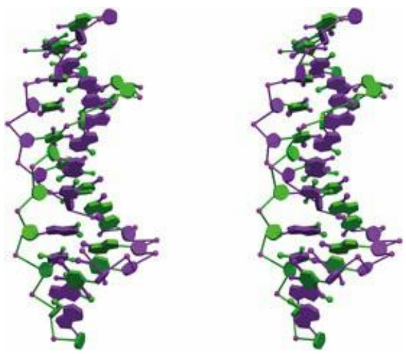

Plate I The double helix of DNA. This is a stereo pair, requiring a viewer, or practice, to see in three dimensions (See Chapter 1).

The strands in the double helix are antiparallel; directions along each strand are called $3 ^ { \prime }$ and $5 ^ { \prime }$

---

(for positions in the deoxyribose ring). In transcription of DNA to RNA, and in translation of messenger RNA (mRNA) to protein, the base sequence is always read in the 5′ → 3′ direction.

The implementation of genetic information occurs, initially, through the synthesis of RNA and proteins.

The RNA referred to in the central dogma is messenger RNA. mRNA is copied from a proteinencoding gene, and in eukaryotes may require splicing to remove noncoding introns. Variable splicing can lead to production of several different proteins from the same gene, by ‘mixing and matching’ of exons.

It is now recognized that the RNA world has a rich variety of structure and function. Ribozymes are RNA molecules with enzymatic activity. The ribosome itself is an example: although the ribosome is an RNA–protein complex, its catalytic activity—mRNA-directed polypeptide chain synthesis—resides in the RNA. Other types of RNA, such as small interfering RNA (siRNA), microRNA (miRNA), and piwi-interacting RNAs (piRNAs), function to control translation.

Proteins are the molecules responsible for much of the structure and biochemical activity of organisms. (A colleague once entitled a keynote lecture ‘Genes are from Venus, proteins are from Mars.’) Our hair, muscle fibres, digestive enzymes, and antibodies are all proteins. Like nucleic acids, proteins are long, linear chain molecules. The genetic ‘code’ is in fact a cipher (see Box 1.2): successive triplets of letters from the DNA sequence specify successive amino acids; stretches of

Box 1.2 The standard genetic code

| ttt | Phe | tct | Ser | tat | Tyr | tgt | Cys |
| --- | --- | --- | --- | --- | --- | --- | --- |
| ttc | Phe | tcc | Ser | tac | Tyr | tgc | Cys |
| tta | Leu | tca | Ser | taa | STOP | tga | STOP |
| ttg | Leu | tcg | Ser | tag | STOP | tgg | Trp |
| ctt | Leu | cct | Pro | cat | His | cgt | Arg |
| ctc | Leu | ccc | Pro | cac | His | cgc | Arg |
| cta | Leu | cca | Pro | caa | Gln | cga | Arg |
| ctg | Leu | ccg | Pro | cag | Gln | cgg | Arg |
| att | Ile | act | Thr | aat | Asn | agt | Ser |
| atc | Ile | acc | Thr | aac | Asn | agc | Ser |
| ata | Ile | aca | Thr | aaa | Lys | aga | Arg |
| atg | Met | acg | Thr | aag | Lys | agg | Arg |
| gtt | Val | gct | Ala | gat | Asp | ggt | Gly |
| gtc | Val | gcc | Ala | gac | Asp | ggc | Gly |
| gta | Val | gca | Ala | gaa | Glu | gga | Gly |
| gtg | Val | gcg | Ala | gag | Glu | ggg | Gly |

DNA sequences encipher amino acid sequences of proteins. Alternative genetic codes appear in organelles—chloroplasts and mitochondria—and in some species.

Typically, proteins are 200–400 amino acids long, requiring 600–1200 letters of expressed DNA message to specify them. DNA sequences also direct the synthesis of RNA molecules, for instance the RNA components of the ribosome. However, not all DNA is expressed as proteins or structural

32

---

RNA. Most genes in higher organisms contain internal untranslated regions, or introns. Some regions of the DNA sequence are devoted to control mechanisms, and a substantial amount of the genomes of higher organisms has been termed ‘junk’, which may mean merely that we do not yet understand its function.

A major effort to understand the function of the genome has produced the results of the ENCODE project (see Box 1.3).

## Box 1.3 The ENCODE project

The goal of the ENCODE project (derived from Encylopaedia of DNA Elements) is to understand the function of the entire human genome. Almost 500 scientists in 32 research groups formed the consortium that tackled the problem. The current effort is the result of a scaling up from a pilot project started in 2007, which focused on a selected 1% (about 30 Mb) of the human genome deemed likely to be of interest. The current results, a landmark burst of 30 papers published coordinately in Nature, Genome Research, and Genome Biology, assign function (meaning that they specify biological activity) to about 80% of the human genome. It is entirely possible that the functions of the remaining 20% will be identified. The Nature ENCODE Explorer offers web access to the project and its results (http://www.nature.com/encode/#/threads).

When the human genome was first sequenced it appeared that there were only about 23 000 protein-coding genes, accounting for about 1.5% of the genome. The number of genes was smaller than expected (earlier, much larger estimates, if scrutinised, had no reliable basis). It is true that variable splicing means that the number of proteins is not limited to the number of protein-coding genes. (The immune system generates the vast majority of the individual proteins in our bodies, but uses a different splicing system—at the DNA rather than the RNA level.)

In addition to proteins, regions of DNA encode non-messenger RNA molecules, including but not limited to the RNA components of the ribosome, and transfer RNAs (tRNAs).

Nevertheless, the function of the more than 99% non-protein-coding DNA was a mystery. Although clearly some of the noncoding regions were regulatory, there was still a tendency to talk about the large amounts of ‘junk’ DNA. For, although the fugu fish genome is only one-eighth the size of the human genome, fugu has a protein repertoire of a similar size to humans. If fugu could get along without seven-eighths of our DNA, the suggestion was that much of this excess must be ‘junk’. (Sydney Brenner distinguished junk, meaning useless stuff you keep around, from garbage, or useless stuff you get rid of.)

There are two ways for a noncoding region of DNA to have a function. Even if not transcribed, it could be involved in sequence-dependent physical interactions, within chromatin, that either expose it to or block it from protein ligands. If transcribed, it can form RNAs with various possible functions, the most common of which is regulation of transcription.

Categories of results of the ENCODE analysis include:

- evidence that $75\%$ of the human genome is transcribed;
- a mapping and dictionary of regulatory sites in the genome, regions of the DNA that bind proteins to control transcription. The 8.4 million such sites amount to twice as much DNA as codes for protein. The affinity is many-to-one; that is, many proteins can bind to the same regulatory region;
- a sketch of the structure of the regulatory network. The interactions that enhance or inhibit gene expression have a detailed and intricate logic, including feedback loops. Many interactions contribute to the ultimate decision;
- a mapping of exposed sites in chromatin, which are unprotected from DNase 1 cleavage. These sites mark regulatory regions typically adjacent to genes, and provide sites for binding of regulators of expression.

The data provided by the ENCODE project will be the launching pad for many future research projects. A colleague admitted to hearing an echo: ‘Now this is not the end. It is not even the beginning of the end. But it is, perhaps, the end of the beginning.’

In DNA the molecules comprising the alphabet are chemically similar, and the structure of DNA

33

---

is, to a first approximation, uniform (although some DNA–protein interactions distort the DNA structure). Proteins, and structural RNAs, in contrast, show great variety in their three-dimensional conformation. These are necessary to support their very diverse structural and functional roles.

The amino acid sequence of a protein dictates its three-dimensional structure. For each natural amino acid sequence there is a unique stable native state that under proper conditions is adopted spontaneously (see Box 1.4). If a purified protein is heated, or otherwise brought to conditions far from the normal physiological environment, it will ‘unfold’ to a disordered and biologically inactive structure. (This is why our bodies contain mechanisms to maintain nearly constant internal conditions.) When normal conditions are restored, protein molecules will generally readopt the native structure, indistinguishable from the original state. There are important exceptions, however. Irreversible denaturation leading to formation of insoluble aggregates is most familiar to us when we hard-boil an egg. Such aggregates are associated with many diseases, including Alzheimer’s disease and bovine spongiform encephalopathies (such as so-called mad-cow disease).

The functions of proteins depend on their adopting their native three-dimensional structure. For example, the native structure of an enzyme may have a cavity on its surface that binds a small molecule and juxtaposes

## Box 1.4 From one dimension to three

The spontaneous folding of proteins to form their native states is the point at which nature makes the giant leap from the one-dimensional world of gene and protein sequences to the three-dimensional world that we inhabit. There is a paradox: the translation of DNA sequences to amino acid sequences is very simple to describe logically; it is specified by the genetic code. The folding of a polypeptide chain into a precise three-dimensional structure is very difficult to describe logically. However, translation requires the immensely complicated machinery of the ribosome, tRNAs, and associated molecules, but protein folding occurs spontaneously (see Plate II).


<details>
<summary>flowchart</summary>

```mermaid
graph LR
  A["A Sequence of Bases in DNA..."] --> B["Is Translated to a Sequence of Amino Acids in a protein..."]
  B --> C["Three Bases"]
  C --> D["Three-Dimensional Structure"]
  D --> E["Which Folds Spontaneously to a Precise Three-Dimensional Structure"]
  E --> F["Genetic Code\n"Translation Table"
```
</details>

Plate II Expression of gene sequences as three-dimensional structures of proteins. A DNA sequence encodes an amino acid sequence. The polypeptide chain of a protein folds spontaneously into the correct native structure.

it to catalytic residues. Many regulatory mechanisms depend on the binding of proteins to other proteins or to DNA. We thus have the paradigm:

• DNA sequence determines protein sequence;
• protein sequence determines protein structure;
• protein structure determines protein function;
• regulatory mechanisms, including but not limited to control of expression patterns, deliver the

34

---

right amount of the right function to the right place at the right time.

Much of the organized activity of bioinformatics has been focused on the analysis of the data related to these processes.

## Statics and dynamics

The genome sequence of a cell, and its implied repertoire of RNAs and proteins, expresses what the cell could be and could do. But cells make choices. Dense, logically integrated, networks of control mechanisms govern the dynamic state of cellular metabolic and transcriptional activity. (See Chapter 7.)

The dynamics of the molecular biology of cells and organisms include levels higher than the molecular, of structure and organization. Examples are such questions as how tissues become specialized during development or, more generally, how environmental effects exert control over genetic events. In some cases of simple feedback loops it is understood at the molecular level how increasing the amount of a reactant causes an increase in the production of an enzyme that catalyses its transformation. The lac operon of Escherichia coli is an example.

More complex are the programmes of development that unfold during the lifetime of an organism. Learning, which must ultimately be reflected in changes in structure and dynamics of the nervous system, is really a developmental process. These fascinating problems about the information flow and control in an organism have now come within the scope of mainstream bioinformatics. For example, it was reported recently $^{3}$ in honeybees that patterns of DNA methylation—that is, epigenetic signals—reversibly control behaviour patterns.

Many novel data streams reflect experiments on dynamic aspects of molecular biology. These include new techniques, such as:

- sequencing of cells' RNA content to measure the transcriptome;
• determination of DNA methylation patterns;
- identification of splice variants and post-translational modifications of proteins;
• identifying the partners in:
- protein–protein interactions,
- DNA–protein interaction in transcription regulation: both the DNA region and the proteins that bind to it;
- integration of individual regulatory steps into networks.

Systematic application of both old and new techniques permits controlled comparisons:

• large-scale surveys of single-nucleotide polymorphisms (SNPs) in human populations;
- phylogenetic studies, to understand the origin and changes of particular genes during the course of evolution;
- tissue-specific, disease-specific, and age-specific measurements of sequences, epigenetic signals, and expression patterns.

## Networks

Crucial to biology is how components of living systems interact. Any molecule may have several partners with which it interacts in different ways. The sets of interactions of different molecules form

35

---

networks.

There are networks of genes, proteins, and metabolites. Indeed, the same set of molecules may be connected by different types of interaction or relationship, to form different networks (see Table 1.1).

Table 1.1

| Network | Element of network | Connection between elements |
| --- | --- | --- |
| Genomes | Gene | Homology |
|  |  | Linkage |
|  |  | Shared expression pattern |
| Protein | Protein | Homology |
|  |  | Regulatory relationship |
|  |  | Shared expression pattern |
|  |  | Physical complex formation |
| Metabolite | Chemical compound | Substrate and product of an enzymatic reaction |
|  |  | Similarity in structure |
|  |  | Similarity in reactivity |

In cells, the two types of interaction network are in operation: a physical network of protein–protein and protein–nucleic acid complexes, and a logical network of control cascades. Physical and logical networks operate in parallel. Interactions may be physical or logical—often they are both. A macromolecular complex such as the ribosome is a network of proteins and RNAs, interacting through the physical contacts in their assembly. A transcription-regulatory network is a network of genes, exerting logical control over expression patterns via the synthesis of specific DNA-binding proteins. A transcription factor that acts by binding to DNA may never interact physically with the proteins the expression of which it controls. Metabolic pathways have a similar duality: many but not all metabolic pathways are mediated by physical protein–protein interactions and regulated by logical ones.

Even though particular complexes may participate in both physical and logical networks, the two remain distinct in terms of their organization and their biological function, and it is useful to keep the distinction between them in mind, especially when they overlap.

## Observables and data archives

Bioinformatics deals with biological data, their collection, curation, distribution, and analysis. The ‘unit’ of distribution of a collection of some type of biological information is a database. There has been a great deal of growth and proliferation of databases and, perhaps paradoxically, there is a trend towards integration into larger and more comprehensive ones, to combine different categories of information that were formerly the provinces of individual projects. This is being driven by both academic and political forces.

A database includes (1) an archive of information, (2) a logical organization or ‘structure’ of that information, called a schema, and (3) tools to gain access to it. Databases in molecular biology contain nucleic acid and protein sequences, macromolecular structures and functions, expression patterns, and networks of metabolic pathways and control cascades. They include:

\- archival databases of biological information:

• DNA and protein sequences, including annotation (see Box 1.5);
- variations, such as compilations of haplotypes, or disease-associated mutations;

36

---

- nucleic acid and protein structures, including annotation;
- databases focused on organisms, including genome databases;
- databases of protein expression patterns;
- databases of metabolic pathways;
- databases of interactions and of regulatory networks;

\- derived databases: these contain information collected from the archival databases, and inferred from analysis of their contents. For instance:

- sequence motifs (characteristic ‘signature patterns’ of families of proteins);
- classifications or relationships (connections between, and common features of, entries in archives). Examples include databases of protein sequence families, or hierarchical classifications of protein folding patterns);

## Box 1.5 Archives of nucleic acid and protein sequences

The archive of nucleic acid sequences is maintained by a triple partnership, the International Nucleotide Sequence Database Collaboration, comprising GenBank, based at the US National Center for Biotechnology Information, in Bethesda, Maryland; the European Nucleotide Archive, or ENA, based at the European Bioinformatics Institute (EBI), in Hinxton, UK, and the Center for Information Biology and DNA Data Bank of Japan, at the National Institute of Genetics in Mishima, Japan. The three sites exchange incoming submissions daily to ensure common coverage. However, the format, annotation, and embedded links differ among the corresponding entries released by the different databases.


## See Weblem 1.4

The archive of amino acid sequences of proteins, now determined almost exclusively from translation of gene sequences, is maintained by the United Protein Database (UniProtKB), a merger of the databases SWISS-PROT, the Protein Identification Resource (PIR), and Translated EMBL (TrEMBL).

Associated with the archives are tools for selection and retrieval of sequences. The EBI has a number of search engines pointed at different components of its databases. The US National Center for Biotechnology Information offers ENTREZ. Both allow parallel searches in multiple data archives.

Many full-genome sequencing projects maintain databases focused on individual species. Notable are the Ensembl (Wellcome Trust Sanger Institute, Hinxton, UK), University of California at Santa Cruz browsers for the human and other genomes, and FlyBase.

Many derived databases assemble families of proteins or subunits based on the similarities of their sequences. An ‘umbrella’ database, InterPro, integrates the contents, features, and annotation of several individual databases of protein families, domains, and functional sites, and contains links to others, including the Gene Ontology Consortium functional classification. Interpro intends to assimilate additional databases, including structural databases. (Resistance is futile.)

- bibliographic databases. The scientific literature itself is data. PubMed is a database. Researchers ‘datamine’ PubMed as they do any other database;
- databases of websites:
- databases of databases containing biological information;
- links between databases.

A database without effective modes of access is merely a data graveyard

37

---

Useful access to data requires a set of tools for answering questions, such as:

- ‘Does the database contain the information I require?’ (Example: can I retrieve the amino acid sequence of human alcohol dehydrogenase?)
- ‘How can I assemble selected information from the database in a useful form?’ (Example: compile a list of globin sequences; or even better, a table of aligned globin sequences.)
- Indices of databases are useful in asking ‘Where can I find some specific piece of information?’ (Example: what databases contain the amino acid sequence of porcupine trypsin?) Of course, if I know and can specify exactly what I want, the problem is relatively straightforward.

Mechanisms that allow effective access are an issue of database design that ideally should remain hidden from users. It has become clear that effective access cannot be provided by bolting a query system onto an unstructured archive. Instead, the logical organization of the storage of the information must be designed with the access in mind, considering what kinds of questions users will want to ask. The structure of the archive must mesh smoothly with the information-retrieval software.

A variety of database queries arise in bioinformatics. Compare the following typical examples:

1. Given a sequence, or fragment of a sequence, find sequences in the database that are similar to it. This is a central problem in bioinformatics. We share such string-matching problems with many fields of computer science. For instance, word processing and editing programs support string-search functions.
2. Given a protein structure, or fragment, find protein structures in the database that are similar to it. This is the generalization of the string-matching problem to three dimensions.
3. Given a sequence of a protein of unknown structure, find structures in the database that adopt similar three-dimensional structures. One might be tempted to cheat, to look in the sequence data banks for proteins with sequences similar to the probe sequence. For if two proteins have sufficiently similar sequences, they will have similar structures. However, the converse is not true, and one can hope to create more powerful search techniques that will find proteins of similar structure even though their sequences have diverged beyond the point where they can be recognized as similar by sequence comparison.
4. Given a protein structure, find sequences in the data bank that correspond to similar structures. Again, one can cheat by using the structure to probe a structure data bank, but this can give only limited success because there are so many more sequences known than structures. It is therefore desirable to have a method that can pick out the structure from the sequence.

Points 1 and 2 are solved problems; such searches are carried out thousands of times a day. Points 3 and 4 are active fields of research.

## Information flow in bioinformatics

Data enter the bioinformatics establishment when a scientist deposits an experimental result in an archive, or a database records a result appearing in the literature. The archive curates and annotates the data to create an entry of proper contents and format. Quality checks are part of the curation process. The new entry then appears in the public release of the archive.

The division of the archive into entries is determined by the provenance of the data; that is, an entry corresponds to one coherent set of experimental measurements, often corresponding to one

38

---

published article. In some cases, fragments of a complete sequence appear in several articles. A database can join the results to form an entry containing the complete biological entity. Currently, many nucleotide sequence data sets enter the databases as annotated genomes, or as unassembled metagenomic fragments.

Other information-retrieval projects, either associated with an archive or independent, may integrate newly released entries into their individual systems. They may select or reorganize the data structure, and provide novel tools for analysis.

Reorganization of the data may involve:

- simply integrating the new entries into a general or specialized search engine;
- extracting useful subsets of the data. Examples include (1) identification of genes in a connected DNA sequence, such as a bacterial genome or a eukaryotic chromosome, and (2) the extraction of a nonredundant set of protein sequences, to both shorten searches and reduce statistical bias;
- deriving new types of information from the original data. A simple example: release of a protein-coding gene by a DNA sequence archive will trigger the appearance of its amino acid sequence translation in databases of protein sequences. (A not-so-simple aspect: DNA sequences don’t tell us about splice variants or about other important information related to the protein);
- recombining data in different ways. Many projects group sequences or structures of families of homologous proteins, or proteins that share function. Examples include the MEROPS protease database and the Protein Kinase Resource. Some archives tend to keep related entries separate to preserve clarity of provenance. Some databases integrate data about a particular organism or sets of related organisms: FlyBase is an example;
- reannotating the data, including provision of different constellations of links. The integration may be horizontal or vertical. That is, links may indicate relationships to other entries of the same type (for instance, correspondences within a genome among homologous genes or among genes associated with the same metabolic pathway). Or, links may adduce a variety of information about a gene or protein (for instance, links between a gene and the clinical consequences of mutations).

Many sites serve as gateways between the archives and the computational tools available for data analysis. Information retrieval permits selection and extraction of data to provide the ingredients of a research project. Many bioinformatics resources not only offer information retrieval, but facilitate the ‘downstream’ processing of the entries selected. A typical example would be to retrieve the sequences of a set of homologous genes and then to align them. The goal is to provide smooth integration of all the data-processing steps required for a research project, by intimate links among the tools for data storage, retrieval, and analysis.

The growing importance of simultaneous access to databases has led to research in database interactivity: how can databases ‘talk to one another’ without too great a sacrifice of the freedom of each one to structure its own data in ways appropriate to the individual features of the material it contains?

On the other hand there is a very strong trend towards merging and integration of data resources in bioinformatics. Some of the reasons for this are political: the ‘empire-building’ allele is present at fairly high frequency in the scientific population, and then the ‘too big to fail’ argument for continued and enhanced funding takes over. Scientifically, integrating databases allows for ‘one-stop shopping’, makes for ease of handling queries that require access to different categories of information, and facilitates of cross-category consistency checks in curating the data. Moreover, large database organizations have the personnel to provide tutorial guides: to usage of the site and to

39

---

present scientific background. A large organization can support a help desk. Frustrated users may retort that the integration of the data produces a site so complex as to require guidance. However, there are plenty of small specialized databases that users also find confusing.

Indeed, only national or commercial rivalries impede fusion into a single world-wide database. Because of the danger that the result will prove unwieldy, it will be possible to tailor access to the needs of particular projects. The unification of the archives will be accompanied by a fragmentation of the routes of access.

Although there are good arguments for unique, or no more than partnership, control over the archives, there is no need to limit the ways to access them: colloquially, the design of the ‘front end’ of the database. Specialized user communities may extract subsets of the data, or recombine data from different sources, and provide specialized avenues of access. Such ‘boutique’ databases depend on the primary archives as the source of the information they contain, but redesign the organization and presentation. Indeed, different derived databases can slice and dice the same information in different ways. This accounts for much of the great proliferation of specialized databases reported in the annual Nucleic Acids Research compendium.

A reasonable extrapolation suggests the concept of specialized ‘virtual databases’ (a concept first suggested almost 50 years ago), grounded in the archives but providing individual scope and function, tailored to the needs of individual research groups or even individual scientists.

## Curation, annotation, and quality control

The scientific and medical communities are dependent on the quality of databases. Indices of quality, even if they do not permit correction of mistakes, may help us avoid arriving at wrong conclusions.

Database entries comprise raw experimental results, and supplementary information or annotations. Each of these has its own sources of error.

The most important determinant of the quality of the data themselves is the state of the art of the experiments. Older data were limited by older techniques; for instance, amino acid sequences of proteins were once determined by peptide sequencing, but are now translated from DNA sequences (except for partial sequencing by mass spectrometry). One consequence of the data explosion is that most data are new data, governed by current technology, which in most cases does quite a good job.

Annotations include information about the source of the data and the methods used to determine them. They identify the investigators responsible and cite relevant publications. They provide links to related information in other databases. In some sequence databases the annotations include feature tables, which are lists of segments of the sequences that have biological significance; for instance, regions of a DNA sequence that code for proteins. These appear in computer-parsable formats, their contents restricted to a controlled vocabulary. Note that a statement by each database on a controlled vocabulary, and the definitions of the terms that appear in the vocabulary, is essential for information-retrieval operations involving interactions among multiple databases, and distributed queries. (This is like a ‘convention card’ at a bridge tournament.)

Formerly, a typical DNA sequence entry was produced by a single research group, investigating a gene and its products in a coherent way. Annotations were grounded in experimental data and written by specialists. In contrast, full-genome sequencing projects offer no experimental confirmation of the expression of most putative genes, nor characterization of their products. Curators at databases base much of their annotation on the analysis of the sequences by computer programs.

Annotation is the weakest component of the genomics enterprise. Automation of annotation is possible only to a limited extent; getting it right remains labour-intensive, and allocated resources are

40

---

inadequate. But the importance of proper annotation cannot be underestimated. P. Bork has commented that errors in gene assignments vitiate the high quality of the sequence data themselves.

Growth of genomic data will permit improvement in the quality of annotation as statistical methods increase in accuracy. This will allow improved reannotation of entries. The improvement of annotations will be a good thing. It implies, however, the disturbing concomitant that annotation will be in flux. The problem is aggravated by the proliferation of websites with increasingly dense networks of links. Networks of websites provide useful avenues for applications. But the web is also a vector of contagion, propagating errors in raw data, in immature data subsequently corrected but the corrections not passed on, and in variant annotations.

Perhaps the only possible solution is a distributed and dynamic error-correction and annotation process. Distributed in that database staff will have neither the time nor the expertise for the job; specialists will have to act as curators. Dynamic in that progress in automation of annotation and error identification/correction will permit reannotation of databases. We will have to give up the safe idea of a stable database composed of entries that were correct when first distributed and which will stay fixed. Databases will become a seething broth of information, growing in size and maturing—we must hope—in quality.

Tasks of greater subtlety arise when one wishes to study relationships between information contained in separate databases. This requires links that facilitate simultaneous access to several databases. Here is an example: for which proteins of known structure involved in diseases of purine biosynthesis in humans are there related proteins in yeast? We are setting conditions on known structure, specified function, detection of relatedness, correlation with disease, and specified species. Today the quality of a database depends not only on the information it contains but on the effectiveness of its links to other related sources of information. This one of the reasons for integration of databases.

## The worldwide web


## See Weblem 1.5

All readers will have used the worldwide web, for reference material, for news, for access to databases in molecular biology, for checking out personal information about individuals—friends or colleagues or celebrities—or just for browsing. The web is a means of interpersonal and intercomputer contact over networks. It provides a complete global village, containing the equivalent of library, post office, shops, and schools.

As a repository, the web can be thought of as a giant worldwide multimedia notice board. It contains text, images, cinema, and sound. Virtually anything that can be stored on a computer can be made available and accessed via the web. An interesting example is a site treating the poetry of Walt Whitman (http://www.whitmanarchive.org). The highest-level page contains a table of contents. The site contains printed text of different poems. You can compare different editions. You can access critical analysis of the poems. You can see versions of some poems in manuscripts. There is even a link to an audio file, from which you can hear Whitman himself reading part of a poem.

Links embedded in a website can be internal or external. Internal links take you to other portions of the text of a current document, or to associated images, cinema, or sounds. External links may allow you to move down to more specialized documents, up to more general ones (perhaps providing background to technical material), sideways to parallel documents (other papers on the same subject), or over, to directories that show what other relevant material is available.

41

---

Nor is the web solely a one-way street. Many web documents include forms in which you can enter information, and launch a program. Search engines are common examples. Many calculations in bioinformatics are now launched via such web servers (see Box 1.6). If the calculations are lengthy the results may not be returned within the session, but sent by e-mail.


## See Weblem 1.6

## Box 1.6 Submitting a BLAST search

A BLAST search is a common and typical example of the use of a web server in bioinformatics. Pointing a browser at a web server, one can paste in a sequence of interest, choose options, and submit the calculation. Subsequently the result will appear in the window.

The calculation is done remotely. If you are using the BLAST server at the EBI (http://www.ebi.ac.uk/Tools/sss/ncbiblast/nucleotide.html) the computations will be done at a data centre in London. External users initiate  $\approx3.7 \times 10^{6}$  sequence-similarity-related jobs per month (most but not all are BLAST searches). Currently, the EBI dedicates a 216-node cluster to this service.

Very soon we shall examine the results of such a search in detail.

The main thing to do, to get started using the web effectively, is to find useful entry points. Once a session is launched, links will take you where you want to go. Among the most important sites are search engines, such as Google, that index the entire web and permit retrieval by keywords. You can enter one or more terms, such as ‘phosphorylase’, ‘allosteric change’, or ‘crystal structure’, and the search program will return a list of links to sites on the web that contain these terms.

Once you have completed a successful session, when you next log in the intersession memory facilities of the browsers allow you to pick up cleanly where you left off. During any session, should you find yourself viewing a document to which you will want to return, you can save the link in a file of bookmarks or favourites. In a subsequent session you can return directly to any site on this list, not needing to follow the trail of links that led you there in the first place.

A personal home page is a short autobiographical sketch (with links, of course). You and your colleagues will have your own home pages which typically include name, institutional affiliation, addresses for paper and electronic mail, telephone and fax numbers, a list of publications, and current research interests. It is not uncommon for home pages to include personal information, such as hobbies, pictures of the individual with his or her spouse and children, and even with the family dog! (It is important, however, not to include information that would create vulnerability to identity theft.)

## Electronic publication

We are in an era of a transition to paper-free publishing. More and more publications are appearing on the web. A scientific journal may post only its table of contents, or a table of contents together with abstracts of articles, or complete articles. Many institutional publications—newsletters and technical reports—appear on the web. Many other magazines and newspapers are showing up as well. You might want to try http://www.nytimes.com. Many printed publications now contain references to web links containing supplementary material that never appears on paper.

Major forces in the conversion of paper to electronic libraries are the advent of electronic-format-only journals and Google's project to scan in the contents of a number of academic libraries. There is movement towards open access publication. We shall develop this topic in Chapter 3.

42

---

## Computers and computer science

Bioinformatics would not be possible without advances in computing hardware and software. Fast and high-capacity storage media are essential even to maintain the archives. Information retrieval and analysis require programs: some fairly straightforward and others extremely sophisticated. Distribution of the information requires the facilities of computer networks and the worldwide web.

Computer science is a relatively young and flourishing field with the goal of making the most effective use of information technology hardware. Certain areas of computer science impinge most directly on bioinformatics. Consider their application to a specific biological problem, that of retrieving from a database all sequences similar to the human PAX-6 sequence. A good solution to this problem would appeal to computer science for:

- Analysis of algorithms. An algorithm is a complete and precise specification of a method for solving a problem. For the retrieval of similar sequences, we need to measure the similarity of the probe sequence to every sequence in the database. It is possible to do much better than the naive approach of checking every pair of positions in every possible juxtaposition, a method that even without allowing gaps would require a time proportional to the product of the number of characters in the probe sequence times the number of characters in the database. A speciality in computer science, known colloquially as ‘stringology’, focuses on developing efficient methods for this type of problem, and analysing their effective performance.
- Data structures and information retrieval. How can we organize our data for efficient response to queries? For instance, are there ways to index or otherwise ‘preprocess’ the data to make our sequence-similarity searches more efficient? How can we provide interfaces that will assist the user in framing and executing queries?
- Software engineering. Hardly ever anymore does anyone write programs in the native language of computers. Programmers work in higher-level languages, such as C, C++, PERL, PYTHON, JAVA, or even FORTRAN. The choice of programming language depends on the nature of the algorithm and associated data structure, and the expected use of the program. Of course, most complicated software used in bioinformatics is now written by specialists, which brings up the question of how much programming expertise a bioinformatician needs.

## Programming

Programming is to computer science what bricklaying is to architecture. Both are creative; one is an art and the other a craft.

Many students of bioinformatics ask whether it is essential to learn to write complicated computer programs. My advice (not agreed upon by everyone in the field) is: ‘Don’t. Unless you want to specialize in it.’ To work in bioinformatics, you will need to develop expertise in using tools available on the web. Learning how to create and maintain a website is essential. And of course you will need facility in the use of the your computer’s operating system, including general-purpose application programs such as word processors and presentation tools. Some skill in writing simple scripts in a language like PERL provides an essential extension to the basic facilities of the operating system.

On the other hand, the size of the data archives, and the growing sophistication of the questions we wish to address, demand respect. Truly creative programming in the field is best left to specialists, with advanced training in computer science. Nor does using programs, via highly polished (not to

43

---

say flashy) web interfaces, provide any indication of the nature of the activity involved in writing and debugging programs. Bismarck once said: ‘Those who love sausages or the law should not watch either being made.’ Perhaps computer programs should be added to his list.

I recommend learning some basic skills with PERL, or with one of the related languages PYTHON or RUBY. PERL is a very powerful tool, and is available for all computer systems. PERL makes it very easy to carry out many very useful simple tasks, but can also be effective in projects demanding heavy computation.

How should you learn enough PERL to be useful in bioinformatics? Many institutions run courses. Learning from colleagues is fine, depending on the ratio of your aptitude to their patience. Books are available. A very useful approach is to find lessons on the web: ask a search engine for ‘PERL tutorial’ and you will turn up many useful sites that will lead you by the hand through the basics. And, of course, use it as much as you can. This book will not teach you PERL, but it will provide opportunities to practise what you learn elsewhere. Should your programming ambitions go beyond simple tasks, check out the BioPERL project, a source of freely available PERL programs and components in the field of bioinformatics (http://bio.perl.org).

Examples of simple PERL programs appear in this book. The strength of PERL at character-string handling make it suitable for sequence-analysis tasks in biology. Here is a very simple PERL program to translate a nucleotide sequence into an amino acid sequence according to the standard genetic code. The first line, #!/usr/bin/perl, is a signal to the UNIX (or LINUX) operating system that what follows is a PERL program. Within the program, all text commencing with a ‘#’, through to the end of the line on which it appears, is merely comment. The line \_\_END\_\_ signals that the program is finished and what follows is the input data. (All material that the reader might find useful to have in computer-readable form, including all programs, appears in the online resource centre associated with this book: http://www.oxfordtextbooks.co.uk/orc/leskbioinf4e/. )

Even the simple program in Case Study 1.1 displays several features of the PERL language. The file contains background data (the standard genetic code translation table), statements that tell the computer to do something, and the input data (appearing after the \_\_END\_\_ line). Comments summarize sections of the program and describe the effect of each statement.

The program is structured as blocks enclosed in curly brackets,  $\{\ldots\}$ , which are useful in controlling the flow of execution. Within blocks, individual statements (each ending in a semicolon,;) are executed in order of appearance. However, the outer block is a loop:

```txt
while ($line = <DATA>) {
    ...
}
```

## CASE STUDY 1.1 Translation of a DNA sequence to an amino acid sequence using the standard genetic code

```perl
#!/usr/bin/perl
#translate.pl -- translate nucleic acid sequence to protein sequence
#                    according to standard genetic code
#     set up table of standard genetic code
%standardgeneticcode = (
"ttt"=> "Phe",    "tct"=> "Ser", "tat"=> "Tyr",    "tgt"=> "Cys",
"ttc"=> "Phe",    "tcc"=> "Ser", "tac"=> "Tyr",    "tgc"=> "Cys",
"tta"=> "Leu",    "tca"=> "Ser", "taa"=> "TER",    "tga"=> "TER",
```

44

---

```perl
"ttg" => "Leu",    "tcg" => "Ser", "tag" => "TER",    "tgg" => "Trp",
"ctt" => "Leu",    "cct" => "Pro", "cat" => "His",    "cgt" => "Arg",
"ctc" => "Leu",    "ccc" => "Pro", "cac" => "His",    "cgc" => "Arg",
"cta" => "Leu",    "cca" => "Pro", "caa" => "Gln",    "cga" => "Arg",
"ctg" => "Leu",    "ccg" => "Pro", "cag" => "Gln",    "cgg" => "Arg",
"att" => "Ile",    "act" => "Thr", "aat" => "Asn",    "agt" => "Ser",
"atc" => "Ile",    "acc" => "Thr", "aac" => "Asn",    "agc" => "Ser",
"ata" => "Ile",    "aca" => "Thr", "aaa" => "Lys",    "aga" => "Arg",
"atg" => "Met",    "acg" => "Thr", "aag" => "Lys",    "agg" => "Arg",
"gtt" => "Val",    "gct" => "Ala", "gat" => "Asp",    "ggt" => "Gly",
"gtc" => "Val",    "gcc" => "Ala", "gac" => "Asp",    "ggc" => "Gly",
"gta" => "Val",    "gca" => "Ala", "gaa" => "Glu",    "gga" => "Gly",
"gtg" => "Val",    "gcg" => "Ala", "gag" => "Glu",    "ggg" => "Gly"
);
# process input data
while ($line = <DATA>) { # read in line of
input
 print "$line"; # transcribe to
output
 chop(); # remove end-of-
line character
 @triplets = unpack("a3" x (length($line)/3), $line); # pull out
successive triplets
 foreach $codon (@triplets) { # loop over
triplets
 print "$standardgeneticcode{$codon}"; # print out
translation of each
} # end loop on
triplets
 print "\n\n"; # skip line on
output
} # end loop on
input lines
# what follows is input data
__END__
atgcatccctttaat
tctgtctga
Running this program on the given input data produces the output:
atgcatccctttaat
MetHisProPheAsn
tctgtctga
SerValTER
```

Here &lt;DATA&gt; refers, successively, to the lines of input data (appearing after \_\_END\_\_). The block is executed once for each line of input; that is, while there is any line of input remaining.

Three types of data structures appear in the program. The line of input data, referred to as \$line, is a simple character string. It is split into an array or vector of triplets. An array stores several items in a linear order, and individual items of data can be retrieved from their positions in the array. Then, for ease of looking up the amino acid coded by any triplet, the genetic code is stored as an associative array. An associative array, or hash table, is a generalization of a simple or sequential

45

---

array. Elements of a simple array are indexed by consecutive integers. Elements of an associative array are indexed by any character strings, in this case the 64 triplets. We utilize the input triplets in order of their appearance in the nucleotide sequence, but we need to access the elements of the genetic code table in an arbitrary order as dictated by the succession of triplets in the input data. A simple array or vector of character strings is appropriate for processing successive triplets, and the associative array is appropriate for looking up the amino acids that correspond to them (see Case Study 1.2).


## See Weblems 1.7 and 1.8

## CASE STUDY 1.2 Assembly of overlapping fragments

Here is another PERL program, that illustrates additional aspects of the language. It continues to emphasize the importance of descriptive comments as an essential part of good programming style. This program reassembles the sentence:

All the world's a stage,

And all the men and women merely players;

They have their exits and their entrances,

And one man in his time plays many parts.

after it has been chopped into random overlapping fragments (\n in the fragments represents end-of-line in the original):

the men and women merely players;\n

one man in his time

All the world's

their entrances,\nAnd one man

stage,\nAnd all the men and women

They have their exits and their entrances,\n

world's a stage,\nAnd all

their entrances,\nAnd one man

in his time plays many parts.

merely players;\nThey have

This kind of calculation is important in assembling DNA sequences from overlapping fragments.

```perl
#!/usr/bin/perl
#assemble.pl -- assemble overlapping fragments of strings

# input of fragments
while ($line = <DATA>) { # read in fragments, 1 per line
    chop($line); # remove trailing carriage
return
    push(@fragments,$line); # copy each fragment into array
}
# now array @fragments contains fragments

# we need two relationships between fragments:
# (1) which fragment shares no prefix with suffix of another fragment
# * This tells us which fragment comes first
# (2) which fragment shares longest suffix with a prefix of another
# * This tells us which fragment follows any fragment
```

46

---

```prolog
# First set array of prefixes to the default value "noprefixfound".
# Later, change this default value when a prefix is found.
# The one fragment that retains the default value must be come first.

# Then loop over pairs of fragments to determine maximal overlap.
# This determines successor of each fragment
# Note in passing that if a fragment has a successor then the
# successor must have a prefix

foreach \$i (@fragments) { # initially set prefix of each fragment
\$prefix{\$i} = "noprefixfound"; # to "noprefixfound"
} # this will be overwritten when a prefix is found
# for each pair, find longest overlap of suffix of one with prefix of the other
# This tells us which fragment FOLLOWS any fragment
foreach \$i (@fragments) { # loop over fragments
\$longestsuffix = ""; # initialize longest suffix to null
foreach \$j (@fragments) { # loop over fragment pairs
unless (\$i eq \$j) { # don't check fragment against itself
\$combine = \$i . "XXX" . \$j; # concatenate fragments, with fence XXX
\$combine =~ /([\S]{2,})XXX\1/; # check for repeated sequence
if (length(\$1) > length(\$longestsuffix)) { # keep longest overlap
\$longestsuffix = \$1; # retain longest suffix
\$successor{\$i} = \$j; # record that \$j follows \$i
}
}
}
\$prefix{\$successor{\$i}} = "found"; # if \$j follows \$i then \$j must have a prefix
}
foreach (@fragments) { # find fragment that has no prefix; that's the start
if (\$prefix{\$_} eq "noprefixfound") {\$outstring = \$_;}
}
\$test = \$outstring; # start with fragment without prefix
while (\$successor{\$test}) { # append fragments in order
\$test = \$successor{\$test}; # choose next fragment
\$outstring = \$outstring . "XXX" . \$test; # append to string
\$outstring =~ s/([\S]+)XXX\1/\1/; # remove overlapping segment
}
\$outstring =~ s/\n/\n/g; # change signal \n to real carriage return
print "\$outstring\n"; # print final result

__END__
the men and women merely players;\n
one man in his time
```

47

---

```txt
All the world's
their entrances,\nand one man
stage,\nAnd all the men and women
They have their exits and their entrances,\n
world's a stage,\nAnd all
their entrances,\nand one man
in his time plays many parts.
merely players;\nThey have
```

## Biological classification and nomenclature

Back to the eighteenth century when academic life was simpler, at least in some respects.

Biological nomenclature is based on the idea that living things are divided into units called species: groups of similar organisms with a common gene pool. (Why living things should be ‘quantized’ into discrete species is a very complicated question.) Linnaeus, a Swedish naturalist, classified living things according to a hierarchy: kingdom, phylum, class, order, family, genus, and species. Modern taxonomists have added additional levels. For identification it generally suffices to specify the binomial genus and species; for instance, Homo sapiens for human or Drosophila melanogaster for fruit fly. Each binomial uniquely specifies a species that may also be known by one or more common names; for instance, Bos taurus = cow. Of course, most species have no common names.


## See Weblems 1.9, 1.10, 1.11

Taxonomic classifications of human and fruit fly

|  | Human | Fruit fly |
| --- | --- | --- |
| Kingdom | Animalia | Animalia |
| Phylum | Chordata | Arthropoda |
| Class | Mammalia | Insecta |
| Order | Primata | Diptera |
| Family | Hominidae | Drosophilidae |
| Genus | Homo | Drosophila |
| Species | sapiens | melanogaster |

Originally the Linnaean system was only a classification based on observed similarities. Once evolution was understood it emerged that the system largely reflects biological ancestry. But which similarities truly reflect common ancestry? Characteristics derived from a common ancestor are homologous; for instance, an eagle's wing and a human's arm. Other apparently similar characteristics may have arisen independently by convergent evolution; for instance, an eagle's wing and a bee's wing: the most recent common ancestor of eagles and bees did not have wings. Conversely, truly homologous characters may have diverged to become very dissimilar in structure and function. The bones of our middle ears are homologous to bones in the jaws of primitive fishes; our eustachian tubes are homologues of gill slits. In most cases experts can distinguish true homologies from similarities resulting from convergent evolution.

Sequence analysis gives the most unambiguous evidence for the relationships among species. The system works well for higher organisms, for which sequence analysis and the classical tools of comparative anatomy, palaeontology, and embryology usually give a consistent picture.

48

---

Classification of microorganisms is more difficult, partly because it is less obvious how to select the features on which to classify them and partly because a large amount of lateral gene transfer threatens to overturn the picture entirely.

Ribosomal RNAs (rRNAs) turned out to have the essential feature of being present in all organisms, with the right degree of divergence. (Too much or too little divergence and relationships become invisible, as is apparent when looking into phylogenetic relationships among elephants and mammoths; see Case Study 1.5).

On the basis of 15S rRNAs, C. Woese divided living things most fundamentally into three domains (a level above kingdom in the hierarchy): Bacteria, Archaea, and Eukarya (see Fig. 1.2). Bacteria and archaea are prokaryotes; their cells do not contain nuclei. Bacteria include the typical microorganisms responsible for many infectious diseases, and, of course, Escherichia coli, the mainstay of molecular biology. Archaea include, but are not limited to, extreme thermophiles and halophiles, sulphate reducers, and methanogens. We ourselves are Eukarya—organisms containing cells with nuclei—as are yeasts and all other multicellular organisms.


<details>
<summary>flowchart</summary>

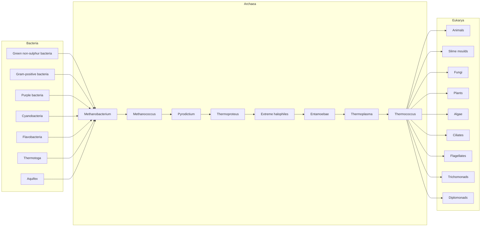
</details>

Figure 1.2 Major divisions of living things, derived by C. Woese on the basis of 15S RNA sequences.

A census of the species with sequenced genomes reveals emphasis on bacteria, because of their clinical importance, and for the relative ease of sequencing genomes of prokaryotes. However, despite the obvious differences in lifestyle, and the absence of a nucleus, Archaea are in some ways more closely related on a molecular level to Eukarya than to Bacteria. It is also likely that the Archaea are the closest living organisms to the root of the tree of life.

Figure 1.2 shows the deepest levels of the tree. The Eukarya branch includes animals, plants, and fungi. At the ends of the eukarya branch are the metazoa (multicellular organisms) (Fig. 1.3). We and our closest relatives are deuterostomes (Fig. 1.4).


<details>
<summary>flowchart</summary>

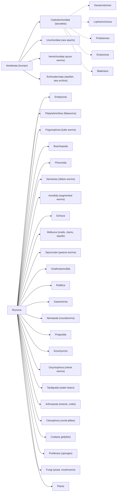
</details>

Figure 1.3 Phylogenetic tree of metazoa (multicellular animals). Bilaterians include all animals that share a left/right symmetry of body plan. Protostomes and deuterostomes are two major lineages that separated at an early stage of evolution, estimated at 670 million years ago. They show very different patterns of embryological development, including different early cleavage patterns, opposite orientations of the mature gut with respect to the earliest

49

---

invagination of the blastula, and the origin of the skeleton from mesoderm (deuterostomes) or ectoderm (protostomes). Protostomes comprise two subgroups distinguished on the basis of 18S RNA (from the small ribosomal subunit) and HOX gene sequences. Morphologically, Ecdysozoa have a moulting cuticle: a hard outer layer of organic material. Lophotrochozoa have soft bodies.

Based on Adouette, A., Balavoine, G., Lartillot, N., Lespinet, O., Prud'homme, B., and de Rosa, R. (2000). The new animal phylogeny: reliability and implications. Proc. Natl. Acad. Sci. USA, 97, 4453–4456.


<details>
<summary>flowchart</summary>

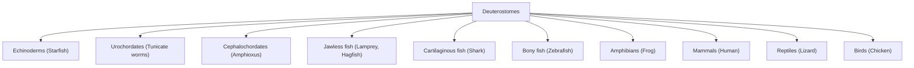
</details>

Figure 1.4 Phylogenetic tree of vertebrates and our closest relatives. Chordates, including vertebrates, and echinoderms are all deuterostomes.

## Use of sequences to determine phylogenetic relationships

Previous sections have introduced sequence databases and biological relationships. Case Studies 1.3, 1.4, and 1.5 are examples of the application of sequence retrieval from databases, and the use of sequence comparisons to analyse biological relationships.


See Weblems 1.13, 1.14

## CASE STUDY 1.3 Retrieve the amino acid sequence of horse pancreatic ribonuclease

Use the ExPASy server at the Swiss Institute for Bioinformatics. The URL is http://www.expasy.org.

Type in the keywords:

horse pancreatic ribonuclease

followed by the ENTER key. Select RNP\_HORSE and then FASTA format. The ID code RNP\_HORSE comprises abbreviations of the molecule and the species (see Box 1.7). This will produce the following (the first line has been truncated):

```txt
>sp|P00674|RNP_HORSE RIBONUCLEASE PANCREATIC (EC 3.1.27.5) (RNASE 1) ...
KESPAMKFERQHMDSGSTSSSNPTYCNQMMKRRNMTQGWCKPVNTFVHEP
LADVQAICLQKNITCKNGQSNCYQSSSSSMHITDCRLTSGSKYPNCAYQTS
QKERHIIVACEGNPYVPVHFDASVEVST
```

For example, we could retrieve several sequences and align them (see Box 1.8). Analysis of patterns of similarity among aligned sequences are useful properties in assessing closeness of relationships.

## Box 1.7 FASTA format

50

---

A very common format for sequence data is derived from conventions of FASTA, a program for fast alignment by W.R. Pearson. Many programs use the FASTA format for reading sequences, or for reporting results.

A sequence in FASTA format:

- Begins with a single-line description. The symbol $>$ must appear in the first column. The rest of the title line is arbitrary but should be informative.
- Subsequent lines contain the sequence, one character per residue.
- Use one-letter codes for nucleotides or amino acids specified by the International Union of Biochemistry and International Union of Pure and Applied Chemistry (IUB/IUPAC): http://www.chem.qmw.ac.uk/iupac/misc/naabb.html and http://www.chem.qmw.ac.uk/iupac/AminoAcid/
- Use Sec and U as the three-letter and one-letter codes for selenocysteine: http://www.chem.qmw.ac.uk/iubmb/newsletter/1999/item3.html
- Lines can have different lengths; that is, ‘ragged right’ margins.
- Most programs will accept lower-case letters as amino acid codes.

An example of FASTA format for bovine glutathione peroxidase:

```csv
>gi|121664|sp|P00435|GSHC_BOVIN GLUTATHIONE PEROXIDASE
MCAAQRSAAALAAAAPRTVYAFSARPLAGGEPFNLSSLRGKVLLIENVASLUGTTVRDYTQMNDLQRRLG
PRGLVVLGFPCNQFGHQENAKNEEILNCLKYVRPGGGFEPNFMLFEKCEVNGEKAHPLFAFLREVLPTPS
DDATALMTDPKFITWSPVCRNDVSWNFEKFLVGPDGVPVRRYSRRFLTIDIEPDIETLLSQGASA
```

The title line contains the following fields:

- > is obligatory in column 1.
- gi|121664 is the geninfo (gi) number, an identifier assigned by the US National Center for Biotechnology Information (NCBI) to every sequence in its ENTREZ data bank. The NCBI collects sequences from a variety of sources, including primary archival data collections and patent applications. Its gi numbers provide a common and consistent ‘umbrella’ identifier, superimposed on different conventions of source databases. When a source database updates an entry, the NCBI creates a new entry with a new gi number if the changes affect the sequence, but updates and retains its entry if the changes affect only non-sequence information, such as a literature citation.
- sp|P00435 indicates that the source database was SWISS-PROT, and that the accession number of the entry in SWISS-PROT was P00435.
- GSHC\_BOVIN GLUTATHIONE PEROXIDASE is the SWISS-PROT identifier of sequence and species (GSHC\_BOVIN), followed by the name of the molecule.

## Box 1.8 Alignment

51

---

Sequence alignment is the assignment of residue–residue correspondences. We may wish to find:

\- a Global match: align all of one sequence with all of the other.

```txt
And.--so,.from.hour.to.hour,.we.ripe.and.ripe
|||| ||||||||||||||||||||||||||||
And.then,.from.hour.to.hour,.we.rot-.and.rot-
```

This illustrates mismatches, insertions, and deletions.

\- a Local match: find a region in one sequence that matches a region of the other.

```javascript
My.care.is.loss.of.care,.by.old.care.done,
|||||||||| |||||||||||||| ||||||||
Your.care.is.gain.of.care,.by.new.care.won
```

For local matching, overhangs at the ends are not treated as gaps. In addition to mismatches, seen in this example, insertions, and deletions within the matched region are also possible.

\- a Motif match: find matches of a short sequence in one or more regions internal to a long one.

A perfect match:

```txt
match
|||||
The match is made; she seals it with a curtsy.
One can allow mismatching characters:
```

```txt
match
    | |
    for the watch to babble and to talk is most tolerable

or: match match
    | |
    And witch the world with noble horsemanship.
```

or insertions and/or deletions:

```txt
mat--ch mat-ch
|| | || |
Fear not, Macbeth; no man that's born of woman
Shall e'er have power upon thee.
```

\- a Multiple alignment: a mutual alignment of many sequences.

```txt
no.sooner.--met.--------but.they.-look'd
no.sooner.look'd.--------but.they.-lo-v'd
no.sooner.lo-v'd.--------but.they.-sigh'd
no.sooner.sigh'd.--------but.they.--asked.one.another.the.reason
no.sooner.knew.the.reason.but.they.--------sought.the.remedy
no.sooner. .but.they.
```

The last line shows characters conserved in all sequences in the alignment.

See Chapter 5 for an extended discussion of alignment.


## See Weblem 1.12

CASE STUDY 1.4 Determine, from the sequences of pancreatic ribonuclease from horse (Equus caballus), minke whale (Balaenoptera acutorostrata), and red kangaroo (Macropus rufus), which two of these species are most closely related

Knowing that horse and whale are placental mammals and kangaroo is a marsupial, we expect horse and whale to be the closest pair. Retrieving the three sequences as in the previous example, and pasting the following:

```txt
>RNP_HORSE
```

52

---

```txt
KESPAMKFERQHMDSGSTSSSNPTYCNQMMKRRNMTQGWCKPVNTFVHEP
LADVQAICLQKNITCKNGQSNCYQSSSSSMHITDCRLTSGSKYPNCAYQTS
QKERHIIVACEGNPYVPVHFDASVEVST
>RNP_BALAC
RESPAMKFQRQHMDSGNSPGNNPNYCNQMMMRRKMTQGRCKPVNTFVHES
LEDVKAVCSQKNVLCKNGRTNCYESNSTMHITDCRQTGSSSKYPNCAYKTS
QKEKHIIVACEGNPYVPVHFDNSV
>RNP_MACRU
ETPAEKFQRQHMDTEHSTASSSNYCNLMMKARDMTSGRCKPLNTFIHEPK
SVVDAVCHQENVTCKNGRTNCYKSNSRLSITNCRQTGASKYPNCQYETSN
LNKQIIVACEGQYVPVHFDAYV
```

into the multiple sequence alignment program CLUSTAL-W (http://www.ebi.ac.uk/Tools/msa/clustalw2/) or, alternatively, T-Coffee (http://www.ch.embnet.org/software/TCoffee.html) produces the following:

```txt
CLUSTAL W (1.8) multiple sequence alignment
RNP_HORSE KESPAMKFERQHMDSGSTSSSNPTYCNQMMKRRNMTQGWCKPVNTFVHEPLADVQAICLQ 60
RNP_BALAC RESPAMKFQRQHMDSGNSPGNNPNYCNQMMMRRKMTQGRCKPVNTFVHESLEDVKAVCSQ 60
RNP_MACRU -ETPAEKFQRQHMDTEHSTASSSNYCNLMMKARDMTSGRCKPLNTFIHEPKSVVDAVCHQ 59
*:** **:********: :......*** ** *.**.* ***:***:**. *.*:* *
RNP_HORSE KNITCKNGQSNCYQSSSSSMHITDCRLTSGSKYPNCAYQTSQKERHIIVACEGNPYVPVHF 120
RNP_BALAC KNVLCKNGRTNCYESNSTMHITDCRQTGSSSKYPNCAYKTSQKEKHIIIVACEGNPYVPVHF 120
RNP_MACRU ENVTCKNGRTNCYKSNSRLSITNCRQTGASKYPNCQYETSNLNKQIIVACEG-QYVPVHF 118
*:****::***:*.* : **:**.**:********* *:*: :::********* *****
RNP_HORSE DASVEVST 128
RNP_BALAC DNSV---- 124
RNP_MACRU DAYV---- 122
* *
```

In this table, a \* under the sequences indicates a position that is conserved (the same in all sequences), and : and . indicate positions at which all sequences contain residues of very similar physicochemical character (:) or somewhat similar physicochemical character (.).

Large patches of the sequences are identical. There are numerous substitutions but only one internal deletion. By comparing the sequences in pairs, the number of identical residues shared among pairs in this alignment (not the same as counting \*s) is:

| Number of identical residues in aligned ribonuclease | A sequences (out of a total of 122–128 residues) |
| --- | --- |
| Horse and minke whale | 95 |
| Minke whale and red kangaroo | 82 |
| Horse and red kangaroo | 75 |

Horse and whale share the highest number of identical residues. The result appears significant, and therefore confirms our expectations. Warning: or is the logic really the other way round?

Let's try a hard one: are mammoths more closely related to Indian or African elephants?

- We ‘know’ that African and Indian elephants and mammoths must be close relatives: just look at them. But could we tell from these sequences alone that they are from closely related species?
- Given that the differences are so few, do they represent true evolutionary divergence or merely random noise or drift?

As background to such questions, let us re-emphasize the distinction between similarity and

53

---

homology. Similarity is the observation or measurement of resemblance and difference, independent of the source of the resemblance. Homology means, specifically, that the sequences and the organisms in which they occur are descended from a common ancestor, with the implication that the similarities are shared ancestral characteristics. Similarity of sequences (or of macroscopic biological characters) is observable in data collectable now, and involves no historical hypotheses. In contrast, assertions of homology are statements of historical events that are almost always unobservable. Homology must be an inference from observations of similarity. Only in a few cases is homology directly

## CASE STUDY 1.5 Phylogeny of Elephantidae

The two living genera of elephant are represented by the African elephant (Loxodonta africana) and the Indian elephant (Elephas maximus). Can we decide, from the sequences of the haemoglobin  $\alpha$ -chains of these species, to which modern elephant the Siberian mammoth Mammuthus primigenius is more closely related?

Retrieving the amino acid sequences, and running CLUSTAL-W:

| E. maximus | -VLSDKDKTNVKATWSKVGDHASDYVAEALERMFFSFPTTKTYFPHFDLS 49 |
| --- | --- |
| L. africana | -VLSDNDKTNVKATWSKVGDHASDYVAEALERMFFSFPTTKTYFPHFDLG 49 |
| M. primigenius | MVLSDNDKTNVKATWSKVGDHASDYVAEALERMFFSFPTTKTYFPHFDLS 50 |
|  | ****:**********. |
| E. maximus | HGSGQVKGHGKKVGEALTQAVGHLDDLPSALSALSDLHAHKLRVDPVNFK 99 |
| L. africana | HGSGQVKAHGKKVGEALTQAVGHLDDLPSALSALSDLHAHKLRVDPVNFK 99 |
| M. primigenius | HGSGQVKGHGKKVGEALTQAVGHLDDLPSALSALSDLHAHKLRVDPVNFK |
| 100 |  |
|  | **********.**********. |
| E. maximus | LLSHCLLVTLSSHQPTEFTPEVHASLDKFLSNVSTVLTSKYR 141 |
| L. africana | LLSHCLLVTLSSHQPTEFTPEVHASLDKFLSNVSTVLTSKYR 141 |
| M. primigenius | LLSHCLLVTLSSHQPTEFTPEVHASLDKFLSNVSTVLTSKYR 142 |
|  | **********.**********. |

The mammoth and African elephant sequences have two mismatches, and the mammoth and Indian elephant sequences have one mismatch, but not at the position of a mammoth/African elephant mismatch. Forced to form a conclusion, we would have to suggest that the mammoth is more closely related to the Indian elephant. However, this result is less satisfying than the previous one. There are so few differences! Are they significant? (In this case, it is harder to decide whether the differences are significant because we have no preconceived idea of what the answer should be.) The data strongly suggest that we should identify and compare other sets of sequences from these species.

observable; for instance in pedigrees of families showing unusual phenotypes such as the Hapsburg lip, or in laboratory populations, or in clinical studies that follow the course of viral infections at the sequence level in individual patients. The new field of metagenomics will provide other examples (See Chapter 2, and Introduction to Genomics; Lesk 2011).

The assertion that the haemoglobin  $\alpha$ -chains from African and Indian elephants and mammoths are homologous means that there was a common ancestor, presumably containing a unique haemoglobin  $\alpha$ -chain, that by alternative mutations gave rise to the proteins of mammoths and modern elephants. Is the very high degree of similarity of the sequences proof that they are homologous, or are there other possible explanations?

\- It might be that a functional haemoglobin $\alpha$-chain requires so many conserved residues that

54

---

haemoglobins from all animals must be as similar to one another as the elephant and mammoth proteins are, whether or not they are homologues. We can test this by looking at haemoglobin  $\alpha$ -chain sequences from other species. The result is that the corresponding sequences from other animals differ substantially from those of elephants and mammoths.

- A second possibility is that there are special physiological requirements for a haemoglobin $\alpha$-chain to function well in an animal with the size and form of an elephant, that the three sequences started out from independent ancestors, and that common selective pressures forced them to become similar. (Remember that we are asking what can be deduced from these sequences alone.)
- The mammoth may be more closely related to the African elephant, but since the time of the last common ancestor the haemoglobin  $\alpha$ -chain sequence of the African elephant may have evolved faster than that of the Indian elephant or the mammoth, accumulating more mutations.
- A fourth hypothesis is that all common ancestors of elephants and mammoths had very dissimilar sequences, but that living elephants and mammoths gained a common gene by transfer from a species in some other family via a virus.

Suppose, however, that we are satisfied that the similarity of the elephant and mammoth sequences is high enough to imply homology: what then about the ribonuclease sequences in Case Study 1.4? Are the larger differences among the pancreatic ribonucleases of horse, whale, and kangaroo evidence that they are not homologues?

How can we answer these questions? Specialists have undertaken careful calibrations of sequence similarities and divergences, among many proteins from many species for which the taxonomic relationships have been worked out by classical methods. In the example of pancreatic ribonucleases, the reasoning from similarity to homology is justified. In the second edition of this book, I wrote: 'The question of whether mammoths are closer to African or Indian elephants was decided only recently, in favour of African elephants.' Since then, expert opinion—including that of some of the same experts—has shifted to the conclusion that Indian elephants are the closest extant relatives of mammoths. Why has this question proved so difficult? It reflects the limited power of our tools, applied to the available data, to resolve events that happened very close to each other, very long ago.


## See Weblems 1.15, 1.16, 1.17

The three major groups of elephants are: African elephants, Asian elephants, and mammoths. These taxa comprise a family, the Elephantidae, containing three main genera: Loxodonta, including the African species L. africana; Elephas, including the Asian species E. maximus; and Mammuthus, including the Siberian species M. primigenius. (At the family level in our lineage, humans, chimpanzees, gorillas, and orangutans comprise the hominidae.)

The genera in the family Elephantidae diverged about 6 million years ago in Africa, at approximately the same time as the divergence of human and chimpanzee ancestors. Today, ‘mammoth’ connotes an extinct Arctic animal. However, our ancestors hunted mammoths in Southern Europe, as depicted in cave-wall paintings (see Box 1.9).

The challenging phylogenetic problem is to determine the branching order of Asian and African elephants and mammoths. Which group split off first? It took only  $\approx$ 500 000 years to establish the three lineages. The shortness of this time makes great demands on our analytical tools.

Other factors that make the identification of the true branching pattern difficult include:

\- is the sequence of a close relative available to serve for comparison (as an outgroup). The earliest work on the mammoth genome used dugong or hyrax as the outgroup. These diverged from

55

---

elephants  $\approx$ 65 million years ago. Sequences from the American mastodon (Mammut americanum) have provided a more suitable outgroup in recent investigations;

- small population sizes may increase the importance of fluctuations;
- the assumption of constant rates of evolution in the different lineages may be unjustified.

Current data and analysis suggest that mammoths are more closely related to Asian elephants.

Despite the difficulty of the elephant/mammoth problem, analysis of sequence similarities in genomes and proteins is now sufficiently well established that it is considered the most reliable method for

## Box 1.9 Mammoth fossils helped shape ideas about species extinction

Cuvier himself first distinguished the African, Asian, and mammoth lineages, in a 1796 paper. Cuvier accepted the idea that species could become extinct, a prerequisite to development of ideas about evolution. Many contemporaries believed instead in the immutability of species. US President Thomas Jefferson was one. He instructed Meriwether Lewis and William Clark, explorers of the Louisiana Territory purchased from France in 1803, to look out for living mammoths.

establishing phylogenetic relationships, even though sometimes the results may not be significant and in other cases they even give incorrect answers. Except for many—but not all—attempts to treat extinct species, there are copious data available, effective tools for retrieving what is necessary to bring to bear on a specific question, and powerful analytical tools. None of this replaces the need for thoughtful scientific judgement.

## Use of SINES and LINES to derive phylogenetic relationships

Major problems with inferring phylogenies from comparisons of gene and protein sequences are (1) the wide range of variation of similarity, which may dip below statistical significance, and (2) the effects of different rates of evolution along different branches of the evolutionary tree. In many cases, even if sequence similarities confidently establish relationships, it may be very difficult or impossible to decide the order in which sets of taxa have split. (The Elephantidae are an example.) The phylogeneticist's dream—features that have an ‘all-or-none’ character, the appearance of which is irreversible so that the order of branching events can be decided—is in some cases afforded by certain noncoding sequences in genomes.

Short and long interspersed nuclear elements, or SINES and LINES, are repetitive noncoding sequences that form large fractions of eukaryotic genomes; that is, at least 30% of human chromosomal DNA and over 50% of some higher plant genomes. Typically, SINES are  $\approx$ 70–500 base pairs long, and up to  $10^{6}$  copies may appear. LINES may be up to 7000 base pairs long, and up to  $10^{5}$  copies may appear. SINES enter the genome by reverse transcription of RNA. Most SINES contain a 5' region homologous to tRNA, a central region unrelated to tRNA, and a 3' AT-rich region.

Features of SINES that make them useful for phylogenetic studies include the following.

- A SINE is either present or absent. Presence of a SINE at any particular position is a property that entails no complicated and variable measure of similarity.
- SINES are inserted at random in the noncoding portion of a genome. Therefore appearance of

56

---

similar SINES at the same locus in two species implies that the species share a common ancestor in which the insertion event occurred. No analogue of convergent evolution muddies this picture, because there is no selection for the site of insertion.

- SINE insertion appears to be irreversible: no mechanism for loss of SINES is known, other than rare large-scale deletions or translocations that include the SINE site. Therefore if two species share a SINE at a common locus, absence of this SINE in a third species implies that the first two species must be more closely related to each other than either is to the third.
- Not only do SINES show relationships, they imply which species branched off first. The last common ancestor of species containing a common SINE must have come after the last common ancestor linking these species and another that lacks this SINE.

N. Okada and colleagues applied SINE sequences to questions of phylogeny.

Whales, like Australians, are mammals that have adopted an aquatic lifestyle. But what—in the case of the whales—are their closest land-based relatives? Classical palaeontology linked the order Cetacea—comprising whales, dolphins, and porpoises—with the order Artiodactyla, the even-toed ungulates (including cows and sheep, for instance). Cetaceans were thought to have diverged before the common ancestor of the three extant artiodactyl suborders: Suiformes (pigs), Tylopoda (including camels and llamas), and Ruminantia (including deer, cows, goats, sheep, antelopes, giraffes, etc.). To place cetaceans properly among these groups, several studies were carried out with DNA sequences. Comparisons of mitochondrial DNA, and genes for pancreatic ribonuclease,  $\gamma$ -fibrinogen, and other proteins, suggested that the closest relatives of the whales are hippopotamuses, and that cetaceans and hippopotamuses form a separate group within the artiodactyls, most closely related to the Ruminantia.

Analysis of SINES confirms this relationship. Several SINES are common to Ruminantia, hippopotamuses, and cetaceans. Four SINES appear in hippopotamuses and cetaceans only. These observations imply the phylogenetic tree shown in Figure 1.5, in which the SINE insertion events are marked.


See Weblems 1.18, 1.19


<details>
<summary>flowchart</summary>

This diagram illustrates the evolutionary relationships and genetic markers of various animal species, showing how specific genetic loci (such as mo(ARE), gns(ARE), etc.) are merged into a central cluster.
</details>

Figure 1.5 Phylogenetic relationships among cetaceans and other artiodactyl subgroups, derived from analysis of SINE sequences. Arrowheads mark insertion events. Each arrowhead indicates the presence of a particular SINE or LINE at a specific locus in all species to the right of the arrowhead. Lower-case letters identify loci, upper-case letters identify sequence patterns. For instance, the ARE2 pattern appears only in pigs, at the ino locus. The ARE pattern appears twice in the pig genome, at loci gpi and pro, and in the peccary genome at the same loci. The ARE insertion occurred in a species that was ancestral to pigs and peccaries but to no other species in the diagram. This implies that pigs and peccaries are more closely related to each other than to any of the other animals studied.

From Nikaido, M., Rooney, A.P., and Okada, N. (1999). Phylogenetic relationships among cetartiodactyls based on insertions of short and long interspersed elements: hippopotamuses are the closest extant relatives of whales. Proc. Natl. Acad. Sci. USA, 96, 10261–10266. Copyright 1999, National Academy of Sciences, USA. Reproduced by permission.

57

---


<details>
<summary>text_image</summary>

Residue i-t Residue i Residue i+t
S_{i-t} S_I S_{i+1} } Sidechains variable
... N - Cα - C_|| - N - Cα - C_|| - N - Cα - C_|| ... } Mainchain constant
</details>

Figure 1.6 The polypeptide chains of proteins have a mainchain of constant structure and sidechains that vary in sequence. Here $S_{\mathrm{i-1}}$, $S_{\mathrm{i}}$, and $S_{\mathrm{i+1}}$ represent sidechains. The sidechains may be chosen, independently, from the set of 20 standard amino acids. It is the sequence of the sidechains that gives each protein its individual structural and functional characteristics.


Figure 1.7 Standard secondary structures of proteins. (a) $\alpha$-Helix. Hydrogen atoms not shown. (b) $\beta$-Sheet. (b) Illustrates a parallel $\beta$-sheet, in which all strands point in the same direction. Antiparallel $\beta$-sheets, in which all pairs of adjacent strands point in opposite directions, are also common. In fact, $\beta$-sheets can be formed by any combination of parallel and antiparallel strands.

Recently discovered fossils of land-based ancestors of whales confirm the link between whales and artiodactyls. This is a good example of the complementarity between molecular and palaeontological methods: DNA sequence analysis can specify relationships among living species quite precisely, but fossils reveal relationships among their extinct ancestors.

## Searching for similar sequences in databases: PSI-BLAST

A common theme of the examples we have treated is the search of a database for items similar to a probe. For instance, if you are studying a novel gene, or if you identify within the human genome a gene responsible for some disease, you will wish to determine whether related genes appear in other species. The ideal method is both sensitive—that is, it picks up even very distant relationships—and selective—that is, all the relationships that it reports are true (see Box 1.10).

A powerful tool for searching sequence databases with a probe sequence is PSI-BLAST, from the NCBI. PSI-BLAST stands for Position Specific Iterated – Basic Local Alignment Search Tool. A previous program, BLAST, worked by identifying local regions of similarity without gaps and then piecing them together. The PSI in PSI-BLAST refers to enhancements that identify patterns within the sequences at preliminary stages of the database search, and then progressively refine them. Recognition of conserved patterns can sharpen both the selectivity and sensitivity of the search. PSI-BLAST involves a repetitive (or iterative) process, as the emergent pattern becomes better defined in successive stages of the search. (See Case Study 1.6 and Chapter 5.)

58

---

The few PSI-BLAST hits to the probe sequence PAX-6 shown later appear in the format:

paired box protein Pax-6 isoform a [Homo sapiens]

A longer list of hits would of course include multiple sequences from many of the species, and contributions from many more species. How would we extract these species names from the results? The following is a typical example of the pattern-identification facilities of PERL (Case Study 1.7).

## Box 1.10 Sensitivity and selectivity

Database search methods involve a tradeoff between sensitivity and selectivity. Does the method find all or most of the examples that are actually present, or does it miss a large fraction? Conversely, how many of the ‘hits’ that it reports are incorrect? Suppose a database contains 1000 globin sequences and that a search of this database for globins reported 900 results, 700 of which were really globin sequences and 200 of which were not. This result would be said to have 300 false negatives (misses) and 200 false positives. There is a tradeoff between sensitivity and selectivity: lowering a tolerance threshold will increase the numbers of both false negatives and false positives. Often one is willing to work with low thresholds to be sure of not missing anything that might be important, but this requires detailed examination of the results to eliminate the false positives.

## Et in terra PAX hominibus, muscisque...

The eyes of the human, fly, and octopus are very different in structure. Conventional wisdom, noting the immense selective advantage conferred by the ability to see, held that eyes arose independently in different phyla. It therefore came as a great surprise that a gene controlling human eye development has a homologue governing eye development in Drosophila.

The PAX-6 gene was first cloned in the mouse and human. It is a master regulatory gene, controlling a complex cascade of events in eye development. Mutations in the human gene cause the clinical condition aniridia, a developmental defect in which the iris of the eye is absent or deformed. The PAX-6 homologue in Drosophila—called the eyeless gene—has a similar function of control over eye development. Flies mutated in this gene develop without eyes; conversely, expression of this gene in a fly’s wing, leg, or antenna produces ectopic (i.e. out-of-place) eyes. (The Drosophila eyeless mutant was first described in 1915. Little did anyone then suspect a relation to a mammalian gene.)

Not only are the insect and mammalian genes similar in sequence, they are so closely related that their function crosses species boundaries. Expression of the mouse $PAX-6$ gene in the fly causes ectopic eye development just as expression of the fly's own eyeless gene does. (It should not, however, be thought that eye development is under the control of a single gene. The expression of mouse $PAX-6$ in the fly triggers a complex cascade of fly genes.)

PAX-6 has homologues in other phyla, including flatworms, ascidians, sea urchins, and nematodes. The observation that rhodopsins—a family of proteins containing retinal as a common chromophore—function as light-sensitive pigments in different phyla is supporting evidence for a common origin of different photoreceptor systems. The genuine structural differences in the macroscopic anatomy of different eyes reflect the divergence and independent development of higher-order structure.

## CASE STUDY 1.6 PAX-6 genes

## Homologues of the human PAX-6 gene

PAX-6 genes control eye development in a widely divergent set of species (see Et in terra PAX hominibus, muscisque...). The human PAX-6 gene encodes the protein appearing in UniProtKB/SWISS-PROT entry P26367. (Tip: the easiest way to retrieve the sequence is to type HUMAN PAX-6 into a Google search.)

59

---

To run PSI-BLAST, go to the following URL: http://www.ncbi.nlm.nih.gov/BLAST. Enter the sequence and use the default options for selections of the database to search, and the similarity matrix to use, and select PSI-BLAST as the algorithm.

The program returns a list of entries similar to the probe, sorted in decreasing order of statistical significance. (Extracts from the response are shown in the box entitled Results of a PSI-BLAST search for human PAX-6 protein. Only a few lines are shown, merely to illustrate the format.) A typical line appears as follows:

pir ||I45557 eyeless, long form - fruit fly (Drosophila melano... 250 2e-64

The first item on the line is the database and corresponding entry number (separated by  $\mid\mid$ ), in this case Protein Identification Resource (PIR) entry I45557. It is the Drosophila homologue eyeless. The number 250 is a score for the match detected, and the significance of this match is measured by  $E = 2 \times 10^{-64}$ . E is related to the probability that the observed degree of similarity could have arisen by chance: E is the number of sequences that would be expected to match as well or better than the one being considered, if the same database were probed with random sequences.  $E = 2 \times 10^{-64}$  means that it is extremely unlikely that even one random sequence would match as well as the Drosophila homologue. Values of E below about 0.05 would be considered significant; at least they might be worth considering. For borderline cases, you would ask: are the mismatches conservative? Is there any pattern or are the matches and mismatches distributed randomly through the sequences? There is an elusive concept, the texture of an alignment, that you will become sensitive to. The court of last resort is whether the structures are similar, but often this information is not available.

Note that if there are many sequences in the database that are very similar to the probe sequence, they will head the list. In this example, there are many very similar PAX genes in other mammals. You may have to scan far down the list to find a distant relative that you consider to be interesting.

Even in the case of Drosophila eyeless, a very close relative of the probe sequence, the program reports only a local match to a portion of the sequences. The full alignment is shown in the box entitled Complete pairwise sequence alignment of human PAX-6 protein and Drosophila melanogaster eyeless.

## Results of a PSI-BLAST search for human PAX-6 protein

One iteration of PSI-BLAST was run, using human PAX-6 as the query sequence, searching the nonredundant (nr) database. The NCBI nr database is a set of unique sequences selected from the full databases to eliminate multiple hits to very similar sequences. The output contains a list of sequences identified. A few are shown below, just to illustrate the format. A more complete list appears in the online resource centre associated with this book: http://www.oxfordtextbooks.co.uk/orc/leskbioinf4e/.

```ini
paired box protein Pax-6 isoform a [Homo sapiens]
paired box protein Pax-6 isoform a [Homo sapiens]
paired box protein Pax-6 isoform 2 [Mus musculus]
paired box protein Pax-6 isoform 2 [Mus musculus]
paired box protein Pax-6 isoform 1 [Sus scrofa]
paired box protein Pax-6 isoform 1 [Sus scrofa]
paired box protein Pax-6 isoform a [Homo sapiens]
paired box protein Pax-6 isoform a [Homo sapiens]
paired box protein Pax-6 [Macaca mulatta]
PREDICTED: paired box protein Pax-6 isoform 1 [Cricetulus griseus]
PREDICTED: paired box protein Pax-6 [Callithrix jacchus]
PREDICTED: paired box protein Pax-6 isoform 2 [Callithrix jacchus]
PREDICTED: paired box protein Pax-6 [Callithrix jacchus]
PREDICTED: paired box protein Pax-6 [Otolemur garnettii]
PREDICTED: paired box protein Pax-6 isoform 1 [Pan paniscus]
PREDICTED: paired box protein Pax-6 isoform 2 [Pan paniscus]
PREDICTED: paired box protein Pax-6 isoform 3 [Pan paniscus]
PREDICTED: paired box protein Pax-6 isoform 1 [Saimiri boliviensis boliviensis]
```

60

---

PREDICTED: paired box protein Pax-6 isoform 2 [Saimiri boliviensis boliviensis]

Even the short list shows that (1) multiple sequences—different isoforms—appear from the same species and (2) some of the taxonomic names are classic binomials (for instance, Homo sapiens) and others are trinomials indicating subspecies designations.

PSI-BLAST also returns pairwise alignments of well-matching regions from the query and the retrieved sequences. Three selected alignments are shown following the alignments results: PAX-6 from Danio rerio, Drosophila eyeless, and a Drosophila circadian clock protein, for which the matching is both shorter and less perfect.

```txt
Query= sp|P26367|PAX6_HUMAN Paired box protein Pax-6(Oculorhombin)
(Aniridia, type II protein) - Homo sapiens (Human).
(422 letters)
```

```csv
Database: All non-redundant GenBank CDS
translations+PDB+SwissProt+PIR+PRF
    2,738,511 sequences; 768,166,133 total letters
```

```txt
Results of PSI-Blast iteration 5
Score E
```

Sequences producing significant alignments: (Bits) Value

```txt
gb|AAA59962.1| oculorhombin >gb|AAA59963.1| oculorhombin 600 6e-170
ref|NP_000271.1| paired box gene 6 isoform a [Homo sapiens] >... 600 7e-170
gb|ABI98848.1| paired box 6 transcript variant 3 [Columba livia] 599 9e-170
ref|NP_001035735.1| paired box gene 6 (aniridia, keratitis) [... 599 1e-169
gb|EAW68233.1| paired box gene 6 (aniridia, keratitis), isofo... 599 1e-169
gb|ABA90484.1| paired box protein PAX6 isoform a [Oryctolagus cu 598 2e-169
ref|NP_037133.1| paired box gene 6 [Rattus norvegicus] >sp|P6... 598 2e-169
dbj|BAA24025.1| PAX6 SL [Cynops pyrrhogaster] 596 8e-169
ref|NP_038655.1| paired box gene 6 [Mus musculus] >emb|CAA453... 596 1e-168
dbj|BAC25729.1| unnamed protein product [Mus musculus] 595 2e-168
emb|CAC80516.1| paired box protein [Mus musculus] 594 2e-168
ref|NP_001595.2| paired box gene 6 isoform b [Homo sapiens] >... 594 3e-168
gb|AAH41712.1| MGC52531 protein [Xenopus laevis] 594 3e-168
ref|NP_990397.1| paired box gene 6 [Gallus gallus] >dbj|BAA23... 594 3e-168
gb|ABO70134.1| PAX6 [Canis familiaris] 593 5e-168
gb|EAW68236.1| paired box gene 6 (aniridia, keratitis), isofo... 593 6e-168
emb|CAF29075.1| putative pax6 isoform 5a [Rattus norvegicus] 593 8e-168
ref|NP_001075686.1| paired box protein PAX6 isoform b [Orycto... 593 9e-168
emb|CAE45868.1| hypothetical protein [Homo sapiens] 593 9e-168
prf||1902328A PAX6 gene 592 1e-167
gb|AAS48919.1| paired box 6 isoform 5a [Rattus norvegicus] >g... 592 1e-167
gb|AAB36681.1| paired-type homeodomain Pax-6 protein [Xenopus la 592 1e-167
gb|AAF73271.1|AF154555_1 paired domain transcription factor v... 590 5e-167
gb|AAB05932.1| Xpax6 [Xenopus laevis] 589 7e-167
sp|P47238|PAX6_COTJA Paired box protein Pax-6 (Pax-QNR) >pir|... 589 1e-166
dbj|BAA24024.1| PAX6 LL [Cynops pyrrhogaster] 589 1e-166
sp|P55864|PAX6_XENLA Paired box protein Pax-6 >gb|AAB36683.1| Pa 588 2e-166
emb|CAA68838.1| PAX-6 protein [Astyanax mexicanus] 588 3e-166
...
emb|CAE66896.1| Hypothetical protein CBG12277 [Caenorhabditis br 44.7 0.010
gb|AAP79287.2| hox 7 [Saccoglossus kowalevskii] 44.7 0.010
gb|AAS07621.1| homeobox protein Lox18 [Perionyx excavatus] 44.7 0.010
gb|AAL04488.1|AF365974_1 transcription factor SOHo [Oryzias lati 44.7 0.010
```

61

---

```txt
ref|NP_186796.1| ATHB-1 (Homeobox-leucine zipper protein HAT5... 44.7 0.010
ref|XP_001076009.1| PREDICTED: similar to gooseberry-neuro CG... 44.7 0.010
ref|XP_001060443.1| PREDICTED: similar to double homeobox 4c [Ra 44.7 0.010
gb|EAT37245.1| lim homeobox protein [Aedes aegypti] 44.7 0.010
gb|AAW70293.1| invected [Heliconius pachinus] 44.7 0.010
ref|NP_174164.1| HB-1 (homeobox-1); transcription factor [Arabid 44.7 0.010
ref|NP_001029316.1| NK-3 transcription factor, locus 1 [Rattu... 44.7 0.010
dbj|BAE44266.1| hoxB3a [Oryzias latipes] >dbj|BAE53473.1| hox... 44.7 0.010
dbj|BAE06563.1| transcription factor protein [Ciona intestinalis 44.7 0.010
gb|EAT43388.1| homeobox protein [Aedes aegypti] 44.7 0.010
gb|AAS21413.1| HOX11 [Oikopleura dioica] 44.7 0.010
```

Additional ‘hits’ are not shown.

The three selected alignments follow. PAX-6 from human (the query sequence) and Danio rerio:

```txt
ref|NP_571379.1| paired box gene 6a [Danio rerio]
    emb|CAA44867.1| pax-6 [Danio rerio]
    emb|CAM16650.1| paired box gene 6a [Danio rerio]
Length=451
    Score = 662 bits (1707), Expect = 0.0, Method: Composition-based stats.
    Identities = 404/436 (92%), Positives = 409/436 (93%), Gaps = 18/436 (4%)
Query 1 MQNSHSGVNQLGGVFVNGRPLPDSTRQKIVELAHSGARPCDISRILQ-----------------
- 47
MQNSHSGVNQLGGVFVNGRPLPDSTRQKIVELAHSGARPCDISRILQ
Sbjct 20 MQNSHSGVNQLGGVFVNGRPLPDSTRQKIVELAHSGARPCDISRILQTHADAKVQVLDNE 79
Query 48 -
VSNGCVSKILGRYYETGSIRPRAIGGSKPRVATPEVVSKIAQYKRECPSIFAWEIRDRL 106
VSNGCVSKILGRYYETGSIRPRAIGGSKPRVATPEVV KIAQYKRECPSIFAWEIRDRL
Sbjct 80 NVSNGCVSKILGRYYETGSIRPRAIGGSKPRVATPEVVGKIAQYKRECPSIFAWEIRDRL 139
Query 107 LSEGVCTNDNIPSVSSINRVLRNLASEKQQMGADGMYDKLRMLNGQTGSWGTRPGWYPGT 166
LSEGVCTNDNIPSVSSINRVLRNLASEKQQMGADGMY+KLRMLNGQTG+WGTRPGWYPGT
Sbjct 140 LSEGVCTNDNIPSVSSINRVLRNLASEKQQMGADGMYEKLRMLNGQTGTWGTRPGWYPGT 199
Query 167 SVPGQPTQDGCQQQEGGGENTNSISSNGEDSDEAQMRLQLKRKLQRNRTSFTQEIEALE 226
SVPGQP QDGCQQ +GGGENTNSISSNGEDSDE QMRLQLKRKLQRNRTSFTQEIEALE
Sbjct 200 SVPGQPNQDGCQQSDGGGENTNSISSNGEDSDETQMRLQLKRKLQRNRTSFTQEIEALE 259
Query 227 KEFERTHYPDVFARERLAAKIDLPEARIQVWFSNRRAKWRRREEKLRNQRRQASNTPSHIP 286
KEFERTHYPDVFARERLAAKIDLPEARIQVWFSNRRAKWRRREEKLRNQRRQASN+ SHIP
Sbjct 260 KEFERTHYPDVFARERLAAKIDLPEARIQVWFSNRRAKWRRREEKLRNQRRQASNSSSHIP 319
Query 287 ISSSFSTSVYQPIPQPTTPVSSFTSGSMLGRTDTALTNTYSALPPMPSFTMANNLPMQPP 346
ISSSFSTSVYQPIPQPTTPV SFTSGSMLGR+DTALTNTYSALPPMPSFTMANNLPMQP
Sbjct 320 ISSSFSTSVYQPIPQPTTPV-
SFTSGSMLGRSDTALTNTYSALPPMPSFTMANNLPMQP- 377
Query 347 VPSQTSSYSCMLPTSPSVNGRSYDTYTPPHMQTHMNSQPMGTSGTTSTGLISPGVSVPVQ 406
SQTSSYSCMLPTSPSVNGRSYDTYTPPHMQ HMNSQ M SGTTSTGLISPGVSVPVQ
Sbjct 378 --
SQTSSYSCMLPTSPSVNGRSYDTYTPPHMQAHMNSQSMAASGTTSTGLISPGVSVPVQ 435
```

62

---

```txt
Query 407 VPGSEPDMSQYWPRLQ 422
VPGSEPDMSQYWPRLQ
Sbjct 436 VPGSEPDMSQYWPRLQ 451
```

Human PAX-6 and Drosophila eyeless:

```txt
>pir||I45557 eyeless, long form - fruit fly (Drosophila melanogaster)
    emb|CAA56038.1| UniGene info transcription factor [Drosophila melanogaster]
Length=838
Score = 224 bits (572), Expect = 8e-59, Method: Composition-based stats.
Identities = 133/212 (62%), Positives = 143/212 (67%), Gaps = 2/212 (0%)

Query 2 QNSHSGVNQLGGVFVNGRPLPDSTRQKIVELAHSGARPCDISRILQVSNGCVSKILGRYY 61
        HSGVNQLGGVFV GRPLPDSTRQKIVELAHSGARPCDISRILQVSNGCVSKILGRYY

Sbjct 35 HKGHSGVNQLGGVFVGGRPLPDSTRQKIVELAHSGARPCDISRILQVSNGCVSKILGRYY 94

Query 62 ETGSIRPRAIGGSKPRVATPEVVSKIAQYKRECPSIFAWEIRDRLLSEGVCTNDNIPSVS 121
        ETGSIRPRAIGGSKPRVAT EVVSKI+QYKRECPSIFAWEIRDRLL E VCTNDNIPSVS

Sbjct 95 ETGSIRPRAIGGSKPRVATAEVVSKISQYKRECPSIFAWEIRDRLLQENVCTNDNIPSVS 154

Query 122 SINRVLRNLASEKQQMGADGMYDKLRMLNGQTGSWGTRPGWYPGTSVPGQPTQDGCQQQE 181
        SINRVLRNLA++K+Q N + G G

Sbjct 155 SINRVLRNLAAQKEQQSTGSGSSSTSAGNSISAKVSVSIGGNVSNVASGSRGTLSSTDL 214

Query 182 GGGENT--NSISSNGEDSDEAQMRLQLKRKLQ 211
        +S S +S E + + KL+

Sbjct 215 MQTATPLNSSESGGATNSGEGSEQEAIIYEKLR 246
```

Human PAX-6 and Drosophila circadian clock protein:

```txt
>gb|AAB94890.1| circadian clock protein [Drosophila melanogaster]
Length=1398
Score = 33.5 bits (75), Expect = 0.42, Method: Composition-based stats.
Identities = 22/145 (15%), Positives = 37/145 (25%), Gaps = 31/145 (21%)
Query 113 TNDNIPSVSSINRVLRN-----LASEKQQMGADGMYDK-----
LRMLNGQTGSWGTRPG 161
N P+ S+ L N + A K + G +
Sbjct 411 NNTTNPTSSAPQGCLGNEPFKPPPPLPVRASTSAHAQMQKFNESSYASHVSAVKLGQKSP 470
Query 162 WYPGTSV-----
PGQPTQDGCQQQEGGGENTNSISSNGEDSDEAQMRLQLKR 208
+ Q C EN SIS++ D D Q + Q ++
Sbjct 471 HAGQLQLTKGKCCPQKRECPSSQSELSDCGYGT-
QVENQESISTSSNDDDGPQGKPQHQK 529
Query 209 K-----LQRNRTSFTQEQIEALEK 227
+ RT + + L +
Sbjct 530 PPCNTKPRNKPRTIMSPMDKKELRR 554
```

63

---

Complete pairwise sequence alignment of human PAX-6 protein and Drosophila melanogaster eyeless

```txt
PAX6_human          -------------------MQNSHSGVNQLGGVFVNGRPLPDSTRQ
27
eyeless         MFTLQPTPTAIGTVVPPWSAGTLIERLPSLEDMAHKGHSGVNQLGGVFVGGRPLPDSTRQ
60
                        :::.*************************.*************************
PAX6_human         KIVELAHSGARPCDISRILQVSNGCVSKILGRYYETGSIRPRAIGGSKPRVATPEVVSKI
87
eyeless         KIVELAHSGARPCDISRILQVSNGCVSKILGRYYETGSIRPRAIGGSKPRVATAEVVSKI
120
                      ************************.*************************
PAX6_human         AQYKRECPSIFAWEIRDRLLSEGVCTNDNIPSVSSINRVLRNLASEKQQ--------
136
eyeless         SQYKRECPSIFAWEIRDRLLQENVCTNDNIPSVSSINRVLRNLAAQKEQQSTGSGSSSTS
180
                      :*************************.*.*************************:::**
PAX6_human         ------MG----------ADG
141
eyeless         AGNSISAKVSVSIGGNVSNVASGSRGTLSSSTDLMQTATPLNSSESGGATNSGEGSEQEA
240
                      .*                             ..
PAX6_human         MYDKLRMLNGQTGS--------WGTRP-------------------
160
eyeless         IYEKLRLLNTQHAAGPGPLEPARAAPLVGQSPNHLGTRSSHPQLVHGNHQALQQHQQQSW
300
                      :::.***:** * .:
                      ***.
PAX6_human         ------GWYPG------TSVP----------GQP-----
172
eyeless         PPRHYSGSWYPTSLSEIPISSAPNIASVTAYASGPSLAHSLSPPNDIKSLASIGHQRNCP
360
                      .***        :::*
PAX6_human         ------TQDGCQQQEGG---GENTNSISSNGEDSDEAQMRLQLKRKLQRNRTSFTQ
219
eyeless         VATEDIHLKKELDGHQSDETGSGEGENSNGGASNIGNTEDDQARLILKRKLQRNRTSFTN
420
                      ** *.:.*  ***:.:* * ::::* ** *************************:
PAX6_human         EQIEALEKEFERTHYPDVFARERLAAKIDLPEARIQVWFSNRRAKWRREEKLRNQRRQAS
279
eyeless         DQIDSLEKEFERTHYPDVFARERLAGKIGLPEARIQVWFSNRRAKWRREEKLRNQRRTPN
480
                      :::.*************************.**.*************************..
PAX6_human         NTPSHIPISSSFSTSVYQPIPQPTTPVSSFTSGSMLG---------
316
eyeless         STGASATSSSTSATASLTDSPNSLSACSSLLSGSAGGPSVSTINGLSSPSTLSTNVNAPT
540
                      .* : . **: *:  *:. . **: *** *
```

64

---

```txt
PAX6_human -----------------
eyeless LGAGIDSSESPTPIPHIRPSCTSDNDNGRQSEDCRRVCSPCPLGVGGHQNTHHIQSNGHA
600
PAX6_human ----------RTDTALTNTYSALPPMPSFTMANNLPMQPPVP
348
eyeless QGHALVPAISPRLNFNSGSFGAMYSNMHHTALSMSDSYGAVTPIPSFNHSAVGPLAPPSP
660
:* ::::::*.*:.*:***. : *: ** *
PAX6_human S-------QTSSYSCMLPTSP-------------------SVNGRS
368
eyeless IPQQGDLTPSSLYPCHMTLRPPPMAPAHHHIVPGDGGRPAGVGLGSGQSANLGASCSGSG
720
:* *.* :.  *
* .* .
PAX6_human YDTYTP----------PHMQTHMNSQP--------MGTS
389
eyeless YEVLSAYALPPPPMASSSAADSSFSAASSASANVTPHHTIAQESCPSPCSSASHFGVAHS
780
*:. . .          **   :*  *           :.  *
PAX6_human GTTSTGLISPGVS----------VPVQVPGS----EPDMSQYWPRLQ----- 422
eyeless SGFSSDPISPAVSSYAHMSYNYASSANTMTPSSASGTSAHVAPGKQQFFASCFYSPWV 838
. *:. ***.* *      .* ...*:     *.*.*:.
```

## CASE STUDY 1.7 What species contain homologues to human PAX-6 detectable by PSI-BLAST?

PSI-BLAST reports the species in which the identified sequences occur (see box entitled Results of a PSI-BLAST search for human PAX-6 protein). These appear, embedded in the text of the output, in square brackets; for instance:

```txt
emb|CAA56038.1| (X79493) transcription factor [Drosophila melanogaster]
```

(In the section reporting E values, the species names may be truncated.)

The following PERL program extracts species names from the PSI-BLAST output:

```perl
#!/usr/bin/perl
#extract species from psiblast output
# Method:
#     For each line of input, check for a pattern of form [Drosophila melanogaster]
#   Use each pattern found as the index in an associative array
#   The value corresponding to this index is irrelevant
#   By using an associative array, subsequent instances of the same
#       species will overwrite the first instance, keeping only a unique set
#   After processing of input complete, sort results and print.
while (<>) {
    if (/\\[((A-Z][a-z]+ [a-z]+)\]/) {      # read line of input
        # select lines containing strings of form
            #     [Drosophila melanogaster]
    $species{$1} = 1;                 # make or overwrite entry in
```

65

---

```txt
}
}
foreach (sort(keys(%species)) {
    print "\$_\n";
}
```

The program makes use of PERL’s rich pattern-recognition resources to search for character strings of the form [Drosophila melanogaster]. We want to specify the following pattern:

• a square bracket,
• followed by a word beginning with an upper-case letter,
• followed by a variable number of lower-case letters,
• then a space between words,
then a word all in lower-case letters,
then a closing square bracket.

This kind of pattern is called a regular expression and appears in the PERL program in the following form: [([A-Z][a-z]+ [a-z]+)].

Building blocks of the pattern specify ranges of characters:

[A-Z] = any letter in the range A, B, C, …Z

[a-z] = any letter in the range a, b, c, …z

We can specify repetitions:

[A-Z] = one upper-case letter

[a-z]+ = one or more lower-case letters

and combine the results:

[A-Z][a-z]+ [a-z]+ = an upper-case letter followed by one or more lower-case letters (the genus name), followed by a blank, followed by one or more lower-case letters (the species name).

Enclosing these in parentheses: ([A-Z][a-z]+ [a-z]+) tells PERL to save the material that matched the pattern for future reference. In PERL this matched material is designated by the variable \$1. Thus if the input line contained [Drosophila melanogaster] the statement:

\$species{\$1} = 1;

would effectively be:

\$species {"Drosophila melanogaster"} = 1;

Finally, we want to include the brackets surrounding the genus and species name, but brackets signify character ranges. Therefore we must precede the brackets by backslashes \[…\] to give the final pattern: \[([A-Z] [a-z]+ [a-z]+)\].

The use of the associative array to retain only a unique set of species is another instructive aspect of the program. Recall that an associative array is a generalization of an ordinary array or vector, in which the elements are not indexed by integers but by arbitrary strings. A second reference to an associative array with a previously encountered index string could change the value in the array but not the list of index strings. In this case we do not care about the value but just use the index strings to compile a unique list of species detected. Multiple references to the same species will merely overwrite the first reference, not make a repetitive list. The set of indices (or ‘keys’) in the associated array %species collects the names of the species found.

Newer versions of PSI-BLAST report the taxonomic distribution of the hits. However, the program in this example would be useful if one wanted to retrieve the alignments, or perform other types of analysis on the results.

Would the program handle correctly identifiers containing subspecies; for example, [Saimiri boliviensis boliviensis]?

#

See Weblem 1.20

66

---

## Introduction to protein structure

With protein structures we leave behind the one-dimensional world of nucleotide and amino acid sequences and enter the spatial world of molecular structures. Some of the facilities for archiving and retrieving molecular biological information survive this change pretty well intact, some must be substantially altered, and others do not make it at all.

Biochemically, proteins play a variety of roles in life processes: there are structural proteins (for example, viral coat proteins, the horny outer layer of human and animal skin, and proteins of the cytoskeleton); proteins that catalyse chemical reactions (the enzymes); transport and storage proteins (haemoglobin); regulatory proteins, including hormones and receptor/signal transduction proteins; proteins that control gene transcription; and proteins involved in recognition, including cell adhesion molecules, and antibodies and other proteins of the immune system.

Proteins are large molecules. In many cases only a small part of the structure—an active site—is directly functional, the rest existing only to create and fix the spatial relationship among the active site residues. Proteins evolve by structural changes produced by mutations in the amino acid sequence and genetic rearrangements that bring together different combinations of structural subunits.

Approximately 100 000 protein structures are now known. Most were determined by X-ray crystallography or nuclear magnetic resonance (NMR). From these we have derived our understanding both of the functions of individual proteins—for example, the chemical explanation of catalytic activity of enzymes—and of the general principles of protein structure and folding.

Chemically, protein molecules are long polymers typically containing several thousand atoms, composed of a uniform repetitive backbone (or mainchain) with a particular sidechain attached to each residue (see Fig. 1.6). The amino acid sequence of a protein records the succession of sidechains.

The polypeptide chain folds into a curve in space; the course of the chain defines a folding pattern. Proteins show a great variety of folding patterns. Underlying these are a number of common structural features. These include the recurrence of explicit structural paradigms—for example, α- helices and β-sheets (Fig. 1.7)—and common principles or features such as the dense packing of the atoms in protein interiors. Folding may be thought of as a kind of intramolecular condensation or crystallization.

## The hierarchical nature of protein architecture

The Danish protein chemist K.U. Linderstrøm-Lang described the following levels of protein structure. The amino acid sequence—the set of primary chemical bonds—is called the primary structure. The assignment of helices and sheets—the hydrogen-bonding pattern of the mainchain—is called the secondary structure. The assembly and interactions of the helices and sheets is called the tertiary structure. For proteins composed of more than one subunit, J.D. Bernal called the assembly of the monomers the quaternary structure. In some cases, evolution can merge proteins, changing quaternary to tertiary structure. For example, five separate enzymes in the bacterium E. coli that catalyse successive steps in the pathway of biosynthesis of aromatic amino acids underwent a gene fusion. These separate genes in E. coli correspond to five regions of a single protein in the fungus

67

---

Aspergillus nidulans. Sometimes homologous monomers form oligomers in different ways; for instance, globins form tetramers in mammalian haemoglobins, and dimers—using a different interface—in the ark clam Scapharca inaequivalvis.

It has proved useful to add additional levels to the hierarchy, as follows.

• Supersecondary structures. Proteins show recurrent patterns of interaction between helices and sheets close together in the sequence. These supersecondary structures include the α-helix hairpin, the β-hairpin, and the β-α-β unit (Fig. 1.8).
Domains. Many proteins contain compact units within the folding pattern of a single chain that look as if they should have independent stability. These are called domains. (Do not confuse domains as substructures of proteins with domains as general classes of living things: Archaea, Bacteria, and Eukarya.) The RNA-binding protein L1 (Fig. 1.9) has features typical of multidomain proteins: the binding site appears in a cleft between the two domains, and the relative geometry of the two domains is flexible, allowing ligand-induced conformational changes. In the hierarchy, domains fall between supersecondary structures and the tertiary structure of a complete monomer.
Modular proteins. Modular proteins are multidomain proteins that often contain many copies of closely related domains. Domains recur in many proteins in different structural contexts; that is, different modular proteins can ‘mix and match’ sets of domains. For example, fibronectin, a large extracellular protein involved in cell adhesion and migration, contains 29 domains including multiple tandem repeats of three types of domain, called F1, F2, and F3. It is a linear array of the form $( \mathrm { F } 1 ) _ { 6 } ( \mathrm { F } 2 ) _ { 2 } ( \mathrm { F } 1 ) _ { 3 } ( \mathrm { F } 3 ) _ { 1 5 } ( \mathrm { F } 1 ) _ { 3 }$ . Fibronectin domains also appear in other modular proteins. (See [http://www.bork.embl-heidelberg.de/Modules/](http://www.bork.embl-heidelberg.de/Modules/) for pictures and nomenclature.)


## See Weblem 1.21


68

---

Figure 1.8 Common supersecondary structures. (a) α-Helix hairpin. (b) β-Hairpin. (c) β-α-β Unit. The chevrons indicate the direction of the chain.


Figure 1.9 Ribosomal protein L1 from Methanococcus jannaschii [1CJS]. ([1CJS] is the Protein Data Bank identification code for the entry.)

## Classification of protein structures

The most general classification of families of protein structures is based on the secondary and tertiary structures of proteins (see Table 1.2).

Table 1.2 Classification of protein structures based on secondary and tertiary structure

<table><tr><td>Class</td><td>Characteristic</td></tr><tr><td>α-Helical</td><td>Secondary structure exclusively or almost exclusively α-helical</td></tr><tr><td>β-Sheet</td><td>Secondary structure exclusively or almost exclusively β-sheet</td></tr><tr><td>α + β</td><td>α-Helices and β-sheets separated in different parts of the molecule; absence of β-α-β supersecondary structure</td></tr><tr><td>α/β</td><td>Helices and sheets assembled from β-α-β units</td></tr><tr><td>α/β-Linear</td><td>Line through centres of strands of sheet roughly linear</td></tr><tr><td>α/β-Barrels</td><td>Line through centres of strands of sheet roughly circular</td></tr><tr><td colspan="2">Proteins with little or no secondary structure</td></tr></table>

Within these broad categories, protein structures show a variety of folding patterns. Among proteins with similar folding patterns there are families that share enough features of structure, sequence, and function to suggest an evolutionary relationship. However, unrelated proteins often show similar structural themes.

Classification of protein structures occupies a key position in bioinformatics, not least as a bridge between sequence and function. We shall return to this theme to describe results and relevant websites. Meanwhile, an album of small structures provides opportunities for practising visual analysis and recognition of the important spatial patterns (Fig. 1.10). Trace the chains visually, picking out helices and sheets. (The chevrons indicate the direction of the chain.)


69

---


70

---


---


<details>
<summary>natural_image</summary>

Two identical 3D protein structure diagrams showing helical and ribosomal conformations (no labels or text)
</details>

Figure 1.10 An album of protein structures: (a) engrailed homeodomain [1ENH], (b) utrophin calmodulin homology domain [1BHD], (c) HIN recombinase, DNA-binding domain [1HCR] (d) rice embryo cytochrome c [1CCR], (e) fibronectin cell-adhesion module type III-10 [1FNA], (f) mannose-specific agglutinin (lectin) [1NPL], (g) TATA-boxbinding protein core domain [1CDW] (h) barnase [1BRN], (i) lysyl-tRNA synthetase [1BBW], (j) scytalone dehydratase [3STD], (k) alcohol dehydrogenase, NAD-binding domain [1EE2] (l) adenylate kinase [3ADK], (m) chemotaxis receptor methyltransferase [1AF7], (n) thiamin phosphate synthase [2TPS], and (o) porcine pancreatic spasmolytic polypeptide [2PSP].

Can you see supersecondary structures? Into which general classes do these structures fall? (See Exercises 1.13 and 1.14, and Problem 1.2.) Many other examples appear in Introduction to Protein Architecture: The Structural Biology of Proteins (Lesk, 2001) and Introduction to Protein Science (Lesk, 2004; see Recommended reading).


## See Weblem 1.22

## Web resource: Web access to macromolecular structures

The Worldwide Protein Data Bank (wwPDB) is a collaboration between three primary archival projects to integrate the archiving and distribution of biological macromolecular structures:

• The Research Collaboratory for Structural Bioinformatics (RCSB) (USA);
• The Protein Databank Europe Database (PDBe) (at the EBI, Hinxton, UK);
The Protein Data Bank/Japan (Osaka, Japan).


## See Weblem 1.23

The wwPDB sites accept depositions, process new entries, and maintain the archives. Other databases reorganize, and provide access to the data, including:

Structural Classification of Proteins (SCOP) and Class, Architecture, Topology, Homologous superfamily (CATH) are carefully curated databases of all protein domains, classified according to structure, function, and evolution;
the Molecular Modeling DataBase (MMDB) is the project within the NCBI ENTREZ system, treating experimentally determined macromolecular structures.

Naturally there is considerable overlap between the sites. Each has its own strengths, based in many cases on the research interests of the contributing scientists. For instance, the Macromolecular Structure Database at the EBI maintains the Protein Quaternary Structure site, which gives the probable state of assembly of multichain proteins in their biologically active forms. Indeed, the EBI group has been active in creating a series of very useful software tools for analysis of protein structures. One example is PDBeMotif, a fast and powerful search tool that combines searching protein sequences, chemical structures (e.g. of ligands), and three-dimensional coordinate data, into a single operation. Different sites differ also in their ‘look and feel’, and users will discover their own preferences.

These and many other sites provide search facilities to identify structures of interest. For instance, to locate a protein of interest in SCOP the user can traverse the structural hierarchy, or search via keywords, such as protein name, PDB code, function (including Enzyme Commission number), or name of fold (for instance, barrel). For

72

---

each structure, SCOP provides textual information (including the full text of the entry), pictures, and links to other databases.


**See Weblem 1.24**

## Protein structure prediction and engineering

The amino acid sequence of a protein dictates its three-dimensional structure. In a medium of suitable solvent and under temperature conditions, such as provided by a cell interior, proteins fold spontaneously into their active states. Chaperones help proteins to fold properly, but they catalyse the process rather than direct it.

If amino acid sequences contain sufficient information to specify three-dimensional structures of proteins it should be possible to devise an algorithm to predict protein structure from amino acid sequence. This has proved elusive, although recent progress has been impressive. In consequence, in addition to pursuing the fundamental problem of a priori prediction of protein structure from amino acid sequence, scientists have defined less-ambitious goals, as follows.

1. Secondary structure prediction: which segments of the sequence form helices and which form strands of sheet?
2. Fold recognition: given a library of known protein structures and their amino acid sequences, and the amino acid sequence of a protein of unknown structure, can we find the structure in the library that is most likely to have a folding pattern similar to that of the protein of unknown structure?
3. Homology modelling: suppose a target protein, of known amino acid sequence but unknown structure, is homologous to one or more proteins of known structure. Then we expect that much of the structure of the target protein will resemble that of the known protein, and it can serve as a basis for a model of the target structure. The completeness and quality of the result depend crucially on how similar the sequences are. As a rule of thumb, if the sequences of two related proteins have 50% or more identical residues in an optimal alignment, the structures are likely to have similar conformations over more than 90% of the model. (This is a conservative estimate, as the following illustration shows.)

Here are the aligned sequences, and superposed structures, of two related proteins, hen egg white lysozyme (black) and baboon α-lactalbumin (green). The sequences are closely related (37% identical residues in the aligned sequences), and the structures are very similar. Each protein could serve as a good model for the other, at least as far as the course of the mainchain is concerned (see Table 1.3).


Table 1.3

| Chicken lysozyme | KVFGRCELAAAMKRHGLDNYRGYSLGNWVCAAKFESNFNTQATNRNTDGS |
| --- | --- |
| Baboon α-lactalbumin | KQFTKCELSQNLY-DIDGYGRIALPELICTMFHTSGYDTQAIVEND-ES |
| Chicken lysozyme | TDYGILQINSRWWCNDGRTPGSRNLCNIPCSALLSSDITASVNCAKKIVS |

73

---

Baboon α-lactalbumin TEYGLFQISNALWCKSSQSPQSRNICDITCDKFLDDDITDDIMCAKKILD

Chicken lysozyme

DGN-GMNAWVAWRNRCKGTDVQA-WIRGCRL-

Baboon α-lactalbumin

I-KGIDYWIAHKALC-TEKL-EQWL-CE-K

## Critical Assessment of Structure Prediction

Judging of techniques for predicting protein structures requires blind tests. To this end, J. Moult initiated biennial Critical Assessment of Structure Prediction (CASP) programmes. Crystallographers and NMR spectroscopists in the process of determining a protein structure are invited to (1) publish the amino acid sequence several months before the expected date of completion of their experiment and (2) commit themselves to keeping the results secret until an agreed date. Predictors submit models, which are held until the deadline for release of the experimental structure. Then the predictions and experiments are compared, to the delight of a few and the chagrin of most.

The results of CASP evaluations record progress in the effectiveness of predictions, which has occurred partly because of the growth of the databases but also because of improvements in the methods. We shall discuss protein structure prediction in Chapter 6.

## Protein engineering

Molecular biologists used to be like astronomers, in that we could observe our subjects but not modify them. This is no longer true. In the laboratory we can modify nucleic acids and proteins at will. We can probe them by exhaustive mutation to see the effects on function. We can endow old proteins with new functions, as in the development of catalytic antibodies. We can even create new ones.


<details>
<summary>chemical</summary>

Chemical reaction scheme showing conversion of a bipyridine derivative to a benzothiazole derivative under specified conditions
</details>

From Merski, M. and Shoichet, B.K. (2012). Engineering a model protein cavity to catalyze the Kemp elimination. Proc. Natl. Acad. Sci. USA, **109**, 16179–16183.

Many rules about protein structure were derived from observations of natural proteins. These rules do not necessarily apply to engineered proteins. Natural proteins have features required by general principles of physical chemistry, and by the mechanism of protein evolution. Engineered proteins must obey the laws of physical chemistry but not the constraints of evolution. Engineered proteins can explore new territory. This includes enhancing thermostability and catalytic effectiveness, features useful for industrial processes. Methods of approach include directed evolution to modify a starting structure, and de novo design, and combinations of techniques. Fields of application of engineered proteins include, but are not limited to, medicine, the chemical industry, biofuel production, and bioremediation (the destruction of toxic pollutants in the environment).<sup>4</sup> A particular challenge is to create novel activities, for either specific binding or even catalysis. It has proved possible to engineer proteins that catalyse the Kemp elimination, an activity unknown among natural enzymes.

## Proteomics and transcriptomics

The proteome, in analogy with the genome, is the set of proteins of an organism. Proteomics

74

---

combines the census, distribution, interactions, dynamics, and expression patterns of the proteins within living systems. It is a data-intensive subject, depending on high-throughput measurements. These include DNA microarrays, RNA sequencing, and mass spectrometry.

## DNA microarrays

DNA microarrays, or DNA chips, are devices for checking a sample simultaneously for the presence of many sequences. DNA microarrays can be used (1) to determine expression patterns of different proteins by detection of mRNAs or (2) for genotyping, by detection of different variant gene sequences, including but not limited to single-nucleotide polymorphisms (SNPs). It is possible to measure simple presence or absence, or to quantitate relative abundance. A caveat is that because of differential mRNA lifetimes and translation rates, the concentrations of mRNAs and the corresponding proteins are not necessarily proportional. (see Box 1.11.)

From the point of view of bioinformatics, DNA arrays are yet another prolific stream of data creation. They demand effective design of archives and information retrieval systems. One advantage is that the data are all so new that the field is not encumbered with data structures and formats based on older generations of hardware and programs.

## Box 1.11 Applications of DNA microarrays

Identifying genetic individuality in tissues or organisms, or genotyping. Detection of SNPs is one example. In humans and animals this permits correlation of genotype with susceptibility to disease. In bacteria it permits identifying mechanisms of development of drug resistance by pathogens.
Investigating cellular states and processes. Patterns of expression that change with cellular state or growth conditions can give clues to the mechanisms of processes such as sporulation, or the change from aerobic to anaerobic metabolism.
Diagnosis of genetic disease. Testing for the presence of mutations can confirm the diagnosis of a suspected genetic disease. Detection of carriers can help in counselling prospective parents.
Diagnosis of infectious disease. Microarrays can detect viruses or other pathogens in blood samples. It may be possible to recognize strains resistant to certain antibiotics, guiding optimal treatment and isolation protocols.
Specialized diagnosis of disease. Different types of leukaemia, for example, can be identified by different patterns of gene expression. Knowing the exact type of the disease is important for prognosis, and for selecting treatment. More generally, expression profiling of tumours permits analysis of development and progression of the disease.
Genetic warning signs. Some diseases are not determined entirely and irrevocably by genotype, but the probability of their development is correlated with genes or their expression patterns. A person aware of an enhanced risk of developing a condition can in some cases improve his or her prospects by adjustments in lifestyle, or in some cases even prophylactic surgery.
Drug selection. Genetic factors can be detected that govern responses to drugs, that in some patients render treatment ineffective and in others cause unusual serious adverse reactions.
Target selection for drug design. Proteins showing enhanced transcription in particular disease states might be candidates for attempts at pharmacological intervention. Detection of genes expressed in pathogens are useful for identification of the pathogen, and for choosing targets for drug design.
Pathogen resistance. Comparisons of genotypes or expression patterns, between bacterial strains susceptible and resistant to an antibiotic, point to the proteins involved in the mechanism of resistance.
Measuring temporal variations in protein expression. This permits timing the course of many interesting processes, including (1) responses to pathogen infection, (2) responses to environmental change, and (3) changes during the cell cycle.

75

---

## Transcriptomics and RNA sequencing

The direct sequencing of RNA is replacing microarrays as the method of choice for detecting patterns of transcription. Reverse transcription into complementary DNA (cDNA) of RNA extracted from a sample of cells allows the application of high-throughput DNA sequencing techniques. Both static versus dynamic, and isolated versus distributed information is available: from the sequences of particular cells at a particular time it is possible to detect, for example, abundances, splice variants, SNPs, and RNA editing. It is also possible to compare different tissues, samples of healthy versus diseased tissues, and dependence on cell and organism age.

## Mass spectrometry

Mass spectrometry is a physical technique that characterizes molecules by measuring the masses of their ions. Applications to proteomics include:

• rapid identification of the components of a complex mixture of proteins;
• partial sequencing of proteins and nucleic acids;
• analysis of post-translational modifications, or substitutions relative to an expected sequence;
measuring extents of hydrogen–deuterium exchange, to reveal the solvent exposure of individual sites. This provides information about static conformation, dynamics—including folding and aggregation—and interactions.

## Systems biology

The watchword of systems biology is integration. Integration has two aspects. One is the study of patterns within a cell or an organism: patterns of protein–protein and protein–nucleic acid interactions, patterns of metabolic pathways and control cascades, and patterns of protein expression. Patterns have both static and dynamic aspects. Identification of pairs of proteins that bind to each other, and the assembly of pairwise interactions into a network, produces a static pattern. The flow of metabolites through a network of enzymes, or the flow of information down a control cascade, is a dynamic pattern.

The other aspect of integration is the comparison of occurrence, activities, and interactions of genes and proteins across dif erent species. The reason why the comparative approach is so powerful in biology is that the systems we are trying to understand arose through processes of evolution. Different species illuminate one another. To understand what it means to be human we must appreciate both what we have in common with other species and how we differ.

High-throughput methods of genomics and proteomics provide data about sequences, expression patterns, and interactions. From genome sequences we can infer the amino acid sequences of an organism’s complement of proteins. Proteomics tells us how expression patterns of these proteins vary within the organism, how they change during development or in response to changes in conditions, and how they cooperate with one another. Systems biology takes these data as pieces of a jigsaw puzzle that extends in both space and time. To understand the complex and delicate instrument that is the living cell, we must fit the pieces into their frame.

## Clinical implications

76

---

There is consensus that the sequencing of human and other genomes will lead to improvements in human health. Even discounting some of the more outrageous claims—hype springs eternal— categories of applications include the following.

1. Diagnosis of disease and disease risks. DNA sequencing can detect the absence of a particular gene, or a mutation. Identification of specific gene sequences associated with diseases will permit fast and reliable diagnosis of conditions (1) when a patient presents with symptoms, (2) in advance of appearance of symptoms, as in tests for inherited late-onset conditions such as Huntington’s disease (see Box 1.12 and Box 1.13), (3) for in utero diagnosis of potential abnormalities such as cystic fibrosis, and (4) for genetic counselling of couples contemplating having children.


## See Weblem 1.25

In many cases our genes do not irrevocably condemn us to contract a disease, but raise the probability that we will. An example of a risk factor detectable at the genetic level involves $\mathbf { a } _ { 1 ^ { - } }$ antitrypsin, a protein that normally functions to inhibit elastase in the alveoli of the lung. People homozygous for the Z mutant of $a_{1} - \mathrm{antiryps}$ $( ^ { 3 4 2 } \mathrm { G l u } \rightarrow \mathrm { L y s } )$ express only a dysfunctional protein. They are at risk of emphysema, because of damage to the lungs from endogenous elastase unchecked by normal inhibitory activity, and also of liver disease, because of accumulation of a polymeric form of the mutant $a_{1} - \mathrm{antiryps}$ in hepatocytes where it is synthesized. Smoking makes the development of emphysema all but certain. In these cases the

## Box 1.12 Huntington’s disease

Huntington’s disease is an inherited neurodegenerative disorder affecting 5–10 people in every 100 000 worldwide. Its symptoms are quite severe, including uncontrollable dance-like (choreatic) movements, mental disturbance, personality changes, and intellectual impairment. Death usually follows within 10–15 years after the onset of symptoms. The gene arrived in New England during the colonial period, in the 17th century. It may have been responsible for some accusations of witchcraft. The gene has not been eliminated from the population, because the age of onset—30–50 years—is after the typical reproductive period.

Formerly, members of affected families had no alternative but to face the uncertainty and fear, during youth and early adulthood, of not knowing whether they had inherited the disease. The discovery of the gene for Huntington’s disease in 1993 made it possible to identify affected individuals. The gene contains expanded repeats of the trinucleotide CAG, corresponding to polyglutamine blocks in the corresponding protein, huntingtin. (Huntington’s disease is one of a family of neurodegenerative conditions resulting from trinucleotide repeats.) The larger the block of CAGs, the earlier the onset and more severe the symptoms. The normal gene contains 11–28 CAG repeats. People with 29–34 repeats are unlikely to develop the disease, and those with 35–41 repeats may develop only relatively mild symptoms. However people with more than 41 repeats are almost certain to suffer full Huntington’s disease.

The inheritance is marked by a phenomenon called anticipation: the repeats grow longer in successive generations, progressively increasing the severity of the disease and reducing the age of onset. For some reason this effect is greater in paternal than in maternal genes. Therefore, even people in the borderline region, who might bear a gene containing 29–41 repeats, should be counselled about the risks to their offspring.

## Box 1.13 Two clinical applications of human genome sequencing

Two examples involve subjects who have voluntarily disclosed information about their own medical histories.

77

---

James D. Watson, discoverer of the double helix with Francis Crick in 1953, was later in his life treated for high blood pressure with a type of drug called a β-blocker. β-Blockers target the β-adregenic receptor, active in stress response. Watson found that the drug was making him inappropriately sleepy. His genome sequence revealed that he was homozygous for a variant of a gene for cytochrome P450, resulting in unusually slow metabolism of the drug. Reducing the dosage avoided the unwanted side effects.

Michael Snyder, of Stanford University, found from his genome sequence a predisposition to type 2 diabetes. Tests of his blood sugar levels did subsequently show development of the condition, which was reversed by lifestyle changes. The genomic sequence ‘tip off’ gave Snyder the advantages of prompt detection, and prompt treatment.

disease is brought on by a combination of genetic and environmental factors. (‘Genetics loads the gun and environment pulls the trigger’, J. Stern)

Often the relationship between genotype and disease risk is much more difficult to pin down. Some diseases such as asthma depend on interactions of many genes, as well as environmental factors. In other cases a gene may be all present and correct, but a mutation elsewhere may alter its level of expression or distribution among tissues. Such abnormalities must be detected by measurements of protein activity. Analysis of protein expression patterns is also an important way to measure response to treatment.

Genome-wide association studies (GWAS) are a common approach to determining sites responsible for diseases. Comparing of genome sequences of patients with a control group permits statistical analysis of the correlation of the disease with sequence changes. The changes usually take the form of SNPs. It might be thought that such studies are simplified by limiting them to exon sequences. However, the ENCODE project has shown that more disease-associated SNPs lie in regulatory than in coding regions.

2. Genetics of responses to therapy: customized treatment. Because people differ in their ability to metabolize drugs, different patients with the same condition may require different dosages (see Box 1.13). Sequence analysis permits selecting drugs and dosages optimal for individual patients, a fast-growing field called pharmacogenomics. Physicians can thereby avoid experimenting with different therapies, a procedure that is dangerous in terms of side effects—often even fatal—and in any case expensive. Treatment of patients for adverse reactions to prescribed drugs consumes billions of dollars in healthcare costs.


## See Weblem 1.26

For example, the very toxic drug 6-mercaptopurine is used in the treatment of childhood leukaemia. A small fraction of patients used to die from the treatment because they lacked the enzyme thiopurine methyltransferase, needed to metabolize the drug. Testing of patients for this enzyme identifies those at risk.

Conversely, it may become possible to use drugs that are safe and effective in a minority of patients, but which have been rejected before or during clinical trials because of inefficacy or severe side effects in the majority. We are on the cusp of personal genome sequences having widespread application in routine clinical medicine.

3. Identification of drug targets. Many drugs will affect the symptoms or underlying causes of a disease by interaction with a specific protein to alter its function. This protein is the target of the drug-discovery process. The specificity of the interaction is important: interaction of the drug with other proteins may lead to unacceptable side effects. Identification of a target provides the

78

---

focus for subsequent steps in the drug-design process. Among drugs now in use, the targets of about half are receptors, about a quarter are enzymes, and about another quarter are hormones. Approximately 7% act on unknown targets.

The growth in bacterial resistance to antibiotics is creating a crisis in disease control. There is a very real possibility that our descendants will look back at the second half of the twentieth century as a narrow window during which bacterial infections could be controlled, and before and after which they could not.

The urgency of finding new drugs is mitigated by the increasing availability of data on which to base their development. Genomics can suggest targets. Dif erential genomics, and comparison of protein expression patterns, between drug-sensitive and -resistant strains of pathogenic bacteria, can pinpoint the proteins responsible for drug resistance. The study of genetic variation between tumour and normal cells can identify differentially expressed proteins as potential targets for anticancer drugs.

4. Gene therapy. If a gene is missing or defective, we’d like to replace it or at least supply its product. If a gene is overactive, we’d like to turn it off.

Direct supply of proteins is possible for many diseases, of which insulin replacement for diabetes and Factor VIII for a common form of haemophilia are perhaps the best known.


## See Weblem 1.27

Gene transfer has succeeded in animals, for production of human proteins in the milk of sheep and cows. In human patients there have been clinical successes in treating immunodeficiency, Leber’s congenital amaurosis, adrenoleukodystrophy, chronic myelogenous leukemia, and Parkinson’s disease.

One approach to blocking genes is called ‘antisense therapy.’ The idea is to introduce a short stretch of DNA or RNA that binds in a sequence-specific manner to a region of a gene. Binding to endogenous DNA can interfere with transcription; binding to mRNA can interfere with translation. Antisense therapy has shown some efficacy against cytomegalovirus and Crohn disease.

Antisense therapy is very attractive because going directly from target sequence to blocker short circuits many stages of the drug-design process.

## The future

This century will see a revolution in healthcare development and delivery. Barriers between ‘blue sky’ research and clinical practice are tumbling down. It is possible that a reader of this book will discover a cure for a disease that would otherwise kill him or her. It is extremely likely that Szent-Gyorgi’s quip, ‘Cancer supports more people than it kills’, will come true. One hopes that this will happen because the research establishment succeeds in developing therapeutic or preventative measures against tumours rather than merely by imitating their uncontrolled growth.

## RECOMMENDED READING

Lesk, A.M. (2011). Introduction to Genomics, 2nd edn. Oxford University Press, Oxford.

## A glimpse of the future?

Blumberg, B.S. (1996). Medical research for the next millennium. The Cambridge Review, **117**, 3–8. Still interesting

79

---

- reading. A fascinating prediction of things to come, some of which are already here.
- Ouzounis, C.A. (2012). Rise and demise of bioinformatics? Promise and progress. PLoS Comput. Biol., 8(4), e1002487.
- Mayr, E. (2004). What Makes Biology Unique? Considerations on the Autonomy of a Scientific Discipline. Cambridge University Press, Cambridge. Perspectives from a self-described ‘dirty-fingernails biologist’ with an unequalled clarity of mind.
- Doolittle, W.F. (2000). Uprooting the tree of life. Sci. Am., 282 (2), 90–95. Implications for analysis of sequences for our understanding of the relationships between living things.
- Hedges, S.B. and Kumar, S. (eds) (2009). The Timetree of Life. Oxford University Press, Oxford. A comprehensive combination of phylogenetic trees linked to timescale.
- Ashburner, M. (2006). Won for All: How the Drosophila Genome Was Sequenced. Cold Spring Harbor Laboratory Press, Cold Spring Harbor.
- Sulston, J. and Ferry, G. (2002). The Common Thread: A Story of Science, Politics, Ethics and the Human Genome. Bantam, New York.
- Desai, N., Antonopoulos, D., Gilbert, J.A., Glass, E.M., and Meyer, F. (2012). From genomics to metagenomics. Curr. Opin. Biotechnol., 23, 72–76.
- Didelot, X., Bowden, R., Wilson, D.J., Peto, T.E.A., and Crook, D.W. (2012). Transforming clinical microbiology with bacterial genome sequencing. Nat. Rev. Genet., 13, 601–612.
- Gonzaga-Jauregui, C., Lupski, J.R., and Gibbs, R.A. (2012). Human genome sequencing in health and disease. Annu. Rev. Med., 63, 35–61.
- Nagarajan, N. and Pop, M. (2013). Sequence assembly demystified. Nat. Rev. Genet., 14, 157–167.
- Ottman, N., Smidt, H., de Vos, W.M., and Belzer, C. (2012). The function of our microbiota: who is out there and what do they do? Front. Cell Infect. Microbiol., 2, 104.
- Shokralla, S., Spall, J.L., Gibson, J.F., and Hajibabaei, M. (2012). Next-generation sequencing technologies for environmental DNA research. Mol. Ecol., 21, 1794–1805.
- Teeling, H. and Glöckner, F.O. (2012). Current opportunities and challenges in microbial metagenome analysis - a bioinformatic perspective. Brief Bioinform., 13, 728–742.

## The intellectual setting

## The overall biological context

## Genomic sequence determination: first-hand accounts

## Genomic sequence determination: applications to medicine and biology

## Sequencing the genomes of extinct organisms: ‘ancient DNA’

- Rizzi, E., Lari, M., Gigli, E., De Bellis, G., and Caramelli, D. (2012). Ancient DNA studies: new perspectives on old samples. Genet. Sel. Evol., 44, 21.
- Rohland, N., Reich, D., Mallick, S., Meyer, M., Green, R.E. et al. (2010). Genomic DNA sequences from mastodon and woolly mammoth reveal deep speciation of forest and savanna elephants. PLoS Biol., 8(12), e1000564.

## Databases and information retrieval

- Jensen, L.J., Saric, J., and Bork, P. (2006). Literature mining for the biologist: from information retrieval to biological discovery. Nat. Rev. Genet., 7, 119–129.
- Kortagere, S., Lill, M., and Kerrigan, J. (2012). Role of computational methods in pharmaceutical sciences. Methods Mol. Biol., 929, 21–48.

80

---

- Wang, J., Kong, L., Gao, G., and Luo, J. (2013). A brief introduction to web-based genome browsers. Brief Bioinform., 14, 131–143.
- Yandell, M. and Ence, D. (2012). A beginner’s guide to eukaryotic genome annotation. Nat. Rev. Genet., 13, 329–342.

## Epigenetics

Herb, B.R., Wolschin, F., Hansen, K.D., Aryee, M.J., Langmead, B. et al. (2012). Reversible switching between epigenetic states in honeybee behavioral subcastes. Nat. Neurosci., 15, 1371–1373.

Martín-Subero, J.I. (2011). How epigenomics brings phenotype into being. Pediatr. Endocrinol. Rev., 9 Suppl 1, 506–510.

## Proteins

Branden, C.I. and Tooze, J. (1999). Introduction to Protein Structure, 2nd edn. Garland, New York. A fine introductory text.

Lesk, A.M. (2001). Introduction to Protein Architecture: The Structural Biology of Proteins. Oxford University Press, Oxford.

Lesk, A.M. (2004). Introduction to Protein Science. Architecture, Function and Genomics. Oxford University Press, Oxford. Companion volumes to Introduction to Bioinformatics, with a focus on protein structure, function, and evolution.

## The transition to electronic publishing, and text mining

Berners-Lee, T. and Hendler, J. (2001). Publishing on the semantic web. Nature, 410, 1023–1024. From the inventor of the worldwide web.

Harmston, N., Filsell, W., and Stumpf, M.P. (2010). What the papers say: text mining for genomics and systems biology. Hum. Genomics, 5, 17–29.

Neylon, C. (2012). More than just access: delivering on a network-enabled literature. PLoS Biol. 10:e1001417.

Valencia, A. (2002). Search and retrieve. EMBO Reports 3, 396–400.

## Legal aspects

Cook-Deegan, R. and Heaney, C. (2010). Patents in genomics and human genetics. Annu. Rev. Genomics Hum. Genet., 11, 383–425.

Greenbaum, D., Sboner, A., Mu, X.J., and Gerstein, M. (2011). Genomics and privacy: implications of the new reality of closed data for the field. PLoS Comput. Biol., 7, e1002278.

Yadav, D., Anand, G., Dubey, A.K., Gupta, S., and Yadav, S. (2012). Patents in the era of genomics: an overview. Recent Pat. DNA Genet., 6, 127–144.

## EXERCISES AND PROBLEMS

Exercise 1.1 (a) The Sloan Digital Sky Survey is a mapping of the northern sky over a 5-year period. The data in release 5 amount to about 15 terabytes (1 byte = 1 character; 1 $\mathrm { T B } = 1 0 ^ { 1 2 }$ bytes). To how many human genome equivalents does this correspond? (b) The Earth Observing System/Data Information System (EOS/DIS)—a series of long-term global observations of the Earth—is estimated to require 15 petabytes of storage $( 1 \; \mathrm { p e t a b y t e } = 1 0 ^ { 1 5 }$ bytes). To how many human genome equivalents will this correspond? (c) Compare the data storage required for EOS/DIS with that required to store the complete DNA sequences of every inhabitant of the USA (population 314 million). (Ignore savings available using various kinds of storage-compression techniques. Assume that each person’s DNA sequence requires 1 byte/nucleotide.)

Exercise 1.2 (a) How many CDs would be required to store the entire human genome? (c) How many DVDs would be required to store the entire human genome? (In all cases assume that the sequence is stored as 1 byte/character, uncompressed.)

81

---

**Exercise 1.3** Suppose you were going to prepare Box 1.12, on Huntington’s disease, for a website. For which words or phrases would you provide links?

**Exercise 1.4** The end of the human β-haemoglobin gene has the nucleotide sequence:

…ctg gcc cac aag tat cac taa

(a) What is the translation of this sequence into an amino acid sequence? (b) Write the nucleotide sequence of a single base change producing a silent mutation in this region. (A silent mutation is one that leaves the amino acid sequence unchanged.) (c) Write the nucleotide sequence, and the translation to an amino acid sequence, of a single base change producing a missense mutation in this region. (d) Write the nucleotide sequence, and the translation to an amino acid sequence, of a single base change producing a mutation in this region that would lead to premature truncation of the protein. (e) Write the nucleotide sequence of a single base change producing a mutation in this region that would lead to improper chain-termination resulting in extension of the protein.

**Exercise 1.5** On a photocopy of the box entitled Complete pairwise sequence alignment of human PAX-6 protein and Drosophila melanogaster eyeless indicate with a highlighter pen the regions aligned by PSI-BLAST.

**Exercise 1.6** On a photocopy of the box entitled Complete pairwise sequence alignment of human PAX-6 protein and Drosophila melanogaster eyeless highlight the regions in the human PAX-6 protein aligned to the Drosophila circadian clock protein.

**Exercise 1.7** (a) What cutoff value of E would you use in a PSI-BLAST search if all you want to know is whether your sequence is already in a database? (b) What cutoff value of E would you use in a PSI-BLAST search if you want to locate distant homologues of your sequence?

**Exercise 1.8** In designing an antisense sequence, estimate the minimum length required to avoid exact complementarity to many random regions of the human genome.

**Exercise 1.9** It is suggested that all living humans are descended from a common ancestor called Eve, who lived ≈190 000–200 000 years ago. (a) Assuming six generations per century, how many generations have there been between Eve and the present? (b) If a bacterial cell divides every 20 minutes, how long would be required for the bacterium to go through that number of generations?

**Exercise 1.10** Name an amino acid that has physicochemical properties similar to (a) leucine, (b) aspartic acid, and (c) threonine. We expect that such substitutions would in most cases have relatively little effect on the structure and function of a protein. Name an amino acid that has physicochemical properties very different from (d) leucine, (e) aspartic acid, and (f) threonine. Such substitutions might have severe effects on the structure and function of a protein, especially if they occur in the interior of the protein structure.

**Exercise 1.11** In Figure 1.7a, does the direction of the chain from N-terminus to C-terminus point up the page or down the page? In Figure 1.7b, do the directions of the chain from N-terminus to C-terminus point up the page or down the page?

**Exercise 1.12** From inspection of Figure 1.9, how many times does the chain pass between the domains of M. jannaschii ribosomal protein L1?

**Exercise 1.13** On a photocopy of Figure 1.10 k and l, indicate with highlighter pen the helices (in pink) and strands of sheet (in green). On a photocopy of Figure 1.10 g and m, divide the protein into domains.

**Exercise 1.14** Which of the structures shown in Figure 1.10 contains the following domain?


**Exercise 1.15** On a photocopy of the superposition of chicken lysozyme and baboon α-lactalbumin structures, indicate with a highlighter pen two regions in which the conformation of the mainchain is different.

**Exercise 1.16** In the PERL program in Case Study 1.1, estimate the fraction of the text of the program that contains

82

---

comment material. (Count full lines and half lines.)

**Exercise 1.17** Modify the PERL program that extracts species names from PSI-BLAST output so that it would also accept names given in the form [D. melanogaster].

**Exercise 1.18** Modify the PERL program that extracts species names from PSI-BLAST output so that it would count the number of sequences from each species occurring in the list.

**Exercise 1.19** What is the nucleotide sequence of the molecule shown in Plate I?

**Problem 1.1** The following table contains a multiple alignment of partial sequences from a family of proteins called ETS domains. Each line corresponds to the amino acid sequence from one protein, specified as a sequence of letters each specifying one amino acid. Looking down any column shows the amino acids that appear at that position in each of the proteins in the family. In this way patterns of preference are made visible.

```txt
TYLWEFLLKLLQDR.EYCPRFIKWTNREKGVFKLV..DSKAVSRLWGMHKN.KPD
VQLWQFLLEILTD..CEHTDVIEWVG.TEGEFKLT..DPDRVARLWGEKKN.KPA
IQLWQFLLELLTD..KDARDCISWVG.DEGEFKLN..QPELVAQKWGQRKN.KPT
IQLWQFLLELLSD..SSNSSCITWEG.TNGEFKMT..DPDEVARRWGERKS.KPN
IQLWQFLLELLTD..KSCQSFISWTG.DGWEFKLS..DPDEVARRWGKRKN.KPK
IQLWQFLLELLQD..GARSSCIRWTG.NSREFQLC..DPKEVARLWGERKR.KPG
IQLWHFILELLQK..EEFRHVIAWQQGEYGEFVIK..DPDEVARLWGRRKC.KPQ
VTLWQFLLQLLRE..QGNGHIISWTSRDGGEFKLV..DAEEVARLWGLRKN.KTN
ITLWQFLLHLLLD..QKHEHLICWTS.NDGEFKLL..KAEEVAKLWGLRKN.KTN
LQLWQFLVALLDD..PTNAHFIAWTG.RGMEFKLI..EPEEVARLWGIQKN.RPA
IHLWQFLKELLASP.QVNGTAIRWIDRSKGIFKIE..DSVRVAKLWGRRKN.RPA
RLLWDFLQQLLNDRNQKYSDLIAWKCRDTGVFKIV..DPAGLAKLWGIQKN.HLS
RLLWDYVYQLLSD..SRYENFIRWEDKESKIFRIV..DPNGLARLWGNHKN.RTN
IRLYQFLLDLLRS..GDMKDSIWWVDKDKGTFQFSSKHKEALAHRWGIQKGNRKK
LRLYQFLLGLLTR..GDMRECVWWVEPGAGVFQFSSSKHKELLARRWGQQKGNRKR
```

On a photocopy of this page: (a) Using coloured highlighter, mark, in each sequence, the residues in different classes in different colours:

| Small residues | G A S T |
| --- | --- |
| Medium-sized nonpolar residues: | C P V I L |
| Large nonpolar residues: | F Y M W |
| Polar residues: | H N Q |
| Positively charged residues: | K R |
| Negatively charged residues: | D E |

(b) For each position containing the same amino acid in every sequence, write the letter symbolizing the common residue in upper case below the column. For each position containing the same amino acid in all but one of the sequences, write the letter symbolizing the preferred residue in lower case below the column. (c) What patterns of periodicity of conserved residues suggest themselves? (d) What secondary structure do these patterns suggest in certain regions? (e) What distribution of conservation of charged residues do you observe? Propose a reasonable guess about what kind of molecule these domains interact with.

**Problem 1.2** Classify the structures appearing in Fig. 1.10 in the following categories: α-helical, β-sheet, α + β, α/β- linear, α/β-barrels, little or no secondary structure.

**Problem 1.3** Generalize the PERL program in Case Study 1.1 to print the translations of a DNA sequence in all six possible reading frames.

**Problem 1.4** Write a PERL program to read a CLUSTAL-W alignment, such as the alignment of pancreatic ribonuclease from horse (Equus caballus), minke whale (Balaenoptera acutorostrata), and red kangaroo (Macropus rufus), to count the number of sequence mismatches between each pair of proteins.

83

---

**Problem 1.5** Write a PERL program to find motif matches as illustrated in Box 1.8. (a) Demand exact matches. (b) Allow one mismatch, not necessarily at the first position as in the examples, but no insertions or deletions.

**Problem 1.6** PERL is capable of great concision. Here is an alternative version of the program to assemble overlapping fragments:

```perl
#!/usr/bin/perl
$/ = "";
@fragments = split("\n",<DATA>);
foreach (@fragments) { $firstfragment{$_} = $_; }
foreach $i (@fragments) {
    foreach $j (@fragments) { unless ($i eq $j) {
        ($combine = $i . "XXX" . $j) =~ /([\S]{2,})XXX\1/;
        (length($1) <= length($successor{$i})) || { $successor{$i} = $j };
    }
    undef $firstfragment{$successor{$i}};
}
$test = $outstring = join "", values(%firstfragment);
while ($test = $successor{$test}) { ($outstring .= "XXX" . $test) =~ s/([\S]+)XXX\1/\1/; }
$outstring =~ s/\n/\n/g; print "$outstring\n";
__END__
the men and women merely players;\n
one man in his time
All the world's
their entrances,\nand one man
stage,\nAnd all the men and women
They have their exits and their entrances,\n
world's a stage,\nAnd all
their entrances,\nand one man
in his time plays many parts.
merely players;\nThey have
```

This is a good example of what to avoid. Anyone who produces code like this should be fired immediately. The absence of comments, and the tricky coding and useless brevity, make it difficult to understand what the program is doing. A program written in this way is difficult to debug and virtually impossible to maintain. Someday you may succeed someone in a job and be presented with such a program to work on. You will have my sympathy. (a) Photocopy the concise program listed in this problem and the original version in Case Study 1.2 so that they appear side-by-side on a page. Wherever possible, map each line of the concise program into the corresponding set of lines of the long one. (b) Prepare a version of the concise program with enough comments to clarify what it is doing (for this you could consider adapting the comments from the original program) and how it is doing it. Do not change any of the executable statements (back to the original version or to anything else); just add comments.

1 We use 1 billion = 109 .
2 For the history of the discovery of the double helix, see Introduction to Genomics (Lesk, 2011), chapter 1.
3 Herb et al. (2012); see Recommended reading.
4 An extensive table appears in Li, S., Yang, X., Yang, S., Zhu, M., and Wang, X. (2012). Technology prospecting on enzymes: Application, marketing and engineering. Comput. Struct. Biotechnol., 2, e201209017, [http://journals.sfu.ca/rncsb/index.php/csbj/article/view/csbj.201209017/160](http://journals.sfu.ca/rncsb/index.php/csbj/article/view/csbj.201209017/160).

84

---

Genome organization and evolution

## LEARNING GOALS

• Knowing the basic sizes, contents, and organizing principles of simple and complex genomes.
• Understanding how genomes are analysed, and the relation of gene sequences to phenotypic features, including inherited diseases.
• Recognizing the importance and the difficulty of deriving from a complete genome sequence the amino acid sequences of the proteins encoded, and assigning functions to these proteins.
• Understanding how to find genes associated with inherited diseases, and how the availability of the complete human genome has changed such investigations. Compare the identification of the gene for cystic fibrosis, by classical methods, with modern genome-wide association studies.
• Knowing the general ideas of the contents of particular genomes, and how the genomes of prokaryotes and eukaryotes differ systematically, and appreciating the implications of general surveys of genomes of different organisms.
Realizing that many published genomes record the characteristics of only a single individual, and that there is considerable variation within populations and great variation between separated populations of organisms belonging to the same species. For humans there has been extensive collection of polymorphisms and their distribution in different populations, complete sequencing of many individuals, and investigation of the effects of disease. Genome variation within other species has been the subject of some study, but to a minor extent compared to humans.
• Appreciating the power of DNA sequences in studying human history, including inference of human migration patterns, and as records of plant and animal domestication.
• Recognizing the power of DNA sequencing for personal identification, its application in paternity and criminal cases, and the questions of social policy it raises.
• Appreciating the power of comparative genomics to identify features responsible for differences between species: what is it that makes us human?

## Genomes, transcriptomes, and proteomes

The genome of a typical bacterium comes as a single DNA molecule of about 5 million characters, about the same as a fairly large book. The number of characters in the E. coli genome and in the first folio edition of Shakespeare’s plays differ by less than 0.1%. If extended, the bacterial genome would be about 2 mm long. (It has to fit into a cell with a diameter of about 0.001 mm!). The DNA of higher organisms is organized into chromosomes: normal human cells contain 23 chromosome pairs. The total amount of genetic information per cell—the sequence of nucleotides of DNA—is very nearly constant for all members of a species, but varies widely between species, as shown in the table (see Box 2.1 for a longer list). There is no simple proportionality between genome size and number of proteins encoded.

| Organism | Genome size (base pairs) |
| --- | --- |
| Epstein-Barr virus | 0.172 × 106 |

85

---

| Bacterium (Escherichia coli) | 4.6 × 106 |
| --- | --- |
| Yeast (Saccharomyces cerevisiae) | 12.5 × 106 |
| Nematode worm (Caenorahbditis elegans) | 100.3 × 106 |
| Thale cress (Arabidopsis thaliana) | 115.4 × 106 |
| Fruit fly (Drosophila melanogaster) | 128.3 × 106 |
| Human (Homo sapiens) | 3223 × 106 |

Different patterns of transcribed RNAs and translated proteins also characterize different species, and different tissues within an organism.

Some RNAs, such as mRNA involved in protein coding, are transient. Some, such as the RNA components of the ribosome, are stable. Some RNAs are involved in gene regulation. These include microRNAs (miRNAs), small interfering RNAs (siRNAs), and piwi-interacting RNAs (piRNAs), which interact with mRNA to inhibit translation. It is clear that cellular RNA is a far more complex domain than was for a long time adequately appreciated.

The relationship between DNA content and protein content is not direct. As a very rough rule of thumb, all metazoa have slightly over 20 000 protein-coding genes. But not all DNA codes for proteins. Conversely, some genes exist in multiple copies. In eukarya, many genes produce several different proteins by alternative splicing. Therefore, the amount of protein sequence information in a cell, much less the number and pattern of different proteins expressed, cannot easily be estimated from the genome size (see Box 2.1).

## Genes

A single gene coding for a particular protein corresponds to a sequence of nucleotides along one or more regions of a molecule of DNA. In cells, genes may appear on either strand of DNA. Bacterial genes are continuous regions of DNA. The nucleotide sequence of the DNA and the amino acid sequence of the corresponding protein are collinear. Therefore, the functional unit of genetic sequence information from a bacterium is a string of 3N nucleotides encoding a string of N amino acids, or a string of N nucleotides encoding a structural RNA molecule of N nucleotides, together with associated control sequences. Such a string, equipped with annotations, would form a typical entry an archive of genetic sequences.


## See Weblems 2.1 – 2.6

In eukarya the nucleotide sequences that encode amino acid sequences of proteins are organized in a more complex manner. Frequently one gene appears split into separate segments in the genomic DNA. An exon—an **ex**pressed regi**on**—is a stretch of DNA retained in the mature mRNA that the ribosome translates into protein. An intron is an **int**ervening regi**on** between two exons. Cellular machinery splices together segments of initial RNA transcripts, based on signal sequences flanking the exons in the sequences themselves. Many introns are very long, in some cases substantially longer than the exons.

The genes that code for proteins, and for structural RNA molecules, present only a static picture of the genome.

Control information organizes the expression of genes. Control mechanisms may turn genes on and off, or regulate gene expression more finely. Cascades of controls respond to concentrations of nutrients, or to stress, or to control the cell cycle. Regulatory networks orchestrate complex programmes of development during the lifetimes of higher organisms.

86

---

Many control regions of DNA lie near the segments coding for proteins. They contain signal sequences that serve as binding sites for the molecules that transcribe the DNA sequence, or sequences that bind regulatory molecules that can block transcription. Bacterial genomes contain examples of contiguous genes, coding for several proteins that catalyse successive steps in an integrated sequence of reactions, all under the control of the same regulatory sequence. F. Jacob, J. Monod, and E. Wollman named

Box 2.1 Genome sizes

| Organism | Number of base pairs | Number of genes | Comment |
| --- | --- | --- | --- |
| ΦX-174 | 5386 | 10 | Virus infecting E. coli |
| Human mitochondrion | 16 569 | 37 | Subcellular organelle |
| Epstein-Barr virus | 172 282 | 80 | Cause of mononucleosis |
| Mycoplasma pneumoniae | 816 394 | 680 | Cause of cyclic pneumonia epidemics |
| Rickettsia prowazekii | 1 111 523 | 878 | Bacterial cause of epidemic typhus |
| Treponema pallidum | 1 138 011 | 1039 | Bacterial cause of syphilis |
| Borrelia burgdorferi | 1 471 725 | 1738 | Bacterial cause of Lyme disease |
| Aquifex aeolicus | 1 551 335 | 1749 | Bacterium from hot springs |
| Thermoplasma acidophilum | 1 564 905 | 1509 | Archaeal prokaryote lacking a cell wall |
| Campylobacter jejuni | 1 641 481 | 1708 | Frequent cause of food poisoning |
| Methanococcus jannaschii | 1 664 970 | 1783 | Archaeal prokaryote thermophile |
| Helicobacter pylori | 1 667 867 | 1589 | Chief cause of stomach ulcers |
| Haemophilus influenzae | 1 830 138 | 1738 | Bacterial cause of middle ear infections |
| Thermotoga maritima | 1 860 725 | 1879 | Marine bacterium |
| Archaeoglobus fulgidus | 2 178 400 | 2437 | Another archaeon |
| Deinococcus radiodurans | 3 284 156 | 3187 | Radiation-resistant bacterium |
| Synechocystis | 3 573 470 | 4003 | Cyanobacterium, 'blue-green alga' |
| Vibrio cholerae | 4 033 460 | 3890 | Cause of cholera |
| Mycobacterium tuberculosis | 4 411 529 | 4275 | Cause of tuberculosis |
| Bacillus subtilis | 4 214 814 | 4779 | Popular in molecular biology |
| Escherichia coli | 4 639 221 | 4406 | Molecular biologists' all-time favourite |
| Pseudomonas aeruginosa | 6 264 403 | 5570 | Largest prokaryote yet sequenced |
| Saccharomyces cerevisiae | $12.1 \times 10^6$ | 6172 | Yeast; first eukaryotic genome sequenced |
| Caenorhabditis elegans | $95.5 \times 10^6$ | 19 099 | The worm |
| Arabidopsis thaliana | $1.17 \times 10^8$ | 25 498 | Flowering plant (angiosperm) |
| Drosophila melanogaster | $1.8 \times 10^8$ | 13 601 | The fruit fly |
| Takifugu rubripes | $3.9 \times 10^8$ | 30 000 | Fugu fish |
| Human | $3.2 \times 10^9$ | 21 000 |  |
| Wheat | $16 \times 10^9$ | 30 000 |  |
| Psilotum nudum | $71 \times 10^9$ | ? | Whisk fern, a simple plant |
| Necturus lewisi | $118 \times 10^9$ |  | Gulf coast waterdog (salamander) |
| Paris japonica | $149 \times 10^9$ |  | Canopy plant |

Some of the largest genomes have arisen by polyploidization.

these operons. One can readily understand the utility of a parallel control mechanism.

In higher organisms, epigenetic signals such as DNA methylation and histone modification direct tissue-specific expression of developmentally regulated genes. DNA methylation is stable during tissue differentiation, surviving cell division. When a cell divides, enzymes copy the methylation

87

---

patterns, preserving the settings of the regulatory switches.

Products of certain genes cause cells to commit suicide, a process called apoptosis. Defects in the apoptotic mechanism leading to uncontrolled growth are observed in some cancers, and stimulation of these mechanisms is a general approach to cancer therapy.

Eukaryotic chromosomes contain complexes of DNA with histones. Chromatin remodelling is an important mechanism of transcriptional control. Reversible chemical modification of histones, by a variety of reactions including deacetylation, methylation, decarboxylation, phosphorylation, ubiquitinylation, and sumoylation, leads to alterations of the DNA–histone interactions that render transcription-initiation sites more or less accessible.

The conclusion is that to reduce genetic data to individual coding sequences is to disguise the very complex nature of the interrelationships among them, and to ignore the historical and integrative aspects of the genome. Robbins has expressed the situation unimprovably:

Consider the 3.2 gigabytes of a human genome as equivalent to 3.2 gigabytes of files on the mass-storage device of some computer system of unknown design. Obtaining the sequence is equivalent to obtaining an image of the contents of that mass-storage device. Understanding the sequence is equivalent to reverse engineering that unknown computer system (both the hardware and the 3.2 gigabytes of software) all the way back to a full set of design and maintenance specifications.

‘Reverse engineering the sequence is complicated by the fact that the resulting image of the massstorage device will not be a file-by-file copy, but rather a streaming dump of the bytes in the order they were entered into the device. Furthermore, the files are known to be fragmented. In addition, some of the device contains erased files or other garbage. Once the garbage has been recognized and discarded and the fragmented files reassembled, the reverse engineering of the codes can be undertaken with only a partial, and sometimes incorrect, understanding of the CPU on which the codes run. In fact, deducing the structure and function of the CPU is part of the project, since some of the 3.2 gigabytes are the binary specifications for the computer-assisted-manufacturing process that fabricates the CPU. In addition, one must also consider that the huge database also contains code generated from the result of literally millions of maintenance revisions performed by the worst possible set of kludge-using, spaghetti-coding, opportunistic hackers who delight in clever tricks like writing self-modifying code and relying upon undocumented system quirks.’

Robbins, R.J. (1992). Challenges in the human genome project. IEEE Eng. Med. Biol., **11**, 25–34 (©1992 IEEE).

## Proteomics and transcriptomics

An organism’s genome gives a complete specification of the potential life of that individual. What reveals the activity of a cell at any instant, at the molecular level, is the set of RNAs being transcribed and the set of proteins synthesized. These also show the state of development of different tissues, and can in some cases mark the presence of disease. The DNA does contain some clues, notably in epigenetic markers. However, inventories of RNA molecules and proteins in cells deal in a more direct and integral way with cellular status and activity. These data are the subjects of the transcriptome and proteome projects.

What kinds of data would we like to measure, and what mature experimental techniques exist to determine them? The basic goal is a spatiotemporal description of the inventory and deployment of RNAs and proteins in the organism. These vary among different tissues and different cell types and states of activity. Methods are available for efficient analysis of transcription patterns of multiple genes.

88

---

## Proteomics

Measurement of protein-coding RNA transcripts provides more information about the cell’s proteins than genome sequences do. However, because proteins are both synthesized and ‘turned over’ at different rates, it is also necessary to measure proteins directly. High-resolution two-dimensional polyacrylamide gel electrophoresis (2D PAGE) shows the pattern of protein content in a sample. Mass-spectrometric techniques identify the proteins into which the sample has been separated. We shall develop these topics in Chapter 9.

Application of these methods provides a picture of the protein-based activity of an organism, as the genome provides a complete set of potential proteins. R. Simpson has drawn an analogy: if the genome is a list of the instruments in an orchestra, the proteome is the orchestra in the process of playing a symphony.

Historically the chemical problem of determining amino acid sequences of proteins directly was solved before the genetic code was established and before methods for determination of nucleotide sequences of DNA were developed. (F. Sanger’s sequencing of insulin in 1955 first proved that proteins had definite amino acid sequences, a proposition that until then was hypothetical.) However, much—although not all—information about the amino acid sequences of an organism’s proteins are inherent in its genome sequence, by virtue of the genetic code. Indeed, new protein sequence data are now being determined by translation of DNA sequences, rather than by direct sequencing of proteins.


## See Weblem 2.7

Yet it is important to distinguish amino acid sequences inferred by translation from DNA, and actual sequences of proteins. First we must assume that it is possible correctly to identify within DNA sequences the regions that encode proteins. The pattern-recognition programs that address this question are subject to three types of error: a genuine protein sequence may be missed entirely, an incomplete protein may be reported, or a gene may be incorrectly spliced. Several variations on the theme add to the complexity: genes for different proteins may overlap; or genes may be assembled from exons in different ways, in different tissues, or even in individual cells. In rare cases, the genetic code of a species may contain slightly different codon/amino acid mappings than the standard. In some cases, mRNA is edited before translation, altering amino acid sequences in ways not inferrable from the gene sequences. Conversely, some genetic sequences that appear to code for proteins may in fact be defective or not expressed. A protein inferred from a genome sequence is a hypothetical object until an experiment verifies its existence.

Several other important features of proteins are not available from genome sequences, even if protein-coding regions are identified accurately. Genome sequences give no clue to the quaternary structure of a protein; for instance, how could one deduce from the genome sequence that adult haemoglobin is a tetramer containing two α- and two β-chains? Many proteins bind prosthetic groups; these are invisible in the genome. Patterns of disulphide bridges—primary chemical bonds between cysteine residues—cannot be deduced directly from the amino acid sequence.

In addition to binding ligands integral to the native structure, many proteins undergo covalent alterations within a cell, to make a mature protein that differs significantly from the one suggested by translation of the gene sequence. In many cases the missing details of post-translational modifications—the molecular analogues of body piercing—are quite important. Post-translational modifications include addition of ligands (for instance, the covalently bound haem group of cytochrome c), glycosylation, methylation, phosphorylation, excision of peptides, and many others.

Cleavage of a peptide is a common post-translational modification. In some cases, cleavage

89

---

converts an inactive form of a protein to an active one. The proteases active in digestion of our food are examples. In other cases, the effect is to promote correct folding. For instance, insulin is synthesized as a single-chain precursor that folds properly, after which excision of a peptide produces the mature oligomeric form.

Most post-translational cleavage reactions are carried out by proteases. Alternatively, inteins are proteins that have a ‘self-splicing’ activity. They autocatalytically excise internal peptides and join the ends. (In contrast, peptide excision from proinsulin leaves two chains that are not joined by a peptide bond.)

## Transcriptomics

‘Between the genome and the proteome lies the transcriptome.’ This rather glib statement is not so much untrue but incomplete. In some ways analogous to proteomics, transcriptomics deals with the inventory of RNA molecules in the cell. Some of the RNA is transient, such as mRNA. Much is stable, such as the RNA components of the ribosome, which typically accounts for over 90% of cellular RNA. Some RNA molecules exert control over translation.

We now recognize that the RNA world is much more complex than previously suspected. Indeed, we now know that 60–70% of the human genome is not transcriptionally inert, although we don’t know the function of many of the RNAs produced. The implication is that the transcriptome and proteome are not as closely related as once thought. Many RNA transcripts are not protein-coding.

The RNAseq method applies modern sequencing techniques to inventory RNA molecules. RNA fragments are converted to cDNA, and high-throughput sequencing methods applied. Because variation in the yields of the RNA → cDNA step may bias the results, there is current effort to develop methods to sequence RNA directly. RNA sequencing methods are competitive with, if they have not entirely superseded, classical microarray methods. An advantage of RNA sequencing is that one need not know in advance the information required to create microarray chips.

## Eavesdropping on the transmission of genetic information

How hereditary information is stored, passed on, and implemented is perhaps the fundamental problem of biology. Three types of maps have been essential (see Box 2.2):

1. linkage maps of genes,
2. banding patterns of chromosomes,
3. DNA sequences.

These maps represent three very different types of data. Genes, as discovered by Mendel, were entirely abstract entities. Chromosomes are physical objects, banding patterns their visible landmarks. Only with DNA sequences are we dealing directly with stored hereditary information in its physical form.

It was the very great achievement of biology during the last century to forge connections between these three types of data. The first steps—which were indeed giant strides—proved that, for any chromosome, the maps are one-dimensional arrays, and that they are collinear. Any school child now knows that genes are strung out along chromosomes, and that each gene corresponds to a DNA sequence. But the proofs of these statements earned a large number of Nobel prizes.

Splitting a long molecule of DNA—for example, the DNA in an entire chromosome—into fragments of convenient size for cloning and sequencing requires additional maps to report the order

90

---

of the fragments, to facilitate assembly of the entire sequence from the sequences of the fragments. A restriction endonuclease is an enzyme that cuts DNA at a specific sequence, usually about 6 bp long. Cutting DNA with several restriction enzymes with different specificities produces sets of overlapping fragments. From the sizes of the fragments it is possible to construct a restriction map, stating the order and distance between the restriction enzyme cleavage sites. A mutation in one of these cleavage sites will change the sizes of the fragments produced by the corresponding enzyme, allowing the mutation to be located in the map.

Restriction enzymes can produce fairly large pieces of DNA. Cutting the DNA into smaller pieces, which are cloned and ordered by sequence overlaps, produces a finer dissection of the DNA called a contig map (which stands for contiguous clone map). In contemporary sequencing technology, random shearing or nebulization produces the set of fragments.

## Identification of genes associated with inherited diseases

In the past, the connections between chromosomes, genes, and DNA sequences were essential for identifying the molecular deficits underlying inherited diseases, such as Huntington’s disease or cystic fibrosis. Sequencing of the human genome has changed the situation radically.

Given a disease attributable to a defective protein:

• if we know the protein involved, we can pursue rational approaches to therapy;
• if we know the gene involved, we can devise tests to identify sufferers or carriers;

## Box 2.2 Gene maps, chromosome maps, and sequence maps

**1.** A gene map is classically determined by observed patterns of heredity. Linkage groups and recombination frequencies can detect whether genes are on the same or different chromosomes, and, for genes on the same chromosome, how far apart they are. The principle is that the farther apart two linked genes are, the more likely they are to recombine, by crossing over during meiosis. Indeed, two genes on the same chromosome but very far apart will appear to be unlinked. The unit of length in a gene map is the Morgan, defined by the relation that 1 cM corresponds to a 1% recombination frequency. (We now know that 1 cM ${ \approx } 1 \times 1 0 ^ { 6 }$ bp in humans, but it varies with the location in the genome and with the distance between genes.)


## See Weblem 2.8

**2.** Chromosome banding pattern maps. Chromosomes are physical objects. Banding patterns are visible features on them. The nomenclature is as follows: in many organisms, chromosomes are numbered in order of size, 1 being the largest. The two arms of chromosomes, separated by the centromere, are called the p (petite = short) arm and q (queue) arm. Regions of the chromosome are numbered p1, p2,… and q1, q2,… outward from the centromere. Subsequent digits indicate subdivisions of bands. For example, certain bands on the q arm of human chromosome 15 are labelled 15q11.1, 15q11.2, 15q12. Originally bands 15q11 and 15q12 were defined; subsequently 15q11 was divided into 15q11.1 and 15q11.2.

Deletions of substantial segments of DNA are observable in changes in banding patterns. (Smaller deletions are observable by fluorescent in situ hybridization, or FISH; see Plate III.) The observation of banding patterns was crucial to the identification of chromosomes as the vessels of heredity (see Introduction to Genomics, Lesk 2011, chapter 1).

91

---


<details>
<summary>natural_image</summary>

Microscopic image of stained chromosomes with a white arrow pointing to a specific cell (no text or symbols present)
</details>

**Plate III** FISH can detect the presence of locus-specific probes and visualize their chromosomal positions. Shown in red is a probe for the centromeric region of chromosome 20, to identify the two homologous copies of the chromosome that appear at metaphase. Shown in green is a probe for D20S108, within the region 20q11.2–13.1, which is present in one copy of chromosome 20 and deleted from the other (see arrow). This cell came from a patient suffering from polycythaemia rubra vera (an abnormal increase in blood cells, primarily erythrocytes, arising from abnormality in bone marrow). The region deleted in the long arm of chromosome 20 is believed to contain tumour-suppressor gene(s), the loss of which contributes to the development of leukaemias. (See Chapter 1.)

Courtesy of Dr E. Nacheva, Department of Academic Haematology, Royal Free & University College London School of Medicine, London.


## See Weblem 2.9

Many deletions are associated with inherited diseases. For instance, deletion in the 15q region in the human are associated with Prader–Willi and Angleman syndromes. These syndromes have the interesting feature that the alternative clinical consequences depend on whether the affected chromosome is paternal or maternal. This observation of genomic imprinting shows that the genetic information in a fertilized egg is not simply the bare DNA sequences contributed by the parents. Chromosomes of paternal and maternal origin have different states of methylation: epigenetic signals for differential expression of their genes. The process of modifying the DNA which takes place during differentiation in development is already present in the zygote.

**3.** The DNA sequence itself. Physically a sequence of nucleotides in the molecule, computationally a string of characters: A, T, G, and C. Genes are regions of the sequence, in many cases interrupted by noncoding regions.

in many cases, knowledge of the chromosomal location of the gene is unnecessary for either therapy or detection; it is required only for identifying the gene, providing a bridge between the patterns of inheritance and the DNA sequence. (This is not true of diseases arising from chromosome abnormalities.) For instance, in the case of sickle-cell anaemia, we know the protein involved. The disease arises from a single point mutation in haemoglobin. We can proceed directly to drug design. We need the DNA sequence only for genetic testing and counselling.


## See Weblem 2.10

In contrast, if we know neither the protein nor the gene, we must somehow retrace the steps back to the gene from the phenotype, a process called positional cloning or reverse genetics. Positional cloning used to involve a kind of ‘Tinker to Evers to Chance’ (see [http://www.1907cubs.com/tinkers-to-evers-to-chance.php](http://www.1907cubs.com/tinkers-to-evers-to-chance.php)) cascade from the gene map to the chromosome map to the DNA sequence. Recent developments have short-circuited this process.

Patterns of inheritance identify the type of genetic defect responsible for a condition. Simple Mendelian inheritance patterns show, for example, that Huntington’s disease and cystic fibrosis are

92

---

caused by single genes. To find the gene associated with cystic fibrosis it was necessary to begin with the gene map, using linkage patterns of heredity in affected families to localize the affected gene to a particular region of a particular chromosome. Knowing the general region of the chromosome, it was then possible to search the DNA of that region to identify candidate genes, and finally to pinpoint the particular gene responsible and sequence it (see Boxes 2.3 and 2.4.) In contrast, many diseases do not show simple inheritance or, even if only a single gene is involved, heredity creates only a predisposition, the clinical consequences of which depend on environmental, including lifestyle, factors. The full human genome sequence, and measurements of expression patterns, are essential to identify the genetic components of these more complex cases.

## Mappings between the maps

A gene linkage map can be calibrated to chromosome banding patterns through observation of individuals

## Box 2.3 Identification of the cystic fibrosis gene

Cystic fibrosis, a disease known to folklore since at least the Middle Ages and to science for about 500 years, is an inherited recessive autosomal condition. Its symptoms include intestinal obstruction, reduced fertility including anatomical abnormalities (especially in males), and recurrent clogging and infection of lungs, which is the primary cause of death now that there are effective treatments for the gastrointestinal symptoms. Approximately half the sufferers die before the age of 25 years, and few survive beyond 50. Cystic fibrosis affects 1 in 2500 individuals in the American and European populations. Approximately 1 in 25 white people carry a mutant gene, as do 1 in 65 African-Americans. The protein that is defective in cystic fibrosis also acts as a receptor for uptake of Salmonella typhi, the pathogen that causes typhoid fever. Increased resistance to typhoid in heterozygotes—who do not develop cystic fibrosis itself but are carriers of the mutant gene—probably explains why the gene has not been eliminated from the population.

The pattern of inheritance showed that cystic fibrosis was the effect of a single gene. However, the actual protein involved was unknown. It had to be found via the gene. Note that this work was carried out before the human genome sequence was available.

Clinical observations provided the gene hunters with useful clues. It was known that the problem had to do with chloride transport in epithelial tissues. Folklore had long recognized that children with excessive salt in their sweat—tasteable when kissing an infant on the forehead—were short-lived. Modern physiological studies showed that epithelial tissues of cystic fibrosis patients cannot reabsorb chloride. When closing in on the gene, the expected distribution—among tissues—of its expression and of the type of protein implicated were useful guides.

In 1989 the gene for cystic fibrosis was isolated and sequenced. This gene—called cystic fibrosis transmembrane conductance regulator (CFTR)—codes for a 1480-amino acid protein that normally forms a cyclic AMP (cAMP)-regulated epithelial chloride channel. The gene, comprising 24 exons, spans a 250 kilobase (kb) region. For 70% of mutant alleles the mutation is a 3 bp deletion, deleting the residue <sup>508</sup>Phe from the protein. This mutation is denoted del508. The effect of the deletion is defective translocation of the protein, which is degraded in the endoplasmic reticulum rather than being transported to the cell membrane.

An in utero test for cystic fibrosis is based on recovery of foetal DNA. A PCR primer is designed to give a 154 bp product from the normal allele and a 151 bp product from the del508 allele.

To experiment with gene therapy clinicians have taken advantage of the fact that the affected tissues of the airways are easily accessible. A delivery system using inhaled liposomes is currently in clinical trials. Alternative approaches using viral carriers of the normal gene are under investigation.

## Box 2.4 Positional cloning: finding the cystic fibrosis gene

93

---

The process by which the gene responsible for cystic fibrosis was found has been called positional cloning or reverse genetics.

A search in family pedigrees for a linked marker showed that the cystic fibrosis gene was close to a known variable-number tandem repeat (VNTR), DOCR-917. Somatic cell hybrids placed this on chromosome 7, band $\mathrm { q 3 }$
Other markers found were linked more tightly to the target gene. It was thereby bracketted by a VNTR in the MET oncogene and a second VNTR, D7S8. The target gene lies 1.3 cM from MET and 0.9 cM from D7S8: localizing it to a region of approximately 1–2 million bp. A region this long could well contain 100–200 genes.
The inheritance patterns of additional markers from within this region localized the target more sharply to within 500 kb. A technique called chromosome jumping made the exploration of the region more efficient.
A 300 kb region at the right distance from the markers was cloned. Probes were isolated from the region, to look for active genes, characterized by an upstream CCGG sequence. (The restriction endonuclease HpaII is useful for this step: it cuts DNA at this sequence, but only when the second C is not methylated; that is, when the gene is active.)
• Identification of genes in this region by sequencing.
Checking in animals for genes similar to the candidate genes turned up four likely possibilities. Checking these possibilities against a cDNA library from sweat glands of cystic fibrosis patients and healthy controls identified one probe with the right tissue distribution for the expected expression pattern of the gene responsible for cystic fibrosis. One long coding segment had the right properties, and indeed corresponded to an exon of the cystic fibrosis gene. Most cystic fibrosis patients have a common alteration in the sequence of this gene: a 3 bp deletion, deleting the residue <sup>508</sup>Phe from the protein.

Proof that the gene was correctly identified included:

70% of cystic fibrosis alleles have the deletion. It is not found in people who are neither sufferers nor likely to be carriers;
• expression of the wild-type gene in cells isolated from patients restores normal chloride transport;
• knockout of the homologous gene in mice produces the cystic fibrosis phenotype;
• the pattern of gene expression matches the organs in which it is expected;
the protein encoded by the gene would contain a transmembrane domain, consistent with involvement in transport.

with deletions or translocations of parts of chromosomes. The genes responsible for phenotypic changes associated with a deletion must lie within the deletion. Translocations are correlated with altered patterns of linkage and recombination.

There have been several approaches to coordinating chromosome banding patterns with individual DNA sequences of genes.

In FISH, a probe sequence is labelled with fluorescent dye. The probe is hybridized with the chromosomes and the chromosomal location where the probe is bound shows up directly in a photograph (see Plate III). Typical resolution is ${ \approx } 1 0 ^ { 5 }$ bp, but specialized new techniques can achieve high resolution, down to 1 kbp. Simultaneous FISH with two probes can detect linkage and even estimate genetic distances. This is important in species for which the generation time is long enough to make standard genetic approaches inconvenient. FISH can also detect chromosomal abnormalities.
Somatic cell hybrids are rodent cells containing few, one, or even partial human chromosomes. (Chromosome fragments are produced by irradiating the human cells prior to fusion. Such lines are called radiation hybrids.) Hybridization of a probe sequence with a panel of somatic cell hybrids, detected by fluorescence, can identify which chromosome contains the probe. This

94

---

approach has been superseded by use of clones of yeast, bacteria, or phage containing fragments of human DNA in artificial chromosomes (named YACs, BACs, and PACs, respectively; that is, yeast, bacterial, and bacteriophage P1 artificial chromosomes).

Of course, with sequences from the human or other organisms for which the complete genome sequence is known, one could localize most genes just by looking them up in the sequence.


**See Weblem 2.11**


**See Weblem 2.12**

## High-resolution maps

Formerly, genes were the only visible portions of genomes. Now, markers are no longer limited to genes with phenotypically observable effects, which are anyway too sparse for an adequately highresolution map of the human genome. Now that we can interrogate DNA sequences directly, any features of DNA that vary among individuals can serve as markers, including the following.

Variable-number tandem repeats (VNTRs), also called minisatellites. VNTRs contain regions 10–100 bp long, repeated a variable number of times (same sequence, different number of repeats). In any individual, VNTRs based on the same repeat motif may appear only once in the genome; or several times, with different lengths on different chromosomes. The distribution of the sizes of the repeats is the marker. Inheritance of VNTRs can be followed in a family and mapped to a disease phenotype like any other trait. VNTRs were the first genetic sequence data used for personal identification—genetic fingerprints—in paternity and in criminal cases.

Formerly, VNTRs were observed by producing restriction-fragment length polymorphisms (RFLPs) from them. VNTRs are generally flanked by recognition sites for the same restriction enzyme, which will neatly excise them. The results can be spread out on a gel, and the distribution of their lengths detected by Southern blotting. (Distinguish: VNTRs are characteristics of genome sequences; RFLPs are artificial mixtures of short stretches of DNA created in the laboratory in order to identify VNTRs.) However, it is much easier and more efficient to measure the sizes of VNTRs by amplifying them with PCR, and this method has replaced the use of restriction enzymes.

• Short tandem-repeat polymorphisms (STRPs), also called microsatellites. STRPs are regions of only 2–5 bp but repeated many times; typically 10–30 consecutive copies. They have several advantages as markers over VNTRs, one of which is a more even distribution over the human genome.

There is no reason why these markers need lie within expressed genes, and usually they do not. (The CAG repeats in the gene for Huntington and certain other disease genes are exceptions.)

Panels of microsatellite markers greatly simplify the identification of genes. It is interesting to compare a recent project to identify a disease gene now that the human genome sequence is available, with such classic studies as the identification of the gene for cystic fibrosis.

Additional mapping techniques deal more directly with the DNA sequences, and can short-circuit the process of gene identification:

• A contig, or contiguous clone map, is a series of overlapping DNA clones of known order along a

95

---

chromosome from an organism of interest—for instance, human—stored in yeast or bacterial cells as YACs or BACs. A contig map can produce very fine mapping of a genome. In a YAC, human DNA is stably integrated into a small extra chromosome in a yeast cell. A YAC can contain up to $1 0 ^ { 6 }$ bp. In principle, the entire human genome could be represented in 10 000 YAC clones. In a BAC, human DNA is inserted into a plasmid in an E. coli cell. (A plasmid is a small piece of double-stranded DNA found in addition to the main genome, usually but not always circular.) A BAC can carry about 250 000 bp. Despite their smaller capacities, BACs are preferred to YACs because of their greater stability and ease of handling.

• A sequence tagged site (STS) is a short, sequenced region of DNA, typically 200–600 bp long, that appears in a unique location in the genome. It need not be polymorphic. An STS can be mapped into the genome by using PCR to test for the presence of the sequence in the cells containing a contig map.

One type of STS arises from an expressed sequence tag (EST), a piece of cDNA (complementary DNA; that is, a DNA sequence derived from the mRNA of an expressed gene). The sequence contains only the exons of the gene, spliced together to form the sequence that encodes the protein. cDNA sequences can be mapped to chromosomes using FISH, or located within contig maps.

How do contig maps and STSs facilitate identifying genes? If you are working with an organism for which the full genome sequence is not known, but for which full contig maps are available for all chromosomes, you would identify STS markers that are tightly linked to your gene and then locate these markers in the contig maps.

## Genome-wide association studies

The goal of genome-wide association studies is the correlation between phenotypic traits and specific locations in the genome. Of particular interest is understanding the genetics of appearance or risk of diseases (see Box 2.5). In cases of simple Mendelian inheritance, one specific allele may govern the observed trait. In other cases, multiple sites in the genome may influence the trait. In addition there may be contributions to the observed phenotype from epigenetic signals and from the environment.

The genetic data most often used in genome-wide association studies are a set of SNPs. To isolate the genetic concomitants of disease, studies compare cases and controls: people with a disease, and healthy people. It is not necessary to examine every possible SNP. The human genome consists of a succession of ‘haplotype blocks’—coinherited regions with relatively little recombination within them. (Haplotype blocks vary in length but 100-150 kb is typical.) A correlation between disease, or other phenotype, with any representative locus within some haplotype points to this region as containing some gene of interest. More fine-grained studies of the regions of interest can pinpoint a specific site. (see Box 2.5.)


## See Weblem 2.13

## Box 2.5 The genetics of age-related macular degeneration

Macular degeneration is a common cause of loss of visual acuity in the elderly. The macula is the central region of the retina, required for registration of fine detail, including but not limited to reading and face recognition. Its degeneration does not always cause complete blindness (peripheral vision may remain), but nevertheless is a great handicap in normal activity. Although environmental factors are involved, notably smoking, there is a

96

---

strong genetic component.

Genome-wide association studies show that the genetics of age-related macular degeneration are multifactorial. Several genes implicated are involved in the immune response and related processes.

| Complement factor H | Immune response |
| --- | --- |
| SERPING1 | Inhibitor of the inflammatory process |
| PLEKHA1 | Mediates cellular processes related to the immune response |
| C-reactive protein | Response to inflammation |
| Complement C3 | Complement cascade |
| Complement factor B | Complement cascade |
| Complement component 2 | Complement cascade |
| Toll-like receptor 3 | Immune response |
| Interleukins IL-6 and IL-8 | Immune response |
| Chemokine (C-C motif) ligand 2 | Immune response |

Other genes implicated include:

| ARMS/HTRA1 | HTRA1 is a serine proteinase |
| --- | --- |
| LOC387715 | Proposed mitochondrial function (?) |
| HMCN1/FBLN6 | Immunoglobulin superfamily |
| FBLN5 | Fibulin-5 |
| ApoE | Apolipoprotein E; transports of fats in blood (also involved in Alzheimer’s disease) |
| Cluster of differentiation 36 | Scavenger of toxins |

These results have several implications.

**1.** They give some clue about the underlying biology. For instance, the prevalence of genes coding for proteins involved in the immune response has led to the suggestion that development of macular degeneration is related to inflammation.
**2.** They allow for evaluation of risk. In particular, a correlation of LOC387715 with enhanced risk of development of macular degeneration as a result of smoking suggests that protective lifestyle changes may be made.
**3.** The correlation of individual alleles with effectiveness of treatment suggests gene-sequence-guided therapy. For example, the high-risk genotype of complement factor H limits the benefits of zinc and antioxidant therapy. This is an example of pharmacogenomics, the tailoring of treatment to the patient on the basis of genetic information.


## See Weblem 2.14

## Picking out genes in genomes

Computer programs for genome analysis identify open reading frames or ORFs. An ORF is a region of DNA sequence that begins with an initiation codon (ATG) and ends with a stop codon. An ORF is a potential protein-coding region.

Approaches to identifying protein-coding regions choose from or combine two possible approaches.

Detection of regions similar to known coding regions from other organisms. These regions may encode amino acid sequences similar to known proteins, or may be similar to ESTs. Because ESTs are derived from mRNA they correspond to genes known to be transcribed. It is necessary to sequence only a few hundred initial bases of cDNA to give enough information to identify a

97

---

gene. Characterization of genes by ESTs is like indexing poems or songs by their first lines.

2. Ab initio methods that seek to identify genes from the properties of the DNA sequences themselves.

Computer-assisted annotation of genomes is more complete and accurate for bacteria than for eukarya. Bacterial genes are relatively easy to identify because they are contiguous—they lack the introns characteristic of eukaryotic genomes—and the intergene spaces are small. In higher organisms, identifying genes is harder. Identification of exons is one problem, assembling them is another. Alternative splicing patterns present a particular difficulty.

A framework for ab initio gene identification in eukaryotic genomes includes the following features.

The initial (5′) exon starts with a transcription start point, preceded by a core promotor site such as the TATA box typically ≈30 bp upstream. It is free of in-frame stop codons and ends immediately before a dinucleotide GT splice signal. (Occasionally a noncoding exon precedes the exon that contains the initiator codon.)
Internal exons, like initial exons, are free of in-frame stop codons. They begin immediately after an AG splice signal and end immediately before a GT splice signal.
The final (3′) exon starts immediately after an AG splice signal and ends with a stop codon, followed by a polyadenylation signal sequence. (Occasionally a noncoding exon follows the exon that contains the stop codon.)

All coding regions have nonrandom sequence characteristics, based partly on codon-usage preferences. Empirically, it is found that statistics of hexanucleotides perform best in distinguishing coding from noncoding regions. Starting from a set of known genes from an organism as a training set, pattern-recognition programs can be tuned to particular genomes.

Accurate gene detection is a crucial component of genome sequence analysis. This problem is an important focus of current research.

## Genome-sequencing projects

Completely sequenced genomes currently include several hundred bacteria, over 20 archaea, many viruses and organelles, and over 30 eukarya (see Table 2.1 for some examples). Almost all the results are freely available on the web. Many others are in progress (not counting assemblies from metagenomics sequencing projects).

Table 2.1 A sample of completed eukaryotic genomes

<table><tr><td colspan="2">Mammals</td></tr><tr><td>Human</td><td>Homo sapiens</td></tr><tr><td>Chimpanzee</td><td>Pan troglodytes</td></tr><tr><td>Macaque</td><td>Macaca mulatta</td></tr><tr><td>Mouse</td><td>Mus musculus</td></tr><tr><td>Norway or brown rat</td><td>Rattus norvegicus</td></tr><tr><td>Dog</td><td>Canis familiaris</td></tr><tr><td>Cow</td><td>Bos taurus</td></tr><tr><td>African elephant</td><td>Loxodonta africana</td></tr><tr><td>Opossum</td><td>Monodelphis domestica</td></tr><tr><td colspan="2">Other chordates</td></tr></table>

98

---

<table><tr><td>Chicken</td><td>Gallus gallus</td></tr><tr><td>Frog</td><td>Xenopus tropicalis</td></tr><tr><td>Zebrafish</td><td>Danio rerio</td></tr><tr><td>Fugu fish</td><td>Takifugu rubripes</td></tr><tr><td>Puffer fish</td><td>Tetraodon nigroviridis</td></tr><tr><td>Sea squirt (tunicate)</td><td>Ciona intestinalis</td></tr><tr><td>Tunicate</td><td>Ciona savignyi</td></tr><tr><td colspan="2">Higher plants</td></tr><tr><td>Thale cress</td><td>Arabidopsis thaliana</td></tr><tr><td>Rice</td><td>Oryza sativa</td></tr><tr><td>Maize (corn)</td><td>Zea mays</td></tr><tr><td>Lotus</td><td>Lotus japonicus</td></tr><tr><td>Barrel medic</td><td>Medicago truncatula</td></tr><tr><td>Tomato</td><td>Lycopersicon esculentum</td></tr><tr><td>Black cottonwood</td><td>Populus trichocarpa</td></tr><tr><td>Cacao tree</td><td>Theobroma cacao</td></tr><tr><td colspan="2">Other eukarya</td></tr><tr><td>Fruit fly</td><td>Drosophila melanogaster</td></tr><tr><td>Anopheles mosquito</td><td>Anopheles gambiae</td></tr><tr><td>Dengue mosquito</td><td>Aedes aegypti</td></tr><tr><td>Honeybee</td><td>Apis mellifera</td></tr><tr><td>Nematode worm</td><td>Caenorhabditis elegans</td></tr><tr><td>Baker&#x27;s yeast</td><td>Saccharomyces cerevisiae</td></tr><tr><td>Fission yeast</td><td>Schizosaccharomyces pombe</td></tr><tr><td>Fungus</td><td>Candida glabrata CBS138</td></tr><tr><td>Fungus</td><td>Debaryomyces hansenii CBS767</td></tr><tr><td>Microsporidian</td><td>Encephalitozoon cuniculi</td></tr></table>

Sequencing of the genomes of many other organisms is in progress. The site [http://www.ncbi.nlm.nih.gov/genome/reports](http://www.ncbi.nlm.nih.gov/genome/reports):

<table><tr><td colspan="2">Complete genome projects</td></tr><tr><td>Viruses</td><td>3843</td></tr><tr><td>Prokaryotes</td><td>22 030</td></tr><tr><td>Eukaryotes</td><td>3324</td></tr></table>

As of 29 July 2013.


## See Weblem 2.15

Groups involved in many full-genome sequencing projects create and maintain databases focused on individual species. Scientists with specialized expertise assume responsibility for curation and annotation of the data. The analysis includes identification of genes, and assignment of function to their products. The results embed the genome in the context of other information about the individual species, arising from other data streams such as proteomics.

For instance, the Comprehensive Yeast Genome Database (CYGD), based at the Munich Information Center for Protein Sequences (MIPS), organizes and presents information on sequence, structure, function, and molecular interactions in S. cerevisiae ([http://mips.gsf.de/genre/proj/yeast/](http://mips.gsf.de/genre/proj/yeast/)).The MIPS group, one of the leading bioinformatics groups in Europe, has provided the nexus of computational support for numerous other collaborative sequencing projects, including that of yeast and A. thaliana.

Several groups, including MIPS, have developed tools specialized for information retrieval and

99

---

comparative analysis of genomes. Others include the ENSEMBL (at the Wellcome Trust Sanger Institute; [http://www.ensembl.org](http://www.ensembl.org)) and University of California at Santa Cruz genome browsers ([http://genome.ucsc.edu](http://genome.ucsc.edu)).

## Genomes of prokaryotes

The genetic material of most prokaryotic cells takes the form of a large single circular piece of double-stranded DNA, usually less than 5 Mb long. In addition, the cells may contain plasmids.

The protein-coding regions of bacterial genomes do not contain introns. In many prokaryotic genomes the protein-coding regions are partially organized into operons: tandem genes transcribed into a single mRNA molecule, under common transcriptional control. In bacteria, the genes of many operons code for proteins with related functions. For instance, successive genes in the trp operon of E. coli code for proteins that catalyse successive steps in the biosynthesis of tryptophan (see Fig. 2.1). In archaea, a metabolic relationship between genes in operons is less frequently observed.


Figure 2.1 The trp operon in E. coli begins with a control region containing promoter, operator, and leader sequences. Five structural genes encode proteins that catalyse successive steps in the synthesis of the amino acid tryptophan from its precursor chorismate:


<details>
<summary>flowchart</summary>


</details>

Reaction step (1): trpE and trpD encode two components of anthranilate synthase. This tetrameric enzyme, comprising two copies of each subunit, catalyses the conversion of chorismate to anthranilate. Reaction step (2): the protein encoded by trpD also catalyses the subsequent phosphoribosylation of anthranilate. Reaction step (3): trpC encodes another bifunctional enzyme, phosphoribosylanthranilate isomerase–indoleglycerolphosphate synthase. It converts phosphoribosyl anthranilate to indoleglycerolphosphate, through the intermediate, carboxyphenylaminodeoxyribulose phosphate. Reaction steps (4) and (5): trpB and trpA encode the β and α subunits, respectively, of a third bifunctional enzyme, tryptophan synthase (an α<sub>2</sub>β<sub>2</sub> tetramer). A tunnel in the structure of this enzyme delivers, without release to the solvent, the intermediate produced by the α subunit—indoleglycerolphosphate to indole—to the active site of the β subunit, which converts indole to tryptophan.

A separate gene, trpR, not closely linked to this operon, codes for the trp repressor. The repressor can bind to the operator sequence in the DNA (within the control region) only when binding tryptophan. Binding of repressor blocks access of RNA polymerase to the promoter, turning the pathway off when tryptophan is abundant. Further control of transcription in response to tryptophan levels is exerted by the attenuator element in the mRNA, within the leader sequence. The attenuator region (a) contains two tandem trp codons and (b) can adopt alternative secondary structures, one of which terminates transcription. Levels of tryptophan govern levels of trp-tRNAs, which govern the rate of progress of the tandem trp codons through the ribosome. Stalling on the ribosome at the tandem trp codons in response to low tryptophan levels reduces the formation of the mRNA secondary structure that terminates transcription.

The typical prokaryotic genome contains only a relatively small amount of noncoding DNA (in comparison with eukarya), distributed throughout the sequence. In E. coli only ≈11% of the DNA is noncoding.

## The genome of the bacterium Escherichia coli

E. coli, strain K-12, has long been the workhorse of molecular biology. The genome of strain MG1655, published in 1997 by the group of F. Blattner at the University of Wisconsin, contains 4

100

---

639 221 bp in a single circular DNA molecule, with no plastids. Approximately 89% of the sequence codes for proteins or structural RNAs. An inventory reveals:

• 4284 protein-coding genes,
• 122 structural RNA genes,
noncoding repeat sequences,
• regulatory elements,
transcription/translation guides,
transposases,
• prophage remnants,
• insertion sequence elements,

patches of unusual composition, likely to be foreign elements introduced by horizontal transfer.

Analysis of the genome sequence required identification and annotation of protein-coding genes and other functional regions. Many E. coli proteins were known before the sequencing was complete, from the many years of intensive investigation: 1853 proteins had been described before publication of the genome sequence. Other genes could be assigned functions from identification of homologues by searching in sequence data banks. The narrower the range of specificity of the function of the homologues, the more precise could be the assignment. Currently, over 60% of proteins can be assigned at least a general function (see Box 2.6). Other regions of the genome are recognized as regulatory sites, or mobile genetic elements, also on the basis of similarity to homologous sequences known in other organisms.

We visualize the contents of bacterial and organelle genomes as concentric circular diagrams, looking vaguely like ‘tie-dyed’ patterns. (Introduction to Genomics contains several examples.) Complex patterns of colour-coding serve as a visual ‘feature table.’ The website [http://wishart.biology.ualberta.ca/BacMap/index.html](http://wishart.biology.ualberta.ca/BacMap/index.html)

Box 2.6 Distribution of E. coli proteins among 22 functional groups

| Functional class | Number | % |
| --- | --- | --- |
| Regulatory function | 45 | 1.05 |
| Putative regulatory proteins | 133 | 3.10 |
| Cell structure | 182 | 4.24 |
| Putative membrane proteins | 13 | 0.30 |
| Putative structural proteins | 42 | 0.98 |
| Phage, transposons, plasmids | 87 | 2.03 |
| Transport and binding proteins | 281 | 6.55 |
| Putative transport proteins | 146 | 3.40 |
| Energy metabolism | 243 | 5.67 |
| DNA replication, recombination, modification, and repair | 115 | 2.68 |
| Transcription, RNA synthesis, metabolism, and modification | 55 | 1.28 |
| Translation, post-translational protein modification | 182 | 4.24 |
| Cell processes (including adaptation, protection) | 188 | 4.38 |
| Biosynthesis of cofactors, prosthetic groups, and carriers | 103 | 2.40 |
| Putative chaperones | 9 | 0.21 |
| Nucleotide biosynthesis and metabolism | 58 | 1.35 |
| Amino acid biosynthesis and metabolism | 131 | 3.06 |

101

---

| Fatty acid and phospholipid metabolism | 48 | 1.12 |
| --- | --- | --- |
| Carbon compound catabolism | 130 | 3.03 |
| Central intermediary metabolism | 188 | 4.38 |
| Putative enzymes | 251 | 5.85 |
| Other known genes (gene product or phenotype known) | 26 | 0.61 |
| Hypothetical, unclassified, unknown | 1632 | 38.06 |

From Blattner, F.R., Plunkett, 3rd, G., Bloch, C.A., Perna, N.T., Burland, V. et al. (1997). The complete genome sequence of Escherichia coli K12. Science, 277, 1453–1462.

contains an atlas of bacterial genome diagrams.<sup>1</sup>

The distribution of protein-coding genes over the genome of E. coli does not seem to follow any simple rules, either along the DNA or on different strands. Indeed, comparison of strains suggests that the genes are mobile.

The E. coli genome is relatively gene dense. Genes coding for proteins or structural RNAs occupy ≈89% of the sequence. The average size of an ORF is 317 amino acids. If the genes were evenly distributed, the average intergenic region would be 130 bp; the observed average distance between genes is 118 bp. However, the sizes of intergenic regions vary considerably. Some intergenic regions are large. These contain sites of regulatory function, and repeated sequences. The longest intergenic region, 1730 bp, contains noncoding repeat sequences.

Approximately three-quarters of the transcribed units contain only one gene; the rest contain several consecutive genes, or operons. It is estimated that the E. coli genome contains 630–700 operons. Operons vary in size, although few contain more than five genes. The genes in operons tend to have related functions.

In some cases, the same DNA sequence encodes parts of more than one polypeptide chain. One gene codes for both the τ and γ subunits of DNA polymerase III. Translation of the entire gene forms the τ subunit. The γ subunit corresponds approximately to the N-terminal two-thirds of the τ subunit. A frameshift on the ribosome at this point leads to chain termination 50% of the time, causing a 1:1 ratio of expressed τ and γ subunits. There do not appear to be any overlapping genes in which different reading frames both code for expressed proteins.

In other cases, the same polypeptide chain appears in more than one enzyme. A protein that functions on its own as lipoate dehydrogenase is also an essential subunit of pyruvate dehydrogenase, 2-oxoglutarate dehydrogenase, and the glycine cleavage complex.

Having the complete genome, we can examine the protein repertoire of E. coli. The largest class of proteins is the enzymes, accounting for ≈30% of the total genes. Many enzymatic functions are shared by more than one protein. Some of these sets of functionally similar enzymes are very closely related, and appear to have arisen by duplication, either in E. coli itself or in an ancestor or gene donor species. Other sets of functionally similar enzymes have very dissimilar sequences, and differ in specificity, regulation, or intracellular location.

Several features of E. coli’s generous endowment of enzymes give it a versatile metabolic competence, which allow it to grow and compete under varying conditions.

• It can synthesize all components of proteins and nucleic acids (amino acids and nucleotides), and cofactors.
• It has metabolic flexibility: both aerobic and anaerobic growth are possible, utilizing different pathways of energy capture. It can grow on many different carbon sources. Not all metabolic pathways are active at any given time: the alternatives allow response to changes in conditions.

102

---

• Even for specific metabolic reactions there are many cases of multiple enzymes. These provide redundancy, and contribute to an ability to tune metabolism to varying conditions, through complementary control mechanisms.
• However, E. coli does not possess a complete range of enzymatic capacity. It cannot fix $\mathrm { C O } _ { 2 }$ or $\mathrm{N}_{2}$

We have described here some of the static features of the E. coli genome and its protein repertoire. Current research has elucidated dynamic aspects, including the mechanisms that govern protein expression patterns in time and space.


## See Weblem 2.16

## The genome of the archaeon Methanococcus jannaschii

S. Luria once suggested that to determine common features of all life one should not try to survey everything, but rather identify the organism most different from us and see what we have in common with it. The assumption was that the way to do this would be to find an organism adapted to the most different environment.

Deep-sea exploration has revealed environments as far from the familiar as those portrayed in science fiction. Hydrothermal vents are underwater volcanoes emitting hot lava and gases through cracks in the ocean floor. They create niches for communities of living things disconnected from the surface, which depend on the minerals exuded from the vent as inorganic nutrients. They support living communities of microorganisms that are the only known forms of life not dependent on sunlight, directly or indirectly, for their energy source.

The microorganism M. jannaschii was collected from a hydrothermal vent 2600 m deep off the coast of Baja California, Mexico, in 1983. It is a thermophilic organism, surviving at temperatures from 48 to $9 4 ^ { \circ } \mathrm { C }$ , with an optimum at $8 5 ^ { \circ } \mathrm { C }$ . It is a strict anaerobe, capable of self-reproduction from inorganic components. Its overall metabolic equation is to synthesize methane from $\mathrm { H } _ { 2 }$ and $\mathrm { C O } _ { 2 }$

M. jannaschii belongs to the archaea, one of the three major divisions of life along with the bacteria and eukarya (see Fig. 1.2). The archaea comprise groups of prokaryotes, including organisms adapted to extreme environmental conditions such as high temperature and pressure, or high salt concentration. However, many archaea are not extremophiles.

The genome of M. jannaschii was sequenced in 1996 by The Institute for Genomic Research (TIGR). It was the first archaeal genome sequenced. It contains a large chromosome containing a circular double-stranded DNA molecule of 1 664 976 bp long, and two extrachromosomal elements of 58 407 and 16 550 bp. There are 1784 predicted protein-coding regions, of which 1728 are on the chromosome, and 44 and 12 on the large and small extrachromosomal elements, respectively. Some RNA genes contain introns. As in other prokaryotic genomes there is little noncoding DNA.

M. jannaschii would appear to satisfy Luria’s goal of finding our most distant extant relative. Comparison of its genome sequence with others shows that it is distantly related to other forms of life. Only 42% of the genes have been assigned a function. However, to everyone’s great surprise, archaea are in some ways more closely related to eukarya than to bacteria! They are a complex mixture. In archaea, proteins involved in transcription, translation, and regulation are more similar to those of eukarya. Archaeal proteins involved in metabolism are more similar to those of bacteria.

The genome of one of the simplest organisms: Mycoplasma genitalium

103

---

M. genitalium is an infectious bacterium, the cause of nongonococcal urethritis. Its genome was sequenced in 1995 by a collaboration of groups at TIGR, Johns Hopkins University, and the University of North Carolina. The genome is a single DNA molecule containing 580 070 bp. At the time, this was the smallest cellular genome yet sequenced. So far, is the closest we have to a minimal organism, the smallest capable of independent life. (Viruses, in contrast, require the cellular machinery of their hosts.)

The genome is dense in coding regions: 468 genes have been identified as expressed proteins. Some regions of the sequence are gene-rich, others gene-poor, but overall 85% of the sequence is coding. The average length of a coding region is 1040 bp. As in other bacterial genomes the coding regions do not contain introns. Further compression of the genome is achieved by overlapping genes. It appears that many of these have arisen through loss of stop codons.

The gene repertoire of M. genitalium includes some that encode proteins essential for independent reproduction, such as those involved in DNA replication, transcription, and translation, plus ribosomal and transfer RNAs. Other genes are specific for the infectious activity, including adhesins that mediate binding to infected cells, other molecules for defence against the host’s immune system, and a large number of transport proteins. As an adaptation to the parasitic lifestyle of the organism there has been widespread loss of metabolic enzymes, including those responsible for amino acid biosynthesis.


**See Weblem 2.17**

## Metagenomics: the collection of genomes in a coherent environmental sample

Classically, the goal of microbiology was the identification of pathogenic organisms responsible for infectious disease. Isolation and cloning of pure strains facilitated diagnosis, and allowed testing of drugs. Powerful as the methods were, and important as they were for clinical applications, they were also blinders that prevented full appreciation of the variety and interactions of species in natural environments. Indeed, it is the lack of independence under natural conditions of many species that makes it impossible to clone them. Conversely, study of entire microbial communities is essential to illuminate general principles of ecology and evolution.

From natural samples containing complex mixtures it is possible to determine sequences directly, without culturing individual strains. This provides access to information about species that cannot be cloned in the traditional way. A millilitre of ocean water may contain 100–200 species. A gram of soil may contain 4000. The human gut contains on the order of 500 different species of microorganisms (although 10% of those species probably account for 99% of the total bacterial population.)

In addition to prokaryotes, many natural samples contain a rich mixture of viruses.

## Subjects of metagenomic sequencing

Subjects of metagenomic sequencing include:

the human microbiome: samples from different parts of the body, comparison of healthy and disease states, and during infant development, including observation of distinct differences between breast- and formula-fed babies, and between babies delivered normally or by Caesarean section;

104

---

general environmental samples: including oceans (see Box 2.7), glaciers, soils, mine tailings, and (even) windshield splatter. Such studies consider spatial and temporal (diurnal and seasonal) variation;
agricultural samples: the flora of the rhizosphere (the immediate vicinity of roots) of wheat, rice, maize, and soybean.

Application of new high-throughput sequencing techniques to metagenomic samples generates very large quantities of data. Sequencing of samples from the human gut identifies over $3   \times   1 0 ^ { 6 }$ genes, from 567.7 Gb of sequence data. These numbers are more than impressive: they are daunting. Recognize that the data are noisy, fragmented, and arise from a complex mixture of sources. (A crucial feature, the read length, depends on the sequencing technique used.) For many metagenomic data sets it is not possible to assemble complete genomes.

However, it is often possible to perform BLAST searches on the fragments to identify source and —in cases of protein-coding sequences—function. This can be enough to estimate an inventory of which species are present and in what proportions. Comparative studies can clarify spatial and temporal variation,

## Box 2.7 The Sorcerer II Global Ocean Sampling Expedition

A very ambitious harvesting of metagenomics data came from the Sorcerer II Global Ocean Sampling Expedition.<sup>2</sup> During a round-the-world trip between 8 August 2003 and 22 May 2004, samples were collected at ≈320 km intervals along a more than 8000 km route that started in Halifax, Nova Scotia, Canada, along the East Coast of the USA, the Gulf of Mexico, the Galapagos Islands, across the Pacific Ocean to Australia, through the Indian Ocean, to South Africa and back across the Atlantic to the USA. The expedition was inspired by the HMS Challenger expedition of 1872–1876, a survey of ocean geology, climate, and biology.

| Phylum or class | Fraction |
| --- | --- |
| α-Proteobacteria | 0.32 |
| Unclassified proteobacteria | 0.155 |
| γ-Proteobacteria | 0.132 |
| Bacteriodetes | 0.13 |
| Cyanobacteria | 0.079 |
| Firmicutes | 0.075 |
| Actinobacteria | 0.046 |
| Marine group A | 0.022 |
| β-Proteobacteria | 0.017 |
| OP11 | 0.008 |
| Unclassified bacteria | 0.008 |
| δ-Proteobacteria | 0.005 |
| Planctomycetes | 0.002 |
| ε-Proteobacteria | 0.001 |

From Rusch, D.B., Halpern, A.L., Sutton, G., Heidelberg, K.B., Williamson, S. et al. (2007). The Sorcerer II Global Ocean Sampling Expedition: Northwest Atlantic through Eastern Tropical Pacific. PLoS Biol., **13**, e77.

Selected fractions with cells of size 0.1–0.8 µm were filtered to focus on bacteria. Of 7.7 million sequencing reads from these samples, amounting in total to $6 . 3 \times 1 0 ^ { 9 }$ bp, there remained, upon counting for overlaps, almost 6 Gb of unique sequence. Over half the reads were unique; that is, they had 98% or less sequence similarity to previously reported sequences. Contigs were assemblable into over 3 million whole genome scaffolds.

The 16S RNA data from shotgun sequencing revealed 811 distinct sequence types (below 97% identity). Over half represented putative novel species. Note the absence of Archaea from the most highly represented taxa.

105

---

Translations of gene sequences identified over 6 million bacterial and viral proteins. Of these, 6000 have no similarity to previously known proteins. If all are indeed novel—remember that sequence-based tools do not always successfully identify structural similarity in distantly related proteins—the results will almost double the number of known protein families.

and even evolutionary relationships among different samples. Harder to achieve is an understanding of the functional relationships and interactions among the different components of an ecosystem.

It was formerly common to characterize individual species in metagenomic samples by 16S rRNA sequences, as in the original work of Woese. However, copy-number variation make this an unreliable index of species frequency. Horizontal gene transfer further erodes its accuracy.

Even worse, viruses do not contain ribosomes and therefore are invisible to probes for 16S rRNA. Viruses are the ‘dark matter’ of nature: they exist in unsuspected numbers and variety. It has been estimated that there are 10<sup>30</sup> tailed bacteriophages in nature. In the oceans, viruses outnumber cells by at least an order of magnitude (although, as they are so much smaller than cells, they account for no more than 5% of the total biomass). Many viral proteins are very different from the sets of molecules from cellular organisms with which we are familiar: typically 90% of viral proteins found in a metagenomic sample don’t match anything in GenBank. Anyone with the ambition of deriving a catalogue of protein-folding patterns, on the basis of the results of current structural genomics projects, should live in dire fear of what the combined viral proteome will reveal. In addition to exposing our ignorance, marine viruses are a mechanism of horizontal gene transfer between cells, thereby contributing to establishment of prokaryotic genetic diversity.

Fields of application of metagenomics include the following.

Human health: Our bodies contain about 10 times as many bacterial cells as human cells. They contribute to healthy states by aiding digestion, synthesizing essential vitamins and amino acids, detoxifying certain harmful chemicals in food, and helping defend against pathogens. They can signal, and of course even cause, disease. Recall the famous story of (subsequent) Nobel laureate Barry Marshall. To prove that H. pylori caused peptic ulcers in the face of a consensus of disbelief, Marshall ingested a sample and induced the disease in himself.

Another illuminating anecdote describes a patient with a recalcitrant unilateral ear infection. After physicians tried everything in their armamentarium, the patient cured himself by transplanting a sample of earwax (and its associated microflora) from his good ear to the infected one. What is perhaps misleading about these examples is that the human microbiome is complex, and its variation in health and disease may in general be far more subtle. The same principles apply to health and disease of animals.

• Agriculture: microorganisms symbiotic with plants, of which the best known are the nitrogenfixing bacteria associated with root nodules of legumes, can provide crop plants with essential nutrients and protect against pathogens.
Environmental remediation: profiles of microbial communities can monitor acute environmental damage, and track long-term changes such as climate change. Bacteria can even help detoxify damaged environments: after the release of $4 \times 1 0 ^ { 6 }$ barrels of oil into the Gulf of Mexico following the sinking of the Deepwater Horizon oil rig, bacteria contributed to the cleanup by digesting components of the hydrocarbons.
• Anthropology: human microbiome profiles are more variable than human genomic DNA variation. They provide data for tracing of migration patterns, using the genetic diversity of H. pylori strains in different human populations. They are an index to social organization and diet.

106

---

Biotechnology: although the core of metabolism is common to most life forms, individual species develop unusual enzymes that are applicable to synthesis of useful products on the industrial scale. This includes, but is not limited to, the development of economic alternative energy sources. For instance, leaf-cutter ants harbour symbiotic bacteria that effectively degrade cellulose and lignin to sugars, which can be fermented to ethanol for fuel.

## The human microbiome

The human body contains several ecological niches that harbour flourishing microbial communities. These include internal habitats such as the gut, and exposed regions such as the skin and nasal mucosa which more readily exchange microorganisms with the environment. In all, the microbiome contains about 10 times as many cells as human cells, contributing several kilograms of body weight; these cells contain millions of genes, dwarfing the 21 000 of the human genome (excluding the immune system).

Recognition of the significance of the human microbiome in health and disease is a recent development. Many people feel that its importance continues to be seriously underestimated. The large number of new discoveries in this field support this point of view.

The US National Institutes of Health has established the Human Microbiome Project to characterize the microorganisms living in and on our bodies, and to determine their roles in health and disease. What are the biodiversities and structures of these microbial communities? How do they interact, with one another and with the surroundings? How do they vary from individual to individual, from place to place on Earth? How do they reveal and contribute to health and disease?

Altogether, human microbiome projects have identified 30 human-associated bacterial phyla (less than half of all known bacterial phyla), 51 classes, 125 orders, 493 families, and 939 genera. The distribution is highly skewed: most sites in the body show a few dominant species and a ‘tail’ of rare ones.

The distribution differs from external environments such as soil and sea, showing that we are not merely reflecting our surroundings. For instance, the human microbiome is rich in Firmicutes, Actinobacteria, Proteobacteria, and Bacteriodetes; in contrast, Firmicutes are rarer in external environments.

Different habitats on and within the human body are characterized by different patterns of microflora. Different sites show different person-to-person variation. For example, the mouth shows the least variation among individuals. The mouth flora is also the most stable when remeasured at intervals of several months.

Clinical applications of the human microbiome project depend on recognizing the effects of microflora on health and disease. In addition to the H. pylori–ulcer connection, gut flora are known to be involved in irritable bowel syndrome, Crohn disease, ulcerative colitis, and a variety of gastrointestinal infections. Two specific mechanisms affecting human health are:

1. bacteria in the gut metabolizing dietary choline to produce a substance leading to arteriosclerosis, and, thereby, cardiovascular disease. Antibiotic treatment is effective;
2. bacteria in the gut metabolizing orally administered drugs. For instance, Eggerthella lenta can inactivate the drug digoxin. Individual and population-specific variation in the population of E. lenta can cause variant responses to treatments with ‘standard’ dosages. This new field is called pharmacomicrobiomics.

107

---

## Genomes of eukarya

It is rare in science to encounter a completely new world containing entirely unsuspected phenomena. The complexity of the eukaryotic genome is such a world (see Box 2.8).

In eukaryotic cells, the majority of DNA is in the nucleus, separated into bundles of nucleoprotein, the chromosomes. Each chromosome contains a single double-stranded DNA molecule. Smaller amounts of

Box 2.8 Inventory of a eukaryotic genome

Moderately repetitive DNA

<div class="docvortex-algorithm" style="white-space: pre-wrap; font-family:monospace;">
- Functional
  - Dispersed gene families
    - e.g. actin, globin
  - tandem gene family arrays
    - rRNA genes (250 copies)
    - tRNA genes (50 sites with 10–100 copies each in humans)
    - histone genes in many species
</div>

<div class="docvortex-algorithm" style="white-space: pre-wrap; font-family:monospace;">
- Without known function
  - short interspersed nuclear elements (SINEs)
    - Alu is an example
    - 200–300 bp long
    - 100 000s of copies (300 000 Alu)
    - scattered locations (not in tandem repeats)
  - long interspersed nuclear elements (LINEs)
    - 1–5 kb long
    - 10–10 000 copies per genome
  - pseudogenes
</div>

Highly repetitive DNA

<div class="docvortex-algorithm" style="white-space: pre-wrap; font-family:monospace;">
- Minisatellites
  - composed of repeats of 14–500 bp segments
  - 1–5 kb long
  - many different ones
  - scattered throughout the genome
- Microsatellites
  - composed of repeats of up to 13 bp
  - ≈ 100s of kb long
  - ≈ $10^{6}$ copies/genome
  - most of the heterochromatin around the centromere
</div>

<div class="docvortex-algorithm" style="white-space: pre-wrap; font-family:monospace;">
- Telomeres
  - contain a short repeat unit (typically 6 bp: TTAGGG in human genome, TTGGGG in Paramecium, TAGGG in trypanosomes, TTTAGGG in Arabidopsis)
  - 250–1000 repeats at the end of each chromosome
</div>

108

---

DNA appear in organelles: mitochondria and chloroplasts. The organelles originated as intracellular parasites. Organelle genomes usually have the form of circular double-stranded DNA, but are sometimes linear and sometimes appear as multiple circles. The genetic code by which organelle genes are translated differs from that of nuclear genes.

Nuclear genomes of different species vary widely in size (see Box 2.1). The correlation between genome size and complexity of the organism is very rough. It certainly does not support any preconception that humans stand on a pinnacle. In many cases differences in genome size reflect different amounts of simple repetitive sequences.

In addition to variation in DNA content, eukaryotic species vary in the number of chromosomes and distribution of genes among them. Some differences in the distribution of genes among chromosomes involve translocations, or chromosome fragmentations or joinings. For instance, humans have 23 pairs of chromosomes; chimpanzees have 24. Human chromosome 2 is equivalent to a fusion of chimpanzee chromosomes 12 and 13 (see Fig. 2.2). Such differences in chromosome structures can cause fatal difficulty in chromosome pairing during mitosis in a zygote, and thereby contribute to the reproductive isolation associated with species separation.


<details>
<summary>natural_image</summary>

Black and white abstract pattern resembling vertical stripes or chromosome pairs (no text or symbols)
</details>

Figure 2.2 Left: human chromosome 2. Right: matching chromosomes from a chimpanzee.

Other differences in chromosome complement reflect duplication or hybridization events. The wheat first used in agriculture, in the Middle East at least 10 000–15 000 years ago, was a diploid called einkorn (Triticum monococcum), containing 14 pairs of chromosomes. Emmer wheat (Triticum turgidum ssp. dicoccum), also cultivated since Palaeolithic times, and durum wheat (T. turgidum ssp. durum), are merged hybrids of relatives of einkorn with other wild grasses, to form tetraploid species. Additional hybridizations, with different wild grasses, gave hexaploid forms,

109

---

including spelt (Triticum aestivum ssp. spelta) and modern common wheat (T. aestivum ssp. aestivum. Triticale, a robust crop developed in modern agriculture and currently used primarily for animal feed, is an artificial genus arising from crossing durum wheat (T. turgidum ssp. durum) and rye (Secale cereale). Most triticale varieties are hexaploids. (see Table 2.2).

Table 2.2 Development of polyploidy in wheat

| Variety of wheat | Classification | Chromosome complement |
| --- | --- | --- |
| Einkorn | Triticum monococcum | AA |
| Emmer wheat | Triticum turgidum ssp. dicoccum | AABB |
| Durum wheat | Triticum turgidum ssp. durum | AABB |
| Spelt | Triticum aestivum ssp. spelta | AABBDD |
| Common wheat | Triticum aestivum ssp. aestivum | AABBDD |
| Triticale | Triticosecale | AABBRR |

A, genome of original diploid wheat or a relative; B, genome of a wild grass Aegilops speltoides or Triticum speltoides or a relative; D, genome of another wild grass, Triticum tauschii, or a relative; R, genome of rye Secale cereale.

All these species are still cultivated—some to only minor extents—and have their individual uses in cooking. Spelt, or farro in Italian, is the basis of a well-known soup; pasta is made from durum wheat; and bread from ssp. aestivum.

Recent investigations of the history of wheat go beyond simple chromosome counts, to studies of relationships between species and subspecies at the genomic level. General results have measured the decay of synteny between orthologous regions after polyploidization, and mapping of insertions and deletions. Particular results include identification of mutations that confer properties favourable for agriculture. These properties include survival under stressful climate or soil conditions; and firmer attachment of grains to spikes, preserving them for harvesting against dispersal by wind.

A species that undergoes a revolutionary genomic change such as polyploidization is threatened with a penalty in the form of loss of genetic diversity. For the change must have occurred initially in only one or a few individuals, founders of new populations. Evidence for gene flow between domestic and wild forms of wheat suggests a mechanism for recovery and maintenance of genetic diversity. (For a corresponding discussion of maize domestication see Introduction to Genomics, chapter 3.)

## Gene families

In addition to duplications of entire chromosomes, duplications of individual genes are common, as a result of unequal crossing over. Therefore, gene families on single chromosomes are common in eukarya.

Some family members are paralogues—related genes that have diverged to provide separate functions in the same species. (Orthologues, in contrast, are homologues that perform the same function in different species. For instance, human α and β globin are paralogues, and human and horse myoglobin are orthologues.) Other related sequences may be pseudogenes, which may have arisen by duplication, or by retrotransposition from mRNA, followed by the accumulation of mutations to the point of loss of function. The human globin gene cluster is a good example (see Box 2.9).

## The genome of Saccharomyces cerevisiae (baker’s yeast)

Yeast is one of the simplest known eukaryotic organisms. Its cells, like our own, contain a nucleus

110

---

and other specialized intracellular compartments. The sequencing of its genome, by an unusually effective international consortium involving ≈100 laboratories, was completed in 1992. The yeast genome contains 12 057 500 bp of nuclear DNA, distributed over 16 chromosomes. The chromosomes range in size

## Box 2.9 The globin gene clusters

Human haemoglobin genes and pseudogenes appear in clusters on chromosomes 11 and 16. The normal adult human synthesizes primarily three types of globin chain: α- and β-chains, which assemble into haemoglobin α<sub>2</sub>β<sub>2</sub> tetramers, and myoglobin, a monomeric protein found in muscle. Other forms of haemoglobin, encoded by different genes, are synthesized in the embryonic and foetal stages of life. Other globins are unlinked; they arose long before this cluster diverged.


## See Weblems 2.18 and 2.19


The α gene cluster on chromosome 16 extends over 28 kbp. It contains three functional genes: $\zeta$ and two α genes identical in their coding regions, $\mathfrak { a } _ { 1 }$ and $\mathbf { a } _ { 2 } ;$ three pseudogenes, ψζ, ψα<sub>1</sub>, and possibly μ; and another homologous gene the function of which is obscure, θ. The β gene cluster on chromosome 11 extends over 50 kbp. It includes five functional genes: ε, two γ genes $( \mathbf { G } _ { \gamma }$ and $\mathbf { A } _ { \gamma } )$ , which differ in one amino acid, δ, and β; and one pseudogene, ψβ. The genes for myoglobin, neuroglobin and cytoglobin are unlinked from both of these clusters.

All human haemoglobin and myoglobin genes have the same intron/exon structure. They contain three exons separated by two introns.

| E1 | I1 | E2 | I2 | E3 |
| --- | --- | --- | --- | --- |

Here E means exon and I means intron. The lengths of the regions in this figure reflect the human β globin gene. This exon/intron pattern is conserved in most expressed vertebrate globin genes, including haemoglobin α- and β-chains and myoglobin. In contrast, the genes for plant globins have an additional intron, genes for Paramecium globins have one fewer intron, and genes for insect globins contain none. The gene for human neuroglobin, a homologue expressed at low levels in the brain, contains three introns, like plant globin genes.

The distribution of haemoglobin genes and pseudogenes on the chromosomes appears to reflect their evolution via duplication and divergence.


<details>
<summary>flowchart</summary>

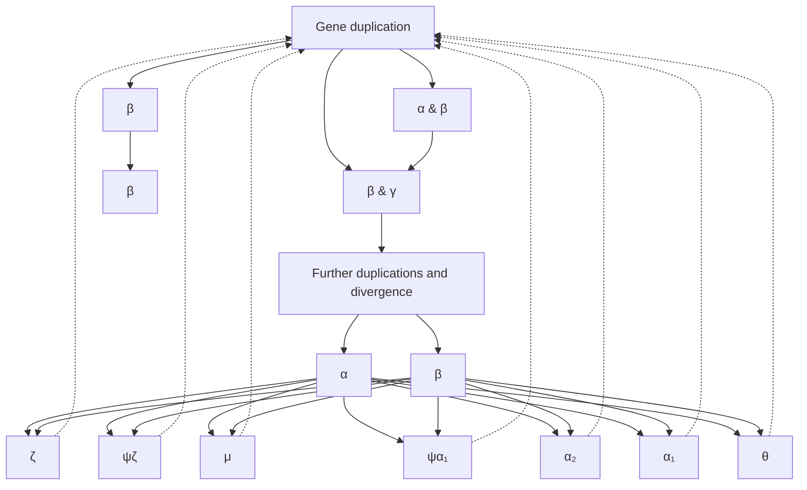
</details>

111

---

The expression of these genes follows a strict developmental pattern. In the embryo (up to 6 weeks after conception) two haemoglobin chains are primarily synthesized—ζ and ε—which form a ζ<sub>2</sub>ε<sub>2</sub> tetramer. Between 6 weeks after conception until about 8 weeks after birth, foetal haemoglobin—α<sub>2</sub>γ<sub>2</sub>—is the predominant species. This is succeeded by adult haemoglobin: α<sub>2</sub>β<sub>2</sub>.

Thalassaemias are genetic diseases associated with defective or deleted haemoglobin genes. Most caucasian people have four genes for the α-chain of normal adult haemoglobin, two alleles of each of the two tandem genes $\mathfrak { a } _ { 1 }$ and α<sub>2</sub>. Therefore α-thalassaemias can present clinically in different degrees of severity, depending on how many genes express normal α-chains. Only deletions leaving fewer than two active genes present as symptomatic under normal conditions. Observed genetic defects include deletions of both genes (a process made more probable by the tandem gene arrangement and repetitive sequences, which make crossing over more likely) and loss of chain termination leading to transcriptional ‘read through’, creating extended polypeptide chains that are unstable.

β-Thalassaemias are usually point mutations, including missense mutations (amino acid substitutions) or nonsense mutations (changes from a triplet coding for an amino acid to a stop codon) leading to premature termination and a truncated protein, mutations in splice sites, or mutations in regulatory regions. Certain deletions including the normal termination codon and the intergenic region between δ and β genes create δ–β fusion proteins.

over an order of magnitude, from the 1352 kbp chromosome IV to the 230 kbp chromosome I.

The yeast genome contains 6172 predicted protein-coding genes, ≈140 genes for rRNAs, 40 genes for small nuclear RNAs, and 275 tRNA genes. In two respects, the yeast genome is denser in coding regions than the known genomes of the more complex eukarya C. elegans, D. melanogaster, and human: (1) introns are relatively rare, and relatively small (only 231 genes in yeast contain introns) and (2) there are fewer repeat sequences compared with more complex eukarya.

A duplication of the entire yeast genome appears to have occurred ≈150 million years ago. This was followed by translocations of pieces of the duplicated DNA and loss of one of the copies of most ( ≈92%) of the genes.

Of the 6172 protein-coding genes, between 4000 and 5000 correspond to molecules to which a function can be assigned, with varying degrees of confidence. Only about one-third of yeast proteins have identifiable homologues in the human genome.

In taking censuses of genes it has been useful to classify their functions into broad categories. The classification of yeast protein functions in Table 2.3 is taken from [http://mips.gsf.de/genre/proj/yeast/Search/Catalogs/catalog.jsp](http://mips.gsf.de/genre/proj/yeast/Search/Catalogs/catalog.jsp).

Table 2.3 Distribution of functional categories among yeast proteins

| Functional category | Number of proteins |
| --- | --- |
| Metabolism | 1514 |
| Energy | 367 |
| Cell cycle and DNA processing | 1007 |
| Transcription | 1078 |
| Protein synthesis | 480 |
| Protein fate (folding, modification, destination) | 1154 |
| Protein with binding function or cofactor requirement (structural or catalytic) | 1048 |
| Regulation of metabolism and protein function | 249 |
| Cellular transport, transport facilities, and transport routes | 1038 |
| Cellular communication/signal transduction mechanism | 234 |
| Cell rescue, defence, and virulence | 554 |
| Interaction with the environment | 463 |
| Transposable elements, viral and plasmid proteins | 120 |

112

---

| Cell fate | 273 |
| --- | --- |
| Development (systemic) | 69 |
| Biogenesis of cellular components | 862 |
| Cell-type differentiation | 452 |
| Total functionally classified proteins | 4778 |
| Functionally unclassified proteins | 1394 |

Yeast is a testbed for development of methods to assign functions to gene products. The search for homologues has been exhaustive and continues. Collections of mutants exist that contain a knockout of every gene. (A unique sequence ‘bar code’ introduced into each mutant facilitates identification of the ones that grow under selected conditions.) Cellular localization and expression patterns are being investigated. Several types of measurement, including those based on activation of transcription by pairs of proteins that can form dimers, are producing catalogues of interprotein interactions.


## See Weblem 2.20

## The genome of Caenorhabditis elegans

The nematode worm C. elegans entered biological research in the 1960s, at the express invitation of Sydney Brenner. He recognized its potential as an organism sufficiently complex to be interesting yet simple enough to permit complete analysis, at the cellular level, of its genetics, development, and neural circuitry.

The C. elegans genome, completed in 1998, provided the first full DNA sequence of a multicellular organism. The C. elegans genome contains ≈97 Mbp of DNA distributed on paired chromosomes I, II, III, IV, V, and X (see Table 2.4). There is no Y chromosome. Different genders in C. elegans appear in the XX genotype, a self-fertilizing hermaphrodite, and the XO genotype, a male.

Table 2.4 Distribution of C. elegans genes

| Chromosome | Size (Mb) | Number of protein genes | Density of protein genes (kb/gene) | Number of tRNA genes |
| --- | --- | --- | --- | --- |
| I | 7.9 | 2803 | 5.06 | 13 |
| II | 8.5 | 3259 | 3.65 | 6 |
| III | 7.6 | 2508 | 5.40 | 9 |
| IV | 9.2 | 3094 | 5.17 | 7 |
| V | 9.8 | 4082 | 4.15 | 5 |
| X | 10.1 | 2631 | 6.54 | 3 |

The C. elegans genome is about eight times larger than that of yeast, and its 19 099 predicted genes are approximately three times the number in yeast. The gene density is relatively low for a eukaryote, with ≈1 gene/5 kb of DNA. Exons cover ≈27% of the genome; the genes contain an average of five introns each. Approximately 25% of the genes are in clusters of related genes.

Many C. elegans proteins have homologues common to other life forms. Others are apparently specific to nematodes: 42% of proteins have homologues outside the phylum, 34% are homologous to proteins of other nematodes, and 24% have no known homologues outside C. elegans itself. Many of the proteins have been classified according to structure and function (see Table 2.5).

Table 2.5 C. elegans: 20 commonest protein domains

| Type of domain | Number |
| --- | --- |
| Seven-transmembrane spanning chemoreceptor | 650 |

113

---

| Eukaryotic protein kinase domain | 410 |
| --- | --- |
| Two domain, C4 type zinc finger | 240 |
| Collagen | 170 |
| Seven-transmembrane spanning receptor (rhodopsin-family) | 140 |
| C2H2-type zinc finger | 130 |
| C-type lectin | 120 |
| RNA-recognition motif | 100 |
| C3HC4-type (RING finger) zinc fingers | 90 |
| Protein tyrosine phosphatase | 90 |
| Ankyrin repeat | 90 |
| WD domain G-β repeat | 90 |
| Homeobox domain | 80 |
| Neurotransmitter-gated ion channel | 80 |
| Cytochrome P450 | 80 |
| Conserved C-terminal helicase | 80 |
| Short-chain and alcohol dehydrogenases | 80 |
| UDP-glucoronosyl and UDP-glucosyl transferases | 70 |
| EGF-like domain | 70 |
| Immunoglobulin superfamily | 70 |

From the C. elegans genome consortium paper in Science volume 282, dated 11 December 1998.

Several kinds of RNA genes have been identified. The C. elegans genome contains 659 genes for tRNA, almost half of them (44%) on the X chromosome. Spliceosomal RNAs appear in dispersed copies, often identical. (Spliceosomes are the organelles that convert pre-mRNA transcripts to mature mRNA by excising introns and stitching the exons together.) rRNAs appear in a long tandem array at the end of chromosome I. 5S RNAs appear in a tandem array on chromosome V. Some RNA genes appear in introns of protein-coding genes.

The C. elegans genome contains many repeat sequences. Approximately 2.6% of the genome consists of tandem repeats. Approximately 3.6% of the genome contains inverted repeats; these appear preferentially within introns, rather than between genes. Repeats of the hexamer sequence TTAGGC appear in many places. There are also simple duplications, involving hundreds to tens of thousands of kilobases.

## The genome of Drosophila melanogaster

D. melanogaster, the fruit fly, has been the subject of detailed studies of genetics and development for almost a century. Its genome sequence, the product of a collaboration between Celera Genomics and the Berkeley Drosophila Genome Project, was announced in 1999.

The chromosomes of D. melanogaster are nucleoprotein complexes, with variation in their structure along their lengths. Approximately one-third of the genome is contained in heterochromatin, highly coiled and compact (and therefore densely staining) regions flanking the centromeres. The other two-thirds is euchromatin, a relatively uncoiled, less compact form. Most of the active genes are in the euchromatin. The heterochromatin in D. melanogaster contains many tandem repeats of the sequence AATAACATAG, and relatively few genes.

The total chromosomal DNA of D. melanogaster contains about ≈180 Mbp. The sequence released in 1999 consists of the euchromatic portion, about 120 Mbp. In 2007 an additional ≈15 Mbp of heterochromatin sequence was assembled.

The genome is distributed over five chromosomes: three large autosomes, a Y chromosome, and a

114

---

fifth tiny chromosome containing only ≈1 Mbp of euchromatin. The fly’s 13 601 genes are approximately double the number in yeast, but are fewer than in C. elegans, perhaps a surprise. The average density of genes in the euchromatin sequence is 1 gene/9 kb, much lower than the typical 1 gene/kb densities of prokaryotic genomes.

The heterochromatin contains at least ≈250 protein-coding genes. They differ from typical euchromatic protein-coding genes by containing longer introns. Most of the intron sequences are repetitive, predominantly fragmented transposable elements.

Despite the fact that insects are not very closely related to mammals, the fly genome is useful in the study of human disease. It contains homologues of 289 human genes implicated in various diseases, including cancer and cardiovascular, neurological, endocrinological, renal, metabolic, and haematological diseases. Some of these homologues have different functions in humans and flies. Other human disease-associated genes can be introduced into, and studied in, the fly. For instance, the gene for human spinocerebellar ataxia type 3, when expressed in the fly, produces similar neuronal cell degeneration. There are now fly models for Parkinson’s disease and malaria.

The noncoding regions of the D. melanogaster genome must contain regions controlling spatiotemporal patterns of development. The developmental biology of the fly has been studied very intensively. It is therefore an organism in which the study of the genomics of development should prove extremely informative.

## The genome of Arabidopsis thaliana

As a flowering plant A. thaliana is a very distant relative of most other higher eukaryotic organisms for which genome sequences are available. It invites comparative analysis to identify common and specialized features. A. thaliana has a relatively small genome—146 Mb—distributed over five chromosomes. The maize genome is almost 20 times larger. The compact genome was one reason for the adoption of Arabidopsis as a research species. A. thaliana is called ‘the fruit fly of botany’

The Arabidopsis Genome Initiative reported 115.4 Mbp of genomic DNA sequence in 2000. There are five pairs of chromosomes, containing 25 498 predicted genes (see Table 2.6). The genome is relatively compact, with 1 gene/4.6 kb on average. This figure is intermediate between prokaryotes and Drosophila, and roughly similar to C. elegans. The genes of Arabidopsis are relatively small. Exons are typically 250 bp long, and introns relatively small, with a mean length 170 bp. Typical of plant genes is an enrichment of coding regions in GC content.

Table 2.6 The A. thaliana genome

<table><tr><td></td><td colspan="5">Chromosome</td><td>Total</td></tr><tr><td></td><td>1</td><td>2</td><td>3</td><td>4</td><td>5</td><td></td></tr><tr><td>Length (bp)</td><td>29 105 111</td><td>19 646 945</td><td>23 172 617</td><td>17 549 867</td><td>25 353 409</td><td>115 409 949</td></tr><tr><td>Number of genes</td><td>6543</td><td>4036</td><td>5220</td><td>3825</td><td>5874</td><td>25 498</td></tr><tr><td>Density (kb/gene)</td><td>4.0</td><td>4.9</td><td>4.5</td><td>4.6</td><td>4.4</td><td></td></tr><tr><td>Mean gene length (kb)</td><td>2078</td><td>1949</td><td>1925</td><td>2138</td><td>1974</td><td></td></tr></table>

Most Arabidopsis proteins have homologues in animals, but some systems are unique, among higher organisms, to plants. These include cell wall production and photosynthesis. It might be expected that these need special proteins that might not be shared with animals. Many proteins shared with animals have diverged widely since the last common ancestor. Typical of another difference between plants and animals, 25% of the nuclear genes have signal sequences governing their transport into organelles—mitochondria and chloroplasts—compared to 5% of mitochondrion-

115

---

targeted nuclear genes in animals.


## See Weblem 2.21

The Arabidopsis nuclear genome is relatively compact. Protein-coding genes contain an average of 5.4 exons and have an average length 276 bp, separated by relatively short introns of about 165 bp long. The intergenic spacing is also short, about 4.6 kb. A feature of plant genes is that the G + C content of exons (44%) is higher than that of introns (32%).

The structure of the A. thaliana genome reveals both local and genome-wide duplications. There were at least three polyploidizations, estimates for the dates of which vary widely. The ranges 225–300 million years ago for the first, 150–170 million years ago for the second, and 25–40 million years ago for the most recent have been suggested. In addition, local duplications have affected ≈17% of genes. Close relatives, such as cabbage and cauliflower, have undergone additional polyploidizations during the 12 million years since they diverged from Arabidopsis.

Higher plants must integrate the effects of three genomes: nuclear, chloroplast, and mitochondrial. The organelle genomes are much smaller (see Table 2.7).

Table 2.7 Gene distribution in A. thaliana between nucleus and organelles

|  | Nucleus | Chloroplast | Mitochondrion |
| --- | --- | --- | --- |
| Size (kb) | 125 100 | 154 | 367 |
| Protein genes | 25 498 | 79 | 58 |
| Density (kb/protein gene) | 4.5 | 1.2 | 6.25 |

Many genes for proteins synthesized by nuclear genes and transported to organelles appear to have originated in the organelles and been transferred to the nucleus.

Genome analysis must address questions of divisions of labour. Relative to animal cells, organelles in plant cells bear a greater metabolic burden, if only because of the activities of chloroplasts. Chloroplast genomes are relatively gene-dense, with preserved gene order. In plant mitochondria, genes are more widely spaced, and recombination is more common. Mitochondrial and chloroplast genes contain fewer introns, as shown here.

| Genome | Nucleus | Chloroplast | Mitochondrion |
| --- | --- | --- | --- |
| Genes containing introns | 80% | 18.4% | 12% |

The Arabidopsis proteome contains many genes specific to plants, including those involved in photosynthesis, and metabolism of cell wall components.

Plants have many special metabolic pathways, for photosynthesis and for metabolism of cell wall components, alkaloids, and growth regulators such as auxins and gibberelins. Complex metabolism requires the genome to encode a large and varied set of enzymes.
• Plants are threatened by pathogens and have evolved defence mechanisms dissimilar from our immune system. One weapon against pathogens involves production of reactive oxygen species. Plants synthesize some defence molecules against animals and others that attract pollinators. These have provided useful sources of flavours, fragrances, and drugs, encompassing traditional ‘herbal medicine’ and modern pharmacology.
• In keeping with the essential role of light in plant life, Arabidopsis has many light sensors, that regulate development and circadian responses.

116

---

• Arabidopsis is rich in genes that encode water-transporting channels, peptide hormone transporters, metabolic and biosynthetic enzymes, and proteins involved in defence, detoxification, and environmental sensing.

Comparing the proteins encoded in the nuclear genome of Arabidopsis with human proteins, the fraction of homologues observed varies with functional category. For protein synthesis, 60% of nuclear-encoded Arabidopsis genes have human homologues. For transcription regulation, the figure is only 30%. It is not that transcription is poorly represented in plant genomes; it’s just that plants do it differently. In fact, plants have several times as many transcription factors as the fruit fly. Although many components of the signal transduction pathways familiar from animals are absent in plants, plants have developed specific transcription factor families unknown in animals.

Many Arabidopsis genes are homologous to human genes implicated in disease. For instance, plants and animals have similar DNA-repair systems, and Arabidopsis has a homologue of BRCA2. For some human-disease-associated genes, the plant homologue is more similar to the human protein than those from fruit fly or C. elegans. Study of the function of the plant homologues will be illuminating, even though it is unlikely that Arabidopsis will be suitable for clinical trials of drugs intended for human use!

## The genome of Homo sapiens (the human genome)

## NOTICE

Persons attempting to find a motive in this narrative will be prosecuted; persons attempting to find a moral in it will be banished; persons attempting to find a plot in it will be shot.

Mark Twain, Preface to The Adventures of Huckleberry Finn

In February 2001 the International Human Genome Sequencing Consortium and Celera Genomics published, separately, drafts of the human genome. On 14 April 2003 the finishing of the genome was announced, with reduced error rate and closure of most gaps. This date was within a few days of the fiftieth anniversary of the publication of the Watson–Crick model for the structure for DNA.

The sequence amounts to about $3 . 2 \times 1 0 ^ { 9 }$ bp, 30 times larger than the genomes of C. elegans or D. melanogaster. One reason for this disparity in size is that coding sequences form less than 5% of the human genome and repeat sequences over 50%. Perhaps the most surprising feature was the small number of genes identified. The finding of only about 20 000–25 000 genes suggests that alternative splicing patterns make a very significant contribution to our protein repertoire. It is estimated that ≈35% of human genes have alternative splicing patterns.

The human genome is distributed over 22 chromosome pairs plus the X and Y chromosomes. The DNA contents of the autosomes range from 279 down to 48 Mbp. The X chromosome contains 163 Mbp and the Y chromosome only 51 Mbp.

The exons of human protein-coding genes are relatively small compared to those in other known eukaryotic genomes. The introns are relatively long. As a result many protein-coding genes span long stretches of DNA. For instance, the dystrophin gene, coding for a 3685 amino acid protein, is more than 2.4 Mbp long.

## Protein-coding genes

Analysis of the human protein repertoire implied by the genome sequence has proved difficult

117

---

because of the problems in detecting genes reliably, and because of alternative splicing patterns. Of the estimated 20 000–25 000 genes, the top categories in a functional classification are in Table 2.8.

Table 2.8 Functional classification of human gene products

| Function | Number | % of genome |
| --- | --- | --- |
| Nucleic acid binding | 2207 | 14.0% |
| DNA binding | 1656 | 10.5% |
| DNA-repair protein | 45 | 0.2% |
| DNA replication factor | 7 | 0.0% |
| Transcription factor | 986 | 6.2% |
| RNA binding | 380 | 2.4% |
| Structural protein of ribosome | 137 | 0.8% |
| Translation factor | 44 | 0.2% |
| Transcription factor binding | 6 | 0.0% |
| Cell-cycle regulator | 75 | 0.4% |
| Chaperone | 154 | 0.9% |
| Motor | 85 | 0.5% |
| Actin binding | 129 | 0.8% |
| Defence/immunity protein | 603 | 3.8% |
| Enzyme | 3242 | 20.6% |
| Peptidase | 457 | 2.9% |
| Endopeptidase | 403 | 2.5% |
| Protein kinase | 839 | 5.3% |
| Protein phosphatase | 295 | 1.8% |
| Enzyme activator | 3 | 0.0% |
| Enzyme inhibitor | 132 | 0.8% |
| Apoptosis inhibitor | 28 | 0.1% |
| Signal transduction | 1790 | 11.4% |
| Receptor | 1318 | 8.4% |
| Transmembrane receptor | 1202 | 7.6% |
| G-protein linked receptor | 489 | 3.1% |
| Olfactory receptor | 71 | 0.4% |
| Storage protein | 7 | 0.0% |
| Cell adhesion | 189 | 1.2% |
| Structural protein | 714 | 4.5% |
| Cytoskeletal structural protein | 145 | 0.9% |
| Transporter | 682 | 4.3% |
| Ion channel | 269 | 1.7% |
| Neurotransmitter transporter | 19 | 0.1% |
| Ligand binding or carrier | 1536 | 9.7% |
| Electron transfer | 33 | 0.2% |
| Cytochrome P450 | 50 | 0.3% |
| Tumour suppressor | 5 | 0.0% |
| Unclassified | 4813 | 30.6% |
| Total | 15 683 | 100.0% |

A classification based on structure revealed the most common types of protein (Table 2.9).

Table 2.9 Most common types of protein

| Protein | Number |
| --- | --- |
| Immunoglobulin and major histocompatibility complex domain | 591 |
| Zinc finger, C2H2 type | 499 |

118

---

| Eukaryotic protein kinase | 459 |
| --- | --- |
| Rhodopsin-like GPCR superfamily | 346 |
| Serine/threonine protein kinase family active site | 285 |
| EGF-like domain | 259 |
| RNA-binding region RNP-1 (RNA recognition motif) | 214 |
| G-protein β WD-40 repeats | 196 |
| Src homology 3 (SH3) domain | 194 |
| Pleckstrin homology (PH) domain | 188 |
| EF-hand family | 185 |
| Homeobox domain | 179 |
| Tyrosine kinase catalytic domain | 173 |
| Immunoglobulin V-type | 163 |
| RING finger | 159 |
| Proline-rich extensin | 156 |
| Fibronectin type III domain | 151 |
| Ankyrin-repeat | 135 |
| KRAB box | 133 |
| Immunoglobulin subtype | 128 |
| Cadherin domain | 118 |
| PDZ domain (also known as DHR or GLGF) | 117 |
| Leucine-rich repeat | 113 |
| Serine proteases, trypsin family | 108 |
| Ras GTPase superfamily | 103 |
| Src homology 2 (SH2) domain | 100 |
| BTB/POZ domain | 99 |
| TPR repeat | 92 |
| AAA ATPase superfamily | 92 |
| Aspartic acid and asparagine hydroxylation site | 91 |

DHR, Dig-homologous region; GLGF, glycine-leucine-glycine-phenylalanine domain; GPCR, G-protein-coupled receptor. From [http://www.ebi.ac.uk/proteome/](http://www.ebi.ac.uk/proteome/).

## Repeat sequences

Repeat sequences comprise over 50% of the genome:

• transposable elements, or interspersed repeats: almost half the entire genome! These include the LINEs and SINEs (see Table 2.10);
• retroposed pseudogenes;
simple ‘stutters’: repeats of short oligomers. These include the minisatellites and microsatellites. Trinucleotide repeats such as CAG, corresponding to glutamine repeats in the corresponding protein, are implicated in numerous diseases;
segmental duplications, in blocks of ≈10–300 kb: interchromosomal duplications appear on nonhomologous chromosomes, sometimes at multiple sites. Some intrachromosomal duplications include closely spaced duplicated regions many kilobases long of very similar sequence implicated in genetic diseases; for example, Charcot–Marie–Tooth syndrome type 1A, a progressive peripheral neuropathy resulting from duplication of a region containing the gene for peripheral myelin protein 22;
• blocks of tandem repeats, including gene families.

Table 2.10 Types of transposable element in the human genome

119

---

| Element | Size (bp) | Copy number | Fraction of genome |
| --- | --- | --- | --- |
| Short interspersed nuclear elements (SINEs) | 100–300 | 1 500 000 | 13% |
| Long interspersed nuclear elements (LINEs) | 6000–8000 | 850 000 | 21% |
| Long terminal repeats | 15 000–110 000 | 450 000 | 8% |
| DNA transposon fossils | 80–3000 | 300 000 | 3% |

## RNA

RNA genes in the human genome include:

497 tRNA genes: one large cluster contains 140 tRNA genes in a 4 Mbp region on chromosome 6;
genes for 28S and 5.8S rRNAs appear in a 44 kb tandem repeat unit of 150–200 copies; 5S RNA genes also appear in tandem arrays containing 200–300 genes, the largest of which is on chromosome 1;
• small nuclear RNAs (snRNAs) include two families of molecules that cleave and process rRNAs;
• spliceosomal snRNAs, including the U1, U2, U4, U5, and U6 snRNAs, many of which appear in clusters of tandem repeats of nearly identical sequences, or inverted repeats;
• other noncoding RNAs are distributed around the genome. These include siRNAs, miRNAs, and piRNAs active in control of gene expression.

## Single-nucleotide polymorphisms and haplotypes

All people, except identical siblings, have a unique DNA sequences in almost all cells.<sup>3</sup> Comparisons between unrelated individuals reveal overall differences between whole-genome sequences of ≈0.1%. Many of the differences between individuals have the form of single-nucleotide polymorphisms, or SNPs. There are also many short deletions.

A SNP (pronounced ‘snip’) is a genetic variation between individuals, limited to a single base pair that can be substituted, inserted, or deleted. Sickle-cell anaemia is an example of a disease caused by a specific SNP: an A → T mutation in the β globin gene changes a Glu to a Val, creating a sticky surface on the haemoglobin molecule that leads to polymerization of the deoxy form.

Not all SNPs are linked to diseases. Many are not within functional regions (although the density of SNPs is higher than the average in regions containing genes). Some SNPs that occur within exons are mutations to synonymous codons, or cause substitutions that do not significantly affect protein function. Other types of SNP can cause more than local perturbation to a protein: (1) a mutation from a sense codon to a stop codon, or vice versa, will cause either premature truncation of protein synthesis or ‘read through’ and (2) a deletion or insertion may cause a phase shift in translation.


## See Weblem 2.22

The A, B, and O alleles of the genes for blood groups illustrate these possibilities. A and B alleles differ by four SNP substitutions. They code for related proteins that add different saccharide units to an antigen on the surface of red blood cells.

| Allele | Sequence | Saccharide |
| --- | --- | --- |
| A | ...gctggtgacccctt... | N-Acetylgalactosamine |
| B | ...gctcgtcaccgcta... | Galactose |
| O | ...cgtggt-acccctt... | — |

The O allele has undergone a mutation causing a phase shift, and produces no active enzyme. The

120

---

red blood cells of type O individuals contain neither the A nor the B antigen. This is why people with type O blood are universal donors in blood transfusions. The loss of activity of the protein does not seem to carry any adverse consequences. Indeed, individuals of blood types B and O have greater resistance to smallpox.

Strong correlation of a disease with a specific SNP is advantageous in clinical work because it is relatively easy to test for affected people or carriers. But if a disease arises from dysfunction of a specific protein there ought to be many sites of mutations that could cause inactivation. However, a particular site may predominate if (1) all bearers of the gene are descendants of a single individual in whom the mutation occurred, and/or (2) the disease results from a gain rather than loss of a specific property, such as in the ability of sickle-cell haemoglobin to polymerize, and/or (3) the mutation rate at a particular site is unusually high, as in the $^ { 3 8 0 } \mathrm { G l y }   \rightarrow   \mathrm { A r g }$ mutation in the fibroblast growth receptor gene FGFR3, associated with achondroplasia (a syndrome including short stature).

In contrast, many independent mutations have been detected in the BRCA1 and BRCA2 genes, loci associated with increased disposition to early-onset breast and ovarian cancer. The normal gene products function as tumour suppressors. Insertion or deletion mutants causing phase shifts generally produce a missing or inactive protein. But it cannot be deduced a priori whether a novel substitution mutant in BRCA1 or BRCA2 confers increased risk or not.

Treatments of diseases caused by defective or absent proteins include the following.

1. Providing normal protein. We have mentioned insulin for diabetes, and Factor VIII in the most common type of haemophilia. Another example is the administration of human growth hormone in patients with an absence or severe reduction in normal levels. Use of recombinant proteins eliminates the risk of transmission of AIDS through blood transfusions or of Creutzfeld–Jakob disease from growth hormone isolated from crude pituitary extracts.
2. Lifestyle adjustments that make the function unnecessary. Phenylketonuria (PKU) is a genetic disease caused by deficiency in phenylalanine hydroxylase, the enzyme that converts phenylalanine to tyrosine. Accumulation of high levels of phenylalanine causes developmental defects, including mental retardation. The symptoms can be avoided by a phenylalanine-free diet. Screening of newborns for high blood phenylalanine levels is legally required in the USA and many other countries.
3. Gene therapy to replace absent proteins is an active field of research.


## See Weblem 2.23 and 2.24

Other clinical applications of SNPs reflect correlations between genotype and reaction to therapy (pharmacogenomics). For example, a SNP in the gene for N-acetyltransferase (NAT-2) is correlated with peripheral neuropathy—weakness, numbness, and pain in the arms, legs, hands, or feet—as a side effect of treatment with isoniazid (isonicotinic acid hydrazide), a common treatment for tuberculosis. Patients who test positive for this SNP are given alternative treatment.

SNPs are distributed throughout the genome, occurring on the average every 2000 bp. Although they arose by mutation, many positions containing SNPs have low mutation rates, and provide stable markers for mapping genes.

Each of us bears an accumulated collection of SNPs reflecting mutations that occurred in our ancestors. Some constellations of SNPs are co-inherited as blocks. Others are not: mutations in dif erent DNA molecules of diploid chromosomes become separated within a single generation, by assortment. Mutations on the same chromosome become separated more slowly, by recombination. Haploid sequences, such as the most of the human Y chromosome or mitochondrial DNA, are not

121

---

subject to recombination. Mutations in these sequences remain together.

Mutations in the same DNA molecule in diploid chromosomes will become unlinked by recombination events that occur between their loci. The greater the separation between two sites, the greater the frequency of recombination. However, recombination rates vary widely along the genome, by several orders of magnitude. SNPs on opposite sides of recombinational ‘hot spots’ are more likely to be separated in any generation. SNPs lying within recombination-poor (‘cold’) regions will tend to stay together.

Haplotypes are local combinations of genetic polymorphisms that tend to be co-inherited. In humans, many 100 kb regions tend to remain intact. They show the expected number of SNPs, but relatively few of the possible combinations. An average SNP density of 0.1%, or 1 SNP/kb, suggests ≈100 SNPs per 100 kb. The genome of any individual may possess, or may lack, each of them, giving a very large number $( 2 ^ { 1 0 0 } )$ of possible combinations. However, many 100 kb regions show fewer than five combinations of SNPs. These discrete combinations of SNPs in recombination-poor regions define an individual’s ‘haploid genotype’ or haplotype (see Box 2.10).

Haplotypes provide a very economical characterization of entire genomes. They simplify the search for genes responsible for diseases, or any other phenotype–genotype correlations. For field biologists, including anthropologists, haplotypes permit detection of migratory and interbreeding patterns in populations.

In looking for genes responsible for diseases or other phenotypic traits, haplotypes provide a magnifying glass. The goal is to correlate phenotype with genetic sequence. The target may be to identify one base out of $3   \times   1 0 ^ { 9 }$ . By correlating phenotype with haplotype, much less sequencing data must be collected to localize the site to within the typical length of a haplotype block, perhaps ≈100 kb, containing only a few genes. Another way to look at it is to regard boundaries between haplotype blocks as like the grooves in a bar of chocolate that permit it to be broken easily into bitesize fragments.

## Systematic measurements and collections of single-nucleotide polymorphisms

Variations in human genomes are the subject of several large-scale projects. NCBI’s dbSNP collects human SNPs. Its database currently contains ${ \approx } 1 0 ^ { 8 }$ entries. The International HapMap project has collected and curated haplotype distributions from 1184

## Box 2.10 Haplotype distributions

Our individual genomes are characterized by a distribution of genetic markers. SNPs are convenient features to observe and to study within and across populations. Although the overall density of SNPs in our genomes is ≈1 SNP/5 kb, many 100 kb regions show only a few (typically two to four) of the possible combinations of SNPs, suggesting that recombination is rare within the region. These segments, which remain intact, are separated by intervals in which recombination is more frequent.

The few discrete combinations of SNPs define the haplotype of an individual. The International HapMap project collects and curates haplotype distributions from several human populations.

Haplotypes are difficult to measure because it is essential to determine which SNPs appear in the same DNA strand. Clearly, study of mixed samples from several individuals can determine the frequencies of individual SNPs but not their correlation into haplotypes. Even a sample containing both chromosomes from a diploid cell mixes the contributions of both copies of the region. However, mass spectral studies of amplified single-copy DNA molecules, produced by dilution, can identify the combination of SNPs appearing together on the same

122

---

chromosome, allowing unambiguous haplotyping.

reference individuals from 11 geographically diverse human populations (see Box 2.11). It measures SNPs and copy-number polymorphisms.

The work of the International HapMap Consortium, together with other studies, shows that:

• most of the variations appear in all populations sampled. Some of the interpopulation differences reflect different relative amounts of the same SNPs;
however, a very few SNPs are unique to particular populations. For example, out of over 1 million SNPs, only 11 are consistently different between all individuals of European origin in the sample studied, and all individuals of Chinese or Japanese origin in the sample studied;
• the genomes of individuals from Japan and China are very similar, suggesting more recent common ancestry than other pairs of populations in the study;
• the X chromosome varies more between different populations than other chromosomes. This may arise from the fact that males have only

Box 2.11 Origin of samples for the International HapMap project\*

| Population origin | Location | Number of individuals | Relationships |
| --- | --- | --- | --- |
| Yoruba | Ibadan, Nigeria | 90 | 30 parent/offspring trios |
| Northern and western European descent | Utah, USA | 90 | 30 parent/offspring trios |
| Han Chinese | Beijing, China | 45 |  |
| Japanese | Tokyo, Japan | 45 |  |

Why the choice of parent/offspring combinations? When determining haplotypes in heterozygous regions of diploid chromosomes a difficulty is how to determine which SNPs lie in the same DNA molecule. Comparison of parental and child sequences can sort the observed SNPs into haploid contributions.

\* The International HapMap Consortium (2005). A haplotype map of the human genome. Nature, **437**, 1299–1320.

one X chromosome, the genes on which are therefore subject to stronger selective pressure. Recombinations of X chromosomes can occur, but only in females;

lengths of haplotype blocks vary among the different sources of samples. They tend to be shorter among populations from Africa, consistent with the idea of African origin of the human species.

The International HapMap Consortium paid due attention to ethical, legal and social issues. Informed consent of the donors preceded collection of samples. The procedure for informed consent involved not only individual agreement, but also community engagement, including interactive explanation of the project. Samples were labelled anonymously. In fact, more samples were collected than used (similar in some ways to the principle of issuing blank cartridges to a firing squad). Nevertheless, the characteristics of a population constitute personal information, the release of which may affect all individuals in the population, including those who were never asked to contribute a sample, and even those who refused. For this reason the HapMap Consortium did not collect medical information about the sample contributors, even under the protections of consent and anonymity.

123

---

## Ethical, legal, and social issues

Knowledge creates power. Power requires control. Control requires decisions. Advances in genomics have created problems that individuals and societies must face. In setting up the Human Genome Project, the US Department of Energy and National Institutes of Health recognized the importance of ethical, legal, and social issues by allocating 3–5% of the funding to them.

There is considerable discussion both within the scientific community and among governments about how to set rules that balance the interests of society as a whole, and the privacy rights of individuals.

There are four general sources of human sequence information:

1. research efforts, such as the 1000 Genomes project (now containing sequence information for 1092 individuals) and the International HapMap project;
2. sequencing of patients in clinical contexts;
3. sequencing by law-enforcement agencies. (On 3 June 2013, in a split decision, the US Supreme Court voted to allow taking DNA samples from people arrested—though not tried and convicted — for serious crimes.);
4. popular genealogy companies, which will provide limited sequence information to individuals.

Provided DNA sequence information is kept as private as normal medical records, sequencing can benefit individuals in a clinical setting. More controversial questions arise in allowing the sequence information to be collected into a generally accessible data bank. Most people recognize that extensive data on genome sequences, in a form that can be correlated with clinical records, would be an extremely valuable resource for medical research. Most people would accept a scheme that would assist in capturing criminals, especially those who are likely to repeat their offences. Most people would have no problem accepting a scheme that would make it easier to identify victims of death on a battlefield or after a terrorist attack.

Questions have been raised, however, over privacy issues:

• Should inclusion of genomic information in a data bank require the individual’s consent?
What data should be included? Should the data be limited to the minimum required for standard identification procedures, or be more extensive? (For instance, should sufficient additional data be kept to identify physical features or ethnic characteristics?)
• Who should have access to the information?

In the UK and USA at least, legislation is moving in the direction of greater protection for the privacy of DNA sequence information. Belief in this protection, which may well be illusory, could lead to increased genetic testing, both in medical practice and by private companies. But (1) as with mailing lists, testing companies may sell genetic information to outside parties, (2) given the increased degree of international sharing of identification information, individuals need to be concerned not with the countries with the most secure databases, but those with the least secure ones, and (3) experience has shown that much private information in fact becomes disseminated, through either accident or design.

Indeed, many researchers have thought that adequate protection would be afforded by construction of a database correlating clinical information with genome sequences, keeping both sets of data anonymous. However, it has recently emerged that by combining the putatively anonymous data from the 1000 Genomes project with sequence information available from ‘pop’ genealogy sites, the

124

---

anonymity could be broken fairly easily.

## Genetic diversity in anthropology

SNP data are of great utility in anthropology, giving clues to historical variations in population size, and migration patterns. Degrees of genetic diversity are interpretable in terms of the size of the founding population. Founders are the original set of individuals from whom an entire population is descended. Founders can be either original colonists, such as the Polynesians who first settled New Zealand, or merely the survivors of a near-extinction. Cheetahs show the effects of a population bottleneck estimated to have occurred 10 000 years ago. All living cheetahs are as closely related to one another as siblings. Extrapolations of mitochondrial DNA variation in contemporary humans suggest a single maternal ancestor who lived 140 000–200 000 years ago. Calling her Eve suggests that she was the first woman. But fossil evidence for human-like ancestors reaches back much longer. Mitochondrial Eve was the founder of a surviving population following a near-extinction.

There is now consensus that our species, H. sapiens, arose in Africa approximately 100 000–150 000 years ago. The evidence for human origins in Africa is that contemporary genetic diversity is highest there. The mitochondrial DNA haplogroup L1 (see Box 2.12), believed to be the oldest haplotype that

## Box 2.12 Human mitochondrial DNA haplogroups

Human mitochondrial DNA is a double-stranded closed circular molecule 16 569 bp long. It is inherited almost exclusively through maternal lines. A fertilized egg contains the mother’s mitochondria. Although sperm contain mitochondria—essential to provide energy for their motility—the few paternal mitochondria that enter the egg are selectively eliminated. As a haploid entity, mitochondrial DNA is therefore not subject to recombination, and changes only by mutation.

Mitochondrial DNA is estimated to adopt one mutation every 25 000 years. This gives a reasonable rate of divergence to trace human migration patterns. (Nuclear DNA mutates approximately 10 times more slowly than mitochondrial DNA because (1) histones protect it, (2) active repair mechanisms edit out some mutations, and (3) the activity of mitochondria in respiration exposes the DNA to mutagenic oxygen radicals.)

Human mitochondrial DNA contains genes for 22 tRNAs, two rRNAs, and 13 proteins. The major noncoding region is the control region, or D-loop, involved in regulation and initiation of replication. This region is about 1 kb long. It shows a higher rate of substitution than the rest of the mitochondrial genome, by a factor of about 4.

Different mitochondrial DNA sequences are associated with different populations. Mutations are referred to the first human mitochondrial DNA sequence determined, called the Cambridge Reference Sequence. Groups of related sequences are called haplogroups. (The distribution of the number of sequence differences between different individuals has peaks at ≈70 for Africans and ≈30 for non-Africans.) The original classification of sequence variants depended on changes in restriction sites (see Fig. 2.3). This was followed by explicit sequencing of the control region, focusing on its two highly polymorphic segments. For finest resolution, contemporary studies are now more frequently determining full mitochondrial DNA sequences, except in cases of ancient DNA where the best recoverable material may be fragmentary.

Several databases focus on human mitochondrial genomes, including MITOMAP ([http://www.mitomap.org](http://www.mitomap.org))and mtDB ([http://www.genpat.uu.se/mtDB](http://www.genpat.uu.se/mtDB)).

125

---


<details>
<summary>dendrogram</summary>

| Group | Subgroup | Prevalent in |
| --- | --- | --- |
| L3 | L1 | Africa |
| L3 | L2 | Africa |
| L3 | L3+ | Africa |
| M | CZ | Siberia |
| M | C | NE Asia, Amerinds |
| M | D | NE Asia, Amerinds |
| M | M* | India, Asia |
| M | E | — |
| M | G | East Asia |
| M | Q | Oceania |
| N | A | Asia, Americas |
| N | Z | Russia, Saami |
| N | W | W. Urals, E. Baltic |
| N | X | Near East, Caucasus |
| N | Y | Siberia |
| N | N* | Asia, Oceania |
| N | B | Amerinds, SE Asia |
| N | F | Asia |
| N | H1 | Europe |
| N | H3 | Europe |
| N | V | Oceania |
| N | R* | East Asia |
| N | P | Oceania |
| N | T | Eastern Baltic Sea, Urals |
| N | J | Europe |
| N | U | Europe |
| N | K | Europe |
</details>

Figure 2.3 Phylogenetic tree of major mitochondrial haplogroups. The nomenclature began with a study of Native Americans, or Amerinds, and the letters A, B, C, and D were assigned to them. Other letters were introduced, and (as more detailed sequencing data appeared) were subdivided as needed (HV0 was formerly called pre-V).

survives, is found in the KhoiSan of the Kalahari Desert in southern Africa, and in the Biaka pygmies of the central African rainforest.

Migrations beginning approximately 60 000 years ago took our ancestors around the world, and continue to do so. Unlike modern population flows documented in historical records we depend on archaeological relics, contemporary genomics, and linguistics to infer the timing, routes, numbers of individuals, and even perhaps motivation of ancient migrations. (See Introduction to Genomics, chapter 3.)

Population-specific SNPs are informative about migrations. Mitochondrial sequences provide information about female ancestors and Y chromosome sequences provide information about male ancestors. For example, it has been suggested that the population of Iceland—first inhabited about 1100 years ago—is descended from Scandinavian males and from females from both Scandinavia and the British Isles. Mediaeval Icelandic writings refer to raids on settlements in the British Isles.

Other crucial transitions in human social organization, such as turning from hunting to agriculture, can be seen in domestications of other species such as maize and dog. Genomic data are joining classical archaeological evidence to illuminate times and places of domestications (see Box 2.13).

## DNA sequences and languages

A fascinating relationship between human DNA sequences and language families has been investigated by L.L. Cavalli-Sforza and colleagues. These

126

---

Box 2.13 Genetic analysis of cattle domestication

Animal resources are an integral and essential aspect of human culture. Analysis of DNA sequences sheds light on their historical development and on the genetic variety characterizing modern breeding populations.

Contemporary domestic cattle include those familiar in Western Europe and North America, Bos taurus, and the zebu of Africa and India, Bos indicus. The most obvious difference in external appearance is the humped back of the zebu. It has been widely believed that the domestication of cattle occurred once, about 8000–10 000 years ago, and that the two species subsequently diverged.

Analysis of mitochondrial DNA sequences from European, African, and Asian cattle suggest, however, that (1) all European and African breeds are more closely related to each other than either is to Indian breeds and (2) the two groups diverged about 200 000 years ago, implying recent independent domestications of different species. The similarity in physical appearance of the African and Indian zebu (and other similarities at the molecular level; for instance, VNTR markers in nuclear DNA) must then be attributable to importation of male cattle from India to East Africa.

studies have proved useful in working out interrelationships among American Indian languages. They confirm that the Basques, known to be a linguistically isolated population, have been genetically isolated also.


## See Weblem 2.25

With the study of isolated populations, anthropological genetics provides data useful in medicine, for mapping disease genes is easier if the background variation is low. Genetically isolated populations in Europe include, in addition to the Basques, the Finns, Icelanders, Welsh, and Lapps.

## Genetic diversity and personal identification

Variations in our DNA sequences give us individual fingerprints, useful for identification and for establishment of relationships, including but not limited to questions of paternity. The use of DNA analysis as evidence in criminal trials is now well established.

Genetic fingerprinting techniques were originally based on patterns of VNTRs, but have been extended to include analysis of other features including mitochondrial DNA sequences.

For most of us, all our mitochondria are genetically identical, a condition called homoplasmy. However, some individuals contain mitochondria with different DNA sequences, called heteroplasmy. Such sequence variation in a disease gene can complicate the observed inheritance pattern of the disease.

The most famous case of heteroplasmy involved Tsar Nicholas II of Russia. After the revolution in 1917 the Tsar and his family were taken to exile in Yekaterinburg in Central Russia. During the night of 16–17 July 1918, the Tsar, Tsarina Alexandra, at least three of their five children, plus their physician and three servants who had accompanied the family, were killed, and their bodies buried in a secret grave. When the remains were rediscovered, assembly of the bones and examination of the dental work suggested—and sequence analysis confirmed—that the remains included an expected family group. The identity of the remains of the Tsarina were proved by matching the mitochondrial DNA sequence with that of a maternal relative, Prince Philip, Chancellor of the University of Cambridge, Duke of Edinburgh, and grandnephew of the Tsarina.

However, comparisons of mitochondrial DNA sequences of the putative remains of Nicholas II with those of two maternal relatives revealed a difference at base 16 169: the Tsar had a C and the relatives a T. Extreme political and even religious sensitivities mandated that no doubts were

127

---

tolerable. Further tests showed that the Tsar was heteroplasmic; T was a minor component of his mitochondrial DNA at position 16 169. To confirm the identity beyond any reasonable question, the body of Grand Duke Georgij, brother of the Tsar, was exhumed, and was shown to have the same rare heteroplasmy.

Continuing the royal theme, Richard III was the last Plantagenet King of England, reigning from 1483 until 1485. (He is best known as the title role in a play by Shakespeare.) King Richard died at Bosworth Field on 22 August 1485, during the crucial battle in the Wars of the Roses.

In 2012, an archaeological excavation of a city council car park in Leicester, UK, turned up remains that were thought to be those of Richard III. Consistent with historical records, the skeleton showed a scoliosis <sup>4</sup> and bore the effects of wounds consistent with reports of the battle. Matching mitochondrial DNA from the skeleton to living descendants of Richard’s sister, Anne of York, showed a rare shared mitochondrial DNA haplotype.

There is the possibility of also matching Y chromosome sequences, provided nuclear DNA can be recovered intact from the skeleton. Richard’s ancestor, John of Gaunt, has four traceable living maleline descendants. (John of Gaunt also appears in Shakespeare, in Richard II. His most famous line, ‘This other Eden, demi-paradise…’, now appears somewhat ironic given that the garden in which his great-great-grandson was buried became paved over for a car park.)

## Evolution of genomes

The availability of complete information about genomic sequences has redirected research. A general challenge in analysis of genomes is to identify ‘interesting events’. A background mutation rate in coding sequences is reflected in synonymous nucleotide substitutions: changes in codons that do not alter the amino acid. With this as a baseline one can search for instances in which there are significantly higher rates of nonsynonymous nucleotide substitutions: changes in codons that cause mutations in the corresponding protein. (Note, however, that synonymous changes are not necessarily selectively neutral.)

Given two aligned gene sequences, we can calculate $K _ { s } ,$ the number of synonyous substitutions, and $K _ { a } ,$ or the number of nonsynonymous substitutions. (The calculation involves more than simple counting because of the need to estimate and correct for possible multiple changes.) A high ratio of $K _ { \mathrm { s } } / K _ { \mathrm { a } }$ identifies pairs of sequences apparently showing positive selection, possibly even functional changes.

The new field of comparative genomics treats questions that can only now be addressed, such as:

• What genes do different phyla share? What genes are unique to different phyla? Do the arrangements of these genes in the genome vary from phylum to phylum?
What homologous proteins do different phyla share? What proteins are unique to different phyla? Does the integration of the activities of these proteins vary from phylum to phylum? Do the mechanisms of control of expression patterns of these proteins vary from phylum to phylum?
What biochemical functions do different phyla share? What biochemical functions are unique to different phyla? Does the integration of these biochemical functions vary from phylum to phylum? If two phyla share a function, and the protein that carries out this function in one phylum has a homologue in the other, does the homologous protein carry out the same function?

The same questions could be asked about different species in each phylum.

M.A. Andrade, C. Ouzounis, C. Sander, J. Tamames, and A. Valencia compared the protein

128

---

repertoire of species from the three major domains of life: Haemophilus influenzae represented the bacteria, M. jannaschii the archaea, and S. cerevisiae (yeast) the eukarya. Their classification of protein functions contained as major categories processes involving energy, information, and communication (see Box 2.14).

## Box 2.14 General functional classes

• Energy
0 Biosynthesis of cofactors, amino acids
Central and intermediary metabolism
0 Energy metabolism
0 Fatty acids and phospholipids
0 Nucleotide biosynthesis
0 Transport
• Information
0 Replication
0 Transcription
Translation
• Communication
0 Regulatory functions
Cell envelope/cell wall
Cellular processes

The numbers of genes in the three species, known at the time of the study, are:

| Species | Number of genes |
| --- | --- |
| H. influenzae | 1680 |
| M. jannaschii | 1735 |
| S. cerevisiae | 6278 |

Are there, among these, shared proteins for shared functions? In the category of energy, proteins are shared across the three domains. In the category of communication, proteins are unique to each domain. In the categories of information, archaea share some proteins with bacteria and others with eukarya.

Analysis of shared functions among all domains of life has led people to ask whether it might be possible to define a minimal organism; that is, an organism with the smallest gene complement consistent with independent life based on the central DNA → RNA → protein dogma (i.e. excluding protein-free life forms based solely on RNA). The minimal organism must have the ability to reproduce, but not be required to compete in growth and reproductive rate with other organisms. One may reasonably assume a generous nutrient medium, relieving the organism of biosynthetic responsibility, and dispensing with stress-reponse functions including DNA repair.

The smallest known independent organism is M. genitalium, with 468 predicted protein sequences. In 1996, A.R. Mushegian and E.V. Koonin compared the genomes of M. genitalium and H. influenzae. (At the time, these were the only completely sequenced bacterial genomes.) The last common ancestor of these widely diverged bacteria lived about 2 billion years ago. Of 1703 proteincoding genes of H. influenzae, 240 are homologues of proteins in M. genitalium. Mushegian and

129

---

Koonin reasoned that all of these must be essential, but might not be sufficient for autonomous life, for some essential functions might be carried out by unrelated proteins in the two organisms. For instance, the common set of 240 proteins left gaps in essential pathways, which could be filled by adding 22 enzymes from M. genitalium. Finally, removing functional redundancy and parasitespecific genes gave a list of 256 genes as the proposed necessary and sufficient minimal set.

What is in the proposed minimal genome? Functional classes included:

• translation, including protein synthesis,
DNA replication,
recombination and repair: a second function of essential proteins involved in DNA replication,
• transcription apparatus,
• chaperone-like proteins,
• intermediary metabolism: the glycolytic pathway,
• no nucleotide, amino acid, or fatty acid biosynthesis,
protein-export machinery,
• limited repertoire of metabolite transport proteins.

It should be emphasized that the viability of an organism with these proteins has not been proven. Moreover, even if experiments proved that some minimal gene content—the proposed set or some other set—is necessary and sufficient, this does not answer the related question of identifying the gene complement of the common ancestor of M. genitalium and H. influenzae, or of the earliest cellular forms of life. For only 71% of the proposed set of 256 proteins have recognizable homologues among eukaryotic or archaeal proteins.

Nevertheless, identification of functions necessarily common to all forms of life allows us to investigate the extent to which different forms of life accomplish these functions in the same ways. Are similar reactions catalysed in different species by homologous proteins? Genome analysis has revealed families of proteins with homologues in archaea, bacteria, and eukarya. The assumption is that these have evolved from an individual ancestral gene through a series of speciation and duplication events, although some may be the effects of horizontal transfer. The challenge is to map common functions and common proteins.

Several thousand protein families have been identified with homologues in archaea, bacteria, and eukarya. Different species contain different amounts of these common families: in bacteria, the range is from Aquifex aeolicus, 83% of the proteins of which have archaeal and eukaryotic homologues, to Borrelia burgdorferi, in which only 52% of the proteins have archaeal and eukaryotic homologues. Archaeal genomes have somewhat higher percentages (62–71%) of proteins with bacterial and eukaryotic homologues. But only 35% of the proteins of yeast have bacterial and archaeal homologues.

Does the common set of proteins carry out the common set of functions? Among the proteins of the minimal set identified from M. genitalium, only ≈30% have homologues in all known genomes. Other essential functions must be carried out by unrelated proteins, or possibly by unrecognized homologues. The protein families for which homologues carry out common functions in archaea, bacteria, and eukarya are enriched in those involved in translation and biosynthesis (see Table 2.11).

Table 2.11 Functional classification of proteins common to many species

| Protein functional class | Number of families appearing in all known genomes |
| --- | --- |

130

---

| Translation, including ribosome structure | 53 |
| --- | --- |
| Transcription | 4 |
| Replication, recombination, repair | 5 |
| Metabolism | 9 |
| Cellular processes (chaperones, secretion, cell division, cell wall biosynthesis) | 9 |

The picture is emerging that evolution has explored the vast potential of proteins to different extents for different types of functions. It has been most conservative in the area of protein synthesis.

## Please pass the genes: horizontal gene transfer

Learning that Streptomyces griseus trypsin is more closely related to bovine trypsin than to other microbial proteinases, Brian Hartley commented in 1970 that, ’… the bacterium must have been infected by a cow’. It was a clear case of lateral or horizontal gene transfer: a bacterium picking up a gene from the soil in which it was growing, which an organism of another species had deposited there. The classic experiments on pneumococcal transformation by O. Avery, C. MacLeod, and M. McCarthy that identified DNA as the genetic material are another example. In general, horizontal gene transfer is the acquisition of genetic material by one organism from another, by natural rather than laboratory procedures, through some means other than descent from a parent during replication or mating. Several mechanisms of horizontal gene transfer are known, including direct uptake, as in the pneumococcal transformation experiments, or via a viral carrier.

Analysis of genome sequences has shown that horizontal gene transfer is not a rare event, but has affected most genes in microorganisms. It requires a change in our thinking from ordinary ‘clonal’ or parental models of heredity. Evidence for horizontal transfer includes (1) discrepancies among evolutionary trees constructed from different genes and (2) direct sequence comparisons between genes from different species.

In E. coli, 755 ORFs (a total of 547.8 kb, ≈18% of the genome) appear to have entered the genome by horizontal transfer after divergence from the Salmonella lineage 100 million years ago.
In microbial evolution, horizontal gene transfer is more prevalent among operational genes—those responsible for ‘housekeeping’ activities such as biosynthesis—than among informational genes, or those responsible for organizational activities such as transcription and translation. For example, Bradyrhizobium japonicum, a nitrogen-fixing bacterium symbiotic with higher plants, has two glutamine synthetase genes. One is similar to those of its bacterial relatives and the other is 50% identical to those of higher plants. Rubisco (ribulose-1,5-bisphosphate carboxylase/oxygenase), the enzyme that first fixes carbon dioxide at the entry to the Calvin cycle of photosynthesis, has been passed around between bacteria, mitochondria, and algal plastids, as well as undergoing gene duplication. Many phage genes appearing in the E. coli genome provide further examples and point to a mechanism of transfer.

Nor is the phenomenon of horizontal gene transfer limited to prokaryotes. Both eukarya and prokaryotes are chimaeras. Eukarya derive their informational genes primarily from an organism related to Methanococcus, and their operational genes primarily from proteobacteria with some contributions from cyanobacteria and methanogens. Almost all informational genes from Methanococcus itself are similar to those in yeast. Nor is gene transfer limited to ancient ancestors. The human genome has revealed hundreds of bacterial proteins among our genes. Conversely, at least eight human genes appeared in the M. tuberculosis genome.

131

---

The observations hint at the model of a ‘global organism’, a genetic common market, or even a worldwide DNA web’ from which organisms download genes at will! How can this be reconciled with the fact that the discreteness of species has been maintained? The conventional explanation is that the living world contains ecological ‘niches’ to which individual species are adapted. It is the discreteness of niches that explains the discreteness of species. But this explanation depends on the stability of normal heredity to maintain the fitness of the species. Why would not the global organism break down the lines of demarcation between species, just as global access to popular culture threatens to break down lines of demarcation between national and ethnic cultural heritages? Perhaps the answer is that it is the informational genes, which appear to be less subject to horizontal transfer, that determine the identity of the species.

It is interesting that although evidence for the importance of horizontal gene transfer is overwhelming, it was dismissed for a long time as rare and unimportant. The source of the intellectual discomfort is clear: parent-to-child transmission of genes is at the heart of the Darwinian model of biological evolution whereby selection (differential reproduction) of parental phenotypes alters gene frequencies in the next generation. For offspring to gain genes from somewhere other than their parents smacks of Lamarck and other discredited alternatives to the paradigm. The evolutionary tree as an organizing principle of biological relationship is a deeply ingrained concept: scientists display an environmentalist-like fervour in their commitment to trees, even when trees are not an appropriate model of a network of relationships (See Chapter 5). Perhaps it is well to recall that Darwin knew nothing of genes, and the mechanism that generated the variation on which selection could operate was a mystery to him. Maybe he would have accepted horizontal gene transfer more easily than his followers!

## Comparative genomics of eukarya

A comparison of the genomes of yeast, fly, worm, and human has revealed 1308 groups of proteins that appear in all four genomes. These form a conserved core of proteins for basic functions, including metabolism, DNA replication and repair, and translation.

These proteins are made up of individual protein domains, including single-domain proteins, oligomeric proteins, and modular proteins containing many domains (the biggest, the muscle protein titin, contains 250–300 domains). The proteins of the worm and fly are built from a structural repertoire containing about three times as many domains as the proteins of yeast. Human proteins are built from about twice as many as those of the worm and fly. Most of these domains appear also in bacteria and archaea, but some are specific to (probably, invented by) vertebrates.

Distribution of probable homologues of predicted human proteins

| Vertebrates only | 22% |
| --- | --- |
| Vertebrates and other animals | 24% |
| Animals and other eukarya | 32% |
| Eukarya and prokaryotes | 21% |
| No homologues in animals | 1% |
| Prokaryotes only | 1% |

These include proteins that mediate activities unique to vertebrates, such as defence and immunity proteins, and proteins in the nervous system; only one of them is an enzyme, a ribonuclease.

To create new proteins, inventing new domains is an unusual event. It is far more common to create different combinations of existing domains in increasingly complex ways. A common

132

---

mechanism is by accretion of domains at the ends of modular proteins (see Fig. 2.4). This process can occur independently, and take different courses, in different phyla.


<details>
<summary>flowchart</summary>

```mermaid
graph LR
  subgraph YPR031W (Yeast)
  A["EP1"] --> B["PHD"]
  B --> C["PHD"]
  C --> D["EP2"]
  end

  subgraph Lin_49_Worm["Lin-49 (Worm)"]
  E["EP1"] --> F["PHD"]
  F --> G["PHD"]
  G --> H["EP2"]
  H --> I["BR"]
  end

  subgraph peregrin (Fly, human)
  J["ZNF"] --> K["EP1"]
  K --> L["PHD"]
  L --> M["PHD"]
  M --> N["EP2"]
  N --> O["BR"]
  O --> P["PWWP"]
  end
```
</details>

Figure 2.4 Evolution by accretion of domains, of molecules related to perigrin, a human protein that probably functions in transcription regulation. The C. elegans homologue, lin-49, is essential for normal development of the worm. The function of the yeast homologue is unknown. The proteins contain these domains: ZNF, C2H2-type zinc finger (not to be confused with acetylene; C and H stand for cysteine and histidine); EP1 and EP2, enhancer of polycomb 1 and 2; PHD, plant homeodomain, a repressor domain containing the $\mathrm { C } _ { 4 } \mathrm { H } _ { 3 } \mathrm { C } _ { 3 }$ type of zinc finger; BR, bromo domain; PWWP, domain containing sequence motif Pro-Trp-Trp-Pro.

Gene duplication followed by divergence is a mechanism for creating protein families. For instance, there are 906 genes + pseudogenes for olfactory receptors in the human genome. These are estimated to bind ≈10 000 odour molecules. Homologues have been demonstrated in yeast and other fungi (some comparisons are odorous), but it is the need of vertebrates for a highly developed sense of smell that multiplied and specialized the family to such a great extent. Eighty per cent of the human olfactory receptor genes are in clusters. Compare this with the small size of the globin gene cluster (see Box 2.9), which did not require such great variety.

## RECOMMENDED READING

- Ashburner, M. (2006). Won for All: How the Drosophila Genome Was Sequenced. Cold Spring Harbor Laboratory Press, Cold Spring Harbor. A personal description—a ‘blow-by-blow’ account—of the fly genome project.
- Bentley, D.R. (2004). Genomes for medicine. Nature, 429, 440–445. Summary and discussion of the results of genomic sequencing and their applications.
- C. elegans Sequencing Consortium (1999). How the worm was won. The C. elegans genome sequencing project. Trends Genet., 15, 51–58. Description of the project in which high-throughput DNA sequencing was originally developed, and the results: the first metazoan genome to be sequenced.
- Doolittle, W.F. (1999). Lateral genomics. Trends Cell Biol., 9, M5–M8. How the discovery of horizontal gene transfer has upset traditional views of evolution.
- Dubcovsky, J. and Dvorak, J. (2007). Genome plasticity a key factor in the success of polyploid wheat under domestication. Science, 316, 1862–1866.
- Koonin, E.V. (2000). How many genes can make a cell: the minimal-gene-set concept. Annu. Rev. Genomics Hum. Genet., 1, 99–116. A summary of work on comparative genomics.
- Kwok, P.-Y. and Gu, Z. (1999). SNP libraries: why and how are we building them? Mol. Med. Today, 5, 538–543. Progress and rationale for databases of SNPs.
- Lesk, A.M. (2011). Introduction to Genomics, 2nd edn. Oxford University Press, Oxford.
- Southan, C. (2004). Has the yo-yo stopped? An assessment of human protein-coding gene number. Proteomics, 4, 1712–1726. How many genes are there in the human genome? Estimates have been changing.
- Ureta-Vidal, A., Ettwiller, L., and Birney, E. (2003). Comparative genomics: genomewide analysis in metazoan eukarya. Nat. Rev. Genet., 4, 251–262. Introduction to the repertoire of solved genomes and how genomes from different species illuminate one another.
- Zhang, R. and Zhang, C.-T. (2006). The impact of comparative genomics on infectious disease research. Microbes Infect., 8, 1613–1622. How comparative genomics of prokaryotes is elucidating infectious disease, including

133

---

identification of virulence determinants, drug targets, candidate vaccines, and diagnostic markers.

Publications of the drafts of the human genome sequences appeared in special issues of Nature, 15 February 2001, containing the results of the publicly supported Human Genome Project, and Science, 16 February 2001, containing the results produced by Celera Genomics. These are landmark issues.

The May 2001 issue of Genome Research, volume 11, number 5, is devoted to the human genome.

The completion of the human genome in 2003 was announced in various press releases, and described in issues of Nature and Science.

Altenhoff, A.M. and Dessimoz, C. (2012). Inferring orthology and paralogy. Methods Mol. Biol., **855**, 259–279.

Collins, F.S., Green, E.D., Guttmacher, A.E., and Guyer, M.S. (2003). A vision for the future of genomics research. Nature, **422**, 835–847.

Building on the DNA revolution. Special section. Science, **300**.

Two papers discussing the current status and conceptual problems of coming to terms with metagenomics.

Eisen, J.A. (2007). Environmental shotgun sequencing: its potential and challenges for studying the hidden world of microbes. PLoS Biol., 5, e82.

Xu, J. (2006). Microbial ecology in the age of genomics and metagenomics: concepts, tools and recent advances. Mol. Ecol., **15**, 1713–1731.

## EXERCISES AND PROBLEMS

**Exercise 2.1** The overall base composition of the E. coli genome is A = T = 49.2% and G = C = 50.8%. In a random sequence of 4 639 221 nucleotides with these proportions, what is the expected number of occurrences of the sequence CTAG?

**Exercise 2.2** The E. coli genome contains a number of pairs of enzymes that catalyse the same reaction. How would this affect the use of knockout experiments (deletion or inactivation of individual genes) to try to discern function?

**Exercise 2.3** Which of the categories used to classify the functions of yeast proteins (see Table 2.3) would be appropriate for classifying proteins from a prokaryotic genome?

**Exercise 2.4** Which occurred first, a man landing on the moon or the discovery of deep-sea hydrothermal vents? Guess first, then look it up.

**Exercise 2.5** Gardner syndrome is a condition in which large numbers of polyps develop in the lower gastrointestinal tract, leading inevitably to cancer if untreated. In every observed case, one of the parents is also a sufferer. What is the mode of the inheritance of this condition?

**Exercise 2.6** The gene for retinoblastoma is transmitted along with a gene for esterase D to which it is closely linked. However, either of the two alleles for esterase D can be transmitted with either allele for retinoblastoma. How do you know that retinoblastoma is not the direct effect of the esterase D genotype?

**Exercise 2.7** If all somatic cells of an organism have the same DNA sequence, why is it necessary to have cDNA libraries from different tissues?

**Exercise 2.8** Suppose you are trying to identify a gene causing a human disease. You find a genetic marker 0.75 cM from the disease gene. To within approximately how many bp have you localized the gene you are looking for? Approximately how many genes is this region likely to contain?

**Exercise 2.9** Leber hereditary optic neuropathy (LHON) is an inherited condition that can cause loss of central vision, resulting from mutations in mitochondrial DNA. You are asked to counsel a woman who has normal mitochondrial DNA and a man with LHON, who are contemplating marriage. What advice would you give them about the risk to their offspring of developing LHON?

**Exercise 2.10** Glucose-6-phosphate dehydrogenase deficiency is a single-gene recessive X-linked genetic defect affecting hundreds of millions of people. Clinical consequences include haemolytic anaemia and persistent neonatal jaundice. The gene has not been eliminated from the population because it confers resistance to malaria. In this case, general knowledge of metabolic pathways identified the protein causing the defect. Given the amino acid sequence of the protein, how would you determine the chromosomal location(s) of the corresponding gene?

134

---

**Exercise 2.11** Before DNA was recognized as the genetic material, the nature of a gene—in detailed biochemical terms—was obscure. In the 1940s, G. Beadle and E. Tatum observed that single mutations could knock out individual steps in biochemical pathways. On this basis they proposed the one gene, one enzyme hypothesis. On a photocopy of Figure 2.1, draw lines linking genes in the figure to numbered steps in the sequence of reactions in the pathway. To what extent do the genes of the trp operon satisfy the one gene, one enzyme hypothesis and to what extent do they present exceptions?

**Exercise 2.12** The figure here shows human chromosome 5 (left) and the matching chromosome from a chimpanzee. On a photocopy of this figure indicate which regions show an inversion of the banding pattern.


<details>
<summary>natural_image</summary>

Two vertical chromosome pairs showing black and white bands (no text or labels)
</details>

**Exercise 2.13** Describe in general terms how the FISH picture in Plate III would appear if the affected region of chromosome 20 were not deleted but translocated to another chromosome.

**Exercise 2.14** The surface area of the human gut is approximately 200 $\mathbf { m } ^ { 2 }$ (for comparison, the area of a singles tennis court is $1 9 6 \: \mathrm { m } ^ { 2 } )$ . The diameter of a standard Petri dish is 100 mm. How many Petri dishes are equivalent in surface area to the human gut?

**Exercise 2.15** A total of 755 ORFs entered the E. coli genome by horizontal transfer in the 14.4 million years since divergence from Salmonella. What is the average rate of horizontal transfer in kb/year? To how many typical proteins (≈300 amino acids) would this correspond? What percentage of known genes entered the E. coli genome via horizontal transfer?

**Exercise 2.16** To what extent is a living genome like a database? Which of the following properties are shared by living genomes and computer databases? Which are properties of living genomes but not databases? Which are properties of databases but not living genomes? (a) Serve as repositories of information. (b) Are self-interpreting. (c) Different copies are not identical. (d) Scientists can detect errors. (e) Scientists can correct errors. (f) There is planned and organized responsibility for assembling and disseminating the information.

**Problem 2.1** Summarize the experimental evidence that shows that the genetic linkage map on any single chromosome is linearly ordered.

**Problem 2.2** For M. genitalium and H. influenzae, what are the values of (a) gene density in genes/kb, (b) average

135

---

gene size in base pairs, and (c) number of genes? Which factor contributes most highly to the reduction of genome size in M. genitalium relative to H. influenzae?

**Problem 2.3** It is estimated that the human immune system can produce $1 0 ^ { 1 5 }$ antibodies. Would it be feasible for such a large number of proteins each to be encoded entirely by a separate gene, the diversity arising from gene duplication and divergence? A typical gene for an IgG molecule is about 2000 bp long.

1 Stothard, P., Van Domselaar, G., Shrivastava, S., Guo, A., O’Neill, B. et al. (2005). BacMap: an interactive picture atlas of annotated bacterial genomes. Nucl. Acids Res., 33, D317–D320.
2 Yooseph, S. et al. (2007). The Sorcerer II Global Ocean Sampling Expedition: expanding the universe of protein families. PLoS Biol., 13, e16; Rusch, D.B. et al. (2007). The Sorcerer II Global Ocean Sampling Expedition: Northwest Atlantic through Eastern Tropical Pacific. PLoS Biol., 13, e77.
3 Exceptions include sperm and egg cells, erythrocytes, cells of the immune system, and the effects of other, sporadic, somatic mutations and polyploidization, that accumulate as we age.
4 See [http://www.theguardian.com/science/blog/2013/feb/04/richard-iii-skeleton-last-plantagenet-king-live](http://www.theguardian.com/science/blog/2013/feb/04/richard-iii-skeleton-last-plantagenet-king-live)

136

---

3

# Scientific publications and archives: media, content, and access

## LEARNING GOALS

• To understand the trajectory of the development of the scientific literature, and how it has affected the practice of science.
• To be familiar with the differences in accessibility and convenience between paper and computer access to scientific journals; to appreciate the differences between traditional and digital libraries.
• To appreciate how economic trends are affecting the scientific publishing industry.
• To be expert in identifying articles relevant to any subject of interest.
• To understand the rights and responsibilities associated with open access.
• To come to terms with the explosion of scientific information, and to find modes of keeping track of what you need to know.
• To be aware of large-scale efforts at digitization of library materials and how the results will be made available.
• To be knowledgeable and active in use of various avenues of dissemination of novel scientific results, including social media.
• To understand some of the general problems associated with curating and distributing information in a high-quality scientific database.
• To understand the problems of organizing questions that must be directed to multiple databases.
• To understand the principles of machine learning and what problems can be usefully addressed with these techniques.
• To be able to distinguish different types of computer languages, to understand their relative strengths, and to know how to decide which to use for different purposes.
• To appreciate the power and limitations of natural language processing by computer.

## The scientific literature

Scientific publication began as interpersonal communication. Schools—known as far back as Pythagoras—and lectures, seminars, and discussions all involve oral communication, often supplemented by demonstrations (see box about Robert Hooke) or audiovisual material. (J.R. Oppenheimer once said: ‘The best way to send information is to wrap it up in a person’.) Only now is this changing: computers are

## Robert Hooke at The Royal Society

In 1662 Robert Hooke became Curator of Experiments at the newly formed Royal Society of London. His duties included a demonstration of novel experimental results every week at the Society's regular meetings. He fulfilled this responsibility for 41 years! Hooke had very wide-ranging interests; his achievements included the discovery of the cell, in April 1683.

137

---

becoming ever more important mediators of human-to-human communication. Of course, computerto-computer communication is also playing an essential role in research, and in society as a whole.

Formal written articles or books, sometimes based on transcriptions of talks, constitute the conventional scientific literature. Classically, scientists presented their major results as full-length books. Euclid, Copernicus, and Newton are well-known examples. The first scientific journal, the Proceedings of the Royal Society, began publication in 1800, as a collection of abstracts of longer publications. A few scientists continued to present their results as books, notably Darwin's On the Origin of Species by Means of Natural Selection, and Freud's The Interpretation of Dreams. However, monographs and articles became the preferred form of publication of scientific results.

Today, in addition to journals, formats of scientific publication include presentations at meetings, books, or chapters contributed to books, material on the web, films, radio or television programmes, and podcasts.

The web provides an alternative to paper as a mechanism of distribution of the regular scientific literature. It has created novel media and forms of publication. These include bulletin boards, blogs, course notes, presentations from scientific meetings or courses, use of social-networking routes, and compendia such as the Wikipedia.

Web-based publications uninhibited by peer review are of highly variable quality. In addition, websites are volatile. Anyone who browses will encounter many pointers to vanished links. Indeed, the mean lifetime of a URL is ≈3 months. (So the mean lifetime of a website is comparable to the mean lifetime of a human erythrocyte.) On the one hand, we lose some valuable material through this volatility. On the other hand, many sites persist long after they cease to be adequately up-to-date. Unlike the organic world, the web has no efficient mechanism for decay and turnover of dead matter. A specific handicap to effective use of the web for research is the lack of a standard indicator of when any site was last modified. Google searches allow restriction of results to recently modified sites. However, some irrelevant modifications, such as adding an advertisement, may give a site the spurious appearance of currency.

Formal academic publications must pass the test of ‘peer review’. This is an imperfect but nevertheless valuable criterion of quality. Before the internet, the scientific literature appeared on paper, primarily in the form of journals. Today, journals appear electronically as well as on paper. Many scientists with adequate internet access now only rarely visit a library to read journals. Indeed, the major reason for the survival of paper copies at all is the need of publishers and subscribers to work out a mutually satisfactory and secure economic model to charge for access (see section ‘Economic factors governing access to scholarly publications’). The emergence of digital libraries has (at least) two important implications:

1. the delivery of the literature is delocalized, changing from a repository of paper copies at one or more fixed sites, to any point with web access and suitable authorization, such as a personal or institutional password;
2. computational methods of information retrieval help to identify relevant articles from the vast amount of information available. Searching has replaced browsing. Does this bid goodbye to serendipity? The standard retort, ‘Why should you have to buy a full bottle of wine if all you want is a glass?’, seems to me to miss the point that the difference between searching and browsing is not merely one of quantity, but of variety, and the magic of the unexpected intellectual connection. The website BananaSLUG (the mascot of the University of California at Santa Cruz) throws in a random word to a set of search terms, with the goal of rounding up more than the usual suspects (see [http://www.bananaslug.com/](http://www.bananaslug.com/)). Readers can experiment with it and

138

---

draw their own conclusions about its effectiveness. (One could of course do this ‘by hand’.)

## Economic factors governing access to scholarly publications

In the traditional economic model of scientific journals, a scientific organization or a commercial publisher produces, and distributes at regular intervals, a paperbound ‘issue’ containing one or more articles. Many journals include ancillary material such as book reviews or meeting announcements.

Costs of production include (see Fig. 3.1):

• activities of an editorial office: receiving submissions, organizing peer review, deciding on acceptance, revision, or rejection (sometimes a long and tortuous process);
• preparation of accepted manuscripts: copy-editing, layout, etc.;
printing and distribution of the journal issue as a physical object.


<details>
<summary>bar</summary>

| Category | Annual cost (1000 US$) |
| --- | --- |
| Editorial | ~210 |
| Support | ~175 |
| Reproduction | ~100 |
| Distribution | ~100 |
</details>

Figure 3.1 Estimates of annual costs of production and distribution of a typical scientific journal. Assumptions of average journal characteristics: 8.3 issues per volume; 123 articles per issue, selected from 205 manuscripts submitted; per volume: 1439 article pages, 260 special graphics pages, 1728 total pages; 5800 subscriptions. Editorial costs include manuscript handling, identification and communication with referees, copy-editing and formatting, indexing, and preparation of table of contents. Reproduction costs include printing, collating, binding, and preparation of offprints. Distribution costs of paper versions include wrapping, labelling, mailing, and maintenance of subscription lists. Support costs include marketing, questions involving rights and permissions, administration, and financial management. A few journals earn considerably more from commercial advertising than from subscriptions, but these are exceptions.

Data from King, D.W. and Tenopir, C. (2004). Scholarly journal and digital database pricing: threat or opportunity? [http://web.utk.edu/\~tenopir/eprints/database\_pricing.pdf](http://web.utk.edu/~tenopir/eprints/database_pricing.pdf)

## Journals’ sources of support include:

• sales, mostly by institutional subscription;
• in many cases, page charges to authors;
• donation of time by editorial boards and referees, who are usually employees of universities, research institutes, or related industrial installations, and not paid by the publisher;
• fees for permissions to reproduce material (a minor component);
• for some journals, subsidies from scientific societies, or from foundations;
a few journals publish commercial advertisements.

Until relatively recently, demand was fairly inelastic. Academic libraries accepted the responsibility of taking virtually all reputable journals in the teaching and research fields of their faculty. Often a university would buy several copies of a journal, for a central library and one or more specialized departmental libraries. No longer! Large increases in costs have broken the budgets of academic libraries, leading to cutbacks in subscriptions.

Several trends have buffeted the system, as follows.

139

---

More papers are being published. As a result, many existing journals are publishing more pages each year: larger issues and/or higher publication frequency. This is one of the factors driving up costs. Some journals have given up by publishing electronically in a timely fashion and allowing a long backlog to build up before the printed publication appears.
The larger volume of publications puts libraries under financial pressure to pay the increased costs of purchasing greater volumes of material, to bind it, and to provide space—in principle in perpetuity—to house the purchased journals and make them available. Ultimately the material will require conservation and repair. To save money, libraries reduce purchases, leading to lower print runs and higher prices per copy, a vicious cycle.
Electronic facilities reduce the costs of paper, printing, and distribution, and also editorial costs. For instance, electronic typesetting and desktop publishing programs greatly reduce the cost of including equations and graphics in a technical article.
• Electronic distribution extends the potential format of journal articles, which may more liberally include colour, movies, sound clips, and web links.
Nevertheless, for libraries journal costs, even for journals distributed electronically, are increasing. Mergers of publishing companies present libraries with monolithic suppliers, at liberty to increase fees. In defence, libraries are joining to gain collective strength. OhioLINK, a consortium of college and university libraries, and the State Library, in Ohio (central USA) was a pioneer. The combined library system of the University of California can get into the ring with even the largest publishers. (See [https://chronicle.com/article/U-of-California-Tries-Just/65823/](https://chronicle.com/article/U-of-California-Tries-Just/65823/).)Some professional groups have organized boycotts of specific publishers.
• Much of the user community supports open access (see the subsection on Open access).

The main tension between readers and publishers is economic. However, scientists depend crucially on journals in another, purely academic, respect: peer review. Today, any research group might simply post their results on the web. What the journals provide, through the review process, is a (putative) guarantee of trustworthiness and quality in the articles published. Despite a few wellpublicized exceptions, and many more unpublicized ones, the system works fairly well. A European Commission report notes that: ‘Scientific journals fulfill a double role of certification and dissemination of knowledge’.<sup>1</sup>

The peer-review process also acts as an (again, putative) guarantee and ranking of the quality of scientists. A major component of judging and comparing scientists, for career milestones of hiring and promotion, depends on the record of peer-reviewed publication. This too works well—not without exceptions—but it is a very expensive solution of the problem, and there does not seem to be any logical link between the quality of a scientist's achievements and the medium in which they are reported. A cynic has quipped: ‘The day Harvard or Stanford gives tenure to someone for web postings, 90% of scientific journals will disappear overnight.’

## Open access

Open access is a redefinition of the author/publisher/reader relationship. Open access retains the peer-review process as the criterion for publication. Then:

• Accepted articles are placed on the web, with free access, immediately upon publication. (Many commercial journals impose a delay—typically 6 months—between paper publication and electronic posting.) <sup>2</sup>

140

---

Authors retain copyright, rather than assigning it to the publisher as most journals require. However, not only are articles accessible, the content is freely usable by readers, subject to giving proper credit to authors. For example, it is permissible to reproduce and distribute articles in a set of teaching materials, or to import pictures into presentations. Such use, of material not subject to open access, would require consent of the author or publisher as copyright holder or, in the case of older material, expiration of copyright protection.
• Payments for publication are transferred from readers to authors.

Open access has wide popular appeal in the scientific community. Supporters include both individual scientists in their dual roles of producers and consumers of the literature, and funding agencies. The US National Institutes of Health, and the several research councils and the Wellcome Trust in the UK, require open access to publications reporting work that they have supported. The European Commission intends to institute analogous requirements on research it supports, and urges member states to follow its lead. Several universities have imposed requirements on faculty for open-access publication.

The US congress considered, in several sessions, but did not pass, the Federal Research Public Access Act. Passage and presidential approval of this act would go beyond the National Institutes of Health guidelines by requiring public availability via the internet of all journal articles resulting from work supported by funding from US Government agencies involved in large-scale research support. A successor proposal, the Fair Access to Science and Technology Research (FASTR) bill, was introduced on 13 February 2013 in the Senate by John Cornyn and Ron Wyden and in the House of Representatives by Mike Doyle, Zoe Lofgren, and Kevin Yoder.


## See Weblems 3.1 and 3.2

## The Public Library of Science

The Public Library of Science was started in October 2000 by H.E. Varmus, P.O. Brown, and M.B. Eisen to put the principles of open access into practice. It is a non-profit organization of professional scientists, not commercial publishers. Its goals include:

• to make available public access to the scientific literature;
• to organize the scientific literature so that it is computer-searchable;
• to encourage developments of innovative approaches to information retrieval from the scientific literature.

With funding from the Gordon and Betty Moore Foundation and other sources, the Public Library of Science has launched a series of journals, which will permit exploration of different relationships— including but not limited to economic ones—between authors, publishers, and readers.

## Rights and responsibilities of open access

Guidelines for usage of material from Public Library of Science (PLoS) journals appear in the Creative Commons Attribution License (see [http://www.plos.org/publications/journals/](http://www.plos.org/publications/journals/) or [http://creativecommons.org/licenses/by/2.5/](http://creativecommons.org/licenses/by/2.5/) for summaries, or [http://creativecommons.org/licenses/by/2.5/legalcode](http://creativecommons.org/licenses/by/2.5/legalcode) for the full details).

141

---

## Traditional and digital libraries

On most university campuses a large, fortress-like building occupies a prominent and central site. Functions of the traditional library include:

• archiving, cataloguing, and curating printed material;
providing to readers facilities for convenient access to the literature;
• helping readers find what they need. This involves help in both identification of suitable sources of information and gaining access to them;
organizing the reservation, borrowing, and return, and photocopying, of material. To enforce security, primarily against loss, theft, or damage. Regular surveillance for misshelved books is essential: a misshelved book is worse than a stolen one, because it continues to occupy space (somewhere);
providing a place to read, study, meet, and communicate;
• to interact with other libraries to enhance user services; for instance, organizing interlibrary loans;
• providing facilities for disabled readers; for instance, scanning and/or audio transcription of books and articles for the blind;
to speak up for readers’ rights. For instance, the American Library Association organized opposition to the loss of readers’ rights to privacy imposed by the US Patriot Act of 2001. Of course, librarians also mediate between readers and publishers in areas such as open access and in negotiating subscription prices.

In a digital library, in contrast:

the archives are in electronic form, not on paper;
provision of access is at a computer screen, rather than off a shelf. This detaches the point of access from the point of repository. The archives can be anywhere. The access point can be anywhere. Many cities, on all continents except Antarctica, have established a complete saturation of wireless access over their entire areas;
• even librarian assistance to readers can be done by e-mail or Skype or their equivalents, not requiring a person stationed at the access point;
• security concerns more typically take the form of password control rather than protection against physical theft or damage. Damage to a library computer is damage to library facilities, not to library contents;
the digital analogue of the place to study, meet, and communicate is perhaps the computer café, which may well be within the library. Some libraries offer computer-equipped conference rooms. Or perhaps collaborative study, meeting, and communication will all be entirely online. Physical proximity may be unnecessary for intellectual intercourse;
representing readers’ interests, and developing enhanced user services, including assistive technology for the disabled, remain responsibilities and commitments.

The detachment of archive and access points raises the question of whether the central library building is necessary. At urban universities in particular the footprint of the building occludes a large chunk of prime real estate. Why not go out in the country somewhere—many miles away if necessary—dig a big hole, install computer equipment and connections—keeping at most a skeleton staff—and establish high-speed electronic links to the user community? Then replace the central

142

---

library with a sports and recreation facility. The most important loss in such a scenario is the provision of quiet, distraction-free rooms in which to concentrate. Some people can find such a place in a home or office. Many people can't, and some of them realize what they are missing.

## How to populate a digital library

Many publishers distribute material in electronic form. Although there are no real technical obstacles, many economic questions involving the renegotiation of traditional financial relationships among authors, publishers, subscribers, and readers remain unsolved. Older publications that exist only on paper can be scanned in and redistributed electronically. Scanning initially produces a page image, readable by a human but not easily intelligible to a computer. At this stage it is not easy to search the material. Optical character recognition can convert the page images to searchable form, at least as far as the text is concerned.

An obstacle to creating large-scale digital libraries by scanning is the restriction imposed by copyright. In the UK, copyright law began in 1709 during the reign of Queen Anne, shortly after the unification of England and Scotland which prompted legal reconciliations of certain aspects of the disparate systems. Under current UK law, printed material remains under copyright for 70 years from the end of the calendar year of the death of the last surviving author.


## See Weblem 3.3

Legal impediments notwithstanding, the Google Books Library project has organized the large-scale scanning of material from approximately two dozen academic libraries, including those of Harvard, Princeton, and Stanford Universities, the Universities of Michigan and California, and the New York Public Library in the USA, and the Oxford University Library in the UK. Different libraries have adopted different stances with respect to material remaining in copyright. For instance, the agreement between Google and Princeton envisages digitizing only material in the public domain, a selection of about 1 million books, out of a total university collection of 6 million printed works and 5 million manuscripts. In contrast, the agreement between Google and the University of Michigan Library involves comprehensive scanning, but limited release of the product. All results will be searchable. However, in the case of material restricted by copyright only a small amount of material will be accessible, amounting to a few sentences around the search term. (For an example see the document ‘Project Overview’ at [http://www.lib.umich.edu/mdp/](http://www.lib.umich.edu/mdp/))

## The information explosion

Recalling The Sorcerer's Apprentice, efficient delivery can be a mixed blessing. The growth in number of practising scientists has led to an increase in the quantity of publications, by expansion of existing journals and proliferation of new ones. The literature has passed a threshold beyond which it is impossible for anyone to read all the literature in any given field. PubMed lists over a million articles with a 2012 publication date. Assuming an average length of 10 pages, a ‘back-of-the-envelope’ calculation suggests that during 2012 the scientific literature grew by over 1000 pages per hour. Assuming it takes 30 minutes to read a paper, it would take 2 months to read all the papers published in a single day.

It is extremely difficult to command comprehensive knowledge of even a relatively narrow specialty. Outside one's own particular field, it is impossible. This has stimulated the growth of

143

---

secondary journals aimed at non-specialists, containing reviews or tutorial presentations. These journals have titles such as Reviews of …, Trends in …, or Current Opinion in …, etc.

Of course, in addition to these formal publications, the web contains many other sources of information, of which Wikipedia is the best known. More specialized versions also exist; for instance Proteopedia (for proteins), organized by E. Hodis, E. Martz, J.L. Sussman, J. Prilusky, and D. Canner ([http://www.proteopedia.org](http://www.proteopedia.org)). In addition to stand-alone articles, the site includes molecular graphics links to journal articles in its Interactive 3D Complements in Proteopedia. (Complements being a general term, not referring to any component of the immune system.)

The conclusion is that a reader must be selective. Search engines play an essential role in helping to pick out journal articles and other information sources, on the basis of combinations of keywords, that match a specific topic. From one relevant publication, links to ‘related articles’ can identify others. Specialized blogs help also. But even the most reasonable procedures threaten to produce reading lists with more material than one can assimilate, except with the narrowest possible focus.

## The web: higher dimensions

The web does more than provide a convenient channel for distribution of information. Hypertext, by supporting links among different sites, changes fundamentally the dimensionality of our access to information.

The presentation of material in a typical traditional book or article is linear: you are intended to read successive lines on successive pages. Footnotes are an exception. In some cases footnotes contain lengthy commentary on or extension of the main text—British historian Edward Gibbon was famous for this—but often they are merely citations. And most people tend to skip sections of technical detail, at least on a first reading.

Hypertext makes a difference. Websites contain embedded links. Internal links take you to other portions of the text of a current document, or to associated images, movies, or sounds. External links take you, in the first instance, to sites containing related or supplementary information. Following links from those sites will take you everywhere, without limit.

Even the traditional scientific literature formed a network of interrelated ideas and data. Hypertext facilitates fluid navigation of this network. A few readers may remember days in which one read a journal in the library of a biology department, found a reference to a journal located in the chemistry department library, crossed campus to read the cited article, found there a reference to an article in the mathematics library

## New media: video, sound

The internet allows the extension of media of presentation from the traditional text with interspersed pictures to incorporation of material in many other formats. Extensive sets of coloured pictures, movies, or audio are in many cases the best way to present scientific results. For instance, it is very difficult to capture the important details of a complex macromolecular structure as a ‘still’ picture; a movie affords a much better perception of three dimensions. This is the motivation for the Interactive 3D Complements component of Proteopedia.

The intrinsic importance of sound in some fields—musicology for example—is obvious. In biology, the study of songs of birds, and of whales, are equally obviously based on sounds. But there are applications in biomedicine also: the University of Pennsylvania Medical School has distributed sound clips of healthy and abnormal cardiac activity as mp3 files that physicians in training can

144

---

download onto portable audio players.

The internet even enhances the distribution of text. For example, the author of a computer program can make it available for downloading. If the program were lengthy, publishing it on paper only would be extremely inconvenient and require the user to retype it.

## Searching the literature

The component of the scientific literature that is available in electronic form constitutes a database. To search this database is to specify a set of criteria – in the form of combinations of keywords. The result of the search will be a list of documents that match the specifications. A ‘follow-up’ question is a subsequent, related search, with modification of the criteria. For example, if a search returned a large number of articles published over the course of many years, one might wish to search again, limiting the results to articles published during the past 2 years.

For readers interested in the biomedical literature, the standard access route is the specialized database PubMed, from the US National Library of Medicine. PubMed is the bibliographic component of the composite database ENTREZ, maintained by the US National Center for Biotechnological Information (NCBI).

Most searching over the web is text searching. However, pattern matching of pictorial information has been very important in interpretation of aerial and satellite pictures for battlefield reconnaissance, for forecasting of agricultural yields, in detecting rare events in photographs of particle collisions, and in analysing shoppers’ habits in supermarkets. In molecular biology, karyotyping a photomicrograph of chromosomes is a pictorial pattern-recognition problem.

General search engines such as Google are very powerful, and will return lists of websites including, but not limited to, articles in the scientific literature. These are the most comprehensive results. Google Scholar is a specialized offshoot of the general Google search engine that covers academic publications: primarily books and journal articles. Its advantages include simplicity of use, access to material in commercial journals not generally publicly available, and the facility to list publications that cite a selected one. Between the backward references cited in the paper, and the forward references in which the paper is cited, any particular work takes its place as a node in a network of publications about its subject.


**See Weblems 3.4 and 3.5**

## Bibliography management

## Staying on top of a subject

Suppose you have used search engines, literature databases, etc., to gain a rounded appreciation of the state of knowledge about some topic. How can you effectively assimilate continuing developments? One way would be to revisit the same general sources, and sort out recent additions from the ones you have seen before.

A more efficient approach is to ask the sources to take the initiative of informing you of new information, called ‘push’ rather than ‘pull’. This takes the form of ‘current awareness’ features in search engines and databases. For instance, many publishers will alert you to publications that cite selected articles. Or you can specify a protein sequence and receive alerts of new sequences related to your ‘standing orders’ by similarity of either sequence or keywords. More generally, you can

145

---

specify general search parameters, and receive updated results of an automatic periodic repetition of the search (see, for example: My NCBI, described at [http://www.nlm.nih.gov/bsd/disted/pubmedtutorial/070\_010.html](http://www.nlm.nih.gov/bsd/disted/pubmedtutorial/070_010.html), or K. Wolfe's PubCrawler software, [http://pubcrawler.gen.tcd.ie](http://pubcrawler.gen.tcd.ie).)

An inconvenience of many alerting agents is that they inform you by e-mail. An alternative is any of a number of systems called RSS (which stands for Really Simple Syndication). These require that: (1) the sites, from which you want to receive alerts, broadcast updates of their information on the web and (2) you run a program, called an aggregator, that collects information from the feeds, filters it according to some keyword specification, and displays what remains in a window on your screen.

More recently, social networking facilities have been applied to create specialized blogs dealing with particular scientific topics.

## Organizing and sharing the harvest

What is the electronic analogue of a stack of reprints cluttering up your desk? You can download selected articles and save them in a directory. Browsers allow saving lists of ‘bookmarks’ or ‘favourites’. These lists have the disadvantages of (1) often containing only short, cryptic, information and (2) residing locally on a disk, making it an effort to synchronize saved URLs if you regularly use more than one computer. Many people have a desktop computer in their laboratory, and use a laptop elsewhere. To solve this problem, several programs allow you to collect literature references online, in a form accessible from any internet-connected computer, and operating-system independent. An early example was the program Connotea ([http://www.connotea.org/](http://www.connotea.org/)), developed by the Nature Publishing Group. Connotea stored URLs, with keywords, or ‘tags’, to serve as mnemonics if necessary; if the URL corresponded to an article in the scientific literature, the reference would automatically be associated with the entry. A comments field allowed more extended annotation. Connotea has discontinued its activity, having been superseded by general social network sites and sites specialized for scientist such as ReadCube, CiteULike, and Papers.

In addition to organizing any individual's sites of interest, the results gathered in accounts on these sites can be shared. Colleagues with overlapping interests can browse one another's files. Several individuals contributing to the comments field can create a blog about any topic. Teachers can prepare material for classes, including traditional ‘reading lists’, and collections of sources of data or other reference material.

Information resource exchanges cover the spectrum from relatively formal and traditional ‘bulletin boards’ such as the Protein Kinase Resource ([http://pkr.genomics.purdue.edu/pkr/](http://pkr.genomics.purdue.edu/pkr/)) to blogs (see, for [instance, http://www.homolog.us/blogs/2012/07/27/how-to-stay-current-in-bioinformaticsgenomics/). The scientific commentary and interpersonal aspects of sharing annotated](http://www.homolog.us/blogs/2012/07/27/how-to-stay-current-in-bioinformaticsgenomics/) URL lists may well be more popular than the purely bibliographic ones. An academic department will typically host a site combining a schedule of seminar speakers and retreats, plus intramural sports schedules, retreats, and (depending on location) plans for picnics, betriebsausflüge, etc. The site [https://del.icio.us](https://del.icio.us) emphasizes the social aspects of sharing URL annotations.

An example of a list primarily intended for other people to read would be an online bridal registry, with shared ‘write-access’ to allow flagging of items as purchased. Other types of primarily social information sharing include ‘dating’ and personal genealogy sites. Now, it is known that a component of attractiveness between humans—provided sense of smell is not impaired by drugs or disease—involves pheromones linked to MHC haplotype. Perhaps inclusion of personal MHC sequences in the information available to a dating site might improve its effectiveness. The

146

---

distinction between scientific and social sites is tenuous indeed!

## Databases

A database is an organized collection of information in computer-readable form. Defining characteristics of databases include:

the contents;
• the ontology: the list of valid terms and their definitions;
• the logical structure, or the expression the interrelationships among the data, called the schema;
• the format of the data;
• the routes for selective retrieval of data and for presentation of the results and passing them on to a program for analysis;
• links to other information resources: other databases, references to original publication of data, tutorial background, etc.

Any database project must assemble all of these. In addition, many independent avenues of retrieval are possible: anyone can write his or her own ‘front end’ to any distributed or web-accessible database. Usually, but not always, only the institution that maintains the archives takes responsibility for curation and annotation of the data.

## Database contents

Most databases limit themselves to a circumscribed subject. Of course, different databases have horizons of different breadths. But most have a unifying theme. For example, the International Nucleotide Sequence Database Collaboration, a partnership of the European Nucleotide Archive (at the EBI, Hinxton, UK), GenBank (at the NCBI, Bethesda, MD, USA), and the DNA Data Bank of Japan (at the National Institute of Genetics, Mishima, Japan), comprehensively collects, curates, and annotates nucleotide sequences, including genome and metagenome sequences. FlyBase is a database containing Drosophila genes and genomes, plus material of interest to the community of scientists carrying out research on D. melanogaster and its near relatives. FlyBase includes a bulletin board showing schedules of meetings and courses, an atlas of pictures and movies, and links to other relevant sites.

The International Nucleotide Sequence Database Collaboration and FlyBase contain overlapping material, presented from different points of view, and set within different contexts of additional material, facilities, and links.


## See Weblem 3.6

Macromolecular structures are the domain of the Worldwide Protein Data Bank, with partners in the USA, UK, and Japan. Like many of the other molecular biology databases they provide a variety of tools for selecting and retrieving information.


## See Weblem 3.7, 3.8 and 3.9

It is tempting to regard certain databases as primary: those that originally gather the data and are

147

---

responsible for curation (that is, applying quality control, standardizing format, and providing annotation) and archiving. Staff at primary databases have expertise in the experimental techniques that produced the data. Secondary databases, or derived databases, then take data from the primary databases, recombine them, reannotate and reformat them, re-present them, and provide different informational environments, different facilities, and different links. However, the distinction between primary and secondary databases is not as clear cut as it used to be.

## The literature as a database

Medline (Medical Literature Analysis and Retrieval System Online) is the bibliographic database of the US National Library of Medicine. Medline has been integrated into PubMed, the bibliographical component of the NCBI database ENTREZ.

Medline covers the scientific literature of fields related to research, teaching, and delivery of healthcare. It includes relevant areas of fundamental science. Medline is not primarily patientoriented. MedlinePlus is a less-technical information resource about healthcare. For instance, a search in MedlinePlus for allopurinol, a drug used in treating gout and related diseases, returns a page linking to descriptions of the diseases for which this drug can be used, recommendations for dosage, side effects, etc. A search for allopurinol in MedLine (via PubMed) returns ≈8000 technical articles, most of which do not deal directly with the prescription of allopurinol in current clinical practice.

In addition to the use of PubMed by individuals to search for articles to read (or, at any rate, to cite), several projects ‘mine’ PubMed to create derived databases.

## Database organization

The internal structure of a database must reflect the interrelationships of the contents, in a way that facilitates answering queries. Types of database organization in common use include the following.

• In a hierarchical structure items are classified, and clustered, at multiple levels. The original Linnaean taxonomy and its many descendants, including the Tree of Life ([http://www.tolweb.org/tree/](http://www.tolweb.org/tree/)), are examples. The databases SCOP and CATH present hierarchies of protein structures based on evolutionary relationships and structural similarity. We shall see that the markup language XML provides a natural format for databases of information with natural hierarchical structures.
In a famous 1970 paper, E.F. Codd of the IBM Corporation introduced the relational database. The basic unit of a relational database is a set of correspondences between different features of the database contents, called tables. Codd showed how set-theoretic operations (union, intersection, difference, Cartesian product) on tables facilitate processing of logically complex queries. Mature software is available, both open source and commercial, for managing relational databases, and for processing queries.

A relational database of amino acids might have one table that associates with each amino acid its name, its three- and one-letter codes, its volume, its accessible surface area, and the chemical nature of the distal atoms in its sidechain. (see Box 3.1.) This organization makes it easy to answer queries of the form: what are the three-letter codes of all amino acids the sidechains of which have distal carboxyl groups? The operation required is to select, from the first table, all rows in which the Distal group has the value carboxyl and to report the three-letter-code

148

---

Box 3.1 Two tables from a relational database of amino acid properties

| Amino acid | Three-letter code | One-letter code | Volume (Å3) | Surface area (Å2) | Distal group |
| --- | --- | --- | --- | --- | --- |
| Alanine | Ala | A | 88.6 | 115 | Methyl |
| Arginine | Arg | R | 173.4 | 225 | Guanidinium |
| Asparagine | Asn | N | 111.1 | 150 | Amide |
| Aspartic acid | Asp | D | 114.1 | 160 | Carboxyl |
| Cysteine | Cys | C | 108.5 | 135 | Sulphydryl |
| Glutamic acid | Glu | E | 138.4 | 190 | Carboxyl |
| Glutamine | Gln | Q | 143.8 | 180 | Amide |
| Glycine | Gly | G | 60.1 | 75 | Hydrogen |
| Histidine | His | H | 153.2 | 195 | Imidazole |
| Isoleucine | Ile | I | 166.7 | 175 | Methyl |
| Leucine | Leu | L | 166.7 | 170 | Methyl |
| Lysine | Lys | K | 168.6 | 200 | Amino |
| Methionine | Met | M | 162.9 | 185 | Methyl |
| Phenylalanine | Phe | F | 189.9 | 210 | Phenyl |
| Proline | Pro | P | 112.7 | 145 | Pyrrolidine |
| Serine | Ser | S | 89.0 | 115 | Hydroxyl |
| Threonine | Thr | T | 116.1 | 140 | Hydroxyl |
| Tryptophan | Trp | W | 227.8 | 255 | Indole |
| Tyrosine | Tyr | Y | 193.6 | 230 | Phenol |
| Valine | Val | V | 140.0 | 155 | Methyl |

| Distal group | H-bond donor | H-bond acceptor |
| --- | --- | --- |
| Amide | Yes | Yes |
| Amino | Yes | No |
| Carboxyl | No | Yes |
| Guanidinium | Yes | Yes |
| Hydrogen | No | No |
| Hydroxyl | Yes | Yes |
| Imidazole | Yes | Yes |
| Indole | Yes | Yes |
| Methyl | No | No |
| Phenol | Yes | Yes |
| Phenyl | No | No |
| Pyrrolidine | Yes | No |
| Sulphydryl | Yes | No |

column from those rows. Or, it would be easy to extract a subtable showing the surface areas of all amino acids with distal methyl groups. This is called a view. A compound query might take the form: what are the three-letter codes of all amino acids that have volumes greater than 120 $\mathrm { A } ^ { 2 }$ with distal carboxyl or amide groups?

A second table might associate with each distal atom grouping the hydrogen-bonding potential. The common column—the distal atom grouping—allows queries that reflect correlations of these properties, for instance: what are the three-letter codes of all amino acids the sidechains of which can serve as hydrogen-bond donors? To combine the information in both tables would involve, in Codd's terms, a join of the two tables.

The general join operation amounts to forming the Cartesian product of the two tables. (The

149

---

Cartesian product of two sets is the set of ordered pairs of elements, one from each set. If the sets contain n and m elements, the Cartesian product will contain nm elements.) There are 20 entries in the first table and 13 in the second. The Cartesian product would contain 260 rows, combining information from the first table, appearing at the left, and from the second table, appearing on the right. Here are just a few illustrative lines, parts of a ‘join’ from a relational database of properties of amino acids:

<table><tr><td colspan="6">From first table</td><td colspan="3">From second table</td></tr><tr><td>Alanine</td><td>Ala</td><td>A</td><td>88.6</td><td>115</td><td>Methyl</td><td>Amide</td><td>Yes</td><td>Yes</td></tr><tr><td>Alanine</td><td>Ala</td><td>A</td><td>88.6</td><td>115</td><td>Methyl</td><td>Amino</td><td>Yes</td><td>Yes</td></tr><tr><td></td><td></td><td></td><td></td><td>...</td><td></td><td></td><td></td><td></td></tr><tr><td>Alanine</td><td>Ala</td><td>A</td><td>88.6</td><td>115</td><td>Methyl</td><td>Methyl</td><td>No</td><td>No</td></tr><tr><td></td><td></td><td></td><td></td><td>...</td><td></td><td></td><td></td><td></td></tr><tr><td>Aspartic acid</td><td>Asp</td><td>D</td><td>114.1</td><td>160</td><td>Carboxyl</td><td>Amide</td><td>Yes</td><td>Yes</td></tr><tr><td></td><td></td><td></td><td></td><td>...</td><td></td><td></td><td></td><td></td></tr><tr><td>Aspartic acid</td><td>Asp</td><td>D</td><td>114.1</td><td>160</td><td>Carboxyl</td><td>Carboxyl</td><td>No</td><td>Yes</td></tr></table>

To report the three-letter codes of amino acids that have sidechains that could serve as hydrogenbond acceptors, we want to do what is called a natural join. This retains from the combined tables those rows in which columns 6 and 7 are equal. Of the three rows shown containing alanine, one contains methyl in both columns 6 and 7. Of the rows shown containing aspartic acid, one contains carboxyl in columns in both columns 6 and 7. The others would be rejected. The survivors form a new table containing columns specifying the hydrogen-bonding potential associated with each amino acid. We could then select from this combined table the rows containing hydrogen-bond acceptors, and report their three-letter codes. One such row would appear as follows, after merging the two equal Distal group columns following the natural join:

| Aspartic acid | Asp | D | 114.1 | 160 | Carboxyl | No | Yes |
| --- | --- | --- | --- | --- | --- | --- | --- |

From this row we could extract the three-letter code Asp.

The relational database organization lends itself naturally to processing complex queries constructed as logical compositions of simpler queries. A somewhat artificial example: what are the three-letter codes of amino acids with volumes between 100 and 120 $\mathbb { A } ^ { 3 }$ AND ((that can serve as hydrogen-bond donors AND NOT serve as hydrogen-bond acceptors) OR (that have surface areas greater than 120 $\mathbb { A } ^ { 2 }$ and have distal methyl groups))?

The Structured Query Language (SQL) is a fairly well-standardized syntax for probing relational databases with queries of this type. Complex queries containing logical connectives are translatable into Codd's set of operations on tables. For a flavour of SQL, the query in the preceding paragraph would appear:

SELECT < 3\_letter\_code > FROM < amino\_acid\_table >

WHERE (sidechain\_volume between 100 AND 120)

AND

((H-bond\_donor="yes" AND H-bond\_acceptor="no")

150

---

OR (surface\_area>100 AND distal\_group="methyl"))

## Annotation

A typical entry in a database in molecular biology might contain the sequence of a gene. However, the entry will contain more than the bare nucleotide sequence. It will also contain:

• reference information: citations of the publications that served as the source of the entry, the history of the entry in the database, and accession information assigned by the database;
interpretative information: for example, the limits of exons within the sequence;
links to other information: perhaps a protein sequence database containing information about product encoded and the function attributed to that product, or other entries in the same or other databases describing homologous genes.

When databases were more thematically focused and isolated there was a comfortable and clear distinction between the primary data and the annotations. Annotations tended to be free-form comments, some expressed more casually than others. Recently many database mergers have occurred in response to the need to assemble a wide spectrum of information about gene sequences (and many other items). As a result of mergers, and of the importance of ontologies and computerinterpretable formats, entries in databases have taken more formal structures. It is growing more difficult to draw as sharp a distinction between data and annotation.

Some of the information in entries is more reliable than others. Nucleic acid sequences, determined by modern techniques with generous coverage allowing confident assembly, are quite accurate. On the other hand, assignment of function to gene products in the absence of direct experimental information is an important challenge in database annotation. It is a common practice to transfer functional annotation from a previously annotated homologous protein. This approach relies on the assumptions that (1) because homologous proteins have similar sequences and structures they also have similar functions and (2) the annotation of the homologue is correct. Often, but certainly not always, these assumptions are valid. However, because of the phenomenon of ‘recruitment’, proteins very similar or even identical in sequence can adopt different functions (See Chapter 8). This can lead to mis-annotation.

## Database quality control

If errors do enter databases—in either data or annotations—they tend to propagate into other databases and are very difficult to extirpate.

In principle there are two approaches to improving database quality: keeping errors out in the first place and removing them when they have been detected. As part of the get-it-right-first-time approach, database curation and annotation has emerged as a new profession. Curators bring to their activities a specialized panoply of skills and attitudes. The quality of their work translates directly into the quality of the databases.

Nevertheless, the high volume and diversity of subjects of scientific papers makes it difficult for database staff to keep up adequately with the workload. An alternative approach is to involve the scientists who publish papers in the harvesting of database entries based on their results. For example, the Protein Data Bank accepts from authors a virtually complete entry, including annotations, corresponding to the structure deposited. Databank staff carry out validation procedures,

151

---

but rarely add significant amounts of material.

However, despite the professionalism of the curators, and the assiduity of their checking, errors will appear. The first problem is to identify them and the second is to remove them. One approach to identifying errors is to enlist experts as external curators to examine database entries in their own specialties. Often, database users call attention to errors.

Given how virtually all work in the biomedical field depends on databases, it is clear that quality of data directly affects the quality of research. The dynamic quality of databases creates additional problems: the proliferation of divergent copies, of an object that is continually changing anyway, makes it difficult to reproduce published investigations.

Once identified, errors can be corrected in a ‘master copy’ of a database, particularly if the database management is in the hands of a single institution or a close-coupled partnership. However, correction at source is not enough, because:

1. Many users create local versions of databases. These copies will contain the errors that appeared at the time of downloading. The dissemination of any corrections is at the mercy of the frequency of updating of the downloaded versions.
2. Many other databases assimilate, reintegrate, and redisseminate data, processes which may shield errors from correction, especially if items are not carefully tagged with their site and date of origin.

One attractive idea is to create ‘knowbots’, robot programs that sweep the web checking for errors. Knowbots are a delocalized form of UNIX ‘daemons’. However, security issues would block them from most sites.

What is possible are programs that offer ‘health checks’ of versions of databases. Two examples are:

The PDBREPORT database<sup>3</sup> contains the results of validation software, WHAT\_CHECK, applied to each entry in the Protein Data Bank. The program tests the validity and consistency of the format, and also analyses the structures, detecting outliers in stereochemical properties, such as bond lengths or angles, and looking for inconsistencies in hydrogen-bonding patterns. It has been pointed out by crystallographers—very, very emphatically—that outliers do not necessarily signal errors in the structure determination. (Of course, non-outliers also may or may not be errors.)
Gene Ontology is a classification scheme for protein function. GOChase-2 provides web-based utilities to detect errors in GO-based annotations, arising from updates in GO itself that are not correctly propagated.<sup>4</sup>

## GOChase offers four facilities:

1. Tracking the history of redefinitions of any GO identification number. Box 3.2 shows the return from a query about GO identification number GO:0006489 in the Biological Process component of GO.
2. Correction of obsolete terms. For any query term which has been merged into another term, or which has become obsolete for any other reason,

## Box 3.2 History of Gene Ontology ID GO:0006489, reported by GOChase

GOChase-HistoryResolver

152

---

Your input : GO:0006489

dolichyl diphosphate biosynthesis (GO:0006489): The formation from simpler components of dolichyl diphosphate, a diphosphorylated dolichol derivative.

GO:0019408: dolichol biosynthesis

GO:0006488: dolichol-linked oligosaccharide biosynthesis

GO:0046465: dolichyl diphosphate metabolism

GO:0006489: dolichyl diphosphate biosynthesis

| Date | Action | GO History |
| --- | --- | --- |
| Mar 01, 2001 | Move to under | metabolism (GO:0008152) |
|  | Move to under | biosynthesis (GO:0009058) |
| Oct 01, 2001 | Move out from | metabolism (GO:0008152) |
|  | Move to under | lipid metabolism (GO:0006629) |
|  | Move to under | catabolism (GO:0009056) |
|  | Move to under | protein metabolism (GO:0019538) |
| Aug 01, 2002 | Move out from | biosynthesis (GO:0009058) |
|  | Move to under | protein biosynthesis (GO:0006412) |
| Oct 01, 2002 | Move out from | catabolism (GO:0009056) |
|  | Move to under | biosynthesis (GO:0009058) |
|  | New definition | GO:0006489 (dolichyl diphosphate biosynthesis) |
|  | Term name change | dolichyl diphosphate biosynthesis (GO:0006489) changed from dolichyl-diphosphate biosynthesis (GO:0006489) |
| Jul 01, 2003 | Move out from | protein biosynthesis (GO:0006412) |
|  | Move out from | protein modification (GO:0006464) |
|  | Move out from | protein metabolism (GO:0019538) |
| Aug 01, 2003 | Move to under | protein biosynthesis (GO:0006412) |
|  | Move to under | protein modification (GO:0006464) |
|  | Move to under | protein metabolism (GO:0019538) |
| Jul 01, 2004 | Move to under | metabolism (GO:0008152) |

the program returns the new term that should replace it.

3. GOChase will examine a file containing GO identification numbers, and report required updates.
4. Given a GO identification number, GOChase will probe a selected set of databases for items annotated with the term.

153

---

## Database access

Many databases in molecular biology permit general, free-of-charge, public access to the data (see Box 3.3). Users can in general read the data, but almost never make changes. ‘Reading’ the data usually means seeing a presentation of the data through some program running in a browser. Many ‘front ends’ may exist for the same database, with individual appearances and different sets of links.

## Box 3.3 Public access to scientific data

Open and free access to articles in journals, and open and free access to the data the articles contain, are related but distinct issues.

Scientists in the academic world who determine novel data, such as gene sequences or protein structures, are expected to deposit the data in publicly accessible databases. To do this is at least potentially to sacrifice commercial rights, or the intellectual advantages of unshared knowledge in a competitive field of research. The commercial sector of research in molecular biology—prominently including but not limited to the pharmaceutical and biotechnology industries—generally regards as proprietary the results that its scientists generate.

Even in the academic world this is not a new conflict. Early in the eighteenth century Isaac Newton demanded access to data collected by the Astronomer Royal, John Flamsteed, to prepare a new edition of his Principia. Flamsteed refused, claiming ownership of the data despite its having been collected while he occupied an official government post.

Today, journals and granting agencies require deposition of data. Journals will not accept papers without confirmation of deposition from an appropriate database. Although these rules now have general acceptance, their establishment was controversial.

Science made an exception to its mandatory-deposition policy in publishing the draft sequence of the human genome by J.C. Venter and coworkers in 2001. For criticism of this waiver, see Powledge (2001).\* A similar waiver applied to the publication of the genome of one of the strains of rice, eliciting similar criticisms.† Conversely, Science did require deposition in publicly accessible databases of the genome sequence of the strain of influenza virus active in the 1918–1919 pandemic. R. Kurzweil and W. Joy criticized the non-withholding of this sequence on the grounds that terrorists might use the information to recreate the virus and use it as a weapon.‡

\*Powledge, T.M. (2001). Changing the rules? EMBO reports 2, 171–172.
†Petsko, G.A. (2002). Grain of truth. Genome Biol., 3, comment1007.1–comment1007.2.
‡The New York Times, 17 September 2005.

Some databases, but not all, permit users to extract entry data in bulk. For this to be worthwhile, the data must be in a generally accessible format. To this end some databases maintain a version in which each entry appears as plain text (called a flat file). This is not necessarily the most useful internal format but facilitates general data exchange. Other collections are maintained using widely available database-management systems. These are easily distributable among installations running equivalent software. The Relational Database format is an example.

All databases must carefully impose controls on permission to modify their contents. Databases in molecular biology are generally maintained by specific institutions, or by limited partnerships. External users can submit information and suggest corrections or other changes, but not modify the database directly. To the extent that external specialists may be invited to curate data about particular topics, the databases will have to consider mechanisms of extending modification rights to these external curators.

154

---

## Links

The utility of a database depends on the quality of its links as well as on its contents. Internal links allow navigation around the database itself. External links make connection to other databases, including literature databases containing references.

Figure 3.2 shows the SWISS-PROT entry for crambin, a protein of unknown function found in the seeds of the Abyssinian kale Crambe abyssinica. The terms highlighted in green contain links. These include:


<details>
<summary>text_image</summary>

UniProtKB/Swiss-Prot entry P01542 [CRAM_CRAAB] C...
http://ca.expasy.org/uniprot/P01542
ExPA5y Home page Site Map Search ExPA5y Contact us Swiss-Prot
Search |Swiss-Prot/TrEMBL for |crambin Go Clear
UniProtKB/Swiss-Prot
entry P01542
Printer-friendly view
Submit update
Quick BlastP search
Entry history
[Entry info] [Name and origin] [References] [Comments] [Cross-references]
[Keywords] [Features] [Sequence] [Tools]
Note: most headings are clickable, even if they don't appear as links. They link to the user manual or
other documents.
Entry information
Entry name CRAM_CRAAB
Primary accession number P01542
Secondary accession numbers None
Integrated into Swiss-Prot on July 21, 1986
Sequence was last modified on May 30, 2000 (Sequence version 2)
Annotations were last modified on March 20, 2007 (Entry version 64)
Name and origin of the protein
Protein name Crambin
Synonyms None
Gene name Name: THI2
From Crambe abyssinica (Abyssinian [TaxID:
crambe) (Abyssinian kale) 3721]
Taxonomy Eukaryota; Viridiplantae; Streptophyta;
Embryophyta; Tracheophyta; Spermatophyta;
Magnoliophyta; eudicotyledons; core
eudicotyledons; rosids; eurosids II; Brassicales;
Brassicaceae; Crambe.
References
[1] PROTEIN SEQUENCE.
DOI=10.1021/bi00522a013; PubMed=6895315 [NCBI, ExPASy, EBI, Israel, Japan]
Teeter M.M., Mazer J.A., L'Italien J.J.;
*Primary structure of the hydrophobic plant protein crambin."]
Biochemistry 20:5437-5443(1981).
[2] X-RAY CRYSTALLOGRAPHY (1.5 ANGSTROMS), AND DISULFIDE BONDS.
Hendrickson W.A., Teeter M.M.;
*Structure of the hydrophobic protein crambin determined directly from the
anomalous scattering of sulphur."]
Nature 290:107-113(1981).
[3] X-RAY CRYSTALLOGRAPHY (1.05 ANGSTROMS).
PubMed=8188676 [NCBI, ExPASy, EBI, Israel, Japan]
Yamano A., Teeter M.M.;
*Correlated disorder of the pure Pro22/Leu25 form of crambin at 150 K refined to
1.05-A resolution."]
J. Biol. Chem. 269:13956-13965(1994).
[4] X-RAY CRYSTALLOGRAPHY (0.89 ANGSTROMS).
DOI=10.1074/jbc.272.15.9597; PubMed=9092482 [NCBI, ExPASy, EBI, Israel,
japan]
</details>

155

---


<details>
<summary>text_image</summary>

UniProtKB/Swiss-Prot entry P01542 [CRAM_CRAAB] C...
Yamano A., Heo N.-H., Teeter M.M.;
*Crystal structure of Ser-22/ile-25 form crambin confirms solvent, side chain
substate correlations.;
J. Biol. Chem. 272:9597-9600(1997).
[5] STRUCTURE BY NMR.
PubMed=3338468 [NCBI, ExPASy, EBI, Israel, Japan]
Lamerichs R.M.J.N., Berliner L.J., Boelens R., de Marco A., Llinas M., Kaptein R.;
*Secondary structure and hydrogen bonding of crambin in solution. A
two-dimensional NMR study.;
Eur. J. Biochem. 171:307-312(1988).
Comments
FUNCTION: The function of this hydrophobic plant seed protein is not known,
SUBCELLULAR LOCATION: Secreted protein.
MISCELLANEOUS: Two isoforms exists, a major form PL (shown here) and a
minor form SI.
SIMILARITY: Belongs to the plant thionin (TC 1.C.44) family [view
classification].
Copyright
Copyrighted by the UniProt Consortium, see http://www.uniprot.org/terms. Distributed under the
Creative Commons Attribution-NoDerivs License.
Cross-references
Sequence databases
PIR A01805; KECX.
3D structure databases
PDB 1AB1; X-ray; @=1-46. [ExPASy / RCSB / EBI]
1CBN; X-ray; @=1-46. [ExPASy / RCSB / EBI]
1CCM; NMR; @=1-46. [ExPASy / RCSB / EBI]
1CCN; NMR; @=1-46. [ExPASy / RCSB / EBI]
1CNR; X-ray; @=1-46. [ExPASy / RCSB / EBI]
1CRN; X-ray; @=1-46. [ExPASy / RCSB / EBI]
1CXR; NMR; A=1-46. [ExPASy / RCSB / EBI]
1EJG; X-ray; A=1-46. [ExPASy / RCSB / EBI]
1XT; X-ray; A=1-46. [ExPASy / RCSB / EBI]
1XU; X-ray; A=1-46. [ExPASy / RCSB / EBI]
1XW; X-ray; A=1-46. [ExPASy / RCSB / EBI]
1XX; X-ray; A=1-46. [ExPASy / RCSB / EBI]
1XY; X-ray; A=1-46. [ExPASy / RCSB / EBI]
1YVB; NMR; A=1-46. [ExPASy / RCSB / EBI]
1YVA; NMR; A=1-46. [ExPASy / RCSB / EBI]
2EYA; NMR; A=1-46. [ExPASy / RCSB / EBI]
2EYB; NMR; A=1-46. [ExPASy / RCSB / EBI]
2EYC; NMR; A=1-46. [ExPASy / RCSB / EBI]
2EYD; NMR; A=1-46. [ExPASy / RCSB / EBI]
Detailed list of linked structures.
ModBase P01542.
Family and domain databases
InterPro IPR001010; Thionin.
Graphical view of domain structure.
Gene3D G3DSA:3.30.70.10; Thionin: 1.
Pfam PF00321; Thionin: 1.
Pfam graphical view of domain structure.
PRINTS PR00287; THIONIN.
PROSITE PS00271; THIONIN: 1.
ProDom [Domain structure / List of seq. sharing at least 1 domain]
BLOCKS P01542.
2 of 3 03/28/2007 12:17 PM
UniProtKB/Swiss-Prot entry P01542 [CRAM_CRAAB] C...
Other
SWISS-3DIMAGE P01542.
LinkHub P01542; -.
ProtoNet P01542.
UniRef View cluster of proteins with at least 50% / 90% / 100% identity.
Keywords
3D-structure; Direct protein sequencing; Plant defense.
Features
Feature table viewer
Key From To Length Description FTId
CHAIN 1 46 46 Crambin. PRD_0000221479
DISULFID 3 40
DISULFID 4 32
DISULFID 16 26
VARIANT 22 22 1 P -> S (in isoform SI).
VARIANT 25 25 1 L -> I (in isoform SI).
STRAND 2 6 5
HELIX 7 17 11
TURN 18 20 3
HELIX 23 30 8
STRAND 36 38 3
Sequence information
Length: 46 AA [This is Molecular weight: 4736 CRC64: 919E68AF159EF722
the length of the Da [This is the MW of the [This is a checksum on the
unprocessed precursor] unprocessed precursor] sequence]
TTCCPSIVAR SNFNVCRPLPG TPEALCATYT GCIIIPGATC PGDYAN P01542 in FASTA
format
View entry in original UniProtKB/Swiss-Prot format
View entry in raw text format (no links)
Report form for errors/updates in this UniProtKB/Swiss-Prot entry
BLAST BLAST submission on Sequence analysis tools: ProtParam,
ExPASy/SIB ProtScale, Compute pl/Mw, PeptideMass,
or at NCBI (USA) PeptideCutter, Dotlet (Java)
ScanProsite, MotifScan Submit a homology modeling request to
SWISS-MODEL
NPSO Sequence analysis tools
ExPASy Home page Site Map Search ExPASy Contact us Swiss-Prot
Hosted by |+| CBR Canada Mirror sites Australia Brazil China Korea Switzerland
3 of 3 03/28/2007 12:17 PM
</details>

Figure 3.2 UniProtKB/SWISS-PROT entry for crambin.

• relevant reference information, some specific to the entry (for instance, bibliographical information about papers reporting the sequence and structure) or relevant but not specific to the entry (for instance, information about the taxonomic classification of the source organism);
• links to other databases, including InterPro, Gene3D, Pfam, PRINTS, PROSITE, ProDOM, and BLOCKS;

156

---

• the feature table, indicating annotations of structural roles of different residues, including the assignments of secondary structure: helices and strands of sheet.

The actual sequence is a very small portion of the entry!

Another important type of link launches a calculation, to analyse selected data. Consider the retrieval of amino acid sequences from UniProtKB (see Fig. 3.3). Searching for serpins in C. elegans returned 22 entries. It is possible to select any or all of them, by checking the boxes, and pass them directly to a multiple sequence alignment program by clicking on ‘Align’. It is not necessary to save the sequences, nor even to cut and paste them into a different window.


<details>
<summary>text_image</summary>

Search in
Protein Knowledgebase UniProtKB v
Query
caenorhabditis elegans serps
Search
Advanced Search
Clear
21 results for caenorhabditis AND elegans AND serps in UniProtKB sorted by score descending:
• Browse by Gasmacy, keyword, gene ontology, enzyme class or pathway |  reduce sequence redundancy to 100%, 80% or 50%
Results
• Quote terms: "caenorhabditis elegans"
• Restrict term "caenorhabditis" to author (20)
• Restrict term "elegans" to author (20)
• Restrict term "serpin" to protein family (14)
Entry
Entry name
Status
Protein names
Gene names
Organism
Length
Q9XVQ6
Q9XVQ5_CAMEL
Protein SRP-7, isoform b
srp-7
Caenorhabditis elegans
366
Q18JQ1
Q18JQ1_CAMEL
Protein Y57G11C.S, isoform a
Y57G11C.S
Caenorhabditis elegans
535
Q9XVQ5
Q9XVQ5_CAMEL
Protein SRP-7, isoform c
srp-7
Caenorhabditis elegans
365
Q45S20
Q45S20_CAMEL
Protein F44G3.7
F44G3.7
Caenorhabditis elegans
705
Q9NAS2
Q9NAS2_CAMEL
Protein Y73F8A.20
Y73F8A.20
Caenorhabditis elegans
541
Q9XU51
Q9XU51_CAMEL
Protein M01G12.3
M01G12.3
Caenorhabditis elegans
288
Q42S09
Q42S09_CAMEL
Protein M01G12.3
M01G12.3
Caenorhabditis elegans
185
Q5H4S1
Q5H4S1_CAMEL
Protein SRP-5
srp-5
Caenorhabditis elegans
115
Q19E53
Q19E53_CAMEL
Protein SRP-8
srp-8
Caenorhabditis elegans
379
A9ZJL3
A9ZJL3_CAMEL
Protein SRP-7, isoform d
srp-7
Caenorhabditis elegans
375
Q17N65
Q17N65_CAMEL
Protein SRP-2
srp-2
Caenorhabditis elegans
378
Q21E09
Q21E09_CAMEL
Protein R02G3.4
R02G3.4
Caenorhabditis elegans
482
Q18J97
Q18J97_CAMEL
Protein C29G3.2
C29G3.2
Caenorhabditis elegans
265
Q1SEK60
Q1SEK60_CAMEL
Protein SRP-1
srp-1
Caenorhabditis elegans
366
Q1SCY33
Q1SCY33_CAMEL
Protein SRP-3
srp-3
Caenorhabditis elegans
362
Q1SEPT33
Q1SEPT33_CAMEL
Protein SRP-7, isoform e
srp-7
Caenorhabditis elegans
366
Q1SEYN43
Q1SEYN43_CAMEL
Protein SRP-6
srp-6
Caenorhabditis elegans
375
Q9WVG03
Q9WVG03_CAMEL
Protein F12D3.4
F12D3.4
Caenorhabditis elegans
623
Q1PYTA3
Q1PYTA3_CAMEL
Protein Y57G11C.S, isoform b
Y57G11C.S<fcel>Caenorhabditis elegans
512<nl>Q9XVQ64
Q9XVQ64_CAMEL
Serine or cysteine protease inhibitor<fcel>srp-8<fcel>Caenorhabditis elegans<fcel>199<nl>Q42WPG3<fcel>Q42WPG3_CAMEL<fcel>Serine or cysteine protease inhibitor<fcel>SRP-2<fcel>Caenorhabditis elegans<fcel>378<nl>Q3MXRT7<fcel>Q3MXRT7_CAMEL<fcel>Protein Y57G11C.S, isoform c<fcel>Y57G11C.S<fcel>Caenorhabditis elegans<fcel>251<nl>Page 1 of 2
</details>

Figure 3.3 Results of search in UniProtKB for serpins in C. elegans, demanding no hypothetical molecules. The software permits selction of any or all sequences by checking boxes on the left, launching a BLAST search or submission to a multiple sequence alignment program directly.

The UniProt Consortium (2007). The Universal Protein Resource (UniProt). Nucl. Acids Res., **35**, D193–D197. [http://www.uniprot.org](http://www.uniprot.org).


## See Weblem 3.10

## Database interoperability

How can we deal with questions that require appeal to multiple databases at once? There are two general approaches:

1. merge several databases into a single one with the combined contents of the contributors;
2. develop methods for intercommunication between databases that allow dissection and distribution of queries, and recombination of responses.

Historically there were good reasons why databases maintained a pretty sharp focus on a selected topic. Database projects reflected the interests and expertise of small groups of dedicated individuals. The data representation and organization flowed from the natural properties of the information. Moreover, in the early days levels of support remained relatively small. With no earmarked categories of funding, databases had to compete with—and often were obliged to disguise (not really too strong a word) themselves as—research projects. This was another factor promoting specialization.

The overall growth, and consolidation of effort, in recent years, of genome sequencing and associated bioinformatics and database activities, has given a natural impetus to merging of

157

---

information resources. Some, for instance UniProtKB, have assimilated a number of separate databases into ‘the universal protein resource’, as they describe themselves. ENTREZ, maintained at the NCBI in the USA, close-couples 36 component databases, with facilities for simultaneous searching. Of course the common managerial superstructure facilitates the integration of these databases. One obvious component of integration is consistency checking and reconciling of disagreements in data or annotation.

The alternative approach is to leave individual databases separate, and to layer a query system on top of them. This system would:

1. disassemble information retrieval requests into partial questions that would be farmed out to different databases; and then
2. merge the responses into a coherent conclusion.

This is an active area of current research. Most people would not consider it a solved problem.

Common to all approaches is the goal of facile interaction among different databases. This involves both a careful specification of the ontology and schema of each database, so that the outside world can correctly interpret its contents, and create mechanisms for handling queries within a framework free of commitment to any specific database organization. CORBA—Common Object Request Broker Architecture—is such a system, which has many adherents in the bioinformatics community.

## Data mining

The examples we have discussed of information retrieval from databases have involved the framing by a user of a specific set of criteria, and the return of relevant entries, selected according to criteria. Consider alternatively a scientific field in the exploratory phase, where a large amount of data has become available, and the challenge is to understand what underlying patterns exist. The first step is to generate hypotheses about those patterns. Perhaps experts might guess what to look for. Testing and refining the experts’ hypotheses then requires computer programs that probe information archives with sets of queries, seeking relationships and correlations in the data. This is the traditional way that science has made progress.

Now, the power of programs permits them to take the initiative in data exploration, to some extent. For example, programs can be adapted to assign data to classes on the basis of ‘training’ with examples, even if it is not possible explicitly to specify the rules that define the classes. It is even possible for a program to suggest hypotheses about patterns implicit in our data. This amounts to a partial automation of scientific research.

Machine learning is a computational approach to data analysis in which, through analysis of relevant information resources, computer programs achieve the ability to infer properties of data. Two complementary aspects are:

1. knowledge discovery: descriptions, or even explanations, of regularities in the data; and
2. successful forecasting, or predictive modelling.

Sophisticated numerical methods applied to data analysis include the following.

Statistical techniques, including clustering and classification algorithms, and principal component analysis (identification of a small number of possibly composite parameters that account for most of the variation in a set of data). Hidden Markov models are the most powerful methods for

158

---

detecting homologous amino acid sequences of proteins.

• Artificial neural networks (See Chapter 6). Neural networks are the method of choice for prediction of secondary structures of proteins.
• Support vector machines are algorithms for classification that outperform neural networks in a number of applications.

Both artificial neural networks and support vector machines are data structures and algorithms for supervised learning. In supervised learning, the general framework of a program is constructed, but the details depend on choices of parameters. By exposing the program to a number of objects of known classification, and telling the program whether its prediction was correct or not (the supervision phase), the program can tune its parameters to give the optimal performance.

The computer programs that implement some machine-learning techniques, including artificial neural networks, have complex internal structures. Large numbers of variable parameters give them versatility; optimization of the parameters by training can achieve impressive accuracy in classifying input data. A disappointing aspect is that it is usually impossible to ‘pick apart’ a trained network, to harvest any insights into the structure of the data, that are expressible in a simple, understandable, form. (R. Hamming wrote, ‘The goal of computing is insight, not numbers.’ Today most people want both.) Some statistical methods do provide such insight, at least by identifying which are the important variables, or combinations of variables.

An example of a program that achieves unsupervised learning is T. Kohonen's self-organizing map (SOM). A two-dimensional SOM is a neural network that clusters similar items of highdimensional data and projects the relationships onto a plane (see Box 3.4). Reduction to two dimensions is most convenient because the results are easy to visualize; however, this is not a limitation of the SOM technique.

## Programming languages and tools

A computer program is a set of orders that a computer will execute. At the moment of execution, the orders must be specified in a form that can activate the computer; that is, the orders must be in a form that corresponds to the computer's limited repertoire of basic operations. Human beings would like to specify the orders in a human language. This has led to the development of ‘pidgin’ languages that allow people to write computer programs in languages as close as possible to natural mathematical discourse, but followed by translation into the computer's operation set. FORTRAN was the first of these.

## Box 3.4 Application of self-organizing maps to analyse olfactory perception space

Odours are an important component of our perceptual environment, and play crucial roles in the sensory lives of many mammals. From the molecular point of view, a set of receptor protein molecules mediates recognition and distinction of odours. Typically mammals express ≈1000 homologous odorant-receptor proteins. At the psychological level humans can distinguish ≈10 000 odours. However, it is difficult to classify odours: There is no natural distance measure, or ‘metric’, that would allow us to say, of the odours of banana, apple, and strawberry for example, which pair is the most similar. Moreover, judgements of smell have a component that varies with cultural background, and may be influenced by drugs or disease. Loss of acuity of smell is an early symptom of Alzheimer’s disease.

Ultimately, we should like to define mappings among (1) perceptual odour space, (2) the molecular structures of the active principles, and (3) the combinatorial code by which differential binding of ≈10 000 molecules to the

159

---

panel of ≈1000 odorant-receptor proteins creates sensation.

Madany Mamlouk, Martinetz, and Bower have applied T. Kohonen's SOMs to classification of odours.\* The Aldrich Flavor and Fragrance $\mathrm { C a t a l o g ^ { \dagger } }$ contains data for 851 chemicals, which are assigned profiles according to 278 odour descriptors, which is a high-dimensional space if there ever was one! The characterization of each chemical is not numerical but rather a record of which perceptual properties it possessed or lacked. Here is a small fragment:

| Odorant | Fruity | Pineapple | Sweet | Apple | Coconut | Nutty |
| --- | --- | --- | --- | --- | --- | --- |
| Hexyl butyrate | Yes | Yes | Yes | No | No | No |
| Methyl-2-methylbutyrate | Yes | No | Yes | Yes | No | No |
| 6-Amyl-α-pyrone | No | No | Yes | No | Yes | Yes |

From Madany Mamlouk, A. (2002). Quantifying Olfactory Perception. Diploma Thesis, University of Lübeck, Germany.

To each of the 851 chemicals corresponds a string of 278 bits. The Hamming distances between pairs of such profiles is the most obvious way to create a dissimilarity matrix. Applied to this matrix, the statistical technique of multidimensional scaling reduced the space to 32 dimensions but not farther.

The SOM neural network classified and clustered the data and projected it into two dimensions (see Fig. 3.4). Not surprisingly, citrus fruits form a class. A less obvious example of odours considered similar are caramel and vanilla. Moreover, as the map is a projection from many dimensions, orange and refreshing are also neighbours.

Do the clusters reflect similarities of chemical structure? Flavour and fragrance chemists have tried very hard to determine predictive rules for odours, based on molecular shape, and spectroscopic properties. Success has proved elusive. At the level of general chemical composition, Madany Mamlouk et al. mapped the nitrogen- and sulphur-containing compounds from their data set onto the clusters and found that they segregate into separated groups.


<details>
<summary>word_cloud</summary>

| Term | Color |
| --- | --- |
| floral | light green |
| violet | light green |
| bengarnot | light green |
| chocolate | light green |
| smoky | light green |
| fragrant | light green |
| hawthorne | light green |
| cucumber | light green |
| heavy | light green |
| diffusive | light green |
| artificial | light green |
| onion | light green |
| sugorous | light green |
| cabbage | light green |
| garlic | light green |
| cooked onion maple | light green |
| coconut | light green |
| caramel | light green |
| vanilla | light green |
| cadaverous | light green |
| unpleasant | light green |
| amine | light green |
| fishy | light green |
| fennet | light green |
| camphoraceous | light green |
| odorless | light green |
| honey | light green |
| milky | light green |
| butter | light green |
| toasted | light green |
| cheese | light green |
| sweet | light green |
| pungent | light green |
| bitter | light green |
| fusel oil | light green |
| lily | light green |
| alcoholic | light green |
| sage | light green |
| lavender | light green |
| balsamic | light green |
| orange blossom | light green |
| apple | light green |
| waxy | light green |
| citrus | light green |
| orange | light green |
| caraway herbaceous | light green |
| strawberry | light green |
| cinnamon | light green |
| cherry | light green |
| gardenia | light green |
| seedy | light green |
| wine-like | light green |
| white rice | light green |
| pineapple | light green |
| cocoa | light green |
| mint | light green |
| onion corn | light green |
| pineapple meal | light green |
| pineapple meal (low) | light green |
| pineapple meal (high) | light green |
| pineapple meal (very low) | light green |
| pineapple meal (very high) | light green |
| pineapple meal (very high) | light green |
| pineapple meal (very high) | light green |
| pineapple meal (very high) | light green |
| pineapple meal (very high) | light green |
| pineapple meal (very high) | light green |
| pineapple meal (very high) | light green |
| pineapple meal (very high) | light green |
| pineapple meal (very high) | light green |
| pineapple meal (very high) | light green |
| pineapple meal (very high) | light green |
| pineapple meal (very high) | light green |
| pineapple meal (very high) | light green |
| pineapple meal (very high) | light green |
| pineapple meal (very high) | light green |
| pineapple meal (very high) | light green |
| pineapple meal (very high) | light green |
| pineapple meal (very high) | light green |
| pineapple meal (very high) | light green |
| pineapple meal (very high) | light green |
| pineapple meal (very high) | light green |
| pineapple meal (very high) | light green |
| pineapple meal (very high) | light green |
| pineapple meal (very high) | light green |
| pineapple meal (very high) | light green |
| pineapple meal (very high) | light green |
| pineapple meal (very high) | light green |
| pineapple meal (very high) | light green |
| pineapple meal (veryhigh) | lightgreen |
| pineapple meal (veryhigh) | lightgreen |
| pineapple meal (veryhigh) | lightgreen |
| pineapple meal (veryhigh) | lightgreen |
| pineapple meal (veryhigh) | lightgreen |
| pineapple meal (veryhigh) | lightgreen |
| pineapple meal (veryhigh) | lightgreen |
| pineapple meal (veryhigh) | lightgreen |
| pineapple meal (veryhigh) | lightgreen |
| pineapple meal (veryhigh) | lightgreen |
</details>

Figure 3.4 Clustering by SOM technique of perceptual odorant space. The 851 chemicals cluster into 37 groups.

From Madany Mamlouk, A., Chee-Ruiter, C., Hofmann, U.G., and Bower, J.M. (2003). Quantifying olfactory perception: mapping olfactory perception space by using multidimensional scaling and self-organizing maps. Neurocomputing, **52–54**, 591–597.

<sup>\*</sup>Madany Mamlouk, A., Chee-Ruiter, C., Hofmann, U.G., and Bower, J.M. (2003). Quantifying olfactory perception: mapping olfactory perception space by using multidimensional scaling and self-organizing maps. Neurocomputing, **52–54**, 591–597.
†Sigma Aldrich Chemicals Company, Milwaukee, WI, USA, 1996.

160

---

Programming languages differ from natural human languages in many respects, including a restricted horizon of possibility of expression, and very strict intolerance to error. A similar intolerance to error affects the preparation and formatting of data to be read by computer programs. To serve as input to a program, data must be (1) presented according to specific rules—for example, terms restricted to a controlled vocabulary—and (2) properly formatted. There is a tension between user-friendliness and program-friendliness in the requirements.

Another distinction, which is not as sharp as it used to be, classifies programs into systems programs and applications programs. Applications programs are generally specific to one or more users. They solve a particular problem in a particular field. They are active in a computer for limited times, after which they report an answer and disappear. In contrast, systems programs govern the overall workflow of the computer, are common to all users, and are consistent with the use of the computer to solve a wide variety of problems (by means of individual applications programs). For instance, a program to superpose two or more protein structures would be an application program. The programs that create the general operating environment—for instance UNIX or Microsoft Windows—are systems programs.

Operating systems offer many specific facilities in addition to their overall ‘housekeeping’ functions. To create lists of orders invoking the facilities of the operating system is to write a program called a script.

The boundaries between systems and applications program are becoming fluid. All the features of the editor with which I am typing this paragraph are specific to the problem of accepting and editing text. However, many people use it, it was distributed with the operating system, and it remains active (in ‘background’) even when I am finished with this passage. Conversely, many programmers who put together large and powerful packages that address a variety of problems—for example, retrieval of genetic sequences from a database—boast of having written ‘program systems’ (rather than systems programs).

## Traditional programming languages

Previous generations of computer languages included FORTRAN, C, and C++. Usually, a separate program called the compiler translates a program in these languages into the appropriate set of computer instructions. The maturity of compiler technology, together with the understanding of algorithms provided by computer scientists, and the experience and skill of the community of programmers, combine to make these languages most suitable for large-scale computations which strain the available resources.

Another advantage of not writing in native machine language is code portability: the ability of one program, written in FORTRAN, C, or C++, to run on a large variety of platforms. It is true that each target machine language requires its own compiler. But writing a compiler needs be done only once per machine, and there is mature software that facilitates compiler construction. Then an entire literature of programs becomes executable.

## Scripting languages

Many extremely useful tasks require only minimal computer resources. For instance, the translation of a gene sequence into an amino acid sequence requires only a straightforward looking-up on a table for each codon (See Chapter 1). For these, a simple program achieves adequate throughput: what is important is to save programmer time. The computer time required is often negligible.

161

---

Indeed, there has been a steady trend in the relative costs of hardware and software. The balance is tipping, steeply, in the direction of high costs of creating software relative to purchasing and maintaining hardware. Programming practice has reacted with tools and languages that streamline the effort required to write code that works correctly, even at some cost in efficiency of execution.

Several languages provide such facilities, including PERL, PYTHON, and RUBY. At least in their initial versions they were interpreted languages. This means that the systems program that carried out the commands skipped the step of compilation to machine language, but simulated the stated operation on a line-by-line basis. In principle this makes for less-efficient execution. In any case, it is a legitimate price to pay for the ease of writing the program and the sharp curtailment of the ‘debugging’ phase. Often the difference in execution time is unnoticeable.

Some languages can be run in either interpretive or compiled mode, for instance LISP. Demonstration by a new interpreted language such as PERL of significant advantages and popular appeal will elicit writing of a compiler, or at least a more efficient interpreter. (A superficially attractive but ultimately ineffective idea is to write a translation program that will convert the scripting language into a language which can be compiled. This will often not speed up execution significantly if the original interpreter calls upon programs written in the compiled language.)

Useful skills in using a scripting language such as PERL are relatively easy to attain, relative to languages such as C or C++. Learning some PERL (or PYTHON or RUBY) is a good compromise for a research scientist who does not intend to specialize in software creation.

## Program libraries specialized for molecular biology

Programmers usually construct new programs by combining well-established components. For instance, an algorithm may contain a step that requires sorting a list, or solving linear equations. Subprograms for these steps are widely available. All programs depend on standard libraries for input and output. Almost never does one write a program completely ‘from scratch.’

In addition to standard libraries for numerical analysis and text processing there are libraries specialized for molecular biology. Different libraries are associated with different programming languages. For example, BioPERL ([http://www.bioperl.org](http://www.bioperl.org)) contains modules that implement common computational tasks in bioinformatics, written in PERL. Typical modules translate nucleic acid sequences to protein sequences, or perform sequence alignments. Modules can be integrated smoothly into a new program.

## Java: computing over the web

The Java language has a syntax with many similarities to C and C++. Its operating environment is designed to address the following problem: suppose the creator of a website wants to provide a program which users can run interactively from a browser. If the program is run on a computer at the website, and if many users simultaneously avail themselves of the facilities, the hardware on which the website is running will come under pressure. An example of this mode is the NCBI BLAST server, which in a typical month fields about 6.5 million enquiries, and runs them on a cluster with 300 CPUs.

An alternative is to ask each user to provide the computer power. Without leaving the website, the browser will dynamically download programs (called applets). The programs will be run on the user's computer. This, in turn, creates a security problem: the user must give the website access to resources on the user's computer. A website that can download executable code and gain access to

162

---

the local files can do considerable harm, including crashing the computer, or snooping around the file system to steal or damage confidential information, or carrying out unwanted invasive activity such as displaying unsolicited advertising material.

The basic idea of the way to protect the user is as follows: the downloaded Java program is not run directly by the user's operating system, but involves an intermediate agent. The user's system simulates an internal computer—called a virtual machine—which runs the Java program. (Each actual operating system requires its own Java virtual machine to provide the executable environment for programs written in Java. Automatic portability of Java programs is concomitant.) The virtual machine carefully restricts the resources to which the Java program running under its auspices has access. The local virtual machine imposes the rules; the distant website programmer must follow them.

Java is a compiled language. Although usually executed from a browser, Java programs can stand alone. In contrast, programs in JavaScript are interpreted by a browser.

## Markup languages

Algorithms + data structures = programs

N. Wirth

Markup languages implement data structures, which are as essential a component of programs as executable instructions. Data structures are the organization of the information on which a program acts. Choice of the proper data structure is a crucial aspect of programming.

The term markup originally described editors’ annotations to manuscripts, which control the appearance of the final published text without explicitly appearing in it. An example would be designation of certain words to appear in italics. Computer-typesetting systems include formatting commands: the UNIX facilities of the ‘roff’ family are an early example, and D. Knuth's TeX system is a development with all possible bells and whistles. HTML, or hypertext markup language, is primarily a presentational markup language.

The utility of the close coupling of annotation with contents extends, beyond presentation markup, to organization of data in files. Such a structure provides an alternative to traditional positional formatting. Positional formatting is specifying how to interpret an item in a file through rigid rules specifying where the item appears. Typical examples of positional formatting are: ‘The number of bases in the sequence appears in columns $1 0 { - } 1 6 ^ { \circ }$ or ‘Items, separated by white space, appear in the order: gene name, source organism, number of bases, sequence’. The markup approach achieves greater flexibility by associating each item with a local descriptor. The line:

$$
<   \text {number of bases} > 5 3 8 6 <   / \text {number of bases} >
$$

could appear anywhere in a file. A program or a human reader would recognize what the number 5386 signified. The syntax < descriptor > value < /descriptor> is common to many markup languages, including HTML. The descriptor is called a tag. The material enclosed by the beginning and end of the tag is called the element. Standardization of the syntax simplifies the construction of the software to interpret it.

Tag/element combinations provide self-describing data. Moreover the data description is local; that is, contiguous with individual data items. In contrast, the summaries that appear in the Learning goals at the beginning of each chapter in this book are descriptions of contents that are not local to the sections to which they refer.

163

---

Flexibility of format comes at a price, most obviously in a rather cumbersome and bloated appearance of the files. Nor is adult supervision entirely unnecessary: the ontology of the data must specify acceptable ranges of values. Programs could not be asked to swallow:

$$
<   \text {number of bases} > \text {Tuesday} <   / \text {number of bases} >
$$

Therefore, any file in a markup language requires a schema: a list of allowed element and attribute names, and allowed ranges of values. This permits validating a file for proper formatting and consistency. A Document Type Definition, itself written in a standardized language, specifies the schema. Note that < number of bases > Tuesday < /number of bases > is valid syntax but invalid with respect to any reasonable schema.

There are many markup languages, specialized for different types of data. One of the most general is XML (or extensible markup language), used in many databases and information-retrieval systems. XML assumes a tree-based, or hierarchical, structure of the material. Lower-level tags and elements can appear within higher-level ones.

An XML database of mammalian species might contain the following:

```txt
\<mammals>
    \<genus>Homo
        \<species>sapiens common_name=
            'human'</species>
        \<species>neanderthalis common_name=
            'neanderthal man'</species>
    \</genus>
\</mammals>
```

Note the three nested levels of tags: mammals, genus, species. The species elements include the common name as an attribute. In an alternative schema, the common name might be a separate tag within the species.

It would be more difficult to construct an XML database of information that is nonhierarchical. Consider a database of information about movies. It would be possible to define an XML schema in which the movie title was at a higher level in the hierarchy than the list of performers. Then it would be easy to probe the database with a movie title, and retrieve the cast. In contrast, it would be more difficult to retrieve all the movies in which Peter Sellers acted. In an alternative schema the performers could be at a higher level than the movies, making it easy to search for an actor or actress, but then it would be difficult to probe with a title and retrieve the cast. A relational database would be a more natural way to organize the data if one wanted to be able to query with either movie title or performer. However, facilities for such queries are not completely incompatibile with XML. Even in a database that is structured hierarchically with an XML schema, it is possible to index it in different ways to support versatile approaches to retrieval, including nonhierarchical ones.

XML, unlike HTML, is not directly concerned with appearance or presentation. On the other hand, it is perfectly possible to write formatting programs that control the presentation of the contents of an XML file such as the mammal-genus-species example. Such a program could follow convention to display genus and species names in italics. Different programs could impose independent decisions about how to display common names. One program could display common names in boldface, another in plain roman type.

In contrast, in an HTML file, the decision to display common names in boldface type would be irrevocably implemented by tags: < b > neanderthal man &lt;/b&gt;, which would force **neanderthal man** to appear in boldface. Moreover, it is impossible to make up novel tags for HTML format (without approval by an international commission). In other words, the schema of HTML has been fixed. This

164

---

has the advantage of complete portability and the disadvantage of inflexibility.

Markup languages in general, and XML and HTML in particular, are becoming standard in database construction and distribution:

Archiving and curating data. XML provides a general and flexible structure compatible with organizing information from many different fields and applications. Data validation—checking that the values of the elements are consistent with the schema—is straightforward. The results provide a format for data interchange, facilitating database interoperability.
• Providing data to programs. Insertion of a parser between an XML data file and an application program can simplify the input phase of a calculation.
Ease of data extraction and presentation. Selection of data and formatting into an HTML file can be a natural and fluent mapping that facilitates conversion of data into a form that is both humanfriendly and distributable over the web. Other markup languages provide facilities for describing graphics. These are profoundly concerned with both data structure and presentation.

## Natural language processing

Biomedical research depends crucially on the quality of the data and annotations in databases. Some annotations are generated from the data whereas others are extracted from articles in the scientific literature. Extraction from the literature is a labour-intensive activity that will not be able to keep up with the increasing rate of published articles. Will it be possible for computers to take over this task? Unlike most input prepared for computers in strictly defined formats, the literature, aimed primarily at human-to-human communication, appears in a natural language, although of course many articles contain equations and tables. Much of the contemporary scientific literature is written in English.

Natural language refers to the oral and/or textual forms of human-to-human communication. Natural language processing by computer means at least the analysis of a stream of spoken or written words that a human could interpret and at best a suitable reaction, such as acting on a command or providing a suitable response in the natural language. (Few people think it a realistic goal for computers to deal with the grunt-and-gesture communications especially common in certain cities.)

Natural language processing has been a goal of computing for decades. Early hopes, during the 1950s and 1960s, for achieving automatic language translation, were unfulfilled (see Box 3.5).

A major difficulty in natural language processing is the ambiguity of words and even phrases. If a man married to a lawyer asks his wife to ‘press his suit’, does he want sartorial or forensic action? Human beings extract the meaning from such phrases by using contextual clues to resolve ambiguities. No reader would interpret the third line of Keats's ‘Ode to a Nightingale’:

## Box 3.5 Automatic translation?

An apocryphal story about automatic translation concerns a program that converted English to Russian and back. From the input ‘The spirit is willing but the flesh is weak’ came back ‘The vodka is fine but the meat is rotten.’ (That this occurred in a computer system is an urban myth. The first traceable publication of this joke actually is in a newspaper over a century ago: The Decatur, Illinois, USA Herald, 20 January 1903, p. 5.) A true computer translation howler was the rendering of ‘…la Cour de Justice considére la création d'un sixiéme poste d'avocat général’ as ‘…the Court of Justice is considering the creation of a sixth general avocado station.’\*

<sup>\*</sup>Wheeler, P.J. and Lawson, V. (1982). Computing ahead of the linguists. Ambassador Int., March, 21–22.

165

---

My heart aches, and a drowsy numbness pains

My sense, as though of hemlock I had drunk,

Or emptied some dull opiate to the drains

One minute past, and Lethe-wards had sunk

as signifying that the poet had just poured his opiate down his kitchen sink. Keats was deliberately using archaic senses of words.

Turning from the sublime to the ridiculous, headlines, because of their enforced concision, are common sources of ambiguity. A standard machine parser ([http://www.link.cs.cmu.edu/link/](http://www.link.cs.cmu.edu/link/)) got this one wrong:

## British left waffles on Falklands<sup>5</sup>

It interprets ‘left’ as a verb and ‘waffles’ as a noun.

Computer programs have access to neither life experience nor context-related clues: is the lawyer's husband holding a garment or a folder of papers? Therefore, ambiguities are difficult to circumvent. A simplification is to restrict the field of discourse. For instance, an early natural languageprocessing system provided an interface to a database of information about the baseball team the Boston Red Sox.

A relatively successful approach to the specific problem of machine translation has been Google Translate. It works by searching a large corpus of paired documents produced by human translators. It is not immune from ambiguity: it translated, from English to French:

They fired the professor for showing up drunk in class.

as

Ils ont tiré le professeur pour se présenter ivre en classe.

but French tirer means fire in the sense of fire a gun, not a person.

## Natural language processing and mining the biomedical literature

Natural language processing in bioinformatics has set as goals the extraction of information from the relevant scientific literature and databases. Applications of textual analysis of databases of biomedical literature include the following.

## Identifying keywords and combinations of keywords

Given a list of names of genes and a list of names of diseases it should be possible to identify papers that contain references to combinations of genes and diseases, and to produce a list of gene/disease combinations based on co-occurrences in one or more papers. Several aspects of this problem make it more challenging than a simple keyword search. Many biological entities have multiple synonyms. Conversely, many terms appear in several technical categories and are used also as colloquial terms. As an extreme example, consider: ‘common cold’, ‘cold sore’, ‘cold shock protein’, ‘kept in a cold room’, ‘cold finger’, ‘paroxysmal cold haemogloburia’, ‘cold turkey’, ‘cold compresses’, ‘colicigonenic plasmid Cold-CA23’, and ‘Cold Spring Harbor Laboratory’, all of which appear in technical articles. Disambiguation challenges abound even in the restricted sphere of the biomedical literature.

166

---

Bioinformaticians have applied synonym dictionaries, syntactic analysers that parse sentences to assign parts of speech to words—cold is a noun in only two of the examples in the preceding paragraph—and a variety of machine learning models that try to assemble context information by analysing the groups of terms that accompany each potential meaning of a word.

## Knowledge extraction: protein–protein interactions

There are several approaches to compiling a database of protein–protein interactions, some experimental and some theoretical. One is to extract information automatically from the scientific literature. For instance, an article entitled: ‘Calnuc binds to Alzheimer's β-amyloid precursor protein and affects its biogenesis’ appeared in the Journal of Neurochemistry.<sup>6</sup> (Of course, it makes no difference whether the sentence is in the title or the text of the article.) A human reader could harvest for a protein interaction database the pair: calnuc and Alzheimer's β-amyloid precursor protein.

To extract this information automatically, it would help to have a list of protein names. The challenge is to write a program that can identify, within processed text, patterns of the form:

```txt
< protein name > ...
  < bind or some equivalent verb > ...
  < protein name >
```

The … allows for various kinds of intervening material. For instance, another article has the title: ‘Ubiquitin binds to and regulates a subset of SH3 domains’.<sup>7</sup> The program should recognize the verb ‘binds’ and ignore ‘to and regulates’. Alternatively, if one were trying to deduce regulatory networks, then a different verb would form part of the pattern. With respect to the proteins that bind ubiquitin, the title of this paper is relatively general. A sentence in the abstract of that paper: ‘The yeast endocytic protein Sla1, as well as the mammalian proteins CIN85 and amphiphysin, carry ubiquitin-binding SH3 domains’, would, if properly parsed, permit extraction of three specific SH3 domains that bind ubiquitin.

One word within the … that the pattern should not ignore is ‘not’: The sentence ‘Auxin-binding protein 1 does not bind auxin within the endoplasmic reticulum despite this being the predominant subcellular location for this hormone receptor’ <sup>8</sup> satisfies the pattern but is a false positive. It is not enough to check for the presence of ‘not’. Consider: ‘The human anti-apoptotic proteins cIAP1 and cIAP2 bind but do not inhibit caspases.’ <sup>9</sup>

To do a better job of data mining would seem to require a better analysis of the structures of the sentences used. A syntactic analyser is a program that parses natural language text. It identifies nouns, verbs, and other elements of a sentence. It specifies relationships among words; for instance, which noun or noun phrase is the subject of which verb (see Box 3.6).

Automatic text-mining software does not work perfectly. (See Problem 3.3.) Some people believe that there are fundamental limitations that will never be overcome. Nevertheless, for extracting information from the literature to create the complete and high-quality annotations in the databases on which

## Box 3.6 Syntactic analysis: parsing of English text

Applied to the sentence:

167

---

Mutations alter the base sequence of DNA.

a syntactic analyser would return:

```txt
[ROOT
  [S
    [NP [NNS Mutations]
      [VP [VBP alter
        [NP
          [NP [DT the [JJ nucleotide]
          [NN sequence]]
          [PP [IN of
            [NP [NNP DNA]]]]
        [...]]]
```

which could be displayed as a tree structure:


<details>
<summary>flowchart</summary>

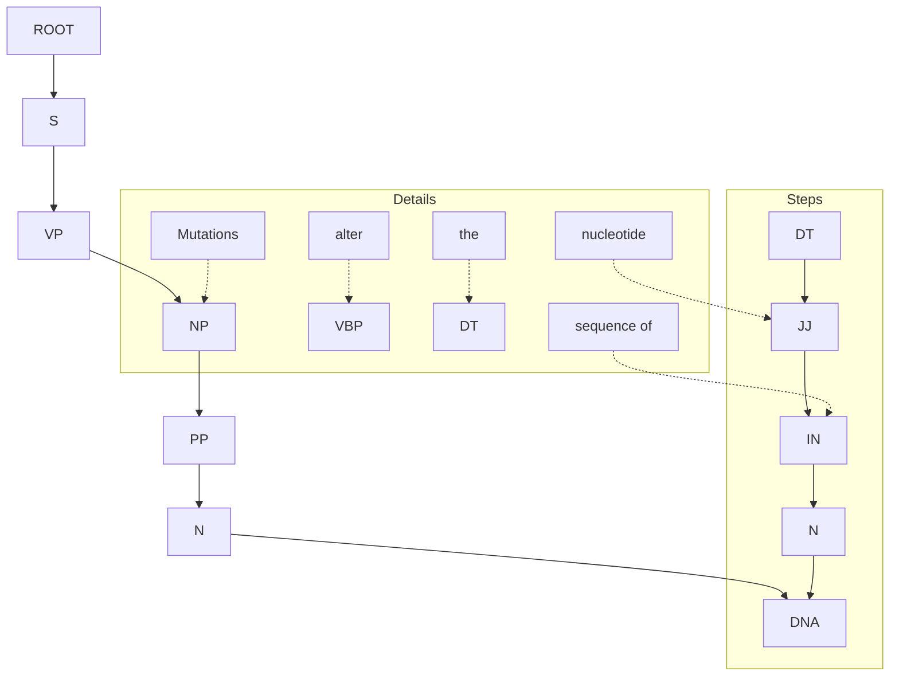
</details>

Here S = subject, NP = noun phrase, NN = singular noun, VP = verb phrase, VBP = verb (non-third-personsingular present tense), DT = determiner (article), JJ = adjective, IN = preposition, NNP = proper noun, singular (for a complete set of definitions see: [http://www.computing.dcu.ie/\~acahill/tagset.html](http://www.computing.dcu.ie/~acahill/tagset.html)).

research crucially depends, what else is there? Annotation by human action is labour-intensive and error-prone. Databases cannot augment their staff by sufficient numbers of well-trained annotation experts to do the job. The only real alternative to successful natural language processing is distributed annotation: authors of journal articles distill database annotations from their own results.

## Applications of text mining

Computational analysis of texts of articles in the biomedical literature offers a series of challenges. The results have been successful in supporting the identification of relevant information for collection into databases, and even in generating useful suggestions for treatments of diseases.

One goal is to identify papers that contain targetted types of information. For example, the protein sequence database SWISS-PROT stores information about protein function, and protein post-translational modifications. BIND is a database of protein–protein interactions. Identification of papers containing relevant information supports the work of the curators of these databases. Because the set of terms that might be relevant is so diffuse, simple keyword searches do not suffice. For instance, to identify post-translational modifications, a search for PHOSPHORYLATION would pick up not only papers describing the phosphorylation of proteins—which are relevant—but also the phosphorylation of glucose or fructose, which might well not be.

168

---

Selection of papers is already a useful result, even if a human curator must read them. The next step would be automatic extraction of the information from the paper. This is a challenge and focus of current research. CASP-like evaluations track progress.

The most basic task in computer analysis of an article is to identify the names that appear: names of genes, proteins, metabolites, drugs, and diseases (or more generally, phenotypes). Name identification depends heavily on dictionaries, but natural language processing contributes semantic information helpful in both recognizing names themselves and recognizing modifiers of names.

The next level is to identify associations and interactions. Examples include attempts to correlate genes or proteins with diseases, or, more generally, to assign function to genes or proteins. To extract interactions, the minimal pattern must include two names + one interaction, the interaction being specified by a word or a phrase. We have already seen examples of the combination:

$$
<   \text {protein name} > \dots \text {binds} \dots <   \text {protein name} >
$$

There are many other protein–protein interactions, such as:

$$
<   \text {protein name} > \dots \text {regulates} \dots <   \text {protein name} >
$$

More complex combinations are very important: a correlation between a set of interacting proteins and two or more apparently unrelated diseases can show a hidden relationship in the mechanism underlying the diseases.

## Identification of references to individual genes and proteins

A basic task is to identify in a body of text the names of the relevant objects, such as genes and proteins. The difficulty is the wide range and ambiguity of names, and the use of common words as parts of gene names. The problem of identifying the species from which a gene arises is very difficult, as many genes have equivalent names in different mammalian species. It is very important to recognize species differences in searching for correlations between genes and drug activities. Tamoxifen, used widely against breast cancer, was originally developed as a birth-control pill. It is a fine contraceptive for rats but promotes ovulation in women.

Chang, Schütze, and Altman developed a program called GAPSCORE that identifies gene and protein names within submitted text.<sup>10</sup> One might think that simply creating a dictionary and looking for its entries would suffice. Dictionaries are of course at the core of any identification procedure. But many genes names have other meanings. For instance, ‘ring’ (which stands for ‘really interesting new gene’) can also appear in articles in the biomedical literature in the context of chemical structure (‘histidine ring’) or histology (‘signet-ring cell’). Even the common colloquial sense of the word ring, as an item of jewellery, appears in the scientific literature in connection with metal-elicited contact dermatitis. Also, a dictionary should include a thesaurus, specifying, for example, that PTEN and MMAC1 are synonyms. (PTEN stands for phosphatase and tensin homolog and MMAC1 stands for mutated in multiple advanced cancers 1.)

GAPSCORE scores terms according to a statistical model based on:

dictionary lookup: a table of known gene names;
appearance: many gene names have the form NAT1; other gene or protein names end with -in. Many enzyme names end with -ase;
variations: the title of a recent paper included the phrase ‘conformational changes of apo- and

169

---

holocalmodulin’; the prefixes apo- and holo- are used only for proteins;

• syntax/context: the name of a protein or gene must be a noun. It is likely to be associated with certain other words, such as ‘expression’, ‘mutated’, or even ‘gene’ itself. To utilize such word combinations as effectively as possible requires syntactic analysis;
• word morphology: the derivation and formation of terms. For example, any short term that begins cdk… is likely to be a cyclin-dependent protein kinase.

Submitting to GAPSCORE only the title of a paper,<sup>11</sup> ‘Neuroprotection by transforming growth factor-β1 involves activation of nuclear factor-κB through phosphatidylinositol-3-OH kinase/Akt and mitogen-activated protein kinase-extracellular-signal regulated kinase1,2 signaling pathways’, returned the following:

<table><tr><td colspan="2">Gene or protein name</td><td>Quality (score)</td></tr><tr><td>1</td><td>Mitogen-activated protein kinase</td><td>Excellent (1.00)</td></tr><tr><td>2</td><td>Phosphatidylinositol-3-OH kinase</td><td>Excellent (1.00)</td></tr><tr><td>3</td><td>Transforming growth factor-beta1</td><td>Excellent (1.00)</td></tr><tr><td>4</td><td>Nuclear factor-kappaB</td><td>Good (0.60)</td></tr><tr><td>5</td><td>Activation</td><td>Poor (0.07)</td></tr><tr><td>6</td><td>Neuroprotection</td><td>Poor (0.04)</td></tr></table>

Note that the Greek letter β is spelt out in full.


## See Weblem 3.11

## Identification of interactions

R. Hofmann and A. Valencia developed a system for data mining PubMed by natural language processing to identify genes, proteins, and their interactions. Their results are available in a database named iHOP,<sup>12</sup> or Information Hyperlinked Over Proteins ([http://www.ihop-net.org/UniPub/iHOP/](http://www.ihop-net.org/UniPub/iHOP/)).

The basic item of iHOP data is a sentence from an abstract of an article appearing in PubMed. Appearances of any gene name, or synonym, in two different sentences provide a link. Currently the system contains 12 000 000 sentences, referring to 80 000 genes, from 1500 organisms.

An example of iHOP and its navigation facilities appears in Figure 3.5.


170

---

**Figure 3.5** Use of the iHOP website. (a) Choice of a gene—snf1 in this case—calls up presentation of information about that gene and its interactions. Panel (a) contains five sentences describing SNF1 (many others are omitted). Each sentence describes an interaction and/or function of SNF1. On the right is a link to the full abstract in which the sentence appeared. The top sentence links the current gene of focus, snf1, with another, reg1. Clicking on any mention of reg1 will shift the focus to it, opening another window. (b) The corresponding window for REG1. Note that the top sentences in this frame contain SNF1 as well as REG1. Information about the predecessor governs the ranking and ordering of the sentences in the new window. (c) In the course of navigation through iHOP, relationships can be collected into a logbook or gene model. The interaction network relating the selected proteins appears as a graph in a separate window.

From Hoffmann, R. and Valencia, A. (2005). Implementing the iHOP concept for navigation of biomedical literature. Bioinformatics, **21**(Suppl. 2), ii252–ii258.

## Interaction networks and diseases

Some genetic diseases show simple Mendelian inheritance. They are the effect of a single gene. Other genetic diseases may arise from mutations of any of several genes. This suggests the involvement of a pathway or network, that has several vulnerable points. Still more complex are several diseases that appear to share a common protein-interaction network.

Sam, Liu, Li, Friedman, and Lussier applied data-mining techniques based on natural language processing to identify relationships between diseases through sharing of components of a proteininteraction network. They combined two sets of data:

1. relationships between proteins and diseases: this data set associated 154 diseases with 1931 proteins;
2. a protein-interaction network: a set of relationships among proteins, including binary interactions and direct complex formation. This data set included 20 317 interaction pairs from 1140 proteins.

For each pair of diseases, the associated proteins were checked for identity or interaction. That is, one protein might be associated with both diseases. Or, one protein associated with one disease might be paired in the interaction network with another protein associated with the other disease. Either contributes to a link between the two diseases.

A pair of diseases that share both common proteins and interactions is xeroderma pigmentosum and Cockayne syndrome (see Box 3.7 and Fig. 3.6). Both diseases involve defects in DNA repair systems. Of the proteins shared by both diseases, some mutations in XPB lead to the combined syndrome called the XP/CS complex, with both sets of symptoms. Mutations in ERCC6 are associated with Cockayne syndrome. The tumour antigen p53—which does not interact with any of the other proteins—is likely to be not the primary lesion but the subject of unrepaired damage leading to enhanced cancer susceptibility.


<details>
<summary>flowchart</summary>

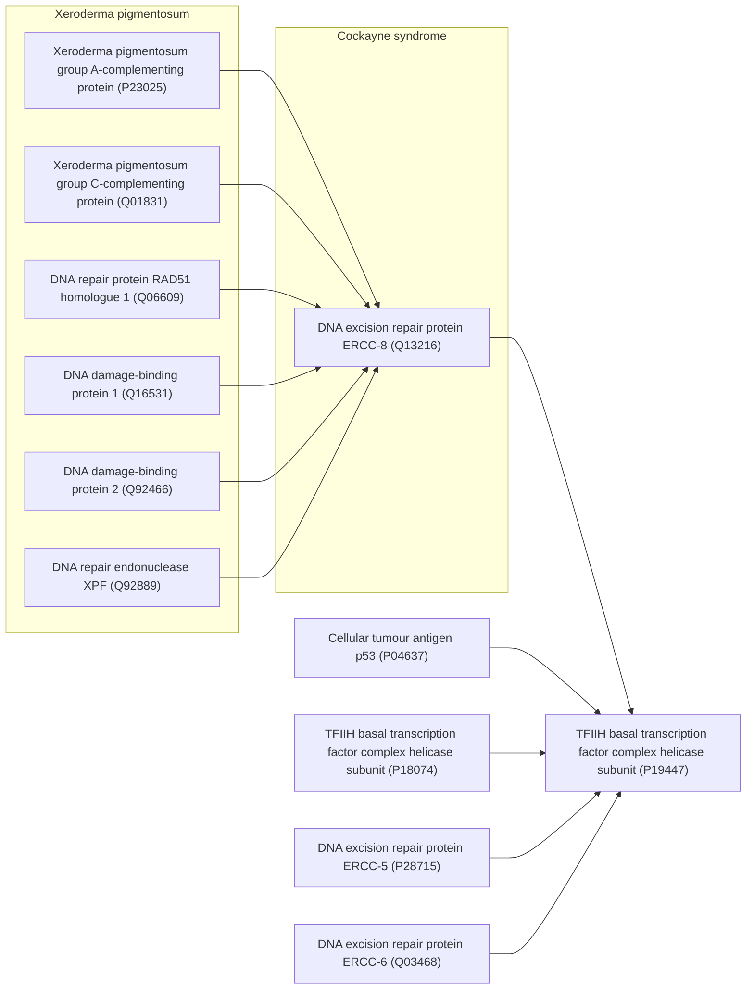
</details>

171

---

**Figure 3.6** Proteins associated with xeroderma pigmentosum and Cockayne syndrome, and their interactions. Arc at lower left: proteins associated with xeroderma pigmentosum. Arc at lower right: proteins associated with Cockayne syndrome. Arc at top: proteins associated with both. Lines indicate interaction pairs. Note that there is only one direct interaction between a protein associated with xeroderma pigmentosum only and another associated with Cockayne syndrome only.

From Sam, L., Liu, Y., Li, J., Friedman, C., and Lussier, Y.A. (2007). Discovery of protein interaction networks shared by diseases. Pacific Symposium on Biocomputing, **12**, 76–87.

At the time of this work, the close connection between xeroderma pigmentosum and Cockayne syndrome, both effects of repair dysfunction, was already known. What was and still is not well understood is what, beyond the known functional defects,

## Box 3.7 Xeroderma pigmentosum and Cockayne syndrome: two diseases of DNA repair

Xeroderma pigmentosum is a genetic disorder involving a defect in the ability to repair damage caused by ultraviolet light. This leads most obviously to great sensitivity to sunlight, including tendency, upon even short exposure, to sunburn, blisters, and freckles. More devastating is the predisposition to development of malignant tumours, presumably arising from unrepaired damage to tumour-suppressor genes.
Cockayne syndrome shares with xeroderma pigmentosum a sensitivity to sunlight, but involves other symptoms including abnormal growth and development leading to short stature, retinal and other neurological degeneration, and premature aging. Risk of skin cancer is normal, not elevated as in xeroderma pigmentosum.
A small number of cases of the xeroderma pigmentosum/Cockayne complex (XP/CS) syndrome are known. Patients show symptoms of both diseases.

| Disease | Genes in which mutations appear include |
| --- | --- |
| Xeroderma pigmentosum | XPA, XPB (ERCC3), XPC, XPD (ERCC2), XPE (DDB2), XPF (ERCC4), XPG (RAD2, ERCC5), XPV (POLH) |
| Cockayne syndrome | CSB ERCC6 (CSB), ERCC8 (CSA) |
| XP/CS complex | XPB (ERCC3), XPD (ERCC2), XPG (ERCC5) |

produces the differences in phenotype associated with the two diseases. In this respect, the mutations that produce the combined symptoms—the XP/CS complex—may be the ones that provide the clues.

## Hypothesis generation

The literature implicitly contains many unsuspected relationships. D.R. Swanson read papers that connected magnesium and epilepsy, and papers that connected epilepsy and migraine headaches. Taken together, these suggested to him that there should be a relationship between magnesium and migrane. Subsequent research confirmed such a link. Swanson had other successes, including the suggestion that fish oil would benefit patients with Raynaud's syndrome (a disorder affecting blood vessels of the extremities). Subsequent research confirmed this suggestion as well.

Automation of Swanson's approach is an obvious goal; implementation of effective methods is not so easy.

P. Srinivasan and B. Libbus developed software to apply Swanson's approach. They searched for applications of turmeric, a spice from the rhizomes of the plant Curcuma longa, containing the active compound curcumin.13 <sub>In</sub> Asia, turmeric is in common use in cooking. Its medicinal properties are also well known. It is an analgesic and an antiseptic, used for treatment of burns, stomach ulcers, skin diseases, and the common cold.

172

---

A PubMed search for TURMERIC OR CURCUMIN OR CURCUMA returned 1175 documents. From these, using natural language processing, Srinivasan and Libbus extracted terms with names of genes or genomes, enzymes, and amino acids, peptides, or proteins, and ranked these terms by how frequently they turned up in the articles identified. They then reprobed PubMed using these results as search terms, and extracted from the results, and ranked, terms referring to diseases or syndromes; neoplastic processes (= terms referring to cancer).

The idea is that this procedure would link turmeric with certain diseases through the medium of genes, genomes, enzymes, or proteins (see Fig. 3.7). The results embody suggestions that turmeric would have some relation with the diseases, and perhaps even be useful in their treatment.


<details>
<summary>flowchart</summary>

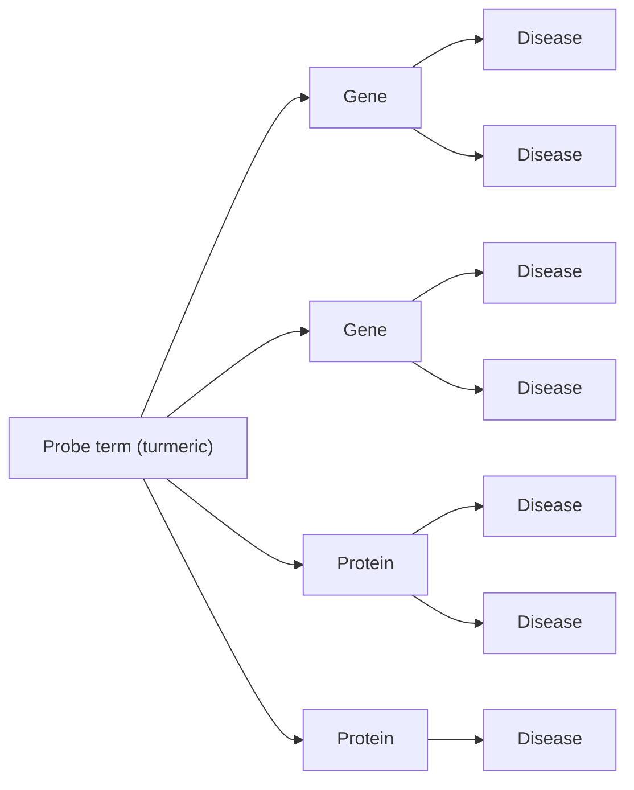
</details>

Figure 3.7 The goal is to link a probe term, such as turmeric, with a set of diseases. In a two-stage procedure, first probe PubMed with the probe term, and recover names of genes, genomes, enzymes, and proteins. These links from turmeric to molecules have a ‘strength’ proportional to the number of times the term appears in the articles that PubMed identifies as related to turmeric. A second stage probes PubMed again, separately, with each of the molecules identified in the first stage. This time analysis of the articles extracts names of diseases. Again the ranking of the molecule–disease link is proportional to the number of times the disease term appears in the articles that PubMed identified in the second stage. A connection between turmeric and a disease, through two strong links, is suggestive of a relationship between turmeric and the disease.

Srinivasan and Libbus discussed three diseases:

• retinal diseases, including diabetic retinopathy, inflammation, and glaucoma;
• Crohn disease;
• disorders related to the spinal core, including inflammation following injury, and an autoimmune disease resembling multiple sclerosis.

A common feature of all these diseases is inflammation. A common set of proteins linking turmeric with the disease includes TNFα, MAPK, NF-κB, COX-2, and other cytokines and interleukins. Knowing the molecules involved in the links between turmeric and diseases means that scientists can understand the mechanism by which turmeric might be expected to act. The result is not merely a correlation but supports a rationale of the relevance of the turmeric to the disease, which in turn usefully guides design of experiments to evaluate and elucidate the connection, and the clinical utility of the probe substance, turmeric.

## RECOMMENDED READING

## The transition to electronic publishing

Berners-Lee, T. (with Mark Fischetti|) (2000). Weaving the Web: The Original Design and Ultimate Destiny of the World Wide Web. Harper Business, New York.

173

---

- Berners-Lee, T. and Hendler, J. (2001). Publishing on the semantic web. Nature, 410, 1023–1024. From the inventor of the web.
- Butler, D. and Campbell, P. (2001). Future e-access to the primary literature. Nature Web Debates, 5 April. [http://www.nature.com/nature/debates/e-access/introduction.html](http://www.nature.com/nature/debates/e-access/introduction.html). Introduction to a continuing discussion, about the web, on the web.
- King, D.W. and Tenopir, C. (2004). Scholarly journal and digital database pricing: threat or opportunity? [http://web.utk.edu/\~tenopir/eprints/database\_pricing.pdf](http://web.utk.edu/~tenopir/eprints/database_pricing.pdf).
- King, D.W. (2007). The cost of journal publishing: a literature review and commentary. Learned Publishing, 20, 85–106.
- Lesk, A.M. (2004). Understanding Digital Libraries, 2nd edn. Morgan Kaufmann, San Francisco, CA. Introduction to the transition from traditional libraries to information provision by computer.
- Malakoff, D. (2003). Scientific publishing. Opening the books on open access. Science, 302, 550–554. Description of the journals published by the Public Library of Science.
- Spedding, V. (2003). Great data, but will it last? Research Information, Spring, 16–20. Problems of preservation of digital information. This journal has many articles of interest to scientists whose research depends on the quality and computer accessibility of data.
- SQW Ltd (2004). Costs and Business Models in Scientific Research Publishing. The Wellcome Trust, London.
- Winograd, S. and Zare, R.N. (1995). ‘Wired’ science or whither the printed pages. Science, 269, 615. The authors, among the most distinguished of contemporary scientists, raise questions that are still not answered after almost 20 years.
- Van Orsdel, L.C. and Born, K. (2006). Journals in the time of Google. Library Journal, 131(7), 39–44.

## Discussion of developments in access and pricing in scientific journals

Dewatriont, M., Ginsburgh, V., Legros, P., Walckiers, A., Devroey, J.-P. et al. (2006). Study on the Economic and Technical Evolution of the Scientific Publication Markets in Europe. European Commission, Directorate-General for Research, Brussels. A thorough exposition of the issues, and some recommendations.

Krallinger, M. and Valencia, A. (2005). Text-mining and information-retrieval services for molecular biology. Genome Biol., 6, 224.

Rebholz-Schuhmann, D., Oellrich, A., and Hoehndorf, R. (2012). Text-mining solutions for biomedical research: enabling integrative biology. Nat. Rev. Genet., 13, 829–839.

Shatkay, H. (2005). Hairpins in bookstacks: information retrieval from biomedical text. Briefings Bioinformatics, 6, 222–238.

## Reviews of the achievements, challenges, and resources for applications of natural language processing in bioinformatics

Bosak, J. and Bray, T. (1999). XML and the second-generation web. Sci. Am., 280(5), 89–93. An introduction to XML, including descriptions of the problems that motivated its development, and the solutions it provides.

Garson, L.R. (2004). Communicating original research in chemistry and related sciences. Accts. Chem. Res., 37, 141–148.

## EXERCISES AND PROBLEMS

Exercise 3.1 Suppose a university library purchases electronic access to a very broad spectrum of scientific journals. Information about usage patterns of different journals are recordable at the publishers’ websites. (a) How could a university librarian make use of this information to help make difficult choices in the face of budgetary pressure? (b) Is it to a publisher's financial advantage to make this information available to university librarians?

Exercise 3.2 Consider a database of audio clips (for example, recordings of broadcasts of speeches by Winston Churchill). You want to create software to make this database searchable by computer, using spoken English sentences as search objects. (a) Suppose you had software that would perform accurate speech recognition; that is, conversion of speech to text. How could you use this to solve the problem? (b) How, in general terms, might you try to solve the

174

---

problem without using speech→text conversion?

**Exercise 3.3** According to the data in Box 3.1, which amino acids satisfy the compound query discussed in the section entitled ‘Database organization’?

**Exercise 3.4** For what types of data are the following markup languages specialized? (a) VRML, (b) CML, (c) BSML, (d) LOGML.

**Exercise 3.5** Rewrite the XML fragment containing a database of mammals in the discussion about Markup languages, converting common name from an attribute to a tag.

**Exercise 3.6** The sentence ‘Time flies like an arrow’ is ambiguous. (a) Explain three potential meanings of this sentence, treating time as (1) a noun, (2) a verb, and (3) an adjective (modifying flies). (b) Could you reject any of these meanings because they do not correctly obey the rules of grammar? (c) Could you reject any of these meanings because they are not consistent with ordinary experience?

**Exercise 3.7** Compose a search pattern to detect interacting proteins analogous to < protein name > … < binds or some equivalent verb > … < protein name > based on the noun association instead of the verb binds.

**Exercise 3.8** A simple way to try to find enzyme names in text is to search for words that end in -ase. Think of 10 English words ending in -ase that are not names of enzymes. What is the longest word ending in -ase that you can find? Of the words you suggest, would any of them be likely to appear in an article in the biomedical literature? (Two obvious words ending in -ase that appear frequently in the biomedical literature are case and disease. To turn this exercise into a weblem, look for an online rhyming dictionary.)

**Problem 3.1** From the data in Figure 3.1, (a) for sales of subscriptions, what price per subscription would give a 5% profit over costs? and (b) how many subscriptions would be required to make a 5% profit while charging half the cost of subscription found in (a)? Assume for simplicity that the cost of reproduction does not increase, but that the cost of distribution is linearly proportional to the number of copies distributed. (c) What would have to be charged for an electronic subscription (no paper version produced) to make a 5% profit if there are still subscribers? Assume for simplicity zero reproduction and distribution costs.

**Problem 3.2** Consider the query: what are the three-letter codes of all amino acids that have volumes greater than 120 Å<sup>3</sup> with distal carboxyl or amide groups? Draw a Venn diagram showing, separately, the distributions of three-letter codes of sidechains, distal functional groups, and volumes. Show the overlaps of the distributions and indicate the residues that satisfy the query.

**Problem 3.3** Recall the ambiguous headline, ‘British left waffles on Falklands’. (a) Parse this text yourself and derive a graph comparable to that given in the text for the sentence 'Mutations alter the base sequence of DNA’ (Box 3.6). (b) In what ways does your analysis differ from that of the computer program? (c) Suppose you think that the example is unfair because waffles is not a verb in US English. Think of a sentence in which waffles must be a verb and submit it to the syntactic analyser at [http://www.link.cs.cmu.edu/link/](http://www.link.cs.cmu.edu/link/). Did it get your sentence right?

**Problem 3.4** Submit to the syntactic analyser the following sentence from Macbeth: ‘The raven himself is hoarse that croaks the fatal entrance of Duncan under my battlements’. Does it get this right? In particular, does it consider ‘under my battlements’ as modifying ‘hoarse’ or ‘entrance of Duncan’? Note that a human reader would use the relationship between entrance and battlements as a clue to disambiguation.

1 Dewatriont, M., Ginsburgh, V., Legros, P., Walckiers, A., Devroey, J.-P. et al. (2006). Study on the Economic and Technical Evolution of the Scientific Publication Markets in Europe. European Commission, Directorate-General for Research, Brussels.
2 For a directory of open-access journals see [http://www.doaj.org](http://www.doaj.org).
3 See [http://swift.cmbi.ru.nl/gv/pdbreport/](http://swift.cmbi.ru.nl/gv/pdbreport/) and Hooft, R.W.W., Vriend, G., Sander, C., and Abola, E.E. (1996). Errors in protein structures. Nature, 381, 272.
4 Park, Y.R., Kim, J., Lee, H.W., Yoon, Y.J., and Kim, J.H. (2011). GOChase-II: correcting semantic inconsistencies from Gene Ontology-based annotations for gene products. BMC Bioinformat., 12 (suppl. 1), S40.
5 Said to be a headline in The Guardian from April 1982, but perhaps apocryphal.
6 Lin, P., Fischer, T., Lavoie, C., Huang, H., and Farquhar, M.G. (2007). Calnuc plays a role in dynamic distribution of Gαi but not Gβ subunits and modulates ACTH secretion in AtT-20 neuroendocrine secretory cells. J. Neurochem., 100, 1505–1514.

175

---

7 Stamenova, S.D., French, M.E., He, Y., Francis, S.A., Kramer, Z.B., and Hicke, L. (2007). Ubiquitin binds to and regulates a subset of SH3 domains. Mol. Cell, 25, 273–284.
8 Tian, H., Klämbt, D., and Jones, A.M. (1995). Auxin-binding Protein 1 does not bind auxin within the endoplasmic reticulum despite this being the predominant subcellular location for this hormone receptor. J. Biol. Chem., 270, 26962–26969.
9 Eckelman, B.P. and Salveson, G.S. (2006). The human anti-apoptotic proteins cIAP1 and cIAP2 bind but do not inhibit caspases. J. Biol. Chem., 281, 3253–3260.
10 Chang, J.T., Schütze, H., and Altman, R.B. (2004). GAPSCORE: finding gene and protein names one word at a time. Bioinformatics, 20, 216–225.
11 Zhu, Y., Culmsee, C., Klumpp, S., and Krieglstein, J. (2004). Neuroscience, 123, 897–906. [http://bionlp.stanford.edu/gapscore/](http://bionlp.stanford.edu/gapscore/).
12 Unfortunately, the acronym also specifies a chain of restaurants in the USA. This is ironic, from a project that so successfully faced challenges of disambiguation.
13 Srinivasan, P. and Libbus, B. (2004). Mining MEDLINE for implicit links between dietary substances and diseases. Bioinformatics, 20 (suppl. 1), i290–i296.

176

---

Archives and information retrieval

## LEARNING GOALS

• Understanding the general kinds of data describing the molecules and processes of life assembled in the data banks supporting research and applications in biology, medicine, agriculture, and technology.
• Knowing the basic infrastructure of bioinformatics, in terms of the sites and responsibilities of the major archival projects.
• Understanding the basic concepts of information retrieval, including how to frame queries.
• Gaining facility with general search engines on the web, and with specific websites for bioinformatics.
• Knowing how to search for specific information about sequences, structures, metabolic pathways, and relationships to disease, and how to launch analyses of the data retrieved.

This chapter introduces the specialized information-retrieval skills that will allow you to make effective use of the data banks in molecular biology. The goal is to give you familiarity with basic operations. It will then be easy to improve and develop your technique, and to learn in more detail the facilities, and interrelationships and interactions, of resources available on the web. Convenient sources of training materials include the tutorials embedded in many data banks. An example is the ENTREZ tutorial site at the US National Center for Biotechnology Information (NCBI): [http://www.ncbi.nlm.nih.gov/education/tutorials/](http://www.ncbi.nlm.nih.gov/education/tutorials/). The European Bioinformatics Institute (EBI) offers many tutorials on various aspects of experiments, databases, and bioinformatics.

## Database indexing and specification of search terms

An index is a set of pointers to information in a database. You have explored the entire worldwide web with a general search engine such as Google, and have visited specialized databases in molecular biology. You proposed one or more search terms, and the retrieval program checked for them in its tables of indices. The model is that the database is composed of entries: discrete, coherent parcels of information. The software identified entries with contents relevant to your interest. An example of the simplest paradigm is that you submit the term ‘horse’ and the program returns a list of entries that contain the term horse.

A full search of the web would turn up information about many different aspects of horses— molecular biology, breeding, racing, poems about horses—most of which you do not want to see. For a successful search, it is not enough to mention what you do want you must specialize your search to ensure that your desired responses don't get buried in a mass of extraneous rubbish. (Of course, rubbish is merely whatever other people are interested in.)

To focus the results, information-retrieval programs accept multiple query terms or keywords. A search for ‘horse liver alcohol dehydrogenase’ would produce responses specialized to this enzyme. The search would, most likely, identify entries that contain all four keywords that you submitted:

177

---

horse AND liver AND alcohol AND dehydrogenase. Poems about horses would be unlikely to appear among its top hits.

It is possible to ask for other logical combinations of indexing terms. For instance, if a search engine did not know about transatlantic spelling differences, it would be useful to be able to search for ‘hemoglobin OR haemoglobin’. Note that a search for ‘hemoglobin haemoglobin’ would probably be interpreted as ‘hemoglobin AND haemoglobin’ which would pick up documents written by international committees or orthographically challenged expatriates. (Some websites deliberately include both spellings, using a synonym dictionary.) Similar considerations apply to sulfur/sulphur, for example.

If you wanted to know about other dehydrogenases, you could ask for dehydrogenase NOT alcohol. This would retrieve entries that contain the term dehydrogenase but did not contain the word alcohol. You would find entries about lactate dehydrogenase, malate dehydrogenase, etc. You would miss references to review articles that compared alcohol dehydrogenases with other dehydrogenases, or alignments of the sequences of many dehydrogenases including alcohol dehydrogenase. You might regret missing these.

Many database search engines will allow complex logical expressions such as (haemoglobin OR hemoglobin) AND (dehydrogenase NOT alcohol). Construction of such expressions is an exercise in set theory. Drawing Venn diagrams helps in formulating the query. Although the logic of a search is independent of the software used to query a database, different programs demand different syntax to express the same conditions. For example the query for dehydrogenase NOT alcohol might have to be entered as DEHYDROGENASE -ALCOHOL or DEHYDOGENASE!ALCOHOL.

Specialized databases, including those in molecular biology, impose a structure on the information to separate different categories of data. This is essential. The biomedical scientific community includes people named E(lisabetta) Coli, (John D.) Yeast, (Patrice) Rat, and a large number of Rabbits, as well as several Crystals and Blots. If you wanted to find papers published by these investigators it would be naive to perform a general search of PubMed or some other molecular biology database with any of their names. Many databases provide separate indexing and searching of different categories of information. They permit searching for papers of which E. Coli is an author.

Some categories, such as taxonomy, have controlled vocabularies. Often a query system presents the vocabulary terms to the user as choices from pull-down menus. The structure of taxonomic information is important in retrieval. To do a search for ‘globin NOT mammal’, and pick out the relatively few entries about nonmammalian globins rather than the very many entries about globins, including human haemoglobins, that do not explicitly mention the term mammal, requires an information-retrieval system that ‘understands’ the taxonomic hierarchy. Controlled vocabularies— limited, explicit, and carefully defined sets of terms, known as ontologies—are also important for distributing queries among several databases.

A technical problem that frequently creates difficulty is how to enter terms containing nonstandard characters such as accent marks or umlauts, cedillas, Greek letters, and, as already mentioned, differences between British and US spelling. NCBI's ENTREZ can handle the US/British spelling differences with a synonym dictionary. Programs that index the entire web usually do not. Ignore the accent marks and hope for the best.

## Follow-up questions

When searching in databases, it is rare that you will find exactly what you want on the first round of

178

---

probing. Usually you have to modify the query on the basis of the results initially returned. Most information-retrieval software permits consecutive, cumulative searches, with altered sets of search terms and/or logical relationships. Conversely, once you find what you were looking for, you will often want to extend your search to find related material. If you find a gene sequence, you might want to know about homologous genes in other organisms, or whether a three-dimensional structure of the corresponding protein is available. Or you might want to read papers published about the sequence.

For these subsidiary queries you need links between entries in the same or different databases. This is an example of the question of how one ‘browses’ in electronic libraries, which is a difficult problem and the subject of current research.

Suppose that you are interested in a particular gene. To find homologous genes you would like links to other items in the same database (a database of gene sequences). To find structures, or bibliographical references, related to that gene you would like links between different databases (from the database of gene sequences to a database of three-dimensional structures, or to a bibliographical database). As the number of databases, and the variety of their contents, grows, intercommunication among them has become a high-priority goal. Indeed, the interactivity of the databases in molecular biology is growing more and more effective, so that these operations are fairly easy now – formerly one had to do separate searches on isolated databases. NCBI's ENTREZ allows selecting a set of databases to search. Alternatively, most entries in molecular biology databases contain large numbers of embedded links. This is a generalization of the original model of a database as a closed set of independent entries that can be selected only by their indexed contents. One must think of the web as a very high-dimensional space.

Database construction in bioinformatics involves activities that can be classified, to some extent, into archiving—with the major goals of conservation and curation of facts—and interpreting and annotating, the compilation of biological information in a form most useful to support research. (Include, within annotation, provision of links to other databases.)

Many archival databases specialize in different kinds of data—nucleic acid sequences, protein sequences, or macromolecular structures—for reasons in part historical and in part because of the different curatorial skills required. In many cases, archival and interpretative projects are carried out at the same institution and even by the same people. However, anyone who wishes to create a new database is free to combine and repackage information from any available sources. Practical laboratory experience and expert knowledge of the experimental techniques used to generate the data are essential for curating an archival database, but are only extremely desirable for an interpretative database.

Two aspects of the recent development of bioinformatics databases stand out. One is the appearance of many projects that recombine the archived data in different ways. The other is the combination of many individual databases into larger and larger conglomerates. These processes overlap and sometimes happen together. Most database unifications are outgrowths of prior collaborations, with varying degrees of intimacy in the result.

## Analysis and processing of retrieved data

Sometimes as a result of a search you will want to launch a program, using the results retrieved for its input. For instance, if you identify a protein sequence of interest, you might want to perform a PSI-BLAST search. This is somewhat different from a strictly keyword-based database entryretrieval problem. Formerly you would have to run one job to search for your data, store the results

179

---

of your search, and then run a separate, second, job, feeding the retrieved sequence to the application program by hand. However, like searches in multiple databases, several information-retrieval systems in molecular biology provide facilities for initiating such calculations. This makes for very much improved fluency in your sessions at the computer. We saw an example in Chapter 3, retrieving C. elegans serpins and feeding the sequences into a multiple alignment program.

## The archives

Although our knowledge of biological data is very far from complete, it is nevertheless of impressive size, and growing extremely rapidly. Many scientists are working to generate the data, and to carry out research projects analysing the results. There is a smooth and copious flow of results from the laboratory bench to data-banking organizations, for archiving, curation, and distribution to the research laboratory and the clinic.

Archiving of bioinformatics data was originally carried out by individual research groups motivated by an interest in the associated science. As the requirements for equipment and personnel grew—and the nature of the skills required multiplied, to include much more emphasis on computer science—national and in most cases international organizations have taken on the responsibility. To match the high volumes of data production these projects have become very large scale indeed. Anyone who has followed the entire history of the field cannot help being impressed by the replacement of tiny, low-profile, and ill-funded projects carried out by a few dedicated individuals to a multinational heavy industry subject to hostile takeovers and the scientific equivalent of leveraged buyouts.

## Primary data collections related to biological macromolecules

Nucleic acid sequences, including whole-genome projects

• Amino acid sequences of proteins
• Protein and nucleic acid structures
• Small-molecule crystal structures
• Protein functions
• Expression patterns of genes
• Networks: of metabolic pathways, of gene and protein interactions, and of control cascades
• Publications

## Nucleic acid sequence databases

The worldwide nucleic acid sequence archive is a triple partnership of the NCBI (USA), the European Nucleotide Archive (or ENA; at the EBI, UK), and the DNA Data Bank of Japan (National Institute of Genetics, Japan). These projects curate, archive, and distribute DNA and RNA sequences collected from genome projects, scientific publications, and patent applications. The groups exchange data daily. As a result the raw data are identical. However, the format in which they are presented, and the nature of the annotation, vary among these data banks. To ensure that these fundamental data are freely available, scientific journals require deposition of new nucleotide sequences, as a condition for publication of an article. Similar conditions apply to nucleic acid and

180

---

protein structures.

The nucleic acid sequence databases, as distributed, are collections of entries. Each entry has the form of a text file containing data and annotations for a single contiguous sequence. Some entries are assembled from several published papers reporting overlapping fragments of a complete sequence. More common now are deposition of the results of (a) sequencing and assembly of complete genomes and (b) sequences of fragments, without assembly, from metagenomic samples.

Entries have a life history. Because of the desire on the part of the user community for rapid access to data, new entries are made available before completion of annotation and checking. Entries mature through the classes:

$$
\text {Unannotated} \rightarrow \text {Preliminary} \rightarrow \text {Unreviewed} \rightarrow \text {Standard}
$$

Rarely, an entry ‘dies’: a few have been removed when they are determined to be erroneous.

A sample DNA sequence entry from the European Nucleotide Archive, including annotations as well as sequence data, is the ATP7A gene from the aardvark (see Box 4.1). It encodes a protein involved in regulating copper levels. Mutations in the human homologue are implicated in Menkes syndrome, a progressive neurodegenerative disorder of copper metabolism.

A feature table (lines beginning FT) is a component of the annotation of an entry that reports properties of specific regions, for instance coding sequences (CDS). The aardvark ATP7A gene contains only one exon. Because feature tables are designed to be readable by computer programs— for example, to extract the amino acid sequence (see Exercise 4.4)—they have a more carefully controlled format and a more restricted vocabulary.

The feature table may indicate regions that

perform or affect function;
• interact with other molecules;
• affect replication;
• are involved in recombination;
• are a repeated unit;

Box 4.1 The EMBL Nucleotide Database entry for ATP7A from the aardvark

```txt
ID AAG47427; SV 1; linear; genomic DNA; STD; MAM; 675 BP.
XX
PA AY011392.1
XX
DE Orycteropus afer (aardvark) ATP7A
XX
OS Orycteropus afer (aardvark)
OC Eukaryota; Metazoa; Chordata; Craniata; Vertebrata; Euteleostomi;
Mammalia;
OC Eutheria; Afrotheria; Tubulidentata; Orycteropodidae; Orycteropus.
OX NCBI_TaxID=9818;
XX
FH Key Location/Qualifiers
FH
FT source 1..675
FT /organism="Orycteropus afer"
```

181

---

```txt
FT                  /mol_type="genomic DNA"
FT CDS     AY011392.1:\<1..>675
FT                 /codon_start=1
FT                 /gene="ATP7A"
FT                 /product="ATP7A"
FT                 /db_xref="GOA:Q9BFP6"
FT                 /db_xref="HSSP:Q04656"
FT                 /db_xref="InterPro:IPR001757"
FT                 /db_xref="InterPro:IPR006121"
FT                 /db_xref="UniProtKB/TrEMBL:Q9BFP6"
FT                 /protein_id="AAG47427.1"
FT                 /translation="IYQPHLITVEEIKKQIEAVGFPAFIKKQPKYLTLGAIDIERLKN
FT                 TSARSSEGSLQKSPSYTNDSTATFIIDGMHCKSCVNSIESALSTLQYVSSIAISLENRS
FT                 AIVKYNASSVTPETLRKAIEAVSPGQYTVSIISDVESIPNSPFSSSHQKIPLNIVSQPL
FT                 TQETVINISGMTCNSCVQSIEGVISKKAGVKSVQVSLADSSGVVEYDPLLTSPETLREE
FT                 IEN"
XX
SQ Sequence 675 BP; 233 A; 136 C; 124 G; 182 T; 0 other; 264016655 CRC32;
        attgtttatc agcctcatct tatcacagta gaggaaataa aaaagcagat tgaagctgtg 60
        ggttttccag cattcatcaa aaaacagccc aagtacctta cattgggagc tattgacata 120
        gaacgtctaa agaacacatc tgccagatcc tcagaaggat cactgcaaaa gagtccatca 180
        tataccaatg attcaacagc cacttttatc atagatggca tgcattgtaa atcatgtgtg 240
        tcaaatattg aaagtgcttt atctacactc caatatgtaa gcagcatagc aatttcttta 300
        gagaataggt ctgccattgt aaaatataat gcaagctcag tcactccaga aaccctgaga 360
        aaggcaatag aggcaagtatc accagggcaa tatactgtta gtattataag tgatgttgag 420
        agtatcccaa actctccttt tagctcatct catcaaaaaa tccctttgaa catagtgagc 480
        cagcctctga ctcaagaaac tgtaataaac atcagtggca tgacttgtaa ttcttgtgta 540
        cagtctattg agggtgtcat atcaaaaaaag gcaggtgtaa aatccgtaca agtctccctt 600
        gcagatagca gtggagttgt tgaatatgat cctctactaa cctctccaga aaccttgaga 660
        gaagaaatag aaaac 675
//
```

have secondary or tertiary structure;
• are revised or corrected.

## Genome databases and genome browsers

The general nucleic acid databases focus on collecting individual sequences. Associated with many full-genome sequences are genome browsers, databases bringing together all molecular information available about a particular species.

## Ensembl

Ensembl ([http://www.ensembl.org](http://www.ensembl.org)) is intended to be the universal information source for the human and other genomes. A goal is to collect and annotate all available information about human DNA sequences, link it to the master genome sequence, and make it accessible to the many scientists who will approach the data with many different points of view and different requirements. To this end, in addition to collecting and organizing the information, very serious effort has gone into developing computational infrastructure, including establishment of suitable conventions of nomenclature. It is not trivial to devise a scheme for maintaining stable identifiers in the face of data that will be

182

---

undergoing not only growth but revision. The most visible result of these efforts is the website, very rich in facilities for both general browsing and focusing on details.

Ensembl is a joint project of the EBI and the Wellcome Trust Sanger Institute. However, Ensembl is organized as an open project; encouraging outside contributions. All but the most naive of readers must recognize the great demands that this will place on quality-control procedures.

Data collected in Ensembl includes genes, SNPs, repeats, and homologies. Genes may either be known experimentally or deduced from the sequence. Because the experimental support for annotation of the human genome is so variable, Ensembl records and presents the evidence for identification and annotation of every gene. Very extensive linking to other databases containing related information, such as Online Mendelian Inheritance in Man (OMIM), or expression databases, extend the accessible information.

Ensembl and other genome browsers are structured around the sequences themselves. To focus on a desired region, users have available several avenues of selective entry into the system:

• browsing, starting at the chromosome level then zooming in;
BLAST searches on a sequence or fragment;
• gene name;
relation to diseases, via OMIM;
• Ensembl ID if the user knows it;
• general text search.

A text search in the Ensembl human genome browser for BRCA1 produced the page displayed in Plate IV, showing the region around the BRCA1 locus. The upper frame shows a megabase, mapped to the q21.2 and q21.31 bands of chromosome 17. It reports markers and assigned genes. The bottom frame shows a more detailed view. Note the control panels between the two frames that permit navigation and ‘zooming’. The bottom frame shows a 0.1 megabase region, reporting many more details, including the detailed structure of the BRCA1 gene and the SNPs observed.

183

---


<details>
<summary>text_image</summary>

e! project Ensembl ContigView
Home ▲ News ▲ BLAST ▲ Disease Browser ▲ Docs ▲ Download ▲
Find Lookup [e.g. U34879, APO00869]
Overview
chr17 band 421.21 421.21
ONH(cont.lgs)
45.45 Mb 44.45 Mb
GENESOME 457243
MARKERS
BETA107a
TURKE 4293
KONTSX 4293
KORNE 4293
KIRKEL 4293
KINEL 4293
KIFL27 4293
KIFL27_0000_0000_0000_0000_0000_0000_0000_0000_0000_0000_0000_0000_0000_0000_0000_0000_0000_0000_0000_0000_000
Detailed View
← 2 Mb  ↑ 1 Mb  Zoom  ↑ 1 Mb → 2 Mb
Length 188.89 Kb
SpTREBL 45.51 Mb 45.51 Mb 45.52 Mb 45.53 Mb 45.54 Mb 45.55 Mb 45.56 Mb 45.57 Mb 45.58 Mb
mRNA 45.51 Mb 45.52 Mb 45.53 Mb 45.54 Mb 45.55 Mb 45.56 Mb 45.57 Mb 45.58 Mb
UniGene 45.51 Mb 45.52 Mb 45.53 Mb 45.54 Mb 45.55 Mb 45.56 Mb 45.57 Mb 45.58 Mb
Genscan 45.51 Mb 45.52 Mb 45.53 Mb 45.54 Mb 45.55 Mb 45.56 Mb 45.57 Mb 45.58 Mb
Transcript 45.51 Mb 45.52 Mb 45.53 Mb 45.54 Mb 45.55 Mb 45.56 Mb 45.57 Mb 45.58 Mb
ONH(cont.lgs) 421.21/421.21/421.21/421.21/421.21/421.21/421.21/421.21/421.21/421.21/421.21/421.21/421.21/421.21/421.21/4
Transcript 45.51 Mb 45.52 Mb 45.53 Mb 45.54 Mb 45.55 Mb 45.56 Mb 45.57 Mb 45.58 Mb
Genscan 45.51 Mb 45.52 Mb 45.53 Mb 45.54 Mb 45.55 Mb 45.57 Mb 45.58 Mb
UniGene 45.51 Mb 45.52 Mb 45.53 Mb 45.54 Mb 45.55 Mb 45.56 Mb 45.57 Mb 45.58 Mb
mRNA 45.51Mb 45.52Mb 45.53Mb 45.54Mb 45.55Mb 45.56Mb 45.57Mb 45.58Mb
SpTREBL 45.51Mb 45.52Mb 45.53Mb 45.54Mb 45.55Mb 45.56Mb 45.57Mb 45.58Mb
SNP 45.51Mb 45.52Mb 45.53Mb 45.54Mb 45.55Mb 45.56Mb 45.57Mb 45.58Mb
Mouse trace Repeats
BP16-CPNOSI BETA-CPNOSI BETA-CPNOSI BETA-CPNOSI BETA-CPNOSI BETA-CPNOSI BETA-CPNOSI BETA-CPNOSI BETA-CPNOSI BETA-CPNOSI BETA-CPNOSI BETA-CPNOSI BETA-CPNOSI BETA-CPNOSI BETA-CPNOSI BETA-CDKALR
File Path RP16-CPNOSI RP16-CPNOSI RP16-CPNOSI RP16-CPNOSI RP16-CPNOSI RP16-CPNOSI RP16-CPNOSI RP16-CPNOSI RP16-CPNOSI RP16-CPNOSI RP16-CPNOSI RP16-CPNOSI RP16-CPNOSI RP16-CPALER
View as text Dump Mouse Trains Jams to UCSC Customize this view
Chr: 17 Nucleotides: 4S49S312 to S39S312 Turn menu On Off Refresh
</details>

Plate IV Ensembl genome browser showing the region surrounding the BRCA1 locus (See Chapter 4).


## See Weblems 4.1 – 4.4

## Protein sequence databases

In 2002, three protein sequence databases—the Protein Information Resource (PIR; at the National Biomedical Research Foundation of the Georgetown University Medical Center in Washington, DC, USA), SWISS-PROT, and TrEMBL (from the Swiss Institute of Bioinformatics in Geneva, Switzerland and the EBI in Hinxton, UK)—coordinated their efforts, to form the UniProtKB consortium. The partners in this enterprise share the database but continue to offer separate information-retrieval tools for access.

The PIR grew out of the very first sequence database, developed by Margaret O. Dayhoff, the pioneer of the field of bioinformatics. SWISS-PROT was developed at the Swiss Institute of Bioinformatics. TrEMBL contains the translations of genes identified within DNA sequences in the European Nucleotide Archive. TrEMBL entries are regarded as preliminary, and are converted— after curation and extended annotation—to mature entries.

Today, almost all amino acid sequence information arises from translation of gene sequences. However, even the amino acid sequence of a protein is not in general inferrable with confidence from the gene sequence. The main reason, in eukaryotes, is ambiguity in splicing. In addition, information about ligands, disulphide bridges, subunit associations, post-translational modifications, effects of mRNA editing, etc., is not available from nucleic acid sequences. For instance, from genetic information alone one would not know that human insulin is a dimer linked by disulphide bridges. Protein-sequence data banks collect this additional information from the literature and

184

---

provide suitable annotations.

From UniProtKB, the entry for the amino acid sequence of the protein bovine pancreatic trypsin inhibitor, in SWISS-PROT format, is shown in the box. Note that the sequence itself occupies only a relatively small amount of space in the entry.

## Amino acid sequence entry for bovine pancreatic trypsin inhibitor

NiceProt View of Swiss-Prot: P00974

Entry information

| Entry name | BPT1_BOVIN |
| --- | --- |
| Primary accession number | P00974 |
| Secondary accession numbers | None |
| Entered in Swiss-Prot in | Release 01, July 1986 |
| Sequence was last modified in | Release 10, March 1989 |
| Annotations were last modified in | Release 44, June 2004 |

Name and origin of the protein

| Protein name | Pancreatic trypsin inhibitor [Precursor] |
| --- | --- |
| Synonyms | Basic protease inhibitorBPIBPTIAprotinin |
| Gene name | None |
| From | Bos taurus (Bovine) [TaxID: 9913] |
| Taxonomy | Eukaryota; Metazoa; Chordata; Craniata; Vertebrata; Euteleostomi;Mammalia; Eutheria; Cetartiodactyla; Ruminantia; Pecora; Bovidae; Bovinae; Bos. |

References

| [1] SEQUENCE FROM NUCLEIC ACID.MEDLINE=87283904; PubMed=2441071; [NCBI, ExPASy, EBI, Israel, Japan]Creighton T.E., Charles I.G.;"Sequences of the genes and polypeptide precursors for two bovine protease inhibitors.";J. Mol. Biol. 194:11-22(1987).REFERENCES 2-13 DELETED |
| --- |

Comments

| FUNCTION: Inhibits trypsin, kallikrein, chymotrypsin, and plasmin.SUBCELLULAR LOCATION: Secreted.PHARMACEUTICAL: Available under the name Trasylol (Mile). Used for inhibiting coagulation so as to reduce blood loss during bypass surgery.SIMILARITY: Contains 1 BPTI/Kunitz inhibitor domain.DATABASE: NAME=Trasylol; NOTE=Clinical information on Trasylol; WWW="http://www.trasylol.com/. |
| --- |

Copyright

| This Swiss-Prot entry is copyright. It is produced through a collaboration between the Swiss Institute of Bioinformatics and the EMBL outstation - the European Bioinformatics Institute. |
| --- |

Cross-references

| EMBL | M20934; AAD13685.1; -.[EMBL / GenBank / DDBJ] [CoDingSequence]5 ADDITIONAL CROSS-REFERENCES DELETED |
| --- | --- |
| PIR | S00277; TIBO.1K09; 10-JUL-02.[ExPASy / RCSB / EBI] |
| PDB | 46 ADDITIONAL STRUCTURES DELETEDDetailed list of linked structures. |
| InterPro | IPR002223; Kunitz_BPTI.Graphical view of domain structure. |
| Pfam | PF00014; Kunitz_BPTI; 1. |

185

---


<details>
<summary>text_image</summary>

Pfam graphical view of domain structure.
PRINTS PR00759; BASICPTASE.
ProDom PD000222; Kunitz_BPTI; 1.
[Domain structure / List of seq. sharing at least 1 domain]
SMART SM00131; KU; 1.
PS00280; BPTI_KUNITZ_1; 1.
PROSITE PSS0279; BPTI_KUNITZ_2; 1.
PROSITE graphical view of domain structure.
HOVERGEN [Family / Alignment / Tree]
BLOCKS P00974.
ProtoNet P00974.
ProtoMap P00974.
PRESAGE P00974.
DIP P00974.
ModBase P00974.
SMR P00974; 6A778A4AD763FB19.
SWISS-2DPAGE Get region on 2D PAGE.
UniRef View cluster of proteins with at least 50% / 90% identity.
Keywords
Serine protease inhibitor: Signal: Pharmaceutical; 3D-structure.
Features
Feature table viewer Feature aligner
Key From To Length Description
SIGNAL 1_21 21 Potential.
PROPEP 22_35 14
CHAIN 36_93 58 Pancreatic trypsin inhibitor.
PROPEP 94_100 7
DOMAIN 40_90 51 BPTI/Kunitz inhibitor.
SITE 50_51 2 Reactive bond for trypsin.
DISULFID 40_90
DISULFID 49_73
DISULFID 65_86
HELIX 38_41 4
STRAND 53_59 7
TURN 60_63 4
STRAND 64_70 7
STRAND 80_80 1
HELIX 83_90 8
Sequence information
Length: 100 AA [This is the length Molecular weight: 10903 Da [This is the CRC64: 6A778A4AD763FB19 [This is the unprocessed precursor] MW of the unprocessed precursor] is a checksum on the sequence]
10 20 30 40 50 60
| | | | | |
MKMSRLCLSV ALLVLLGTLA ASTPGCOTSN QAKAQRPDFC LEPPYTGPCK ARIIRYFYNA
70 80 90 100
KAGLCQTFVY GGCRAKRNNF KSAEDCMRTC GGAIGPWENL
P00974 in FASTA format
</details>

## The Swiss Institute for Bioinformatics

The Swiss Institute for Bioinformatics originally compiled SWISS-PROT. It carries out a wide range of activities, including additional databases, and collections of bioinformatics tools and links, called the Expert Protein Analysis System (ExPASy; [http://www.expasy.org](http://www.expasy.org)).

PROSITE is a set of signature patterns characteristic of protein families. Such a pattern (or motif, or signature, or fingerprint, or template) is common to related proteins, usually because of the requirements of binding sites that constrain the evolution of the protein family. For instance, the consensus pattern for inorganic pyrophosphatase is D-[SGDN]-D-[PE]-[LIVMF]-D-[LIVMGAC]. The three conserved Ds bind divalent metal cations. Often, such a pattern identifies distant relationships not otherwise detectable by comparing sequences.

ExPASy presents certain bioinformatics tools as servers on its website, and has links to many others. Categories of tools include proteomics, genomics, structural bioinformatics, systems biology, phylogeny/evolution, population genetics, transcriptomics, biophysics, imaging, IT infrastructure, and drug design. The full list of tools contains 325 entries, roughly half of which were created and are maintained ‘in house’, with the others being links to external sites.

## The Protein Information Resource (PIR) and associated databases

The PIR is one of the partners in UniProtKB. In addition, the PIR maintains several databases about

186

---

proteins:

PIRSF: the Protein Family Classification System provides clustering of the sequences in UniProtKB according to their evolutionary relationships;
• iProClass, an integrated Protein Knowledgebase, is a gateway providing uniform access to over 90 biological databases, with flexible retrieval and navigation facilities;
• iProLINK (integrated Protein Literature, Information and Knowledge) is a gateway to the literature.

## Databases of protein families

Evolutionary relationships are essential for making sense of biological data. Evolution provides the framework for an integrated appreciation of the properties of molecules and processes, and their similarities and difference in various species. Perhaps less obvious is that comparative studies illuminate, in an essential way, even individual molecules. Knowing only a single sequence, or structure, it is difficult to understand the significance of particular features. Patterns of conservation identify features that nature has found it necessary to retain. (PROSITE signatures are examples.) The challenge then is to figure out why.

Study of evolutionary patterns must begin with assembling a set of homologues. We again emphasize (1) the distinction between homology—descent from a common ancestor—a yes-or-no property, from similarity, which is some quantitative measure of the difference between two objects, and (2) that similarity can always be measured but it is rare to be able to observe homology directly; therefore, in most cases homology is an inference from similarity.

R. Doolittle suggested a general calibration of pairwise sequence similarity for homology detection. Two full-length protein sequences (≥100 residues) that have 25% or more identical residues in an optimal alignment are likely to be related. Below ≈15% identical residues in an optimal alignment and we become mired in the noise. In this range of similarity we have no reason to believe that the sequences are related, although they might be. Doolittle defined the range between 18 and 25% identity as ‘the twilight zone’, where there may be tantalizing suspicion of a relationship, but the evidence falls short of proof. In some cases the active site is better conserved than the bulk of the protein. In these cases the appearance of a motif—such as the PROSITE consensus pattern for inorganic pyrophosphatase, D-[SGDN]-D-[PE]-[LIVMF]-D-[LIVMGAC]—can support the case for homology.

Multiple sequence alignments are much more powerful than pairwise sequence alignments. First, the additional data allow more accurate alignments. Second, the conservation patterns stand out far more sharply. (See Problem 4.1).

Protein structure changes more conservatively than amino acid sequence. Therefore inference of homology from structural similarity can link more distant relatives than sequence similarity can. In cases that lie in the twilight zone where sequence similarity is suggestive but not convincing, structural similarity is the court of last resort. In many cases, structural similarity can identify homologues even if no signal whatever—at least no signal detectable by current techniques— remains in the sequences.

It is common to refer to a group of related proteins as a family. Many databases classify proteins into families. These include sequence-oriented databases such as InterPro, Pfam, and COG and structure-oriented databases such as SCOP and CATH. The assignment of proteins to families is similar but not identical in various sources.

187

---

Most protein families contain many clusters of closer relatives. These form subfamilies. Conversely, two or more families can be grouped into superfamilies. Whereas the distinction between homologous and nonhomologous proteins is objective (even if we cannot determine it with confidence in all cases), the clustering of homologues into subfamilies or superfamilies is partially a matter of convention or taste. Definition of subfamilies and superfamilies may legitimately differ among different databases.

## Databases of structures

Structure databases archive, annotate, and distribute sets of atomic coordinates. Started by the late Walter Hamilton at Brookhaven National Laboratories (Long Island, NY, USA) in 1971, the major database for biological macromolecular structures is now the Worldwide Protein Data Bank (wwPDB). It is a joint effort of the Research Collaboratory for Structural Bioinformatics (RCSB; a distributed organization based at Rutgers University in New Jersey, the San Diego Supercomputer Center in California, and the University of Wisconsin, all in the USA), the Protein Data Bank Europe (at the EBI in the UK), and the Protein Data Bank Japan (based at Osaka University). The wwPDB contains structures of proteins, nucleic acids, and a few carbohydrates. The parent website is [http://www.wwpdb.org](http://www.wwpdb.org).

The home pages of the wwPDB partners contain links to the data files themselves, to expository and tutorial material including short news items and the PDB Newsletter, to facilities for deposition of new entries, and to specialized search software for retrieving structures.

Box 4.2 shows part of a Protein Data Bank entry for a structure of spinach chloroplast thioredoxin.<sup>1</sup> The information contained includes:

• what protein is the subject of the entry, and what species it came from;
• who solved the structure, and literature references;
experimental details about the structure determination, including information related to the general quality of the result, such as resolution of an X-ray structure determination, and stereochemical statistics;
• the amino acid sequence;
• the atomic coordinates (lines beginning ATOM);
• what additional molecules appear in the structure, potentially including cofactors, inhibitors, and water molecules (the keyword HETATM identifies the coordinates of these moities);
• assignments of secondary structure: helices and sheets;
• disulphide bridges.

The wwPDB overlaps several other databases. The Cambridge Crystallographic Data Centre (CCDC) archives the structures of small molecules; oligonucleotides appear in both the CCDC and the wwPDB. The combination of structural data from these sources is extremely useful in studies of conformations of the component units of biological macromolecules, and for investigations of macromolecule–ligand interactions, including but not limited to applications to drug design. The Nucleic Acid Structure Databank (NDB) at Rutgers University also complements the wwPDB. The BioMagResBank, at the Department of Biochemistry, University of Wisconsin—a partner in the RCSB—archives protein structures determined by nuclear magnetic resonance.

The archives collect not only the results of structure determination, but also the measurements on which they are based. The wwPDB keeps the data from X-ray structure determinations, and the

188

---

BioMagResBank those from NMR.

Box 4.2 Protein Data Bank entry 1FAA, spinach chloroplast thioredoxin

```proteindb
HEADER ELECTRON TRANSPORT 13-JUL-00 1FAA
TITLE CRYSTAL STRUCTURE OF THIOREDOXIN F FROM SPINACH CHLOROPLAST
TITLE     2 (LONG FORM)
COMPND      MOL_ID: 1;
COMPND   2 MOLECULE: THIOREDOXIN F;
COMPND   3 CHAIN: A;
COMPND   4 FRAGMENT: LONG FORM;
COMPND   5 ENGINEERED: YES;
COMPND   6 MUTATION: YES
SOURCE       MOL_ID: 1;
SOURCE   2 ORGANISM_SCIENTIFIC: SPINACIA OLERACEA;
SOURCE   3 ORGANISM_COMMON: SPINACH;
SOURCE   4 CELLULAR_LOCATION: CHLOROPLAST;
SOURCE   5 EXPRESSION_SYSTEM: ESCHERICHIA COLI;
SOURCE   6 EXPRESSION_SYSTEM_COMMON: BACTERIA;
SOURCE   7 EXPRESSION_SYSTEM_PLASMID: PKK233-2 (MODIFIED)
KEYWDS      ELECTRON TRANSPORT
EXPDTA      X-RAY DIFFRACTION
AUTHOR     G.CAPITANI,Z.MARKOVIC-HOUSLEY,G.DELVAL,M.MORRIS,
AUTHOR   2 J.N.JANSONIUS,P.SCHURMANN
REVDAT    1 20-SEP-00 1FAA     0
JRNL           AUTH    G.CAPITANI,Z.MARKOVIC-HOUSLEY,G.DELVAL,M.MORRIS,
JRNL           AUTH 2 J.N.JANSONIUS,P.SCHURMANN
JRNL           TITL   CRYSTAL STRUCTURES OF TWO FUNCTIONALLY DIFFERENT
JRNL           TITL 2 THIOREDOXINS IN SPINACH CHLOROPLASTS
JRNL           REF     J.MOL.BIOL.                  V. 302   135 2000
JRNL           REFN   ASTM JMOBAK UK ISSN 0022-2836
REMARK    1
REMARK    2
REMARK   2 RESOLUTION. 1.85 ANGSTROMS.
REMARK    3
REMARK   3 REFINEMENT.
REMARK   3 PROGRAM          : X-PLOR 3.851
REMARK   3 AUTHORS          : BRUNGER
REMARK    3
```

Additional information about details of solution of structure omitted

```proteindb
REMARK 900 RELATED ENTRIES
REMARK 900 RELATED ID: 1F9M    RELATED DB: PDB
REMARK 900 THIOREDOXIN F FROM SPINACH CHLOROPLAST (SHORT FORM)
REMARK 900 RELATED ID: 1FB0    RELATED DB: PDB
REMARK 900 THIOREDOXIN M FROM SPINACH CHLOROPLAST (REDUCED FORM)
REMARK 900 RELATED ID: 1FB6    RELATED DB: PDB
REMARK 900 THIOREDOXIN M FROM SPINACH CHLOROPLAST (OXIDIZED FORM)
DBREF 1FAA A      1   121     SWS     P09856    THIF_SPIOL      69    189
SEQADV 1FAA MET A    -2     SWS    P09856             CLONING ARTIFACT
SEQADV 1FAA TYR A    -1     SWS    P09856             CLONING ARTIFACT
SEQADV 1FAA TYR A      0     SWS    P09856             CLONING ARTIFACT
SEQADV 1FAA LEU A      1     SWS    P09856    MET     69 ENGINEERED
```

189

---

<table><tr><td>SEQADV</td><td>1FAA</td><td>LEU A</td><td>3</td><td>SWS</td><td>P09856</td><td>GLN</td><td>71</td><td>ENGINEERED</td><td></td><td></td></tr><tr><td>SEQRES</td><td>1 A</td><td>124</td><td>MET</td><td>TYR</td><td>TYR</td><td>LEU</td><td>GLU</td><td>LEU ALA</td><td>LEU GLY</td><td>THR GLN GLU MET</td></tr><tr><td>SEQRES</td><td>2 A</td><td>124</td><td>GLU</td><td>ALA</td><td>ILE</td><td>VAL</td><td>GLY</td><td>LYS VAL</td><td>THR GLU VAL ASN LYS ASP</td><td></td></tr><tr><td>SEQRES</td><td>3 A</td><td>124</td><td>THR</td><td>PHE</td><td>TRP</td><td>PRO</td><td>ILE</td><td>VAL LYS ALA</td><td>ALA ALA GLY ASP LYS PRO</td><td></td></tr><tr><td>SEQRES</td><td>4 A</td><td>124</td><td>VAL</td><td>VAL</td><td>LEU</td><td>ASP</td><td>MET</td><td>PHE THR GLN TRP CYS GLY PRO CYS</td><td></td><td></td></tr><tr><td>SEQRES</td><td>5 A</td><td>124</td><td>LYS</td><td>ALA</td><td>MET</td><td>ALA</td><td>PRO LYS</td><td>TYR GLU LYS LEU ALA GLU GLU</td><td></td><td></td></tr><tr><td>SEQRES</td><td>6 A</td><td>124</td><td>TYR</td><td>LEU</td><td>ASP</td><td>VAL</td><td>ILE</td><td>PHE LEU LYS LEU ASP CYS ASN GLN</td><td></td><td></td></tr><tr><td>SEQRES</td><td>7 A</td><td>124</td><td>GLU</td><td>ASN LYS</td><td>THR</td><td>LEU</td><td>ALA LYS GLU LEU GLY ILE ARG VAL</td><td></td><td></td><td></td></tr><tr><td>SEQRES</td><td>8 A</td><td>124</td><td>VAL</td><td>PRO</td><td>THR</td><td>PHE</td><td>LYS ILE</td><td>LEU LYS GLU ASN SER VAL VAL</td><td></td><td></td></tr><tr><td>SEQRES</td><td>9 A</td><td>124</td><td>GLY</td><td>GLU</td><td>VAL</td><td>THR</td><td>GLY ALA LYS TYR ASP LYS LEU LEU GLU</td><td></td><td></td><td></td></tr><tr><td>SEQRES</td><td>10 A</td><td>124</td><td>ALA</td><td>ILE</td><td>GLN</td><td>ALA</td><td>ALA ARG SER</td><td></td><td></td><td></td></tr><tr><td>FORMUL</td><td>2</td><td>HOH</td><td colspan="8">*34 (H2 O1)</td></tr><tr><td>HELIX</td><td>1</td><td>1 GLY A</td><td>6</td><td>ALA A</td><td>12</td><td>1</td><td></td><td></td><td></td><td>7</td></tr><tr><td>HELIX</td><td>2</td><td>2 THR A</td><td>24</td><td>ALA A</td><td>32</td><td>1</td><td></td><td></td><td></td><td>9</td></tr><tr><td>HELIX</td><td>3</td><td>3 CYS A</td><td>46</td><td>TYR A</td><td>63</td><td>1</td><td></td><td></td><td></td><td>18</td></tr><tr><td>HELIX</td><td>4</td><td>4 ASN A</td><td>77</td><td>GLY A</td><td>85</td><td>1</td><td></td><td></td><td></td><td>9</td></tr><tr><td>HELIX</td><td>5</td><td>5 LYS A</td><td>108</td><td>ARG A</td><td>120</td><td>1</td><td></td><td></td><td></td><td>13</td></tr><tr><td>SHEET</td><td>1</td><td>A 5 VAL A</td><td>17</td><td>GLU A</td><td>19</td><td>0</td><td></td><td></td><td></td><td></td></tr><tr><td>SHEET</td><td>2</td><td>A 5 ILE A</td><td>67</td><td>ASP A</td><td>72</td><td>1</td><td>O PHE A</td><td>68 N</td><td>THR A</td><td>18</td></tr><tr><td>SHEET</td><td>3</td><td>A 5 VAL A</td><td>37</td><td>PHE A</td><td>42</td><td>1</td><td>N VAL A</td><td>38 O</td><td>ILE A</td><td>67</td></tr><tr><td>SHEET</td><td>4</td><td>A 5 THR A</td><td>91</td><td>LYS A</td><td>96</td><td>-1</td><td>O THR A</td><td>91 N</td><td>MET A</td><td>41</td></tr><tr><td>SHEET</td><td>5</td><td>A 5 SER A</td><td>99</td><td>THR A</td><td>105</td><td>-1</td><td>O SER A</td><td>99 N</td><td>LYS A</td><td>96</td></tr><tr><td>SSBOND</td><td>1</td><td>CYS A</td><td>46</td><td>CYS A</td><td>49</td><td></td><td></td><td></td><td></td><td></td></tr><tr><td>CISPEP</td><td>1</td><td>VAL A</td><td>89</td><td>PRO A</td><td>90</td><td></td><td>0</td><td>-0.06</td><td></td><td></td></tr><tr><td>CRYST1</td><td>30.600</td><td>63.100</td><td colspan="2">31.600</td><td>90.00</td><td>110.70</td><td colspan="3">90.00 P 1 21 1</td><td>2</td></tr><tr><td>ORIGX1</td><td colspan="2">1.000000</td><td colspan="2">0.000000</td><td colspan="2">0.000000</td><td colspan="3">0.00000</td><td></td></tr><tr><td>ORIGX2</td><td colspan="2">0.000000</td><td colspan="2">1.000000</td><td colspan="2">0.000000</td><td colspan="3">0.00000</td><td></td></tr><tr><td>ORIGX3</td><td colspan="2">0.000000</td><td colspan="2">0.000000</td><td colspan="2">1.000000</td><td colspan="3">0.00000</td><td></td></tr><tr><td>SCALE1</td><td colspan="2">0.032680</td><td colspan="2">0.000000</td><td colspan="2">0.012349</td><td colspan="3">0.00000</td><td></td></tr><tr><td>SCALE2</td><td colspan="2">0.000000</td><td colspan="2">0.015848</td><td colspan="2">0.000000</td><td colspan="3">0.00000</td><td></td></tr><tr><td>SCALE3</td><td colspan="2">0.000000</td><td colspan="2">0.000000</td><td colspan="2">0.033829</td><td colspan="3">0.00000</td><td></td></tr><tr><td>ATOM</td><td>1</td><td>N</td><td>LEU A</td><td>1</td><td></td><td></td><td>24.389</td><td>12.172</td><td>22.330</td><td>1.00</td></tr><tr><td>49.98</td><td></td><td></td><td>N</td><td></td><td></td><td></td><td></td><td></td><td></td><td></td></tr><tr><td>ATOM</td><td>2</td><td>CA</td><td>LEU A</td><td>1</td><td></td><td></td><td>23.617</td><td>11.064</td><td>22.997</td><td>1.00</td></tr><tr><td>51.12</td><td></td><td></td><td>C</td><td></td><td></td><td></td><td></td><td></td><td></td><td></td></tr><tr><td>ATOM</td><td>3</td><td>C</td><td>LEU A</td><td>1</td><td></td><td></td><td>22.228</td><td>10.829</td><td>22.381</td><td>1.00</td></tr><tr><td>51.55</td><td></td><td></td><td>C</td><td></td><td></td><td></td><td></td><td></td><td></td><td></td></tr><tr><td>ATOM</td><td>4</td><td>O</td><td>LEU A</td><td>1</td><td></td><td></td><td>21.316</td><td>11.634</td><td>22.547</td><td>1.00</td></tr><tr><td>50.88</td><td></td><td></td><td>O</td><td></td><td></td><td></td><td></td><td></td><td></td><td></td></tr><tr><td>ATOM</td><td>5</td><td>CB</td><td>LEU A</td><td>1</td><td></td><td></td><td>23.447</td><td>11.351</td><td>24.497</td><td>1.00</td></tr><tr><td>49.15</td><td></td><td></td><td>C</td><td></td><td></td><td></td><td></td><td></td><td></td><td></td></tr><tr><td>ATOM</td><td>6</td><td>CG</td><td>LEU A</td><td>1</td><td></td><td></td><td>24.373</td><td>10.670</td><td>25.513</td><td>1.00</td></tr><tr><td>47.15</td><td></td><td></td><td>C</td><td></td><td></td><td></td><td></td><td></td><td></td><td></td></tr><tr><td>ATOM</td><td>7</td><td>CD1</td><td>LEU A</td><td>1</td><td></td><td></td><td>23.831</td><td>10.905</td><td>26.924</td><td>1.00</td></tr><tr><td>45.33</td><td></td><td></td><td>C</td><td></td><td></td><td></td><td></td><td></td><td></td><td></td></tr><tr><td>ATOM</td><td>8</td><td>CD2</td><td>LEU A</td><td>1</td><td></td><td></td><td>24.488</td><td>9.185</td><td>25.215</td><td>1.00</td></tr><tr><td>44.91</td><td></td><td></td><td>C</td><td></td><td></td><td></td><td></td><td></td><td></td><td></td></tr><tr><td>ATOM</td><td>9</td><td>N</td><td>GLU A</td><td>2</td><td></td><td></td><td>22.076</td><td>9.713</td><td>21.674</td><td>1.00</td></tr><tr><td>53.58</td><td></td><td></td><td>N</td><td></td><td></td><td></td><td></td><td></td><td></td><td></td></tr><tr><td>ATOM</td><td>10</td><td>CA</td><td>GLU A</td><td>2</td><td></td><td></td><td>20.806</td><td>9.358</td><td>21.044</td><td>1.00</td></tr><tr><td>54.60</td><td></td><td></td><td>C</td><td></td><td></td><td></td><td></td><td></td><td></td><td></td></tr><tr><td>ATOM</td><td>11</td><td>C</td><td>GLU A</td><td>2</td><td></td><td></td><td>20.054</td><td>8.350</td><td>21.907</td><td>1.00</td></tr><tr><td>52.06</td><td></td><td></td><td>C</td><td></td><td></td><td></td><td></td><td></td><td></td><td></td></tr><tr><td>ATOM</td><td>12</td><td>O</td><td>GLU A</td><td>2</td><td></td><td></td><td>20.550</td><td>7.916</td><td>22.943</td><td>1.00</td></tr></table>

190

---

| 53.01 |  |  | O |  |  |  |  |  |  |
| --- | --- | --- | --- | --- | --- | --- | --- | --- | --- |
| ATOM | 13 | CB | GLU A | 2 | 21.043 | 8.762 | 19.650 | 1.00 |  |
| 60.19 |  |  | C |  |  |  |  |  |  |
| ATOM | 14 | CG | GLU A | 2 | 20.884 | 9.756 | 18.502 | 1.00 |  |
| 71.27 |  |  | C |  |  |  |  |  |  |
| ATOM | 15 | CD | GLU A | 2 | 19.687 | 10.694 | 18.678 | 1.00 |  |
| 77.29 |  |  | C |  |  |  |  |  |  |
| ATOM | 16 | OE1 | GLU A | 2 | 19.521 | 11.277 | 19.779 | 1.00 |  |
| 79.51 |  |  | O |  |  |  |  |  |  |
| ATOM | 17 | OE2 | GLU A | 2 | 18.910 | 10.850 | 17.705 | 1.00 |  |
| 81.98 |  |  | O |  |  |  |  |  |  |
| ATOM | 18 | N | LEU A | 3 | 18.857 | 7.975 | 21.477 | 1.00 |  |
| 48.15 |  |  | N |  |  |  |  |  |  |
| ATOM | 19 | CA | LEU A | 3 | 18.047 | 7.029 | 22.227 | 1.00 |  |
| 43.81 |  |  | C |  |  |  |  |  |  |
| ATOM | 20 | C | LEU A | 3 | 18.098 | 5.650 | 21.573 | 1.00 |  |
| 40.93 |  |  | C |  |  |  |  |  |  |
| ATOM | 21 | O | LEU A | 3 | 18.285 | 5.529 | 20.371 | 1.00 |  |
| 40.43 |  |  | O |  |  |  |  |  |  |
| ATOM | 22 | CB | LEU A | 3 | 16.598 | 7.531 | 22.280 | 1.00 |  |
| 44.07 |  |  | C |  |  |  |  |  |  |
| ATOM | 23 | CG | LEU A | 3 | 15.797 | 7.608 | 23.586 | 1.00 |  |
| 44.51 |  |  | C |  |  |  |  |  |  |
| ATOM | 24 | CD1 | LEU A | 3 | 15.534 | 6.207 | 24.087 | 1.00 |  |
| 52.05 |  |  | C |  |  |  |  |  |  |
| ATOM | 25 | CD2 | LEU A | 3 | 16.543 | 8.400 | 24.639 | 1.00 |  |
| 48.17 |  |  | C |  |  |  |  |  |  |

Coordinates of residues 4–121 of protein omitted

<table><tr><td>ATOM</td><td>937</td><td>N</td><td>SER A 121</td><td></td><td>8.850</td><td>-16.291</td><td>7.411</td><td>1.00</td></tr><tr><td>55.56</td><td></td><td></td><td>N</td><td></td><td></td><td></td><td></td><td></td></tr><tr><td>ATOM</td><td>938</td><td>CA</td><td>SER A 121</td><td></td><td>9.537</td><td>-17.581</td><td>7.231</td><td>1.00</td></tr><tr><td>60.26</td><td></td><td></td><td>C</td><td></td><td></td><td></td><td></td><td></td></tr><tr><td>ATOM</td><td>939</td><td>C</td><td>SER A 121</td><td></td><td>10.923</td><td>-17.478</td><td>6.558</td><td>1.00</td></tr><tr><td>62.65</td><td></td><td></td><td>C</td><td></td><td></td><td></td><td></td><td></td></tr><tr><td>ATOM</td><td>940</td><td>O</td><td>SER A 121</td><td></td><td>11.870</td><td>-18.086</td><td>7.107</td><td>1.00</td></tr><tr><td>64.76</td><td></td><td></td><td>O</td><td></td><td></td><td></td><td></td><td></td></tr><tr><td>ATOM</td><td>941</td><td>CB</td><td>SER A 121</td><td></td><td>8.656</td><td>-18.556</td><td>6.432</td><td>1.00</td></tr><tr><td>60.35</td><td></td><td></td><td>C</td><td></td><td></td><td></td><td></td><td></td></tr><tr><td>ATOM</td><td>942</td><td>OG</td><td>SER A 121</td><td></td><td>7.280</td><td>-18.401</td><td>6.747</td><td>1.00</td></tr><tr><td>60.82</td><td></td><td></td><td>O</td><td></td><td></td><td></td><td></td><td></td></tr><tr><td>ATOM</td><td>943</td><td>OXT</td><td>SER A 121</td><td></td><td>11.059</td><td>-16.809</td><td>5.503</td><td>1.00</td></tr><tr><td>63.39</td><td></td><td></td><td>O</td><td></td><td></td><td></td><td></td><td></td></tr><tr><td>TER</td><td>944</td><td colspan="2">SER A 121</td><td></td><td></td><td></td><td></td><td></td></tr><tr><td>HETATM</td><td>945</td><td>O</td><td>HOH</td><td>1</td><td>2.260</td><td>-3.687</td><td>15.041</td><td>1.00</td></tr><tr><td>21.56</td><td></td><td></td><td>O</td><td></td><td></td><td></td><td></td><td></td></tr><tr><td>HETATM</td><td>946</td><td>O</td><td>HOH</td><td>2</td><td>0.884</td><td>-6.116</td><td>15.287</td><td>1.00</td></tr><tr><td>24.15</td><td></td><td></td><td>O</td><td></td><td></td><td></td><td></td><td></td></tr><tr><td>HETATM</td><td>947</td><td>O</td><td>HOH</td><td>3</td><td>0.912</td><td>13.888</td><td>2.773</td><td>1.00</td></tr><tr><td>30.06</td><td></td><td></td><td>O</td><td></td><td></td><td></td><td></td><td></td></tr><tr><td>HETATM</td><td>948</td><td>O</td><td>HOH</td><td>4</td><td>14.616</td><td>-4.966</td><td>11.156</td><td>1.00</td></tr><tr><td>26.65</td><td></td><td></td><td>O</td><td></td><td></td><td></td><td></td><td></td></tr><tr><td>HETATM</td><td>949</td><td>O</td><td>HOH</td><td>5</td><td>4.640</td><td>10.330</td><td>9.025</td><td>1.00</td></tr><tr><td>23.93</td><td></td><td></td><td>O</td><td></td><td></td><td></td><td></td><td></td></tr></table>

191

---

| HETATM | 950 | O | HOH | 6 | 3.040 | -0.537 | 15.641 | 1.00 |
| --- | --- | --- | --- | --- | --- | --- | --- | --- |
| 28.46 |  |  | O |  |  |  |  |  |
| HETATM | 951 | O | HOH | 7 | 6.246 | -2.378 | 27.633 | 1.00 |
| 49.34 |  |  | O |  |  |  |  |  |

Coordinates of additional water molecules omitted

| CONECT | 358 | 375 |  |  |  |  |  |  |  |  |  |  |  |
| --- | --- | --- | --- | --- | --- | --- | --- | --- | --- | --- | --- | --- | --- |
| CONECT | 375 | 358 |  |  |  |  |  |  |  |  |  |  |  |
| MASTER |  | 211 | 0 | 0 | 5 | 5 | 0 | 0 | 6 | 977 | 1 | 2 | 10 |
| END |  |  |  |  |  |  |  |  |  |  |  |  |  |

The wwPDB assigns a four-character identifier to each structure deposited. The first character is a number from 1 to 9. Do not expect mnemonic significance. In many cases several entries correspond to one protein, solved in different states of ligation, or in different crystal forms, or re-solved using better crystals or more accurate data-collection techniques. For instance, there have been at least four generations of sperm whale myoglobin crystal structures.

It is easy to retrieve a structure if you know its identifier. From the RCSB home page, entering a PDB ID and selecting ‘Explore’ gives a one-page summary of the entry. Figure 4.1 shows part of the summary page for the spinach chloroplast thioredoxin structure, identifier 1FAA. Links from this page take you to:


<details>
<summary>text_image</summary>

PDB
An Information Portal for Biological Micro-Interferential Structure
As of Tuesday, 12, 2017
There are 4848 structures
Contact on WIP/PRINT NAME
PDB @ http://www.pdb.org
PDB & Method
AUXIA
File Source
Physical System
Alert: Our data files are changing seen. Please see http://www.expdb.org for more details.
Title: CHEMICAL STRUCTURE OF THEORECOSM FROM SPINACH CHLORoplast LONG FORM
Authors: Captur, C., Harvallou, Mouta, C., Chetak, G., Homi, H., Janshuk, JU., Schyrmann, R.
Primary Litigation: Captur, C., Harvallou, Mouta, C., Chetak, G., Homi, H., Janshuk, JU., Schyrmann, R. Copy annotations if yes; automatically effective information in spinach chloroplast (used as: pp.133-079, pp.133-079, pp.133-079).
Military Department: 2000-07-13 Author: 2000-09-02
Experimental Method: Type: A/B/M DIFFRACTION Form: E1001
Number of entries: Numbered by: 1.05 0.209 (each) 0.269 Space group:
Length (ft): 30.00 10.15 31.80
Angle (°): 90.00 110.70 90.00
Molecular Transcription Assymptomatic script: Pateman T, Mouta, THREOCOSM F Magnment LONG FORM
Huisman MLL QIL Zhao A
Chemical Action: Mechanic Transport
Book#: Pateman | Scientific Name | Ighustic distance | Common Name | Ighustic Expression | Expression system | Ischerichia coli
Avidated: PDB | Pateman | Threobium from spinach chloroplast (reduced form) | Threobium from spinach chloroplast (reduced form) | Threobium from spinach chloroplast (soft form)
BIDP Classification: Domain Info | Data and key problems | Part | Superfamily | Parent | Domain | Species | Ighustic Expression | Intense Expression
CATA Classification: Chain #1000 | Chain #1000 | Chain #1000 | Threobium fast | Threobium fast | Threobium fast | Threobium fast | Threobium fast |
PDA Classification: Chain #1000 to update a copy of PDA | PDA #1000 | Description | Type | Type | Type | Type | Type |
AD Forms: Numbering | Molecular Function | Biological Process | Cellular Component | Cellular Component | Cellular Component | Cellular Component | Cellular Component | Cellular Component |
</details>

Figure 4.1 The summary page for the wwPDB entry 1FAA, spinach chloroplast thioredoxin.

• the publication in which the entry was described, via the bibliographic database PubMed;
• pictures of the structure (some of these may require that you install a viewing program on your computer);
access to the file containing the entry itself;
• lists of related structures, according to several different classifications of protein structures;
stereochemical analysis: the distribution of bond lengths and angles, and conformational angles;
sources of other information about this entry;
• the sequence and secondary structure assignment;

192

---

• details about the crystal form and methods by which the crystals were produced.

## Searches for structures

Retrieval of a particular structure is easy, provided that you know its identifier. If not, how do you find it? A simple tool accessible from the RCSB home page permits a search for keywords. Entering SPINACH THIOREDOXIN returns 13 entries, including 1FAA and other crystal structures, of the same molecule or mutants, in different oxidation states. However, the search also returns several structures of glyceraldehyde-3-phosphate dehydrogenase. Why? This is because, embedded in the dehydrogenase structure entries is a reference to an article that contains the word thioredoxin in the title. Nevertheless, the information returned would easily permit you to choose structures to look at or analyse, according to your particular interest in this family of molecules.

The RCSB site also offers more complex browsers. Using these, you could insist that the keywords appear in the molecule name. This would exclude the glyceraldehyde-3-phosphate dehydrogenase entries. Or, with other goals, you could constrain the method of structure determination, and set limits on the resolution.

Here we have discussed searching the wwPDB with various types of keywords; that is, a text search. In Chapter 6 we shall treat the problem of searching a structural database with a probe structure.

The Macromolecular Structure Database at the EBI offers a useful list of facilities for searching and browsing the wwPDB. Another useful information source available at the EBI is the database of Probable Quaternary Structures (PQS) of the biologically active forms of proteins. Often the asymmetric unit of the crystal structure, as deposited in the PDB entry, contains only part of the active unit, or alternatively multiple copies of the active unit. For many entries it is not obvious how to go from information in the deposited entry to the active form. The EBI deserves credit and gratitude from the entire field for its success not only in creating databases, but for a large amount of extremely useful and well-documented software for data retrieval and analysis.


**See Weblems 4.5 – 4.10**

## Classifications of protein structures

Several websites offer hierarchical classifications of all proteins of known structure according to their folding patterns:

SCOP: Structural Classification of Proteins;
• CATH: Class/Architecture/Topology/Homology;
• DALI: based on extraction of similar structures from distance matrices;
• CE: a database of structural alignments.

These sites are useful general entry points to protein structural data. For instance, SCOP offers facilities for searching on keywords to identify structures, navigation up and down the hierarchy, generation of pictures, access to the annotation records in the PDB entries, and links to related databases (See Chapter 6).


**See Weblem 4.11**

193

---

## Accuracy and precision of protein structure determinations

## X-ray crystallography

X-ray crystallography produces estimates of the position of the atoms in a molecule. It also produces estimates of their effective sizes, called B factors. An important feature of the experimental data (usually measured are the absolute values of the Fourier coefficients of the electron density) is that all atoms contribute to all observations. It is difficult to estimate errors in individual atomic positions. For small molecules, forming well-ordered crystals, B factors reflect thermal vibrational amplitudes. For protein crystal structures B factors are a useful index of the precision of the position of the individual atoms. B factors for proteins do not report vibrational amplitudes exclusively, but include contributions from conformational variability. (A colleague who read this page in draft muttered darkly that for many protein structure determinations B factors ‘cover a multitude of sins’.) Indeed, crystal structure determinations are at the mercy of the degree of order in different parts of the molecule. (Order is the extent to which different unit cells of the crystal are exact and static copies of one another.) The degree of order governs the available resolution of the experimental data. Resolution is an index of potential quality of an X-ray structure determination, measuring the ratio of the number of parameters to be determined to the number of observations. In structure determinations of small organic molecules or of minerals this ratio is usually generous: ≈10. But for a typical protein crystal:

<table><tr><td></td><td colspan="6">Low resolution ... High</td></tr><tr><td>Resolution in Å</td><td>4.0</td><td>3.5</td><td>3.0</td><td>2.5</td><td>2.0</td><td>1.5</td></tr><tr><td>Ratio of observations to parameters</td><td>0.3</td><td>0.4</td><td>0.6</td><td>1.1</td><td>2.2</td><td>3.8</td></tr></table>

Resolution measures the fineness of the details that can be distinguished; hence, the lower the number, the higher the resolution.

In addition to disorder, errors in crystal structures reflect errors in both data measurement and solving the structure. A comparison of four independently solved structures of interleukin-1β showed an average variation in atomic position of 0.84 Å, higher than the expected experimental error.

Many crystallographers deposit their experimental data along with the solved structures. This permits detailed checks on the results. But in many cases the experimental data are not available. How can one then assess the quality of a structure? B factors provide important clues; high B factors in an entire region suggest that the region is not well determined. This usually reflects imperfect order in the crystal. Programs can flag stereochemical outliers: exceptions to regularities common to well-determined protein structures. The entries corresponding to the wwPDB entries in [http://www.cmbi.kun.nl/gv/pdbreport](http://www.cmbi.kun.nl/gv/pdbreport) describe diagnostic analysis and identification of problems and outliers.

But although outliers are relatively easy to detect, it is difficult to decide whether they are correct but unusual features of the structure, or the result of errors in building the model, or the inevitable result of crystal disorder. Proper assessment requires access to the experimental data; and fixing real errors may well require the attention of an experienced crystallographer. The conclusion seems inescapable that structure factors should be archived and available.

## Nuclear magnetic resonance

194

---

Nuclear magnetic resonance (NMR) is the second major technique for determining macromolecular structure. It produces structures that are correct in topology but often not as precise as a good X-ray structure determination. Crystallographers report a single structure, or only a small number. NMR spectroscopists usually produce a family of ≈10–20 related structures or even more, calculated from the same experimental data. Comparison across such an ensemble indicates precision; regions in which the local variation in structure is small are well defined by the data. This is a rough equivalent of the crystallographer's B factor.

There are two sources of structural variation among the models reported by NMR spectroscopists. One is genuine dynamic disorder, arising because the conformation is not locked in by crystal packing forces. The other is an uncomfortably low ratio of measurements to parameters that need to be determined. As a result, several different conformations may fit the experimental data comparably well.

Analysis of NMR measurements can distinguish these effects, but is carried out in only a minority of NMR protein structure determinations.

## Specialized, or ‘boutique’ , databases

Many individuals or groups select, annotate, and recombine data focused on particular topics, and include links affording streamlined access to information about subjects of interest. For instance, the protein kinase resource is a specialized compilation that includes sequences, structures, functional information, laboratory procedures, lists of interested scientists, tools for analysis, a bulletin board, and links.

The HIV protease database archives structures of human immunodeficiency virus 1 proteinases, human immunodeficiency virus 2 proteinases, and simian immunodeficiency virus proteinases, and their complexes, and provides tools for their analysis and links to other sites with AIDS-related information. This database contains some crystal structures not deposited in the PDB.

In the field of immunology:

IMGT, the international immunogenetics database, is a high-quality integrated database specializing in immunoglobulins (Ig), T-cell receptors (TcR), and major histocompatibility complex (MHC) molecules of all vertebrate species. The IMGT server provides a common access to all immunogenetics data. It includes IMGT/LIGM-DB, a comprehensive database of immunoglobulin and TcR gene sequences from human and other vertebrates, with translation for fully annotated sequences, and IMGT/MH-DB, a database of the human MHC, or human leucocyte antigens (HLA). See [http://www.imgt.org](http://www.imgt.org).
IEDB, the Immune Epitope Database and Analysis Resource, curated at the La Jolla Institute for Allergy and Immunology, containing data related to antibody and T-cell epitopes. See [http://www.iedb.org](http://www.iedb.org).
• DIGIT, the Database of Immunoglobulins with Integrated Tools, collects annotated sequences of annotated immunoglobulin variable domains and tools for analysing them. See [http://biocomputing.it/](http://biocomputing.it/).
The site [http://www.antibodyresource.com/antibody-database.html](http://www.antibodyresource.com/antibody-database.html) lists 19 different sites with information related to the databases and software related to antibodies.

## Expression and proteomics databases

195

---

Recall the central dogma: DNA makes RNA makes protein. Genomic databases contain DNA sequences. Expression databases record measurements of mRNA levels. Some record expressed sequence tags (ESTs; short terminal sequences of cDNA synthesized from mRNA) describing patterns of gene transcription. Proteomics databases record measurements on proteins, describing patterns of gene translation.

Comparisons of expression patterns give clues to (1) the function and mechanism of action of gene products, (2) how organisms coordinate their control over metabolic processes in different conditions (for instance, yeast under aerobic or anaerobic conditions), (3) the variations in mobilization of genes at different stages of the cell cycle, or of the development of an organism, (4) mechanisms of antibiotic resistance in bacteria and consequent suggestion of targets for drug development, (5) the response to challenge by a parasite, and (6) the response to medications of different types and dosages, to guide effective therapy.

There are many databases of ESTs. In most, the entries contain fields indicating tissue of origin and/or subcellular location, state of development, conditions of growth, and quantitation of expression level. In GenBank the dbEST collection currently contains over 74 million entries, from 2551 species, led by those in Table 4.1.

Table 4.1 Species with largest number of entries in dbEST

| Species | Number of entries |
| --- | --- |
| Homo sapiens (human) | 8 704 790 |
| Mus musculus + domesticus (mouse) | 4 853 570 |
| Zea mays (maize) | 2 019 137 |
| Sus scrofa (pig) | 1 669 337 |
| Bos taurus (cattle) | 1 559 495 |
| Arabidopsis thaliana (thale cress) | 1 529 700 |
| Danio rerio (zebrafish) | 1 488 275 |
| Glycine max (soybean) | 1 461 722 |
| Triticum aestivum (wheat) | 1 286 372 |
| Xenopus (Silurana) tropicalis (western clawed frog) | 1 271 480 |
| Oryza sativa (rice) | 1 253 557 |
| Ciona intestinalis | 1 205 674 |
| Rattus norvegicus + sp. (rat) | 1 162 136 |
| Drosophila melanogaster (fruit fly) | 821 005 |
| Panicum virgatum (switchgrass) | 720 590 |
| Xenopus laevis (African clawed frog) | 677 911 |
| Oryzias latipes (Japanese medaka) | 666 891 |
| Brassica napus (oilseed rape) | 643 881 |
| Gallus gallus (chicken) | 600 434 |
| Bombyx mori (domestic silkworm) | 568 825 |
| Hordeum vulgare + subsp. vulgare (barley) | 501 838 |
| Salmo salar (Atlantic salmon) | 498 245 |
| Vitis vinifera (wine grape) | 446 664 |
| Caenorhabditis elegans (nematode) | 396 687 |
| Phaseolus coccineus | 391 150 |
| Porphyridium cruentum | 386 903 |
| Canis lupus familiaris (dog) | 382 638 |

Some EST collections are specialized to particular tissues (e.g. muscle, tooth) or to species. In many cases there is an effort to link expression patterns to other knowledge of the organism. For instance, the Jackson Lab Gene Expression Information Resource Project for Mouse Development

196

---

coordinates data on gene expression and developmental anatomy.

Many databases provide connections between ESTs in different species, for instance, linking human and mouse homologues, or relationships between human disease genes and yeast proteins. Other EST collections are specialized to a type of protein, for instance cytokines. A large effort is focused on cancer: integrating information on mutations, chromosomal rearrangements, and changes in expression patterns, to identify changes during tumour formation and progression.

Although of course there is a close relationship between patterns of transcription and patterns of translation, direct measurements of protein contents of cells and tissues—proteomics—provides additional valuable information. Because of differential rates of translation and turnover of different mRNAs, measurements of proteins directly give a more accurate description of patterns of gene expression than measurements of transcription. Post-translational modifications can be detected only by examining the proteins.

Proteome analysis involves separation, identification, and quantitative determination of amounts of proteins present in the sample (See Chapter 9). Proteome databases store images of gels, and their interpretation in terms of protein patterns. For each protein, an entry typically records:

• identification of protein;
relative amount;
• function;
mechanism of action;
• expression pattern;
subcellular localization;
• related proteins;
• post-translational modifications;
• interactions with other proteins;
links to other databases.


## See Weblem 4.12

## Bibliographic databases

Medline (based at the US National Library of Medicine) integrates the medical literature, including very many papers dealing with subjects in molecular biology that are not overtly clinical in content. It is included in PubMed, a bibliographical database offering abstracts of scientific articles, integrated with other information-retrieval tools of the NCBI in the National Library of Medicine ([http://www.ncbi.nlm.nih.gov/PubMed/](http://www.ncbi.nlm.nih.gov/PubMed/)).

One very effective feature of PubMed is the option to retrieve related articles. This is a very quick way to ‘get into’ the literature of a topic. Combined with the use of a general search engine for websites that do not correspond to articles published in journals, fairly comprehensive information is readily available about most subjects. Here's a tip: if you are trying to start to learn about an unfamiliar subject, try adding the keyword tutorial to your search in a general search engine, or the keyword review to your search in PubMed.

Almost all scientific journals now place their tables of contents, and in many cases their entire issues, on websites. The US National Institutes of Health have established a centralized web-based library of scientific articles, called PubMed Central ([http://www.pubmedcentral.nih.gov/](http://www.pubmedcentral.nih.gov/)). In

197

---

collaboration with scientific journals, the NCBI is organizing the electronic distribution of the full texts of published articles.

## Surveys of molecular biology databases and servers

Lists of web resources in molecular biology are very common. It is difficult to explore any topic in molecular biology on the web without quickly bumping into a list of this nature. They contain, to a large extent, the same information, but vary widely in their ‘look and feel’. The real problem is that unless they are curated they tend to degenerate into lists of dead links. (A draft of this section featured a reference to a website that contained a reasonable survey. Returning to it 2 months later, the name of the site had changed and over half of the links had disappeared.)

This book does not contain a long annotated list of relevant and recommended sites, for the following reasons: (1) you don't want a long list, you need a short one and (2) the web is too volatile for such a list to stay useful for very long. It is much more ef ective to use a general search engine to find what you want at the moment you want it.

My advice is this: spend some time browsing; it won't take you long to find a site that appears reasonably stable and has a style compatible with your methods of work. Alternatively, the ExPASy site (see the section on The Swiss Institute for Bioinformatics) is comprehensive and shows signs of a commitment to remaining comprehensive and up to date.


**See Weblem 4.13**

## Gateways to archives

Databases in molecular biology maintain facilities for a very wide variety of information-retrieval and -analysis operations. Categories of these operations include the following.

1. Retrieval of sequences from a database. Sequences can be ‘called up’ on the basis of either features of the annotations or patterns found within the sequences themselves.
2. Sequence comparison. This is not a facility, this is a heavy industry! It was introduced in Chapter 1 and will be discussed in detail in Chapter 5. It includes the very important searches for relatives.
3. Identification of genes in genome sequences, and translation of protein-coding gene sequences to amino acid sequences.
4. Simple types of structure analysis and prediction, for example statistical methods for predicting the secondary structure of proteins from sequences alone, including hydrophobicity profiles, from which the transmembrane proteins can generally be identified. Other sites offer full threedimensional sequence-to-structure prediction.
5. Pattern recognition. It is possible to search for all sequences containing a pattern or combination of patterns, expressed as probabilities for finding certain sets of residues at consecutive positions. These patterns may extend over large regions of the sequence. Such patterns reflect the global folding pattern of a protein. Other patterns are short. In DNA sequences these patterns may reflect recognition sites for enzymes such as those responsible for splicing together interrupted genes. In proteins, short and localized patterns generally identify molecules that share a common function.
6. Molecular graphics are necessary to provide intelligible depictions of very complicated systems.

198

---

Typical applications of molecular graphics include:

• giving a useful overall impression of a protein folding pattern;
mapping residues believed to be involved in function on to the three-dimensional framework of a protein. Often this will isolate an active site;
• classifying and comparing the folding patterns of proteins;
analysing changes between closely related structures, or between two conformational states of a single molecule, and;
• studying the interaction of a small molecule with a protein, in order to attempt to assign function, or for drug development;
interactive fitting of a model to the noisy and fuzzy image of the molecule that arises initially from the measurements in solving protein structures by X-ray crystallography;
• design and modelling of new structures.

## Access to databases in molecular biology

## How to learn web skills

It would be difficult to learn to ride a bicycle by reading a book describing the sets of movements required, much less a treatise on the theory of the gyroscope. Similarly, the place to learn web skills is at a terminal, running a browser. True enough, but there is always a certain initial period of difficulty and imbalance. Here the goal is only to provide some temporary assistance to get you started. Then, off you go!

This section contains introductions to some of the major data banks and information-retrieval systems in molecular biology. In each case the illustrations show relatively simple searches and applications. When appropriate, unique features of each system will be emphasized.

## ENTREZ

The NCBI maintains databases and avenues of access to them. ENTREZ offers access via 35 database divisions (see Table 4.2).

Table 4.2 The ENTREZ database system of the NCBI

| Name | Contents |
| --- | --- |
| Nucleotide | Core subset of nucleotide sequence records |
| EST | Expressed sequence tag records |
| GSS | Genome Survey Sequence records |
| Protein | Sequence database |
| Genome | Whole-genome sequences |
| Structure | Three-dimensional macromolecular structures |
| Taxonomy | Organisms in GenBank |
| SNP | Short genetic variations |
| dbVar | Genomic structural variation |
| Gene | Gene-centred information |
| SRA | Sequence Read Archive |
| BioSystems | Pathways and systems of interacting molecules |
| HomoloGene | Eukaryotic homology groups |
| OMIM | Online Mendelian Inheritance in Man |

199

---

| OMIA | Online Mendelian Inheritance in Animals |
| --- | --- |
| Probe | Sequence-specific reagents |
| BioProject | Aggregated biological research project data |
| dbGaP | Genotype and phenotype |
| UniGene | Gene-oriented clusters of transcript sequences |
| CDD | Conserved protein domain database |
| Clone | Integrated data for clone resources |
| UniSTS | Markers and mapping data |
| PopSet | Population study data sets |
| GEO Profiles | Expression and molecular abundance profiles |
| GEO DataSets | Experimental sets of Gene Expression Omnibus (GEO) data |
| Epigenomics | Epigenetic maps and data sets |
| PubChem BioAssay | Bioactivity screens of chemical substances |
| PubChem Compound | Unique small molecule chemical structures |
| PubChem Substance | Deposited chemical substance records |
| Protein Clusters | A collection of related protein sequences |
| BioSample | Biological material description |
| PubMed | Biomedical literature citations and abstracts |
| PubMed Central | Free, full-text journal articles |
| Site Search | NCBI web and ftp sites |
| Books | Online books |

For a diagram showing all component ENTREZ databases, and the connections among them, see [http://www.ncbi.nlm.nih.gov/Database/datamodel/index.html](http://www.ncbi.nlm.nih.gov/Database/datamodel/index.html). The integration of the various databases, at least from the point of view of the search engines, are a strong point of NCBI's system.

Let us pick a molecule—human neutrophil elastase—and search for relevant entries in the different sections of ENTREZ.

## Searches in the ENTREZ protein database

Go to [http://www.ncbi.nlm.nih.gov/entrez/](http://www.ncbi.nlm.nih.gov/entrez/). Select Protein, enter the search terms HUMAN ELASTASE, and click on Go.

The results, of course, will change with time as the databases grow. (Disclosure: what is presented here are the results from the time of preparation of the previous edition, which were substantially clearer and more focused than the current ones.)

Box 4.3 shows 14 ‘hits’: the first three, plus selected interesting results from further down the list. The top hit is LEUKOCYTE ELASTASE PRECURSOR. Other responses include elastases from other species, inhibitors, a leech protein, and a transcriptional regulator. (Why should a leech protein and a transcriptional regulator—which presumably interacts with

## Box 4.3 Selected ENTREZ responses to human elastase in the Protein database

## 1: P08246

Leukocyte elastase precursor (Elastase-2) (Neutrophil elastase) (PMN elastase) (Bone marrow serine protease) (Medullasin) (Human leukocyte elastase) (HLE)

$$
\mathrm{gi} - 1 1 9 2 9 2 - \mathrm{sp} - \mathrm{P08246} - \text {ELNE\_HUMAN} [ 1 1 9 2 9 2 ]
$$

## 2: 1HNEE

Chain E, Human Neutrophil Elastase (HNE) (E.C.3.4.21.37) (Also Referred To As Human Leucocyte Elastase

200

---

```txt
(HLE)) Complex With Methoxysuccinyl-Ala-Ala-Pro-Ala Chloromethyl Ketone (MSACK) gi-230004-pdb-1HNE-E[230004]
```

## 3: 1PPFE

Chain E, Human Leukocyte Elastase (Hle) (Neutrophil Elastase (Hne)) (E.C.3.4.21.37) Complex With The Third Domain Of Turkey Ovomucoid Inhibitor (Omtky3)

```txt
gi - 809343 - pdb - 1PPF - E[809343]
```

…

## 14: P30740

Leukocyte elastase inhibitor (LEI) (Serpin B1) (Monocyte/neutrophil elastase inhibitor) (M/NEI) (EI)

```json
gi - 266344 - sp - P30740 - ILEU_HUMAN[266344]
```

## 15: AAB20263

Alzheimer's beta-amyloid precursor protein, Kunitz-type protease inhibitor, neutrophil elastase inhibitor, P1-Val-APP-KD [human, Peptide Partial Mutagenesis, 17 aa]

```txt
gi - 238492 - gb - AAB20263.1 -- bbm - 163757 - bbs - 65057[238492]
```

…

## 166: NP\_835455

pancreas specific transcription factor, 1a [Homo sapiens]

```json
gi - 30039710 - ref - NP_835455.1 - [30039710]
```

## 167: P23352

Anosmin-1 precursor (Kallmann syndrome protein) (Adhesion molecule-like X-linked)

```txt
gi - 134048661 - sp - P23352 - KALM_HUMAN[134048661]
```

## 168: NP\_982283

Notch homolog 2 N-terminal like protein [Homo sapiens]

```txt
gi - 46397353 - ref - NP_982283.2 - [46397353]
```

…

## 256: AAH76933

Elastase 2, neutrophil [Xenopus tropicalis]

```txt
gi - 49899920 - gb - AAH76933.1 - [49899920]
```

## 257: 1FZZA

Chain A, The Crystal Structure Of The Complex Of Non-Peptidic Inhibitor Ono-6818 And Porcine Pancreatic Elastase.

```txt
gi - 16975403 - pdb - 1FZZ - A[16975403]
```

## 258: BAA00166

pancreatic elastase 2 precursor [Sus scrofa]

```json
gi - 217686 - dbj - BAA00166.1 - [217686]
```

…

## 262: NP\_493468

human KALlmann syndrome homolog family member (kal-1) [Caenorhabditis elegans]

```json
gi - 25149859 - ref - NP_493468.2 - [25149859]
```

## 263: AAH95070

Elastase 3 like [Danio rerio]

```json
gi-63101424-gb-AAH95070.1-[63101424]
```

…

201

---

346: AAD09442

guamerin [Hirudo nipponia]

gi – 4096732 – gb – AAD09442.1 – [4096732]

DNA, not protein—show up in a search for human elastase?) We shall see how to tune the query to eliminate these extraneous responses.

The format of the responses is as follows: in each case, the first line contains an identifier, its form reflecting the source database. For example, in the first response, P08246 is a SWISS-PROT accession number; in the second, 1HNEE signifies chain E of wwPDB entry 1HNE. The next line gives the name and synonyms of the molecule, and the species of origin. Note that Greek letters are spelt out. The last line gives references to the source data banks: gi = geninfo identifier (see Box 1.7); gb = GenBank accession number; sp = SWISS-PROT; pdb = Protein Data Bank; pir = Protein Identification Resource; dbj = DNA Data Bank of Japan; ref = the Reference Sequence project of NCBI. The entries retrieved include elastases from human and other species, and also inhibitors of elastase.

Opening the entry that corresponds to the first hit retrieves a file containing the material shown in the Box 4.4. (The entire file is 469 lines long.) The

Box 4.4 US NCBI ENTREZ Protein database entry for human leukocyte elastase precursor

```csv
LOCUS     P08246 267 aa linear PRI 01-MAY-2007
DEFINITION Leukocyte elastase precursor (Elastase-2) (Neutrophil elastase)
(PMN elastase) (Bone marrow serine protease) (Medullasin) (Human
leukocyte elastase) (HLE).
ACCESSION  P08246
VERSION    P08246 GI:119292
DBSOURCE   swissprot: locus ELNE_HUMAN, accession P08246;
          class: standard.
          extra accessions:P09649,Q6B0D9,Q6LDP5
          created: Aug 1, 1988.
          sequence updated: Aug 1, 1988.
          annotation updated: May 1, 2007.
          xrefs: Y00477.1, CAA68537.1, M20203.1, AAA36359.1, M20199.1,
                  M20200.1, M20201.1, M34379.1, AAA36173.1, AY596461.1,
AAS89303.1,
          BC074816.2, AAH74816.1, BC074817.2, AAH74817.1, D00187.1,
          BAA00128.1, X05875.1, CAA29299.1, CAA29300.1, J03545.1,
AAA52378.1,
          M27783.1, AAA35792.1, ELHUL, 1B0FA, 1H1BA, 1H1BB, 1HNEE, 1PPFE,
          1PPGE
          xrefs (non-sequence databases): UniGene:Hs.99863,
MEROPS:S01.131,
          Ensembl:ENSG00000197561, KEGG:hsa:1991, HGNC:3309, MIM: 130130,
          MIM: 162800, DrugBank:BTD00002, LinkHub:P08246,
          ArrayExpress:P08246, GermOnline:ENSG00000197561,
           RZPD-ProtExp:F0319, GO:0009986, GO:0005576, GO:0008367,
GO:0019955,
          GO:0042708, GO:0006874, GO:0045079, GO:0050922, GO:0050728,
          GO:0045415, GO:0045416, GO:0043406, GO:0048661, GO:0030163,
```

202

---

```txt
GO:0009411, InterPro:IPR009003, InterPro:IPR001254,
InterPro:IPR001314, Gene3D:G3DSA:2.40.10.10, PANTHER:PTHR19355,
Pfam:PF00089, PRINTS:PR00722, SMART:SM00020, PROSITE:PS50240,
PROSITE:PS00134, PROSITE:PS00135
KEYWORDS 3D-structure; Direct protein sequencing; Disease mutation;
Glycoprotein; Hydrolase; Polymorphism; Protease; Serine protease;
Signal.
SOURCE Homo sapiens (human)
ORGANISM Homo sapiens
Eukaryota; Metazoa; Chordata; Craniata; Vertebrata;
Euteleostomi;
Mammalia; Eutheria; Euarchontoglires; Primates; Haplorrhini;
Catarrhini; Hominidae; Homo.
REFERENCE 1 (residues 1 to 267)
AUTHORS Nakamura,H., Okano,K., Aoki,Y., Shimizu,H. and Naruto,M.
TITLE Nucleotide sequence of human bone marrow serine protease (medullasin) gene
JOURNAL Nucleic Acids Res. 15 (22), 9601-9602 (1987)
PUBMED 3479752
REMARK NUCLEOTIDE SEQUENCE [GENOMIC DNA].
```

Material omitted …

```txt
COMMENT On or before Mar 21, 2006 this sequence version replaced
gi:74757422, gi:74724761, gi:67584.
[FUNCTION] Modifies the functions of natural killer cells,
monocytes and granulocytes. Inhibits C5a-dependent neutrophil
enzyme release and chemotaxis.
[CATALYTIC ACTIVITY] Hydrolysis of proteins, including elastin.
Preferential cleavage: Val- - -Xaa > Ala- - -Xaa.
[TISSUE SPECIFICITY] Bone marrow cells.
[DISEASE] Defects in ELA2 are a cause of cyclic haematopoiesis
(CH)
[MIM:162800]; also known as cyclic neutropenia. CH is an
autosomal
dominant disease in which blood-cell production from the bone
marrow oscillates with 21-day periodicity. Circulating
neutrophils
vary between almost normal numbers and zero. During intervals of
neutropenia, affected individuals are at risk for opportunistic
infection. Monocytes, platelets, lymphocytes and reticulocytes
also
cycle with the same frequency.
[SIMILARITY] Belongs to the peptidase S1 family. Elastase
subfamily.
[SIMILARITY] Contains 1 peptidase S1 domain.
[WEB RESOURCE] NAME=GeneReviews;
URL='http://www.genetests.org/query?gene=ELA2'.
[WEB RESOURCE] NAME=Wikipedia elastase entry;
URL='http://en.wikipedia.org/wiki/Elastase'.
FEATURES Location/Qualifiers
source 1..267
/organism="Homo sapiens"
/db_xref="taxon:9606"
```

203

---

```csv
gene 1..267
/gene="ELA2"
Protein 1..267
/gene="ELA2"
/product="Leukocyte elastase precursor"
/EC_number="3.4.21.37"
Region 30..267
/gene="ELA2"
/region_name="Mature chain"
/experiment="experimental evidence, no additional details recorded"
/note="Leukocyte elastase. /FTId=PRO_0000027704."]
Bond bond (55,71)
/gene="ELA2"
/bond_type="disulfide"
/experiment="experimental evidence, no additional details recorded"
Region 64..67
/gene="ELA2"
/region_name="Beta-strand region"
/experiment="experimental evidence, no additional details recorded"
Site 70
/gene="ELA2"
/site_type="active"
/experiment="experimental evidence, no additional details recorded"
/note="Charge relay system."
ORIGIN
1 mtlgrrlacl flacvlpall lggtalasei vggrrarpha wpfmvslqlr gghfcgatli
61 apnfvmsaah cvanvnvrav rvvlgahnls rreprqvfa vqrifengyd pvnllndivi
121 lqlngsatin anvqvaqlpa qgrrlgngvq clamgwgllg rnrgiasvlq elnvtvvtsl
181 crrsnvctlv rgrqagvcfg dsgsplvcng lihgiasfvr ggcasglypd afapvaqfvn
241 widsiiqrse dnpcphprdp dpasrth
//
```

first lines are mostly database housekeeping, such as accession numbers, molecule name, and date of deposition. Then comes descriptive material such as the source, in this case human, with the full taxonomic classification; credit to the scientists who deposited the entry; and literature references. There are extensive cross-references to other data banks. Finally is the particular scientific information: the location of the gene and its product (CDS = coding sequence), and the sequence (see Exercise 4.2). Again, note that the sequence itself occupies quite a small portion of the entry.


## See Weblem 4.14


## See Weblem 4.15

Many literature references, and many feature table entries, have been omitted. Keywords (site types or region names) associated with feature table entries include: Helical region, Beta-strand region, Domain, Hydrogen bonded turn, Disulphide bridge, Mature chain, Propeptide, Signal, Tryp\_SPc (signifying membership in the trypsin-like serine protease family), Variant (for example, an observed

204

---

SNP), Substrate-binding site, Charge relay system, and Glycosylation site.

## Searches in ENTREZ Gene database

Next we look again for HUMAN ELASTASE, this time in the Gene database. On the ENTREZ page, select Nucleotide from the pulldown menu at the left, type the following into the box following the word for, and then execute the search:

HOMO SAPIENS[ORGANISM] AND LEUKOCYTE[TITLE]

AND ELASTASE[TITLE] NOT INHIBITOR[TEXT WORD]

The search returns two hits, including DNA (see Box 4.5) and mRNA.

Box 4.5 The gene for human neutrophil elastase in the ENTREZ CoreNucleotide database

```txt
LOCUS Y00477 5292 bp DNA linear PRI 14-NOV-2006
DEFINITION Human bone marrow serine protease gene (medullasin) (leukocyte neutrophil elastase gene).
ACCESSION Y00477
VERSION Y00477.1 GI:34529
KEYWORDS elastase; medullasin; serine protease.
SOURCE Homo sapiens (human)
ORGANISM Homo sapiens
Eukaryota; Metazoa; Chordata; Craniata; Vertebrata;
Euteleostomi;
Mammalia; Eutheria; Euarchontoglires; Primates; Haplorrhini;
Catarrhini; Hominidae; Homo.
REFERENCE 1 (bases 1 to 5292)
AUTHORS Nakamura,H., Okano,K., Aoki,Y., Shimizu,H. and Naruto,M.
TITLE Nucleotide sequence of human bone marrow serine protease (medullasin) gene
JOURNAL Nucleic Acids Res. 15 (22), 9601-9602 (1987)
PUBMED 3479752
REFERENCE 2 (bases 1 to 5292)
AUTHORS Naruto,M.
TITLE Direct Submission
JOURNAL Submitted (09-NOV-1987) Naruto M., Basic Research Laboratories, Toray Insustries, Inc., 1111 Tebiro, Kamakura 248, Japan
COMMENT This cDNA encodes the full protein sequence of human leukocyte (neutrophil) elastase (HLE), which was reported by Sinha et al.
in
PNAS USA 84:2228-2232(1987).
FEATURES Location/Qualifiers
source 1..5292
/organism="Homo sapiens"
/mol_type="genomic DNA"
/db_xref="taxon:9606"
/clone_lib="tonsil genomic library in lambda gt WES lambda
```

205

---

B"

```txt
repeat_region 287..551
            /note="tandemly arranged direct repeats"
CAAT_signal 1114..1118
TATA_signal 1230..1234
CDS join(1287..1353,1786..1942,2173..2314,4485..4715,
            4882..5088)
            /codon_start=1
            /product=βerine protease"
            /protein_id="CAA68537.1"
            /db_xref="GI:296665"
            /db_xref="GDB:118792"
            /db_xref="GOA:P08246"
            /db_xref="HGNC:3309"
            /db_xref=InterPro:IPR001254"
            /db_xref=InterPro:IPR001314"
            /db_xref=InterPro:IPR009003"
            /db_xref="PDB:1B0F"
            /db_xref="PDB:1H1B"
            /db_xref="PDB:1HNE"
            /db_xref="PDB:1PPF"
            /db_xref="PDB:1PPG"
            /db_xref=UniProtKB/Swiss-Prot:P08246"
            /translation="MTLGRRLACLFLACVLPALLLGGTALASEIVGGRRARPHAWPFM
             VSLQLRGGHFCGATLIAPNFVMSAAHCVANVNVRAVRVVLGAHNLSRREPTRQVFAVQ
             RIFENGYDPVNLLNDIVILQLNGSATINANVQVAQLPAQGRRLGNGVQCLAMGWGLLG
             RNRGIASVLQELNVTVVTSLCRRSNVCTLVRGRQAGVCFGDSGSPLVCNGLIHGIASF
             VRGGCASGLYPDAFAPVAQFVNWIDSIIQRSEDNPCPHPRDPDPASRTH"
sig_peptide join(1287..1353,1786..1805)
mat_peptide join(1806..1942,2173..2314,4485..4715,4882..5085)
            /product=unnamed"
exon <1287..1353
                /number=1
intron 1354..1785
                /number=1
exon 1786..1942
                /number=2
intron 1943..2172
                /number=2
exon 2173..2314
                /number=3
intron 2315..4484
                /number=3
repeat_region 2538..2957
                /note="tandemly arranged direct repeats"
exon 4485..4715
                /number=4
intron 4716..4881
                /number=4
exon 4882..>5088
                /number=5
polyA_signal 5146..5151
ORIGIN
```

1 ttgtcagagc cccagctggt gtccagggac tgaccgtgag cctgggtgaa agtgagttcc

206

---

| 61 | ccgttggagg | caccagacga | ggagaggatg | gaaggcctgg | cccccaagaa | tgagccctga |
| --- | --- | --- | --- | --- | --- | --- |
| 121 | ggttcaggag | cggctggagt | gagccgcccc | cagatctccg | tccagctgcg | ggtcccagag |
| 181 | gcctgggtta | cactcggagc | tcctggggga | ggcccttgac | gtgctcagtt | cccaaacagg |
| 241 | aaccctggga | aggaccagag | aagtgcctat | tgcgcagtga | gtgcccgaca | cagctgcatg |
| 301 | tggccggtat | cacagggccc | tgggtaaact | gaggcaggcg | acacagctgc | atgtggccgg |
| 361 | tatcacaggg | ccctgggtaa | actgaggcag | gcgacacagc | tgcatgtggc | cggtatcaca |
| 421 | gggccctggg | taaactgagg | caggcgacac | agctgcatgt | ggccggtatc | acagggccct |
| 481 | gggtaaactg | aggcaggcga | cacagctgca | tgtggccggt | atcacggggc | cctggataaa |
| 541 | cagaggcagg | cgaggccacc | cccatcaagt | ccctcaggtc | taggtttggc | caggtttgga |
| 601 | aaaacacagc | aacgctcggt | aatctgaat | ttcgggtaag | tatatcctgg | gcctcatttg |
| 661 | gaagagactt | agattaaaaa | aaaaacgtcg | agaccagccc | ggccaacacg | tgaaaccccg |
| 721 | tctctactaa | aaatacaaaa | aattagccag | gcgcagtgt | cacgcctgtg | atcccagcac |
| 781 | tctgggaggt | gaggcaggcg | gatcacccga | ggtcagctgt | tcaagaccag | cctggccgag |
| 841 | tgggcgaaac | actgtctcta | ctacaaatac | aaaaattagc | cgggagtgg | ggcaggtgcc |
| 901 | tgtaatctca | gctattcagg | aggctgaggc | aggagaatca | cttgaacctg | ggaggcggag |
| 961 | gttgccgtga | gccgggatca | cgccaccgca | ctccagcctg | ggcgatagag | caagactctg |
| 1021 | tctccaaaaa | aataaattaa | aaaacccaca | ttgattatct | gacatttgaa | tgcgattgtg |
| 1081 | catcctgaat | tttgtctgga | ggccccaccc | gagccaatcc | agcgtcttgt | cccccttctc |
| 1141 | ccccttttca | tcaacgcctg | tgccagggga | gaggaagtgg | agggcgctgg | ccggccgtgg |
| 1201 | ggcaatgcaa | cggcctccca | gcacagggct | ataagaggag | ccgggcgggc | acggaggggc |
| 1261 | agagaccccg | gagccccagc | cccaccatga | ccctcggccg | ccgactcgcg | tgtcttttcc |
| 1321 | tcgcctgtgt | cctgccggcc | ttgctgctgg | ggggtgagtt | tttgagtcca | acctcccgct |
| 1381 | gctccctctg | tcccgggttc | tgttcccacc | tctccataga | gggccccacc | agtgtgggtc |
| 1441 | cctcatcctc | acaggggagg | tgccagctgg | gacaaggaga | ccagaagaga | ctgaggttct |
| 1501 | gagcgtgaa | gccaccacca | ggagcccaga | gttggggttt | gaaaaccggg | gagggggggg |
| 1561 | gtggcaggtc | gccctctggg | ttcaagtcca | ggtctgtctg | tgccttggag | gggcaccgtg |
| 1621 | gggaggtccc | tttgcctctc | cgtgcctcag | tttcctcatc | tgaacaacag | gggtgcgaac |
| 1681 | ggccccgatc | ccgtgggttc | ccggtggggg | atccagaggc | cccgtggccg | ggaggggaca |
| 1741 | ggctccttgg | caggcactca | gcacccgcac | ccggtgtgtc | cccaggcacc | gcgctggcct |
| 1801 | cggagattgt | ggggggccgg | cgagcgcggc | cccacgcgtg | gcccttcatg | gtgtccctgc |
| 1861 | agctgcgcgg | aggccacttc | tgcggcgcca | ccctgattgc | gcccaacttc | gtcatgtcgg |
| 1921 | ccgcgcactg | cgtggcgaat | gtgtgagtag | ccgggagtgt | gcgcgccgg | ctcggacccc |
| 1981 | gcgtccccggt | ctgtgaggtg | ggtggggga | ggccggggcc | ggggctgctg | gcgggggggg |
| 2041 | gtccgtccag | ggcccgcggg | gcccctcgag | caccttcgcc | ctcaggcccg | tcgccggatg |
| 2101 | gggacgacaa | ggcgcggctg | agccccgacc | cccggggccg | cccctgagcc | ccgcctctcc |
| 2161 | ctcttttggc | agaaacgtcc | gcgcggtgcg | ggtggtcctg | ggagcccata | acctctcgcg |
| 2221 | gcgggagccc | acccggcagg | tgttcgccgt | gcagcgcatc | ttcgaaaacg | gctacgaccc |
| 2281 | cgtaaacttg | ctcaacgaca | tcgtgattct | ccaggtgccg | ccgggcgggc | gggggcgagg |
| 2341 | ggcggaggcc | agaggcctgg | ggaggtgga | ggcctgggga | gggtggaggc | tgcgacggag |
| 2401 | gggcgcgtcg | gggccgctcg | tggggacctg | gggtggcatc | gtgggctggg | tggtcccctc |
| 2461 | tccgcgcctc | ggtctgcacc | tctgtgaaac | gggaaaatac | ccgccatggg | ccgttgaggg |
| 2521 | gttaaatgag | atcctgcagg | gaggccccga | tctgctgtca | atcaacaaac | ttactgagaa |
| 2581 | gggaggcccc | gatctgttgt | caatcaacaa | acttactgag | aagggaggcc | ccgatctgtt |
| 2641 | gtcaatcaac | aaacttactg | agaagggagg | ccccgatctg | ctgtcaatca | acaaacttac |
| 2701 | tgagaaggga | ggccccgatg | ttgtcaatca | acaaacttac | tgagaaggga | ggccccgatc |
| 2761 | tgctgtcaat | caaccaaaact | tactgagaag | ggaggccccg | atctgctgtc | aatcatcaaa |
| 2821 | cttactgaga | agggaggccc | cgatctgctg | tcaatcaaca | aacttactga | gaagggaggc |
| 2881 | ccccgatctg | ttgtcaatca | acaaacttac | tgagaaggga | ggccccgatc | tgctgtcaat |
| 2941 | caacaaactt | actgagattc | tgtgtgtctc | tccattcacc | agtcctgtgg | cccagggcag |
| 3001 | gggccgcctc | tgtctttggg | aaaaggggca | aaagtcccca | cctttccacc | cctgtccgcg |
| 3061 | gcttgcagtt | ctggttattt | cctgggcgcc | gggccccgtg | gctcaggcct | gtcatcccag |
| 3121 | cactttggga | ggctgaggcg | ggtggatcac | gaggtcaggt | gttcgagacc | agcctgagca |
| 3181 | acatagtgaa | accccgtctc | tactaaaata | cacaaaaaaa | aaattagccg | agtgtggttg |
| 3241 | tgggtgcctg | taatgccaac | tactcaggag | gctgaggaag | gagaatcgct | tgaaccccgg |

207

---

| 3301 | aggcggagat | tgcagtgc | tgagatcaca | ccactgcact | ccagcctggg | tctcaaaaaa |
| --- | --- | --- | --- | --- | --- | --- |
| 3361 | aaaaaaaaag | attcctccct | gggaaggtt | agagggagag | tttccttgtc | actaagtttt |
| 3421 | ctcatagctc | tcacccagtg | cagtggcgcg | atcgcagctc | actacacctc | catctcctgg |
| 3481 | gctcaagcca | ccctctcagc | ttggaatggg | gggtagctgg | aaccacaggt | gccaccacgt |
| 3541 | ggtccaccac | gtctggctaa | tatatatata | tacacacaca | catacatata | ttataaataa |
| 3601 | taaatatata | ttttatttaa | ataaaatata | taatatttat | aattatttta | taattataat |
| 3661 | aatatttata | taattataaa | tatcatttat | aattataata | tttattattt | tataaaataa |
| 3721 | taaatataaa | atatataaaa | atatttttat | aaataataaa | atatatatat | acacacatat |
| 3781 | atatatattt | tttgagacaa | gtctcgctct | gtcgcccagg | ctggagcgca | gtgcacaatc |
| 3841 | tcactcactg | cacctccgcc | tcccaggttc | aagcgattct | cctgcctcag | cctcccaggt |
| 3901 | agctgggact | acaggcgccc | gccaccacgc | ctggctaatt | tttggtattg | ttagtagaga |
| 3961 | cggggtttaa | ccatgttagc | caggatggtc | ttgatctcct | gaccttttga | ttggcccacc |
| 4021 | tcagcctccc | aaaatgctgg | gattataggc | gtgagcaccg | cacctggcaa | ttttttttta |
| 4081 | ttatttttgt | agacatgggg | ctttgccaca | ttgcccaggc | tggtcttgaa | tgcctggcct |
| 4141 | ggcctaagtg | atcctcctgc | ctcgccctcc | caaagtgctg | ggcttacaag | catgagccac |
| 4201 | cgcgccggc | tgtagttttt | ttgttaactg | agcacctact | gcttcctgca | ctcaagccac |
| 4261 | atccagggac | aacctccaac | gccctgagcc | ttggtgacgg | ctcccactct | acagatgggg |
| 4321 | aaaccgaggc | ttgccttggg | gagcagagtg | tggggtgggt | atcctgccct | gcaggatccc |
| 4381 | agaaccacag | tggaacctga | gatggggaaa | ctgaggcccg | gagaggggag | ggtcatcatc |
| 4441 | actgccccgt | gtgacgcgct | gacgatctgt | ccccaccgcc | acagctcaac | gggtcggcca |
| 4501 | ccatcaacgc | caacgtgcag | gtggcccagc | tgccggctca | gggacgccgc | ctgggcaacg |
| 4561 | gggtgcagtg | cctggccatg | ggctggggcc | ttctgggcag | gaaccgtggg | atcgccagcg |
| 4621 | tcctgcagga | gctcaacgtg | acggtggtga | cgtccctctg | ccgtcgcagc | aacgtctgca |
| 4681 | ctctcgtgag | gggccggcag | gccggcgtct | gtttcgtacg | tgccctgggt | gtccctctgc |
| 4741 | tccccacccg | ctcccagccc | ggtactgcag | caacaggcac | cgtggctaga | ccctaggatg |
| 4801 | ggacttccca | accctgacac | gtcggcgggc | aggtgggcag | ggcctcgcag | tccagcttcc |
| 4861 | ccaccttgtc | tgcctccaca | gggggactcc | ggcagcccct | tggtctgcaa | cgggctaatc |
| 4921 | cacggaattg | cctccttcgt | ccggggaggc | tgcgcctcag | ggctctaccc | cgatgccttt |
| 4981 | gccccggtgg | cacagtttgt | aaactggatc | gactctatca | tccaacgctc | cgaggacaac |
| 5041 | ccctgtcccc | acccccggga | cccgacccg | gccagcagga | cccactgaga | agggctgccc |
| 5101 | gggtcacctc | agctgcccac | acccacactc | tccagcatct | ggcacaataa | acattctctg |
| 5161 | ttttgtagaa | tgtgtttgat | gctccttggc | tgtgtgattg | ggtgttgaaa | atggtcagta |
| 5221 | ggtcgggcgt | ggtggctcac | acctgtaatc | ccagcacttt | gggaggttga | ggcaggcgga |
| 5281 | tcacttgagc | tc |  |  |  |  |

Compare this file with the result of searching in the Protein database (see Exercise 4.5).

## Searches in the bibliographic database PubMed

Perhaps it is time to look at what people have had to say about our molecule. Of course, the literature on elastase is huge. A search in PubMed for HUMAN ELASTASE returns 10 453 entries. To prune the results, let us try to find citations to articles describing the role of elastase in disease. A search for HUMAN ELASTASE DISEASE returns 2447 entries. What about specific elastase mutants related to human disease? A search for HUMAN ELASTASE DISEASE MUTATION returns 114 articles, in reverse chronological order. Here are the first eight.

1. Dickens JA, Lomas DA. Why has it been so difficult to prove the efficacy of alpha-1-antitrypsin replacement therapy? Insights from the study of disease pathogenesis. Drug Des Devel Ther. 2011;5:391–405.
2. Ye Y, Carlsson G, Wondimu B, Fahlén A, Karlsson-Sjöberg J, Andersson M, Engstrand L,

208

---

Yucel-Lindberg T, Modéer T, Pütsep K. Mutations in the ELANE gene are associated with development of periodontitis in patients with severe congenital neutropenia. J Clin Immunol. 2011 Dec;31(6):936–45.
3. Vogt SL, Green C, Stevens KM, Day B, Erickson DL, Woods DE, Storey DG. The stringent response is essential for Pseudomonas aeruginosa virulence in the rat lung agar bead and Drosophila melanogaster feeding models of infection. Infect Immun. 2011 Oct;79(10):4094-104.
4. Dunn CT, Skrypek MM, Powers AL, Laguna TA. The need for vigilance: the case of a falsenegative newborn screen for cystic fibrosis. Pediatrics. 2011 Aug;128(2):e446–9.
5. Wang D, Wang W, Dawkins P, Paterson T, Kalsheker N, Sallenave JM, Houghton AM. Deletion of Serpina1a, a murine α1-antitrypsin ortholog, results in embryonic lethality. Exp Lung Res. 2011 Jun;37(5):291–300.
6. Ding J, Yannam GR, Roy-Chowdhury N, Hidvegi T, Basma H, Rennard SI, Wong RJ, Avsar Y, Guha C, Perlmutter DH, Fox IJ, Roy-Chowdhury J. Spontaneous hepatic repopulation in transgenic mice expressing mutant human α1-antitrypsin by wild-type donor hepatocytes. J Clin Invest. 2011 May;121(5):1930–4.
7. Flotte TR, Mueller C. Gene therapy for alpha-1 antitrypsin deficiency. Hum Mol Genet. 2011 Apr 15;20(R1):R87–92.
8. Walkovich K, Boxer LA. Congenital neutropenia in a newborn. J Perinatol. 2011 Apr;31 Suppl 1:S22–3.

Two themes among these, and rest of the citations returned, are references to serpins, including α<sub>1</sub>- antitrypsin, which is an inhibitor of elastase, and to a relationship between mutations in neutrophil elastase and neutropenia, a low level of a type of white blood cells called neutrophils. To pursue cyclic neutropenia, we can look for elastase in the database of human genetic disease.

## Online Mendelian Inheritance in Man

Online Mendelian Inheritance in Man (OMIM™) is a database of human genes and genetic disorders. It was originally compiled by V.A. McKusick, M. Smith, and colleagues and published on paper. The NCBI has developed it into a database accessible from the web, and introduced links to other archives of related information, including sequence data banks and the medical literature. OMIM is now well integrated with the NCBI information-retrieval system ENTREZ. A related database, the OMIM Morbid Map, treats genetic diseases and their chromosomal locations.

The response to ELASTASE in a search of OMIM describes the results linking mutations in the gene to both cyclic and congenital (noncyclic) neutropenia. OMIM lists nine allelic variants (many more are known). Five are associated with cyclic neutropenia, of which three cause amino acid substitutions, one is in a splice site, and one is in an intron. Four variants, all substitutions, are associated with severe congenital neutropenia.

The collection of results on elastase that we have assembled would support research on the system; for instance, we could map elastase mutants onto the structure of the molecule to see whether we could derive clues to the causes of cyclic and noncyclic neutropenia.

## Evolution of elastase

In addition to looking at the clinical relevance of elastase, its interactions, and its mutants, we might be interested in its evolution. Although elastase has many homologues in the human genome—

209

---

digestive enzymes such as trypsin and chymotrypsin, and proteins involved in blood clotting—it is also of interest to see how widely distributed among species the family is.

There are several approaches:

we could submit the sequence of human leukocyte elastase to PSI-BLAST, collect the sequences found, and align them;
there are several databases collecting protein families, and showing their sequence alignments; an example is Pfam ([http://pfam.sanger.ac.uk](http://pfam.sanger.ac.uk)). SCOP and CATH also define families of proteins related by evolution, but they are restricted to proteins of known structure.

Plate V shows an alignment of 14 mammalian elastases.


<details>
<summary>other</summary>

| Chromosome | Sample | Sequence |
| --- | --- | --- |
| CLCR_RAT | CPAD_RAT | HHSSVYLVAVVLEAVCAQPRG |
| CLCR_RAT | CLCR_RAT | MLGTVLAALACAGCCGFBPAFDPN |
| ELI_BOVIN | CLCR_RAT | HLRLVPTSLSLYGHSTDQFPETN |
| ELI_BOVIN | CLER_BOVIN | HMLLVVASLYGHSTDQFPETN |
| ELI_BOVIN | ELI_BAT | HLRLIVFASLVIYGHSTDQFPETN |
| ELI_BOVIN | ELI_BAT | MIRALLSLLTAGALS GCGSTYAF |
| ELI_BOVIN | ELI2A_HUMAN | MIRALLSLLTAGALS GCGSTYAF |
| ELI2B_HUMAN | ELI2B_HUMAN | MIRALLSLLTAGALS GCGSTYAF |
| ELI2B_HUMAN | ELI2_BOVIN | MIRALLSLLTAGALS GCGSTYAF |
| ELI2B_HUMAN | ELI2_MOUSE | MIRALLSLLAGALS GCGSTYAF |
| ELI2B_HUMAN | ELI2_PIG | MIRALLSLLTAGALS GCGSTYAF |
| ELI2B_HUMAN | ELI2_RAT | MIRALLSLLAGALS GCGSTYAF |
| ELI3A_HUMAN | ELI3A_HUMAN | MHLRLSSELLAYAVSGYQPSHS |
| ELI3B_HUMAN | ELI3B_HUMAN | MHLRLSSELLAYAVSGYQPSHS |
| ELIE_HUMAN | ELIE_HUMAN | MTLGRRKACLFACVLPALLGGTA |
| CLCR_RAT | CPAD_RAT | EKFKHYLDVQSVVLHFGSPDSVED |
| CLCR_RAT | CLCR_RAT | EKGKYVAISVDZYVEKHEW |
| ELI_BOVIN | CLER_BOVIN | DGTQTYGVQTVVVRHSNSMNVAGYDIAVRLAOSATLMSVQ |
| ELI_BOVIN | ELI_PIG | DGTQTYGVQTVVVRHSNSMQVS |
| ELI_BOVIN | ELI_RAT | DGTQTYGVQTVVVRHSNSMQVS |
| ELI2A_HUMAN | CLER_A_HUMAN | EKGDAVSVSKIVVRKDMSKQIS |
| ELI2B_HUMAN | CLER_BOVIN | EKGDAVSVSKIVVRKDMSKQIS |
| ELI2_BOVIN | ELI2_MOUSE | GAGAAVVSVKLVVRQRMSKVQGYDIALKLASPVLTDKIQ |
| ELI2_BOVIN | ELI2_PIG | EKGDAVVSVKLVVRKDMSKQIS |
| ELI2_RAT | ELI3A_HUMAN | EKGDAVVSVKLVVRKDMSKQIS |
| ELI3A_HUMAN | ELI3B_HUMAN | EKGDAVVSVKLVVRKDMSKQIS |
| ELIE_HUMAN | CLER_HUMAN | ERTQVFAVQNTFEN |
| CLCR_RAT | CPAD_RAT | DGATTENHHCAMSH |
| CLCR_RAT | CLCR_RAT | FIKVERTHVCAGGDQVISACNGDSGGGLMCQADGDSHO |
| ELI_BOVIN | CLER_BOVIN | GSTVTTHVCAGGDQVISACNGDSGGGLMCQADGDSHO |
| ELI_BOVIN | ELI_PIG | GSTVTTHVCAGGDQVISACNGDSGGGLMCQADGDSHO |
| ELI_RAT | CLER_RAT | GSTVTTHVCAGGDQVISACNGDSGGGLMCQADGDSHO |
| ELI2A_HUMAN | CLER_A_HUMAN | GSTVTTHMCAGGDQVISACNGDSGGGLMCQADGDSHO |
| ELI2B_HUMAN | CLER_BOVIN | GSTVTTHMCAGGDQVISACNGDSGGGLMCQADGDSHO |
| ELI2_MOUSE | CLER_MOUSE | GSTVTTHMCAGGDQVISACNGDSGGGLMCQADGDSHO |
| ELI2_RAT | CLER_RAT | GSTVTTHMCAGGDQVISACNGDSGGGLMCQADGDSHO |
| ELI3A_HUMAN | CLER_HUMAN | GSTVTTHMCAGGDQVISACNGDSGGGLMCQADGDSHO |
| ELI3B_HUMAN | CLER_HUMAN | GSTVTTHMCAGGDQVISACNGDSGGGLMCQADGDSHO |
| ELIE_HUMAN | CLER_HUMAN | GSSVKTVMVCAGGD_IZSGCMGDSGGGLMCPTEDGGHQVGVGTFSVFGSLGCNYRKPSVTVSNYNDIMSVNM |
| CLER_HUMAN | CLER_HUMAN | GSSVKTVMVCAGGD_IZSGCMGDSGGGLMCPTEDGGHQVGVGTFSVFGSLGCNYRKPSVTVSNYNDIMSVNM |
| CLER_RAT | CLER_RAT | GSSVKTVMVCAGGD_IZSGCMGDSGGGLMCPTEDGGHQVGVGTFSVFGSLGCNYRKPSVTVSNYNDIMSVNM |
| ELI2A_HUMAN | CLER_A_HUMAN | GSSVKTVMVCAGGD_IZSGCMGDSGGGLMCPTEDGGHQVGVGTFSVFGSLGCNYRKPSVTVSNYNDIMSVNM |
| ELI2B_HUMAN | CLER_BOVIN | GSSVKTVMVCAGGD_IZSGCMGDSGGGLMCPTEDGGHQVGVGTFSVFGSLGCNYRKPSVTVSNYNDIMSVNM |
| ELI2_MOUSE | CLER_MOUSE | GSSVKTVMVCAGGD_IZSGCMGDSGGGLMCPTEDGGHQVGVGTFSVFGSLGCNYRKPSVTVSNYNDIMSVNM |
| ELI2_RAT | CLER_RAT | GSSVKTVMVCAGGD_IZSGCMGDSGGGLMCPTEDGGHQVGVGTFSVFGSLGCNYRKPSVTVSNYNDIMSVNM |
| ELI3A_HUMAN | CLER_HUMAN | GSSVKTVMVCAGGD_IZSGCMGDSGGGLMCPTEDGGHQVGVGTFSVFGSLGCNYRKPSVTVSNYNDIMSVNM |
| ELI3B_HUMAN | CLER_HUMAN | GSSVKTVMVCAGGD_IZSGCMGDSGGGLMCPTEDGGHQVGVGTFSVFGSLGCNYRKPSVTVSNYNDIMSVNM |
| ELIE_HUMAN | CLER_HUMAN | GSSVKTVMVCAGGD_IZSGCMGDSGGGLMCPTEDGGHQVGVGTFSVFGSLGCNYRKPSVTVSNYNDIMSVNM |
| CLER_HUMAN | CLER_HUMAN | GSSVKTVMVCAGGD_IZSGCMGDSGGGLMCPTEDGGHQVGVGTFSVFGSLGCNYRKPSVTVSN YNDIMSVNM |
| CLER_HUMAN | CLER_HUMAN | GSSVKTVMVCAGGD_IZSGCMGDSGGGLMCPTEDGGHQVGVGTFSVFGSLGCNYRKPSVT VSNYNDIMSVNM |
| CLER_HUMAN | CLER_HUMAN | GSSVKTVMVCAGGD_IZSGCMGDSGGGLMCPTEDGGHQVGVGTFSVFGSLGCNYRKPSVT VSNYNDIM SVNM |
| CLER_HUMAN | CLER_HUMAN | GSSVKTVMVCAGGD_IZSGCMGDSGGGLMCPTEDGGHQVGVGTFSVFGSLGCNYRKPSVT VSNYNDIM SVNM |
| CLER_HUMAN | CLER_HUMAN | GSSVKTVMVCAGGD_IZSGCMGDSGGGLMCPTEDGGHQVGVGTFSVFGSLGCNYRKPSVT VSWYNDIM SVNM |
| CLER_HUMAN | CLER_HUMAN | GSSVKTVMVCAGGD_IZSGCMGDSGGGLMCPTEDGGHQVGVGTFSVFGSLGCNYRKPSVT VSWYNDIM SVNM |
| CLER_HUMAN | CLER_HUMAN | GSSVKTVMVCAGGD_IZSGCMGDSGGGLMCPTEDGGHQVGVGTFSVFGSLGCNY RKPSVT VSWYNDIM SVNM |
| CLER_HUMAN | CLER_HUMAN | GSSVKTVMVCAGGD_IZSGCMGDSGGGLMCPTEDGGHQVGVGTFSVFGSLGCNY RKPSVT VSWYNDIM SVNM |
| CLER_HUMAN | CLER_HUMAN | GSSVKTVMVCAGGD_IZSGCMGDSGGGLMCPTEDGGHQVGVGTFS VFGSLGCNY RKPSVT VSWYNDIM SVNM |
| CLER_HUMAN | CLER_HUMAN | GSSVKTVMVCAGGD_IZSGCMGDSGGGLMCPTEDGGHQVGVGTFS VFGSLGCNY RKPSVT VSWYNDIM SVNM |
| CLER_HUMAN | CLER_HUMAN | GSSVKTVMVCAGGD_IZSGCMGDSGGGLMCPTEDGGHQ VGSFTPVPVPVPVPVPVPVPVPVPVPVPVPVPVPVPVPVPVPVPVPVPVPVPVPVPVPVPVPVPVPVPVPVPVPVPVPVPVPVPVPVPVPVPVPVPVPVPVPVPVPVPVPVPVPVPVPVPVPVPVPVPVPVPVPVPVPVPVPVPVPVPVPVPVPVPVPVPVPVPVPVPVPVPVPVPVPVPVPVPVPVPVPVPVPVPVPVPVPVPVP VPAPVFPCPGLP_C |
| CLER_HUMAN | CLER_HUMAN | GSSVKTVMVCAGGD_IZSGCMGDSGGGLMCPTEDGGHQVGVGTFS VFGSLGCNY RKPSVT VSWYNDIM SVNM |
| CLER_HUMAN | CLER_HUMAN | GSSVKTVMVCAGGD_IZSGCMGDSGGGLMCPTEDGGHQVGVGTFS VFGSLGCNY RKPSVT VSW YNDIM SVNM |
| CLER_HUMAN | CLER_HUMAN | GSSVKTVMVCAGGD_IZSGCMGDSGGGLMCPTEDGGHQ VGSFTPVPVPVPVPVPVPVPVPVPVPVPVPVPVPVPVPVPVPVPVPVPVPVPVPVPVPVPVPLP_VAPVFPCPGLP_C |
| CLER_HUMAN | CLER_HUMAN | GSSVKTVMVCAGGD_IZSGCMGDSGGGLMCPTEDGGHQ VGSFTPVPVPVPVPVPVPVPVPVPVPVPVPVPVPVPLP_VAPVFPCPGLP_C |
| CLER_HUMAN | CLER_HUMAN | GSSVKTVMVCAGGD_IZSGCMGDSGGGLMCPTEDGGHQ VGSFTPVPVPVPVPVPVPVPLP_VAPVFPCPGLP_C |
| CLER_HUMAN | CLER_HUMAN | GSSVKTVMVCAGGD_IZSGCMGDSGGGLMCPTEDGGHQ VGSFTPVPVPVPVPLP_VAPVFPCPGLP_C |
| CLER_HUMAN | CLER_HUMAN | GSSVKTVMVCAGGD_IZSGCMGDSGGGLMCPTEDGGHQ VGSFTPVPVPVLVDYMDTMMN |
| CLER_HUMAN | CLER_HUMAN | GSSVKTVMVCAGGD_IZSGCMGDSGGGLMCPTEDGGHQ VGSFTPIPVLVDYMDTMMN |
| CLER_HUMAN | CLER_HUMAN | GSSVKTVMVCAGGD_IZSGCMGDSGGGLMCPTEDGGHQ VGSFTPIPVLVDYMDTMMN |
| CLER_HUMAN | CLER_HUMAN | GSSVKTVMVCAGGD_IZSGCMGDSGGGLMCPTEDGGHQ VGSFTPIPVLVDYMDTMMN |
| ELIE_HUMAN | CLER_HUMAN | GSSVKTVMVCAGGD_IZSGCMGDSGGGLMCPTEDGGHQ VGSFTPIPVLVDYMDTMMN |
| ELIE_HUMAN | CLER_HUMAN | GSSVKTVMVCAGGD_IZSGCMGDSGGGLMCPTEDGGHQ VGSFTPIPVLVDYMDTMMN |
</details>

Plate V Alignment of amino acid sequences of mammalian elastases (See Chapter 5.).

## The Protein Identification Resource

The Protein Identification Resource (PIR) is an effective combination of a carefully curated database, information-retrieval access software, and a workbench for investigations of sequences. The PIR describes itself as an integrated protein informatics resource for genomic and proteomic research. Think of it as an analysis package sitting on top of a retrieval system. Its functionality includes browsing, searching and similarity analysis, and links to other databases. Users may:

• browse by annotation;

210

---

• search selected text fields for different annotations, such as superfamily, family, title, species, taxonomy group, keywords, and domains;
• analyse sequences using BLAST or FASTA searches, pattern match, or multiple alignment;
global and domain search, and annotation-sorted search;
• view statistics for superfamily, family, title, species, taxonomy group, keywords, domains, and features;
• view links to other databases, including PDB, COG, KEGG, WIT, and BRENDA;
• select specialized sequence groups such as human, mouse, yeast, and E. coli genomes.

A URL for a search of PIR using text terms is [http://pir.georgetown.edu/pirwww](http://pir.georgetown.edu/pirwww).

One feature of the PIR International system is the search for a specific peptide. (Identifying proteins from sequences of fragments also has applications in proteomics; See Chapter 9). Looking at the alignment of mammalian elastases in Plate V, we note at positions 220–228 a conserved motif: most of the sequences contain CNGDSGGPLN. In the PIR we can select Peptide Search in iProClass and retrieve exact matches for the subsequence CNGDSGGPLN, giving:

| 1 | ELRT2 pancreatic elastase II (EC 3.4.21.71) |
| --- | --- |
|  | 214 - 223 GVTSSCNGDSGGPLNCQASN |
| 2 | CPBOA3 procarboxypeptidase A complex compon |
|  | 183 - 192 DTRSGCNGDSGGPLNCPAAD |
| 3 | S68826 pancreatic elastase (EC 3.4.21.36) i |
|  | 212 - 221 GVISACNGDSGGPLNCQLEN |
| 4 | S68825 pancreatic elastase (EC 3.4.21.36) i |
|  | 212 - 221 GVISACNGDSGGPLNCQLEN |
| 5 | A29934 pancreatic elastase (EC 3.4.21.36) I |
|  | 213 - 222 YIRSGCNGDSGGPLNCPTED |
| 6 | B26823 pancreatic elastase II (EC 3.4.21.71 |
|  | 212 - 221 GVISSCNGDSGGPLNCQASD |
| 7 | C26823 pancreatic elastase II (EC 3.4.21.71 |
|  | 212 - 221 GVICTCNGDSGGPLNCQASD |
| 8 | A26823 pancreatic elastase II (EC 3.4.21.71 |
|  | 212 - 221 GIISSCNGDSGGPLNCQGAN |
| 9 | A25528 pancreatic elastase II (EC 3.4.21.71 |
|  | 214 - 223 GVTSSCNGDSGGPLNCRASN |
| 10 | JQ1473 pancreatic elastase (EC 3.4.21.36) I |
|  | 212 - 221 GVISACNGDSGGPLNCQAED |
| 11 | B29934 pancreatic elastase (EC 3.4.21.36) I |
|  | 213 - 222 DIRSGCNGDSGGPLNCPTED |
| 12 | S29239 chymotrypsin (EC 3.4.21.1) 1 precurs |
|  | 219 - 228 GGKSTCNGDSGGPLNLNGMT |
| 13 | T10495 chymotrypsin (EC 3.4.21.1) BII - pen |
|  | 214 - 223 GGKGTCNGDSGGPLNLNGMT |

Note that the molecule names are truncated, which can sometimes create misleading situations, especially if one tries to analyse the output with a computer program, with which it is often harder to see the obvious. For instance, it might appear that an identical 10-residue subsequence appears in carboxypeptidase, a molecule entirely unrelated to elastase. But entry CPBOA3, the second response, is actually the molecule bovine procarboxypeptidase A complex component III, an elastase

211

---

homologue. Chymotrypsin is of course a close homologue of elastase.

Returning to the alignment table (Plate V), variations in the pattern appear in some molecules. The more general search for C[RNQF]GDSG[GS]PL[HNV], in which [XYZ] means a position containing X or Y or Z, would pull out all the mammalian elastases in the alignment, plus a total of 82 sequences in all. Even these are not all the sequences related to elastase in the data bank, as one could find by running a PSI-BLAST search for any of the sequences, or, remaining strictly within PIR, by looking up elastase in the Pfam database. The pattern matches 20 families, all serine proteinases.

We are well on the way to generating a complete list of homologues.

## ExPASy: Expert Protein Analysis System

ExPASy is the information-retrieval and -analysis system of the Swiss Institute of Bioinformatics, which (in collaboration with the EBI) also produces the protein sequence databases SWISS-PROT and TrEMBL. TrEMBL contains translations of nucleotide sequences from the EMBL Nucleotide Database not yet fully integrated into SWISS-PROT.

Opening the main web page of ExPASy and selecting SWISS-PROT and TrEMBL gives access to a set of information-retrieval tools. There is also the option of searching SWISS-PROT directly. If we select Full Text Search and probe SWISS-PROT with the single term ELASTASE, we find ELNE\_HUMAN, the real goal of our search, and 180 other hits: 53 from SWISS-PROT and 127 from TrEMBL. These include many inhibitors. One elastase homologue found is from the blood fluke: CERC\_SCHMA. Both sequences are precursors (in the following alignment of these two sequences, upper-case letters indicate the mature enzyme):

```txt
CERC_SCHMA --msnrwrfvvvvtlftycltfervstwlIRSGEPVQHPAEFPFIAFLTTER-TMCTGSL
57ELNE_HUMAN mtlgrrlaclflacvlpalllggtalaseIVGGR-RARPHAWPFMVSLQLRGGHFCGATL 59
: ... * : ... : : * . : * .* . * * * * . * . : * .* *
CERC_SCHMA VSTRAVLTAGHCVCSPLPVIRVSFLTLRNGDQQGIHHQPSGVKVAPGYMPSCMSARQRRP 117
ELNE_HUMAN IAPNFVMSAAHCVAN----VNVRAVRVVLGAHNLSRREP----TRQVFAVQRIFENGYDP 111
: ... * : * * * * . : . : . *
CERC_SCHMA IAQTLSGFDIAIVMLAQMVNLQSGIRVISLPQPSDIPPPGTGVFIVGYGRDDNDRDPSRK 177
ELNE_HUMAN VNLLN---DIVILQLNGSATINANVQVAQLPAQGRRLGNGVQCLAMGWGLLGRNRG---- 164
: **.*: * ..::.:.:* .** . *. : *:* ..:*.
CERC_SCHMA NGGILKKGRATIMECRHATNGNPICVKAGQNFGQLPAPGDSGGPLLPS-LQGPVLGVVSH 236
ELNE_HUMAN IASVLQELNVTVVTS-LCRRSNVCTLVRGRQAG--VCFGDSGSPLVCNGLIHGIASFVRG 221
: ..*:: ..*:: . ...* : *:: * . ****.**: . * : ..*
CERC_SCHMA GVTLPNLPDIIVEYASVARMLDFVRSNI---------- 264
ELNE_HUMAN GCASGLYPDAFAPVAQFVNWIDSIIQRSEDNPCPHPRDPDPASRTH 267
* : ** : .. * .... : * : ..
```

The structure of human neutrophil elastase is known from X-ray crystallography, but that of the blood fluke elastase is not.

One of the facilities of the ExPASy server is the link to SWISS-MODEL, an automatic web server for building homology models. Opening SWISS-MODEL and choosing FIRST APPROACH MODE (the simplest), we can simply enter the SWISS-PROT code CERC\_SCHMA, and launch the application. Model building is not a trivial operation, so the job is done off-line and the results sent by e-mail.

We shall discuss SWISS-MODEL further in Chapter 6.

212

---

## Where do we go from here?

We have visited only a few of the many data banks in molecular biology accessible on the web. In the short term readers will explore these sites and others, and become familiar not only with the contents of the web but its dynamics: the appearance and disappearance of sites and links. There are various biological metaphors for the web; as an ecosystem that is evolving, or that is growing polluted by dead sites and links to dead sites.

Data banks are developing more effective avenues of intercommunication, to the point where ever more intimate links shade into apparent coalescence. The time is not far off when there will be one molecular biology data bank with many avenues of access. Scientists will be able to configure their own access to selected slices and views of the information, creating personal ‘virtual databases.

## RECOMMENDED READING

- Each year the January issue of Nucleic Acids Research contains a set of articles on databases in molecular biology. This should be kept at hand for ready reference.
- Doolittle, R.F. (1981). Similar amino acid sequences: chance or common ancestry? Science, 214, 149–159. Some basic ideas about the relationship between sequence similarity and homology.
- Hubbard, T.J. Aken, B.L., Beal, K., Ballester, B., Caccamo, M. et al. (2007). Ensembl 2007. Nucleic Acids Res., 35, D610–D617. Description of Ensembl.
- http://www.ornl.gov/sci/techresources/Human\_Genome/posters/chromosome/sequence.shtml Tutorial covering accessing records in NCBI's sequence databases, with links to tutorials about other ENTREZ databases.
- http://www.nlm.nih.gov/bsd/pubmed\_tutorial/m1001.html NCBI tutorial on the use of PubMed.
- Likić, V.A. (2006). Databases of metabolic pathways. Biochem. Mol. Biol. Educ., 6, 408–412. Expository comparison of BioCyc and KEGG.

## EXERCISES AND PROBLEMS

- Exercise 4.1 A database of vehicles has entries for the following: bicycle, tricycle, motorcycle, car. It stores only the following information about each entry: (1) how many wheels (a number) and (2) source of propulsion = human or engine. For every possible pair of vehicles, devise a logical combination of query terms referring to either the exact value or the range in the number of wheels, and to the source of propulsion, that will return the two selected vehicles and no others.
- Exercise 4.2 Box 4.4 shows the NCBI protein entry for human elastase 1 precursor. On a photocopy of this page, indicate which items are (a) purely database housekeeping, (b) peripheral data such as literature references, (c) the results of experimental measurements, (d) information inferred from experimental measurements, or (e) links to other databases exclusive of literature references.
- Exercise 4.3 Write a PERL script to extract the amino acid sequence or the encoded protein from an entry in the EMBL nucleotide sequence database, as shown in Box 4.1, and convert it to FASTA format.
- Exercise 4.4 Compare the files retrieved by a search in NCBI for human elastase under protein (Box 4.4) and nucleotide (Box 4.5). On photocopies of these two pages, mark with a highlighter all information that the two files have in common.
- Exercise 4.5 What is the latest common ancestor of the human and the aardvark? (Compare information in Boxes 4.1 and 4.4.)
- Exercise 4.6 Box 4.4 contains the amino acid sequence of human elastase 1 precursor. What sequence differences are there between this and the mature protein?
- Problem 4.1 The multiple sequence alignment of mammalian elastases in Plate V contains 34 conserved residues. (a) How many residues are conserved, in the alignment shown in Plate V, between EL2\_PIG and EL2\_RAT? (b) How

213

---

many residues are conserved, in the alignment shown in Plate V, between EL2\_BOVINE and EL2\_MOUSE? (c) How many of the positions found in parts (a) and (b) are common? (d) How many positions found in (a) are not conserved in the full alignment in Plate V? (e) How many positions found in (b) are not conserved in the full alignment? (f) How many positions found in (c) are not conserved in the full alignment? The point of this problem is to compare the efficacy of detection of conservation patterns between pairwise and multiple sequence alignments. In principle the reader should have been required to perform pairwise realignments of each pair of sequences treated separately. However, for sequences this closely related that would not make a very great difference. For distantly related sequences, it would have been essential.

1 Capitani, G., Marković-Housley, Z., DelVal, G., Morris, M., Jansonius, J.N., and Schürmann, P. (2000). Crystal structures of two functionally different thioredoxins in spinach chloroplasts. J. Mol. Biol., **302**, 135–154.

214

---

# Alignments and phylogenetic trees

## LEARNING GOALS

• Understanding the concept of sequence alignment: the assignment of residue–residue correspondences.
• Knowing how to construct and interpret dotplots, and understanding the relationship between dotplots and alignments.
• Being able to define and distinguish the Hamming distance and Levenshtein distance as measures of dissimilarity of character strings.
• Understanding the basis of scoring schemes for string alignment, including substitution matrices and gap penalties.
• Appreciating the difference between global alignments and local alignments, and understanding the use of approximate methods for quick screening of databases.
• Understanding the significance of Z scores, and knowing how to interpret P values and E values returned by database searches.
• Being able to interpret multiple alignments of amino acid sequences, and to make inferences from multiple sequence alignments about protein structures.
• Being able to define and distinguish the concepts of homology, similarity, clustering, and phylogeny.
Becoming expert in the use of PSI-BLAST and related programs.
• Appreciating the use of profile methods and hidden Markov models in database searching.
• Understanding the contents and significance of phylogenetic trees, and the methods available for deriving them, including maximum parsimony and maximum likelihood; knowing the role and use of an outgroup in derivation of a phylogenetic tree.

## Introduction to sequence alignment

Given two or more sequences, we wish to:

• measure their similarity;
• determine the residue–residue correspondences;
observe patterns of conservation and variability;
infer evolutionary relationships.

If we can do these, we will be in a good position to go fishing in data banks for related sequences. A major application is to the annotation of genomes, involving assignment of structure and function to as many genes as possible.

How can we define a quantitative measure of sequence similarity? Before comparing the nucleotides or amino acids that appear at corresponding positions in two or more sequences, we must first assign those correspondences. Sequence alignment is the identification of residue–residue correspondences. It is the basic tool of bioinformatics.

Any assignment of correspondences that preserves the order of the residues within the sequences is

215

---

an alignment. Gaps may be introduced.

| Given two | first string | a b c d e |
| --- | --- | --- |
| text strings: | second string | a c d e f |

| A reasonable alignment would be: | a b c d e - |
| --- | --- |
|  | a - c d e f |

We must define criteria so that an algorithm can choose the best alignment. For the sequences gctgaacg and ctataatc:

An uninformative alignment:

<table><tr><td colspan="2">- - - - - - - g c t g c t a t a a t c</td></tr><tr><td colspan="2">c t a t a a t c - - - - - - - - - - - - -</td></tr><tr><td>An alignment</td><td>g c t g a a c g</td></tr><tr><td>without gaps:</td><td>c t a t a a t c</td></tr><tr><td>An alignment</td><td>g c t g a - a - - c g</td></tr><tr><td>with gaps:</td><td>- - c t - a t a a t c</td></tr><tr><td>And another:</td><td>g c t g - a a - c g</td></tr><tr><td></td><td>- c t a t a a t c -</td></tr></table>

Most readers would consider the last of these alignments the best of the four. To confirm this, and to decide whether it is the best of all possibilities, we need a way to examine all possible alignments systematically. Then we need to compute a score reflecting the quality of each possible alignment. Then we can identify the alignment with the optimal score. In many cases, the optimal alignment is not unique: several different alignments may give the same best score. Moreover, even minor variations in the scoring scheme may change the ranking of alignments, causing a different one to emerge as the best.

These examples illustrate pairwise sequence alignments. However, usually we can find large families of similar sequences by identifying homologues in different species. A mutual alignment of more than two sequences is called a multiple sequence alignment. Multiple sequence alignments are much more informative than pairwise sequence alignments in terms of revealing patterns of conservation.

## The dotplot

The dotplot is a simple picture that gives an overview of the similarities between two sequences. Less obvious is its close relationship to alignments.

The dotplot is a table or matrix. The rows correspond to the residues of one sequence and the columns to the residues of the other sequence. In its simplest form, the positions in the dotplot are left blank if the residues are different, and filled if they match. Stretches of similar residues show up as diagonals in the upper left–lower right (northwest–southeast) direction (see Examples 5.1, 5.2, and 5.3).

The dotplot gives a quick pictorial statement of the relationship between two sequences. Obvious features of similarity stand out. For example, a dotplot relating the mitochondrial ATPase-6 genes from a lamprey (Petromyzon marinus) and dogfish (Scyliorhinus canicula) shows that the similarity of the sequences is weakest near the beginning. This gene codes for a subunit of the ATPase complex. In the human, mutations in this gene cause Leigh syndrome, a neurological disorder of

216

---

infants produced by the effects of impaired oxidative metabolism on the brain during development.

Example 5.1 Dotplot showing identities between short name (DOROTHYHODGKIN) and full name (DOROTHYCROWFOOTHODGKIN) of a famous protein crystallographer


<details>
<summary>heatmap</summary>

| D | D | — | — | — | — | — | — | — | — | — | — | — | — | — | — | — | — | D | — | — | — |
| --- | --- | --- | --- | --- | --- | --- | --- | --- | --- | --- | --- | --- | --- | --- | --- | --- | --- | --- | --- | --- | --- |
| O | — | O | — | O | — | — | — | — | — | O | — | — | O | O | — | — | O | — | — | — | — |
| R | — | — | R | — | — | — | — | — | R | — | — | — | — | — | — | — | — | — | — | — | — |
| O | — | O | — | O | — | — | — | — | — | O | — | — | O | O | — | — | O | — | — | — | — |
| T | — | — | — | — | T | — | — | — | — | — | — | — | — | T | — | — | — | — | — | — | — |
</details>

Letters corresponding to isolated matches are shown in nonbold type. The longest matching regions, shown in boldface, are the first and last names DOROTHY and HODGKIN. Shorter matching regions, such as the OTH of dorOTHy and crowfoOTHodgkin, or the RO of doROthy and cROwfoot, are noise.

## Example 5.2 Dotplots showing identities between a repetitive sequence and itself

The first shows the result for the sequence ABRACADABRACADABRA. The repeats appear on several subsidiary diagonals parallel to the main diagonal. The second, in honour of the discovery of the remains of Richard III, shows the result for perhaps his famous line, ‘A horse! A horse! My kingdom for a horse!’ ([http://www.youtube.com/watch?v=Fk\_teL3QudI](http://www.youtube.com/watch?v=Fk_teL3QudI).)


<details>
<summary>heatmap</summary>

| Row | A | B | R | A | C | A | D | A | B | R | A | C | A | D | A | B | R | A |
| --- | --- | --- | --- | --- | --- | --- | --- | --- | --- | --- | --- | --- | --- | --- | --- | --- | --- | --- |
| A | A | — | — | A | — | A | — | A | — | — | A | — | A | — | A | — | — | A |
| B | — | B | — | — | — | — | — | — | B | — | — | — | — | — | — | B | — | — |
| R | — | — | R | — | — | — | — | — | — | R | — | — | — | — | — | — | R | — |
| A | A | — | — | A | — | A | — | A | — | — | A | — | A | — | A | — | — | A |
| C | — | — | — | — | C | — | — | — | — | — | — | C | — | — | — | — | — | — |
| A | A | — | — | A | — | A | — | A | — | — | A | — | A | — | A | — | — | A |
| D | — | — | — | — | — | D | — | — | — | — | — | — | D | — | — | — | — | — |
| A | A | — | — | A | — | A | — | A | — | — | A | — | A | — | A | — | — | A |
</details>

217

---


<details>
<summary>heatmap</summary>

| A | h | o | r | s | e | ! | h | o | r | s | e | ! | M | y | k | i | n | g | d | o | m | f |
| --- | --- | --- | --- | --- | --- | --- | --- | --- | --- | --- | --- | --- | --- | --- | --- | --- | --- | --- | --- | --- | --- | --- |
| b | h | o | r | s | e | ! | o | r | s | e | ! | ! | o | y | k | i | n | g | d | o | m | f |
| c | o | r | s | e | ! | ! | o | r | s | e | ! | ! | o | y | k | i | n | g | d | o | m | f |
| d | r | s | e | ! | ! | ! | o | r | s | e | ! | ! | o | y | k | i | n | g | d | o | m | f |
| e | s | e | ! | ! | ! | ! | o | r | s | e | ! | ! | o | y | k | i | n | g | d | o | m | f |
</details>

## Example 5.3 Dotplot showing identities between the palindromic sequence MAX I STAY AWAY AT SIX AM and itself

The palindrome reveals itself as a stretch of matches perpendicular to the main diagonal.


<details>
<summary>heatmap</summary>

|  | M | A | X | I | S | T | A | Y | A | W | A | Y | A | T | S | I | X | A | M |
| --- | --- | --- | --- | --- | --- | --- | --- | --- | --- | --- | --- | --- | --- | --- | --- | --- | --- | --- | --- |
| **M** | M | — | — | — | — | — | — | — | — | — | — | — | — | — | — | — | — | — | M |
| **A** | — | A | — | — | — | — | A | — | A | — | A | — | A | — | — | — | — | A | — |
| **X** | — | — | X | — | — | — | — | — | — | — | — | — | — | — | — | — | X | — | — |
| **I** | — | — | — | I | — | — | — | — | — | — | — | — | — | — | — | I | — | — | — |
| **S** | — | — | — | — | S | — | — | — | — | — | — | — | — | — | S | — | — | — | — |
| **T** | — | — | — | — | — | T | — | — | — | — | — | — | — | T | — | — | — | — | — |
| **A** | — | A | — | — | — | — | A | — | A | — | A | — | A | — | — | — | — | A | — |
</details>

This is not just word play: regions in DNA recognized by transcriptional regulators or restriction enzymes have sequences related to palindromes, crossing from one strand to the other:

EcoRI recognition site:

GAATTC

CTTAAG

Within each strand a region is followed by its reverse complement (see Exercise 5.9 and Problem 5.9). Longer regions of DNA or RNA containing inverted repeats of this form can form stem–loop structures. In addition, some transposable elements in plants contain true (approximate) palindromic sequences: inverted repeats of

218

---

noncomplemented sequences, on the same strand; the following example appears in the wheat dwarf virus genome: ttttcgtgagtgcgcggaggctttt.


<details>
<summary>scatter</summary>

| Series | X (range) | Y (range) |
| --- | --- | --- |
| Data Points | 0~100 | 0~100 |
</details>


## See Weblem 5.1

A disadvantage of the dotplot is that its ‘reach’ into the realm of distantly related sequences is poor. In analysing sequences, one should always look at a dotplot to be sure of not missing anything obvious, but be prepared to apply more sensitive tools.

Often regions of similarity may be displaced, to appear on parallel but not collinear diagonals. This indicates that insertions or deletions have occurred in the segments between the similar regions. A dotplot relating the PAX-6 protein of mouse and the eyeless protein of D. melanogaster shows three extended regions of similarity with different lengths of sequence between them, two near the beginning of the sequences and one near the middle. Between the second and third of them, there is a longer intervening region in the mouse than in the Drosophila sequence.


<details>
<summary>text_image</summary>

Drosophila eyeless
mouse PAX-6
</details>

Filtering the results can reduce the noise in a dotplot. In the comparison of the ATPase sequences, dots were not shown unless they were at the centre of a consecutive region of 15 residues containing at least six matches. The PERL program for dotplots (see Box 5.1) allows the user to set values for a window (length of region of consecutive residues) and a threshold (number of matches required within the window).

## Box 5.1 A PERL program to draw dotplots

219

---

The program shown reads the following.

**1.** A general title for the job, printed at the top of the output drawing. (First line of input.)
**2.** Parameters specifying the filtering parameters window and threshold (second line of input). A dot will appear in the dotplot if it is in the centre of a stretch of residues of length window in which the number of matches is ≥ threshold.
**3.** The two sequences, each beginning with a title line and ending with an \*.

The program draws a dotplot similar to those shown in the text. The output is in a graphical language called Post-Script™, which can be displayed or printed on many devices, or converted to the common pdf format.

```perl
#!/usr/bin/perl
#dotplot.pl -- reads two sequences and prints dotplot

# read input

$/ = "";
$_ = <DATA>; $_ =~ s/#(.*)\n/\n/g;
$_ =~ /^(.*)\n\s*(\d+)\s+(\d+)\s*\n(.*) \n([A-Z\n]*)\*\s*\n(.*)\n([A-Z\n]*)\*/;
\$title = \$1; \$nwind = \$2; \$thresh = \$3;
\$seq1 = \$4; \$seq1 = \$5; \$seq2 = \$6; \$seq2 = \$7;
\$seq1 =~ s/\n//g; \$seq2 =~ s/\n//g; \$n = length(\$seq1); \$m = length(\$seq2);
# postscript header

print <<EOF;
%!PS-Adobe-/s /stroke load def /l /lineto load def /m /moveto load def /r /rlineto load def
/n /newpath load def /c /closepath load def /f /fill load def
1.75 setlinewidth 30 30 translate /Helvetica findfont 20 scalefont setfont EOF

#print matrix

\$dx = 500.0/\$n; \$mdx = -\$dx; \$dy = 500.0/\$m;
if (\$dy < \$dx) {\$dx = \$dy;} \$dy = \$dx; \$xmax = \$n*\$dx; \$ymax = \$m*\$dx;
print "0 510 m (\$title NWIND = \$nwind) show\n";
printf "0 0 m 0 %9.2f 1 %9.2f %9.2f 1 %9.2f 0 l c s\n",
\$ymx,\$xmax,\$ymx,\$xmax;

for (\$k = \$nwind - \$m + 1; \$k < \$n - \$nwind; \$k++) {
    \$i = \$k; \$j = 1; if (\$k < 1) {\$i = 1; \$j = 2 - \$k;}
    while (\$i <= \$n - \$nwind && \$j <= \$m - \$nwind) {
        $_ = (substr(\$seq1,\$i -1,\$nwind) ^ substr(\$seq2,\$j -1,\$nwind));
        \$mismatch = (\$_ =~ s/[^\x0]//g);
        if (\$mismatch < \$thresh) {
            \$xl = (\$i - 1)*\$dx; \$yb = (\$m - \$j)*\$dy;
            printf "n %9.2f %9.2f m %9.2f 0 r 0 %9.2f r %9.2f 0 r c f\n",
                    \$xl,\$yb,\$dx,\$dy,\$mdx;
        }
        \$i++; \$j++;
    }
}
print "showpage\n";
__END__
```

220

---

```txt
ATPases lamprey / dogfish #TITLE
15 6 #WINDOW, THRESHOLD
Petromyzon marinus mitochondrion #SEQUENCE 1
ATGACACTAGATATCTTTGACCAATTTACCTCCCCAACA
ATATTTGGGCTTCCACTAGCCTGATTAGCTATACTAGCCCCTAGCTTA
ATATTAGTTTCACAAACACCAAAATTTATCAAATCTCGTTATCACACACTA
CTTACACCCATCTTAACATCTATTGCCAAACAACTCTTTCTTCCAATAAAC
CAACAAGGGCATAAATGAGCCTTAATTTGTATAGCCTCTATAATATTTATC
TTAATAATTAATCTTTTAGGATTATTACCATATACTTATACACCAACTACC
CAATTATCAATAAACATAGGATTAGCAGTGCCACTATGACTAGCTACTGTC
CTCATTGGGTTACAAAAAAAACCAACAGAAGCCCTAGCCCACTTATTACCA
GAAGGTACCCCAGCAGCACTCATTCCCATATTAATTATCATTGAAACTATT
AGTCTTTTTATCCGACCTATCGCCCTAGGAGTCCGACTAACCGCTAATTTA
ACAGCTGGTCACTTACTTATACAACTAGTTTCTATAACAACCTTTGTAATA
ATTCCTGTCATTTCAATTTCAATTATTACCTCACTACTTCTTCTATTA
CTAACAATTCTGGAGTTAGCTGTTGCTGTAATCCAGGCATATGTATTTATT
CTACTTTTAACTCTTTATCTGCAAGAAAACGTTT*
Scyliorhinuscanicula mitochondrion #SEQUENCE 2
ATGATTATAAGCTTTTTTGATCAATTCCTAAGTCCCTCCTTTCTAGGA
ATCCCACTAATTGCCCTAGCTATTTCAATTCCATGATTAATATTTCCAACACCAACC
AATCGTTGACTTAATAATCGATTATTAACTCTTCAAGCATGATTTATTAACCGATTTATT
TATCAACTAATACAACCCATAAATTTAGGAGGACATAAATGAGCTATCTTATTTACAGCC
CTAATATTATTTTAATTACCATCAATCTTCTAGGTCTCCTTCCATATACTTTTACGCCT
ACAACTCAACTTTCTCTTAATATAGCCTTTGCCCTGCCCTTATGGCTTACAACTGTATTA
ATTGGTATATTTAATCAACCAACCATTGCCCTAGGGCACTTATTACCTGAAGGTACCCCA
ACCCCTTTAGTACCAGTACTAATCATTATCGAAACCATCAGTTTATTTATTCGACCATTAG
GCCTTAGGAGTCCGATTAACAGCCAACTTAACAGCTGGACATCTCCTTATACAATTAATC
GCAACTGCGGCCTTTGTCCTTTTAACTATAATACCAACCGTGGCCTTACTAACCTCCCTA
GTCCTGTTCCTATTGACTATTTTAGAAGTGGCTGTAGCTATAATTCAAGCATACGTATTT
GTCCTTCTTTTAAGCTTATATCTACAAGAAAACGTATAA*
```

## Web resource: Dotplots

E.L. Sonnhammer’s program Dotter computes and displays dotplots. It allows the user to control the calculation and alter the appearance of the display by adjusting parameters interactively ([http://www.cgr.ki.se/cgr/groups/sonnhammer/Dotter.html](http://www.cgr.ki.se/cgr/groups/sonnhammer/Dotter.html)).

To use the full set of features of Dotter it is necessary to install it locally. A website that offers interactive dotplotting is: [http://myhits.isb-sib.ch/cgi-bin/dotlet](http://myhits.isb-sib.ch/cgi-bin/dotlet).

## Dotplots and sequence alignments

The dotplot captures in a single picture not only the overall similarity of two sequences, but also the complete set and relative quality of different possible alignments. Any path through the dotplot from upper left to lower right, moving from each point only in the east, south, or southeast directions, corresponds to a possible alignment. If two sequences are closely related, the alignment can be read directly off the dotplot.

Figure 5.1 shows an example based on the Dorothy Hodgkin dotplot. If the direction of the ‘move between successive cells is diagonal, two pairs of successive residues appear in the alignment without an insertion between them. If the direction of the move is horizontal, a gap is introduced in

221

---

the sequence indexing the rows. If the direction of the move is vertical, a gap would be introduced in the sequence indexing the columns. Note that no moves can be directed up or to the left, as this would correspond to aligning several residues of one sequence with only one residue of the other, or to introducing gaps in both sequences. The path indicated by the arrows corresponds to the obvious alignment:

DOROTHY––––––––HODGKIN

DOROTHYCROWFOOTHODGKIN


<details>
<summary>line</summary>

| Category | Value |
| --- | --- |
| D | 1 |
| O | 2 |
| R | 3 |
| O | 4 |
| T | 5 |
| H | 6 |
| Y | 7 |
| H | 8 |
| H | 9 |
| H | 10 |
| H | 11 |
| H | 12 |
| H | 13 |
| H | 14 |
| H | 15 |
| H | 16 |
| H | 17 |
| H | 18 |
| H | 19 |
| H | 20 |
| H | 21 |
| H | 22 |
| H | 23 |
| H | 24 |
| H | 25 |
| H | 26 |
| H | 27 |
| H | 28 |
| H | 29 |
| H | 30 |
| H | 31 |
| H | 32 |
| H | 33 |
| H | 34 |
| H | 35 |
| H | 36 |
| H | 37 |
| H | 38 |
| H | 39 |
| H | 40 |
| H | 41 |
| H | 42 |
| H | 43 |
| H | 44 |
| H | 45 |
| H | 46 |
| H | 47 |
| H | 48 |
| H | 49 |
| H | 50 |
| H | 51 |
| H | 52 |
| H | 53 |
| H | 54 |
| H | 55 |
| H | 56 |
| H | 57 |
| H | 58 |
| H | 59 |
| H | 60 |
| H | 61 |
| H | 62 |
| H | 63 |
| H | 64 |
| H | 65 |
| H | 66 |
| H | 67 |
| H | 68 |
| H | 69 |
| H | 70 |
| H | 71 |
| H | 72 |
| H | 73 |
| H | 74 |
| H | 75 |
| H | 76 |
| H | 77 |
| H | 78 |
| H | 79 |
| H | 80 |
| H | 81 |
| H | 82 |
| H | 83 |
| H | 84 |
| H | 85 |
| H | 86 |
| H | 87 |
| H | 88 |
| H | 89 |
| H | 90 |
| H | 91 |
| H | 92 |
| H | 93 |
| H | 94 |
| H | 95 |
| H | 96 |
| H | 97 |
| H | 98 |
| H | 99 |
| N | 100 |
</details>

Figure 5.1 Any path through the dotplot from upper left to lower right passes through a succession of cells, each of which picks out a pair of positions, one from the row and one from the column, that are matched in the alignment that corresponds to that path; or that indicates a gap in one of the sequences. The path need not pass through filled-in points only. However, the more filled-in points on the path, the more matching residues in the alignment.

Another way to think of a path through the dotplot is as an edit script; that is, a prescription of a series of operations that transforms the sequence that indexes the columns—the ‘horizontal’ sequence—into the sequence that indexes the rows, or the ‘vertical’ sequence. Each move tells us to perform an operation: a substitution, an insertion, or a deletion. When the end of the path is reached, the effect will be to change one sequence into the other. In many cases, several different sequences of edit operations may convert one string into the other in the same number of steps, but they induce different alignments.

It should be emphasized that although a sequence of edit operations derived from an optimal alignment may correspond to an actual set of evolutionary events, it is impossible to prove that it does. The larger the edit distance, the larger the number of reasonable evolutionary pathways between two sequences. Moreover, an alignment does not contain any information about the order of occurrence of the sequence changes during evolution. (See Case Study 5.1.)

## Measures of sequence similarity

To go beyond ‘alignment by eyeball’ via dotplots, we must define quantitative measures of sequence similarity and difference.

Given two character strings, two measures of the distance between them are:

1. the Hamming distance, defined between two strings of equal length, is the number of positions with mismatching characters;
2. the Levenshtein, or edit, distance, defined between two strings of not necessarily equal length, is the minimal number of ‘edit operations’ required to change one string into the other. An edit operation is a deletion, insertion, or alteration of a single character in either sequence. A given sequence of edit operations induces a unique alignment, but not vice versa.

For example:

222

---

```hcl
agtc                      Hamming distance = 2
cgta
ag-tcc                  Levenshtein distance = 3
cgctca
```

For applications to molecular biology, recognize that certain changes are more likely to occur than others. For example, amino acid substitutions tend to be

## CASE STUDY 5.1 Dotplots and alignments

Let us compare the appearance of dotplots between pairs of proteins with increasingly more distant relationships. Figure 5.2 shows the dotplot comparisons of the sulphydryl proteinase papain from papaya with four homologues: the close relative, kiwi fruit actinidin, and the successively more distant relatives, human procathepsin L, human cathepsin B, and Staphylococcus aureus staphopain. The sequence alignments are also shown. As the sequences progressively diverge, it becomes more and more difficult to spot the correct alignment in the dotplot. The alignments shown were derived from comparisons of the structures. For pictures of the superposed structures, see Introduction to Protein Science (Lesk, 2004).

223

---


Figure 5.2 (a) Alignment of papaya papain and kiwi fruit actinidin, with the corresponding dotplot. (b) Alignment of papaya papain and human procathepsin L, with the corresponding dotplot. This dotplot shows that there are several similar regions, but it would be difficult to generate a complete sequence alignment from the dotplot. (c) Alignment of papaya papain and human liver cathepsin B, with the corresponding dotplot. Note, in both the sequence alignment and the dotplot, the higher similarity at the beginning and end of the sequences than in the middle region. (d) Alignment of papaya papain and S. aureus staphopain, with the corresponding dotplot. The alignment is not derivable from this dotplot.


## See Weblems 5.2, 5.3 and 5.4

conservative: the replacement of one amino acid by another with similar size or physicochemical properties is more likely to have occurred than its replacement by another amino acid with greater

224

---

differences. Or, the deletion of a succession of contiguous bases or amino acids is a more probable event than the independent deletion of the same number of bases or amino acids at noncontiguous positions in the sequences. Therefore, we may wish to assign variable weights to different edit operations. A computer program can then determine not just minimal edit distances but optimal alignments. It can score each path by adding up the scores of the individual steps. For substitutions, it adds the score of the mutation, depending on the pair of residues involved. For horizontal and vertical moves, it adds a suitable gap penalty.

## Scoring schemes

A scoring system must account for residue substitutions, and insertions or deletions. Deletions, or gaps in a sequence, will have scores that depend on their lengths.

Hamming and Levenshtein distances measure the dissimilarity of two sequences: similar sequences give small distances and dissimilar sequences give large distances. It is common in molecular biology to define scores as measures of sequence similarity. Then similar sequences give high scores and dissimilar sequences give low scores. These are equivalent formulations. Algorithms for optimal alignment can seek either to minimize a dissimilarity measure or to maximize a scoring function.

For nucleic acid sequences, it is common to use a simple scheme for substitutions: +1 for a match, −1 for a mismatch, or a more complicated scheme based on a higher frequency of transition mutations than transversion mutations. (See Example 5.4.)

For proteins, a variety of scoring schemes have been proposed. We might group the amino acids into classes of similar physicochemical type, and score +1 for a match within residue class and –1 for residues in different classes. We might try to devise a more precise substitution score from a combination of properties of the amino acids. Alternatively, we might try to let the proteins teach us an appropriate scoring scheme. M.O. Dayhoff did this first by collecting statistics on substitution frequencies in the protein sequences then known. Her results were used for many years to score alignments. They have been superseded by

## Example 5.4 Substitution matrix reflecting greater frequency of transition mutations than transversion mutations

Transition mutations (purine↔purine and pyrimidine↔pyrimidine, i.e. a↔g and t↔c) are more common than transversions [purine↔pyrimidine, i.e. (a, g)↔(t, c)]. Suggest a substitution matrix that reflects this. (The higher the value in the matrix, the more favourable the contribution to the alignment score.)

One possibility is:

|  | a | g | t | c |
| --- | --- | --- | --- | --- |
| a | 20 | 10 | 5 | 5 |
| g | 10 | 20 | 5 | 5 |
| t | 5 | 5 | 20 | 10 |
| c | 5 | 5 | 10 | 20 |

newer matrices based on the very much larger set of sequences that has subsequently become available.

225

---

## Derivation of substitution matrices: PAM and BLOSUM matrices

As sequences diverge, mutations accumulate. To measure the relative probability of any particular substitution, for instance serine→threonine, we can count the number of serine→threonine changes in pairs of aligned homologous sequences. We could use the relative frequencies of such changes to form a scoring matrix for substitutions. A common change should score higher than a rare one. But, what if there have been multiple substitutions at certain sites? This will bias the statistics. We can avoid this problem by restricting our samples to sequences that are sufficiently similar that we can assume that no position has changed more than once.

A measure of sequence divergence is the PAM, where 1 PAM = 1 per cent accepted mutation. Thus, two sequences 1 PAM apart have 99% identical residues. For pairs of sequences within the 1 PAM level of divergence, it is likely that there has been no more than one change at any position. Collecting statistics from pairs of sequences as closely related as this, and correcting for different amino acid abundances, produces the 1 PAM substitution matrix.

To produce a matrix appropriate for more widely divergent sequences, we can take powers of this matrix. The PAM250 level, corresponding to ${ \approx } 2 0 \%$ overall sequence identity, is the lowest sequence similarity for which we can hope to produce a correct alignment by simple pairwise sequence comparison alone. It is therefore the appropriate level to choose for practical work. (Several authors have derived substitution matrices appropriate in different ranges of overall sequence similarity.)

The occurrence of reversions, either directly or via one or more other changes, produces an apparent slowdown in mutation rates as sequences progressively diverge. The relationship between PAM score and percentage sequence identity is:

| PAM | 0 | 30 | 80 | 110 | 200 | 250 |
| --- | --- | --- | --- | --- | --- | --- |
| % Identity | 100 | 75 | 50 | 60 | 25 | 20 |

The PAM250 matrix of M.O. Dayhoff is shown in Box 5.2. It expresses scores as log-odds values:

$$
\begin{array}{l} \text {Score of mutation $i \leftrightarrow j =$} \\ \log_ {1 0} \frac {\text {observed $i \leftrightarrow j$ mutation rate}}{\text {mutation rate expected from amino}} \\ \text {acid frequencies} \end{array}
$$

## Box 5.2 Substitution matrices used for scoring amino acid sequence similarity

The entries are in alphabetical order of the three-letter amino acid names. Only the lower triangles of the matrices are shown, as the substitution probabilities are taken as symmetric. (This is not because we are sure that the rate of any substitution is the same as the rate of its reverse, but because we cannot determine the differences between the two rates.)

The Dayhoff PAM250 matrix (MDM78):

226

---

| Ala (A) | 2 |  |  |  |  |  |  |  |  |  |  |  |  |  |  |  |  |  |  |
| --- | --- | --- | --- | --- | --- | --- | --- | --- | --- | --- | --- | --- | --- | --- | --- | --- | --- | --- | --- |
| Arg (R) | -2 | 6 |  |  |  |  |  |  |  |  |  |  |  |  |  |  |  |  |  |
| Asn (N) | 0 | 0 | 2 |  |  |  |  |  |  |  |  |  |  |  |  |  |  |  |  |
| Asp (D) | 0 | -1 | 2 | 4 |  |  |  |  |  |  |  |  |  |  |  |  |  |  |  |
| Cys (C) | -2 | -4 | -4 | -5 | 12 |  |  |  |  |  |  |  |  |  |  |  |  |  |  |
| Gln (Q) | 0 | 1 | 1 | 2 | -5 | 4 |  |  |  |  |  |  |  |  |  |  |  |  |  |
| Glu (E) | 0 | -1 | 1 | 3 | -5 | 2 | 4 |  |  |  |  |  |  |  |  |  |  |  |  |
| Gly (G) | 1 | -3 | 0 | 1 | -3 | -1 | 0 | 5 |  |  |  |  |  |  |  |  |  |  |  |
| His (H) | -1 | 2 | 2 | 1 | -3 | 3 | 1 | -2 | 6 |  |  |  |  |  |  |  |  |  |  |
| Ile (I) | -1 | -2 | -2 | -2 | -2 | -2 | -2 | -3 | -2 | -5 |  |  |  |  |  |  |  |  |  |
| Leu (L) | -2 | -3 | -3 | -4 | -6 | -2 | -3 | -4 | -2 | 2 | 6 |  |  |  |  |  |  |  |  |
| Lys (K) | -1 | 3 | 1 | 0 | -5 | 1 | 0 | -2 | 0 | -2 | -3 | 5 |  |  |  |  |  |  |  |
| Met (M) | -1 | 0 | -2 | -3 | -5 | -1 | -2 | -3 | -2 | 2 | 4 | 0 | 6 |  |  |  |  |  |  |
| Phe (F) | -3 | -4 | -3 | -6 | -4 | -5 | -5 | -5 | -2 | 1 | 2 | -5 | 0 | 9 |  |  |  |  |  |
| Pro (P) | 1 | 0 | 0 | -1 | -3 | 0 | -1 | 0 | 0 | -2 | -3 | -1 | -2 | -5 | 6 |  |  |  |  |
| Ser (S) | 1 | 0 | 1 | 0 | 0 | -1 | 0 | 1 | -1 | -1 | -3 | 0 | -2 | -3 | 1 | 2 |  |  |  |
| Thr (T) | 1 | -2 | 0 | 0 | -2 | -1 | 0 | 0 | -1 | 0 | -2 | 0 | -1 | -3 | 0 | 1 | 3 |  |  |
| Trp (W) | -6 | 2 | -4 | -7 | -8 | -5 | -7 | -7 | -3 | -5 | -2 | -3 | -4 | 0 | -6 | -2 | -5 | 17 |  |
| Tyr (Y) | -3 | -4 | -2 | -4 | 0 | -4 | -4 | -5 | 0 | -1 | -1 | -4 | -2 | 7 | -5 | -3 | -3 | 0 | 10 |
| Val (V) | 0 | -2 | -2 | -2 | -2 | -2 | -2 | -1 | -2 | 4 | 2 | -2 | 2 | -1 | -1 | -1 | 0 | -6 | -2 |
|  | A | R | N | D | C | Q | E | G | H | I | L | K | M | F | P | S | T | W | Y |

The BLOSUM62 matrix:

| Ala (A) | 4 |  |  |  |  |  |  |  |  |  |  |  |  |  |  |  |  |  |
| --- | --- | --- | --- | --- | --- | --- | --- | --- | --- | --- | --- | --- | --- | --- | --- | --- | --- | --- |
| Arg (R) | -1 | 5 |  |  |  |  |  |  |  |  |  |  |  |  |  |  |  |  |
| Asn (N) | -2 | 0 | 6 |  |  |  |  |  |  |  |  |  |  |  |  |  |  |  |
| Asp (D) | -2 | -2 | 1 | 6 |  |  |  |  |  |  |  |  |  |  |  |  |  |  |
| Cys (C) | 0 | -3 | -3 | -3 | 9 |  |  |  |  |  |  |  |  |  |  |  |  |  |
| Gln (Q) | -1 | 1 | 0 | 0 | -3 | 5 |  |  |  |  |  |  |  |  |  |  |  |  |
| Glu (E) | -1 | 0 | 0 | 2 | -4 | 2 | 5 |  |  |  |  |  |  |  |  |  |  |  |
| Gly (G) | 0 | -2 | 0 | -1 | -3 | -2 | -2 | 6 |  |  |  |  |  |  |  |  |  |  |
| His (H) | -2 | 0 | 1 | -1 | -3 | 0 | 0 | -2 | 8 |  |  |  |  |  |  |  |  |  |
| Ile (I) | -1 | -3 | -3 | -3 | -1 | -3 | -3 | -4 | -3 | 4 |  |  |  |  |  |  |  |  |
| Leu (L) | -1 | -2 | -3 | -4 | -1 | -2 | -3 | -4 | -3 | 2 | 4 |  |  |  |  |  |  |  |
| Lys (K) | -1 | 2 | 0 | -1 | -3 | 1 | 1 | -2 | -1 | -3 | -2 | 5 |  |  |  |  |  |  |
| Met (M) | -1 | -1 | -2 | -3 | -1 | 0 | -2 | -3 | -2 | 1 | 2 | -1 | 5 |  |  |  |  |  |
| Phe (F) | -2 | -3 | -3 | -3 | -2 | -3 | -3 | -3 | -1 | 0 | 0 | -3 | 0 | 6 |  |  |  |  |
| Pro (P) | -1 | -2 | -2 | -1 | -3 | -1 | -1 | -2 | -2 | -3 | -3 | -1 | -2 | -4 | 7 |  |  |  |
| Ser (S) | 1 | -1 | 1 | 0 | -1 | 0 | 0 | 0 | -1 | -2 | -2 | 0 | -1 | -2 | -1 | 4 |  |  |
| Thr (T) | 0 | -1 | 0 | -1 | -1 | -1 | -1 | -2 | -2 | -1 | -1 | -1 | -1 | -2 | -1 | 1 | 5 |  |
| Trp (W) | -3 | -3 | -4 | -4 | -2 | -2 | -3 | -2 | -2 | -3 | -2 | -3 | -1 | 1 | -4 | -3 | -2 | 11 |
| Tyr (Y) | -2 | -2 | -2 | -3 | -2 | -1 | -2 | -3 | 2 | -1 | -1 | -2 | -1 | 3 | -3 | -2 | -2 | 2 |
| Val (V) | 0 | -3 | -3 | -3 | -1 | -2 | -2 | -3 | -3 | 3 | 1 | -2 | 1 | -1 | -2 | -2 | 0 | -3 |
|  | A | R | N | D | C | Q | E | G | H | I | L | K | M | F | P | S | T | W |

The numbers are multiplied by 10, simply to avoid decimal points. The matrix entries reflect the probabilities of mutational events. A value of +2—for instance, C↔S—implies that in related sequences the mutation would be expected to occur 1.6 times more frequently than random. The calculation is as follows: the matrix entry 2 corresponds to the actual value 0.2 because of the scaling. The value 0.2 is $\log _ { 1 0 }$ of the relative expectation value of the mutation. Therefore, this

227

---

expectation value is $1 0 ^ { 0 . 2 }   { = }   1 . 6 .$

The probability of two independent mutational events is the product of their probabilities. By using logs we have scores that we can add up rather than multiply, a computational convenience.

## The BLOSUM matrices

S. Henikoff and J.G. Henikoff developed the family of BLOSUM matrices for scoring substitutions in amino acid sequence comparisons. Their goal was to replace the Dayhoff matrix with one that would perform best in identifying distant relationships, making use of the much larger amount of sequence data that had become available since Dayhoff’s work.

The BLOSUM matrices are based on the BLOCKS database of aligned protein sequences; hence the name BLOcks SUbstitution Matrix. From regions of closely related proteins alignable without gaps, Henikoff and Henikoff calculated the ratio of the number of observed pairs of amino acids at any position to the number of pairs expected from the overall amino acid frequencies. Like the Dayhoff matrix, the results are expressed as log-odds. In order to avoid overweighting closely related sequences, the Henikoffs replaced groups of proteins that have sequence identities higher than a threshold by either a single representative or a weighted average. The threshold 62% produces the commonly used BLOSUM62 substitution matrix (see Box 5.2). This is offered by all programs as an option, and is the default in most. BLOSUM matrices have superseded the Dayhoff matrix.

## Scoring insertions/deletions, or ‘gap weighting

To form a complete scoring scheme for alignments, we need, in addition to the substitution matrix, a way of scoring gaps. How important are insertions and deletions relative to substitutions? Distinguish gap initiation:

aaagaaa

aaa–aaa

from gap extension:

aaaggggaaa

aaa––––aaa

For aligning DNA sequences, CLUSTAL-W recommends use of the identity matrix for substitution (+1 for a match, 0 for a mismatch) and gap penalties of 10 for gap initiation and 0.1 for gap extension by one residue. For aligning protein sequences, the recommendations are to use the BLOSUM62 matrix for substitutions, and gap penalties of 11 for gap initiation and 1 for gap extension by one residue.

## Computing the alignment of two sequences

Now that we have a scoring scheme, we can apply it to finding optimal alignments: we seek the alignment that maximizes the score. A famous algorithm to determine the global optimal alignments of two sequences is based on a mathematical technique called dynamic programming. (Details appear in the next section.) This algorithm has been extremely important in molecular biology. Some noteworthy features are as follows.

The good news is that the method is guaranteed to give an optimal global alignment. It will find the best alignment score, given the choice of parameters—substitution matrix and gap penalty—

228

---

with no approximation.

The bad news is that many alignments may give the same optimal score, and none of these need correspond to the biologically correct alignment. For instance, in comparing the α- and β-chains of chicken haemoglobin, W. Fitch and T. Smith found 17 alignments, all of which give the same optimal score and one of which is correct (on the basis of the structures, the court of last resort). There are 1317 alignments with scores within 5% of the optimum.
Another item of bad news is technical: the time required to align two sequences of lengths n and m is proportional to $n \times m ,$ , because this is the size of the edit matrix that must be filled in. This means that the dynamic-programming method is not convenient to use for searching in an entire sequence database for a match to a probe sequence, and even less convenient for ‘all-against-all’ alignments. The database search problem is in effect the problem of matching a probe sequence to a region of a very long sequence, the length of the entire database.

## Variations and generalizations

Variations of the dynamic-programming method apply to three related alignment questions: entire sequence against entire sequence, region of one sequence against entire other sequence, and region of one sequence against region of other sequence (see Box 1.8). The global alignment algorithm was first applied to biological sequence alignment by S.B. Needleman and C.D. Wunsch. T. Smith and M. Waterman modified it to identify local matches.

Box 5.3 BLAST programs come in several flavours

| Program | Type of query sequence | Search in database of: |
| --- | --- | --- |
| BLASTP | Amino acid sequence | Protein sequences |
| BLASTX | Translated nucleotide sequence | Protein sequences |
| TBLASTN | Amino acid sequence | Translated nucleotide sequences |
| TBLASTX | Translated nucleotide sequence | Translated nucleotide sequences |
| PSI-BLAST | Amino acid sequence | Protein sequence database |

All these programs compare amino acid sequences with amino acid sequences, using by default the BLOSUM62 matrix. Searches involving nucleotide sequences, either as query sequence or in the database searched, are carried out by translating nucleotide sequences to amino acid sequences in all six possible reading frames. BLASTN compares nucleic acid query sequences with nucleic acid data banks directly.

## Approximate methods for quick screening of databases

It is routine to screen genes from a new genome against the databases, for similarity to other sequences. Approximate methods can detect close relationships well and quickly but are inferior to the exact ones in picking up very distant relationships. In practice they give satisfactory performance in the many cases in which the probe sequence is fairly similar to one or more sequences in the data bank. They are therefore worth trying first. (We have already seen an example of PSI-BLAST in Chapter 1.)

A typical approximation approach would take a small integer k, and determine all instances of each k-tuple of residues in the probe sequence that occur in any sequence in the database. A candidate sequence is a sequence in the data bank containing a large number of matching k-tuples, with equivalent spacing in probe and candidate sequences.

229

---

There are several variations on this theme, including the original BLAST program and its variants (see Box 5.3). For a selected set of candidate sequences, approximate optimal alignment calculations are then carried out, with the time- and space-saving restriction that the paths through the matrix that can be considered are restricted to bands around the diagonals containing the many matching ktuples. It is clearest to show the procedure in terms of a dotplot (see Fig. 5.3).


<details>
<summary>flowchart</summary>

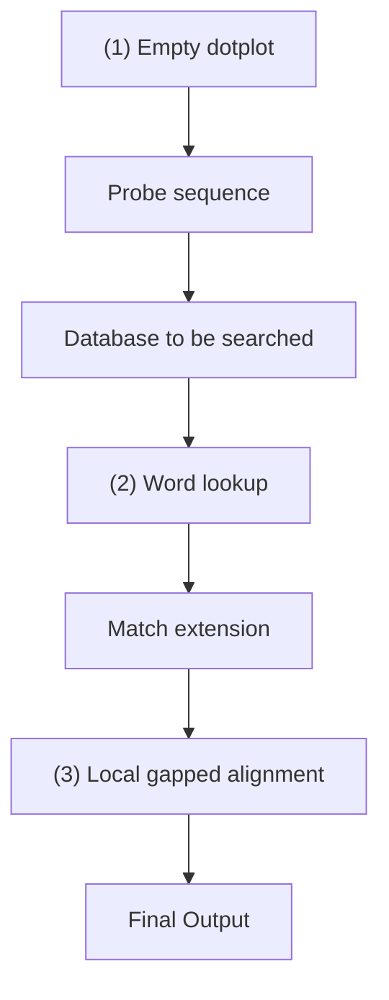
</details>

Figure 5.3 The mechanism of a BLAST search shown as a schematic. BLAST solves the problem of finding matches of a probe sequence in a full genome or a full database that is much longer than the probe sequence.

1. The ‘playing field’ of the algorithm is the outline of a dotplot, just as if the problem were going to be solved by application of an exact alignment method.
2. BLAST first divides the probe sequence into fixed-length words of length k; here, k = 4. It then identifies all exact occurrences of these words in the full database: no mismatches, no gaps. Note that the same four-letter word may occur several times in the probe sequence (shown here in green), and of course each four-letter word may match many times within the database. It is possible to do this step quickly after pre-processing the database to record the sites of appearance of all four-letter words.
3. Starting with each match, BLAST tries to extend the match in both directions. Still no mismatches, no gaps allowed.
4. Given the extended matches, BLAST tries to put them together by doing alignments allowing mismatches and gaps, but only within limited regions containing the preliminary matches (grey areas). The result of this step is to add to the matches the positions shown as ★. This produces longer matching regions.

It is the restriction of the more complex matching procedure to relatively small regions, rather than applying it to the entire matrix, that gives the method its speed. The price to pay is that if a combined match lies outside the grey area, the method will miss it. In the example illustrated, the matching regions at the right of the matrix, will not be combined, but reported as separate hits.

## The dynamic-programming algorithm for optimal pairwise sequence alignment1

A chart implicitly containing all possible alignments can be constructed as a matrix similar to that used in drawing the dotplot. The residues of one sequence index the rows, the residues from the other sequence index the columns. Any path through the matrix from upper left to lower right corresponds to an alignment. The task is to find the path that has the lowest cost, and the difficulty is that there are a very large number of paths to consider.

230

---

As an illustration, suppose you wanted to drive from Malmö in southern Sweden to Tromsø in northern Norway. Your route will consist of a number of segments, taking you through a succession of intermediate cities (see Fig. 5.4). There are many choices of different combinations of segments to produce a complete, continuous path.


<details>
<summary>text_image</summary>

TROMSO
UPPSALA
STOCKHOLM
MALMO
</details>

Figure 5.4 Possible routes from Malmö to Tromsø. How can you determine an optimal route?

© Collins Bartholemew Ltd. 1980.

The computational approach to finding the optimal path begins by assigning a numerical measure of the ‘cost’ to each of the possible individual segments of the journey. This ‘cost’ is not simply the financial outlay, but a more general estimate of your relative preferences for different portions of the route. The distance travelled will clearly be an important component of the cost, but other factors such as the quality of the roads and the opportunities for sightseeing may also contribute. For any route selected, the overall cost of the trip is the sum of the costs of the individual segments. Clearly it is inefficient to repeat any leg of the journey, or to visit any city twice, so we will agree that every intermediate stop will be north of the previous one. This formalism is expressed in terms of minimizing a cost rather than maximizing a score; for our purposes the two approaches are equivalent. An algorithm can explore the possible combinations to determine an optimal overall route.

Here is an abstract version of the problem, which illuminates the essential idea of dynamic programming.


<details>
<summary>text_image</summary>

Start
A
Finish
</details>

Consider first: how many paths from Start to Finish pass through A? There are six paths from Start to A. (Write them all down.) Therefore, by symmetry, there are six paths from A to Finish, and a

231

---

total of 36 paths from Start to Finish passing through A. (Why?) Assuming that we have assigned costs to the individual steps, do we have to check all 36 paths to find the path of minimum cost that goes from Start to Finish, passing through A? No. Here is the crucial observation: the choice of the best path from A to Finish is independent of the choice of path from the Start to A. If we determine the best of the six paths from Start to A, and we determine the best of the six paths from A to Finish, the best path from Start to Finish passing through A is the best path from Start to A followed by the best path from A to Finish. No more than 12 of the paths through A need be considered.

Even greater simplification is possible by systematically re-subdividing the problem. The dynamic-programming method for finding the optimal path through the matrix is based on this idea.

A statement of the optimal alignment problem and the dynamic-programming solution are as follows. Given two character strings, possibly of unequal length— ${ \mathcal { A } } = a _ { 1 } a _ { 2 } { \cdots } a _ { n }$ and $B = b _ { 1 } b _ { 2 } . . . b _ { m } \mathrm { {  —  } }$ where each $a _ { i }$ and $b _ { j }$ is a member of an alphabet set $\mathcal { A } _ { 1 }$ , consider sequences of edit operations that convert A and B to a common sequence. Individual edit operations include:

Substitution of $b _ { j }$ for $a _ { i }$ is represented by $(a_{i},b_{j})$

Deletion of $a _ { i }$ from sequence A is represented by $(a_{i}, \phi)$

Deletion of $b_{j}$ from sequence B is represented by $( \phi , b _ { j } )$

If we extend the alphabet set to include the null character $\Phi : \mathcal { A } ^ { + } = \mathcal { A } \cup \{ \phi \}$ , a sequence of edit operations is a set of ordered pairs $( x , y )$ , with $x , y \in \mathcal { A }$

A cost function, $d ,$ is defined on edit operations:

which position i of sequence A corresponds to position $j$ of sequence $B _{ z }$ and the mutation

Define the minimum weighted distance between sequences A and B as:

$$
D (A, B) = \min _ {A \to B} \Sigma d (x, y)
$$

where $x , y \in \mathcal { A }$ and the minimum is taken over all sequences of edit operations that convert A and B into a common sequence.

The problem is to find $D ( A , B )$ and one or more of the alignments that correspond to it.

An algorithm that solves this problem, requiring execution time proportional to the product of the lengths of the two sequences, creates a matrix $\mathcal { D } ( i , j ) , i = 0 , \ldots n ; j = 0 , \ldots m ,$ such that $\mathcal { D } \left( i , j \right)$ is the minimal distance between the strings that consist of the first i characters of A and the first j characters of B. Then $\mathcal { D } ( n , m )$ will be the required minimal distance $D ( A , B )$

The algorithm computes $\varpi ( i , j )$ by recursion. The value of $\varpi ( i , j )$ corresponds to the conversion of the initial subsequences ${ \mathcal { A } } _ { i }   =   a _ { 1 } a _ { 2 } { \cdots } a _ { i }$ and $B _ { j }   =   b _ { 1 } b _ { 2 } . . . b _ { j }$ into a common sequence by L edit operations $S _ { k } , k = 1 , \ldots L ,$ , which can be considered to be applied in increasing order of position in the strings. Consider undoing the last of these edit operations. The resulting truncated sequence of edit

232

---

operations, $S _ { k } ,   k = 1 ,   \ldots   L ^ { - 1 }$ , is a sequence of edit operations for converting a substring of $A _ { i }$ and a substring of $B _ { j }$ into a common result. What is more, it must be an optimal sequence of edit operations for these substrings, for if some other sequence $\vec { S } _ { \vec { k } } ^ { \prime }$ were a lower-cost sequence of operations for these substrings, then followed by $S _ { L }$ would be a lower-cost sequence of operations than $S _ { k }$ for converting $A _ { i }$ to $B _ { j }$ . Therefore, there should be a recursive method for calculating the $\varpi ( i , j )$

Recognize the correspondence of steps between adjacent squares in the matrix, and individual edit operations (see Fig. 5.1):

$$
\begin{array}{l} \begin{array}{l} (i - 1, j - 1) \to (i, j) \text {corresponds to the} \\ \text {substitution} a _ {i} \to b _ {j} \end{array} \\ \begin{array}{l l} (i - 1, j) \to (i, j) & \text {corresponds to the} \\ & \text {deletion of a_{i} from A} \end{array} \\ \begin{array}{l l}(i, j - 1) \rightarrow (i, j)&\text {corresponds to the insertion}\\&\text {of b_{j} into A at position i}\end{array} \\ \end{array}
$$

Sequences of edit operations correspond to stepwise paths through the matrix:

$$
(i _ {0}, j _ {0}) = (0, 0) \rightarrow (i _ {1}, j _ {1}) \rightarrow \dots (n, m)
$$

where $0 \leq i _ { k + 1 } { - } i _ { k } \leq 1$ (for $0 \leq k \leq n { - } 1 )$ , $0 \leq j _ { k + 1 } - j _ { k } \leq 1$ (for $0 \leq k \leq m { - } 1 )$ . Considering the possible sequences of edit operations and the corresponding paths through the matrix, the predecessor of an optimal string of edit operations leading from $( 0 , \; 0 )$ to $( i , j )$ , where $i , j \geq 0$ , must be an optimal sequence of edit operations leading to one of the cells $( i { - } 1 , \; j ) , \; ( i { - } 1 , \; j { - } 1 )$ , or $( i ,   j { - } 1 )$ ; and, correspondingly, $\mathcal { D } ( i , j )$ must depend only on the values of $\scriptstyle { \mathcal { D } } ( i - 1 ,   j ) , \; { \mathcal { D } } ( i - 1 ,   j - 1 )$ , and $\mathcal { D } ( i , j { - } 1 )$ , together, of course, with the parameterization specified by the cost function d.

The algorithm is then as follows.

Compute the $( m + 1 ) \times ( n + 1 )$ matrix D by applying:

1. the initialization conditions on the top row and left column:

$$
\begin{array}{l} \mathcal {D} (i, 0) = \sum_ {k = 0} ^ {i} d (a _ {k}, \phi) \\ \mathcal {D} (0, j) = \sum_ {k = 0} ^ {j} d (\phi , b _ {k}) \\ \end{array}
$$

These values impose the gap penalty on unmatched residues at the beginning of either sequence.

And then:

2. the recurrence relationships:

$$
\begin{array}{l} \mathcal {D} (i, j) = \min \left\{\mathcal {D} (i - 1, j) + d (a _ {i}, \phi), \mathcal {D} (i - 1, j - 1) + \right. \\ d (a _ {i}, b _ {j}), \mathcal {D} (i, j - 1) + d (\phi , b _ {j}) \bigg \} \\ \end{array}
$$

for $i = 1 \ldots n ; j = 1 , \ldots m$ . This means, consider all three possible steps to $\varpi ( i , j )$

233

---

| Operation | Cumulative cost |
| --- | --- |
| Insert a gap in sequence A | $\mathcal{D}(i-1,j) + d(a_i, \phi)$ |
| Substitute $a_i \leftrightarrow b_j$ | $\mathcal{D}(i-1,j-1) + d(a_i, b_j)$ |
| Insert a gap in sequence B | $\mathcal{D}(i,j-1) + d(\phi, b_j)$ |

From these, choose the minimal value of the cumulative cost. For each cell, record not only the value $\mathcal { D } ( i , j )$ but a pointer back to (one or more of) the cell(s) $( i – 1 , j ) , ( i , – 1 , j – 1 )$ , or $( i , j { - } 1 )$ selected by the minimization operation. Note that more than one predecessor may give the same value.

When the calculations are complete, $\mathcal { D } ( n , ~ m )$ is the optimal distance $D ( A ,   B )$ . An alignment corresponding to the sequence of edit operations recorded by the pointers can be recovered by tracing a path back through the matrix from $( n ,   m )$ to (0, 0). This alignment, corresponding to the minimal distance $D ( A , B ) = \mathcal { D } ( n , m )$ , may well not be unique. (See Example 5.5.)

## Example 5.5 Dynamic-programming algorithm for sequence alignment

Align the strings $A = g g a a t g g$ and $B = a t g$ according to the simple scoring scheme of match = 0, mismatch = 20, and insertion or deletion = 25.

Here is the state of play after the top row and leftmost column have been initialized (italic), and the element in the second row and second column has been entered as **20** (boldface):

|  | $\phi$ | a | t | g |
| --- | --- | --- | --- | --- |
| $\phi$ | 0 | 25 | 50 | 75 |
| g | 25 | 20 |  |  |
| g | 50 |  |  |  |
| a | 75 |  |  |  |
| a | 100 |  |  |  |
| t | 125 |  |  |  |
| g | 150 |  |  |  |
| g | 175 |  |  |  |

The value of **20** was chosen as the minimum of $2 5 \pm 2 5$ (horizontal move, or insert gap into string atg), 0 + 20 (substitution $\alpha { \leftrightarrow } g ) ,$ , and $2 5 \pm 2 5$ (vertical move, or insert gap into string ggaatgg). Because the substitution (the diagonal move) provided the minimal value, the cell containing 0 in the upper left-hand corner of the matrix is the predecessor of the cell in which we have just entered the 20. For traceback purposes, we would also draw an arrow from the value of 20 just entered, back to the 0 at the upper left. (If two or even three of the possible moves produce the same value, the resulting cell has multiple predecessors.)

Here is the matrix after completion of the calculation:

234

---


<details>
<summary>text_image</summary>

φ a t g
0 ←25 ←50 ←75
↑ ↘ ↘ ↘
g 25 20 ←45 50
↑ ↘ ↘ ↘
g 50 45 40 45
↑ ↘ ↘ ↘
a 75 50 65 60
↑ ↘ ↘ ↘ ↘
a 100 75 70 85
↑ ↑ ↘ ↘
t 125 100 75 90
↑ ↑ ↑ ↘
g 150 125 100 75
↑ ↑ ↑ ↘ ↗
g 175 150 125 100
</details>

It includes the traceback information in the form of arrows pointing from each cell to its predecessor(s). For some applications we may need only the value of D(A, B) but not an alignment; if so, it is unnecessary to save the pointers. Boldface arrows delineate the paths of optimal alignment retracing a trail of predecessors from lower right, back to upper left. In some cases, one cell may show two predecessors. These correspond to alternative alignments with the same score.

There are two cells at which the traceback path branches. This gives a total of four optimal alignments with equal score:

| ggaatgg | ggaatgg | ggaatgg | ggaatgg |
| --- | --- | --- | --- |
| ---atg- | ---at-g | --a-tg- | --a-t-g |

With a gap-weighting scheme that assigned a smaller penalty to gap extension than to gap initiation the first two of these would score better than the others, because they contain the smallest number of gaps, irrespective of the length of the individual gaps. However, more sophisticated gap-weighting schemes require more complicated recurrence formulas for filling the matrix.

This algorithm determines the optimal global alignment of two sequences. It is inappropriate for detection of local regions of high similarity within two sequences, or for probing a long sequence with a short fragment, because it imposes gap penalties outside the similar regions. The method of T. Smith and M. Waterman solves this problem. Their modifications of the basic dynamic-programming algorithm find optimal local alignments; that is, they select the substrings from both sequences that are most similar to each other. Their changes affect the following aspects.

Initialization of the matrix: setting the values of the top row and left column. In the Smith–Waterman method, the top row and left column are set to 0. As a result, either sequence can slide along the other before alignment starts, without incurring any gap penalty against the residues it passes by.
2. Filling in the matrix: in global alignment, at each step a choice is forced among match, insertion, or deletion, even if none of these choices is attractive and even if a succession of unattractive choices degrades the score along a path containing a well-fitting local region. The Smith–Waterman method adds the fourth option: end the region being aligned.
3. Scoring and traceback: the score of a global alignment is the number in the matrix element at the lower right. In the Smith–Waterman method it is the optimal value encountered, wherever in the matrix it appears. For global alignment, traceback to determine the actual alignment starts at the lower-right cell. In the Smith– Waterman method it starts at the cell containing the optimal value and continues back only as far as the region of local similarity continues.

The Smith–Waterman method would report a unique global optimum for our example:

Note that no gaps appear outside the region matched.

235

---

Example adapted from Tyler, E.C., Horton, M.R., and Krause, P.R. (1991). A review of algorithms for molecular sequence comparison. Computers and Biomedical Research, 24, 72–96.

## Significance of alignments

Suppose alignment reveals an intriguing similarity between two sequences. Is the similarity significant or could it have arisen by chance? (We raised this question in Chapter 1.) For some simple phenomena—tossing a coin or rolling dice—it is possible to calculate exactly the expected distribution of results, and the likelihood of any particular result. For sequences it is not trivial to define the population from which the alignment is selected. For instance, to take random strings of nucleotides or amino acids as controls ignores the bias arising from nonrandom composition.

A practical approach to the problem is as follows: if the score of the alignment observed is no better than might be expected from the corresponding alignment of a random permutation of the sequence, then it is likely to have arisen by chance. We may randomize one of the sequences many times, realign each result to the second sequence (held fixed) and collect the distribution of resulting scores. Figure 5.5 shows a typical result. For database searches we would use the population of results returned from the entire database as the population with which to measure the statistics.


<details>
<summary>violin</summary>

| Optimal local alignment score | Number of pairs of sequences |
| --- | --- |
| Low | ~0.1 |
| Peak | ~0.9 |
| High | ~0.1 |
</details>

Figure 5.5 Optimal local alignment scores for pairs of random amino acid sequences of the same length follow an extreme value distribution. For any score x the probability of observing a score ≥ x is:

$$
P (\text {Score} \geq x) = 1 - \exp (- K e ^ {- \lambda x})
$$

where K and λ are parameters related to the position of the maximum and the width of the distribution. Note the long tail at the right. This means that a score several standard deviations above the mean has a higher probability of arising by chance (i.e. it is less significant) than if the scores followed a normal distribution.

Clearly, if the randomized sequences score as well as the original one then the alignment is unlikely to be significant. We can measure the mean and standard deviation of the scores of the alignments of randomized sequences and ask whether the score of original sequence is unusually high. The Z score reflects the extent to which the original result is an outlier from the population:

$$
Z \text { score } = \frac {\text { score - mean }}{\text { standard   deviation }}
$$

A Z score of 0 means that the observed similarity is no better than the average of random permutations of the sequence, and might well have arisen by chance. Other values used as measures of significance are P, or the probability that the observed match could have happened by chance, and, for database searching, E, which is the number of matches as good as the observed one that would be expected to appear by chance in a database of the size probed (see Box 5.4).

236

---

Many ‘rules of thumb’ are expressed in terms of percentage of identical residues in the optimal alignment. If two proteins have more than 45% identical residues in their optimal alignment they will have very similar structures and are very likely to have a common or at least a similar function. If two proteins have greater than 25% identical residues they are likely to have a similar general folding pattern. On the other hand, observations of a lower degree of sequence similarity cannot rule out homology. Recall R.F. Doolittle’s definition of the region of 18–25% sequence identity as the ‘twilight zone’ in which the suggestion of homology is tantalizing but dangerous. Below the twilight zone is a region where pairwise sequence alignments tell very little. Lack of significant sequence similarity does not preclude genuine homology.

Although the twilight zone is a treacherous region, we are not entirely helpless. In deciding whether there is a genuine relationship, the ‘texture’ of the alignment is important: are the similar residues isolated

## Box 5.4 How to play with matches but not get burned

Pairwise alignments and database searches often show tenuous but tantalizing sequence similarities. How can we decide whether we are seeing a true relationship? Statistics cannot answer biological questions directly, but can tell us the likelihood that a similarity as good as the one observed would appear, just by chance, among unrelated sequences. To do this we want to compare our result with alignments of the same sequences to a large population. This ‘control’ population should be similar in general features to our aligned sequences, but should contain few sequences related to them. Only if the observed match stands out from the population can we regard it as significant.

To what population of sequences should we compare our alignment? For pairwise alignments we can pick one of the two sequences, make many scrambled copies of it using a random-number generator, and align each permuted copy to the second sequence. For probing a database the entire database provides a comparison population.

Aligning our sequence to each member of the control population generates a large set of scores. How does the score of our original alignment rate? Several statistical parameters have been used to evaluate the significance of alignments, as follows.

The Z score is a measure of how unusual our original match is, in terms of the mean and standard deviation of the population scores. If the original alignment has score S,

$$
\text {Z score of } S = \frac {S - \text {mean}}{\text {standard deviation}}
$$

A Z score of 0 means that the observed similarity is no better than the average of the control population, and might well have arisen by chance. The higher the Z score, the greater the probability that the observed alignment has not arisen simply by chance. Experience suggests that Z scores ≥5 are significant.

Many programs report P, the probability that the alignment is better than random. The relationship between Z and P depends on the distribution of the scores from the control population, which do not follow the normal distribution.

A rough guide to interpreting P values:

| P≤10-100 | Exact match |
| --- | --- |
| P in range 10-100-10-50 | Sequences very nearly identical, e.g. alleles or SNPs |
| P in range 10-50-10-10 | Closely related sequences, homology certain |
| P in range 10-5-10-1 | Usually, distant relatives |
| P>10-1 | Match probably insignificant |

• For database searches, some programs (including PSI-BLAST) report E-values. The E value of an alignment is

237

---

the expected number of sequences that give the same Z score or better if the database is probed with a random sequence. E is found by multiplying the value of P by the size of the database probed. Note that E but not P depends on the size of the database. Values of P are between 0 and 1.0. Values of E are between 0 and the number of sequences in the database searched.

• A rough guide to interpreting E values:

| E ≤ 0.02 | Sequences probably homologous |
| --- | --- |
| E between 0.02 and 1 | Homology unproven but cannot be ruled out |
| E > 1 | You would have to expect this good a match just by chance |

Statistics are a useful guide, but not a substitute for thinking carefully about the results, and further analysis of ones that look promising!

and scattered throughout the sequence, or are there ‘icebergs’? Are there local regions of high similarity (another term of Doolittle’s) that may correspond to a shared active site? We may need to rely on other information, about shared ligands or function. Of course, if the structures are known we could examine them directly.

Some illustrative examples are listed here.

Sperm whale myoglobin and lupin leghaemoglobin have 15% identical residues in optimal alignment. This is even below Doolittle’s definition of the twilight zone. But we also know that both molecules have similar three-dimensional structures, and that both contain a haem group and both bind oxygen. They are indeed distantly related homologues.
The sequences of the N- and C- terminal halves of rhodanese have 11% identical residues in optimal alignment. If these appeared in independent proteins one could not conclude from the sequences alone that they were related. However, their appearance in the same protein suggests that they arose via gene duplication and divergence. The striking similarity of their structures confirms their relationship.
As a cautionary note, consider the proteinases chymotrypsin and subtilisin. They have 12% identical residues in optimal alignment. These enzymes have a common function and a common catalytic triad (see Fig. 8.5). However, they have dissimilar folding patterns, and are not related. Their common function and mechanism is an example of convergent evolution. This case serves as a warning against special pleading for relationships between proteins with dissimilar sequences on the basis of similarities of function and mechanism!

## Multiple sequence alignment

‘One amino acid sequence plays coy; a pair of homologous sequences whisper; many aligned sequences shout out loud.’ In nature, even a single sequence contains all the information necessary to dictate the fold of the protein. How does a multiple sequence alignment make that information more intelligible and useful? Alignment tables expose patterns of amino acid conservation, from which distant relationships may be more reliably detected. Structure-prediction tools also give more reliable results when based on multiple sequence alignments than on single sequences.

Visual examination of multiple sequence alignment tables is one of the most profitable activities that a molecular biologist can undertake away from the laboratory bench. Don’t even think about not displaying them with different colours for amino acids of different physiochemical type. A reasonable colour scheme (not the only possible one) is shown in Table 5.1.

238

---

Table 5.1 Distinguishing amino acids of different physico-chemical types in multiple sequence alignments

| Colour | Residue type | Amino acids |
| --- | --- | --- |
| Yellow | Small nonpolar | Gly, Ala, Ser, Thr |
| Green | Hydrophobic | Cys, Val, Ile, Leu, Pro, Phe, Tyr, Met, Trp |
| Magenta | Polar | Asn, Gln, His |
| Red | Negatively charged | Asp, Glu |
| Blue | Positively charged | Lys, Arg |

To be informative, a multiple alignment should contain a distribution of closely and distantly related sequences. If all the sequences are very closely related, the information they contain is largely redundant, and few inferences can be drawn. If all the sequences are very distantly related, it will be difficult to construct an accurate alignment (unless all the structures are available), and in such cases the quality of the results, and the inferences they might suggest, are questionable. Ideally, one has a complete range of similarities, including distantly related examples linked through chains of close relationships. (See Case Study 5.2.)

## CASE STUDY 5.2 Structural inferences from multiple sequence alignments of thioredoxins

Thioredoxins are enzymes found in all cells. They participate in a broad range of biological processes, including cell proliferation, blood clotting, seed germination, insulin degradation, repair of oxidative damage, and enzyme regulation. The common mechanism of these activities is the reduction of protein disulphide bonds.

Plate VI shows a multiple sequence alignment of 16 thioredoxins. The structure of E. coli thioredoxin contains a central five-stranded β sheet flanked on either side by α helices; these helices and strands are indicated by the symbols α and β. Other thioredoxins are expected to share most but not all of the secondary structure of the E. coli enzyme. The plate also shows a summary of the alignment as a sequence logo, in which letters of different sizes indicate different proportions of amino acids. (T. Schneider and M. Stephens designed sequence logos; this example was produced using the web server at [http://weblogo.berkeley.edu/logo.cgi](http://weblogo.berkeley.edu/logo.cgi)).

239

---

(a) Alignment of thioredoxins


(b) Thioredoxin


<details>
<summary>text_image</summary>

1
2
3
4
5
6
7
8
9
10
11
12
13
14
15
16
17
18
19
20
21
22
23
24
25
26
27
28
29
30
31
32
33
34
35
36
37
38
39
40
41
42
43
44
45
46
47
48
49
50
51
52
53
54
55
56
57
58
59
60
K Y D P C F E F K V V D W C P K M L P E F E F L E X E Y F Y F Y F Y F Y F Y F Y F Y F Y F Y F Y F Y F Y F Y F Y F Y F Y F Y F Y F Y F Y F Y F Y F Y F Y F Y F Y F Y F Y F Y F Y F Y F Y F Y F Y F Y F Y F Y F Y F Y F Y F Y F Y F Y F Y F Y F Y F Y F Y F Y F YF E E E E E E E E E E E E E E E E E E E E E E E E E E E E E E E E E E E E E E E E E E E E E E E E E E E E E E E E E E E E E E E E E E E E E E E E E E E E E E E E E E E E E E E E E E E E E E E E E E E EE A B C D D
</details>


<details>
<summary>chemical</summary>

Protein secondary structure diagram showing helices and labeled amino acid residues (N, C)
</details>


<details>
<summary>chemical</summary>

Protein secondary structure diagram with labeled amino acid residues and helices
</details>

Plate VI (a) Alignment of amino acid sequences of E. coli thioredoxin and homologues. Some of the sequences have been trimmed at their termini. Residue numbers in this table corresponds to positions in the E. coli sequence (top line). Helix α and strand β assignments for E. coli thioredoxin are from PDB entry 2TRX. (b) Sequence logo derived from this multiple-sequence alignment. (c) The structure of E. coli thioredoxin [2TRX] contains a central five-stranded β sheet flanked on either side by α helices. Residue numbers correspond to those in the multiple sequence alignment table. The N- and C-termini are also marked. Spheres indicate positions of the Cα atoms of every tenth residue. The reactive disulphide bridge between $^ { 3 2 } \mathrm { C y s }$ and $^ { 3 5 } \mathrm { C y s }$ appears in yellow (see Case Study 5.2).

Structural and functional features of thioredoxins that we might hope to identify from the multiple sequence alignment include the following (see Fig. 5.6 and Plate VI).

• The most highly conserved regions probably correspond to the active site. The disulphide bridge between residues 32 and 35 in E. coli thioredoxin is part of a WCGPC[K or R] motif conserved in the family. Other regions conserved in the sequences, including the PT at residues 75–77 and the GA at residues 92–93, are involved in substrate binding.
Regions rich in insertions and deletions probably correspond to surface loops. A position containing a conserved Gly or Pro probably corresponds to a turn. Turns correlated with insertions and deletions occur at positions 9, 20, 60, and 95. The conserved glycine at position 92 in E. coli thioredoxin is indeed part of a turn. It is in an unusual mainchain conformation, one that is easily accessible only to glycine (See Chapter 6). The conserved proline at position 76 in E. coli thioredoxin is also associated with a turn. It is in another unusual mainchain conformation, this one easily accessible only to proline.
• A conserved pattern of hydrophobicity with spacing 2 (i.e. every other residue)—with the intervening residues more variable and including hydrophilic residues—suggests a $\beta$ strand on the surface. This pattern is observable in the β strand between residues 50 and 60.
• A conserved pattern of hydrophobicity with spacing ≈4 suggests a helix. This pattern is observable in the region of helix between residues 40 and 49.

240

---

Thioredoxins are members of a superfamily including many more distantly related homologues. These include glutaredoxin (hydrogen donor for ribonucleotide reduction in DNA synthesis), protein disulphide isomerase (which catalyses exchange of mismatched disulphide bridges in protein folding), phosducin (a regulator of Gprotein signalling pathways), and glutathione-S-transferases (chemical defence proteins). Implicit in the multiple sequence alignment table of the thioredoxins themselves are patterns that should be applicable to identifying these more distant relatives.


E. coli Thioredoxin


E. coli Thioredoxin

Figure 5.6 The structure of E. coli thioredoxin [2TRX] (see also Plate VI). Residue numbers correspond to those in the multiple sequence alignment table. The N- and C-termini are also marked. Spheres indicate the positions of the Cα atoms of every tenth residue. The reactive disulphide bridge between $^ { 3 2 } \mathrm { C y s }$ and $^ { 3 5 } \mathrm { C y s }$ appears between the numbers 30 and 60.


**See Weblem 5.5**

## Applications of multiple sequence alignments and database searching

Searching in databases for homologues of known proteins is a central theme of bioinformatics. Indeed, it brooked no delay; we introduced it in Chapter 1 with the application of PSI-BLAST. We reconsider database searching here, with the goal of trying to understand how we can best use available information to build effective procedures. The goals are high sensitivity—picking up even very distant relationships—and high selectivity—minimizing the number of sequences reported that are not true homologues. Here we discuss how to apply multiple sequence alignments to this problem. In Chapter 6 we shall discuss how to apply structural information in addition.

Great progress has been made during the last decade in devising methods for applying multiple sequence alignments of known proteins to identify related sequences in database searches. The results are central to contemporary applications of bioinformatics, including the interpretation of genomes. Three important methods are profiles, PSI-BLAST, and hidden Markov models (HMMs).

## Profiles

Profiles express the patterns inherent in a multiple sequence alignment of a set of homologous sequences. They have several applications.

• They permit greater accuracy in alignments of distantly related sequences.
• Sets of residues that are highly conserved are likely to be part of the active site, and give clues to function.
The conservation patterns facilitate identification of other homologous sequences.
• Patterns in the sequences are useful in classifying subfamilies within a set of homologues.
Sets of residues that show little conservation, and are subject to insertion and deletion, are likely to be in surface loops. This information has been applied to vaccine design, because such regions are

241

---

likely to elicit antibodies that will cross-react well with the native structure.

Most structure-prediction methods are more reliable if based on a multiple sequence alignment than on a single sequence. Homology modelling, for instance, depends crucially on correct sequence alignments, and can make effective use of the conformational variation seen in multiple parent structures.

To use profile patterns to identify homologues, the basic idea is to match the query sequences from the database against the sequences in the alignment table, giving higher weight to positions that are conserved than to those that are variable. If a region is absolutely conserved, such as the WGCPC motif in thioredoxins, the procedure should all but insist on finding it. But the risk of being too compulsive is to miss interesting distant relatives; some leeway should be allowed.

What is needed is a quantitative measure of conservation. Take an inventory of the distribution of amino acids for each position in the table of aligned sequences. For instance, for positions 25–30 of the thioredoxin alignment see Table 5.2.

Table 5.2 Position-dependent inventory of amino acids in residues 25–30 of 16 aligned thioredoxin sequences

<table><tr><td rowspan="2">Residue number</td><td colspan="20">Number of occurrences</td></tr><tr><td>A</td><td>C</td><td>D</td><td>E</td><td>F</td><td>G</td><td>H</td><td>I</td><td>K</td><td>L</td><td>M</td><td>N</td><td>P</td><td>Q</td><td>R</td><td>S</td><td>T</td><td>V</td><td>W</td><td>Y</td></tr><tr><td>25</td><td>1</td><td></td><td></td><td></td><td></td><td></td><td></td><td></td><td></td><td>2</td><td></td><td></td><td></td><td></td><td></td><td></td><td></td><td>13</td><td></td><td></td></tr><tr><td>26</td><td></td><td></td><td>16</td><td></td><td></td><td></td><td></td><td></td><td></td><td></td><td></td><td></td><td></td><td></td><td></td><td></td><td></td><td></td><td></td><td></td></tr><tr><td>27</td><td></td><td></td><td></td><td></td><td>16</td><td></td><td></td><td></td><td></td><td></td><td></td><td></td><td></td><td></td><td></td><td></td><td></td><td></td><td></td><td></td></tr><tr><td>28</td><td></td><td></td><td></td><td></td><td></td><td></td><td></td><td></td><td></td><td></td><td></td><td></td><td></td><td></td><td></td><td>7</td><td>1</td><td></td><td>5</td><td>3</td></tr><tr><td>29</td><td>16</td><td></td><td></td><td></td><td></td><td></td><td></td><td></td><td></td><td></td><td></td><td></td><td></td><td></td><td></td><td></td><td></td><td></td><td></td><td></td></tr><tr><td>30</td><td></td><td></td><td>1</td><td>4</td><td></td><td></td><td></td><td></td><td></td><td></td><td></td><td></td><td>2</td><td></td><td></td><td>1</td><td>7</td><td>1</td><td></td><td></td></tr></table>

Given a query sequence representing a potential thioredoxin homologue, we want to evaluate its similarity to the query sequence in such a way that agreement with the known sequences at the absolutely conserved positions—for instance 26, 27, and 29—contributes a very high score, and disagreement at these positions contributes a very low score. For moderately conserved positions, such as 28, we want a modest positive contribution to the score if the query sequence has an S or a W at this position, and a smaller contribution if it has T or Y. The general idea is to score each residue from the query sequence based on the amino acid distribution at that position in the multiple sequence alignment table.

It is tempting to use the inventories as scores directly. For example, if the residues in a query sequence that correspond to positions 25–30 in thioredoxin contain the sequence VDFSAE, this fragment would score $13+16+16+6+16+4=71$ . This is almost the greatest value possible. The alternative query sequence ACGVAP would score $1+0+0+5+16+2=24$ , a much lower value. Of course, for each query sequence we have to test all possible alignments with the multiple alignment table and take the largest total score. The highest scoring sequences best fit the patterns implicit in the table.

This simple approach would work if our table contained a large and unbiased sample of thioredoxin sequences. But only in that case would the simple inventory give a correct picture of the potential distributions of residues at each position. If our sample were small the pattern derived would be unlikely to reflect the complete repertoire. Or, if the sample contained a large subset of similar sequences, these would be over-represented in the inventories. For instance, we can see in Plate VI that vertebrate thioredoxins form a very closely related set. If we included 20 more vertebrate thioredoxins in the alignment the profile would recognize only vertebrate thioredoxins

242

---

effectively.

Substitution matrices suggest how to make the inventory ‘fuzzy’ and thereby more general.

The observed amino acid distribution at any residue position is a 20-membered array $( a _ { 1 } ,   a _ { 2 } ,   a _ { 3 }$ $\cdots a _ { 2 0 } )$ where $a _ { i }$ is the number of amino acids of type i observed at that position. (For position 25 of the thioredoxins, $a _ { 1 } = 1$ because one alanine is observed, and $a _ { 1 8 } = 1 3$ , representing the valines.) Then in the simple ‘inventory scoring’ scheme, the score of an alanine at position 25 is just 1; the score of a valine is 13; in general, the score of an amino acid of type i is $a _ { i } .$ In this scheme the rows of the inventory itself provide the arrays a needed for scoring each position.

A better scoring scheme would evaluate any amino acid according to its chance of being substituted for one of the observed amino acids. If $D ( i , j )$ is an amino acid substitution matrix— BLOSUM62, for example—then amino acid i could score $a _ { 1 } D ( i ,   1 ) + a _ { 2 } D ( i ,   2 )   \cdots   a _ { 2 0 } D ( i ,   2 0 )$ . This scheme distributes the score among observed amino acids, weighted according to the substitution probability. An amino acid in the query sequence could score high either if it appears frequently in the inventory at this position, or if it has a high probability of arising by mutation from residue types that are common at this position. This approach is more effective in detection of distant relatives from a limited set of known sequences. In this case, the scoring vector for amino acids at any position is a row in the product of the substitution matrix and the rows of the inventory array. An even better approach is to use as the amino acid distribution a combination of the observed inventory and a general background level of amino acid composition.

The result is a set of probability scores for each amino acid (or gap) at each position of the alignment, called a position-specific scoring matrix. An alternative method of deriving a positionspecific scoring matrix, based on three-dimensional structures, is described in Chapter 6.

Given a query sequence, and the position-specific scoring matrices derived from a profile, the calculations required to find the optimal score over all alignments of the query sequence with the profile are extensions of the dynamic-programming methods for aligning two sequences.

A weakness of simple profiles is that the multiple sequence alignment must be provided in advance, and is taken as fixed. PSI-BLAST and hidden Markov models gain power by integrating the alignment step with the collection of statistics.

## PSI-BLAST

PSI-BLAST is a program that searches a data bank for sequences similar to a query sequence. It is a development of the earlier program BLAST. The BLAST program and its variants check each entry in the data bank independently against a query sequence. PSI-BLAST begins with such a one-at-atime search. It then derives pattern information from a multiple sequence alignment of the initial hits, and reprobes the database using the pattern. Then it repeats the process, fine-tuning the pattern in successive cycles (see Fig. 5.7).


<details>
<summary>flowchart</summary>

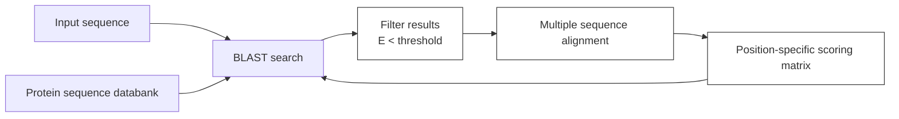
</details>

Figure 5.7 Schematic flowchart of a PSI-BLAST calculation to detect protein sequences in a database similar to a

243

---

probe sequence. The user submits an input sequence and chooses a protein sequence data bank to probe. First, using the input sequence and a standard substitution matrix such as BLOSUM62, a BLAST calculation identifies similar sequences in the database and assigns a statistical measure of significance, E, to each ‘hit’. For each sequence retrieved from the database, E is the number of sequences of equal or higher similarity to the probe sequence that would be expected to be found in the database, just by chance. The program will select those sequences for which E is no greater than a specified threshold, often chosen as 0.005, and perform a multiple sequence alignment of them. By counting the relative frequencies of different amino acids in each column of the multiple sequence alignment the program will derive a position-specific scoring matrix. The box at the lower left shows a part of a position-specific scoring matrix. The columns are labelled by the 20 natural amino acids. The rows are labelled by the sequence to be scored by the matrix. In this case the N-terminal sequence of the sequence to be scored is $\mathrm { R D A . . . }$ . The entries in the column are the log-odd scores of finding any amino acid at any position in the multiple alignment. For instance, the entry under A in row 3 is −1; therefore, the probability of finding an A at the third position is proportional to $1 0 ^ { - 1 }$ . To find the score of the sequence, add up the value in the R column of the first row, the D column of the second row, the A column of the third row, etc., to give: $1 0 ^ { - 3 } \pm 1 0 ^ { - 7 } \pm 1 0 ^ { - 1 }$ . In this example the probabilities are expressed unscaled and as logs to the base 10. Note that the sequence being scored may contain gaps. This matrix can be used as an alternative to the input sequence and substitution matrix in a BLAST search. Each subsequent BLAST search, based on the matrix derived in the previous step, will return a different set of ‘hits’. With a sensible choice of input parameters the procedure will usually converge, to produce a more reliable set of similar sequences than would be returned by the simple BLAST search of the input sequence performed in the first step.

The problem that BLAST was originally designed to solve is that full-blown dynamicprogramming methods are rather slow for complete searches in a large data bank. Often the data bank contains close matches to the query sequence. Less-sensitive but faster programs, such as BLAST, are quite capable of identifying the close matches. If that is what you want, fine. For example, if you want to search for homologues of a mouse protein in the human genome, the similarity is likely to be high and an approximate method likely to find it. But if you want to search for homologues of a human protein in C. elegans or yeast, the relationship may be more tenuous. More sophisticated, slower methods may be required. (It may come as a surprise, but computer time requirements are still a consideration. For although computing is becoming less expensive, the sizes of the data banks and the number of searches desired, on a worldwide basis, are growing. The net effect is that the pressure on computing resources is increasing.)

The method used by BLAST goes back, in a sense, to the dotplot approach, checking for wellmatching local regions. For each entry in the database it checks for short contiguous regions that match a short contiguous region in the query sequence, using a substitution scoring matrix but allowing no gaps. An approach in which candidate regions of fixed length are identified initially can be made very fast by the use of lookup tables.

Once BLAST identifies a well-fitting region, it tries to extend it. In some versions gaps are allowed. The output of BLAST is the set of local segment matches. In an example from Chapter 1:


<details>
<summary>text_image</summary>

My.care.is.loss.of.care,.by.old.care.done,
Your.care.is.gain.of.care,.by.new.care.won
</details>

even a very simple algorithm could pick up all matching regions of five contiguous residues and then combine and extend them.

## A flowchart for PSI-BLAST

**1.** Probe each sequence in the chosen database independently for local regions of similarity to the query sequence, using a BLAST-type search but allowing gaps.
**2.** Collect significant hits. Construct a multiple sequence alignment table between the query sequence and the

244

---

significant local matches.

**3.** Form a profile from the multiple sequence alignment.
**4.** Reprobe the database with the profile, still looking only for local matches.
**5.** Decide which hits are statistically significant and retain these only.
**6.** Go back to step 2 until a cycle produces little or no change. This accounts for the ‘Iterated’ in the title of the PSI-BLAST program.

PSI-BLAST, using iterated pattern searching (see the box and Fig. 5.7), is much more powerful than simple pairwise BLAST in picking up distant relationships. PSI-BLAST correctly identifies three times as many homologues as BLAST in the region below 30% sequence identity. It is therefore a very useful method for analysing whole genomes. PSI-BLAST was able to match protein domains of known structure to 39% of the genes in M. genitalium, 24% of the genes in yeast, and 21% of the genes in C. elegans.

The only methods based entirely on sequence analysis that do better than PSI-BLAST are HMMs. These are described in the next section. To achieve significantly better performance it is necessary to make explicit use of structural information. This is discussed in Chapter 6.


## See Weblems 5.6 and 5.7

## Hidden Markov models

A hidden Markov model (HMM) is a computational structure for describing the subtle patterns that define families of homologous sequences. HMMs are powerful tools for detecting distant relatives and for prediction of protein folding patterns. They are the only method based entirely on sequences that is, without explicitly using structural information—competitive with PSI-BLAST for identifying distant homologues. They also perform well at identifying the folding pattern of a protein from the amino acid sequence, as assessed in CASP programmes.

Within an HMM is a multiple sequence alignment. However, HMMs are usually presented as procedures for generating sequences. A conventional multiple sequence alignment table could also be used to generate sequences by selecting amino acids at successive positions, each amino acid being chosen from a position-specific probability distribution derived from the profile. But HMMs are more general than profiles:

1. they include the possibility of introducing gaps into the generated sequence, with positiondependent gap penalties;
2. application of profiles requires that the multiple sequence alignment be specified up front; the pattern statistics are then derived from the alignment. HMMs carry out the alignment and the assignment of probabilities together.

The internal structure of an HMM shows the mechanism for generating sequences (Fig. 5.8). Begin at Start, and follow some chain of arrows until arriving at End. Each arrow takes you to a state of the system. At each state (1) you take some action—emit a residue, perhaps—and (2) choose an arrow to take you to the next state. The action and the choice of successor state are governed by sets of probabilities. Associated with each state that emits a residue are one probability distribution for the 20 amino acids and a second probability distribution for the choice of successor state. Both of these probability distributions are calibrated to encode information about a particular sequence family. In

245

---

this way the same general computational framework can be specialized to many different sequence families.


<details>
<summary>flowchart</summary>

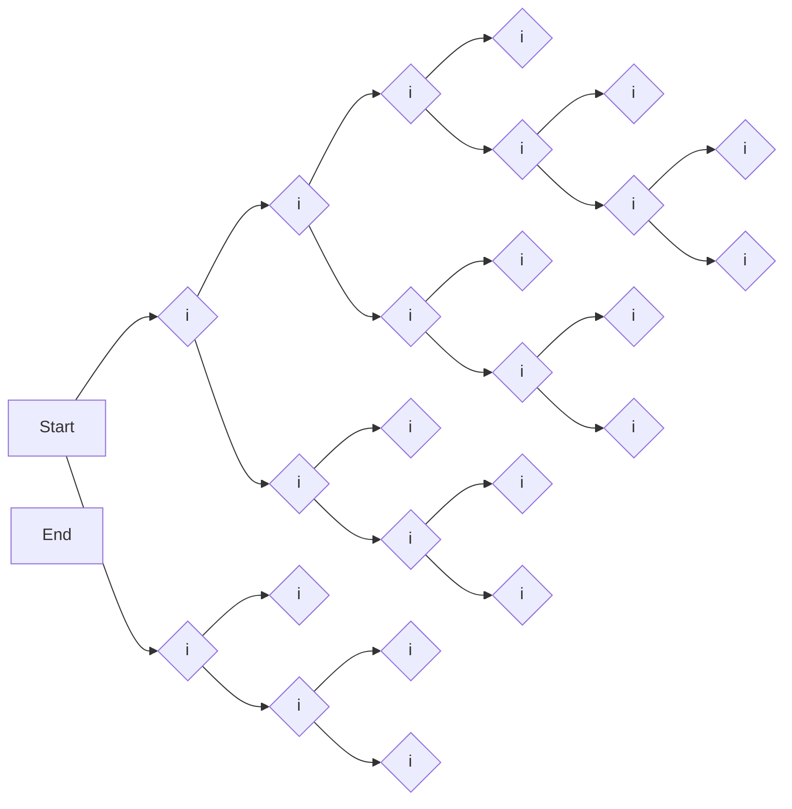
</details>

Figure 5.8 The structure of an HMM. Corresponding to each residue position in a multiple sequence alignment, the HMM contains a match state (m) and a delete state (d). Insert states (i) appear between residue positions, and at the beginning and end.

• Match states emit a residue. Here the term match means only that there is some amino acid both in the model underlying the HMM and in the sequence emitted, not that these are necessarily the same amino acid. The probability of emitting each of the 20 amino acids in each of the match states is a property of the model. As with profiles, the probabilities are position-dependent.
• Delete states skip a column in the multiple sequence alignment. Arriving at a delete state from a match or insert state corresponds to gap opening, and the probabilities of these transitions reflect a position-specific gap-opening penalty. Arriving at a delete state from a previous delete state corresponds to gap extension.
• Insert states appear between two successive positions in the alignment. If the system enters an insert state, a new residue that does not correspond to a position in the alignment table appears in the emitted sequence. An insert state can be followed by itself, to insert more than one residue. The succession of residues emitted from match and insert states generates the output sequence.

After taking the action appropriate to the type of state (m, d, or i), another probability distribution governs the choice of the next state. In every possible succession of states every column of the embedded alignment must be visited and either matched or deleted: there is no way to traverse the network without passing through either an m state or a d state at each position.

The dynamics of the system is such that only the current state influences the choice of its successor: the system has no ‘memory’ of its history. This is characteristic of processes studied by the 19th century Russian mathematician A.A. Markov. Distinguish the succession of states from the succession of amino acids emitted to form the output sequence. Several paths through the system can generate the same sequence. Only the succession of characters emitted is visible; the state sequence that generated the characters remains internal to the system; that is, hidden. By the probability distributions associated with the individual states the system captures—or models—the patterns inherent in a family of sequences. Hence the name, hidden Markov model.

Software for applying HMMs to biological sequence analysis can achieve the following.

1. Training: given a set of unaligned homologous sequences it can align them and adjust the transition and residue output probabilities to define an HMM capturing the patterns inherent in the sequences submitted.

## Web resource: Hidden Markov models

Two research groups specializing in biological applications of HMMs run web servers and distribute their programs:

R. Hughey, K. Karplus, and D. Haussler (University of California at Santa Cruz, CA, USA)

[http://cse.ucsc.edu/research/compbio/sam.html](http://cse.ucsc.edu/research/compbio/sam.html)

[http://cse.ucsc.edu/research/compbio/HMM-apps/HMM-applications.html](http://cse.ucsc.edu/research/compbio/HMM-apps/HMM-applications.html)

S. Eddy (Washington University, St Louis, MO, USA; now at HHMI Janelia Farm Research Campus)

[http://hmmer.janelia.org/](http://hmmer.janelia.org/)

246

---

Results of analysis of known sequences and structures are also available on the web:

Pfam is a database of multiple sequence alignments and HMMs for many protein domains, developed by A. Bateman, E. Birney, R. Durbin, S.R. Eddy, K.L. Howe, and E.L. Sonnhammer [http://www.sanger.ac.uk/Software/Pfam](http://www.sanger.ac.uk/Software/Pfam)

2. Detection of distant homologues: given an HMM and a test sequence, calculate the probability that the HMM would generate the test sequence. If an HMM trained on a known family of sequences would generate the test sequence with relatively high probability, the test sequence is likely to belong to the family.
3. Alignment of additional sequences: the probability of any sequence of states can be computed from the individual state-to-state transition probabilities. Finding the most likely succession of states that the HMM would use to generate one or more test sequences reveals their optimal alignment to the family.

## Phylogeny

We have now seen several examples of evolution, in proteins and in genomes. These represent the extension to the molecular level of concerns that have occupied biologists since Darwin and even before. The basic principle is that the origin of similarity is common ancestry. Although there are exceptions, arising from convergent evolution or horizontal gene transfer, the importance of this principle both for rationalizing contemporary observations and giving a window into the history of life cannot be underestimated.

The field of phylogeny has the goals of working out the relationships among species, populations, individuals, or genes. (The general term is ‘taxa.’) The observable taxa—for instance the extant species for which we wish to work out the pattern of ancestry—are called the ‘operational taxonomic units’, abbreviated to OTUs. Relationship is taken in the literal sense of kinship or genealogy; that is, assignment of a scheme of descendants of a common ancestor (see Box 5.5). Evolutionary relationships give us a glimpse at the historical development of life (see Box 5.6). Although molecules themselves cannot be dated, the evolutionary events as observed on the molecular level can be calibrated with the fossil record.

## Box 5.5 Concepts related to biological classification and phylogeny

Homology means, specifically, descent from a common ancestor.

Similarity is the measurement of resemblance or difference, independent of the source of the resemblance. Similarity is observable in data collectable now, and involves no historical hypotheses. In contrast, assertions of homology require inferences about historical events which are usually unobservable.

Clustering is bringing together similar items, distinguishing classes of objects that are more similar to one another than they are to other objects outside the classes. Most people would agree about degrees of similarity, but clustering is more subjective. When classifying objects, some people prefer larger classes, tolerating wider variation; others prefer smaller, tighter, classes. They are called groupers or splitters.

Hierarchical clustering is the formation of clusters of clusters of … .

Phylogeny is the description of biological relationships, usually expressed as a tree. A statement of phylogeny among objects assumes homology and depends on classification. Phylogeny states a topology of the relationships based on classification according to similarity of one or more sets of characters, or on a model of evolutionary processes. In many cases, phylogenetic relationships based on different characters are consistent,

247

---

and support one another. If different characters induce inconsistent phylogenetic relationships, they are all dubious. Note that the same similarity data may be consistent with different possible topologies or trees.

See also the section on Biological classification and nomenclature in Chapter 1.

## Box 5.6 Time scale of Earth history

Geological eras (e.g. Cenozoic), periods (e.g. Jurassic), and cataclysmic events (e.g. asteroid impact: mass extinction) are shown in black. First appearance of, or prevalence of, different life forms are in green (mya, millions of years ago).


The results of phylogenetic analyses are usually presented in the form of an evolutionary tree. The taxonomy of the ratites—large flightless birds—is a typical example (Fig. 5.9a). The ancestor of the ratites is believed to be a bird that could fly, probably related to the extant tinamous.

248

---


Figure 5.9 (a) Phylogenetic tree of ratites (large flightless birds) based on mitochondrial DNA sequences. The common ancestor is at the root of this tree. A surprising implication of these DNA sequences is that the moa and kiwi are not the closest relatives, and therefore that New Zealand must have been colonized twice by ratites or their ancestors. (b) Unrooted tree of relationships among finches from the Galapagos and Cocos Islands. Darwin studied the Galapagos finches in 1835, noting the differences in the shapes of their beaks and the correlation of beak shape with diet. Finches that eat fruits have beaks like those of parrots, and finches that eat insects have narrow, prying beaks. These observations were seminal to the development of Darwin’s ideas. As early as 1839 he wrote, in The Voyage of the Beagle, ‘Seeing this gradation and diversity of structure in one small, intimately related group of birds, one might really fancy that from an original paucity of birds in this archipelago, one species had been taken and modified for different ends’.

Such a tree, showing all descendants of a single original ancestral species, is said to be rooted. (The root of the tree typically appears at the top or the side; botanists will have to get used to this.) Alternatively, we may be able to specify relationships but not order them according to a history. The relationships among the finches of the Galapagos Islands, studied by Darwin, plus a related species from the nearby Cocos Island, are shown in an unrooted tree (Fig. 5.9b). Addition of data from species on the South American mainland ancestral to the island finches might allow us to root the tree.

Statement of a tree of relationships may reveal only the connectivity or topology of the tree, in which case the lengths of the branches contain no information. A more ambitious goal is to show the distances between taxa quantitatively, for instance to label the branches with the time since divergence from a common ancestor.

## Determination of taxonomic relationships from molecular properties

Given a set of data that characterize different groups of organisms—for example, DNA or protein sequences, or protein structures, or shapes of teeth from different species of animals—how can we derive information about the relationships among the organisms in which they were observed? It is rare for species relationships and ancestry to be directly observable. Evolutionary trees determined from genetic data are often based on inferences from the patterns of similarity. We generally assume that the more similar the characters the more closely related the species, although this is a dangerous assumption. Nevertheless, from the relationships among the characters we wish to infer patterns of ancestry: the topology of the phylogenetic relationships (informally, the ‘family tree’).

To what extent do the topologies of the relationships depend on the choice of character? In

249

---

particular, are there systematic discrepancies between the implications of molecular and palaeontological analysis?

Molecular approaches to phylogeny developed against a background of traditional taxonomy, based on a variety of morphological characters, embryology, and, for fossils, information about the geological context (stratigraphy). The classical methods have some advantages. Traditional taxonomists have much less restricted access to extinct organisms, via the fossil record. They can date appearances and extinctions of species by geological methods.

A crucial event in the acceptance of molecular methods occurred in 1967 when V.M. Sarich and A.C. Wilson dated the time of divergence of humans from chimpanzees at 5 mya, based on immunological data. At that time palaeontologists had dated this split at 15 mya, and were reluctant to accept the molecular approach. Reinterpretation of the fossil record led to acceptance of a more recent split, and broke the barrier to general acceptance of molecular methods. It is now generally accepted that human and chimpanzee lineages diverged between ≈6 and 8 mya.

Indeed, many molecular properties have been used for phylogenetic studies, some surprisingly long ago. Serological cross-reactivity was used from the beginning of the last century until superseded by direct use of sequences. In one of the most premature scientific studies I know of, E.T. Reichert and A.P. Brown published, almost a century ago, a phylogenetic analysis of fishes based on haemoglobin crystals. Their work was based on Stenö’s law (1669), which states that although different crystals of the same substance have different dimensions—some are big, some small—they have the same interfacial angles, reflecting the similarity in microscopic arrangement and packing of the atomic or molecular units within the crystals. Reichert and Brown demonstrated that the interfacial angles of crystals of haemoglobins isolated from different species showed patterns of similarity and divergence parallel to the species’ taxonomic relationships.

Reichert and Brown’s results are replete with significant implications. They show that proteins have definite, fixed shapes, an idea by no means recognized at the time. They imply that as species progressively diverge the structures of their haemoglobins also progressively diverge. In 1909 no one had a clue about nucleic acid or protein sequences. In principle, therefore, the recognition of evolution of protein structures preceded, by several decades, the idea of evolution of sequences.

Today, DNA sequences provide the best measures of similarities among species for phylogenetic analysis. The data are digital. It is even possible to distinguish selective from nonselective genetic change, using the third position in codons, or untranslated regions such as pseudogenes, or the ratio of synonymous to nonsynonymous codon substitutions. Many genes are available for comparison. This is fortunate because, given a set of species to be studied, it is necessary to find genes that vary at an appropriate rate. Genes that remain almost constant among the species of interest provide no discrimination of degrees of similarity. Genes that vary too much cannot be aligned. There is an analogous situation in radioactive dating requiring choice of an isotope with a half-life of the same general magnitude as the time interval to be determined.

Fortunately genes vary widely in their rates of change. The mammalian mitochondrial genome, a circular double-stranded DNA molecule approximately 16 000 bp long, provides a useful fastchanging set of sequences for study of evolution among closely related species. In contrast, rRNA sequences were used by C. Woese to identify the three major kingdoms: Archaea, Bacteria, and Eukarya (see Fig. 1.2).

Conversely, different rates of change of sequences of different genes can lead to different and even contradictory results in phylogenetic studies. This is especially true if what we want is not just the topology of the relationships but the branch lengths. In addition, horizontal gene transfer and convergent evolution are competing phenomena—that is, competing with descent—that interfere

250

---

with the deduction of phylogenetic relationships.

One limitation of sequence methods is the paucity of access to extinct species. Some subfossil remains of species which became extinct as recently as the last century or two have legible DNA, including specimens of the quagga (a relative of the zebra) and the thylacine (Tasmanian ‘wolf’, a marsupial), and some New Zealand birds (including moas). We have seen an example of a sequence from the mammoth. Extensive DNA sequences from Neanderthals have been recovered from individuals who died approximately 30 000 years ago.

It has been possible to sequence DNA amplified from ancient samples, given adequate preservation in continuously frozen environments. Most of the samples that provide useful sequences come from locations near the poles. A few are from mountaintop glaciers even in the tropics.

Holders of the current age record for extraction and analysis of ancient DNA are E. Willerslev and coworkers <sup>2</sup> who have sequenced DNA fragments from ice cores extracted from Greenland. The longest of these cores extended to depths of 2 and 3 km, reaching back 500 000 years or more.

Geologists have reconstructed ancient environments and ecologies from fossil material. Actual sequence data have the potential to offer a much sharper focus. One of the ice core samples, from the Dye 3 site in south-central Greenland $( 6 5 ^ { \circ } ~ 1 1 ^ { \prime } ~ \mathrm { N } , ~ 4 5 ^ { \circ } ~ 5 0 ^ { \prime } ~ \mathrm { W } )$ , contained sequences from several species of trees, including alder, spruce, pine, and yew. DNA from animals included butterflies and moths (definitely) and beetles, flies, spiders, and brushfoots (probably). These flora and fauna do not characterize the current ecology of southern Greenland. They suggest that at the time the samples were laid down the temperature did not fall below −17°C in the winter and rose higher than +10°C in the summer. This corresponds to current conditions in Helsinki, Finland, or Murmansk, Russia, warmer than current conditions in southern Greenland (see [http://worldclimate.com](http://worldclimate.com)).

## Phylogenetic trees

We describe phylogenetic relationships as trees. In computer science, a tree is a particular kind of graph. A graph is a structure containing nodes (abstract points) connected by edges (represented as lines between the points) (see box entitled Glossary of terms related to graphs). In a directed graph each edge has a direction, like a one-way street. A path from one node to another is a consecutive set of edges beginning at one point and ending at the other, like our trip from Malmö to Tromsø. A connected graph is a graph containing at least one path between any two nodes. From these we can define a tree: a connected graph in which there is exactly one path between every two points. A particular node may be selected as a root, but this is not necessary: abstract trees may be rooted or unrooted (see Fig. 5.9). Unrooted trees show the topology of relationship but not the pattern of descent. A rooted tree in which every node has two descendants is called a binary tree (see Box 5.7). A completely connected graph has an edge between every pair of nodes.

## Glossary of terms related to graphs

Graph An abstract structure containing nodes (points) and edges (lines connecting points).

Path A consecutive set of edges.

Connected graph A graph in which there is at least one path between every two nodes.

Tree A connected graph with exactly one path between every two points.

Edge length A number assigned to each edge signifying in some sense the distance between the nodes connected by the edge.

Path length The sum of the lengths of the edges that comprise the path.

251

---

Box 5.7 A PERL program to draw binary trees

The input (A((BC)D)(EF)) produces the following output, as a PostScript file, which can be printed on most printers and displayed on most terminals.


<details>
<summary>flowchart</summary>

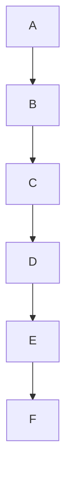
</details>

This representation of a tree is about as simple as possible. Many programs are available on the web to make fancier drawings, including those with curved lines, or three-dimensional representations for clarity in depiction of very complex trees.

```perl
#!/usr/bin/perl
#drawtree.pl -- draws binary trees (root at top)
#usage: echo '(A((BC)D)(EF))' | drawtree.pl > output.ps

print <<EOF;
%!PS-Adobe-
%%BoundingBox: atend
/n /newpath load def /m /moveto load def /l /lineto load def
/rm /rmoveto load def /rl /rlineto load def /s /stroke load def
1.0 setlinewidth 50 100 translate 2 2 scale
/Helvetica findfont 10 scalefont setfont
EOF

\$tree = <>; chop(\$tree); \$_ = reverse(\$tree); s/[]//g;

\$x = 0; \$y = 0;
while (\$nd = chop()) {
    print "\$x \$y m (\$nd) stringwidth pop -0.5 mul 0 rm (\$nd) show\n";
    \$xx{\$nd} = \$x; \$x+=20; \$yy{\$nd} = 10;
}
while (\$tree =~ s/\?(?([A-Z])([A-Z])?)?/\$1/) {
    print "n \$xx{\$1} \$yy{\$1} m\n";
    (\$yy{\$1} > \$yy{\$2}) || {\$yy{\$1} = \$yy{\$2}}; \$yy{\$1} += 20;
    print "\$xx{\$1} \$yy{\$1} l \$xx{\$2} \$yy{\$1} l \$xx{\$2} \$yy{\$2} l s\n";
    \$xx{\$1} = 0.5*(\$xx{\$1} + \$xx{\$2});
}
print "n \$xx{\$tree} \$yy{\$tree} m 0 20 rl s showpage\n";
\$rx = 2*\$x + 30; \$yt = 2*\$yy{\$tree} + 146;
print "%%BoundingBox: 40 95 \$rx \$yt\n";
```

Another special kind of graph is a directed graph in which each edge is a one-way street. Examples include the Gene Ontology subnetworks (See Chapter 8), the HMM diagram shown in Figure 5.8, and the neural networks illustrated in Chapter 6. Rooted phylogenetic trees are, implicitly, directed graphs, the ancestor–descendant relationship implying the direction of each edge.

It may be possible to assign numbers to the edges of a graph to signify, in some sense, a ‘distance’

252

---

between the nodes connected by the edges. The graph may then be drawn to scale, with the sizes of the edges proportional to the assigned lengths. The length of a path through the graph is the sum of the edge lengths.

In phylogenetic trees, edge lengths signify either some measure of the dissimilarity between two species or the length of time since their separation. The assumption that differences between properties of living species reflect their divergence times will be true only if the rates of divergence are the same in all branches of the tree. Many exceptions are known; for instance, among mammals, rodents show, for many proteins, relatively fast evolutionary rates.


## See Weblem 5.8.

Broadly, there are two approaches to deriving phylogenetic trees. One approach makes no reference to any historical model of the relationships. Proceed by measuring a set of distances between species, and generate the tree by a hierarchical clustering procedure. This is called the phenetic approach. The alternative, the cladistic approach, is to consider possible pathways of evolution, infer the features of the ancestor at each node, and choose an optimal tree according to some model of evolutionary change. Phenetics is based on similarity; cladistics is based on genealogy. (see Box 5.7.)

## Clustering methods

Phenetic, or clustering, approaches to determination of phylogenetic relationships are explicitly nonhistorical. Indeed, hierarchical clustering methods are perfectly capable of producing a tree even in the absence of evolutionary relationships. A department store has goods clustered into sections according to the type of product—for instance, clothing or furniture—and subclustered into more closely related subdepartments, such as men’s and women’s shoes. Men’s and women’s shoes have a common ancestor, but there is no implication that shoes and furniture do.

A simple clustering procedure works as follows: given a set of species, determine for all pairs a measure of the similarity or difference between them. This could depend on a physical body trait such as the difference between the average adult height of members of two species. Or one could use the number of different bases in alignments of mitochondrial DNA. To create a tree from the set of dissimilarities, first choose the two most closely related species and insert a node to represent their common ancestor. Then replace the two selected species by a set containing both, and replace the distances from the pair to the others by the average of the distances of the two selected species to the others. Now we have a set of pairwise dissimilarities, not between individual species, but between sets of species. (Regard each remaining individual

## Example 5.6 Generation of phylogenetic tree by progressive clustering

Consider four species characterized by homologous sequences ATCC, ATGC, TTCG, and TCGG. Taking the number of differences as the measure of dissimilarity between each pair of species, use a simple clustering procedure to derive a phylogenetic tree.

The distance matrix is:

|  | ATCC | ATGC | TTCG | TCGG |
| --- | --- | --- | --- | --- |
| ATCC | 0 | 1 | 2 | 4 |
| ATGC |  | 0 | 3 | 3 |
| TTCG |  |  | 0 | 2 |
| TCGG |  |  |  | 0 |

253

---

Because the matrix is symmetrical, we need fill in only the upper half. The smallest distance is 1 (in green), between ATCC and ATGC. Therefore, our first cluster is {ATCC, ATGC}. The tree will contain the fragment:


The reduced distance matrix is:

|  | {ATCC, ATGC} | TTCG | TCGG |
| --- | --- | --- | --- |
| {ATCC, ATGC} | 0 | $\frac{1}{2}(2+3)=2.5$ | $\frac{1}{2}(4+3)=3.5$ |
| TTCG |  | 0 | 2 |
| TCGG |  |  | 0 |

The next cluster is {TTCG, TCGG}, distance 2. Finally, linking the clusters {ATCC, ATGC} and {TTCG, TCGG} gives the tree:


<details>
<summary>dendrogram</summary>

| Category | Value |
| --- | --- |
| ATCC | 0.5 |
| ATGC | 0.5 |
| TTCG | 1 |
| TCGG | 1 |
</details>

Branch lengths have been assigned according to the rule:

$$
\text { branch   length   of   edge   between   nodes } X \text { and } Y = \frac {1}{2} \text { distance   between } X \text { and } Y
$$

Whether the branch lengths are truly proportional to the divergence times of the taxa represented by the nodes must be determined from external evidence.

species as a set containing only one element.) Then repeat the process, as in Example 5.6.

This process of tree building is called the UPGMA method, for unweighted pair group method with arithmetic mean. A modification of the UPGMA method by N. Saitou and M. Nei, called neighbour-joining, is designed to correct for unequal rates of evolution in different branches of the tree.

## Cladistic methods

Cladistic methods deal explicitly with the patterns of ancestry implied by the possible trees relating a set of taxa. Their aim is to select the correct tree by utilizing an explicit model of the evolutionary process. The most popular cladistic methods in molecular phylogeny are the maximum parsimony and maximum likelihood approaches. They are specialized to sequence data, starting from a multiple sequence alignment. Neither maximum parsimony nor maximum likelihood could be applied to anatomic characters such as average adult height.

The maximum parsimony method of W. Fitch defines an optimal tree as the one that postulates the fewest mutations. For instance, given species characterized by homologous sequences ATCG, ATGG, TCCA, and TTCA, the tree:


<details>
<summary>flowchart</summary>

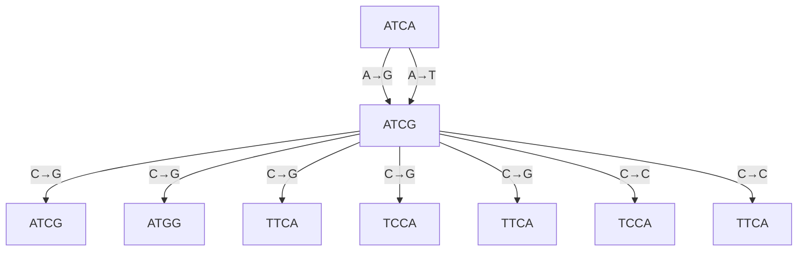
</details>

254

---

postulates four mutations. An alternative tree:


<details>
<summary>flowchart</summary>

This diagram illustrates the genetic relationships and mutation types between ATCG, ATCA, TTCG, and their respective transgenic lines (A→G, A→T, T→C, C→G).
</details>

postulates seven mutations. Note that the second tree implies that the G→A mutation in the fourth position occurred twice independently. The former tree is optimal according to the maximum parsimony method, because no other tree involves fewer mutations. In many cases, several trees may postulate the same number of mutations, fewer than any other tree. For such cases the maximum parsimony approach does not give a unique answer.

The maximum likelihood method assigns quantitative probabilities to mutational events, rather than merely counting them. Like maximum parsimony, maximum likelihood reconstructs ancestors at all nodes of each tree considered, but it also assigns branch lengths based on the probabilities of the mutational events postulated. For each possible tree topology the assumed substitution rates are varied to find the parameters that give the highest likelihood of producing the observed sequences. The optimal tree is the one with the maximum likelihood of generating the observed data.

Both maximum parsimony and maximum likelihood methods are superior to clustering techniques. This has been demonstrated with cases where independent evidence—for instance, from classical palaeontology—provides a correct answer, and also with simulated data: computed generation of evolving sequences.

## Reconstruction of ancestral sequences

Maximum likelihood methods of phylogenetic tree construction determine, as part of their procedures, the sequences expected in the ancestors of extant species. L. Pauling and E. Zuckerkandl suggested in a 1963 paper that if we could determine the sequences of proteins from extinct organisms then the proteins could be recreated by synthesis.<sup>3</sup> In some cases, such a synthesized sequence shows the expected biological activity. Although this does not prove that it is the correct ancestral sequence, the result is of course gratifying.

Steroid receptors are vertebrate proteins that detect hormones, including androgen, oestrogen, progesterone, glucocorticoid, and mineralocorticoid receptors (see Table 5.3). Upon activation they translocate from the cytoplasm to the nucleus and control gene expression. They belong to a larger superfamily of receptors with affinity for a wider variety of ligands, including thyroid hormones, prostaglandins, and 1,25-dihydroxyvitamin D. It is likely that the entire superfamily diverged from a single ancestral protein.

255

---


Table 5.3 Properties of two closely related receptors in higher vertebrates

| Receptor | Ligand | Physiological role includes |
| --- | --- | --- |
| Mineralocorticoid receptor | 11-Deoxycorticosterone (teleost fish)Aldosterone (tetrapods) | Electrolyte homeostasis |
| Glucocorticoid receptor | Cortisol | Regulation of metabolism, inflammation and immunity |

J.W. Thornton and colleagues have studied the species distribution and the evolution of these receptors.<sup>4</sup> The most primitive species in which natural steroid receptors appear are lamprey and hagfish. The receptors in these species show high affinity for 11-deoxycorticosterone, cortisol, and aldosterone. It is likely that 11-deoxycorticosterone is the natural ligand of the ancestral homologue. A gene duplication before the emergence of tetrapods gave rise to receptors with differential specificity for cortisol and aldosterone (see Fig. 5.10).


<details>
<summary>text_image</summary>

Agnathans
Elasmobranchs
Teleosts
Tetrapods
6 subst
CA
4 subst
CA
* Aldosterone synthesis begins
C(A)
S106P
L111Q
C(A)
-420 mya
36 substitutions
1 aa deleted
-440 mya
proto-QR
C(A)
proto-MR
25 substitutions
-470 mya
Ancestral state
</details>

**Figure 5.10** Evolutionary pathway of steroid receptors, inferred from ancestral sequence reconstruction, and synthesis and assay of predicted sequences. The ancestor of the vertebrate steroid receptor probably had affinity for aldosterone (A) as well as other steroids (C), notably 11-deoxycorticosterone and cortisol. This affinity is indicated by C(A), with the (A) in parentheses because aldosterone was not a natural ligand at that time. After gene duplication to form protoglucocorticord (proto-GR) and proto-mineralocorticoid (proto-MR) receptors, the protein diverged to attain differential specificity. In tetrapods, subsequent to the origin of aldosterone synthesis, two families of receptor show selectivity for aldosterone (MR) or cortisol. aa, amino acid; mya, million years ago; subst, substitutions.

These specificity profiles must be interpreted in light of the fact that aldosterone is not present in

256

---

primitive vertebrates. The affinity preceded the ligand. (How could a lock evolve millions of years before the appearance of the key?) Aldosterone was first synthesized along the line leading to tetrapods, when a mutation in the cytochrome P450 11β-hydroxylase gene produced a protein that would hydroxylate 11-deoxycorticosterone. The tetrapod glucocorticoid receptor must have lost aldosterone affinity (see Fig. 5.10).

Thornton and colleagues computed the maximum likelihood evolutionary tree of cortisol-specific and aldosterone-specific receptors. They inferred the ancestral sequence, and ‘resurrected’ it, following Pauling and Zuckerkandl: synthesizing the protein, determining its specificity, and solving its crystal structure. The computed and synthesized ancestral protein is activated by 11- deoxycorticosterone, aldosterone, and, with lower affinity, cortisol.

Thornton and colleagues computed the evolutionary pathway from the computed ancestral protein. By synthesizing and assaying proteins with different substitutions they identified two mutations as primarily reponsible for the loss of aldosterone affinity in tetrapod glucocorticosteroid receptors: S106P and L111Q. The L111Q substitution, by itself, has almost no effect on the affinity for any of the three ligands: aldosterone, deoxycorticosterone, and cortisol. The S106P substitution, by itself, largely destroys affinity for all three. That L111Q is functional and S106P is not suggests the scenario that L111Q appeared first, followed by S106P. In this way, the evolutionary pathway passed through functional intermediates only. Other substitutions, with less dramatic effects, acted to ‘tune the affinities to their current value.

Molecular modelling allowed inference of the structural consequences in the computed-ancestral protein structure of these two mutations, separately and together. In the hypothetical glucocorticoid receptor of the common ancestor of all jawed vertebrates, positions 106 and 111 appear in a loop adjacent to a helix. The mutation S106P on its own is predicted to reconform the loop, and the adjacent helix partially unwinds. However, a concomitant of these changes is to bring position 111 closer to the ligand, to the point where the L111Q mutation can form a hydrogen bond to the C17 hydroxyl of cortisol, stabilizing its binding. This hydroxyl is not present in aldosterone (or 11- deoxycorticosterone) so the hydrogen bond can form only to cortisol. Without the repositioning of position 111 by the S106P mutation it is unlikely that the L111Q mutation, on its own, could form the hydrogen bond to enhance cortisol binding (see Plate VII).


Plate VII Effect of mutations S106P and L111Q in evolution of differential specificity to aldosterone and cortisol in vertebrate steroid receptors. Magenta: experimental structure corresponding to predicted sequence ancestral to all jawed vertebrates. Cyan: experimental structure corresponding to predicted sequence ancestral to all bony vertebrates. A region from the binding site is shown. The mutation S106P reconforms the loop between helices 6 and 7 (H6 and H7). The mutation L111Q creates a hydrogen bond to the C17 hydroxyl which is present in cortisol but not in aldosterone nor 11-deoxycorticosterone (See Chapter 5, Reconstruction of ancestral sequences).

Although some aspects of this investigation are hypothetical, there is reason to be fairly confident that they are correct. In revealing a detailed evolutionary pathway, one can see the mechanism whereby gene duplication followed by divergence produces differential ligand specificity.

257

---

## The problem of varying rates of evolution

Suppose that the four species—A, B, C, and D—have the phylogenetic tree:


This tree is consistent with the dissimilarity matrix:

|  | A | B | C | D |
| --- | --- | --- | --- | --- |
| A | 0 | 3 | 3 | 3 |
| B |  | 0 | 2 | 2 |
| C |  |  | 0 | 1 |
| D |  |  |  | 0 |

Suppose, however, that species D has changed very fast, although the phylogeny is unaltered. The dissimilarity matrix might then be observed to be:

|  | A | B | C | D |
| --- | --- | --- | --- | --- |
| A | 0 | 3 | 3 | 20 |
| B |  | 0 | 2 | 20 |
| C |  |  | 0 | 20 |
| D |  |  |  | 0 |

From this we would derive the incorrect phylogenetic tree:


All the methods discussed here are subject to errors of this kind if the rates of evolutionary change vary along different branches of the tree. To test for varying rates, compare the species under consideration with an outgroup, a species more distantly related to all the species in question than any pair of them is to each other. For instance, if we are studying species of primates, a nonprimate mammal such as the cow would be a suitable outgroup. If the rates of evolution among the primate species were constant, we should expect to observe approximately equal dissimilarity measures between all primate species and the cow. If this is not observed, the suggestion is that evolutionary rates have varied among the primates, and the character being used may well not provide the correct phylogenetic tree.

## Are trees the correct way to present phylogenetic relationships?

In the classic model of evolution by descent and divergence, the biological process assures us that the relationship between species is a hierarchy. A tree structure is its natural and proper representation. The question of whether we can accurately and confidently determine the correct tree is a separate issue. However, in some cases a tree structure does not adequately account for the data. This is observed particularly often in viral evolution, or in situations in which there has been a large amount of horizontal gene transfer.

H.-J. Bandelt and A.W.M. Dress developed a more general graphical clustering method, called

258

---

split decomposition, that can better account for a set of distances than a tree structure (see Example 5.7).

## Example 5.7 Alternative representations of similarity data

Bandelt and Dress\* consider the following distance matrix:

|  | A | B | C | D | E | F | G |
| --- | --- | --- | --- | --- | --- | --- | --- |
| A | 0 | 4 | 5 | 7 | 13 | 8 | 6 |
| B | 4 | 0 | 1 | 3 | 9 | 12 | 10 |
| C | 5 | 1 | 0 | 2 | 8 | 13 | 11 |
| D | 7 | 3 | 2 | 0 | 6 | 11 | 13 |
| E | 13 | 9 | 8 | 6 | 0 | 5 | 7 |
| F | 8 | 12 | 13 | 11 | 5 | 0 | 2 |
| G | 6 | 10 | 11 | 13 | 7 | 2 | 0 |

Application of the UPGMA method gives the following tree representation:


<details>
<summary>dendrogram</summary>

| Node | Value |
| --- | --- |
| A | 2.66 |
| B | 1.25 |
| C | 0.5 |
| D | 1.25 |
| E | 3 |
| F | 1 |
| G | 1 |
</details>

Note that the sum of the path labels between B and C is $0.5 + 0.5 = 1,$ which is equal to the B–C distance in the matrix. However, the sum of the path labels between A and D is $2.66 + 2.66 + 1.25 = 6.57$ which is only approximately equal to 7. The tree does not account precisely for all the distance data.

Bandelt and Dress represent the distance matrix by a more complex network based on the split decomposition method:


<details>
<summary>text_image</summary>

A
4
6
G
2
F
4
6
E
1
B
C
1
2
D
1
6
</details>

This is not a phylogenetic tree such as we are used to. But the sum of the indices of the edges linking any two nodes, along the shortest path, does reproduce the distance data. In this graph the distance between A and D, along a shortest path—which might pass through B and $C--is 4+1+2=7$ equal to the distance in the original data matrix. Observe that the graph contains some intermediary nodes that do not correspond to original data points.

From which representation do the clusters appear more naturally? Do you think that if the UPGMA graph were drawn so that the edge lengths were proportional to the distances indicated as the labels that the clustering would be more clear? (Try it!)

259

---

\*Bandelt, H.-J. and Dress, A.W.M. (1992). Split decomposition: a new and useful approach to phylogenetic analysis of distance data. Mol. Phylogenet. Evol., 1, 242–252.

## Computational considerations

Cladistic methods—maximum parsimony and maximum likelihood—are more accurate than simpler clustering methods such as UPGMA, but require large amounts of computer time if the number of species is appreciable. The total number of possible trees, which cladistic methods are committed to considering if they could, increases very rapidly with the number of species. As a result, in many cases of interest these methods can give only approximate answers, even with respect to their intrinsic assumptions.

Because calculated phylogenies are often approximations, it is important to try to test them. Methods include the following.

1. Comparison of phylogenies obtained from different characters describing the same set of taxa: are they consistent? If trees produced from different characters share a subtree, perhaps that portion of the phylogeny has been determined reliably and other portions have not.
2. Analysis of subsets of taxa should give the same answer—with respect to the subset—as appears within the full tree.
3. Formal statistical tests, involving rerunning the calculation on subsets of the original data, are known as jackknifing and bootstrapping.

**Jackknifing** is calculation with data sets sampled randomly from the original data. For phylogeny calculations from multiple sequence alignments, select different subsets of the positions in the alignment and rerun the calculation. Finding that each subset gives the same phylogenetic tree lends it credibility. If each subset gives a different tree, none of them is trustworthy.

**Bootstrapping** is similar to jackknifing except that the positions chosen at random may include multiple copies of the same position, to form data sets of the same size as the original, to preserve statistical properties of the sampling.

4. If there are very long edges, consider seriously the possibility of unequal variation in evolutionary rate that may have perturbed the calculation. Introduce outgroup taxa to check.

## Putting it all together

A fairly standard sequence of operations in bioinformatics involves:

1. selecting a sequence of interest, and using PSI-BLAST or some equivalent tool to extract a set of similar sequences;
2. performing a multiple alignment of the sequences retrieved;
3. from the multiple sequence alignment, deriving and studying the conservation patterns, and from the set of overall similarities and differences among the sequences computing and drawing a phylogenetic tree. (Some multiple sequence alignment packages, such as CLUSTAL-W, provide facilities to launch a phylogenetic tree calculation from the alignments they produce.)

Numerous tools are available to facilitate the individual steps of the process, and to smooth the transition from each to the next. We have already mentioned the feature of the PSI-BLAST that feeds

260

---

retrieved sequences into a multiple sequence alignment program such as CLUSTAL-W. CLUSTAL-W computes a tree based on the similarities of the input sequences, which can serve as input to one of a number of tree-drawing programs. The most popular current program for many aspects of phylogeny analysis is Molecular Evolutionary Genetics Analysis (MEGA) by K. Tamura, D. Peterson, N. Peterson, G. Stecher, M. Nei, and S. Kumar ([http://www.megasoftware.net](http://www.megasoftware.net)). See also [http://en.wikipedia.org/wiki/List\_of\_phylogenetics\_software](http://en.wikipedia.org/wiki/List_of_phylogenetics_software).


## See Weblems 5.9–5.15

## RECOMMENDED READING

- Altschul, S.F. and Koonin, E.V. (1998). Iterated profile searches with PSI-BLAST—a tool for discovery in protein databases. Trends Biochem. Sci., 23, 445–447. Description of one of the most important tools when database searching for sequence similarity.
- Altschul, S.F., Boguski, M.S., Gish, W., and Wootton, J.C. (1994). Issues in searching molecular sequence databases. Nat. Genet., 6, 119–129. General background to challenges in designing information-retrieval methods and interpreting the results.
- Doyon, J., Ranwez, V., Daubin, V., and Berry, V. (2011). Models, algorithms and programs for phylogeny reconstruction. Brief. Bioinform., 12, 392–400.
- Eddy, S. (1996). Hidden Markov models. Curr. Opin. Struct. Biol., 6, 361–365. Readable introduction to an important mathematical technique providing powerful tools for detection of distantly related sequences, and protein-fold recognition.
- Efron, B. and Gong, G. (1983). A leisurely look at the bootstrap, the jackknife, and cross-validation. Am. Stat., 37, 36–48. Classic paper on statistical methods for calibrating pattern-recognition procedures.
- Lesk, A.M. (2004). Introduction to Protein Science. Architecture, Function and Genomics. Oxford University Press, Oxford.
- Nei, M. and Kumar, S. (2000). Molecular Evolution and Phylogenetics. Oxford University Press, Oxford.
- Page, R.D. (2012). Space, time, form: viewing the Tree of Life. Trends Ecol. Evol., 27, 113–120.
- Penny, D., Hendy, M.D., Zimmer, E.A., and Hamby, R.K. (1990). Trees from sequences: panacea or Pandora’s box? Aust. Syst. Bot., 3, 21–38. Cautionary notes about determination of phylogenetic trees.
- Smith, T.F. (1999). The art of matchmaking: sequence alignment methods and their structural implications. Structure, 7, R7–R12. Explanation of different sequence alignment methods and what can confidently be concluded from them about similarity of structure. Gives due emphasis to structure-based alignment as a ‘gold standard’.
- Tamura, K., Peterson, D., Peterson, N., Stecher, G., Nei, M., and Kumar, S. (2011). MEGA5: molecular evolutionary genetics analysis using maximum likelihood, evolutionary distance, and maximum parsimony methods. Mol. Biol. Evol., 28, 2731–2739.

## EXERCISES AND PROBLEMS

**Exercise 5.1** What is the Hamming distance between the words DECLENSION and RECREATION?

**Exercise 5.2** What is the Levenshtein distance between the words BIOINFORMATICS and CONFORMATION?

**Exercise 5.3** The Levenshtein distance between the strings agtcc and cgctca is 3, consistent with the following alignment:

ag-tcc cgctca

Provide a sequence of three edit operations that convert agtcc to cgctca.

**Exercise 5.4** ‘I wasted time and now doth time waste me.’ (a) First sketch the expected appearance of a dotplot of this character string against itself. (b) Then calculate the dotplot exactly, recording only character identities as dots in the matrix, and compare with (a).

261

---

**Exercise 5.5** What values of window and threshold (see program, Box 5.1) could you use to eliminate the singletons in the DOROTHYHODGKIN dotplot, but retain the other matches shown?

**Exercise 5.6** For each of the matrices (a) PAM250 and (b) BLOSUM62, which substitution is more probable, W↔F or H↔R?

**Exercise 5.7** To what alignment does the path through the following dotplot correspond?


**Exercise 5.8** In planning your trip from Malmö to Tromsø (see section on The dynamic-programming algorithm for optimal pairwise sequence alignment), suppose that for personal reasons you wanted to include a visit to Uppsala. How could you adjust the costs of the segments to ensure that the minimal-cost route passed through Uppsala?

**Exercise 5.9** How would you use a dotplot to pick up palindromic DNA sequences of the type that appear partly on each strand, as in the specificity sites of restriction endonucleases?

**Exercise 5.10** Modify the PERL program in Box 5.1 that draws dotplots to accept sequences in FASTA format.

**Exercise 5.11** To what value of P would a Z score of 1 correspond in a normal distribution?

**Exercise 5.12** For each of the alignments in Figure 5.2, state whether it is in the twilight zone, more similar than the twilight zone or less similar than the twilight zone.

**Exercise 5.13** Figure 5.2a shows the sequence alignment of papaya papain and kiwi fruit actinidin, and the corresponding dotplot. The sequence alignment shows two places at which one or more residues are deleted from the papain sequence, and one place at which a residue is deleted from the actinidin sequence. On a photocopy of Figure 5.2a indicate in the dotplot the approximate positions of these insertions and deletions.

**Exercise 5.14** Suppose it were argued that randomizing a sequence is not an appropriate way to generate a control population for analysis of the statistical significance of pairwise sequence alignments, because natural sequences have nonrandom dipeptide or tripeptide frequencies. What improved way to generate a control population would you suggest?

**Exercise 5.15** Comparisons of DNA sequences of homologous chromosomes in different people show that, on average, one of every 700 bp of noncoding DNA is different. Ninety-five per cent of the human genome is noncoding. Estimate the number of polymorphisms in the human genome to give some idea of the number of potential DNA markers.

**Exercise 5.16** Show the calculations that led to the entry with value 65 in Example 5.6. What is the significance of the observation that there are two arrows coming from it?

**Exercise 5.17** The α helix formed by residues 32–49 in E. coli thioredoxin is interrupted. On a photocopy of Figure 5.6 indicate where this interruption appears. At what residue is this distortion likely to occur?

**Exercise 5.18** (a) Using simple ‘inventory’ scoring, what hexapeptide gives the greatest possible value for a match to positions 25–30 in the thioredoxin scoring table (see Table 5.2). (b) Using a scoring scheme distributed among all 20 amino acids according to the BLOSUM62 matrix, compare the score of this hexapeptide with the score of the hexapeptide VDFSAE.

**Exercise 5.19** (a) Make an inventory of the region from residues 90 to 95, similar to Table 5.2. What contribution would the following sequences aligned to these residues make to a simple profile score using inventories as weights? (b) ISSAVK. (c) FVGAKE.

**Exercise 5.20** (a) Is the following pair of trees identical in topology?

262

---


(b) Is the following pair of trees identical in topology?


**Exercise 5.21** Draw all possible rooted trees relating three taxa. How many are there?

**Exercise 5.22** For the final graph in Example 5.6, how was the branch length 1.5 of the nodes joining the clusters {ATCC, ATGC} and {TTCG, TCGG} arrived at?

**Exercise 5.23** Using the original matrix of distances, and the final tree, in Example 5.6, for each pair of species compare the original distance between them with the sum of the lengths of the paths joining them in the tree.

**Exercise 5.24** Draw an example of a connected graph containing five nodes that is not a tree.

**Exercise 5.25** If a completely connected graph (a graph with an edge between every two nodes) is not a tree, what is the maximum number of nodes it can contain?

**Exercise 5.26** Mitochondrial DNA sequences of European, African, and Asian cattle suggest that European and African breeds are more closely related to each other than to Indian breeds. To exclude the appearance of this result as the spurious result of differential rates of evolution in the two lineages, suggest a reasonable choice of a species as an outgroup.

**Exercise 5.27** Draw the final tree in Example 5.6 to scale, with sizes of the edges proportional to the assigned branch lengths.

**Exercise 5.28** For the dynamic-programming method for alignment of two sequences of length n we noted that the execution time requirements scale as $n ^ { 2 } .$ In a naive implementation of the algorithm how would the storage space requirements scale with n: (a) if we want to determine an optimal alignment, so that traceback information must be stored? and (b) if we want only the score and not an alignment, so that traceback need not be stored? (Note: subtle ways of implementing the algorithm substantially reduce the space requirements over the naive implementation.)

**Problem 5.1** Draw a dotplot of the following sequence from the wheat dwarf virus genome —ttttcgtgagtgcgcggaggctttt—against itself. In what respects is it not a perfect palindrome?

**Problem 5.2** (a) How would you change the algorithm of the section entitled The dynamic-programming algorithm for optimal pairwise sequence alignment to find the optimal matches of a relatively short pattern $A   =   a _ { 1 } a _ { 2 } . . . a _ { n }$ in a long sequence $B   =   b _ { 1 } b _ { 2 } . . . b _ { m }$ with $n { < } { < } m$ . (No gap penalty in the regions of B that precede and follow the region matched by A.) This corresponds to motif matching as described in Chapter 1. (b) Redo the calculations of Example 5.5 for aligning the strings ggaatgg and $B = a t g$ as a motif-matching problem, using the same scoring scheme: match 0, mismatch 20, internal gap initiation 25, gap extension 22. (c) How do the results that you get differ from those derived in the example?

**Problem 5.3** At which residues in E. coli thioredoxin are there turns in the chain conformation that do not correspond to regions at or near which there are deletions in the multiple sequence alignment?

**Problem 5.4** How could you modify the profile method to retain its ability to pick up nonmammalian thioredoxins if a large number of additional mammalian, closely related, sequences were added to the table. Consider (a) methods that attempt to remove redundancy by ignoring certain sequences and (b) methods that retain all the sequences but include a weighting scheme to balance the representation of the closely related ones.

**Problem 5.5** Write a PERL program to make profile inventories from a multiple sequence alignment, and to score the matching of query sequences using BLOSUM62. Assume that the query sequence has already been aligned before it is presented to the program.

263

---

**Problem 5.6** (a) Write a PERL program to read in two character strings and report all matches of contiguous fourcharacter regions. Test this on the strings:

My.care.is.loss.of.care,.by.old.care.done

and

Your.care.is.gain.of.care,.by.new.care.won

(b) Develop this program to extend and combine the matches found, to the longest regions that contain perfectly matching 4-mers, without gaps, with no more than 25% mismatches overall.

**Problem 5.7** Extend the previous problem by writing a PERL program to illustrate, in a form based on dotplots, the progress of a BLAST-type algorithm at the stages when it (a) detects all matching substrings of length 5, (b) extends them to maximal contiguous matches, and (c) combines them to form a match with no more than k mismatches. You may make use of the PERL program for dotplots in the text.

**Problem 5.8** Write a program to animate the progress of a BLAST-type algorithm as described in the previous problem. As background, look on the web for examples of animation of string search algorithms. (This problem requires a relatively high level of experience with computing.)

**Problem 5.9** Single-stranded RNAs, such as tRNA or rRNAs, adopt conformations containing stem–loop regions, in which a region of the chain loops back on itself to form a double-stranded helix from complementary base pairs, with antiparallel strands. How would a program that would detect palindromes be useful in analysing RNA sequences to detect regions capable of forming perfect (i.e. no mismatched bases) stem–loop structures?

**Problem 5.10** Suppose that you have a pair of dice, one red and one green. Define a state of the pair of dice as the pair of numbers: the number appearing on the upper face of the red one followed by the number appearing on the upper face of the green one. Instead of rolling the dice, pass from state to state by tipping each of the dice by 90° in any direction with equal probability. Then a state in which 6 is up on one of die can by followed, with equal probability, by 2, 3, 4, or 5 up. (Dice are constructed so that the sum of the numbers on each of the three sets of opposite faces is 7. Therefore, the probability that 1 follows 6 is 0, because this would require a 180° rotation.) The probability of the sequence 6, 2, 6, 4 is (1/4)<sup>4</sup> = 1/256. The probability of generating the sequence 6, 2, 5, 4 is 0, because the transition 2→5 is not allowed, and the probability of the sequence 6, 6, 2, 3, 4 is 0 because the system must change its state, so 6 cannot be followed by 6. This procedure defines a first-order Markov process.

Write a program to answer the following questions (suppose the initial state has a 4 at the top of the red die and a 3 at the top of the green die). (a) What is the probability of another state in which the numbers add up to 7 appearing within five moves? (b) If the initial state is an 8, what is the probability that another 8 appears before a 7?

**Problem 5.11** Show that any (undirected) graph that has either of the following properties must also have the other: (a) there is a unique path between any two nodes and (b) The graph contains no cycles.

**Problem 5.12** How many paths are there altogether from Start to Finish in Figure 5.11? Count them in each of the following ways.

(a) Brute force: write down all the possibilities. This is actually less of a mindless exercise than it appears. It demonstrates that it is really not so difficult to do as it first seems. Secondly, it shows how you will get to sense patterns as you do it.
(b) In Figure 5.11, count the number of paths from Start to A and from A to Finish. Multiply these numbers together to get the total number of paths from Start to Finish that pass through A. Then count the number of paths from Start to B and from B to Finish. What is the relationship between these numbers? Multiply them together to get the total number of paths from Start to Finish that pass through B. Compute the total number of paths from Start to Finish as the sum of the number of paths from Start to Finish that pass through A, B, C, and D.
(c) Recognize that to go from Start to Finish requires six steps, including exactly three left turns and three right turns (else you won’t end up at the right place). Different choices of the order of right and left turns correspond to different paths. To count the number of paths, recognize that you need to decide only how many ways there are to choose the three steps at which you turn left (for then you must turn right at the other three steps). To assign three left turns to six steps, first we can choose one

264

---

of six steps for one left turn, then one of the five remaining steps for the next left turn, and then one of the four remaining steps for the final left turn. However, the product of these numbers overcounts the number of possibilities, because it includes the same sets of steps assigned in different order. Each triple can arise in six different ways, and it is necessary to correct for this. The result is equal to the binomial coefficient $\binom { 6 } { 3 } = 6 ! / ( 3 ! 3 ! )$


<details>
<summary>text_image</summary>

Start
A
B
C
D
Finish
</details>

Figure 5.11 Counting paths on a finite lattice.

**Problem 5.13** For the final tree in Example 5.6, derive possible ancestors at internal nodes chosen from a maximum parsimony criterion. Are there any ambiguities?

**Problem 5.14** A convenient notation for trees uses nested parentheses to indicate the clusters. (a) Expand the following into a rooted tree: ((A(BC))D). (b) Write the parenthesis notation for the trees shown in Exercise 5.20.

**Problem 5.15** Add a generous amount of comments to the PERL program for drawing dotplots and trees.

**Problem 5.16** Write a PERL program for the UPGMA method of deriving a phylogenetic tree from a matrix of distances. You may use the program for tree drawing to produce graphical output.

**Problem 5.17** For each pair of points in Example 5.7: (a) calculate the sum of indices of the edges along the path joining the two points in the tree representation of the data; (b) calculate the sum of indices of the edges along the shortest path joining the two points in the split-decomposition representation of the data; and (c) what is the average value of the absolute value of the difference between the numbers computed in (a) and the distances in the data matrix? (d) Confirm that the values computed in part (b) precisely reproduce all values in the data matrix.

**Problem 5.18** If you didn’t draw the UPGMA graph with edge lengths scaled according to the values of the indices, do it now. Compare with the split-decomposition representation. Now, from which representation do the clusters appear more naturally?

1 This is an optional section. Readers in doubt may consider the remarks in Lesk, A.M. (1988). TATA for now… . Trends Biochem. Sci., 13, 410.
2 Willerslev, E. et al. (2007). Ancient biomolecules from deep ice cores reveal a forested Southern Greenland. Science, 317, 111–113.
3 Pauling, L. and Zuckerkandl, E. (1963). Chemical paleogenetics: molecular restoration studies of extinct forms of life. Acta Chem. Scand., 17 (suppl.), 1, 9–16.
4 Bridgham, J.T., Carroll, S.M., and Thornton, J.W. (2006). Evolution of hormone-receptor complexity by molecular exploitation. Science, 322, 97–101; Ortlund, E.A., Bridgham, J.T., Redinbo, M.R., and Thornton, J.W. (2007). Crystal structure of an ancient protein: evolution by conformational epistasis. Science, 317, 1544–1548.

265

---

6

# Structural bioinformatics and drug discovery

## LEARNING GOALS

Understanding the concept of protein folding: the process by which the one-dimensional amino acid sequence encoded by a gene takes up a definite and biologically active three-dimensional conformation.
• Recognizing that steric considerations severely limit the conformations of the polypeptide chain, with the Sasisekharan–Ramakrishnan–Ramachandran plot showing the allowed states of the mainchain.
• Getting to know the 20 sidechains: the actors that play all the roles in all the proteins.
• Understanding the hydrophobic effect and its implications for the structures and energetics of folded proteins.
• Generalizing the ideas of sequence alignment to alignment of protein sequences by structural superposition.
• Knowing the relationship between divergence of sequence and divergence of structure in protein evolution.
Becoming familiar with classification of protein folding patterns, as presented for example by the Structural Classification of Proteins (SCOP) database and website.
• Knowing some basic approaches to the prediction of protein structure from amino acid sequence, and the Critical Assessment of Structure Prediction (CASP) programs.
• Understanding neural networks and hidden Markov models, among the most powerful bases for ‘machine-learning algorithms.
• Knowing the basic requirements of a successful drug and understanding some approaches to drug discovery and design.

## Introduction

To equip them to play their biological roles, proteins have three profound and fundamental properties:

1. for implementation of the metabolism, growth, architecture, and regulation of cell and organism, proteins show a great variety of structures and functions;
2. for their synthesis, proteins show a unity that permits all proteins to be synthesized by one apparatus, the ribosome. The implications for molecular biology are analogous to the impact of movable type on printing;
3. proteins fold spontaneously to active native three-dimensional states. It is therefore sufficient to encode the amino acid sequence in terms of a one-dimensional sequence of nucleotides in a genome. Evolution takes advantage of the hereditary transmission of the information, and of the mutations that generate variants on which natural selection can act.

The great variety of three-dimensional structures and functions of proteins arise in molecules that share underlying common chemical features. Proteins are like strings of Christmas tree lights: almost all proteins consist of a linear (that is, unbranched) polymer mainchain with different amino acid sidechains attached at regular intervals (Fig. 1.6). The wire linking the string of lights corresponds to the repetitive mainchain or backbone, and the variable sequence of colours of the lights corresponds

266

---

to the individuality of the sequence of sidechains.

The amino acid sequence of a protein is specified by the nucleotide sequence of a gene. The threedimensional structures of protein molecules are determined, without further participation of nucleic acids, by the one-dimensional sequences of their amino acids. Proteins fold spontaneously to their native conformations.

How does the amino acid sequence encode the three-dimensional structure? Any possible folding of the mainchain places different residues into contact. The interactions of the sidechains and mainchain, with one another and with the solvent, and the restrictions placed on sidechain mobility, determine the relative stabilities of different conformations. This is a consequence of the second law of thermodynamics, which states that systems at constant temperature and pressure find an equilibrium state that is a compromise between comfort (low enthalpy, H) and freedom (high entropy, S), to give a minimum Gibbs free energy $G   =   H   -   T S _ { z }$ in which T is the absolute temperature. (In human relationships, marriage is just such a compromise.)

Proteins have evolved so that one folding pattern of the mainchain is thermodynamically significantly better than other conformations. This is the native state. If we could calculate sufficiently accurately the energies and entropies of different conformations, and if we could computationally examine a large enough set of possible conformations to be sure of including the correct one, it would be possible consistently to predict protein structures from amino acid sequences on the basis of a priori physicochemical principles. There has been progress towards this goal but it has not yet been achieved.

The mainchain of each protein in its native state describes a curve in space. We now know 100 000 protein structures. They show a great variety of folding patterns. The first problem in analysing these structures is one of presentation. Figure 6.1 illustrates the difficulty in interpreting a fully detailed, literal representation, and the kind of simplified pictures that computer programs produce to give us visual access to the material. An active cottage industry has produced many different simplified representations. A skilled molecular illustrator will combine them to show different parts of a structure in finely tuned degrees of detail.


## See Weblems 6.1 and 6.2

The central panel of Figure 6.1 shows the course through space of the mainchain. Two regions at the front of the picture have the form of helices—like classic barber poles—with their axes almost vertical in the orientation shown. The structure also contains four strands of sheet, in which the chain is extended, almost linearly. These too are approximately vertical in orientation.

The four strands interact laterally to stabilize their assembly into a β sheet. In the bottom frame, helices and strands are represented by ‘icons’: helices as cylinders and strands of sheet as large arrows. The top panel of Figure 6.1, showing the most detailed representation of the structure, including mainchain and sidechains, demonstrates the importance of simplification in producing an intelligible picture of even a small protein.

267

---


<details>
<summary>natural_image</summary>

Six-panel scientific illustration showing protein secondary structure and helical binding, no text or labels present
</details>

Figure 6.1 Proteins are sufficiently complex structures that it has been necessary to develop specialized tools to present them. This figure shows a relatively small protein, at three different degrees of simplification. (Which protein? This is the subject of a series of web-based projects.) Top: complete skeletal model; mainchain bolder than sidechains. Centre: the course of the chain is represented by a smooth interpolated curve, the chevrons indicating the direction of the chain. Bottom: schematic diagram, in which cylinders represent helices and arrows represent strands of sheet. The solid objects in the picture are represented as ‘translucent’ by altering lines that pass behind them to broken lines. It is possible to superpose different representations visually by rotating the page $9 0 ^ { \circ }$ and viewing in stereo (but not for too long!)

## Protein stability and folding

To form the native structure, a protein must optimize the interactions within and between residues, subject to constraints on the space curve traced out by the mainchain. Preferred conformations of the mainchain bias the folding pattern towards recurrent structural patterns: (1) helices, (2) extended regions that interact to form sheets, and (3) several standard types of turns.

## The Sasisekharan–Ramakrishnan–Ramachandran plot describes allowed mainchain conformations

To a good approximation, the mainchain conformation of each nonglycine residue in a protein is restricted to two discrete conformational states.

A fragment of the polypeptide chain common to all protein structures is shown in Figure 6.2. Rotation is permitted around the N–Cα and Cα–C single bonds of all residues (with one exception: proline). The angles ϕ and ψ around these bonds, and the angle of rotation, ω, around the peptide bond, define the conformation of a residue. The peptide bond itself tends to be planar, with two allowed states: trans, $\omega \approx 1 8 0 ^ { \circ }$ and $c i s ,   \omega \approx 0 ^ { \circ }$ . Most peptide bonds in proteins are in the trans state.

268

---

cis peptides are rare, and most cases involve a proline residue. The sequence of ψ, $\phi ,$ and ω angles of all residues in a protein defines the backbone conformation.


<details>
<summary>chemical</summary>

Molecular structure diagram showing atom labels and bond angles in a coordination compound
</details>

Figure 6.2 Definition of conformational angles of the polypeptide backbone.

The principle that two atoms cannot occupy the same space limits the values of conformational angles. The allowed ranges of $\phi$ and $\Psi ,$ for $\omega = 1 8 0 ^ { \circ }$ , fall into defined regions in a graph called a Sasisekharan–Ramakrishnan–Ramachandran plot, usually shortened to ‘Ramachandran plot’ (see Fig. 6.3). Solid lines in the figure delimit energetically preferred regions of $\phi$ and $\Psi ;$ regions outside the broken lines are sterically disallowed. The conformations of most amino acids fall into either the $\mathbf { a } _ { \mathrm { R } }$ or $\beta$ regions. Glycine has access to additional conformations. In particular it can form a lefthanded helix, $\mathbf { a } _ { \mathrm { L } }$ . Figure 6.3 shows the typical distribution of residue conformations in a welldetermined protein structure. Most residues fall in or near the allowed regions, although a few are forced by the folding into energetically less favourable states.


<details>
<summary>scatter</summary>

| Series | \(\phi (\)range) | \(\nu (\)range) |
| --- | --- | --- |
| Data Points | -180~180 | -180~180 |
</details>

Figure 6.3 A Sasisekharan–Ramakrishnan–Ramachandran plot of acyl phosphatase (PDB code 2ACY). Note the clustering of residues in the α and $\beta$ regions, and that most of the exceptions occur in glycine residues (labelled G).

The allowed regions generate standard conformations. A stretch of consecutive residues in the α conformation (typically between $6$ and 20 in native states of globular proteins) generates an α helix. Repeating the $\beta$ conformation generates an extended $\beta$ strand. Two or more $\beta$ strands can interact laterally to form $\beta$ sheets, as in (Fig. 6.1).


## See Weblems 6.3–6.4

Helices and sheets are ‘standard’ or ‘prefabricated’ structural pieces that form components of the conformations of most proteins. They are stabilized by relatively weak interactions, hydrogen bonds, between mainchain atoms. In some fibrous proteins virtually all of the residues belong to one of these types of structure: wool contains α helices and silk $\beta$ sheets. Amyloid fibrils, formed in disease states by many proteins, also contain extensive β sheets.

269

---

Typical globular proteins contain several helix and/or sheet regions, connected by turns. Usually the ends of helix or strand regions appear on the surface of a domain of a protein structure. They are connected by turns, or loops: regions in which the chain alters direction to point back into the structure. Many but not all turns are short, surface-exposed regions that contain charged or polar residues.

How does the mainchain choose among the possible allowed conformations? What is unique about each protein is the sequence of its sidechains. Therefore, interactions involving sidechains must determine the mainchain conformation.

## The sidechains

Sidechains offer the physicochemical versatility required to generate all the different folding patterns. The sidechains of the 20 amino acids vary in the following ways.

• Size The smallest, glycine, consists of only a hydrogen atom; one of the largest, phenylalanine, contains a benzene ring.
Electric charge Some sidechains bear a net positive or negative charge at normal pH. Asp and Glu are negatively charged. Lys, Arg, and often His are positively charged. Charged residues of opposite sign can form attractive pairwise interactions called salt bridges.
Polarity Some sidechains are polar; they can form hydrogen bonds to other polar sidechains, or to the mainchain, or to water. Other sidechains are electrically neutral. Some of these contain chemical groups related to ordinary hydrocarbons such as methane or benzene. Because of the thermodynamically unfavourable interaction of hydrocarbons with water, these are called ‘hydrophobic’ residues. Congregation of hydrophobic residues in protein interiors, predicted by W.J. Kauzmann before the first protein structures were determined, is an important contribution to protein stability. This effect is analogous to the formation of droplets of oil in salad dressing. (See Box 6.1.)
• Shape and rigidity The overall shape of a sidechain depends on its chemical structure and on its degrees of internal conformational freedom.

Many pairs of amino acids have similar properties. For instance, Glu and Asp both contain distal

## Box 6.1 The hydrophobic effect

The difference among the different amino acid sidechains in their preferences for aqueous or oil-like environments is one of the governing principles of protein structure.

What is the hydrophobic effect? Phase separation in oil/water mixtures—for instance, salad dressing—is one common example; another is that gases (unlike most solids) are less soluble in water as the temperature increases. Readers with whistling tea kettles will have heard low levels of sound prior to proper boiling; this occurs when dissolved air comes out of solution as the water is heated.

What is the origin of the hydrophobic effect? Cold water is a highly structured liquid. It contains many hydrogen bonds, which account for its high heat of vaporization and low density. But water is even more highly ordered around solutes than in the pure liquid. Methane dissolved in water—it is only slightly soluble, but soluble enough to study—is surrounded by a cage of water molecules called a clathrate complex. As a result, dissolving methane in water makes the solvent even more ordered, lowering the entropy. The natural tendency towards states of higher entropy inhibits the dissolving of methane in water. This is why methane and other hydrocarbons are only very slightly water-soluble. The solubilities of nonpolar gases decrease upon heating— from an already small value in cold water—because as the temperature increases entropy plays an even more

270

---

important role in determining the equilibrium state.

The hydrophobic effect in aqueous solutions of simple nonpolar solutes was well known to physical chemists when W.J. Kauzmann, in 1959, recognized its importance for protein structure.

The nonpolar sidechains of proteins are similar to oil-like solutes. Their interaction with water is unfavourable. Kauzmann predicted that they would be sequestered in protein interiors, away from the solvent. This oil-drop model of protein interiors was confirmed by the X-ray crystal structures of globular proteins. We now recognize also the importance of high packing densities in protein interiors, and that it is better to regard the interior of a folded protein as more like a crystal than like an organic liquid. But the hydrophobic effect has lost none of its significance.

As a consequence of the hydrophobic effect, charged residues are largely excluded from protein interiors; in rare cases they form internal salt bridges, or gain or lose protons to form neutral states. Obviously, the backbone must traverse the interiors of the protein, and carries with it the polar N and O atoms, which interact with other polar mainchain atoms and with polar sidechains such as threonine or asparagine. Thus the interior is not completely oil-like. Conversely, the surface of a protein is not exclusively charged or polar. About half the residues on the surface of a protein are nonpolar.

carboxyl groups. Leu and Ile are both hydrophobic and have the same sidechain volume. Mutations changing Glu ↔ Asp or Leu ↔ Ile are conservative changes, and might be expected to cause only minor changes in the protein's structure and function. A mutation from a Leu to a Glu, especially in a residue in a protein interior, would be expected to do severe damage. One of the motivations for collecting SNPs by wide-scale genetic screening is to look for mutants that, by damaging proteins, cause disease. (However, many SNPs associated with diseases appear in nonprotein-coding regions!)


## See Weblem 6.5

## Protein stability and denaturation

What are the chemical forces that stabilize native protein structures? What is the process by which a protein folds from an ensemble of denatured conformations to a unique native state?

To address these questions, biochemists have studied the denaturation of proteins in response to heat, or to increasing concentrations of urea or guanidinium hydrochloride (commonly used denaturants). Some measurements are static, such as determination of the amount of native and denatured states at equilibrium under different conditions, or the heat released at points along the transition. Others are kinetic, such as measurement of rates of folding or unfolding, or identification of structures that appear transiently during the process.

One important message from these studies is that proteins are only marginally stable. The native state of globular proteins is typically only 20 − 60 kJ⋅mol<sup>−1</sup> (5 − 15 kcal⋅mol<sup>−1</sup> ) more stable than the denatured state. This is the equivalent of about one or two water–water hydrogen bonds.

Precisely why proteins have marginal stability is unclear. Some people believe that it facilitates protein turnover. Others suggest that proteins are as stable as they need to be so ‘why bother’ (less informally: there is no selective advantage in) further optimizing the stabilizing interactions. We do know that the interactions that stabilize native proteins are capable of producing protein structures with much higher stabilities.

Suppose you are a globular protein in aqueous solution, and you want to achieve a stable native state. Your major problem is the great loss of conformational freedom, relative to the large ensemble of denatured states, that is exacted from you in adopting a unique conformation. This entails a large reduction in entropy, which is thermodynamically unfavourable. One way in which you can compensate is to form a compact globular state, burying many residues in the interior away from

271

---

contact with water. The release of water from interaction with the nonpolar atoms of the protein produces a compensating favourable increase in entropy arising from the hydrophobic ef ect (See Box 6.1).

That's fine, but now you discover that to form the compact state you have buried many polar atoms, including but not limited to mainchain nitrogen and carbonyl oxygens. In the denatured state, these atoms make hydrogen bonds to water. When buried in the interior, their hydrogen-bonding potential must somehow be satisfied. (Don't forget: one or two uncompensated hydrogen bonds and you've blown it; your native state would be unstable.) A fairly general-purpose solution that satisfies mainchain hydrogen-bonding potential is to form helices or sheets.

There is a bonus: formation of secondary structure also ensures that the mainchain is in a stereochemically acceptable conformation, as limited by the Sasisekharan–Ramakrishnan– Ramachandran plot. Residues in α helices are all in the α conformation; residues in strands of β sheet are all in the β conformation.

How do you decide which regions should form helices or strands? Enthalpically, helix and sheet are reasonably similar for most residues. However, entropically, some sidechains are more hindered in helices than in strands (Ile, Val, Thr); these prefer strands. Such effects bias the formation of secondary structures. Specific sequences providing sidechain–mainchain hydrogen bonds form helix caps, governing where α helices begin and end.

How compact is the globular state required to be? You could achieve exclusion of water from your interior by fairly loose packing—as long as no channel is larger than 1.4 Å in radius—the size of a water molecule (see Box 6.2). But the closer together you can squeeze your atoms, the better advantage you can take of Van der Waals forces: general forces of attraction between atoms that give matter its general cohesion. Protein interiors are densely packed: the fitting together of the sidechains is like a solved jigsaw puzzle. However, the puzzle pieces (the residues) are deformable, so the folding process is more complicated than the rigid matching of pieces in ordinary jigsaw puzzles.<sup>1</sup>

## Box 6.2 Accessible and buried surface area

In a pioneering development of computational analysis of protein structures, B.D. Lee and F.M. Richards defined and measured the solvent-accessible surface areas of proteins.

The accessible surface area of a protein or protein complex is the area swept out by a water molecule (modelled as a sphere 1.4 Å in radius) rolling around the outside of the protein. The accessible surface includes nooks and crannies in the protein surface that are larger than 2.8 Å wide, but smoothes over finer wrinkles. Calculations of accessible surface area rationalize the hydrophobic contribution to the thermodynamics of protein folding and interactions. Observed regularities include the following.

**1.** C. Chothia established a basic calibration: each $\mathrm { A } ^ { 2 }$ of buried surface area contributes 6 J (25 cal) of free energy of stabilization.
**2.** The accessible surface area (ASA) of monomeric proteins of up to about 300 residues varies as the ⅔ power of the molecular weight M: $\mathrm { A S A } = 1 1 . 1 M ^ { 2 / 3 }$
**3.** The formation of oligomeric proteins from monomers buries an additional 1000–5000 $\mathrm { A } ^ { 2 }$ of surface. Lower values characterize proteins for which the monomer structure is stable in isolation; higher values characterize proteins in which association must stabilize the structure of the monomers as well as the complex.
**4.** The nature of the accessible and buried area in native protein structures: the average solvent-accessible surface of monomeric proteins—the protein exterior—is ≈58% nonpolar (hydrophobic), ≈29% polar, and ≈13% charged. The average buried surface of monomeric proteins—the protein interior—is ≈60% nonpolar (hydrophobic), ≈33% polar, and ≈7% charged. Many people expect the large buried hydrophobic surface but are surprised at how large the exterior hydrophobic area is. In fact, the main ‘take-home message’ about the difference between the surface and the interior is that proteins rarely bury charged groups.

272

---

In summary, you have to find a conformation of the chain that simultaneously solves all the following problems.

1. All residues must have stereochemically allowed conformations. This applies to both the mainchain and the sidechains. Steric collisions would raise the energy of the conformation and render it unstable.
2. Buried polar atoms must be hydrogen-bonded to other buried polar atoms. If you miss out a few hydrogen bonds, the protein will prefer to form the denatured state to allow these unsatisfied polar atoms to hydrogen bond to solvent.
3. Enough hydrophobic surface must be buried, and the interior must be sufficiently densely packed, to provide thermodynamic stability.

For most proteins there is a unique solution of all these problems, defining the native state. Other proteins change conformation when they bind ligands, or pass through metastable states, as part of their mechanisms of function. Many proteins contain disordered regions.

The fact that one conformation of a protein—the native state—has substantially greater stability than others is complex but not mysterious. It is a question of optimizing the available interactions, and selecting sequences for which this optimum is unique and substantially lower than others. For most regions the local structure is determined by local interactions. Therefore if the native state were not unique there would have to be more than one way to fit a given set of pieces together. This is possible for small independent subunits. Many small inorganic and organic molecules crystallize in different forms. But the constraints imposed by the connectivity of the polypeptide chain make this much more difficult for a protein. As a result it is easy for evolution to avoid multiple stable conformations, unless this is required by the mechanism of biological activity.

## Protein folding

Suppose again that you are a protein, and that you are denatured. Now that you understand how your native state is stabilized, how would you go about finding it? Clearly you can't try all conformations: many years ago C. Levinthal calculated that a simple conformational search, using reasonable assumptions about speeds of internal rotations, could not achieve the desired result in times shorter, by many orders of magnitude, than observed folding times.

Two circumstances conspire to make the process by which proteins fold to their native states a mysterious one.

First is the fact that proteins are only marginally stable. This implies that any quasi-stable intermediate in protein folding must be even less stable, else the folding process would get trapped in the intermediates. Indeed, for many proteins, measurements of fractions of molecules in native and denatured states, as a function of temperature or denaturant concentration, imply simple two-state native ↔ denatured equilibria in which undetectably few molecules are anything but native or denatured. This confirms that there are no intermediates with more than marginal stability. But this makes it difficult to follow the folding transition structurally.

The second circumstance that makes protein folding mysterious is that the denatured state is so heterogeneous that in the absence of stable intermediates there is no convenient way to visualize the complete pathway.

273

---

Contrast protein folding with two other types of structure formation.

1. In assembling do-it-yourself furniture, one passes through a succession of well-defined intermediate states. First one screws A to B in the native-like conformation. The structure of the A–B fragment is determined and stabilized purely by the interactions between A and B. Were it not for gravity, a stable A–B intermediate would be formed. But proteins don't have the luxury of forming stable intermediates.
2. In assembling an arch from its voussoirs, the structure as a whole has no stability until the keystone is inserted. Only the completed arch has independent stability, there are no stable intermediates, and the only way to assemble the structure is by using scaffolding which is subsequently removed. But proteins don't have the luxury of using external scaffolding.

What proteins have to do is to work with unstable intermediates—like do-it-yourself furniture in the presence of gravity—and to get the job finished before the intermediates fall apart, or else keep reforming them and trying again.

Identification of transient structure during protein folding can be achieved experimentally by isotope-exchange measurements. Prepare a sample of denatured protein in which all hydrogen atoms are replaced by deuterium. (It is possible to separate signals from H and D in NMR experiments.) At various times during refolding, in separate experiments, expose the sample to a pulse of protons. After the native state is formed, detect where in the structure D ↔ H exchange occurred and when. Such studies justify the model that many proteins fold by initial formation of a ‘molten globule containing some native secondary structure, but without the tertiary structural interactions that lock the molecule into its final conformation. This is followed by a hierarchical condensation to form supersecondary structure, etc., leading eventually to accretion of the native state. For most proteins there is no evidence for nonnative structures as intermediates along productive folding pathways, although nonnative structures—such as incorrect proline isomers—can divert and thereby slow down the folding process.

The conclusion is that structures of local regions are determined primarily by local interactions, and, although these interactions may be inadequate to stabilize local regions to the point where they can be isolated, they are good enough to provide a low-energy pathway for structure assembly.

Most of what we understand about the process of protein folding comes from measurements on purified proteins in dilute solution. Within cells, protein folding is made more difficult by the intermolecular crowding. What is worse, misfolded proteins have an enhanced tendency to aggregate. Protein aggregates are implicated in many diseases, including spongiform encepalopathies, and Alzheimer’s disease. Cells contain chaperones to catalyse proper folding and reduce aggregation.

The idea is that the function of a chaperone is to prevent unwanted interactions. The ‘substrates’ of chaperones are misfolded proteins. The chaperone recognizes them by the exposure of hydrophobic surface. The chaperonin system GroEL and GroES engulfs such misfolded proteins in a cage, forming a macroclathrate complex. The misfolded proteins are unfolded, and released to have another try at folding properly. Observe that the chaperonin does not contain any information about the native state of any specific protein on which it acts. Therefore, chaperones are not an exception to the statement that all information about the native protein fold is contained in the amino acid sequence.

Applications of hydrophobicity

274

---

Using a hydrophobicity scale that assigns a value to each amino acid we can plot the variation of hydrophobicity along the sequence of a protein. This is called a hydrophobicity profile. Hydrophobicity profiles have been used to predict the positions of turns between elements of secondary structure, exposed and buried residues, membrane-spanning segments, and antigenic sites (see Examples 6.1 and 6.2, and Box 6.3).

## Coiled-coiled proteins

Helical wheel diagrams also illuminate coiled-coil structures, in which two α helical regions wind around each other. Proteins containing coiled coils are known among structural proteins, such as α- keratin, and also in a variety of globular proteins associated with a number of functions prominently including transcription regulation. The pitch—the rise, along the axis, of one complete turn—is 14.7 nm. The chains go in opposite directions. The JUN–DNA complex is a typical example (see Fig. 6.5).

Such coiled-coil domains contain a signature pattern in their amino acid sequences. They show heptad repeats—seven-residue patterns—containing positions denoted $a , b , c , d , e , f ,$ and g, of which

## Example 6.1 Use of hydrophobicity profiles to predict the positions turns between helices and strands of sheet

Figure 6.4a shows the hydrophobicity profile of hen egg white lysozyme. It has pronounced minima at the following residues: 17, 44, 70, 93, and 117. Figure 6.4b shows the structure of hen egg white lysozyme, from which it is possible to check the correlation between turns in the structure and the positions of the minima in the hydrophobicity profile.

Four of the major minima in the hydrophobicity profile appear at or near the positions of turns. Another minimum occurs in a surface-exposed region, but in the structure this one corresponds to a strand of a β sheet rather than to a turn. One of the minima is within a helix. Conversely, many of the turns do not correspond to pronounced minima in the hydrophobicity plot. Hydrophobicity profiles provide useful information, but do not unambiguously predict all turns in a protein structure.

275

---


Figure 6.4 (a) Hydrophobicity profile of hen egg white lysozyme. (Produced using the Primary Structure Analysis tools available through [http://www.expasy.org](http://www.expasy.org).) (b) Structure of hen egg white lysozyme. Regions corresponding to minima in the hydrophobicity plot are shown with bold green lines.

## Example 6.2 The helical wheel

O.B. Ptitsyn observed that α helices in globular proteins often have a ‘hydrophobic face’ turns inwards towards the protein interior, and a ‘hydrophilic face’ turned outwards towards the solvent. Each residue in an α helix appears at a position 100° around the circumference of the helix from its predecessor. Therefore, to achieve Ptitsyn's effect, the sequence of residues should alternate between hydrophobic and hydrophilic with a periodicity of approximately four.

To check this relationship, the residues can be projected onto a plane perpendicular to a helix axis, a diagram called a helical wheel. This example shows the sequence of an α helix of sperm whale myoglobin. Charged and polar residues appear in green; others in black.


<details>
<summary>donut</summary>

| Ring | Label |
| --- | --- |
| Outer | 33F |
| Outer | 29L |
| Outer | 32L |
| Inner | 25G |
| Inner | 28I |
| Inner | 21V |
| Inner | 24H |
| Inner | 20D |
| Inner | 27D |
| Inner | 23G |
| Inner | 26Q |
| Inner | 30I |
| Inner | 34K |
| Outer | 31R |
</details>

The helix has a hydrophobic face—which points to the inside of the structure, and a hydrophilic face—which points outside. In this picture the hydrophilic face is at the bottom of the diagram. From such a pattern of hydrophobicity we can predict whether a region of an amino acid sequence is likely to form an α helix in the native protein structure.

276

---

Box 6.3 shows a PERL program to draw helical wheels.

Box 6.3 A PERL program to draw helical wheels

```perl
#!/usr/bin/perl
#helwheel.pl---draw helical wheel
#usage: echo DVAGHGQDILIRLFKSH | helwheel.prl > output.ps
# or    echo 20DVAGHGQDILIRLFKSH | helwheel.prl > output.ps
#       the numerical prefix sets the first residue number

# The output of this program is in PostScript (TM),
#      a general-purpose graphical language

# The next section prints a header for the PostScript file
print <<EOF;
%!PS-Adobe-
%%BoundingBox: (atend)
%1 0 0 setrgbcolor
%newpath
%37.5 161 moveto 557.5 161 lineto 557.5 681 lineto 37.5 681 lineto
%closepath stroke
297.5 421. translate 2 setlinewidth 1 setlinecap
/Helvetica findfont 20 scalefont setfont 0 0 moveto
EOF

# Define fonts to associate with each amino acid

$font{"G"} = "Helvetica";          $font{"A"} = "Helvetica";          $font{"S"} =
"Helvetica";
$font{"T"} = "Helvetica";          $font{"C"} = "Helvetica";          $font{"V"} =
"Helvetica";
$font{"I"} = "Helvetica";          $font{"L"} = "Helvetica";          $font{"F"} =
"Helvetica";
$font{"Y"} = "Helvetica";          $font{"P"} = "Helvetica";          $font{"M"} =
"Helvetica";
$font{"W"} = "Helvetica";          $font{"H"} = "Helvetica-Bold"; $font{"N"} =
"Helvetica-Bold";
$font{"Q"} = "Helvetica-Bold"; $font{"D"} = "Helvetica-Bold"; $font{"E"} =
"Helvetica-Bold";
$font{"K"} = "Helvetica-Bold"; $font{"R"} = "Helvetica-Bold";
$_= <>;                                # read line of input
chop();$_=~ s/\s//g;                          # remove terminal carriage
return and blanks
if ($_ =~ s/^(\d+)//)                  # if input begins with integer
{$resno = $1;}                            # extract it as initial
residue number
else {$resno = 1}                             # if not, set initial residue
number = 1
$radius = 50;                               # initialize values for
radius,
$x = 0; $y = -50; $theta = -90;         # x, y and angle theta
# print light gray spiral arc as succession of line segments, 10 per
residue
$npoints = 10*(length($_) - 1);
```

277

---

```perl
print "0.8 0.8 0.8 setrgbcolor\n";          # set colour to light gray
print "newpath\n";                          # draw spiral arc
printf("%8.3f %8.3f moveto\n",$x,$y);
foreach $d (1 .. $npoints) {              # 10 points per residue
    $theta += 10; $radius += 0.6;         # increase radius and theta
    $x = $radius*cos($theta*0.01747737);     # calculate new value of x
    $y = $radius*sin($theta*0.01747737);     #     and y
    printf("%8.3f %8.3f lineto\n",$x,$y);
}
print "stroke\n";

# print residues and residue numbers

$radius = 50;                          # reinitialize values for
radius,
$x = 0; $y = -50; $theta = -90;           # x, y and angle theta
print "0 setgray\n";                           # set colour to black

foreach (split ("",$_)) {                # loop over characters from
input line
    print "/$font{$_} findfont ";           # set font appropriate
    print "20 scalefont setfont\n";        # for this amino acid
    printf("%8.3f %8.3f moveto\n",$x,$y);   # move to current point
    print " ($resno$_) stringwidth";       # adjust position to centre
residue
    print " pop -0.5 mul -7 rmoveto\n";      # identification on point
on spiral
    print " ($resno$_) show\n";               # print residue number and id
    print "% $theta $resno$_\n";
    $theta += 100; $radius += 6;            # set new values of angle,
radius
    $x = $radius*cos($theta*0.01747737);     # compute new values of x
    $y = $radius*sin($theta*0.01747737);     #     and y
    $resno++;                            # increase residue number
}
print "showpage\n";                   # postscript signals to
print "%%BoundingBox:";                    # print
$xl = 297.5 - 1.05*$radius;          # x
$xr = 297.5 + 1.05*$radius;          #     and
$yb = 421.  - 1.05*$radius;          #     y
$yt = 421.  + 1.05*$radius;          #     limits
printf("%8.3f %8.3f %8.3f %8.3f\n",$xl,$xr,$yb,$yt);

print "%%EOF\n";                             # and wind up
```

the first and fourth positions—a and g—are usually hydrophobic. The sequences of coiled-coiled regions frequently contain a motif called the ‘leucine zipper’ because of the leucine repeats every seven residues. Here is the sequence of the coiled-coil region of GCN4, with the heptads demarcated and the hydrophobic positions indicated by asterisks:

278

---


<details>
<summary>chemical</summary>

Molecular structure diagram showing a long chain of atoms with a central helical backbone and terminal groups
</details>

Figure 6.5 Coiled-coil BZIP domain from proto-oncogene c-jun bound to cAMP response element (CRE) DNA target.

abcdefg abcdefg abcdefg abcdefg

\* \* \* \* \* \* \* \*

R|MKQLEDK|VEELLSK|NYHLENE|VARLKKL|VG

The distribution of leucine residues (green) is clear on a helical wheel:


<details>
<summary>radar</summary>

| Ring | Label |
| --- | --- |
| Top | 28K |
| Top | 24A |
| Top | 31G |
| Upper-Mid | 21N |
| Upper-Mid | 17Y |
| Upper-Mid | 10E |
| Upper-Mid | 6E |
| Upper-Mid | 13L |
| Upper-Mid | 20E |
| Upper-Mid | 27K |
| Lower-Mid | 14S |
| Lower-Mid | 7D |
| Lower-Mid | 18H |
| Lower-Mid | 11E |
| Lower-Mid | 4Q |
| Lower-Mid | 1R |
| Lower-Mid | 8K |
| Lower-Mid | 15K |
| Lower-Mid | 19L |
| Lower-Mid | 22E |
| Lower-Mid | 26L |
| Bottom | 29L |
| Bottom | 30V |
| Bottom | 19L |
| Bottom | 12L |
| Bottom | 9V |
| Bottom | 6E |
| Bottom | 3K |
</details>

## Prediction of transmembrane proteins and signal peptides

Many proteins are designed to sit within membranes. Membrane proteins mediate the exchange of matter, energy, and information between cell interiors, organelles, and surroundings. Examples of membrane protein functions include energy transduction, via the generation or release of concentration gradients across cell or organelle membranes; and signal reception and transmission.


## See Weblem 6.6

It is estimated that in the human genome approximately 30% of genes encode membrane proteins. Approximately 70% of known targets of drugs are membrane proteins, mostly receptors. Given that membrane proteins are so common, it is important to have reliable tools for their identification. Relatively few membrane protein structures have been experimentally determined. Their identification and characterization places a greater burden on computational tools for sequence analysis.

Among their adaptations, transmembrane proteins contain regions of mostly nonpolar residues, which interact with the organic layer. Thereby they differ from water-soluble proteins that show biases towards a hydrophobic interior and a hydrophilic exterior. Most also contain additional domains in the aqueous regions inside and/or outside the membrane. Many transmembrane proteins contain a set of seven consecutive α helices that traverse the membrane, oriented approximately

279

---

perpendicular to the plane of the membrane. These helices are connected by loops that protrude into the aqueous surroundings. A second class of membrane-associated protein structures contains a β- barrel. Transmembrane helices are typically 15–30 residues long. Although enriched in hydrophobic residues they contain some polar sidechains, usually in interfaces between helices packed together in the structure.

A useful clue to the orientation of the helices across the membrane is the ‘positive-inside rule’. The loops between helices lie either entirely inside or entirely outside the cell or organelle. Those inside contain a preponderance of positively charged residues. (see Example 6.3.)

These applications of hydrophobicity are typical of early approaches to sequence–structure correlation. Using some specific physical idea about proteins, they describe, or infer, structural properties of one protein at a time, from one sequence at a time.

## Example 6.3 Detection of transmembrane helical segments

Bacteriorhodopsin was the first solved structure to show the configuration of seven helices traversing a membrane, connected by loops (see Fig. 6.6).


<details>
<summary>line</summary>

| Residue position | Hydropathy |
| --- | --- |
| 0 | ~0.3 |
| 10 | ~1.9 |
| 20 | ~1.5 |
| 30 | ~-1.5 |
| 40 | ~1.8 |
| 50 | ~1.6 |
| 60 | ~1.0 |
| 70 | ~-1.3 |
| 80 | ~-0.5 |
| 90 | ~2.8 |
| 100 | ~0.2 |
| 110 | ~1.8 |
| 120 | ~1.8 |
| 130 | ~-0.2 |
| 140 | ~1.5 |
| 150 | ~2.5 |
| 160 | ~-1.6 |
| 170 | ~0.8 |
| 180 | ~1.5 |
| 190 | ~1.2 |
| 200 | ~2.2 |
| 210 | ~1.5 |
</details>

Figure 6.6 Bacteriorhodopsin from the bacterium Halobacterium salinarum (formerly H. halobium) [2BRD] viewed in the plane of the membrane. The ligand shown in ball-and-stick representation is the chromophore, retinal.

Residues within the membrane-spanning segments are almost exclusively hydrophobic because the entire helix is embedded in a nonaqueous medium. They are separated by regions containing polar amino acids.

An unfiltered hydrophobicity plot of the amino acid sequence of Halobacterium salinarum bacteriorhodopsin shows seven regions of maxima, corresponding to the seven transmembrane helices (positions indicated by horizontal bars).


**See Weblem 6.7**

280

---


<details>
<summary>natural_image</summary>

Two identical 3D protein structure models shown with helical helices and green cross markers (no text or labels)
</details>

2BRD

Modern developments have demonstrated the predictive power of multiple sequence alignments. Indeed, a program to predict coiled-coil regions, by C.D.D. Barry in 1982, was the first application of position-specific scoring matrices (See Chapter 5). The best current methods for predicting coiled coils and transmembrane domains make use of hidden Markov models (HMMs; See Chapter 5).

## Superposition of structures, and structural alignments

Some aspects of sequence analysis carry over fairly directly into structural analysis, some must be generalized, and others have no analogues at all.

As in the case of sequences, a fundamental question in analysing structures is to devise and compute a measure of similarity. If two molecules have very similar structures, we can imagine superposing them so that corresponding points are as close together as possible. Then the average distance between corresponding points is a measure of the structural similarity. In practice it is conventional to report the root-mean-square (r.m.s.) deviation of the corresponding atoms:

$$
\text { r.m.s.   deviation } = \sqrt {\{\Sigma d _ {i} ^ {2} / n \}}
$$

where $d _ { i }$ is the distance between the ith pair of atoms after optimal fitting, and n is the number of points. This assumes that we have prespecified the correspondence between the points.

If the correspondence is not known, we must first determine it and only then calculate the r.m.s. deviation of the alignable substructures. If each point corresponds to an atom representing the successive residues of a protein or nucleic acid structure (the Cα atoms of proteins or the phosphorus atoms of nucleic acids), the problem is literally a question of alignment (= assignment of residue– residue correspondences) (see Example 6.4 and Box 6.4). Indeed, determination of residue–residue correspondences

## Example 6.4 Structural alignment of bovine γ-chymotrypsin and S. aureus epidermolytic toxin A

Bovine chymotrypsin and S. aureus epidermolytic toxin A are both members of the chymotrypsin family of proteinases. Figure 6.7 shows a structural superposition of PDB entries 8GCH (γ-chymotrypsin) (black) and 1AGJ (S. aureus epidermolytic toxin A) (green). The molecules share the common chymotrypsin-family serine proteinase folding pattern, and the Ser-His-Asp catalytic triad (ball-and-stick).

A sequence alignment derived from the superposition follows:

8gch CGVPAIQPVLIVNG- EEAVP--GS----WPWQVSLQ-DKTG

281

---

<div class="docvortex-algorithm" style="white-space: pre-wrap; font-family:monospace;">
1agj ----------EVSAEEIKKHEEKWNKYYGVNAFNLPKELFSKVDEKDR-QKYPYNTIGNVFVK-G-
8gch FH--FCGGSLINE-NWVVTAAHC-GV-T---T-SDVVVAGEFDQG---SSSEKI--QKLKIAKVFK-NS-
1agj --QTSATGVLIG-KNTVLTNRHIAK-FANGDPSKVSFRPSI-NTDDNGNT-E-TPYGEYEVKEILQEP-F
8gch KYNSLTINNDITLLKLST----AAS--FSQTVSAVCLPSASD--DFAAGTTCVTTGWG-LTRYNTPD-R
1agj GAG------VDLALIRLKPDQNGVSL-GDK---ISPAKIGT---SNDLKDGTKLELIGYPFDH----KVNQ
9gch LQQASLPLL-SNTNCKKYWGTKIKDAM--ICAGASGV-SSCMGDSGGPLVCKKNGAWTLVGIVSWGSSTC
1agj MHRSEIELTTLS----------RGLRYY----GFTVPGNSGSGIFNSN---GELVGIHSSK-----
8gch STST-------PGVYARVTA-LVNWVQQTLAAN-
1agj ----VSHLDREHQINYGVGIGNYVKRIINEKN---E
</div>

The resemblance between these two sequences is well within the ‘twilight zone’. It could not be derived correctly from standard pairwise alignment of the two sequences alone.


## See Weblem 6.8


Figure 6.7 Structural superposition of γ-chymotrypsin [8GCH] (black) and S. aureus epidermolytic toxin A [1AGJ] (green). The sidechains of the catalytic triads are shown. Observe that the region around the active site is the best-conserved part of the protein.

## Box 6.4 Determination of similarity and alignment in computational chemistry

Three related problems have applications in molecular biology.

**1.** Similarity of two sets of atoms with known correspondences:

$$
p _ {i} \leftrightarrow q _ {i}, i = 1, \dots N
$$

The analogue, for sequences, is the Hamming distance: mismatches only.

**2.** Similarity of two sets of atoms with unknown correspondences, but for which the molecular structure— specifically, the linear order of the residues—restricts the possibilities. In the case of proteins or nucleic acids we are limited to correspondences in which we retain the order along the chain:

$$
p _ {i (k)} \leftrightarrow q _ {j (k)}, k = 1, \dots K \leq N, M
$$

with the constraint that if $k _ { 1 } \geq k _ { 2 }$ then it is necessary that $i ( k _ { 1 } )   \geq   i ( k _ { 2 } )$ and $j ( k _ { 1 } )   >   j ( k _ { 2 } )$ This can be thought of as corresponding to the Levenshtein distance, or to sequence alignment with gaps. The result of such a calculation is a structural alignment of parts of all of the sequences.

**3.** Similarities between two sets of atoms with unknown correspondence, with no restrictions on the correspondence:

$$
p _ {i (k)} \leftrightarrow q _ {j (k)}
$$

282

---

This problem arises in the following important case: suppose two (or more) molecules have similar biological effects, such as a common pharmacological activity. It is often the case that the structures share a common constellation of a relatively small subset of their atoms that are responsible for the biological activity. These atoms are called a pharmacophore. The problem is to identify them: to do so it is useful to be able to find the maximal subsets of atoms from the two molecules that have a similar structure.

via structural superposition of two or more proteins is a powerful method of sequence alignment. Because structure tends to diverge more conservatively than sequence during evolution, structure alignment is a more powerful method than pairwise sequence alignment for detecting homology and aligning the sequences of distantly related proteins.

There are many available programs for pairwise and multiple structure alignment (see [http://www.cgl.ucsf.edu/home/meng/grpmt/structalign.html](http://www.cgl.ucsf.edu/home/meng/grpmt/structalign.html)).


**See Weblems 6.9–6.10**

## DALI and MUSTANG

As proteins evolve, their structures change. Among the subtle details that evolution has strongly tended to conserve are the patterns of contacts between residues. That is, if two residues are in contact in one protein, the residues aligned with these two in a related protein are also likely to be in contact. This is true even in very distant homologues, and even if the residues involved change in size. Mutations that change the sizes of packed buried residues produce adjustments in packing of the helices and sheets against one another.

L. Holm and C. Sander applied these observations to the problem of structural alignment of proteins. If the interresidue contact pattern is preserved in distantly related proteins then it should be possible to identify distantly related proteins by detecting conserved contact patterns.

Computationally, one makes matrices of contact patterns in two proteins (this is very easy) and then seeks the maximal matching submatrices (this is hard). Using carefully chosen approximations, Holm and Sander wrote an efficient program called DALI (for Distance-matrix ALIgnment) that is now in common use for identifying proteins with folding patterns similar to that of a query structure. The program runs fast enough to carry out routine screens of the entire Protein Data Bank for structures similar to a newly determined structure, and even to perform a classification of protein domain structures from an all-against-all comparison. Holm and Sander have found several unexpected similarities not detectable at the level of pairwise sequence alignment.

An example of DALI's ‘reach’ into recognition of very distant structural similarities is its identification of the relationship between mouse adenosine deaminase, Klebsiella aerogenes urease, and Pseudomonas diminuta phosphotriesterase (see Fig. 6.8).


283

---

Figure 6.8 The regions of common fold, as determined by the program DALI by L. Holm and C. Sander, in the TIM-barrel proteins mouse adenosine deaminase [1FKX] (black) and Pseudomonas diminuta phosphotriesterase [1PTA] (green). In the alignment shown in this figure the sequences have only 13% identical residues: closer to midnight than to the twilight zone.

DALI is available over the web. You can submit coordinates to the site [http://ekhidna.biocenter.helsinki.fi/dali\_lite/start](http://ekhidna.biocenter.helsinki.fi/dali_lite/start) and receive the set of similar structures and their alignments with the query.


## See Weblem 6.11

MUSTANG, written by A.S. Konagurthu, is a development of DALI's distance-matrix approach to multiple structural alignment ([http://www.csse.monash.edu.au/\~karun/Site/mustang.html](http://www.csse.monash.edu.au/~karun/Site/mustang.html)).

## Evolution of protein structures

Included in the 100 000 protein structures now known are several families in which the molecules maintain the same basic folding pattern over ranges of sequence similarity from near-identity down to well below 20% conservation. The serine proteinases (γ-chymotrypsin and S. aureus epidermolytic toxin A; Fig. 6.7) and the adenosine deaminase/phosphotriesterase family (Fig. 6.8) are examples.

The general response to mutation is structural change. It is characteristic of biological systems that the objects we observe to have a certain form arose by evolution from related objects with similar but not identical form. They must, therefore, be robust, having the freedom to tolerate some variation. We can take advantage of this robustness in our analysis: by identifying and comparing related objects we can distinguish variable and conserved features, and thereby determine what is crucial to structure and function.

Natural variations in families of homologous proteins that retain a common function reveal how structures accommodate changes in amino acid sequence. Surface residues not involved in function are usually free to mutate. Loops on the surface can often accommodate changes by local refolding. Mutations that change the volumes of buried residues generally do not change the conformations of individual helices or sheets, but produce distortions of their spatial assembly. The nature of the forces that stabilize protein structures sets general limitations on these conformational changes. Particular constraints derived from function vary from case to case.

Families of related proteins tend to retain common folding patterns. However, although the general folding pattern is preserved, there are distortions which increase as the amino acid sequences progressively diverge. These distortions are not uniformly distributed throughout the structure. Usually, a large central core of the structure retains the same qualitative fold, and other parts of the structure change conformation more radically. As a simple analogy, consider the letters B and R. As structures, they have a common core which corresponds to the letter P. Outside the common core they differ: at the bottom right B has a loop and R has a diagonal stroke.

Figure 6.9 compares spinach plastocyanin and cucumber stellacyanin. For other illustrations of structural comparisons of homologous proteins, and discussion of classification schemes, see Chapter 4 of Introduction to Protein Architecture: The Structural Biology of Proteins (Lesk, 2001; see Recommended reading). That book contains a large number of pictures of protein structures, suitable for browsing, for any reader interested in exploring the stunning variety of protein folding patterns.

284

---


Figure 6.9 Two related proteins that share the same general folding pattern but which differ in detail. Circles represent copper ions. (a) Spinach plastocyanin [1AG6], (b) cucumber stellacyanin [1JER], (c,d) superpositions, showing (c) the entire structures and (d) only the well-fitting core. The main secondary structural elements of these proteins are two β sheets packed face-to-face. It is seen in the superposition that several strands of β sheet are conserved but displaced, and that the helix at the right of cucumber stellacyanin has no counterpart in the spinach plastocyanin structure. Even the relatively well-fitting core shows the conservation of folding topology but nevertheless reveals considerable distortion.

Systematic studies of the structural differences between pairs of related proteins have defined a quantitative relationship between the divergence of the amino acid sequences of the core of a family of structures and the divergence of structure. As the sequence diverges, there are progressively increasing distortions in the mainchain conformation, and the fraction of the residues in the core usually decreases. Until the fraction of identical residues in the sequence drops below about 40–50% these effects are relatively modest. Almost all the structure remains in the core, and the deformation of the mainchain atoms is on average no more than 1.0 Å. With increasing sequence divergence, in most cases some regions refold entirely, reducing the size of the core, and the distortions of the residues remaining within the core increase in magnitude.

A correlation between the divergence of sequence and structure applies to all families of proteins. Figure 6.10a shows the changes in structure of the core, expressed as the r.m.s. deviation of the mainchain atoms after optimal superposition; plotted against the sequence divergence, expressed as the percentage conserved amino acids of the core after optimal alignment. The points correspond to pairs of homologous proteins from many related families. (Those at 100% residue identity are proteins for which the structure was determined in two or more crystal environments, and the deviations show that crystal packing forces—and, to a lesser extent, solvent and temperature—can modify slightly the conformation of the proteins.) Figure 6.10b shows the changes in the fraction of residues in the core as a function of sequence divergence. The fraction of residues in the cores of distantly related proteins can vary widely: in some cases the fraction of residues in the core remains high, in others it can drop to below 50% of the structure.

285

---


Figure 6.10 Relationships between divergence of amino acid sequence and three-dimensional structure of the core, in evolving proteins. (a) Variation of r.m.s. deviation of the core with the percent identical residues in the core. (b) Variation of size of the core with the percent identical residues in the core. This figure shows results calculated for 32 pairs of homologous proteins of a variety of structural types.

Adapted from Chothia, C. and Lesk, A.M. (1986). Relationship between the divergence of sequence and structure in proteins. EMBO J., 5, 823–826.

## Classifications of protein structures

Organization of protein structures according to folding pattern imposes a very useful logical structure on the entries in the PDB. It affords a basis for structure-oriented information retrieval. Several databases derived from the PDB are built around classifications of protein structures. They offer useful features for exploring the protein structure world, including search for keyword or sequence, navigation among similar structures at various levels of the classification hierarchy, presentation of structure pictures, probing the data bank for structures similar to a new structure, and links to other sites. These databases include SCOP (Structural Classification of Proteins), CATH (Class, Architecture, Topology, Homologous superfamily), and FSSP/DDD (Fold classification based on Structure-Structure alignment of Proteins/Dali Domain Dictionary).

## SCOP

SCOP, by A.G. Murzin, L. Lo Conte, B.G. Ailey, S.E. Brenner, T.J.P. Hubbard, and C. Chothia, organizes protein structures in a hierarchy according to evolutionary origin and structural similarity. At the lowest level of the SCOP hierarchy are individual domains, extracted from the PDB entries. Sets of domains are grouped into families of homologues, for which the similarities in structure, sequence, and sometimes function imply a common evolutionary origin. Groups of families containing proteins of similar structure and function, but for which the evidence for evolutionary relationship is suggestive but not compelling, form superfamilies. Superfamilies that share a common folding topology, for at least a large central portion of the structure, are grouped as folds. Finally, each fold group falls into one of the general classes. The major classes in SCOP are $\alpha , \beta , \alpha + \beta , \alpha / \beta$ and miscellaneous ‘small proteins’, which often

286

---

Box 6.5 SCOP classification of flavodoxin from C. beijerinckii

| 1. Root | SCOP |
| --- | --- |
| 2. Class | α and β proteins (α/β)Mainly parallel β sheets (β-α-β units) |
| 3. Fold | Flavodoxin-likeThree layers, α/β/α; parallel β sheet of five strands, order 21345 |
| 4. Superfamily | Flavoproteins |
| 5. Family | Flavodoxin-related, binds FMN (flavin mononucleotide) |
| 6. Protein | Flavodoxin |
| 7. Species | Clostridium beijerinckii |

have little secondary structure and are held together by disulphide bridges or ligands.


## See Weblem 6.12

Box 6.5 shows the SCOP classification of flavodoxin from Clostridium beijerinckii (Plate VIII.) For illustrations of the degree of similarities of proteins grouped together at different levels of the hierarchy, and discussion of other classification schemes, see Introduction to Protein Architecture, chapter 4 (Lesk, 2001).


Plate VIII Flavodoxin from Clostridium beijerinckii, binding cofactor FMN [5NLL]. Large arrows represent strands of sheet. Placement of this structure in a hierarchical classification of protein structures according to the SCOP database is described in Box 6.5.

The SCOP release of February 2009 contained 38 221 PDB entries, split into 110 800 domains. The distribution of entries at different levels of the hierarchy is shown in Table 6.1.

Table 6.1 Contents of current SCOP release

| Class | Number of families | Number of superfamilies | Number of folds |
| --- | --- | --- | --- |
| All-α proteins | 871 | 507 | 284 |
| All-β proteins | 742 | 354 | 174 |
| α/β Proteins | 803 | 244 | 147 |
| α+β Proteins | 1055 | 552 | 376 |
| Multidomain proteins | 89 | 66 | 66 |
| Membrane and cell-surface proteins | 123 | 110 | 58 |
| Small proteins | 219 | 129 | 90 |
| Total | 3902 | 1962 | 1195 |

287

---

## Protein structure prediction and modelling

The observation that each protein folds spontaneously into a unique three-dimensional native conformation implies that nature has an algorithm for predicting protein structure from amino acid sequence.


## See Weblem 6.13

Some attempts to understand this algorithm are based solely on general physical principles; others are empirical, based on observations of the known amino acid sequences and protein structures. A proof of our understanding would be the ability to reproduce the algorithm in a computer program that could predict protein structure from amino acid sequence (see Box 6.6).

## A priori and empirical methods

Many attempts to predict protein structure from basic physical principles alone try to reproduce the interatomic interactions in proteins, to define a computable energy associated with any conformation. Computationally, the problem of protein structure prediction then becomes a task of finding the global

## Box 6.6 Overview of modelling methods

Nature has an algorithm that computes protein native structure from amino acid sequence. All the information needed to do this computation is contained in the sequence itself: proteins don't need to look things up in databases. We do. Many of the most effective methods for protein structure prediction make use of known structures of homologous proteins. Indeed, the degree of sequence similarity between a protein of unknown structure and its nearest homologue of known structure controls what we can achieve in prediction of the unknown structure, and dictates what methods to use.

Generally speaking:

**1.** If a protein of unknown structure has homologues of known structure with 40% or more identical residues in an optimal alignment, homology modelling methods are likely to produce a nearly complete structural model. The quality of the model is likely to be good enough to interpret the protein's function. (The higher the sequence similarity, the more accurate the model.) Mature software for homology modelling is available.
**2.** If no homologue of known structure has sequence similarity to the unknown with 40% or more residue identity, it may still be possible to assign a general folding pattern to the protein of unknown structure. It should be possible to predict its secondary structure with ≈70–80% accuracy on a residue-by-residue basis. Many servers will apply a variety of methods to a submitted sequence.
**3.** If no homologue of known structure is recognizable from the sequences, the last recourse is to use a prediction method general enough to handle novel folds. Such methods include both a priori and knowledgebased approaches. At present, the program ROBETTA, by D. Baker and colleagues, is the most effective tool for protein structure prediction whenever homology modelling is not applicable. It has proved quite successful at recent Critical Assessment of Structure Prediction (CASP) programmes.

minimum of this conformational energy function. So far this approach has not succeeded, partly because of the inadequacy of the energy function, partly because the minimization algorithms tend to get trapped in local minima, and partly because the calculations require more computer resources than are available.

Other a priori approaches to structure prediction are based on attempts to simplify the problem, to

288

---

capture the essentials somehow.

There is a spectrum of approaches, distributed between two extremes.

Establish the most detailed and accurate model of the interatomic interactions within a protein and between protein and solvent. Apply molecular dynamics to simulate the motion of the system starting with a denatured conformation—perhaps the extended chain—and ending with something in the vicinity of the native state. The idea is that the physics of the problem is fairly well understood, down to the detailed microscopic level. The challenges are computational: how to simulate the system for long enough to attain the native state.
2. Establish the least detailed and least accurate model that can give the correct answer. If one could identify the essentials, great computational power might not be needed. The idea is that the physics of the problem is not well understood, except in microscopic detail. Of course, everyone accepts the principles of mechanics and thermodynamics, but much of the detail is irrelevant and unilluminating, and this is a crucial part of the picture. Proteins just aren't that fussy: at the melting temperature half the molecules are in the native state, despite the very great alteration in the relative strengths of various terms in the free energy relative to normal physiological conditions. This argues for a great robustness in the determinants of structure, which is difficult to capture in detailed calculations, or to explain even if they were captured. It argues for a distinction between determinants of structure and determinants of stability, also difficult to explain from detailed calculations. In addition, many proteins with substantial sequence differences fold to very similar native states. However, in some cases there are large perturbations of the folding pathway.

The field contains many people widely scattered between these endpoints, linked by a certain creative tension.

It is partly a question of choosing goals. To go beyond a prediction of the native state, to account for trajectories, transition states, intermediates if any, and melting temperatures, a detailed simulation may well be necessary. If one wants a perspicuous and satisfying explanation of how amino acid sequence determines protein structure, then even a successful fully detailed calculation may not provide it.

A proponent of molecular dynamics might argue that (1) from a successful fully detailed calculation one could generate a series of simplified models by making approximations that keep the broad picture intact and (2) a simplified model that works is—by virtue of its success—interesting, but may be unrealistic, or, even if realistic, incomplete. After all, there may be many simplified models, all of which work, but which do not agree on what is essential. The reason for suspecting that this may be true is the observation that folded proteins solve many problems at once: stereochemistry, packing, hydrogen bonding, entropy compensation. It might be possible to base a successful prediction on optimizing one of these features, while ignoring the others; any spoke may lead to the hub.

The alternative to a priori methods are approaches based on assembling clues to the structure of a target sequence by finding similarities to known structures. These empirical or ‘knowledge-based’ methods have become very powerful.

We are coming closer and closer to saturating the set of possible folds with known structures. This is the stated goal of structural genomics projects (see Box 6.7). Once we have a complete set of folds and sequences, and powerful methods for relating them, empirical methods will provide pragmatic solutions of many problems. What will be the effect of this on attempts to predict protein structure a priori? The intellectual appeal of the problem will still be there: nature folds proteins without

289

---

searching databases. Moreover, some methods may not merely identify the native conformation, but illuminate folding pathways. But it is unlikely that the problem will continue to command interest of the same intensity, and support of the same largesse, once a pragmatic solution has been found.

Methods for prediction of protein structure from amino acid sequence include the following.

• Attempts to predict secondary structure without attempting to assemble these regions in three dimensions. The results are lists of regions of the sequence predicted to form α helices and regions predicted to form strands of β sheet.
Homology modelling: prediction of the three-dimensional structure of a protein from the known structures of one or more related proteins. The results are a complete coordinate set for mainchain and sidechains, intended to be a high-quality model of the structure, comparable to at least a lowresolution experimental structure.
Fold recognition: given a library of known structures, determine which of them shares a folding pattern with a query protein of known sequence but unknown structure. If the folding pattern of the target protein does not occur in the library, such a method should recognize this. The results are a nomination of a known structure that has the same fold as the query protein, or a statement that no protein in the library has the same fold as the query protein.
Prediction of novel folds, by either a priori or knowledge-based methods. The results are a complete coordinate set for at least the mainchain and sometimes the sidechains also. The model is intended to have the correct folding pattern, but would not be expected to be comparable in quality to an experimental structure. D. Jones has likened the distinction between a priori modelling and fold recognition to the difference between an essay and a multiple-choice question in an exam.

## Critical Assessment of Structure Prediction

Critical Assessment of Structure Prediction (CASP) organizes blind tests of protein structure predictions, in which participating crystallographers and NMR spectroscopists make public the amino acid

## Box 6.7 Structural genomics

In analogy with full-genome sequencing projects, structural genomics has the commitment to deliver the structures of the complete protein repertoire. X-ray crystallographic and NMR experiments will solve a ‘dense set’ of proteins, such that all proteins are within homology-modelling range of one or more known experimental structures. More so than genomic sequencing projects, structural genomics projects combine results from different organisms. The human proteome is of course of special interest, as are proteins unique to infectious microorganisms.

The goals of structural genomics have become feasible partly by advances in experimental techniques, which make high-throughput structure determination possible; and partly by advances in our understanding of protein structures, which define reasonable general goals for the experimental work, and suggest specific targets.

The theory and practice of homology modelling suggests that at least 30% sequence identity between target and some experimental structure is necessary. This means that experimental structure determinations will be required for an exemplar of every sequence family, including many that share the same basic folding pattern. Experiment will have to deliver the structures of on the order of 10 000 domains. In the year 2006, 6547 structures were deposited in the PDB, so the throughput rate is adequate.

Methods of bioinformatics can help select targets for experimental structure determination that offer the highest payoff in terms of useful information. Goals of target selection include:

• elimination of redundant targets: proteins too similar to known structures;

290

---

• identification of sequences with undetectable similarity to proteins of known structure;
• identification of sequences with similarity only to proteins of unknown function; or
proteins of unknown structure with ‘interesting’ functions; for example, human proteins implicated in disease, or bacterial proteins implicated in antibiotic resistance;
proteins with properties favourable for structure determination—likely to be soluble—or contain methionine (which facilitates solving the phase problem of X-ray crystallography).

The machinery for carrying out the modelling is already up and running. MODBASE

([http://modbase.compbio.ucsf.edu/](http://modbase.compbio.ucsf.edu/)) and the SWISS-MODEL repository

([http://swissmodel.expasy.org/repository/](http://swissmodel.expasy.org/repository/)) collect homology models of proteins of known sequence.

sequences of the proteins they are investigating, and agree to keep the experimental structure secret until predictors have had a chance to submit their models. CASP runs on a 2-year cycle. Every 2 years the sequences are published in the spring, and predictions are due in the autumn. At the end of the year a gala meeting brings the predictors together to discuss the current results and to gauge progress. (The CASP programmes were introduced briefly in Chapter 1.)

Protein structure predictions in CASP have traditionally fallen into three main categories: (1) comparative modelling (in effect homology modelling), (2) fold recognition, and (3) modelling of novel folds (Table 6.2).

Table 6.2 Traditional categories of protein structure prediction challenges in CASP

| CASP category | Nature of target |
| --- | --- |
| Comparative modelling | Close homologues of known structure are available; homology modelling methods are applicable. |
| Fold recognition | Structures with similar folds are available, but no sufficiently close relative for homology modelling; the challenge is to identify structures with similar topology. |
| New fold | No structure with same folding pattern known; requires either a genuine a priori method or a knowledge-based method that can combine features of several structures. |

Three groups of assessors, one for each category, compared the predicted and experimental structures, and judged the predictions. Speakers at the end-of-year meeting include the organizers, the assessors, and selected predictors, including those who have been particularly successful, or who have an interesting novel method to present.

As the field has progressed, the prediction challenges have varied. Secondary structure prediction was dropped a decade ago, when specialized methods ceased to make robust progress. Fold recognition has been dropped, as a priori methods did as well as specialized ones. The classical problems still provide essential background to understanding the state of the art, and we will continue to discuss them.

Currently the categories for CASP predictions are:

template-based modelling: a sequence such that a homologue of known structure can be identified so that homology modelling methods, for instance, are applicable;
• refinement: given a—perhaps rough—homology model, can it be improved?
template-free modelling: no suitable homologue identified, a priori method necessary;
• contact-assisted structure modelling: given, as a hint, a small number of pairs of residues that are neighbours, can this information improve prediction quality?
• chemical-shift guided modelling: given the chemical shifts measured by NMR, can this information improve prediction quality?

291

---

• molecular-replacement structure modelling: given crystallographic diffraction data (phases not measured), can an a priori model be of adequate quality to place the model in the unit cell and solve the structure?
• prediction of residue–residue contact patterns;
• identification of disordered regions;
prediction of binding sites;
• quality assessment of models, in ignorance of the correct structure.

The latest CASP programme took place in 2012. There were over 100 targets. In all categories, 213 groups of predictors, and 69 servers, submitted a total of 66 297 models. This was almost equal to the number of entries in the PDB!

Many predictions are prepared by groups of researchers who study the results generated by their computer programs, and select and edit them before submission. In addition, the target sequences are sent to web servers that return predictions without human intervention. The CAFASP, or Critical Assessment of Fully Automated Structure Prediction, programme monitors the quality of these predictions. It is thereby possible to determine to what extent successful procedures could be made fully automatic. There are three challenges:

| Human against protein | CASP |
| --- | --- |
| Computer against protein | CAFASP |
| Human against computer | CASP versus CAFASP |

A separate programme of blind tests of prediction evaluates methods for predicting protein– protein interactions, or ‘docking’. This is CAPRI, or Critical Assessment of PRedicted Interactions. Both CASP and CAPRI held assessment meetings in 2012–2013.

Structure predictions at recent CASP programmes have showed continued improvements. Indeed, improvements in knowledge-based methods originally developed for prediction of novel folds threaten to supersede traditional methods for fold recognition, such as threading, that make explicit reference to libraries of complete structures.

For the most part progress has been incremental rather than spectacular, with one notable exception: David Baker's group predicted and refined the structure of a small (70-residue) protein from Thermus thermophilus, producing a model that deviated by 1.59 Å from the X-ray structure!

Results at CAPRI show that complexes between partners that do not undergo major conformational changes can now be predicted from the structures of the components. Large conformational changes upon complex formation still present difficulties. However, progress could be seen in at least one case, the trimeric TBE envelope protein.

For both CASP and CAPRI the best results are very impressive. An observer of this scene once commented some years ago that protein structure prediction had advanced to the point that ‘failure can no longer be guaranteed’. Things are now much better than that. However, consistency in quality of prediction is still the challenge.

## Secondary structure prediction

It seems obvious that (1) it should be easier to predict secondary structure than tertiary structure and (2) to predict tertiary structure a sensible way to proceed would be first to predict the helices and strands of sheet and then to assemble them. Whether or not these propositions are correct, many people have believed in, and acted upon, them. Given the amino acid sequence of a protein of

292

---

unknown structure, they produce secondary structure predictions, the assignment of regions in the sequence as helices or strands of sheet.

To assess the quality of a secondary structure prediction, classify the residues in the experimental three-dimensional structure into three categories (helix = H, strand = E (extended), and other = -). The percentage of residues predicted correctly is denoted Q3. At the 2000 CASP programme, the PROF server by B. Rost achieved a good prediction of a domain from the Thermus aquaticus mismatch-repair protein MutS. The value of Q3 for Rost's prediction is 81%:


<details>
<summary>text_image</summary>

Amino acid sequence ALVEDPPLKVSEGGLIREGYDPDLDALRAAHREGVAYFLEERERERTG
Prediction HH---EEE--HHHHHHHHHH-HHHHHHHHHHHHHH-
Experiment -E-----E--HHHHHHHHHHHHHHHHHHHHHHHHH-60 70 80 90 100
Amino acid sequence IPTLKVGYNAVFGYYLEVTRPYYERVPKEYRPVQTLKDRQRYTLPEMKEK
Prediction -EEEEEEEEEEEEEEEE---EEEEEEEE-EEEE-HHHHHH
Experiment -EEEE-EEEEEEEEHHHHH--EEEE-EEEE-HHHHH
Amino acid sequence EREVYRLEALIRRREEEVFLEVRERAKRQ
Prediction HHHHHHHHHHHHHHHHHHHHHHHH-
Experiment HHHHHHHHHHHHHHHHHHHHHH-
</details>

Figure 6.11 shows the experimental structure, with the predicted secondary structures distinguished. Except for a short $3 _ { 1 0 }$ helix, the secondary structural elements are predicted correctly except for some minor discrepancies in the positions at which they start and end. (Other scoring schemes that check for segment overlap are less sensitive to end effects.) The quality of this result is very high but not exceptionally rare. This target was classified as being of medium difficulty by the assessors at CASP4 (the fourth CASP meeting, held in 2000). At present, PROF is running at an average accuracy of Q3 ≈77%.


<details>
<summary>natural_image</summary>

Diagram showing two molecular structures labeled (a) and (b), with no visible text or symbols.
</details>

Figure 6.11 The structure from the T. aquaticus mismatch-repair protein MutS [1EWQ]. (a) The regions predicted by the PROF server of Rost to be helical are shown as wider ribbons. The prediction missed only a short $3 _ { 1 0 }$ helix, at the top left of the picture. (b) The regions predicted to be in strands are shown as wider ribbons.

The most powerful methods of secondary structure prediction are based on artificial neural networks.

## Artificial neural networks

Artificial neural networks are a class of general computational structures based loosely on the anatomy and physiology of biological nervous systems. They have been applied successfully to a wide variety of pattern recognition, classification, and decision problems.

293

---

A single neuron, in the computational scheme, is a node in a directed graph, with one or more entering connections designated as input, and a single leaving connection called the output:


<details>
<summary>flowchart</summary>

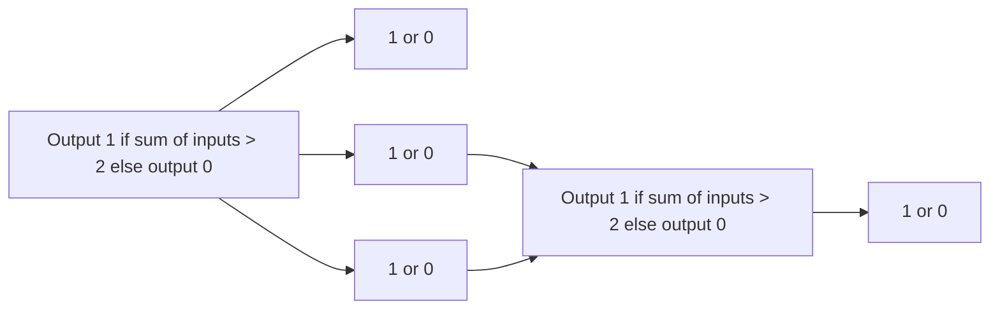
</details>

In the physiological metaphor, one says that the neuron ‘fired’ if the output is 1, and that the neuron ‘didn't fire’ if the output is 0. Simulated neurons can differ in the number of input and output connections, and in the formula for deciding whether to fire (see Box 6.8).

To form a network, assemble several neurons and connect the outputs of some to the inputs of others. Some nodes contain connections that provide input to the entire network; some deliver output information from the network to the outside world; and others, that do not interact directly with the outside, are called hidden layers.


<details>
<summary>flowchart</summary>

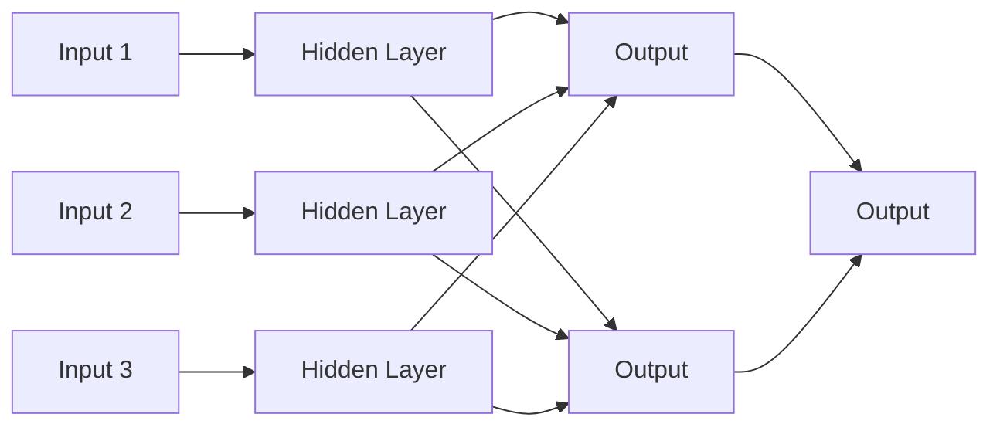
</details>

An unlimited degree of complexity is available by assembling and connecting neurons, and by varying

## Box 6.8 Logic of neural networks

For a single neuron, a discrete decision process governing the output has a geometric interpretation in terms of lines and planes. The neuron in the following figure has two inputs. If we interpret the inputs as the coordinates of a point (x, y) in the plane, the neuron ‘decides’ on which side of a line the input point lies. The output will be 1 if and only if x+ y ≤ 2; that is, if the point is below and to the left of the line x + y = 2.


<details>
<summary>text_image</summary>

x
y
Output 1 if
x + y < 2;
else output 0
Region of output = 0
2
1
Region of output = 1
1
2
x
y
</details>

A neural network is specified by the topology of its connections, and the weights and decision formulas of its nodes. A network can make more complex decisions than a single neuron. Thus, if one neuron with two inputs can decide on which side of a line a point lies, three neurons can select points that lie within a triangle:

294

---


<details>
<summary>flowchart</summary>

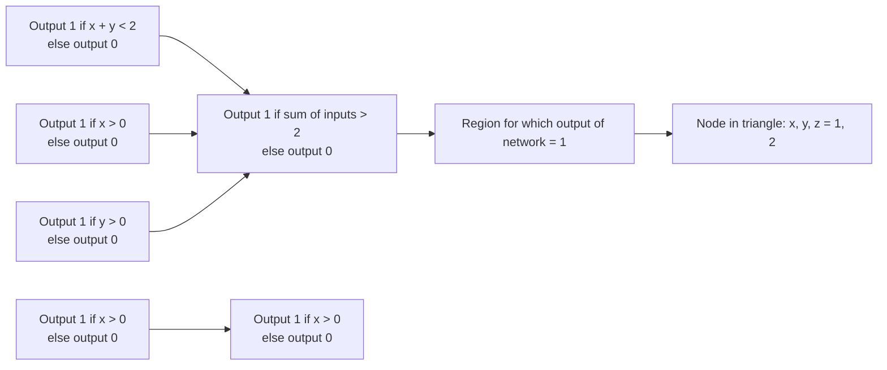
</details>

Neural networks are more powerful and robust if the output is a smoothly varying function of the inputs. Such networks can perform more general kinds of computations and are better at pattern recognition. Also, for training the network it is useful if the output is a differentiable function of the parameters. To this end a sharp threshold function for the output of a neuron is replaced by a smoothed-out step, or sigmoidal, function:


the strengths of the connections. That is, instead of taking a simple sum of inputs, $i _ { 1 } + i _ { 2 } + i _ { 3 } ,$ , take a weighted sum—for instance, $1 0 i _ { 1 } + 5 i _ { 2 } + i _ { 3 } ]$ —which would make the neuron most sensitive to input 1 and least sensitive to input 3. Biologically, this may correspond to changing the strengths of synapses.

A property of a neural network that gives it great power is that the weights may be regarded as variables, and a calculation or learning process may determine the weights appropriate for a particular decision or pattern identifier. To train a network, feed the system sets of sample input for which the desired output is known, and compare the output with the correct answer. If the observed output differs from the desired one, adjust the parameters. The topology of the network remains invariant during the training process, although of course setting a weight to 0 has the effect of detaching an input.

The type of neural network that has been applied to secondary structure prediction is shown in Figure 6.12.

295

---


<details>
<summary>flowchart</summary>

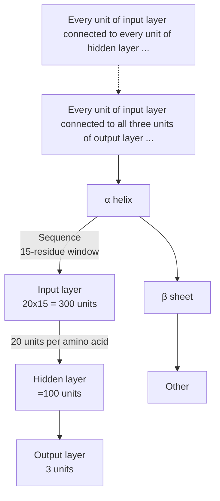
</details>

Figure 6.12 A neural network applicable to secondary structure prediction contains three layers:

1. The input layer sees a sliding 15-residue window in the sequence. That is, it treats a 15-residue region, predicts the secondary structure of the central residue (marked by an arrow, at the top), and then moves the window one residue along the amino acid sequence and repeats the process. To each of the 15 residues in the current window there correspond 20 nodes in the input layer of the network, one of which will be triggered according to the amino acid in that position.
2. A hidden layer of ≈100 units connects the input with the output. Each node of the hidden layer is connected to all input and output units; not all the connections are shown.
3. The output layer consists of only three nodes, that signify prediction that the central residue in the window be in a helix, strand, or other conformation.

A major advance in secondary structure prediction occurred with the application of evolutionary information, the recognition that multiple sequence alignment tables contain much more information than individual sequences. The conservation of secondary structure among related proteins means that the sequence–structure correlations are much more robust when a family as a whole is taken into account. Most neural network-based methods for secondary structure prediction now feed the input layer not simply with the identities of the amino acid at successive positions, but with a profile derived from a multiple sequence alignment.

It has also proved useful to run two neural networks in tandem, to make use of observed correlations among conformations of residues at neighbouring positions. Predictions of the states of several successive residues by one network similar to the one shown in Figure 6.12 are combined by a second network into a final prediction.

A test of the maturity of a prediction method is whether it can be made fully automatic. (See the section on CASP.) Some computational methods require human intervention and editing of results. Others, including PROF, the system that predicted the secondary structure of MutS, are fully automatic.

## Homology modelling

Model building by homology is a useful technique for predicting the structure of a target protein of known sequence, when the target protein is related to at least one other protein of known sequence and structure. If the proteins are closely related, the known protein structures—called the parents— can serve as the basis for a model of the target. Although the quality of the model will depend on the degree of similarity of the sequences, it is possible to estimate this quality before experimental testing (see Fig. 6.10). In consequence, knowing how good a model is necessary for the intended application permits intelligent prediction of the probable success of the exercise.

Steps in homology modelling are outlined here.

296

---

1. Align the amino acid sequences of the target and the protein or proteins of known structure. It will generally be observed that insertions and deletions lie in the loop regions between helices and sheets.
2. Determine mainchain segments to represent the regions containing insertions or deletions. Stitching these regions into the mainchain of the known protein creates a model for the complete mainchain of the target protein.
3. Replace the sidechains of residues that have been mutated. For residues that have not mutated, retain the sidechain conformation. Residues that have mutated tend to keep the same sidechain conformational angles, and could be modelled on this basis. However, computational methods are now available to search over possible combinations of sidechain conformations.
4. Examine the model—both by eye and by programs—to detect any serious collisions between atoms. Relieve these collisions, as far as possible, by manual manipulations.
5. Refine the model by limited energy minimization. The role of this step is to fix up the exact geometrical relationships at places where regions of mainchain have been joined together, and to allow the sidechains to wriggle around a bit to place themselves in comfortable positions. The effect is really only cosmetic: energy refinement will not fix serious errors in such a model.

To a great extent, this procedure produces ‘what you get for free’ in that it defines the model of the protein of unknown structure by making minimal changes to its known relatives. In some cases it is possible to make substantial improvements. A rule of thumb (referring again to Fig. 6.10) is that if two or more sequences have at least 40–50% identical amino acids in an optimal alignment of their sequences, the procedure described will produce a model of sufficient accuracy to be useful for many applications. If the sequences are very distantly related, neither the procedure described nor any other currently available method will produce a model, correct in detail to atomic resolution, of the target protein from the structure of its relative.


## See Weblem 6.14

In most families of proteins the structures contain relatively constant regions and more variable ones. A single parent structure will permit reasonable modelling of the conserved portion of the target protein, but may fail to produce a satisfactory model of the variable portion. From only one target and one parent sequence, it will not be easy to even predict which are the variable and constant regions. A more favourable situation occurs when several related proteins of known structure provide a basis for modelling a target protein. These reveal the regions of constant and variable structure in the family. The observed distribution of structural variability among the parents dictates an appropriate distribution of constraints to be applied to the model.

SWISS-MODEL hosts a website that will accept the amino acid sequence of a target protein, determine whether a suitable parent or parents for homology modelling exist, and, if so, deliver a set of coordinates for the target. SWISS-MODEL was developed by T. Schwede, M.C. Peitsch, and N. Guex, now at the Geneva Biomedical Research Institute.

An example of the automatic prediction by SWISS-MODEL is the prediction of the structure a neurotoxin from red scorpion (Buthus tamulus) from the known structure of the neurotoxin from the related scorpion North African yellow scorpion (Androctonus australis hector). These two proteins have 52% identical residues in their sequence alignment. With such a close degree of similarity it is not surprising that the model fits the experimental result very closely, even with respect to the sidechain conformation (Fig. 6.13).

297

---


<details>
<summary>chemical</summary>

Molecular structure diagram showing two complex organic frameworks with labeled atoms and bonds
</details>

Figure 6.13 SWISS-MODEL predicts the structure of red scorpion neurotoxin [1DQ7] (green) from a closely related protein [1PTX] (black). The prediction was done automatically. Observe that most of the buried sidechains have not mutated, and have very similar conformations. Some sidechains on the surface have different conformations, and the mainchain of the C-terminus is in a different position (upper left). Not shown is a network of disulphide bridges, which constrain the structure. However, a model of this high quality would be expected, for two such closely related proteins, even without the extra constraints.


## See Weblem 6.15

## Fold recognition

Searching a sequence database for a probe sequence and searching a structure database with a probe structure are problems with known solutions. The mixed problems—probing a sequence database with a structure, or a structure database with a sequence—are less straightforward. They require a method for evaluating the compatibility of a given sequence with a given folding pattern.

The goal is to abstract the essence of a set of sequences or structures. Other proteins that share the pattern are expected to adopt similar structures.

## Three-dimensional profiles

We have discussed patterns and profiles derived from multiple sequence alignments and their application to detection of distant homologues. One way to take advantage of available structural information to improve the power of these methods is a type of profile derived from the available sequences and structures of a family of proteins.

J.U. Bowie, R. Lüthy, and D. Eisenberg analysed the environments of each position in known protein structures and related them to a set of preferences of the 20 amino acids for these structural contexts.

Given a protein structure, classify the environment of each amino acid in three separate categories:

1. its mainchain hydrogen-bonding interactions; that is, its secondary structure;
2. the extent to which it is buried within or on the surface of the protein structure;
3. the polar/nonpolar nature of its environment.

The secondary structure may be one of three possibilities: helix, sheet, and other. A sidechain is considered buried if the accessible surface area is less than 40 $\mathrm { A } ^ { 2 } ;$ partially buried if the accessible surface area is between $4 0$ and 114 $\mathrm { A } ^ { 2 }$ , and exposed if the accessible surface area is greater than 114 $\mathrm { A ^ { 2 } } ,$ The fraction of sidechain area covered by polar atoms is measured. The authors define six classes on the basis of accessibility and polarity of the surroundings. Sidechains in each of these six classes may have any of three types of secondary structure assignment: helix, sheet, or neither. This gives a total of 18 classes.

Assigning each sidechain to one of 18 categories makes it possible to write a coded description of

298

---

a protein structure as a message in an alphabet of 18 letters, called a 3D structure profile. Algorithms developed for sequence searches can thereby be applied to ‘sequences’ of encoded structures. For example, one could try to align two distantly related sequences by aligning their 3D structure profiles rather than their amino acid sequences. The 3D profile method translates protein structures into onedimensional probe (or probe-able) objects that do not explicitly retain either the sequence or structure of the molecules from which they were derived.

Next, how can one relate the 3D structure profile to the set of known protein folding patterns? It is clear that some amino acids will be unhappy in certain kinds of sites; for example, a charged sidechain would prefer not to be buried in an entirely nonpolar environment. Other preferences are not so clear-cut, and it is necessary to derive a preference table from a statistical survey of a library of well-refined protein structures.

Suppose now that we are given a sequence and want to evaluate the likelihood that it takes up, say, the globin fold. From the 3D structure profile of the known sperm whale myoglobin structure we know the environment class of each position of the sequence. We must consider all possible alignments of the sequence of the protein of unknown structure with the 3D structure profile of myoglobin. Consider a particular alignment, and suppose that the residue in the unknown sequence that corresponds to the first residue of myoglobin is phenylalanine. The environment class in the 3D structure profile of the first residue of sperm whale myoglobin is: exposed, no secondary structure. One can score the probability of finding phenylalanine in this structural environment class from the table of preferences of particular amino acids for this 3D structure profile class. (The fact that the first residue of the sperm whale myoglobin sequence is actually valine is not used, and in fact that information is not directly accessible to the algorithm. Sperm whale myoglobin is represented only by the sequence of environment classes of its residues, and the preference table is averaged over proteins with many different folding patterns.) Extension of this calculation to all positions and to all possible alignments (not allowing gaps within regions of secondary structure) gives a set of scores that measures how well the given unknown sequence, in each possible alignment, fits the sperm whale myoglobin sequence–structure profile. The best score, over all tested alignments, can be calibrated to decide whether the sequence and folding pattern are likely to correspond.

A particular advantage of this method is that it can be automated, with a new sequence being scored against every 3D profile in the library of known folds, in essentially the same way as a new sequence is routinely screened against a library of known sequences.

## Use of three-dimensional profiles to assess the quality of structures

The 3D profile derived from a structure depends only very indirectly on the amino acid sequence. It is therefore meaningful to ask not only whether it is possible to identify other amino acid sequences compatible with the given fold, but whether the score of a 3D profile for its own parent sequence is a measure of the compatibility of the sequence with the structure. Naturally, if real sequences did not generally appear to be compatible with their own structures, credibility in the method as capturing a valid connection between sequence and structure would be severely impaired. Two interesting results are observed. (1) protein structures determined correctly do fit their own profiles well, although other, related, proteins, may give higher scores. The profile is abstracting properties of the family, not of individual sequences. (2) When a sequence does not match a profile computed from an experimental structure of that protein there is likely to have been an error in the structure determination. The positions in the profile that do not match can identify the regions of error.

299

---

## Threading

Threading is a method for fold recognition. Given a library of known structures, and a sequence of a query protein of unknown structure, does the query protein share a folding pattern with any of the known structures? The fold library could include some or all of the PDB, or even hypothetical folds.

The basic idea of threading is to build many rough models of the query protein, based on each of the known structures and using different possible alignments of the sequences of the known and unknown proteins. This systematic exploration of the many possible alignments gives threading its name: imagine trying out all alignments by pulling the query sequence gently through the threedimensional framework of any known structure. Gaps must be allowed in the alignments, but if the thread is thought of as being sufficiently elastic the metaphor of threading survives.

Both threading and homology modelling deal with the three-dimensional structure induced by an alignment of the query sequence with known structures of homologues. Homology modelling focuses on one set of alignments and the goal is a very detailed model. Threading explores many alignments and deals with only rough models usually not even constructed explicitly.

| Homology modelling | Threading |
| --- | --- |
| First, identify homologues | Try all possible folds |
| Then, determine optimal alignment | Try many possible alignments |
| Optimize one model | Evaluate many rough models |

Successful fold recognition by threading requires:

1. a method to score the models, so that we can select the best one;
2. a method for calibrating the scores, so that we can decide whether the best-scoring model is likely to be correct.

Several approaches to scoring have been tried. One of the most effective is based on empirical patterns of residue neighbours, as derived from known structures. First, we observe the distribution of interresidue distances in known protein structures, for all 20 × 20 pairs of residue types. For each pair, derive a probability distribution, as a function of the separation in space, and in the amino acid sequence. For instance, for the pair Leu–Ile, consider every Leu and Ile residue in known structures, and, for each Leu–Ile pair, record the distance between their Cβ atoms, and the difference in their positions in the sequence. Collecting these statistics permits estimation of how well the distributions observed in a model agree with the distributions in known structures.

The Boltzmann equation relates probabilities and energies. Usual applications of the Boltzmann equation start from an energy function and predict a probability distribution. (A standard example is the prediction of the density of the atmosphere as a function of altitude from the gravitational potential energy function of the air molecules.) For threading, one turns this on its head, and derives an energy function from the probability distribution. This energy function is then used to score threading models.

For each structure in the fold library, the procedure finds the assignment of residues that produces the lowest energy score. The most effective algorithms for finding optimal sequence alignments are based on a mathematical technique called dynamic programming (See Chapter 5).

Although threading is an alignment problem, it can't be solved by dynamic programming, because of the nonlocal interactions.

Fold recognition at CASP in 2000

300

---

The best methods for fold recognition are consistently effective. These include, but are not limited to, methods based on threading.

Figures 6.14 and 6.15 show a prediction by A.G. Murzin, and another prediction by Bonneau, Tsai, Ruczinski, and Baker, of targets from the 2000 CASP programme. Both proteins were of unknown function and came from H. influenzae.


Figure 6.14 Prediction of structure of H. influenzae, hypothetical protein. (a) The folding pattern of the target. (b) Prediction by A.G. Murzin. (c) Folding pattern of the closest homologue of known structure: an N-ethylmaleimidesensitive fusion protein involved in vesicular transport (PDB entry 1NSF). The topology of Murzin's prediction is closer to the target than that of the closest single parent.


<details>
<summary>natural_image</summary>

Two abstract line drawings of a protein structure, possibly a ligand or protein backbone, with no visible text or symbols.
</details>

Figure 6.15 Prediction by Bonneau, Tsai, Ruczinski, and Baker of another hypothetical protein from H. influenzae, based on glycine N-methyltransferase [1XVA]. Black, experimental structure; green, prediction. Note that much of the prediction superposes well on the experimental structure, and that the parts that do not superpose well have similar local structures but improper orientation and packing against the main body of the protein.

## Prediction of coiled coils by hidden Markov models

Approaches to prediction of coiled-coiled regions in proteins include:

profile methods using running windows (PCOILS);
profile methods, running windows, with residue correlations (PairCoil2);
• HMMs (MARCOIL).

MARCOIL gave the best overall performance in controlled tests.

#

See weblem 6.16

301

---

MARCOIL uses a HMM trained on a database containing nine classes of proteins:

• Tropomyosins

• Myosins

• Intermediate filaments

• Dyneins

• Kinesins

• Laminins

• SNARE proteins

• Transcription factors

• Others

Submitting to MARCOIL the chicken proto-oncogene protein c-fos, and selecting default parameters:

```txt
>P11939 - FOS_CHICK Proto-oncogene protein c-fos - Gallus gallus (Chicken).
MMYQGFAGEYEAPSSRCSSASPAGDSLTYYPSPADSFSSMGSPVNSQDFCTDLAVSSANF
VPTVTAISTSPDLQWLVQPTLISSVAPSQNRGHPYGVPAPAPPAAYSRPAVLKAPGGRGQ
SIGRRGKVEQLSPEEEEKRRIRRERNKMAAAKCRNRRRELTDTLQAETDQLEEEKSALQA
EIANLLKEKEKLEFILAAHRPACKMPEELRFSEELAAATALDLGAPSPAAAEEAFALPLM
TEAPPAVPPKEPSGSGLELKAEPFDELLFSAGPREASRSVPDMDLPGASSFYASDWEPLG
AGSGGELEPLCTPVVTCTPCPSTYTSTFVFTYPEADAFPSCAAAHRKGSSSNEPSSDSLS
SPTLLAL
```

The program returned the prediction shown in Figure 6.16. The program is quite confident that the protein contains a coiled-coil domain, between residues ≈125– ≈ 200.


<details>
<summary>line</summary>

| Residue number | Probability of coiled-coil |
| --- | --- |
| ~120 | 0.0 |
| ~130 | ~0.2 |
| ~140 | ~0.6 |
| ~150 | ~0.7 |
| ~160 | ~0.9 |
| ~170 | 1.0 |
| ~180 | 1.0 |
| ~190 | ~0.3 |
| ~200 | 0.0 |
</details>

Figure 6.16 Prediction by MARCOIL of a coiled-coil domain in chicken c-fos.

## Prediction of transmembrane helices and signal sequences by hidden Markov models

Some fold-recognition procedures strive for sufficient generality to identify all known domain structures. Others are specialized to particular types of folds. The best algorithms for prediction of transmembrane helices and coiled coils make use of HMMs, as will be discussed.

A simple approach to prediction of membrane proteins involves looking for amino acid segments 15–30 residues in length that are rich in hydrophobic residues. However, signal peptides also contain hydrophobic helices: the signal sequence typically comprises a positively charged n-region, followed by a helical hydrophobic h-region, followed by a polar c-region. Methods for recognizing transmembrane helices in amino acid sequences tend to pick up the h-regions of signal peptides as false positives. Methods for recognizing signal peptides in amino acid sequences tend to pick up transmembrane helices as false positives.

Käll, Krogh, and Sonnhammer trained HMMs to test simultaneously for transmembrane helices and signal peptides. The goals are to find both at the same time, to discriminate between them in the results, and to predict not only the positions of the transmembrane helices but the locations— cytoplasmic or interior—of the loops. They called their method PHOBIUS.

PHOBIUS is the most successful algorithm currently available for recognizing signal peptides and helical transmembrane proteins, and for predicting the orientation of the transmembrane segments. PHOBIUS is capable of distinguishing h-domains of signal peptides from transmembrane helices: the number of false classifications of signal peptides was 3.9%, and the number of false

302

---

classifications of transmembrane helices was 7.7%. These results represent a substantial improvement over previous methods. It is interesting that addressing the two problems at once proved to be more successful than treating them separately.

Web resources: Membrane proteins

| PHOBIUS (L. Käll, A. Krogh, and E. Sonnhammer) | http://phobius.cgb.ki.se/ |
| --- | --- |
| PHDhtm (B. Rost) | http://www.predictprotein.org |
| Membrane Protein Explorer (S. White) | http://blanco.biomol.uci.edu/mpex/ |
| Membrane proteins of known structure | http://blanco.biomol.uci.edu/mpstruc/listAll/list |
| The Membrane Protein Data Bank (P. Raman, V. Cherezov, and M. Caffrey) | http://www.mpdb.tcd.ie/ |
| Protein Data Bank of Transmembrane Proteins (G.E. Tusnády, Z. Dosztányi, and I. Simon) | http://pdbtm.enzim.hu/ |

## Conformational energy calculations and molecular dynamics

A protein is a collection of atoms. The interactions between the atoms create a unique state of maximum stability. Find it, that's all!

The computational difficulties in this approach arise because (1) the model of the interatomic interactions is not complete or exact and (2) even if the model were exact we face an optimization problem in a large number of variables, involving nonlinearities in the objective function and the constraints, creating a very rough energy surface with many local minima. Like a golf course with many bunkers, such problems are very difficult.

The interactions between atoms in a molecule can be divided into:

1. primary chemical bonds: strong interactions between atoms that must be close together in space; these are regarded as a fixed set of interactions that are not broken or formed when the conformation of a protein changes, but are equally consistent with a large number of conformations;
2. weaker interactions that depend on the conformation of the chain. These can be significant in some conformations and not in others: they affect sets of atoms that are brought into proximity by different folds of the chain.

The conformation of a protein can be specified by giving the list of atoms in the structure, their coordinates, and the set of primary chemical bonds between them (this can be read off, with only slight ambiguity, from the amino acid sequence). Terms used in the evaluation of the energy of a conformation typically include:

Bond stretching: $\scriptstyle \sum _ { \mathrm { b o n d s } } K _ { r } ( r - r _ { 0 } ) ^ { 2 }$ . Here $r _ { 0 }$ is the equilibrium interatomic separation and $K _ { r }$ is the force constant for stretching the bond. $r _ { 0 }$ and $K _ { r }$ depend on the type of chemical bond.

• Bond angle bend: $\scriptstyle \sum _ { \mathrm { a n g l e s } } K _ { \theta } ( \theta \mathrm { ~ - ~ } \theta _ { 0 } ) ^ { 2 }$ . For any atom i that is chemically bonded to two (or more) other atoms j and k, the angle $i - j - k$ has an equilibrium value $\theta _ { 0 }$ and a force constant for bending $K _ { \theta } .$

• Other terms to enforce proper stereochemistry penalize deviations from planarity of certain groups, or enforce correct chirality (handedness) at certain centres.

303

---

Torsion angle: $\textstyle \sum _ { \mathrm { d i h e d r a l s } }$ $\% V_{n}[1+\cos\phi]$ For any four connected atoms—i bonded to j bonded to k bonded to l—the energy barrier to rotation of atom l with respect to atom i around the $j { - } k$ bond is given by a periodic potential. $V _ { n }$ is the height of the barrier to internal rotation; n barriers are encountered during a full $3 6 0 ^ { \circ }$ rotation. (For instance, for ethane $n \; = \; 3 . )$ The mainchain conformational angles ϕ, ψ, and ω are examples of torsional rotations (see Fig. 6.2).
Van der Waals interactions: $A_{ij}R_{ij}^{-12}-B_{ij}R_{ij}^{-6}$ . For each pair of nonbonded atoms i and j the first term accounts for a short-range repulsion and the second term for a long-range attraction between them. The parameters A and B depend on atom type.
Hydrogen bonds: $C_{ij}R_{ij}^{-12}-D_{ij}R_{ij}^{-10}$ The hydrogen bond is an weak chemical/electrostatic interaction between two polar atoms. Its strength depends on distance and also on the bond angle. This approximate hydrogen-bond potential does not explicitly reflect the angular dependence of hydrogen-bond strength; other potentials attempt to account for hydrogen-bond geometry more accurately.
Electrostatics: $\mathcal { Q } _ { i } \mathcal { Q } _ { j } / ( \varepsilon R _ { i j } )$ For each pair of charged atoms i and $j ,   Q _ { i }$ and $Q _ { j }$ are the effective charges on the atoms, $R _ { i j }$ is the distance between them, and ε is the dielectric ‘constant’. This formula applies only approximately to media that are not infinite and isotropic, including proteins.
Solvent: interactions with the solvent, water, and cosolutes such as salts and sugars, are crucial for the thermodynamics of protein structures. Attempts to model the solvent as a continuous medium, characterized primarily by a dielectric constant, are approximations. With the increase in available computer power it is now possible to include solvent explicitly, simulating the motion of a protein in a box of water molecules.

There are numerous sets of conformational energy potentials of this or closely related forms, and a great deal of effort has gone into the tuning of parameter sets. The energy of a conformation is computed by summing these terms over all bonded and nonbonded atoms.

The potential functions satisfy necessary but not sufficient conditions for successful structure prediction. One test is to take the right answer—an experimentally determined protein structure—as a starting conformation, and minimize the energy starting from there. Most high-quality energy functions produce a minimized conformation that is about 1 Å (r.m.s. deviation) away from the starting model. This can be thought of as a measure of the resolution of the force field. Another test has been to take deliberately misfolded proteins and minimize their conformational energies, to see whether the energy value of the local minimum in the vicinity of the correct fold is significantly lower than that of the local minimum in the vicinity of an incorrect fold. Such tests reveal that multiple local minima cannot be reliably distinguished from the correct one on the basis of calculated conformational energies.

Indeed, attempts to predict the conformation of a protein by minimization of the conformational energy have so far not provided a general method for predicting protein structure from amino acid sequence. Molecular dynamics offers a way to overcome the problems of getting trapped in local minima, and of the absence of a good static model for protein–solvent interactions. In molecular dynamics calculations, the protein plus explicit solvent molecules are treated—via the force field— by classical Newtonian mechanics. It is true that this permits exploration of a much larger sector of phase space. However, as an a priori method of structure prediction it has still not succeeded consistently. However, these are calculations that are extremely computationally intensive and here, perhaps more than anywhere else in this field, advances deriving from the increased power of processors will have an effect.

304

---

Is lack of computational power the only reason for lack of success in prediction of protein structure by simulation of the folding pathway? There have been several attempts to apply ‘brute force’, including the IBM Blue Gene supercomputer project and the distributed computing approach of Folding, which makes use of contributions of computer power from over a million participating CPUs. (A similar approach has been applied to drug design.) In 2003, an IBM group folded a 20- residue peptide from a fully extended conformation to a state within ≈1.5 Å r.m.s. deviation of the native state. (See Box 6.9.)

In the meantime, molecular dynamics, if supplemented by experimental data, regularly makes extremely important contributions to structure determinations by both X-ray crystallography (usually) and NMR (always). How is molecular dynamics integrated into the process of structure determination? For any conformation, one can measure the consistency of the model with the experimental data. In the case of crystallography, the experimental data are the absolute values of the Fourier transform of the electron density of the molecule. In the case of NMR, the experimental data provide constraints on the distances

## Box 6.9 Scaling of resource requirements for molecular dynamics calculations

Fully detailed molecular dynamics calculations perform a series of individual time steps of duration $1 0 ^ { - 1 5 }   \mathrm { s }   ( = 1$ fs). The computer time required for an individual time step scales approximately as N lnN, where N is the length of the protein. The time required for a protein to fold depends on a number of features, but, for purposes of a ‘back-of-the-envelope’ calculation, it varies with the length N of the protein $\mathrm { a s   \approx   } N ^ { 2 / 3 }$

Therefore the total computer resources required to fold a protein may be expected to vary approximately as $N ^ { 5 / 3 }$ lnN. This means that if it takes 3 months (of uninterrupted time on a supercomputer running flat out) to fold a protein of length N, it would be expected to require over 1.5 years, on the same system, to fold up a protein of length 3N residues.

between certain pairs of residues. But in both X-ray crystallography (usually) and NMR the experimental data underdetermine the protein structure. To solve a structure one must seek a set of coordinates that minimizes a combination of the deviation from the experimental data and the conformational energy. Molecular dynamics is successful at determining such coordinate sets: the dynamics provides adequate coverage of conformation space, and the bias derived from the experimental data channels the calculation quite effectively towards the correct structure.

Molecular dynamics revolutionized protein crystallography. It has transformed what used to be a lengthy, labour-intensive process of manual building and rebuilding of models into electron densities, into a ‘batch’ job turned over to a computer, and requiring much less overall time.

## ROSETTA

ROSETTA is a program by D. Baker and colleagues that predicts protein structure from amino acid sequence by assimilating information from known structures. At recent CASP programmes, ROSETTA has showed consistent success on targets in both the Fold Recognition and Novel Fold categories. At present, it leads the field by several lengths. It represents a major breakthrough.

ROSETTA predicts a protein structure by first generating structures of fragments using known structures, and then combining them. First, for each contiguous region of three and nine residues, instances of that sequence and related sequences are identified in proteins of known structure. For fragments this small there is no assumption of homology to the target protein. The distribution of

305

---

conformations of the fragments serves as a model for the distribution of possible conformations of the corresponding fragments of the target structure.

ROSETTA explores the possible combinations of fragments using Monte Carlo calculations (see Box 6.10). The energy function has terms reflecting compactness, paired β sheets, and burial of hydrophobic residues. The procedure carries out 1000 independent simulations, with starting structures chosen from the fragment conformation distribution pattern generated previously. The structures that result from these simulations are clustered, and the centres of the largest clusters presented as predictions of the target

## Box 6.10 Monte Carlo algorithms

Monte Carlo algorithms are used very widely in protein structure calculations to explore conformations efficiently, and in many other optimization problems to search for the minimum of a complicated function. Simple minimization methods based on moving ‘downhill’ in energy fail because the calculation gets trapped in a local minimum far from the native state.

In general, Monte Carlo methods make use of random numbers to solve problems for which it is difficult to calculate the answer exactly. The name was invented by J. von Neumann, referring to the applications of random-number generators in the famous casino in Monaco.

To apply Monte Carlo techniques to find the minimum of a function of many variables—for instance, the minimum energy of a protein as a function of the variables that define its conformation—suppose that the configuration of the system is specified by the variables x, and that for any values of these variables we can calculate the energy of the conformation, E(x). (x stands for a whole set of variables: perhaps the set of atomic coordinates of a protein, or the mainchain and sidechain torsion angles.)

Then the Metropolis procedure (invented in 1953, allegedly at a dinner party in Los Alamos) prescribes:

**1.** generate a random set of values of x, to provide starting conformation. Calculate the energy of this conformation, $E   =   E ( \mathbf { x } )$
**2.** perturb the variables, $\mathbf { x } \longrightarrow \mathbf { x } ^ { \prime } ,$ to generate a neighbouring conformation;
**3.** calculate the energy of the new conformation, $E ( \mathbf { x } ^ { \prime } )$ ;
**4.** decide whether to accept the step, to move $\mathbf { x } \longrightarrow \mathbf { x } ^ { \prime } ,$ or to stay at x and try a different perturbation:

**a.** if the energy has decreased, so $E = E ( \mathbf { x } ) > E ( \mathbf { x } ^ { \prime } )$ that is, the step went downhill—always accept it. The perturbed conformation becomes the new current conformation: set $\mathbf { x } ^ { \prime } = \mathbf { x }$ and $E   =   E ( \mathbf { x } ^ { \prime } )$
**b.** if the energy has increased or stayed the same; that is $E ( \mathbf { x } ) \leq E ( \mathbf { x } ^ { \prime } )$ in other words the step goes uphill —sometimes accept the new conformation. If $\Delta   =   E ( { \bf x } ^ { \prime } )   -   E ( { \bf x } )$ accept the step with a probability exp[ $[ - \Delta / ( k T ) ]$ , where k is Boltzmann's constant and T is an effective temperature;

## 5. return to step 2.

It is step 4b that is the ingenious one. It has the potential to get over barriers; out of traps in local minima. The effective temperature, $T ,$ controls the chance that an uphill move will be accepted. T is not the physical temperature at which we wish to predict the protein conformation, but simply a numerical parameter that controls the calculation.

For any temperature, the higher the uphill energy difference, the less likely that the step will be accepted. For any value of $E ,$ if $T$ is low, then $E ( \mathbf { x } ) / ( k T )$ will be high, and $\exp [ - E ( \mathbf { x } ) / ( k T ) ]$ will be relatively low. If $T$ is high then $E ( \mathbf { x } ) / ( k T )$ will be low, and $\exp [ - E ( \mathbf { x } ) / ( k T ) ]$ will be relatively high. The higher the temperature, the more probable the acceptance of an uphill move. This relatively simple idea has proved extremely effective, with successful applications including but by no means limited to protein structure calculations.

Simulated annealing is a development of Monte Carlo calculations in which T varies; first it is set high to allow efficient exploration of conformations and then it is reduced to drop the system into a low-energy state.

structure. The idea is that a structure that emerges many times from independent simulations is likely

306

---

to have favourable features.

Figure 6.17 shows successful predictions by ROSETTA of two targets from the 2000 CASP programme.


Figure 6.17 Predictions by ROSETTA of (a) H. influenzae, hypothetical protein and (b) the N-terminal half of domain 1 of human DNA repair protein Xrcc4. Panel b shows a selected substructure containing the N-terminal 55 out of 116 residues. Solid lines, experimental structures; broken lines, predicted structures.

ROBETTA ([http://robetta.bakerlab.org](http://robetta.bakerlab.org)) is a web server designed to integrate and implement the best of the protein structure prediction tools. The central pipeline of the software involves first the parsing of a submitted amino acid sequence of a protein of unknown structure into putative domains. Then homology modelling techniques are applied to those domains for which suitable parents of known structure exist, and the de novo methods developed by Baker and coworkers to other domains. In addition, the user will receive the results of other prediction methods based on software developed outside the ROBETTA group. These include, for example, predictions of secondary structure, coiled coils, and transmembrane helices.

## LINUS

LINUS, or Local Independently Nucleated Units of Structure, is a program for prediction of protein structure from amino acid sequence by G.D. Rose and R. Srinivasan. It is a completely a priori procedure, making no explicit reference to any known structures or sequence–structure relationships. LINUS folds the polypeptide chain in a hierarchical fashion, first producing structures of short segments and then assembling them into progressively larger fragments.

An insight underlying LINUS is that the structures of local regions of a protein—short segments of residues consecutive in the sequence—are controlled by local interactions within these segments. During natural protein folding, each segment will preferentially sample its most favourable conformations. However, these preferred conformations of local regions, even the one that will ultimately be adopted in the native state, are below the threshold of stability. Local structure will form transiently and break up many times before a suitable interacting partner stabilizes it. But in the computer one is free to anticipate the results. In a LINUS simulation, favourable structures of local fragments, as determined by their frequent recurrence during the simulation, transmit their preferred conformations as biases that influence subsequent steps. The procedure applies the principle of a rachet to direct the calculation along productive lines.

LINUS begins by building the polypeptide from the sequence as an extended chain. The

307

---

simulation proceeds by perturbing the conformations of a succession of randomly chosen threeresidue segments and evaluating the energies of the results. Structures with steric clashes are rejected out of hand; other energetic contributions are evaluated only in terms of local interactions. A Monte Carlo procedure (see Box 6.10) is used to decide whether to accept a perturbed structure or revert to its predecessor. LINUS performs a large number of such steps. It periodically samples the conformations of the residues to accumulate statistics of structural preferences.

Subsequent stages in the simulation assemble local regions into larger fragments, using the conformational biases of the smaller regions to guide the process. The window within the sequence controlling the range of interactions is progressively opened, from short local regions to larger ones, and ultimately to the entire protein.

The LINUS representation of the protein folding process is realistic in essential respects, although approximate. All nonhydrogen atoms of a protein are modelled, but the energy function is approximate and the dynamics simplified. The energy function captures the ideas of (1) steric repulsion preventing overlap of atoms, (2) clustering of buried hydrophobic residues, (3) hydrogen bonding, and (4) salt bridges.

LINUS is generally successful in getting correct structures of small fragments (sized between a supersecondary structure and a domain), and in some cases can assemble them into the right global structure. Figure 6.18 shows the LINUS prediction of the C-terminal domain of rat endoplasmic reticulum protein ERp29, one of the targets of the 2000 CASP programme.


<details>
<summary>natural_image</summary>

Two abstract line drawings with interlocking shapes, no text or symbols present
</details>

Figure 6.18 A LINUS prediction of the C-terminal domain of rat endoplasmic reticulum protein ERp29. Black, experimental structure; green, prediction.

## Assignment of protein structures to genomes

A genome sequence is the complete statement of a potential life. Assignment of structures to gene products is a first step in understanding how organisms implement their genomic information.

We want to understand the structures of the molecules encoded in a genome, their individual activities and interactions, and the organization of these activities and interactions in space and time during the lifetime of the organism. We want to understand the relationships among the molecules encoded in the genome of one individual, and their relationships to those of other individuals and other species.

For individual proteins, knowing their structure is essential for understanding the mechanism of their function and interactions. For entire organisms, knowing the structures tells us how the repertoire of possible protein folds is called upon, and how it is distributed among different functional categories in different species. For interspecies comparisons, protein structures can reveal relationships invisible in highly diverged sequences.

Several methods have been applied to structure assignment.

Experimental structure determination: the best way of all!

308

---

Detection of homology in sequences: sophisticated sequence comparison methods such as PSI-BLAST or HMMs can identify relationships between proteins, both within an organism and between species. If the structure of any homologue is known experimentally, at least the general fold of the family can be inferred.
• Fold-recognition methods can assign folds to some proteins even in the absence of evidence for homology.
• Specialized techniques detect membrane proteins and coiled coils.

The results of structure assignments provide partial inventories of proteins in the different genomes, and, for the subset of proteins with sufficiently close relatives of known structure, detailed threedimensional models. The degree of coverage of assignments is changing very fast, primarily because of the rapid growth of sequence and structural data. The table contains a current scorecard:

| Species | Number of sequences | Structures assigned | Percentage |
| --- | --- | --- | --- |
| E. coli | 4289 | 916 | 21 |
| M. jannaschii | 1773 | 262 | 14 |
| S. cerevisiae | 6289 | 1109 | 17 |
| D. melanogaster | 13 687 | 2990 | 21 |

From GeneQuiz, [http://jura.ebi.ac.uk:8765/ext-genequiz/](http://jura.ebi.ac.uk:8765/ext-genequiz/).

What do these results tell us about the usage of the potential protein repertoire? A comparison of folding patterns of proteins deduced from the genomes of an archaeon, M. jannaschii, a bacterium, H. influenzae, and a eukaryote, S. cerevisiae, revealed that, out of a total of 148 folds, 45 were common to all three species, and, by implication, probably common to most forms of life. The archaeon M. jannaschii had the fewest unshared folds (see Fig. 6.19).


<details>
<summary>funnel</summary>

| Region | Value |
| --- | --- |
| Haemophilus influenzae | 23 |
| Methanococcus jannaschii | 3 |
| Saccharomyces cerevisiae | 36 |
| Haemophilus influenzae & Methanococcus jannaschii | 3 |
| Haemophilus influenzae & Saccharomyces cerevisiae | 35 |
| Methanococcus jannaschii & Saccharomyces cerevisiae | 3 |
| Haemophilus influenzae & Methanococcus jannaschii & Saccharomyces cerevisiae | 45 |
</details>

Figure 6.19 Shared protein folds in an archaeon, M. jannaschii, a bacterium, H. influenzae, and a eukaryote, S. cerevisiae.

After Gerstein, M. (1997). A structural census of genomes: comparing bacterial, eukaryotic, and archaeal genomes in terms of protein structure. J. Mol. Biol., **274**, 562–576.

An inventory of the structures common to all three species showed that the five most common folding patterns of domains are (1) the P-loop-containing NTP hydrolase fold, (2) the NAD-binding domain, (3) the TIM-barrel fold, (4) the flavodoxin fold, and (5) the thiamin-binding fold. Plate IX shows the structure and a simplified schematic diagram of the topology of the first of these (see also Weblem 6.2). All are of the α/β type.

309

---


<details>
<summary>chemical</summary>

Molecular structure diagrams showing protein-ligand interactions and a corresponding molecular diagram with labeled atoms N, C, and C'.
</details>

Plate IX The thiamin-binding domain from yeast pyruvate decarboxylase. Thiamin-binding domains, identified by M. Gerstein as one of the five most common folding patterns, have been found in archaea, bacteria, and eukarya. (a) Three-dimensional structure. (b) Schematic topology diagram (See Chapter 6).

## Prediction of protein function

The cascade of inference should ideally flow as sequence → structure → function. However, although we can be confident that similar amino acid sequences will produce similar protein structures, the relationship between structure and function is more complex. Proteins of similar structure and even of similar sequence can be recruited for very different functions. Very widely diverged proteins may retain similar functions. Moreover, just as many different sequences are compatible with the same structure, proteins with different folds can carry out the same function (see Fig. 6.20).


<details>
<summary>flowchart</summary>

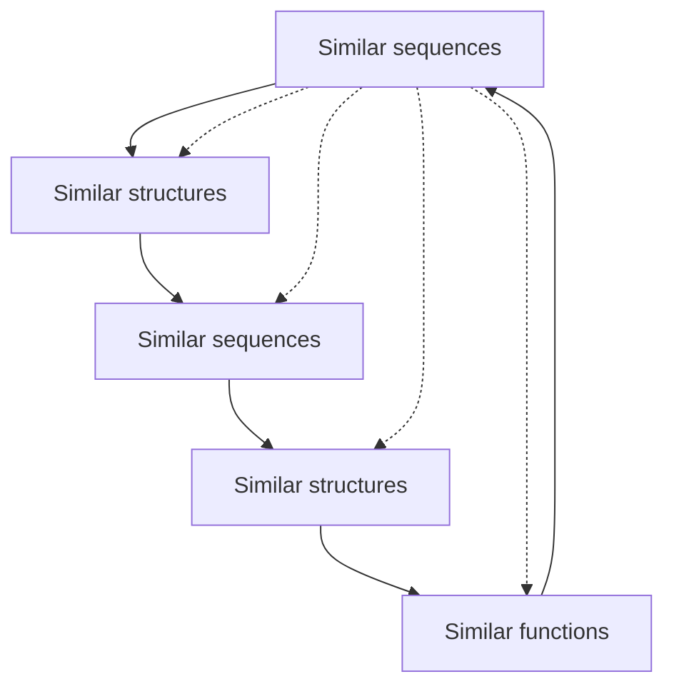
</details>

Figure 6.20 Relationships among sequence, structure, and function:

• similar sequences can be relied on to produce similar protein structures, with divergence in structure increasing progressively with the divergence in sequence;
conversely, similar structures are often found with very dif erent sequences. In many cases the relationships in a family of proteins can be detected only in the structures, the sequences having diverged beyond the point of our being able to detect the underlying common features;
• similar sequences and structures often produce proteins with similar functions, but exceptions abound;
• conversely, similar functions are often carried out by nonhomologous proteins with dissimilar structures; examples include the different families of proteinases, sugar kinases, and lysyl-tRNA synthetases.

As proteins evolve they may:

• retain function and specificity;
• retain function but alter specificity;
• change to a related function, or a similar function in a different metabolic context; or
• change to a completely unrelated function.

310

---

## Divergence of function: orthologues and paralogues

The family of chymotrypsin-like serine proteinases includes closely related enzymes in which function is conserved, and widely diverged homologues that have developed novel functions (see Box 6.11).

Trypsin, a digestive enzyme in mammals, catalyses the hydrolysis of peptide bonds adjacent to a positively charged residues, Arg or Lys. (A specificity pocket, a surface cleft in the active site, is complementary in shape and charge distribution to the sidechain of the residue adjacent to the scissile bond.) Enzymes with similar sequence, structure, function, and specificity exist in many species, including human, cow, Atlantic salmon, and even Streptomyces griseus (Fig. 6.21). The similarity of the S. griseus enzyme to vertebrate trypsins suggests a lateral gene transfer. For the three vertebrate enzymes, each pair of sequences has 64% or more identical residues in the alignment, and the bacterial homologue has 30% or more identical residues with the others; all have very similar structures. These enzymes are orthologues, or homologous proteins in different species. (Other bacterial homologues are very different in sequence.)


<details>
<summary>text_image</summary>

TRYPSIN
Human
Cow
Atlantic salmon
S. griseus
10 20 30 40 50 60 70 80
IVGGYTCKENSVPTQVSLNGTGEFCGGLSIQQWYSAAGHCYESK----IQVLEGKENHIVLEGNEQPINKAAIKIRHPQTD
IVGGYTCCAMTVPTQVSLNGTGEFCGGLSIQQWYSAAGHCYESK----IQVRLGKENHIVLEGNEQPISASESVNPHSYN
IVGGYECKATSGAEQVSLNGTGEFCGLVENBWVSAAHCYESK----TEVLGKEKNIKVTDEGKEQIFIGSRVIRHPFYSI
VVGGTRAAQGEFFPVMRLMG---CGGALTAQDIVLTAANCVSGDGNMTSITATGGYVDLGQSGAAYKVFRSTKVLQAPGTN
iVGOy c p qValnsqYhfC0GsL n wVysA Hcyks vrlge ni v e9 sqfi k i hp y
90 100 110 120 130 140 150 160
Human
Cow
Atlantic salmon
S. griseus
RETLAMDMLIKLSSRAVINASYSTISLPTAPPATGTFLCLGGWNTASSGADYPDELQLCLDAFVPILSQAKCEASYFP-GKI
SWTLAMDMLIKLSSRAASLMSKYASISLTSPSCARQTCLIDGGWNTESGGTSYPVILCKLAPILSEDSGCKSAYFP-GQI
STWDMDMLIKLSKPATLNTYGPVALPTSPACAPRTMCTVEGGWNTMESTADS-NEKLCLNIPILSYSDCNNSYP-GMI
--GTGEDWALIKLAQPIMQ----FTLEIATTAYMGTPTVAGWSANKEGGSSQRYLLLEAN-VPPVSDAACRSATGYNELV
nDimLIKL a n v lpT gt c sgWont ssg L cl P 1S C Tp g i
170 180 190 200 210 220 230
Human
Cow
Atlantic salmon
S. griseus
TSNMFCYGFLE-OGKDSCQDGSGPVYCMG----QLGVYVSWGDGCAQKNKPGVYTEVYNTVKWIKMNTIAANS
TSNMFCAYYLE-OGKDSCQDGSGPVYCMG----KLGVYVSWGDGCAQKNKPGVYTEVYNTVKWIKMNTIAANS
TNAMPCAGYLE-OGKDSCQDGSGPVYCMG----KLGVYVSWGTGCAEPGNPGVYAKVCIPNDWLTLSTMAST-
ANERICAGYPTQGVUTCQDGSGPMPRKWDADEWIQGVYGWTGCABPGTPGVTYEVSTFASAIASAAETL-
t mfC G le OGKDSCQDGSGPVvvo g lgG VSWG GCA PGVYTKV wi t a
</details>

Figure 6.21 Alignment of sequences of trypsins from human, cow, Atlantic salmon, and S. griseus. In the lines under the blocks, uppercase letters indicate absolutely conserved residues and lowercase letters indicate residues conserved in three of the four sequences (in most but not all cases S. griseus is the exception).

Evolution has also created related enzymes in the same species with different specificities. Chymotrypsin and pancreatic elastase are other digestive enzymes that, like trypsin, cleave peptide bonds, but next to different residues: chymotrypsin cleaves adjacent to

## Box 6.11 Evolutionary relationships among proteins: homologues, orthologues, and paralogues

• Proteins are homologous if and only if they are descended from a common ancestor.
• Homologues in different species, descended from a single ancestral protein, are orthologues.
Homologues in the same species, arising from gene duplication, are paralogues. Their descendants are also paralogues. After gene duplication, one of the resulting pairs of proteins can continue to provide its customary function, releasing the other to diverge, to develop new functions. Therefore, inferences of function from homology are more secure for orthologues than for paralogues.

large flat hydrophobic residues (Phe, Trp) and elastase cleaves adjacent to small residues (Ala). The change in specificity is effected by mutations of residues in the specificity pocket. Another homologue, leukocyte elastase (the object of database searching in Chapter 4) is essential for phagocytosis and defence against infection. Under certain conditions it is responsible for lung

311

---

damage leading to emphysema.

Homologous proteins in the same species are called paralogues. Trypsin, chymotrypsin and pancreatic elastase function in digestion of food. Another set of paralogues mediates the blood coagulation cascade. Although all are proteinases, the requirements for activation and control are very different for digestion and blood coagulation, and the families have diverged and become specialized for these respective roles.

Many proteolytic enzymes are synthesized in inactive forms, and mature by peptide cleavage to expose the active site. (It would just not do to have rogue proteases running around in cells.) However, in trypsin, activation involves cleavage of a 15-residue N-terminal peptide. In the activation of thrombin the protein is doubly cleaved, not near the initial N-terminus, and ends up as about half the size of its precursor. Also, trypsin and thrombin interact with different sets of inhibitors and thrombin, but not trypsin, is subject to allosteric control.

Some homologues of trypsin have developed entirely new functions, as described here.

Haptoglobin is a chymotrypsin homologue that has lost its proteolytic activity. It acts as a chaperone, preventing unwanted aggregation of proteins. Haptoglobin forms a tight complex with haemoglobin fragments released from erythrocytes, with several useful effects including preventing the loss of iron.
The serine proteinase of rhinovirus has developed a separate, independent function, of forming the initiation complex in RNA synthesis, using residues on the opposite side of the molecule from the active site for proteolysis. This is not a modification of an active site: it is the creation of a new one.
• Subunits homologous to serine proteinases appear in plasminogen-related growth factors. The role of these subunits in growth factor activity is not yet known, but it cannot be a proteolytic function because essential catalytic residues have been lost.
• An antifreeze glycoprotein in antarctic fish is homologous to chymotrypsin.
• The insect ‘immune’ protein scolexin is a distant homologue of serine proteinases that induces coagulation of haemolymph in response to infection.

In the chymotrypsin family we see a retention of structure with similar functions in closely related proteins, and progressive divergence of function in some but not all distantly related ones.

The message is that the overall folding pattern of a protein is an unreliable guide to predicting function, especially for very distant homologues. For correct prediction of function in distantly related proteins it is necessary to focus on the active site. For example:

• J.F. Bazan and R. Fletterick, and, independently, P. Argos, G. Kamer, M.J. Nicklin, and E. Wimmer, recognized that viral 3C proteinases are chymotrypsin homologues, despite the fact that the serine of the catalytic triad is changed to cysteine;
• W.R. Taylor and L. Pearl recognized the distant homology between retroviral and aspartic proteinases from conserved Asp, Thr, and Gly residues.

Like motif libraries such as PROSITE, such approaches go directly from signature patterns of activesite residues in the sequence to conserved function, even in the absence of an experimental structure.

In focusing on the active site there is opportunity to use methods similar to those used in drug design to predict ligands that might bind to the proteins. These would be putative substrates. It will be important to make use of other experimental information available, such as tissue-distribution patterns of expression, and catalogues of proteins that interact. Attempts to measure function

312

---

directly, for instance by means of gene knockouts, will sometimes provide an answer, but are unproductive if the knocked-out phenotype is lethal or if there are multiple proteins that share a function.

It seems likely that the contribution of bioinformatics to prediction of protein function from sequence and structure will not be a simple algorithm that provides an unambiguous answer. (In contrast there is reasonable hope that there will someday be a program that will predict structure from sequence.) More reasonable aims are to suggest productive experiments and to contribute to the interpretation of the results. These are not unworthy goals.

## Drug discovery and development

It is a sobering experience to ask a classroom full of students how many would be alive today without at least one course of drug therapy during a serious illness. (This ignores diseases escaped entirely, through vaccination.) Or to ask the students how many of their surviving grandparents would be leading lives of greatly reduced quality without regular treatment with drugs. The answers are eloquent. They engender fear of the new antibiotic-resistant strains of infectious microorganisms. It is necessary to develop new drugs, which, in combination with genomic information that can improve their specificity and reduce side effects, will extend and improve our lives.

However, it is not easy to be a drug. For a chemical compound to qualify as a drug, it must be:

1. safe,
2. effective,
3. stable: both chemically and metabolically,
4. deliverable: the drug must be absorbed and make its way to its site of action,
5. available: by isolation from natural sources or by synthesis,
6. novel; that is, patentable.

Medicinal chemists apply an equivalent of the duck test: only if it walks like a drug, swims like drug, and quacks like a drug, then maybe it will be a drug. Steps in the development of new drug are summarized in Box 6.12. The process involves

## Box 6.12 Steps in the development of a new drug

**1.** Understanding the biological nature and symptoms of a disease. Is it caused by

o an infectious agent: bacterium, virus, other?
a poison of nonbiological origin?
a mutant protein in the patient?

**2.** Developing an assay. Given a candidate drug, can you test it by:

0 its effect on the growth of a microorganism?
its effect on cells grown in tissue culture?
its effect on animals that suffer the disease or an analogue?
0 its binding to a known protein target?

**3.** Is an effective agent from a natural source known from folklore? If so, go to 6.

**4.** Identify a specific molecular target, usually a protein. Determine its structure experimentally or by model building.

313

---

**5.** Get a general idea of what kind of molecule would fit the site on the target. Is there a known substrate or inhibitor?
**6.** Identification of a lead compound: any chemical that shows the desired biological activity to any measurable extent. A lead compound is a bridgehead; finding lead compounds and subsequently modifying them are quite different kinds of activities.
**7.** Development of the lead compound: extensive study of variants of the compound, with the goal of building in all the desired properties and enhancing the biological activity.
**8.** Preclinical testing, in vitro and with animals, to prove effectiveness and safety. At this point the drug may be patented. (In principle, one wants to delay patenting as long as possible because of finite lifetime of the patent. Many lengthy steps still remain before the drug can be sold.)
**9.** In the USA: submission of an Investigational New Drug Application to the Federal Drug Administration (FDA). This is followed by three phases of clinical trials.
**10.** Phase I clinical trials. Test the compound for safety on healthy volunteers. Determine how the body deals with the drug: how it is absorbed, distributed, metabolized, and excreted. The results suggest a safe dosage range.
**11.** Phase II clinical trials. Test the compound for efficacy against a disease on approximately 200 volunteer patients. Does it cure the disease or alleviate symptoms? Calibrate the dosage.
**12.** Phase III clinical trials. Test approximately 2000 patients to demonstrate conclusively that the compound is better than the best known treatment. These are randomized double-blind tests, either against a placebo or against a currently used drug. These trials are very expensive; it is not uncommon to kill a project before embarking on this step, if the phase II trials expose side effects or unsatisfactory efficacy.
**13.** File a New Drug Application with the FDA, containing supporting data proving safety and efficacy. FDA approval allows selling the drug. Only now can the drug bring in income.
**14.** Phase IV studies, subsequent to FDA approval and marketing, involve continued monitoring the effects of the drug, reflecting the wider experience in its use. New side effects may turn up in some classes of patients, leading to restrictions on the use of the drug, or even possibly its recall.

scientific research, clinical testing to prove safety and efficacy, and very important economic and legal aspects involving patent protection and estimation of returns on the very high investment that is required.

To develop a drug, first you must choose a target disease. You will want to study what is known about its possible causes, its symptoms, its genetics, its epidemiology, its relationship to other diseases—human and animal—and all known treatments. Assuming that the potential utility of a drug justifies the major time, expense, and effort required to develop one, you are now ready to begin.

You must develop a suitable assay with which to detect success in the initial phase. If a known protein is the target, binding can be measured directly. A potential antibacterial drug can be tested by its effect on growth of the pathogen. Some compounds might be tested for effects on eukaryotic cells grown in tissue culture. If a laboratory animal is susceptible to the disease, compounds can be tested on animal subjects. However, compounds may have different effects on animals and humans. For example, tamoxifen, now a drug used widely against breast cancer, was originally developed as a birth-control pill. In fact it is a fine contraceptive for rats but promotes ovulation in women.

## The lead compound

A goal in the early stages of drug development is identification of one or more lead compounds. A lead compound is any substance that shows the biological activity you seek. It demonstrates that a compound exists that possesses at least some of the desired properties.

314

---

#

See Weblem 6.17

There are a number of ways to find lead compounds.

1. Serendipity: penicillin is the classic example.
2. Survey of natural sources. ‘Grind and find’ is the medicinal chemist's motto. Sometimes traditional remedies point to a source of active compounds. For example, digitalis was isolated from leaves of the foxglove, which had been used for congestive heart failure. (Why not just continue to use the traditional remedy? Isolation of the active principle makes it possible to regulate dosage, and to explore variants.)
3. Study of what is known about substrates, inhibitors, and the mechanism of action of a protein implicated in a disease, and select potentially active compounds from these properties.
4. Drugs effective against similar diseases.
5. Large-scale screening. Techniques of combinatorial chemistry permit parallel testing of large sets of related compounds. A special technique applicable to polypeptides is phage display.
6. Occasionally, from side effects of existing drugs. Minoxidil (2,4-diamino-6-piperidinopyrimidine-3-oxide), originally designed as an antihypertensive, was found to induce hair growth. Viagra, originally developed as a heart medicine, is another example.
7. Screening. The US National Cancer Institute has screened tens of thousands of compounds. (Screening of variants is also very important after a lead compound has been found.)
8. Computer screening and ab initio computer design.

Discovery of a lead compound triggers other kinds of research activities. Many variants of the lead compound must be tested to improve its effectiveness, and to build in other essential properties. For instance, a compound that binds to its target is no good as a drug unless it can get there. Deliverability of a drug to a target within the body requires the capacity to be absorbed and transmitted. It requires metabolic stability. It requires the proper solubility profile: a drug must be sufficiently water-soluble to be absorbed, but not so soluble that it is excreted immediately; it must (in most cases) be sufficiently lipid-soluble to get across membranes, but not so lipid-soluble that it is merely taken up by fat stores.

## Improving on the lead compound: quantitative structure-activity relationships

For any compound with pharmacological activity, similar compounds typically exhibit related activity but vary in potency and specificity. Starting with a lead compound, chemists must survey large numbers of related molecules to optimize desired pharmacological properties. To search systematically, it would be very useful to understand how the variation in structural and physicochemical features in the family of molecules is correlated with pharmacological properties. The problem is that there are very many possible descriptors for characterizing molecules. These include structural features such as the nature and distribution of substituents; experimental features such as solubility in aqueous and organic solvents, or dipole moments; and computed features such as charges on individual atoms.

Quantitative structure-activity relationships (QSARs) provide methods for predicting the pharmacological activity of a set of compounds from the relationship between molecular features and pharmacological activity, based on test cases. The method was developed by C. Hansch and colleagues in the 1960s and has been of very widespread use.

315

---

C. Hansch, J. McClarin, T. Klein, and R. Langridge applied QSAR methods to study inhibitors of carbonic anhydrase. Carbonic anhydrase is an enzyme that catalyses the reaction $\mathrm{CO}_{2}+\mathrm{H}_{2}\mathrm{O}\rightleftharpoons\mathrm{H}^{+}$ + $HCO _{3}^{-}$ . Clinical applications of carbonic anhydrase inhibitors include diuretics, treatment of high interocular pressure in glaucoma by supressing secretion of aqueous humour (the fluid within the eye), and antiepileptic agents. High-altitude climbers take carbonic anhydrase inhibitors for relief of symptoms of acute mountain sickness.

Measurements of carbonic anhydrase binding of 29 phenylsulphonamides:


where X stands for a set of substituents on the ring that are variable in both structure and position, showed that the binding constant was related to Hammett electronic substituent constant σ, a measure of the electron-withdrawing or -donating strength of the substituent; the octanol–water partition coefficient P of the unionized form of the ligand; and the location (ortho or meta) of the substitution:

$$
\log K \approx 1. 5 5 \sigma + 0. 6 5 \log P - 2. 0 7 I _ {1} + 3. 2 8 I _ {2} + 6. 9 4
$$

in which K = binding constant, $\mathrm { I } _ { 1 } = 1 \mathrm { i f }   \mathrm { X }$ is meta and 0 otherwise and $\mathrm { I } _ { 2 } = 1$ if X is ortho and 0 otherwise. The substituents X were of the form -alkyl, -COO-alkyl, or -CONH-alkyl.

This type of correlation has two implications.

1. A large number of compounds can be screened in the computer and those predicted to be the best can then be tested experimentally.
2. It is possible to visualize the binding site from analysis of the parameters:

• the positive coefficient of $\mathfrak { S } _ { \mathfrak { z } }$ implying that electron-withdrawing substituents are favoured, suggests that the ionized form of the $- \mathrm { S O } _ { 2 } \mathrm { N H } _ { 2 }$ moiety binds to the $\mathrm { Z n ^ { 2 + } }$ ion in the carbonic anhydrase active site;
• the positive coefficient of logP suggests a hydrophobic interaction between the protein and ligand;
• the negative coefficients of $I _ { 1 }$ and $I _ { 2 }$ suggest steric clashes with substituents in the meta or ortho positions.

Structures of ligated carbonic anhydrase confirm these conclusions.

## Bioinformatics in drug discovery and development

Computing and information retrieval contribute to several steps in drug discovery and development projects. These include target identification, design, analysis, and enhancement of ligands, and selection and in silicio screening of libraries. Information systems are also important in the organization of the theoretical predictions, the experimental designs, and analysis of the data. D. Searls has called the intimate interplay between theory and experiment ‘wet–dry cycles’.

## Target selection

To develop a drug against a disease it is necessary to select a protein linked to the disease in a way that suggests that it would be therapeutically useful to affect its function or expression. New highthroughput data sources, particularly of genome sequences and protein expression patterns, provide a rich source of material for identifying potential drug targets. Dif erential genomics and proteomics,

316

---

the comparisons of healthy and diseased humans or animals, can pinpoint which particular protein is missing, dysfunctional, improperly regulated, or expressed only in affected cells. Comparisons between antibiotic-resistant and -susceptible strains of bacteria can elucidate the mechanism of resistance. Information about protein–protein complexes make it possible to target not just a single protein, but a specific protein–protein interaction.

Knowledge of prokaryotic and viral genomes supports identification of targets for drugs against infectious disease. Of particular interest are metabolic pathways specific to microorganisms, and the proteins that participate in them. A drug affecting such a target is less likely to interact with a human homologue with consequent side effects. Proteins with sequences similar across bacterial clades offer the possibility of broad-spectrum antibiotics. Conversely, gene duplications warn of potential redundant functions, with concomitant insensitivity to inactivation of the target. Knowledge of the relative speed of evolution of different proteins, including horizontal gene transfer rates, indicates the expected stability of a therapy against development of resistant strains.

Commitment to a target by a large pharmaceutical company involves a very heavy investment of resources. The profit expected to flow from a successful drug exerts a very important influence on the choice of targets actively pursued. Analysis of the history of drugs that currently yield high profits suggests that prediction of economic returns is not a very precise science. Now, even generously supported bioinformatics efforts are much less expensive than laboratory work. The possibility that calculations will improve predictions and enhance profit is behind the espousal of bioinformatics by the pharmaceutical industry, in addition to the purely scientific contributions of bioinformatics to drug discovery. This contribution to economic forecasting is especially important when a company considers high-risk projects, such as those aimed at developing a drug against a new class of targets. Such projects must compete with lower-risk activities such as trying to improve on a competitor's success.

## Prediction of a lead compound

Methods for predicting ligands suitable as lead compounds for drug discovery can be divided into inductive and deductive approaches.

Inductive methods depend on correlations between known affinities of some test set of compounds, and molecular features characterizing entire libraries of potential ligands. These features include structural properties such as size, geometry, charge distributions, and specific functional groups including hydrogen-bond donors and acceptors. They include general ‘drug-like’ qualities such as solubility in aqueous and organic solvents, easy route of administration, appropriate distribution in body tissues, and metabolic turnover rate. The relevant characteristics of compounds are compiled into a feature vector used to compare the overall match between compounds of known affinity and a complete library. The requirements for organization, encoding, storage, and searching of information about small molecules has created a new field, chemoinformatics, which complements bioinformatics in applications to drug discovery.

Deductive methods are applicable if the binding site on the target protein is known or can be inferred. However, because binding affinity and specificity are only two requirements for a lead compound—admittedly essential ones—it is necessary to combine deductive methods with the correlation to desirable properties as in the purely inductive approach. Binding assays on purified systems give little idea of the behaviour of a compound as a drug in its biological context. Bioinformatics has a contribution to make in integrating the information available from molecular and cell biology, and physiology and pharmacology, to help bridge the gap between in vitro

317

---

experiments and in vivo therapeutic activities.

## Molecular modelling in drug discovery

A central problem in drug discovery is the identification of a compound that will bind tightly and specifically to a target protein. Tight binding is necessary for efficacy at low concentrations. Specificity is necessary to minimize side effects.

If the structure of the target is known from experiment, it is possible to apply molecular modelling directly to ligand design. If the structure of the target is unknown, a picture of the binding site must be created from indirect evidence and ligand design is correspondingly more difficult. Ligand design without the target structure is like trying to catch a bank robber from eyewitness descriptions; ligand design to a target of known structure is like trying to catch the bank robber from a clear image on a CCTV recording.

Goals of molecular modelling applied to drug design include:

• ideally: suggestion of a lead compound that already shows reasonable affinity and specificity. This is a rare achievement;
analysis of compounds known to bind to the target. Understanding the important interactions serves as a guide to design and testing of potential ligands, and for selecting structural features to build into combinatorial synthesis of libraries. In the case of antibacterial or antiviral projects, a model of the protein–ligand complex can give some idea of how easy it would be for the pathogen to develop resistance by mutations that lower the affinity;
pharmacophore identification is the identification of common substructures of many compounds that share a pharmacological activity, or at least that bind to the same site on a protein. The hypothesis is that there is some common constellation of atoms within the structures that is responsible. The computational problem of extracting the pharmacophore from a set of compounds is similar to that of structural alignment of a set of homologous proteins. Although typical ligands are much smaller than proteins, the combinatorial problems are more severe because one has lost the linear ordering of the residues in proteins (see Box 6.4). Inferred pharmacophore properties are integrated with QSAR methods to filter libraries of compounds for candidate ligands;
in silicio screening: predicting of affinities, even qualitatively, suggests candidate ligands from a library of chemical structures. (See Box 6.13.) The results can be either used for setting priorities in experimental tests or integrated into broader approaches to computer screening of libraries on the basis of features correlated with favourable chemical and pharmacological properties. Many readers will be aware of the harnessing of screensavers worldwide to search for potential drugs.<sup>2</sup> Over 3.5 million computers joined the project. They contributed a cumulative total of over 320 000 years of CPU power;
lead compound improvement: once a compound is identified that binds to a target protein, albeit with low affinity and specificity, interactive modelling can suggest modifications that are expected to enhance the fit. Synthesis and testing of compounds predicted to show enhanced affinity, and even solution of crystal structures of their complexes, can guide the search for improved compounds. The modelling is usually coupled with combinatorial chemistry and experimental library screening.

318

---

Box 6.13 Docking: prediction of ligand geometry and affinity

Docking is prediction of ligand binding. It includes prediction both of binding of small molecules to proteins and of protein–protein binding. The goals of docking are (1) to identify the binding site on the protein, and determine the position and orientation of the ligand, and (2) to estimate the affinity.

**1.** Identification of mode of binding. Docking of small molecules to proteins requires matching of the ligand to a site on a protein of known structure. The binding site may be known in advance, or it may be necessary to try many different modes of apposition of the ligand and protein to predict the optimal binding site.

The basis for docking is the identification of complementarity in size, shape, and distribution of charge, polarity, and potential for hydrophobic and hydrogen-bonding interactions. A complication is the possibility of flexibility in both partners. Small organic molecules containing many single bonds have high degree of conformational flexibility. (Drug designers love structures with rings and bridges.) Many proteins show conformational changes upon binding ligands. Therefore the experimental structure of an unligated protein cannot be assumed to serve as a rigid target for docking. However, allowing for flexibility complicates docking calculations substantially.

Water molecules at interfaces present another difficulty. They can contribute to the surface complementarity, and provide bridging hydrogen bonds.

**2.** Estimation of affinity. It is difficult to estimate absolute affinities. However, comparative docking can provide useful information about relative affinities. A suitable scoring function that can predict the ranking of different ligands in approximate order of affinity allows selectivity, and setting of priorities, in experimental testing. Such scoring schemes can be ab initio—based on the kinds of force fields described in the section entitled Conformational energy calculations and molecular dynamics—or empirical. Conversely, comparative docking of one ligand to many proteins can predict the specificity of the interaction.

| Docking calculation | Information provided |
| --- | --- |
| 1 ligand–1 protein | Mode of binding, estimate of affinity |
| Many ligands–1 protein | Ranking of affinities of a series of potential ligands |
| 1 ligand–many proteins | Prediction of specificity |

Docking and scoring are important steps in the filter between a total potential library and testing at the bench. A typical narrowing of the funnel might run as follows:

| Overall library size | 1012 compounds |
| --- | --- |
| After general filters | 105 |
| Docking | 104 |
| Scoring | 103 |
| Visual | 10–100 for experimental testing |

Case Studies 6.1 and 6.2 illustrate the range of chemical and molecular biological techniques involved in drug development, and show some interesting similarities and contrasts. They concern well-known families of analgesic drugs—colloquially, painkillers—typified by morphine and aspirin. The two groups of compounds have different mechanisms of actions, different potencies, and different spectra of side effects.

## CASE STUDY 6.1 Development of analgesic drugs based on morphine\*

Morphine and codeine are natural alkaloids contained in the latex of the opium poppy (Papaver somniferum) (Fig. 6.22). The pharmacological effects have been known since antiquity. Modern chemistry has explored and

319

---

developed many variants. Heroin was synthesized in 1874 (Fig. 6.22). More hydrophobic than the natural compounds, heroin traverses the blood–brain barrier more readily, giving it a more rapid onset of action.

Both codeine and heroin are metabolized to produce morphine, the active form. Codeine is therefore a natural example of a prodrug, an inactive agent that is converted to an active one. The conversion depends on a cytochrome, CYP2D6, which is absent in 5–10% of white people and 1–3% of African-Americans and Asians.

Morphine and codeine have been applied in medicine and surgery as analgesics, or drugs to relieve severe pain. Side effects include passivity and euphoria, and physical dependence and addiction. Drug developers have therefore long sought a compound that would relieve pain without the harmful side effects. Of course there was no guarantee that this would be possible.

Synthetic variants of morphine allow correlation of biological effects with chemical structure.

One approach is to try to simplify the structure. The goals are (1) to infer the minimal pharmacophore required for activity and (2) if possible, to dissect the parts of the structure that relieve pain away from those causing addiction. Morphine, codeine, and heroin are rigid compounds containing five fused rings. Levorphanol differs from morphine by loss of the bridging oxygen (i.e. removal of the tetrahydrofuran ring) and one of the hydroxyl groups (Fig. 6.23). It is a more potent analgesic than morphine but still addictive. Benzomorphan, cyclazocine, and pentazocine break the cyclohexene ring (Fig. 6.24). The addictive effects of these compounds are less than those of morphine and levorphanol. Demerol, which opens the cyclohexene ring, and methadone, which has no fused rings, retain analgesic activity, sharing even smaller common substructures with morphine. From these structures one can infer the pharmacophore shown in Figure 6.25.


Figure 6.22 Morphine, codeine, and heroin have structures differing only in substituents at two positions:

| Compound | R | R' |
| --- | --- | --- |
| Morphine | -H | -H |
| Codeine | -CH3 | -H |
| Heroin | -COCH3 | -COCH3 |


Figure 6.23 The structure of levorphanol.


Figure 6.24 The structures of benzomorphan $( \mathrm { R }   =   \mathrm { C H } _ { 3 } )$ , cyclazocine $\mathrm{(R = CH_{2} - cp)}$ , where $\mathrm { c p } = \mathrm { c y c l o p r o p a n e } )$ and pentazocine $\mathrm{(R = CH_2CH = C(CH_3)_2)}$ .


320

---

Figure 6.25 Pharmacophore (green) derived from structural comparisons among morphine derivatives. After A.D. MacKerell, Jr.

In contrast to simplifying the molecule to identify a pharmacophore, attempts to enhance specificity have retained the pharmacophore but made the molecule more complex. Some success has been achieved. Etorphine and buprenorphine, discovered in the 1960s, are far more powerful analgesics than morphine (etorphine is used for sedation of large animals) and have lower addictive potential (see Fig. 6.26). Indeed, the most important clinical use of buprenorphine is in treatment of drug addiction rather than in analgesia.


<details>
<summary>chemical</summary>

Complex organic molecule structure with multiple functional groups including amide, hydroxyl, and ester linkages
</details>

Figure 6.26 The structures of etorphine $\left( \mathrm{R} = \mathrm{CH}_{3}, \mathrm{R}' = \mathrm{C}_{3} \mathrm{H}_{7} \right)$ and buprenorphine $\mathrm{(R = CH_{2}-cp)}$ , where cp = cyclopropane; $\mathrm { R } ^ { \prime } = t \mathrm { - b u t y l ) }$

This exploration of variants went on before the natural receptors were identified. We now know that the natural targets of action of morphine and related molecules are receptors for endogenous peptides called endorphins. These include:

| β-Endorphin | YGGFMTSEKSQTPLVTLFKNAIIKNAYKKGE |
| --- | --- |
| Dynorphin | YGGFLRRIRPKLKWDNQ |

And their cleavage products:

| Leu-enkephalin | YGGFL |
| --- | --- |
| Met-enkephalin | YGGFM |

Morphine is therefore a natural peptidomimetic, a nonpeptide that shares a structure and activity with a peptide.

Several classes of receptors are known, including μ, κ, and δ types, and a recently discovered fourth type, called ORL-1 (where ORL means opiate-receptor like). They are G-protein-coupled receptors, similar in structure to bacteriorhodopsin (see Fig. 6.6). Their sequences are about 50–70% identical at the residue level. Different ligands—natural and synthetic—have differential affinity to different receptors, and different kinetics of binding and dissociation. The natural targets of morphine are μ receptors. It is thought that μ receptors tend to be more involved in physical dependence and addiction than κ receptors, although this statement of the situation is extremely oversimplified. Nevertheless the suggestion is that an approach to producing a drug that provides analgesia with reduced side effects is to look at the distribution of affinities of compounds with the different types of receptor.

\*Coop, A. and MacKerell, Jr., A.D. (2002). The future of opioid analgesics. Am. J. Pharm. Edu., **66**, 153–156.

## CASE STUDY 6.2 Computer-aided drug design: specific inhibitors of prostaglandin cyclooxygenase 2

Prostaglandins are a family of natural compounds that mediate a wide variety of physiological processes. Pharmacological applications include the use of prostaglandins themselves, and, conversely, drugs that block prostaglandin synthesis. Prostaglandin $\mathrm { E } _ { 2 }$ (dinoprostone) is used in obstetrics to induce labour. Aspirin, ibuprofen, acetaminophen (paracetamol), and other non-steroidal anti-inflammatory drugs (NSAIDs) are effective against arthritis and related diseases (see Box 6.14). They achieve this effect by inhibiting enzymes in the pathway of prostaglandin synthesis; specifically, prostaglandin cyclooxygenases. A well-known side effect

321

---

of aspirin is bleeding from the walls of the stomach. This occurs because prostaglandins (the production of which aspirin inhibits) suppress acid secretions by the stomach and promote formation of a mucus coating protecting the stomach lining.

Aspirin and other NSAIDs inhibit two closely related prostaglandin cyclooxygenases, called COX-1 and COX-2. (Unfortunately the same abbreviations are used for cytochrome oxidases 1 and 2.) COX-1 is expressed constitutively in the stomach lining. COX-2 is inducible, and upregulated in response to inflammation. This suggests that a drug that would inhibit COX-2 but not COX-1 would retain the desired activity of NSAIDs but reduce unwanted side effects.

The amino acid sequences and crystal structures of COX-1 and COX-2 are known. (These proteins have 65% sequence identity.) Figure 6.27 shows part of the structure of COX-1, acetylated by the aspirin analogue 2- bromoacetoxybenzoic acid (aspirin brominated on the methyl group of the acetyl moiety). The salicylate moiety binds nearby. The effect is to block the entrance to the active site. Most NSAIDs bind but do not covalently modify the enzyme.


<details>
<summary>chemical</summary>

Two molecular structures showing organic frameworks with substituents and functional groups
</details>

Figure 6.27 The binding site in COX-1 for an aspirin analogue, 2-bromoacetoxybenzoic acid. The ligand has reacted with the protein, transferring the bromoacetyl group to the sidechain of<sup>530</sup>Ser. The protein is shown in skeletal representation, in black. The aspirin analogue is shown in ball-and-stick representation, in green.

Figure 6.28 shows the same figure with the corresponding region of COX-2 superposed. Can you see regions of structural difference, that could be clues to the design of selective drugs? Figure 6.29 shows the region of COX-2 with the selective inhibitor SC-558 (1-phenylsulphonamide-3-trifluoromethyl-5- parabromophenylpyrazole; made by Searle). From Figure 6.30 we can see why SC-558 cannot inhibit COX-1. There would be steric clashes with the isoleucine sidechain, which corresponds to a valine in COX-2.


<details>
<summary>chemical</summary>

Two molecular structures showing complex organic frameworks with labeled atoms (W, V, L, S, F) and substituents (H, Y, L, SS)
</details>

Figure 6.28 The binding site in COX-1 for an aspirin analogue, 2-bromoacetoxybenzoic acid, in black, and the homologous residues of COX-2, in green. Can you see what unoccupied space exists in the site that could accomodate a larger ligand? Can you see any sequence differences that might be exploited to design an inhibitor that would bind to COX-2 (green) but not to COX-1 (black)?.


<details>
<summary>chemical</summary>

Molecular structure diagrams showing two identical organic molecules with green atoms and functional groups
</details>

Figure 6.29 The binding site in COX-2 (black) for a selective inhibitor of COX-2, SC-558 (1- phenylsulphonamide-3-trifluoromethyl-5-parabromophenylpyrazole) (green).

322

---


<details>
<summary>chemical</summary>

Two molecular structures showing atom connectivity and bonding interactions
</details>

Figure 6.30 SC-558 and the residue in COX-1 (black, isoleucine) and COX-2 (green, valine) that appears to produce the selectivity. SC-558 cannot bind to COX-1 because there would be steric contacts between it and the isoleucine.

## Box 6.14 Aspirin

Aspirin is one of the oldest of folk remedies and newest of scientific ones. Hippocrates noted the effectiveness of preparations of willow leaves or bark to assuage pain and reduce fever. The active ingredient, salicin, was purified in 1828, and synthesized in 1859 by Kolbe. The mechanism of its action was unknown, and indeed remained unknown until, in the 1970s, J. Vane and colleagues discovered that aspirin acts by blocking prostaglandin synthesis. Not knowing the mechanism of action was never an impediment to its use.

A century ago, sodium salicylate was used in the treatment of arthritis. Because stomach irritation was a serious side effect, F. Hoffman sought to reduce the compound's acidity by forming acetylsalicylic acid, or aspirin. Aspirin was the first synthetic drug, which launched the modern pharmaceutical industry. (The name salicin comes from the Latin name for willow, Salix, and the name aspirin comes from ‘a’ for acetyl and ‘spir’ from the Spirea plant, another natural source of salicin.)

Aspirin has the effect of reducing fever, and giving relief from aches and pains. In high doses it is effective against arthritis. Aspirin is also used for prevention and treatment of heart attacks and strokes. The applications to cardiovascular disease depend on inhibition of blood clotting by suppressing prostaglandin control over platelet clumping. The many applications of aspirin reflect the many physiological processes that involve prostaglandins.

Aspirin's many uses:

| Small doses | Medium doses | Large doses |
| --- | --- | --- |
| Interferes with blood clotting | Fever/pain | Reduces pain and inflammation of arthritis and related diseases |

## RECOMMENDED READING

## Protein folding

- Baldwin, R.L. and Rose, G.D. (1999). Is protein folding hierarchic? I. Local structure and peptide folding. II. Folding intermediates and transition states. Trends Biochem. Sci., 24, 26–32, 77–83.
- Han, J.-H., Batey, S., Nickson, A.A., Teichman, S.A., and Clarke, J. (2007). The folding and evolution of multidomain proteins. Nat. Rev. Mol. Cell Biol., 8, 319–330.
- Lesk, A.M. (2001). Introduction to Protein Architecture: The Structural Biology of Proteins. Oxford University Press, Oxford.
- Liberles, D.A. et al. (2012). The interface of protein structure, protein biophysics, and molecular evolution. Prot. Sci., 21, 769–785.
- Morris, E.R. and Searle, M.S. (2012). Overview of protein folding mechanisms: experimental and theoretical approaches to probing energy landscapes. Curr. Protocols Prot. Sci., Chapter 28, Unit 28.2, 1–22.

## Structural bioinformatics

323

---

- Donald, B.R. (2011). Algorithms in Structural Molecular Biology. MIT Press, Cambridge, MA.
- Peitsch, M. and Schwede, T. (eds) (2008). Computational Structural Biology. World Scientific Publishing, Singapore.
- Sussman, J.L. and Silman, I. (eds) (2008). Structural Proteomics and its Impact on the Life Sciences. World Scientific Publishing, Singapore.

## Structure alignment and sequence–structure relationships

- Hasegawa, H. and Holm, L. (2009). Advances and pitfalls of protein structural alignment. Curr. Opin. Struct. Biol., 19, 341–348.
- Holm, L. and Sander. C. (1995). Dali: a network tool for protein structure comparison. Trends Biochem. Sci., 20, 478–480. Describes DALI and its applications to structural alignment.
- Sadowski, M.I. and Taylor, W.R. (2012). Evolutionary inaccuracy of pairwise structural alignments. Bioinformatics, 28, 1209–1215.
- Slater, A.W., Castellanos, J.I., Sippl, M.J., and Melo, F. (2013). Towards the development of standardized methods for comparison, ranking and evaluation of structure alignments. Bioinformatics, 29, 47–53.

## Connections among sequences, structures, and functions

- Das, R., Junker, J., Greenbaum, D., and Gerstein, M.B. (2001). Global perspectives on proteins: comparing genomes in terms of folds, pathways and beyond. Pharmacogenom. J., 1, 115–125.
- Galperin, M.Y. and Koonin, E.V. (2003). Sequence – Evolution – Function / Computational Approaches in Comparative Genomics. Kluwer, Boston, MA.
- Pethica, R.B., Levitt, M., and Gough, J. (2012). Evolutionarily consistent families in SCOP: sequence, structure and function. BMC Struct. Biol., 12, 27.

## State of the art in homology modelling and its application in structural genomics

- Guex, N., Diemand, A., and Peitsch, M.C. (1999). Protein modelling for all. Trends. Biochem. Sci., 24, 364–367. A description of SWISS-MODEL.
- Martí-Renom, M.A., Stuart, A.C., Fiser, A., Sánchez, R., Melo, F., and Sali, A. (2000). Comparative protein structure modeling of genes and genomes. Annu. Rev. Biophys. Biomol. Struct., 29, 291–325.
- Nurisso, A., Daina, A., and Walker, R.C. (2012). A practical introduction to molecular dynamics simulations: applications to homology modeling. Methods Mol. Biol., 857, 137–173.
- Peitsch, M.C., Schwede, T., and Guex, N. (2000). Automated protein modelling – the proteome in 3D. Pharmacogenomics, 1, 257–266. What it will take to complete the structural genomics problem.
- Pieper, U., Eswar, N., Braberg, H., Madhusudhan, M.S., Davis, F.P. et al. (2004). MODBASE, a database of annotated comparative protein structure models, and associated resources. Nucl. Acids Res., 32, D217–D222.
- Schwede, T., Kopp, J., Guex, N., and Peitsch, M.C. (2003). SWISS-MODEL: an automated protein homologymodeling server. Nucl. Acids Res., 31, 3381–3385. A description of SWISS-MODEL.
- Tramontano, A. (2004). Integral and differential form of the protein folding problem. Phys. Life Rev., 1, 103–127.
- Tramontano, A. (2006). Protein Structure Prediction: Concepts and Applications. Wiley-VCH, Weinheim, Baden-Württemberg.

## Other protein structure prediction methods

- Bonneau, R. and Baker, D. (2001). Ab initio protein structure prediction: progress and prospects. Annu. Rev. Biophys. Biomol. Struct., 30, 173–189.
- Kaufmann, K.W., Lemmon, G.H., Deluca, S.L., Sheehan, J.H., and Meiler, J. (2010). Practically useful: what the Rosetta protein modeling suite can do for you. Biochemistry (ACS), 49, 2987–2498.
- Kuroda, D., Shirai, H., Jacobson, M.P., and Nakamura, H. (2012). Computer-aided antibody design. Prot. Eng. Des. Sel., 25, 507–522.

324

---

- Marks, D.S., Colwell, L.J., Sheridan, R., Hopf, T.A., Pagnani, A., Zecchina, R., and Sander C. (2011). Protein 3D structure computed from evolutionary sequence variation. PLoS One., 6, e28766.
- Pavlopoulou, A. and Michalopoulos, I. (2011). State-of-the-art bioinformatics protein structure prediction tools. Int. J. Mol. Med., 28, 2959–3010.
- Raman, S. et al. (2009). Structure prediction for CASP8 with all-atom refinement using Rosetta. Proteins, 77 (suppl. 9), 89–99.

## Structural and computational drug design

- Abraham, D.J. (2007). Structure-based drug design – a historical perspective and the future. In: Comprehensive Medicinal Chemistry II, Mason, J.S. (volume editor), vol. 4, pp. 1–22. Elsevier, Amsterdam.
- Frey, J.G. and Bird, C.L. (2011). Web-based services for drug design and discovery. Expert Opin. Drug Discov., 6, 885–895.
- Kortagere, S., Lill, M., and Kerrigan, J. (2012). Role of computational methods in pharmaceutical sciences. Methods Mol. Biol., 929, 21–48.

## Introduction to molecular visualization

Lesk, A.M. and Bernstein, H.J. (2008). Molecular graphics in stuctural biology. In: Computational Structural Biology, Peitsch, M. and Schwede, T. (eds), pp. 729–770. World Scientific Publishing, Singapore.

## Classics still well worth reading

Chothia, C. (1984). Principles that determine the structure of proteins. Annu. Rev. Biochem., 53, 537–572.

Kauzmann, W. (1959). Some factors in the interpretation of protein denaturation. Adv. Protein Chem., 14, 1–63.

Richards, F.M. (1977). Areas, volumes, packing and protein structure. Annu. Rev. Biophys. Bioeng., 6, 151–176.

Richards, F.M. (1991). The protein folding problem. Sci. Am., 264(1), 54–57, 60–63.

## EXERCISES AND PROBLEMS

Exercise 6.1 The heat of sublimation of ice $= 5 1 \mathrm { k J } \cdot \mathrm { m o l } ^ { - 1 }$ at the freezing point. In the solid state, each molecule of H<sub>2</sub>O makes two hydrogen bonds. What is the energy of a single water–water hydrogen bond?

Exercise 6.2 Which pairs are orthologues, which are paralogues and which are neither?

- (a) Human haemoglobin α and human haemoglobin β
- (b) Human haemoglobin α and horse haemoglobin α
- (c) Human haemoglobin α and horse haemoglobin β
- (d) Human haemoglobin α and human haemoglobin γ
- (e) The proteinases human chymotrypsin and human thrombin
- (f) The proteinases human chymotrypsin and kiwi fruit actinidin

Exercise 6.3 On a photocopy of Plate IX, indicate the locations in the structure that correspond to X, Y, and Z in the following diagram.


<details>
<summary>flowchart</summary>

```mermaid
graph LR
  X["X"] --> N["N"]
  Y["Y"] --> C["C"]
  Z["Z"] --> C
  C --> N
  N --> X
  X --> Y
  Y --> Z
  Z --> C
  C --> Y
```
</details>

Exercise 6.4 On a photocopy of Figure 6.11a, highlight the region of $^ { 1 3 } 1 0$ helix that was not predicted to be helical.

Exercise 6.5 Which of the following shows the correct topology—correct strand order in the sequence and orientation —of the β sheet in Figure 6.11b?

325

---

(a) ↑↑↑↑ 1234 (b) ↑↓↓ 3421 (c)↑↑↓↑ 1324

**Exercise 6.6** On a photocopy of Figure 6.9a, indicate with highlighters of two different colours the strands that form the two β sheets.

**Exercise 6.7** In the structure prediction of the H. influenzae hypothetical protein (Fig. 6.14): (a) What are the differences in folding pattern between the target protein and the experimental parent? (b) What are the differences in folding pattern between the prediction by A.G. Murzin and the target? (c) What are the differences in folding pattern between the prediction by A.G. Murzin and the experimental parent? In what respects is Murzin's prediction a better representation of the folding pattern than the experimental parent?

**Exercise 6.8** Draw the chemical structures of aspirin and 2-bromoacetoxybenzoic acid.

**Exercise 6.9** Many proteins from pathogens have human homologues. Suppose you had a method for comparing the determinants of specificity in the binding sites of two homologous proteins. How could you use this method to select propitious targets for drug design?

**Exercise 6.10** In the neural network illustrated in Box 6.8, how many parameters—variable weights and thresholds— are available to adjust, assuming a linear decision procedure?

**Exercise 6.11** What is the geometrical interpretation of a neuron that accepts two inputs x and y and ‘fires’ if and only if x + 2y ≥ 2?

**Exercise 6.12** Sketch a neuron with two inputs x and y, each of which may have any numerical value, that will emit 1 if and only if the value of the first input is greater than or equal to that of the second. What is the geometric interpretation of this neuron?

**Exercise 6.13** Which of the following compounds would you expect to have the higher affinity for carbonic anhydrase?

(a) HOCH2 (b)

**Problem 6.1** In the table of aligned sequences of ETS domains (see Problem 1.1): (a) which are the most similar and most distant members of the family? (b) Suppose that an experimental structure is known only for the first sequence. For which others would you expect to be able to build a model with an overall deviation of ≤ 1.0 Å for 90% or more of the residues?

**Problem 6.2** Sketch a network that accepts eight inputs, each of which has value 0 or 1, with the interpretation that the eight inputs correspond to the residues in a sequence of eight amino acids, and that the value of the ith input is 0 if the ith residue is hydrophilic and 1 if the ith residue is hydrophobic. The network should output 1 if the pattern appears helical—for simplicity demand that it be PPHHPPHH where H = hydrophobic (uncharged) and P = polar or charged— and 0 otherwise.

**Problem 6.3** Write a more reasonable set of patterns to identify helices from the hydrophobic/hydrophilic character of the residues in a 10-residue sequence. Your patterns might include ‘wild cards’: positions that could be either hydrophobic or hydrophilic, or correlations between different positions. Generalize the previous problem by sketching neural networks to detect these more complex patterns.

**Problem 6.4** We, and computers, can do logic with arithmetic. Define: 1 = TRUE and 0 = FALSE. Sketch simulated neurons with two inputs, each of which can have only the values 0 or 1, and a linear decision process for firing, for which (a) the output is the logical AND of the inputs and (b) the output is the logical OR of the two inputs. (c) What is the simplest neural network, with each neuron having a linear decision process for firing, that produces as its output the EXCLUSIVE OR of the two inputs (the exclusive or is true if either one of the inputs is true, and false if neither or both inputs are true.) Can this be done with a single neuron? If not, what is the minimum number of layers in the

326

---

network required?

**Problem 6.5** Modify the PERL program for drawing helical wheels (Box 6.3) so that different amino acids appear in different colours, as follows: GAST, cyan; CVILFYPMW, green; HNQ, magenta, DE, red; KR, blue.

**Problem 6.6** Hydrophobic cluster analysis. Suppose a region of a protein forms an α helix. To represent its surface, imagine winding the sequence into an α helix (even if in fact it forms a strand of sheet or loop in the native structure). Then ‘ink’ the surface of the helix, and roll it onto a sheet of paper, to print the names of the residues. By rolling the helix over twice, all surfaces are visible. From such a diagram, hydrophobic patches on surfaces of helices can be identified. In this way it is possible to try to predict which regions of the sequence actually form helices in the native structure. Comparisons of hydrophobic clusters can also be used to detect distant relationships. Write a PERL program to produce such diagrams.

**Problem 6.7** In the 2000 CASP4, one of the targets in the category for which no similar fold was known was the Nterminal domain of the human DNA end-joining protein Xrcc4, residues 1–116. The secondary structure prediction by B. Rost, using the method PROF (profile-based neural network prediction), is as follows (an H under a residue means that residue is predicted to be in a Helix, an E means that that residue is predicted to be in an Extended conformation, or strand, and–means Other):

<table><tr><td rowspan="2"></td><td>1</td><td>2</td><td>3</td><td>4</td><td>5</td><td>6</td></tr><tr><td>0</td><td>0</td><td>0</td><td>0</td><td>0</td><td>0</td></tr><tr><td rowspan="5">Sequence Prediction</td><td colspan="6">MERKISRIHLVSEPSITHFLQVSWEKTLESGFVITLTDGHSAWTGTVSESEISQEADDMA</td></tr><tr><td colspan="6">---EEEEEEE----HHHHHH-HHHHHHH--EEEEEE----EE---HHHHHHHHHHHH</td></tr><tr><td></td><td></td><td></td><td>1</td><td>1</td><td></td></tr><tr><td>7</td><td>8</td><td>9</td><td>0</td><td>1</td><td></td></tr><tr><td>0</td><td>0</td><td>0</td><td>0</td><td>0</td><td></td></tr></table>

Sequence MEKGKYVGELRKALLSGAGPADVYTFNFSKESCYFFFEKNLKDVSFRLGSFNLEKV Prediction HHH-HHHHHHHHHHHH-----EEEEEE-----EEEEE------EEEE-----HHHH

The experimental structure of this domain, released after the predictions were submitted (PDB entry 1FU1) is shown here:


The secondary structure assignments from the wwPDB entry are:

| Secondary structure | Residue ranges |
| --- | --- |
| Helix | 27–29, 49–59, 62–75 |
| Sheet 1 | 2–8, 18–24, 31–37, 42–48, 114–115 |
| Sheet 2 | 84–88, 95–101, 104–111 |

(a) Calculate the value of Q3, the percentage of residues correctly assigned to helix (H), strand (E), and other (–).
(b) On a photocopy of the picture of Xrcc4, highlight, in separate colours, the regions predicted to be in helices and strands.
(c) From the result of (b), how many predicted helices overlap with helices in the experimental structure? How many strands overlap with strands in the experimental structure?

**Problem 6.8** In CASP4 the group of Bonneau, Tsai, Ruczinski, and Baker made a prediction of the full threedimensional structure of protein Xrcc4, residues 1–116. The secondary structure prediction derived from their model is

327

---

as follows (H = helix, E = strand (extended), − = other):

<div class="docvortex-algorithm" style="white-space: pre-wrap; font-family:monospace;">
1 2 3 4 5 6
0 0 0 0 0 0
Sequence MERKISRIHLVSEPSITHFLQVSWEKTLESGFVITLTDGHSAWTGTVSESEISQEADDMA
Prediction ----E--EEEE---EEEE--EHHHHHHH----EEEE--EEEE-----HHHHHHHHHHH
7 8 9 0 1
0 0 0 0 0
Sequence MEKGKYVGELRKALLSGAGPADVYTFNFSKESCYYFFFEKNLKDVSFRLGSFNLEKV
Prediction HHH---HHHHHHHHHHH----EEEEEEE--EEEEEEE-----HHHH----HHHH
</div>

(a) What is the value of Q3 for this prediction? (b) In this case, which method gives the better results, as measured by Q3, for the prediction of secondary structure: the neural network that produces only a secondary structure prediction, or a prediction of the full three-dimensional structure.

**Problem 6.9** A much more ambitious challenge: write a PERL program that implements the neural network shown in the second diagram in Box 6.8.

**Problem 6.10** Suppose that you are trying to evaluate, using a threading approach, whether a sequence of length M is likely to have the folding pattern of a protein of known structure of length N > M. (a) How many different alignments of the sequences are possible? (b) Suppose that half the residues of the known protein form α helices, and no gaps within helical regions are permitted. How many different alignments of the sequences are now possible? (c) How many alignments are there, under each of these assumptions, if N = 200 and M = 150?

**Problem 6.11** Write a PERL program to calculate approximate values of π by a Monte Carlo method, as follows: the square in the plane with corners at (0, 0), (1, 0), (0, 1), and (1, 1) has area 1. Compute a series of pairs of random numbers (x, y) in the range [0, 1] to generate points distributed at random in this square. Count the number of points that lie within a circle of radius 0.5 inscribed in the square. The ratio of the number of points that fall within the circle to the total number of points = the ratio of the area of the circle to the area of the square = π/4.

Determine the average relationship between the number of points chosen and the number of correct digits in the calculated value of π. Estimate the number of points required to determine π correctly to 50 decimal places.

**Problem 6.12** To convert the output of a neuron from a step function to a smooth function (see the third diagram in Box 6.8) one can replace a statement of the form ‘Let X be some weighted sum of the inputs; then output 1 if X > 0, else output 0’ to ‘Let X be some weighted sum of the inputs; then output $1 / ( 1 + e ^ { - X _ { \mathrm { { } } } } ) ^ { \star }$ . (a) Verify that as $X   \rightarrow   - \infty ,   1 / ( 1 +$ $e ^ { - X } ) \to 0 , \mathrm { a s } X \to + \infty , 1 / ( 1 + e ^ { - X } ) \to 1$ , and that if $X = 0 , 1 / ( 1 + e ^ { - X } ) = 0 . 5 . ( b )$ Suppose the network for determining whether a point lies within a triangle (as in the second diagram in Box 6.8) is so altered that the output of each neuron is described by the smooth function $1 / ( 1 \pm e ^ { - X _ { \mathrm { { } } } } )$ rather than a step function, and that a point is considered inside the accepted area if the output of the network is > 0.5. Write a PERL program to determine what area is then defined.

**Problem 6.13** The pollen antigen from western ragweed Ambrosia psilostachya (SWISS-PROT ID MPA5A\_AMBPS) is a 77-residue protein with the sequence:

MNNEKNVSFEFIGSTDEVDEIKLLPCAWAGNVCGEKRAYC

CSDPGRYCPWQVVCYESSEICSQKCGKMRMNVTKNTI

A BLAST search in the nonredundant protein sequence data bank produced the following hits:

Score E

Sequences producing significant alignments: (Bits) Value

<div class="docvortex-algorithm" style="white-space: pre-wrap; font-family:monospace;">
sp - P43174 - MP5A_AMBPS Pollen allergen Amb p 5a precursor (Amb ... 142 8e-33
gb - AAA20067.1 - Amb p V allergen 140 2e-32
sp - P43175 - MPA5B_AMBPS Pollen allergen Amb p 5b precursor (Amb... 116 3e-25
gb - AAA20066.1 - Amb p V allergen 115 5e-25
gb - AAA20068.1 - Amb p V allergen 115 1e-24
sp - P02878 - MPA5_AMBEL Pollen allergen Amb a 5 (Amb a V) (Allergen 81.3 2e-14
</div>

328

---

sp – P10414 – MPAT5\_AMBTR Pollen allergen Amb t 5 precursor (Amb 42.4 0.008

The first six ‘hits’ have E values substantially less than 1.0. These proteins can be confidently taken to be homologous to the probe sequence. The last ‘hit’, with an E value of 0.008, is a likely homologue, a pollen antigen from a closely related plant: ragweed pollen allergen from giant ragweed Ambrosia trifida (SWISS-PROT ID MPAT5\_AMBTR). Although the similarity of the sequences is above Doolittle's ‘twilight zone’, the E value suggests that there is almost a 1% chance of finding a sequence, with this degree of similarity to the probe sequence, at random.

What can we do to try to confirm a true relationship? The structure of the mature form of the A. trifida protein, corresponding to the C-terminal 40 residues of that sequence, is known (PDB entry 1BBG). In the full alignment of the sequences, uppercase letters indicate the portion of the sequence that corresponds to the mature protein, and which appears in the structure; and the letter B underneath the blocks indicates the residues buried within the structure (computed from coordinate set 1BBG):

<div class="docvortex-algorithm" style="white-space: pre-wrap; font-family:monospace;">
P43174|MPA5A_AMBPS mnne--------knvsfefigstdevdeikllP--
CAWAGNVCGEKRAYCCSDPGRYCP 49
P10414|MPAT5_AMBTR mknifmltlfiliitstikaigstnevdeikqeDDGLCYEGTNCGKVGKYCCSPIGKYC-
59
*:*
. ::: ****
:********* . : *. **: **** *:**
B BB
P43174|MPA5A_AMBPS WQVVCYESSEICSQKCGkmrmnvtknti 77
P10414|MPAT5_AMBTR ---VCYDSKAICNKNCT---------- 73
***:. **.::**
B
</div>

These two sequences share the same residue at 28 positions. From the structure, the following pairs of cysteines form disulphide bridges: 5–35, 11–26, 18–28, 19–39.

Figure 6.31 shows the structure of the mature fragment of the giant ragweed (A. trifida) antigen, including the putative disulphide bridges. Sidechains corresponding to positions of mutations are shown in green. The site of the insertion in the A. psilostachya sequence is marked by a ‘\*’.


Figure 6.31 Ambrosia trifida pollen antigen. Sidechains shown are those that differ from pollen antigen of A. psilostachya.

(a) Does the overall extent of sequence similarity suggest that the proteins are homologous? (b) On a photocopy of Figure 6.31 mark the N- and C-termini. (c) On a photocopy of Figure 6.31 write next to the sidechain of each mutated residue the one-letter code of the amino acid that appears in the parent sequence. (d) Is the site of insertion in a loop between two elements of secondary structure? (e) Consider each of the mutations. Which are easy to reconcile with a conservation of structure and which are difficult to reconcile with a conservation of structure? (f) Was MODBASE able to construct a model of the parent sequence? (This will require checking a website.)

For a more in-depth discussion of protein folding see Chapter 5 in Lesk, A.M. (2004). Introduction to Protein Science. Architecture, Function and Genomics. Oxford University Press, Oxford.
2 See [http://www.chem.ox.ac.uk/curecancer.html](http://www.chem.ox.ac.uk/curecancer.html)

329

---

# Introduction to systems biology

## LEARNING GOALS

• Appreciating a trend towards a new point of view: the theme of systems biology is integration.
• Understanding the general features of graphs, including the distinction between undirected, directed, and labelled graphs. Understanding the representation of networks by graphs.
• Knowing which kinds of biological interaction patterns can profitably be thought of as networks.
• Recognizing the distinction between static and dynamic properties of networks.
Appreciating the different possible kinds of dynamic states of networks.

## Introduction

Like all good first acts, this short interlude is anticipatory. It provides the background for the final two chapters. This is a tribute to the recent growth in systems biology: in the previous edition the subject could be contained in a single chapter.

The increased interest in systems biology is both the effect and, if not the cause, certainly a contributor to the motivation for development, of novel high-throughput data streams. Like most of contemporary biology, systems biology is data-driven. But where are the data driving us? They are driving us to the exploration of new directions and attitudes. Specifically, there is focus on integration of the components of biological activity, at the cellular, organismic, and ecological levels. It is justifiable to repeat that, for generations, biochemists have been taking things apart. Systems biology has the goal of putting them back together.

This change in focus demands new ideas, and new mathematical techniques with which to express them.

Many patterns of interaction have the form of networks. Many networks are already familiar: the web is a pervasive example. A road map of the city in which you live portrays a network of locations connected by streets. In biology, metabolic pathways and phylogenetic trees are networks.

As phylogenetic trees show, the mathematical representation of a network is a graph. A strictly hierarchical graph, or a ‘tree’ structure, is a simple type of graph. The Bandelt–Dress representation of phylogenetic relationships (see Example 5.7) is a more complex form of graph.

We are interested in both the static and dynamic aspects of networks. A graph showing the underground rail system in a city, such as London, indicates the stations and the links between them. The familiar map reports the static structure of the network. But although stations and tracks do not move, trains and their passengers do. The traffic patterns in a network at a particular time are an aspect of its dynamic structure. So too are the variations in traffic patterns. Although the static structure of the London underground—the stations and tracks—is the same at noon and midnight, the dynamic structure—the traffic pattern—is very different.

Similarly, in an E. coli cell, the potential metabolic pathways are fixed. These depend on the

330

---

catalytic activities of the enzymes that the genome encodes, plus spontaneous reactions not requiring enzymes. But, depending on the physiological state of the cell, the traffic through the network of metabolic pathways may be very different. Indeed, the metabolic network is itself governed by a supervising control network that responds to internal and external changes. A famous example is control of the Lac operon in response to the composition of the medium.

We have suggested that an initial goal of systems biology is to identify the active networks in cells, organisms, and ecosystems, and to understand the properties of their components and the interactions among them. Perhaps an ultimate challenge would be this: suppose we know the complete structure of the cellular networks, and know exact details specifying, quantitatively, the inputs and outputs of each network element. That is, suppose for simplicity that we consider a cell in some fixed physiological state. Assume that we know the complete inventory of cellular enzymes, and we know exactly which reactions they catalyse and the relevant kinetic parameters. Would the behaviour of the cell be predictable? Given a set of conditions—initial metabolite concentrations— would we be able to model, computationally, the metabolic traffic patterns?

Some systems biologists have already achieved some interesting results in modelling the dynamics of some fragments of metabolic networks, under simplifying assumptions.

How can we try to set reasonable goals? We learn from physics that some dynamical systems are stable, and robust to perturbations. For instance, a golf ball sitting at the bottom of a hill will, after a small displacement up the hill, return and come to rest at its initial position. Other systems are not stable. A golf ball balanced precariously on the peak of a hill will, after a small displacement, roll down the hill.

Living things are more complicated, because the environment is changeable. There is consensus that instead of asking whether a cell is or is not stable, we must ask whether or not it is robust. Before trying to answer such a question, we shall have to devote some attention to a careful characterization of robustness, a matter of considerable delicacy.

We also learn from physics that for a system consisting of a small number of particles we can in classical mechanics predict their trajectories precisely in many cases, knowing the forces between them and given the initial conditions. But for large numbers of particles, for example the air in a bicycle tyre, even in classical mechanics we can hope for no more than to derive some statistical regularities.

There is an analogue of that in biology, in modelling epidemics of a disease. Suppose we know the state of a population, the typical severity and time course of the disease in individuals, and the probability of transmission. It is then possible to predict the spread of the disease in the population. We cannot predict whether any particular individual will become ill, but we can do a reasonable job of modelling the number of affected individuals as a function of time. In particular we can try to decide whether the parameters suggest that there will be an epidemic—uncontrolled spread of disease throughout the population—or only self-contained pockets.

Such ideas set out the program for our discussion of systems biology, as follows.

What are the data?
• How can we represent and analyse them?
• What concepts do we need to understand if we are to be able to make sense of the data?
• What kinds of predictions can we make?

• Specific?
• Statistical?

331

---

• Qualitative?
• Quantitative?

## Networks and graphs

In the abstract, networks have the form of graphs. (See Box 7.1.)

The routes between cities on the map of Sweden in Figure 5.4 is a network represented by a graph, similar to those appearing in systems biology. Each city is a node. The thick lines joining them indicate routes. Other examples familiar to many readers are the map of the London Underground, and maps of the subway systems of other cities (see Box 7.2). Each station is a node of the graph, and edges correspond to tracks connecting the stations. The modern London Underground map shows the topology of the network; it does not quantitatively represent the geography of the area. An early map, from 1925, did maintain geographic accuracy.<sup>2</sup> This was possible when the system was simpler than it is now. Some of the maps now posted in the Paris Métro are fairly accurate geographically. Considered as networks, a geographically accurate map and a simplified map with the same topology correspond to the same graph.

The London Underground network is fully connected, in that there is (on most days) a route between any two stations. Many questions familiar to commuters are shared in the analysis of biological networks; for example: what are the routes connecting

## Box 7.1 The idea of a graph

• Mathematically, a graph consists of a set of vertices V and a set of edges E.
• Each edge is specified by a pair of vertices.
• In a directed graph the edges are ordered pairs of vertices.
In a labelled graph there is a value associated with each edge. (A directed graph is a special case of a labelled graph: consider the arrowheads as labels.)


<details>
<summary>flowchart</summary>

```mermaid
graph LR
  V1["V1"] --> V2["V2"]
  V2 --> V4["V4"]
  V3["V3"] --> V4
  V4 --> V5["V5"]
  V4 --> V6["V6"]
  V6 --> V5
```
</details>

Graph


<details>
<summary>flowchart</summary>

```mermaid
graph LR
  V1["V1"] --> V2["V2"]
  V2 --> V4["V4"]
  V3["V3"] -.-> V4
  V4 --> V5["V5"]
  V4 --> V6["V6"]
  V6 --> V4
```
</details>

Directed graph


<details>
<summary>flowchart</summary>

```mermaid
graph LR
  V1["V1"] -->|"3"| V2["V2"]
  V2 -->|"x"| V6["V6"]
  V3["V3"] -->|"y"| V4["V4"]
  V4 -->|"14"| V5["V5"]
```
</details>

Labelled graph

An undirected unlabelled graph specifies the connectivity of a network but not the distances between vertices (the topology but not the geometry, as in the modern London Underground map). Labels on the edges can indicate distances. For example, some phylogenetic trees indicate only the topology of the ancestry. Others indicate quantitatively the amount of divergence between species. Phylogenetic trees are often drawn with the lengths of the branches indicating the time since the last common ancestor. This is a pictorial device for labelling the edges.

Some graphs do not correspond to physical structures, and in any event edge labels need not indicate only internode distances; they can be far more general. For example, the links in a network of metabolic pathways might be labelled to reflect flow capacities.

## Box 7.2 Examples of graphs

332

---

• Sets of people who have met each other; generalizable to people linked in online social networks
• Road maps, railroad maps, airline routing maps (but not purely topographic maps)
• Electricity distribution systems
• Phylogenetic trees
• Metabolic pathways
• Chemical bonding patterns in molecules
• Citation patterns in scientific literature
• The worldwide web

Station A and Station B? Regarding different lines as subnetworks, how easy is it to transfer from one to another; that is, what is the nature of the patterns of connectivity? In case of failure of one or more links, does the network remain fully connected? If so, this would be an example of robustness.

## Connectivity in networks

If $V _ { A }$ and $V _ { Z }$ are vertices in a graph, a path from $V _ { A }$ to $V _ { Z }$ is a series of vertices: $V _ { A } ,   V _ { B } ,   V _ { C } ,   \dots   V _ { Z } ,$ such that an edge in the graph connects each successive pair of vertices. For instance, in the graph in Box 7.1, $V _ { 1 } ,   V _ { 2 } ,   V _ { 4 } ,   V _ { 5 }$ is a path from $V _ { 1 }$ to $V _ { 5 } .$ . The number of vertices in the chain, including the initial and final vertices, is called the length of the path. A cycle is a path of length $> 2$ in a nondirected graph for which the initial and final endpoints are the same, but in which no intermediate link is repeated.

A graph that contains a path between any two vertices is called connected. Alternatively, a graph may split into several connected components.

The graph in the Box 7.1 contains two connected components, one containing five vertices and one containing only one vertex. (In the extreme, a graph could contain many vertices but no edges at all.) It is often useful to determine the shortest path between any two nodes, and to characterize a network by the distribution of shortest path lengths. The phrase ‘six degrees of separation’—also the title of a play by John Guare, made into a film—refers to the assertion (attributed originally to Marconi) that if the people in the world are vertices of a graph and the graph contains an edge whenever two people know each other, then the graph is connected, and there is a path between any two vertices with length $\leq 6$

A tree is a special form of graph. A tree is a connected graph containing only one path between each pair of vertices. A hierarchy is a tree: examples include chains of command and Linnaean taxonomy. Note that some family trees are not trees in the mathematical sense; examples are plentiful in the royal families of Europe. A tree cannot contain a cycle: if it did, there would be two paths from the initial point (= the final point) to each intermediate point. In the graph in Box 7.1 the subgraph consisting of vertices $V _ { 1 , }   V _ { 2 , }   V _ { 4 , }   V _ { 5 , }$ and $V _ { 6 }$ is a tree. Adding an edge from $V _ { 1 }$ to $V _ { 5 }$ would create an alternative path from $V _ { 1 }$ to $V _ { 5 , }$ and the cycle $V _ { 1 } \to V _ { 2 } \to V _ { 4 } \to V _ { 5 } \to V _ { 1 }$ ; the modified subgraph is not a tree.


## See Weblem 7.1

The density of connections, or the mean number of edges per vertex, characterizes the structure of a graph. A fully connected graph of N vertices has N − 1 connections per vertex; a graph with no edges has 0. Nervous systems of higher animals achieve their power not only by containing large number of neurons but also by having high connectivities.

333

---

In some systems there are limits on numbers of connections: for many human societies, in the graph in which individuals are the vertices and edges link people married to each other, each node has connectivity 0 or 1. For any hydrocarbon, the graph in which carbon and hydrogen atoms are the vertices and edges link atoms bonded to each other, each node has four or fewer connections. In other networks, connectivities follow observable regularities (see Box 7.3). For instance, the worldwide web can be considered as a directed graph. Individual documents are the nodes, and hyperlinks are the edges. It is observed that the distribution of incoming and outgoing links follow power laws: P(k) = probability of k edges is proportional to $k ^ { - q }$ , where $q = 2 . 1$ for incoming links and $q = 2 . 4 5$ for outgoing links.

The density of connections is very important in defining the properties of a network. For instance, the interactions that spread disease among humans and/or animals form a network. Whether a disease will cause an epidemic depends not only on the ease

## Box 7.3 ’Small-world’ networks

Many observed networks, including biological networks, the worldwide web, and electric power distribution grids, have the characteristics of high clustering and short path lengths. They include relatively few nodes with very large numbers of connections, called ’hubs’, and many that contain few connections. These combine to produce short path lengths between all nodes. From this feature they are called ’small-world’ networks. Such networks tend to be fairly robust, staying connected after failure of random nodes. Failure of a hub would be disastrous but is unlikely, because there are so few hubs. The 1987 fire in the King’s Cross underground station in London had a devastating effect on the underground network because King’s Cross is a hub.

Many networks, notably the worldwide web, are continuously adding nodes. The connectivity distribution tends to remain fairly constant as the network grows. These are called ’scale-free’ networks.


## See Weblem 7.2

of transmission in any particular interaction, but on the density of connections. As the density of connections—the rate of interactions—increases, the system can exhibit a qualitative change in behaviour, analogous to a phase change in physical chemistry, from a situation in which the disease remains under control to an epidemic spreading through an entire population. The classic approach of ‘quarantine’—isolating people for 40 days—works by cutting down the degree of connectivity of the disease-transmission network. Note that a carrier who shows no symptoms—‘Typhoid Mary’ <sup>3</sup> was a classic case—serves as a hub of the disease-transmission network.

Two historical epidemics associated with wars demonstrate the distinction between topology and geometry in network connectivity. In the early years of the Peloponnesian War, Athens suffered a severe epidemic. (From Thucydides' detailed description of the symptoms, the disease was probably bubonic plague.) A factor contributing to its transmission was the crowding of people into the city from the more militarily vulnerable surrounding countryside. After World War I, an epidemic of influenza killed an estimated 20 million people, more than died in the war itself. Long-distance travel by soldiers returning from the war helped spread the disease. Any epidemic needs an infectious agent and a high density of routes of transmission. These examples show that the controlling factor is the density of the connections and not necessarily the density of the people.

A change in behaviour analogous to the transition to an epidemic appears in nuclear fission. In a sample of uranium-235, decaying nuclei produce neutrons that can trigger fission of other atoms. If the sample is small, so many secondary neutrons are lost through the surface that the sample remains

334

---

stable. Above a critical mass, enough neutrons are captured within the sample to create a chain reaction. If the atoms are vertices of a graph, and the edges are the trajectories of neutrons from one atom to another, the change in behaviour can be seen as the effect of increasing the connectivity density of a network. (The background to Michael Frayn's popular play, Copenhagen, involves the attempts, before and during the Second World War, to estimate the size of the critical mass, in order to determine whether nuclear explosions would be feasible.)

## Dynamics, stability, and robustness

An unlabelled, undirected graph gives a static structure of the topology of a network. For our molecular interaction networks this may be an adequate description of many of the physical interactions.

For some networks, such as metabolic pathways or patterns of traffic in cities, the dynamics of the system depend on the transmission capacities of the individual links. These capacities can be indicated as labels of the edges of the graph. This allows modelling of patterns of flow through the network. Examples include route planning, in travel or deliveries. Note that the shortest path may well not give optimal throughput. In many cities, taxi drivers are exquisitely sensitive—and insensitively garrulous—about optimal traffic paths.

In molecular biology, metabolic pathways and signal transduction cascades are networks that lend themselves to pathway and flow analysis. Optimal sequence alignment by dynamic programming (see Chapter 5) involves determining the optimal path through an edit graph.

Although much is known about the mechanisms of individual elements of control in signalling pathways, understanding their integration is a subject of current research. For instance, the idea that healthy cells and organisms are in stable states is certainly no more than an approximation (and in most cases a gross idealization). The description of the actual dynamic state of the metabolic and regulatory networks is a very delicate problem. Understanding how cells achieve even an apparent approximation to stability is also quite tricky. It is likely that great redundancy of control processes lies at its basis. Regulation is based on the resultant of many individual control mechanisms: here a short feedback loop, there a multistep cascade. Somehow the independent actions of all the individual signals combine to achieve an overall, integrated result. It is like the operation of the ‘invisible hand’ that, according to Adam Smith, coordinates individual behaviour into the regulation of national economies.

## Stability and robustness

Stability is the property of being able to continue to carry out approximately the same set of activities when challenged by small fluctuations in conditions: ’Take it in your stride’. A stable system is not necessarily a static system.

Robustness is the property of being able to continue to carry out the same or if necessary a more substantially modified set of activities, that achieve similar goals, after challenge by larger perturbations. Sometimes but not always this involves the attainment of a different stable state. An example would be a switch from anaerobic to aerobic metabolism in yeast, which involves major physiological changes. ’Oops!’

Several types of dynamic states of a network are possible (see Box 7.4):

• equilibrium;

335

---

• steady-state;
• states that vary periodically;
• unfolding of developmental programmes;
• chaotic states;
• runaway or divergence;
shutdown.

## Box 7.4 States of a network of processes

At equilibrium one or more forward and reverse processes occur at compensating rates, to leave the amounts of different substances unchanging:

$$
A \rightleftharpoons B
$$

Chemical equilibria are generally self-adjusting upon changes in conditions, or in concentrations of reactants or products.

A steady state will exist if the total rate of processes that produce a substance is the same as the total rate of processes that consume it. For instance, the two-step conversion:

$$
\mathrm{A} \rightarrow \mathrm{B} \rightarrow \mathrm{C}
$$

could maintain the amount of B constant, provided that the rate of production of B (the process A → B) is the same as the rate of its consumption (the process B → C). The net effect would be to convert A to C.

A cyclic process could maintain a steady state in all its components:


A steady state in such a cyclic process with all reactions proceeding in one direction is very different from an equilibrium state. Nevertheless, in some cases it is still true that altering external conditions produces a shift to another, neighbouring, steady state.

States that vary periodically appear in the regulation of the cell cycle, circadian rhythms, and seasonal changes such as annual patterns of breeding in animals and flowering in plants. Circadian and seasonal cycles have their origins in the regular progressions of the day and year, but have evolved a certain degree of internalization.
Many equilibrium and some steady-state conditions are stable, in the sense that concentrations of most metabolites are changing slowly if at all, and the system is robust to small changes in external conditions. The alternative is a chaotic state, in which small changes in conditions can cause very large responses. Weather is a chaotic system: the meteorologist Lorenz asked, ’Does the flap of a butterfly’s wings in Brazil set off a tornado in Texas?’ In a carefully regulated system, chaos is usually well worth avoiding, and it is likely that life has evolved to damp down the responses to the kinds of fluctuations that might give rise to it. Chaotic dynamics does sometimes produce the approximations to stable states: these are called strange attractors. Understanding stability in dynamical systems subject to changing environmental stimuli is an important topic, but beyond the scope of this book.
Unfolding of developmental programmes occurs over the course of the lifetime of the cell or organism. Many developmental events are relatively independent of external conditions, and are controlled primarily by regulation of gene expression patterns.
Runaway or divergence. Breakdown in control over cellular proliferation leads to unconstrained growth, in cancer.
• Shutdown is part of the picture. Apoptosis is the programmed death of a cell, as part of normal developmental

336

---

processes, or in response to damage that could threaten the organism, such as DNA strand breaks. Breakdown of mechanisms of apoptosis—for instance, mutations in the protein p53—is an important cause of cancer.

## Some sources of ideas for systems biology

Several related ideas are important in coping with the static and dynamic aspects of the networks studied in systems biology. These include complexity, entropy, randomness, redundancy, robustness, predictability, and chaos. We deal with these in our daily lives, but without the need to define them precisely and quantitatively. How well do we really understand these concepts? What are the relationships among them? And how can they be used to illuminate biology in general and systems biology in particular?

## Complexity of sequences

The simplest complex object in biology is a sequence. We have all heard of random sequences, and probably agree that the more random the sequence the more complex it is. For example, genomic sequences contain ‘low-complexity’ regions. In the human genome, such regions include simple repeats, or microsatellites, or regions of highly skewed nucleotide composition such as AT-rich or GC-rich regions, or polypurine and polypyrimidine stretches. Are these regions more, or less, random than a region containing a gene that encodes a specific protein? How can such properties of sequences be measured?

Take a sequence of characters:

AGTCTCTA . . ., or AATAAAAATAAA . . ., or ABZXUVJFLT....

What determines the amount of information needed to specify the next character in each sequence? Less information is required if the set of possible characters—A, T, G, C—is very small, or if the distribution is very skewed—AATAAAAATAAA—than if the set is very large and the ratios of different characters is more even.

How can we make this quantitative? Genomic sequences are limited to the characters A, T, G, and C. To identify each symbol it is enough to ask two ‘yes-or-no’ questions. For instance:

Question 1: is it a purine (or a pyrimidine)? (Purine implies it is A or G.)

Question 2: Is it 6-amino (or 6-keto)? (6-Amino implies it is A or C.)

Knowing the answer to these two questions is enough for us to identify one of the four bases uniquely.

Representing yes with 1 and no with 0, each ‘yes-or-no’ question provides 1 binary digit, or 1 bit of information. We could encode each nucleotide of a genome sequence as a two-bit binary string.

To identify a character of the ordinary alphabet—abcd … z—requires more than two yes/no questions. It is therefore reasonable to think that a character string of full text is more complex than a genomic sequence of the same length containing only the characters A, T, G, and C.

Questions of how much information is needed to specify an amino acid appear in the genetic code itself. How many nucleotides are required to encode 20 amino acids? If each position in a gene can contain one of four nucleotides, then there are only 16 possible dinucleotides: not enough. So, if the same number of nucleotides is to be required for each amino acid, there must be at least three

337

---

nucleotides per codon, as observed. Because there are only 20 amino acids, the triplet code contains redundancy.

Why not make do with fewer amino acids? If 15 amino acids (plus a STOP signal)—not unreasonable—would suffice, then from the information point of view a doublet code would be possible. However, a two-base codon/two-base anticodon interaction would probably not have adequate stability.

It has been possible to embed these ideas in a more formal framework.

## Shannon's definition of entropy

In 1948 C.E. Shannon introduced the concept of entropy into information theory, as part of his analysis of signal transmission. Suppose a text contains symbols with relative probability $p _ { i } .$ Shannon's measure of entropy is:

$$
H = - \sum_ {i} p _ {i} \log_ {2} p _ {i}
$$

The entropy H can be interpreted as the minimum average number of bits per symbol required to transmit the sequence.

For example, for a genomic sequence with equimolar base composition, $p_{\mathrm{G}}=p_{\mathrm{C}}=p_{\mathrm{G}}=p_{\mathrm{C}}=0.25$

$$
\begin{array}{l} H = - \sum_ {i} p _ {i} \log_ {2} p _ {i} \\ = - [ 0. 2 5 \log_ {2} 0. 2 5 + 0. 2 5 \log_ {2} 0. 2 5 + 0. 2 5 \log_ {2} 0. 2 5 \\ + 0. 2 5 \log_ {2} 0. 2 5 ] = 2 \\ \end{array}
$$

(Note that $\log_{2}0.25 = \log_{2}\% = - 2.$

The result H = 2 for the gene sequence with equimolar base composition recovers our informal result that 2 bits, or two ‘yes-or-no’ questions, are required. For a sequence limited to two equiprobable characters A and T: $p_{\mathrm{A}} = p_{\mathrm{T}} = 0.5, H = - \left[ 0.5 \log_{2} 0.5 + 0.5 \log_{2} 0.5 \right] = 1$ . This also makes sense because, knowing that the only choices are A and T, we can decide which it is with one ‘yes-or-no’ question, or 1 bit.

Suppose that a sequence is known to have the skewed nucleotide composition: $p _ { \mathrm { A } }   =   p _ { \mathrm { T } }   =   0 . 4 2$ , and $p _ { \mathrm { G } }   =   p _ { \mathrm { C } }   =   0 . 0 8$ . Then:

$$
\begin{array}{l} H = - [ 0. 4 2 \log_ {2} 0. 4 2 + 0. 4 2 \log_ {2} 0. 4 2 + 0. 0 8 \log_ {2} 0. 0 8 \\ + 0. 0 8 \log_ {2} 0. 0 8 ] = 1. 6 3 \\ \end{array}
$$

What is the significance of the fact that the value H = 1.63 is less than 2? It suggests that we might be able to encode the sequence with fewer than 2 bits/character, on average.

The Morse code for telegraphy took such advantage of unequal letter distribution frequencies to encode common letters with short sequences and uncommon letters with longer ones. For instance E = dot (length one) and J = dot-dash-dash-dash (length four). Note that to take advantage of entropy values lower than those corresponding to equal distributions of characters requires variable-length encoding. Huffman devised an algorithm for assigning length-optimal codes to symbols knowing their relative probabilities.

It would be difficult to devise a Morse code for single nucleotides because the fact that we can easily encode them with no more than 2 bits doesn’t give us much room to play with; after all, we can’t subdivide a single bit. However, consider encoding a genome sequence at the trinucleotide

338

---

level. Assume that there is no bias in trinucleotide frequencies other than that expected from the mononucleotide frequencies. (That is, $p _ { \mathrm { A T C } } = p _ { \mathrm { A } } \times p _ { \mathrm { T } } \times p _ { \mathrm { C } }$ , etc.) There are 64 trinucleotides to encode. Six bits per triplet obviously suffice, but for the skewed distribution $p _ { \mathrm { A } }   =   p _ { \mathrm { T } }   =   0 . 4 2$ and $p _ { \mathrm { G } } =$ $p_{\mathrm{C}} = 0.08, H = 4.9$ . We could encode the sequence using 5 bits per trinucleotide instead of 6.

The entropy is lower than for an equimolar sequence because the uncertainty in each transmitted symbol is not complete: it is more likely to be A or T than G or C. In principle we can use this knowledge to improve the coding efficiency.

Conversely, looking at distributions of oligonucleotides (dinucleotides, triplets, etc.) is a useful way to detect biologically significant patterns. Codon usage patterns in protein-coding regions are examples. Some algorithms for gene identification make use of biases, in coding regions, of frequencies of hexanucleotides.

Although the actual genetic code does not achieve the theoretical efficiency that entropy calculations suggest, and indeed there does not even seem to be selection for reduction in the size of nonviral genomes, it is clear that the redundancy in the genetic code has biological significance. Many single-base mutations are silent. Conservative mutations allow proteins to evolve with small nonlethal changes that, cumulatively, can achieve large changes in structure and function. And of course the redundancy in having two copies of the genetic information in two strands of DNA is used to detect and correct errors in replication and translation, and to repair DNA damage.

## Randomness of sequences

The Shannon entropy of sequences is related to the idea of randomness, another concept that we know from everyday life without worrying too much about exactly what it means.<sup>4</sup> A.N. Kolmogorov defined, as a quantitative measure of the randomness of a sequence of numbers, the length of the shortest computer program that can reproduce the sequence. Thus the sequence 0, 0, 0, 0, 0, 0, 0, … is far from random, as it is the output of the very short program:

Step 1: print 0

Step 2: go back to step 1

Periodic sequences, such as:

Monday, Tuesday, Wednesday, Thursday, Friday, Saturday, Sunday, Monday,

are also of low complexity. In contrast, a truly random sequence has no description shorter than the sequence itself.

## The relationship between complexity, randomness, and compressibility

One way to shorten the specification of a nonrandom sequence is to compress it. We all use compression algorithms on our computer files to save disk space. If a sequence is truly random, in the sense of Kolmogorov, it cannot be compressed. By definition, nonrandom sequences can be compressed.

One basic principle of compression is that: if you can predict what is coming next, you can compress ef ectively.

The reason that sequences such as 0, 0, 0, 0, … and Monday, Tuesday, Wednesday, Thursday, Friday, Saturday, Sunday, Monday, … are so effectively compressible, and—concomitantly—far

339

---

from random, is that it is simple to decide what the successor of any element is. Even sequences for which it is not possible to decide unambiguously what the next element is can be compressed if some indications are available. It is not even necessary that the rules be supplied ‘up front’ as they can be for sequences such as 0, 0, 0, 0, … and Monday, Tuesday, Wednesday, Thursday, Friday, Saturday, Sunday, Monday, … The rules and statistics of prediction of a successor can be generated on the fly from the incoming data. The rule, ‘the weather tomorrow is likely to be the same as the weather today’ would—in most places—be good enough for effective compression of a series of daily weather reports.

Putting together these considerations suggests a general idea that the harder it is to predict the contents of a data set from a subset of the data, the more complex the data set is.

The relationships among complexity, predictability, compressibility, and randomness, which we have so far described for character strings, apply to the static structures of other types of objects, including images, three-dimensional structures, and—especially—networks. Indeed, most types of biological data can be regarded as networks. For instance, a nucleotide sequence is equivalent to a network in which the individual bases are the nodes, and each base is connected by a directed edge pointing to the next base. That's a perfectly proper graph! Conversely, recognizing that sequences are networks can usefully lead us to ask: can we define analogues of sequence alignment for more general networks? (Yes, we can.)

## Complexity of other types of biological data

Many types of biological data are not sequences. These include static data, such as protein structures,<sup>5</sup> gene expression patterns measured with microarrays, and regulatory networks; and dynamic data, describing processes.

For static data, generalizations of Kolmogorov's approach are suitable for defining complexity. The description of the complexity of a process is more difficult.

## Computational complexity

Perhaps the best-developed area of analysis of complexity of processes comes from studies of the complexities of computational problems.

An algorithm in computer science defines a process for solving a computational problem. For some problems, the execution time required to solve it is directly proportional to the size of the problem. These are said to be of order O(N) (read ‘Oh-N’). For instance, searching for a number in an unsorted table requires an execution time proportional to the length N of the table, O(N). For some problems, the execution time increases only as N logN. Sorting a list is an O(N logN) problem. For some problems, the execution time increases as a power $N ^ { 2 }$ or $N ^ { 3 }$ or …. The alignment by dynamic programming (see Chapter 5) of two sequences, both of length N, by dynamic programming is an O(N <sup>2</sup> ) problem. These are called polynomial-time problems. Still other problems have even greater time demands. Enumerating all subsets of a set containing N members is $O ( 2 ^ { N } )$

Computer scientists define the complexity of a problem in terms of the dependence of execution time on problem size (see Box 7.5).

In principle, constraints of computational complexity apply to biological systems much as to any other kind of computer. Computational complexity describes the complexity of the problem, not the complexity of the device that solves it. However, classical computational complexity theory applies to computers that execute programs sequentially. Biological computers do lots of parallel processing. This allows them to solve problems of substantial complexity. For instance, the regulatory activities

340

---

that biological systems carry out are complicated nonlinear optimization calculations. Prediction of protein structure from amino acid sequence is an example. Another, described by Sydney Brenner, is the growth of bacteria in heavy water. Changing from $\mathrm { H } _ { 2 } \mathrm { O }$ to $\mathrm { D } _ { 2 } \mathrm { O }$ has the effect of changing the kinetic constants of many enzymatic reactions. After a relatively short period, cells readjust and resume activity and growth. (Would you call this stability or robustness?)

## Static and dynamic complexity

One dimension of complexity is time. Is it possible to distinguish static from dynamic complexity? If we could define and measure the static complexity of a system, this would provide an approach to dynamic complexity: we could ask how the static complexity of a system changes with time.

For example, a program that sorts a list of numbers into order may proceed through a series of steps

## Box 7.5 Classes P and NP

A problem that can be solved in polynomial time is said to be in class P. O(N logN) algorithms are faster than $O ( N ^ { 2 } )$ , and are therefore in class P.

Suppose on the other hand that the optimal algorithm to solve a problem has order worse than polynomial— for instance, it might have exponential order $O ( 2 ^ { N } )$ but that if you propose a solution it can be checked in polynomial time. Such a problem is said to be of class NP. (NP does not stand for nonpolynomial, but for nondeterministic polynomial, referring to a different model for the computation. Don’t worry about this technical distinction.)

Consider the problem of sorting a list of numbers into order. That is, given a series of N numbers—2, 1, 7, 5, 8, 4, 3, … —an algorithm must produce as output the numbers rearranged into order: 1, 2, 3, 4, 5, 7, 8, Whatever the order of the optimal algorithm that solves the problem, an algorithm to verify that 1, 2, 3, 4, 5, 7, 8, is a solution (or that 1, 8, 7, 2, 4, 5, 3, …, is not a solution) can run in time linear in the length of the list. It is necessary only to check that each number is greater than or equal to its predecessor, which can be done by looking at each element of the list once. Therefore, sorting a list of numbers into order is a problem in class NP. (Sorting happens also to be in class P; sorting algorithms are known with order O(N logN).)

For many problems, we don’t know whether any polynomial time algorithm exists.

## NP-complete problems. Does P = NP?

Many NP problems have equivalent complexities, in the sense that if a polynomial algorithm were discovered for one, it could be applied to solve others. The set of NP-complete problems is the set of NP problems, such that if we could solve any one of them in polynomial time we would be able to solve all of them in polynomial time. In other words, the discovery of a polynomial-time algorithm for any problem known to be NP complete would cause the classes P and NP-complete to coalesce. But are there any NP problems that are not in class P? This is the famous unsolved conjecture of computer science: does P = NP? (See Figure 7.1).


<details>
<summary>flowchart</summary>

```mermaid
graph LR
  A["NP-complete problems"] --> B["Class P problems"]
  C["Class NP problems"] -.-> A
```
</details>

Figure 7.1 Computational problems can be:

341

---

• class P = problems for which algorithms of polynomial asymptotic order are known;
• class NP = problems, for which optimal algorithms are probably nonpolynomial;
NP-complete = a set of problems for which no algorithms of asymptotic polynomial-time order are known but which are reducible to one another in the sense that the discovery of an algorithm of asymptotic polynomialtime order for one of them (proving it to be of class P) would show that all NP-complete problems are of class P, or:

If P = NP, class P would expand to fill the entire class NP set.

in which the numbers appear ordered to progressively greater extents. The randomness, of the list may steadily decrease. This provides an important connection between complexity of static data and complexity of process. We can collect the historical records of a process, and treat them as a succession of cases of static data. We can apply ideas of predictability and complexity of structures to these historical records, to give insight into the changes in complexity of the system during the process.

For real physical processes, changes in complexity over time appear to be governed by some general rules. If you stop people on the street, some of them might well say that in closed systems the laws of thermodynamics require that structural complexity always increases in natural processes. Others might say that the solar system is structurally complex but, ignoring tidal effects, dynamically simple. Will these statements hold up to rigorous analysis?

Within classical Newtonian mechanics, we could base an analysis of dynamic complexity on the definition and description of the trajectories of a system of particles. The initial positions and velocities of the particles, knowledge of the forces between them, and Newton’s laws of motion, together provide a concise description of the dynamics of such a system.

However, even within the framework of classical dynamics, this concise description can break down in the case of chaotic states. In chaotic states, very small changes in the initial conditions can lead to very large changes in the ensuing trajectories. Prediction of the dynamics requires very precise statement of the initial conditions, and very precise knowledge of the forces. Specification of the information required to describe the dynamics cannot in these cases be concise. Chaos is an extreme form of dynamic complexity.<sup>6</sup>

Another way to look at this is directly relevant to systems biology: the dynamics of nonchaotic systems are robust to small changes in initial conditions. The dynamics of chaotic systems are not robust to small changes in initial conditions.

## Chaos and predictability

The discovery of the laws of mechanics in the 17th century—Newton’s Principia was published in 1687—gave rise to the hope that the dynamics of the solar system in particular (and much if not all of the universe in general) was predictable. Laplace expressed the view that:

‘If we can imagine a consciousness great enough to know the exact locations and velocities of all the objects in the universe at the present instant, as well as all forces, then there could be no secrets from this consciousness. It could calculate anything about the past or future from the laws of cause and effect.’

Leaving aside philosophical questions of the implications about free will and responsibility, there are also issues of computability. How much information do we really need, and how accurately do

342

---

we need it, to predict the dynamics of the solar system? The weather? The universe? In chaotic systems, accurate prediction of the dynamic development requires unachievably accurate knowledge of the initial conditions. (At the atomic level Heisenberg’s uncertainty principle killed off Laplace’s hope of perfect determinism.)

It is true that, in classical mechanics, even chaotic systems are subject to Poincaré’s recurrence principle: any system of particles held at fixed total energy will eventually return arbitrarily closely to any set of initial positions and velocities. (What rescues the second law of thermodynamics is that the closer the reapproach demanded, the longer the time required; that is, the rarer the fluctuations that achieve the recurrence.) However, knowing that the configuration will recur does not simplify the calculation of the trajectories of the particles.

Through unpredictability, chaotic dynamics is associated with complexity. However, chaotic dynamics is not entirely incompatible with order and even the ‘spontaneous’ generation of order. In governing the time course of evolution of a system, chaotic dynamics does sometimes produce stable states or approximations to stable states: these are called attractors. Sometimes these are unique points, in other cases they are periodic and/or localized states. There have been examples of apparent generation of order in model systems evolving ‘at the edge of chaos’.

There are even examples of static or structural order in chaotic systems. Many sequences associated with chaotic behaviour have a fractal structure. This means that if an object is dissected into parts, the parts have a structure similar to that of the whole (as well as to one another). B. Mandelbrot has produced many familiar beautiful images. This self-similarity at different scales implies that if we know part of such a structure we can predict a larger segment of it. This should recall the idea that predictability should permit compressibility, and effectively reduce complexity. Indeed, such internal structural relationships have been applied to compression. Fractal image compression is an effective tool for reducing the sizes of images, to a form from which the recovered image is not exactly the same as the starting image but perceptually equivalent.

Fractal structures in biology include branching patterns of plants, and of the circulatory systems of vertebrates. At the molecular level, the storage polysaccharide glycogen has features of a fractal structure.

## RECOMMENDED READING

- Albert, R. and Barabási, A.-L. (2002). Statistical mechanics of complex networks. Rev. Mod. Phys., 74, 47–97.
- Barabási, A.-L. (2003). Linked: How Everything Is Connected to Everything Else and What It Means. Plume Books, New York.
- Bechhoefer, J. (2005). Feedback for physicists: a tutorial essay on control. Rev. Mod. Phys., 77, 783–836.
- Emmert-Streib, F. and Dehmer, M. (2011). Networks for systems biology: conceptual connection of data and function. IET Syst. Biol., 5, 185–207.
- Ideker, T. (2004). A systems approach to discovering signaling and regulatory pathways – or, how to digest large interaction networks into relevant pieces. Adv. Exp. Med. Biol., 547, 21–30.
- Ma’ayan, A. (2011). Introduction to network analysis in systems biology. Sci Signal., 4(190), tr5.
- Pavlopoulos, G.A., Secrier, M., Charalampos, N., Moschopoulos, C.N., Soldatos, T.G. et al. (2011). Using graph theory to analyze biological networks. BioData Mining, 4, 10.
- Wagner, A. (2009). Robustness and Evolvability in Living Systems. Princeton University Press, Princeton, NJ.
- Wagner, A. (2009) Networks in molecular evolution. In: Meyers, R.A. (ed.), Encyclopedia of Complexity and System Science|, pp. 5655–5667. Springer, Heidelberg.

## EXERCISES AND PROBLEMS

343

---

**Exercise 7.1** In the undirected, unlabelled graph in Box 7.1:

(a) Name two vertices such that if you add an edge between them at least one vertex has exactly four neighbours. (Note that two edges may cross without making a new vertex at their point of intersection.)
(b) Name two vertices such that if you add an edge between them to the original graph, the graph becomes a tree.
(c) Starting with the answer to (b), name two vertices (neither of them $V _ { 1 } )$ such that if you add an edge between them to the original graph, the graph does not remain a tree.
(d) Name two vertices such that if you add an edge between them to the original graph, there are alternative paths, of lengths 3 and 4, between $V _ { 1 }$ and $V _ { 5 } ,$ with no vertices repeated. (In determining the length of a path, you have to count the initial and final vertices. A path of length 3 between $V _ { 1 }$ and $V _ { 5 }$ contains one intermediate vertex.)
(e) Name two vertices such that if you add an edge between them to the original graph there is exactly one path between $V _ { 1 }$ and $V _ { 3 } ,$ with no vertices repeated, and it has length 4.

**Exercise 7.2** Of the examples of graphs in Box 7.1, (a) which are directed graphs? (b) Which are labelled graphs? (c) In each example, what is the set of nodes? (d) In each example, what is the set of edges?

**Exercise 7.3** In the London Underground: (a) what is the shortest path between Moorgate and Embankment stations? Note that, considered as a graph, the shortest path between two nodes is the path with the fewest intervening nodes, not the path that would take the minimal time or fewest interchanges. (b) What is the shortest cycle containing King’s Cross, Holborn, and Oxford Circus stations? (c) The clustering coefficient of a node in a graph is defined as follows: suppose the node has k neighbours. Then the total possible connections between the neighbours is $k ( k - 1 ) / 2$ The clustering coefficient is the observed number of neighbours divided by this maximum potential number of neighbours. If the neighbours of a station are the other stations that can be reached without passing through any intervening stations, what is the clustering coefficient of the Oxford Circus station? (If necessary, see [http://www.bbc.co.uk/london/travel/downloads/tube\_map.html](http://www.bbc.co.uk/london/travel/downloads/tube_map.html)).

**Exercise 7.4** In the London Underground: (a) what is the maximum path length between any two stations? That is, for which two stations does the shortest trip between them involve the maximum number of intervening stops? (b) If the District Line were not active, what stations if any would be inaccessible by underground? (c) If the Jubilee line were not active, what stations if any would be inaccessible by underground?

**Problem 7.1** On the map of the London Underground, what is the distribution of numbers of neighbours of vertices? (You could just count them by hand. Or you could download the map and write a program to solve this problem. Generating the connectivity list is not an entirely trivial exercise.)

**Problem 7.2** Analyse the map of the London Underground by counting the number of connections made from each station in Zone 1 (the central portion). Count connections to stations inside and outside Zone 1 as long as they originate within Zone 1. Count only one connection if two stations are connected by more than one line; in other words, for each station, the question is: how many other stations can be reached without passing through any intermediate stops? (a) What is the maximum number of connections of any station? (b) For each integer k from 1 to this maximum number, how many stations have k connections? (c) Plot these data on a log-log plot. Does the relationship appear reasonably linear? (d) If so, fit a straight line to the log-log plot and determine the exponent. Results of network analysis of this sort are more significant if the data cover several orders of magnitude, but this is not possible for this example.

**Problem 7.3** What is the minimum number of ’yes-or-no’ questions required to identify a specific letter of the English uppercase alphabet: ABC … Z? Assume a random text with equal distribution of all letters.

**Problem 7.4** Suppose you want a program to identify whether a certain passage of text, no fewer than 200 words in length, is in English, French, or German. You are given sample texts of comparable length known to be in each of those languages. Of course you could scan the unknown text for its alphabet: the presence of é would imply French, the presence of ü would imply German, and the absence of both would imply English. Or you could look for words:’and’ implies English, ’le’ implies French, and ’der’ or ’das’ (but not ’die’ or ’den’, or even, in Brooklyn, ’dem’) implies German. However, these might fail in the case of text primarily in one language, but quoting a short passage in one of the others.

Think of a method based on compression of the concatenation of the unknown text with each of the knowns. Your method should require no knowledge whatsoever of the alphabet or vocabulary of each of the languages. Indeed, it should work even if the languages of the known texts were unidentified and unrecognized. For instance, there is no

344

---

reason why it should not work with transliterations of material in oriental languages, provided samples were provided. (Based on a remark by A. Aho.)

**Problem 7.5** Write a program that accepts as input two London Underground stations, and advises a traveller what line to take, and where if necessary to change trains. Choose the route to minimize the number of changes.

**Problem 7.6** Write a web server to provide the information generated in Problem 7.5 to tourists. (Note that Transport for London has already done this. If you were lazy or in a hurry, could your program simply access their site, rather than redoing the calculation yourself? Why might you want to revisit a solved problem? One reason might be to provide versions in languages that the TFL site does not. Another might be to link to sites with local attractions around the destination.)


## See Weblems 7.3, 7.4 and 7.5

1 See [http://www.bbc.co.uk/london/travel/downloads/tube\_map.html](http://www.bbc.co.uk/london/travel/downloads/tube_map.html). Exercises 7.3 and 7.4, Problems 7.1, 7.2, and 7.5, and Weblem 7.4 also make use of this map.
[2 See http://www.ltmcollection.org/museum/object/related.html?](http://www.ltmcollection.org/museum/object/related.html?IXrelsr=sdi5UHeCftW&IXrelinv=&IXinv=1983/4/1924&IXcollection=tickets%20or%20maps%20or%20timetables&IXsummary=collection/collection&IXfirst=7)
[IXrelsr=sdi5UHeCftW&IXrelinv=&IXinv=1983/4/1924&IXcollection=tickets%20or%20maps%20or%20timetables&](http://www.ltmcollection.org/museum/object/related.html?IXrelsr=sdi5UHeCftW&IXrelinv=&IXinv=1983/4/1924&IXcollection=tickets%20or%20maps%20or%20timetables&IXsummary=collection/collection&IXfirst=7)
3 Mary Mallon (1869–1938) presented the following unfortunate combination of features: (1) she was infected with typhoid, (2) she did not show symptoms, and (3) she worked for many families as a cook.
4 Shannon entropy is linked with thermodynamic entropy through the general notion of disorder or randomness. The relationship has been explored by physicists, including J.C. Maxwell and L. Szilard, in their discussions of’Maxwell’s demon’, and by E.T. Jaynes.
5 A paradox when applying Kolmogorov’s ideas to protein structures is that the shortest representation of a protein structure is an amino acid or DNA sequence!
6 The original meaning of the word chaos (from the Greek word for vast empty void) suggests a structural significance, but modern physics, since Maxwell, has given it a dynamical one.

345

---

8

Metabolic pathways

## LEARNING GOALS

• To recognize that metabolic networks of any organism correspond to graphs, in which metabolites are the nodes and reactions connecting them are the edges. Enzymes label the edges that correspond to the reactions they catalyse.
• To understand that comparisons of metabolic pathways in different species shows regions of core overlap. Some pathways are special to certain groups of organisms. For instance, the Calvin–Benson cycle for fixation of carbon dioxide does not appear in (almost any) animals.1
• To know the defining principles of the Enzyme Commission and the Gene Ontology Consortium classifications of the functions of biological molecules. In what ways are they similar? In what ways do they differ?
• To appreciate the importance of accurate annotation of enzyme function in databases. To recognize that transfer of annotation among homologous proteins is by far the easiest way to proceed, but in the absence of experimental confirmation it is not trustworthy.
• To appreciate the physicochemical basis of enzymatic catalysis, and the quantities needed to characterize their kinetics. Such information is necessary if we are to consider modelling flows through metabolic networks.
• To understand how enzymes develop modified or novel functions. General categories are recruitment, divergence, and mixing and matching of domains.
• To see how the algorithms for comparison of nucleic acid and amino acid sequences can be generalized to compare metabolic pathways.
• To become familiar with databases of metabolic networks.

A metabolite is a molecule that undergoes transformation in a biological system, either under the action of enzymatic catalysis or by spontaneous reaction. It is conventional to think of metabolites as small molecules such as simple sugars or amino acids, rather than proteins and nucleic acids, but the distinction is arbitrary.

Metabolic pathways are the road maps defining the possible transformations of metabolites. They form a network, representable as a graph. Usually the metabolites are the nodes, and reactions connecting them are the edges. Irreversible reactions correspond to directed edges. The enzyme that catalyses each reaction labels the edge.


## See Weblem 8.1

To compile a metabolic network we need to know the possible reactions that can occur, and we need to know the catalytic activities of all the enzymes. These sets of data are really two sides of the same coin.

Generations of biochemists have charted metabolic pathways. These are fairly comprehensive for the best-studied organisms, which include E. coli, yeast, rat, and human. A sizable fraction of the pathways are common, and in many cases the enzymes that catalyse corresponding reactions are homologous over a broad range of species. Indeed, this often provides the most direct route to establishing the metabolic pathway network of a less-well-studied organism. Working out the

346

---

individual reactions using classical methods such as following radioactive tracers remains very labour-intensive. It is much easier to sequence the genome, infer the amino acid sequences of the enzymes, look for sequences similar to enzymes of known function, and assemble the metabolic networks from the assignable enzymatic functions. When this works, it is golden. The problem is that it often fails.

Clearly the basic infrastructure of this enterprise involves knowing the functions of enzymes. To impose some order on this information there have been several attempts to classify enzyme function.

## Classification and assignment of protein function

## The Enzyme Commission

The first detailed classification of protein functions was that of the Enzyme Commission (EC). In 1955, the General Assembly of the International Union of Biochemistry (IUB), in consultation with the International Union of Pure and Applied Chemistry (IUPAC), established an International Commission on Enzymes to systematize nomenclature. The EC published its classification scheme, first on paper and now on the web ([http://www.chem.qmul.ac.uk/iubmb/enzyme/](http://www.chem.qmul.ac.uk/iubmb/enzyme/)).

EC numbers (looking suspiciously like a computer's IP number) contain four fields, corresponding to a four-level hierarchy. For example, EC 1.1.1.1 corresponds to alcohol dehydrogenase, catalysing the general reaction:

<div class="docvortex-algorithm" style="white-space: pre-wrap; font-family:monospace;">
An alcohol+NAD$^{+}$=
the corresponding aldehyde or ketone+NADH+H$^{+}$
</div>

Several reactions, involving different alcohols, would share this number; but the same dehydrogenation of one of these alcohols by an enzyme using the alternative cofactor NADP + would be assigned EC 1.1.1.2.

The first field in an EC number indicates one of the six main divisions (classes) to which the enzyme belongs:

| Class 1 | Oxidoreductases |
| --- | --- |
| Class 2 | Transferases |
| Class 3 | Hydrolases |
| Class 4 | Lyases |
| Class 5 | Isomerases |
| Class 6 | Ligases |

The significance of the second and third numbers depends on the class. For oxidoreductases the second number describes the substrate and the third number the acceptor. For transferases, the second number describes the class of item transferred and the third number describes either more specifically what they transfer or in some cases the acceptor. For hydrolases, the second number signifies the kind of bond cleaved (e.g. an ester bond) and the third number the molecular context (e.g. a carboxylic ester or a thiolester). (Proteinases are treated slightly differently, with the third number indicating the mechanism: serine proteinases, thiol proteinases, and acid proteinases are classified separately.) For lyases the second number signifies the kind of bond formed (e.g. C─C or C─O) and the third number the specific molecular context. For isomerases, the second number indicates the type of reaction and the third number the specific class of reaction. For ligases, the

347

---

second number indicates the type of bond formed—for example, EC 6.1 for C─O bonds (enzymes acylating tRNA) and EC 6.2 for C─S bonds (acyl-CoA derivatives), etc—and the third number the type of molecule in which it appears. The fourth number gives the specific enzymatic activity.

Specialized classifications are available for some families of enzymes; for instance, the MEROPS database by N.D. Rawlings and A.J. Barrett provides a structure-based classification of peptidases and proteinases ([http://merops.sanger.ac.uk/](http://merops.sanger.ac.uk/)).

The EC produced a catalogue of reactions, not an assignment of function to proteins. The EC has emphasized that: ‘It is perhaps worth noting, as it has been a matter of long-standing confusion, that enzyme nomenclature is primarily a matter of naming reactions catalysed, not the structures of the proteins that catalyse them’ ([http://www.chem.qmul.ac.uk/iubmb/nomenclature/](http://www.chem.qmul.ac.uk/iubmb/nomenclature/)). Assigning EC numbers to proteins is a separate task. Such assignments appear in protein databases such as UniProtKB.

## The Gene Ontology Consortium protein function classification

In 1999, Michael Ashburner and many coworkers faced the problem of annotating the soon-to-becompleted D. melanogaster genome sequence. As a classification of function, the EC classification was unsatisfactory, if only because it was limited to enzymes. Ashburner organized the Gene Ontology Consortium to produce a standardized scheme for describing function.<sup>2</sup> (Recall that an ontology is a formal set of well-defined terms with well-defined interrelationships; that is, a dictionary and rules of syntax.)

The Gene Ontology Consortium ([http://www.geneontology.org](http://www.geneontology.org)) has produced a systematic classification of gene function, in the form of a dictionary of terms, and their relationships. As with the EC classification, GO provides a catalogue of functions, not an assignment of function to particular genes or proteins. Many databases contain attributions of EC and GO categories to individual proteins.

Organizing concepts of the GO project include three categories.

1. Molecular function: a function associated with what an individual protein or RNA molecule does in itself; either a general description such as enzyme, or a specific one such as alcohol dehydrogenase. This is function from the biochemists’ point of view.
2. Biological process: a component of the activities of a living system, mediated by a protein or RNA, possibly in concert with other proteins or RNA molecules; either a general term such as signal transduction, or a particular one such as cAMP synthesis. This is function from the cell's point of view.

Because many processes are dependent on location. GO also tracks:

3. Cellular component: the assignment of site of activity or partners; this can be a general term such as nucleus or a specific one such as ribosome.

An example of the GO classification is shown in Figure 8.1. The GO schemes are not strict hierarchies, but have a more general structure. They form ‘directed acyclic graphs’: Graphs, because they consist of nodes connected by edges. Directed because for any pair of nodes connected by an edge, one of the nodes represents a more general class than the other, so that (more inclusive) → (less inclusive) defines a direction, pointing away from the root. Acyclic means that any path that follows the directions specified by each edge cannot re-encounter any previous node in the path, for this would contradict the idea that the directions of the edges are always from the more general to the

348

---

more specific.


Figure 8.1 Selected portions of the three categories of GO, showing classifications of functions of proteins that interact with DNA. (a) Molecular function: including general DNA binding by proteins, and enzymatic manipulations of DNA. (b) Biological process: DNA metabolism. (c) Cellular component: Different places within the cell. These pictures illustrate the general structure of the GO classification. Each term describing a function is a node in a graph. Each node has one or more parents and one or more descendants: arrows indicate direct ancestor–descendant relationships. A path in the graph is a succession of nodes, each node the parent of the next. Nodes can have ‘grandparents’, and more remote ancestors.

Unlike the EC hierarchy, the GO graphs are not trees in the technical sense, because there can be more than one path from an ancestor to a decendant. For example, there are two paths in (a) from enzyme to ATP-dependent helicase.

349

---

Along one path helicase is the intermediate node. Along the other path adenosine triphosphatase is the intermediate node.

Although the nodes are shown on discrete levels to clarify the structure of the graph, all the nodes on any given level do not necessarily have a common degree of significance, unlike family, genus, and species levels in the Linnaean taxonomic tree, or the ranks in military, industrial, or academic organizations. GO terms could not have such a common degree of significance given that there can be multiple paths, of different lengths, between different nodes.


## See Weblem 8.2, 8.3 and 8.4

## Comparison of Enzyme Commission and Gene Ontology classifications

EC identifiers form a strict four-level hierarchy, or tree. For example, isopentenyl-diphosphate Δ- isomerase is assigned EC number 5.3.3.2. The initial 5 specifies the most general category, 5 = isomerases, 5.3 comprises intramolecular isomerases, 5.3.3 is those enzymes that transpose C═C bonds, and the full identifier 5.3.3.2 specifies the particular reaction. In the molecular function ontology, GO assigns the identifier 0004452 to isopentenyl-diphosphate Δ-isomerase. (The numbers themselves have no specific significance.)

Figure 8.2 compares the EC and GO classifications of isopentenyl-diphosphate Δ-isomerase. The figure shows a path from GO:0004452 to the root node of the molecular function directed acyclic graph (DAG), GO:0003674. In this case there are four intervening nodes, with progressively more general categories as we move up the figure. Note that the GO description of this enzyme as an oxidoreductase is inconsistent with the EC classification, in which a committed choice between oxidoreductase and isomerase must be made at the highest level of the EC hierarchy.


<details>
<summary>flowchart</summary>

```mermaid
graph TD
  A["Molecular_function\nGO:0003674"] --> B["Catalytic activity\nGO:0003824"]
  B --> C["Isomerase activity\nGO:0016853"]
  C --> D["Intramolecular oxidoreductase activity\nGO:0016860"]
  D --> E["Intramolecular oxidoreductase activity, transposing C=C bonds\nGO:0016863"]
  E --> F["Isopentenyl-diphosphate delta-isomerase activity\nGO:0004452"]
  G["Catalytic activity\nEC: x.x.x.x"] --> H["Isomerases\nEC: 5.x.x.x"]
  H --> I["Intramolecular isomerases\nEC: 5.3.x.x"]
  I --> J["Enzymes that, transpose C=C bonds\nEC: 5.3.3.x"]
  J --> K["Isopentenyl-diphosphate delta-isomerase activity\nEC: 5.3.3.2"]
```
</details>

Figure 8.2 Comparison of Enzyme Commission and Gene Ontology Consortium classifications of isopentenyldiphosphate Δ-isomerase.

350

---

Proteomics has become an important field in bioinformatics, given the importance of accurate assignments of enzyme functions. Genomics and proteomics contribute to the development of the relevant databases, and also to the development of algorithms for comparing and analysing the patterns they contain.

## Catalysis by enzymes

Enzymes are examples of protein–ligand complexes. They bind substrates and cofactors selectively and in specific geometric orientations. In this way, they ensure that substrates are properly juxtaposed with catalytic residues of the protein. For multisubstrate reactions, enzymes force the two substrates to approach each other in the correct orientation for favourable reaction. If the same molecules, free in solution, were to collide in random orientation, the probability that any collision would result in a reaction would be very low.

Some enzyme-catalysed reactions follow the same pathway as the uncatalysed reactions, but with lower activation barriers. Other enzymes substitute different reaction mechanisms, with intermediates very different from those of the uncatalysed reaction. To understand rate enhancement by activation-barrier lowering, compare the affinities of the initial enzyme–substrate complex and the enzyme–transition state complex (see Fig. 8.3).


Figure 8.3 (a) A graph of energy (vertical) against ‘reaction coordinate’ (horizontal). The reaction coordinate is a measure of the progress of the reaction. Both reactants and products are stable. Therefore they appear at local minima in the energy. To convert from reactants to products requires traversing a barrier. The configuration at the top of the barrier is called the transition state. The height of the barrier above the energy level of the reactants—the activation energy $E _ { a }$ —controls the rate of reaction. The higher the barrier, the slower the reaction. (b) Comparison of the uncatalysed reaction (black) with the catalysed reaction (green). In the presence of a catalyst that does not change the energies of reactants and products, but which stabilizes the transition state, the barrier is lower and the reaction rate higher.

The Gibbs free energy G is a thermodynamic quantity such that the change in Gibbs free energy measures the ‘driving force’ for a reaction or other process that takes place at constant temperature and pressure. A process with a negative Gibbs free energy will be spontaneous. The height of a barrier in Gibbs free energy in a reaction diagram measures the difficulty in surmounting the barrier, and thereby governs the rate of reaction.

A superscript ‡ indicates a property of the transition state: the state at the top of a barrier $\mathrm{(S = substrate, S^{\dagger} =}$ transition state, E = enzyme, ES = enzyme–substrate complex, $\mathrm { E S } ^ { \ddagger } = \mathrm { e n z y m e - t r a n s i t i o n }$ state complex).

Free energy of activation in the presence of enzyme $= \mathrm { G } ( \mathrm { E S ^ { \ddagger } } ) - \mathrm { G } ( \mathrm { E S } )$ . Free energy of activation in the absence of enzyme $= \mathrm { G } ( \mathrm { S } ^ { \ddag } ) - \mathrm { G } ( \mathrm { S } )$

Subtracting:

351

---

$$
\begin{array}{l} \Delta \Delta G ^ {\ddagger} = [ G (E S ^ {\ddagger}) - G (E S) ] - [ G (S ^ {\ddagger}) - G (S) ] \\ = [ \mathrm{G} (\mathrm{ES} ^ {\ddagger}) - \mathrm{G} (\mathrm{S} ^ {\ddagger}) - \mathrm{G} (\mathrm{E}) ] - [ \mathrm{G} (\mathrm{ES}) ] - \\ \mathrm{G(S)-G(E)} \\ = \text {binding affinity of transition state} S ^ {\ddagger} \\ - \text {binding affinity of substrate S} \\ \end{array}
$$

The rate enhancement is directly related to the lowering of the activation energy, $\Delta \Delta \mathrm { G } ^ { \ddagger }$ . The effect of the enzyme on $\Delta \mathbf { G } ^ { \ddagger }$ is the dif erence between the affinity of the enzyme for the transition state $\mathbb { S } ^ { \frac { 1 } { \frac { 1 } { 2 } } }$ and for the substrate S. (Here $\Delta \mathrm { G }   =   \mathrm { G } ( \mathrm { E S } )   -   \mathrm { G } ( \mathrm { S } )   -   \mathrm { G } ( \mathrm { E } )$ is the Gibbs free energy change of the association reaction $\mathrm { E } + \mathrm { S } = \mathrm { E S }$ ; not shown in Fig. 8.3)

An efficient enzyme will bind its substrate adequately to get the process started, but bind the transition state more tightly. Some enzymes are rigid, and have better complementarity to the transition state than to the substrate. Others undergo conformational changes upon binding substrate, from a form adapted to bind the substrate to one adapted to bind the transition state, or, often, to exclude water from the reaction site. This is known as ‘induced fit’.

## Active sites

Many enzymes bind substrates in crevices, often but not always between domains. The picture of E. coli N-acetyl-L-glutamate kinase in Plate X shows a single-domain protein with substrate and cofactor swaddled in a cleft. These active sites both bind substrates and juxtapose specific catalytic residues with them.


Plate X An enzyme–substrate complex: E. coli N-acetyl-L-glutamate kinase binding the substrate N-acetylglutamate and the inhibitory cofactor analogue AMPPNP (instead of the natural cofactor ATP) [1GS5]. The substrate and inhibitor nestle snugly into the enzyme, which holds them in proper proximity and orientation for phosphate transfer.

In most cases the active site is a small portion of the protein, perhaps ≈10%. Why then is the rest of the protein necessary? Reasons include the following.

The rest of the protein is required to bring the active site residues into their correct spatial relationship. The active site residues are generally distant in the sequence, and it is the folding of the chain that brings them into proximity.
• In many enzyme mechanisms, proteins must undergo conformational changes. The entire structure is needed to provide the levers and fulcra for the mechanical activity.
In some proteins active sites are in strained conformations. The rest of the structure must provide the energy to stabilize this. Coupling of relief of this strain to interaction with a substrate can enhance binding affinity and catalytic power. Typically the enzyme becomes more rigid, thermostable, and protease-resistant with substrate bound.

352

---

## Cofactors

The natural amino acids have a range of chemical properties, but not enough for all biochemical reactions. Many metal ions and small organic molecules attach to enzymes or enzyme-substrate complexes and participate in catalysis. For example, $\mathrm { N A D ^ { + } }$ and $\mathrm { N A D P ^ { + } }$ accept electrons during dehydrogenation reactions. Several metal ions undergo reversible oxidation and reduction, for instance in the electron transport chains of respiration and photosynthesis.

Classes of cofactors tend to specialize in different types of reactions (see Table 8.1).

Table 8.1 Typical biochemical roles of different types of cofactor

| Type of cofactor | Example | Biological role |
| --- | --- | --- |
| Redox | NAD+, NADP+ | Electron or hydrogen transfer |
|  | Flavin adenine dinucleotide (FAD) |  |
|  | Coenzyme Q |  |
| Group transfer | Thiamine pyrophosphate | Aldehyde transfer |
|  | Coenzyme A | Acyl transfer |
|  | Pyridoxal phosphate | Amino group transfer |
|  | S-Adenosyl methionine | Methyl group transfer |
|  | Biotin | Carboxyl group transfer |
|  | Tetrahydrofolate | Methyl group transfer |
|  | UDP-glucose | Glucosyl group transfer |

Many cofactors are vitamins or related to vitamins. To say that a compound is a vitamin means that it is essential, but that the species never developed (or had, but subsequently lost) a biosynthetic pathway leading to the compound.

## Protein–ligand binding equilibria

Reversible binding of ligands to proteins involves equilibria of the form:

$$
\begin{array}{c} \text {Protein + Ligand = Protein\cdot Ligand} \\ \text {P + L = P\cdot L} \end{array}
$$

for a one-to-one complex, or:

$$
\text {Protein} + n \text {Ligand} = \text {Protein} \cdot \text {Ligand} _ {n}
$$

for the binding of n identical ligands to a single protein. These do not exhaust the possibilities. Many proteins bind two or more different ligands at the same time: enzymes binding a substrate and a cofactor provide many examples. A common index of the affinity of a complex is the dissociation constant, $K _ { \mathrm { D } } ,$ , the equilibrium constant for the reverse of the binding reaction:

$$
\text {Protein} \cdot \text {Ligand} = \text {Protein} + \text {Ligand} K _ {\mathrm{D}} = [ \mathrm{P} ] [ \mathrm{L} ] / [ \mathrm{PL} ]
$$

[P], [L], and [PL] denote the numerical values of the concentrations of protein, ligand, and protein– ligand complex, respectively, expressed in $\mathrm { m o l }   \cdot   \mathrm { l } ^ { - 1 }$ . The lower the $K _ { \mathrm { D } } ,$ the tighter the binding. $K _ { \mathrm { D } }$ corresponds to the concentration of free ligand at which half the proteins bind ligand and half are free: $[ \mathrm { P } ] = [ \mathrm { P L } ]$ . It is common parlance, although incorrect, to write equilibrium constants in terms of concentration, with the result that $K _ { \mathrm { D } }$ may appear to have units mol $\cdot \mathrm { I } ^ { - 1 }$ . One often reads, ‘The ligand binds with nanomolar affinity,’ to mean:<sup>3</sup>

353

---

$$
K _ {\mathrm{D}} = \frac {[ \mathrm{P} ] [ \mathrm{L} ]}{[ \mathrm{PL} ]} = 1 0 ^ {- 9} \mathrm{mol} \cdot \mathrm{l} ^ {- 1}
$$

The Michaelis constant of an enzyme is the dissociation constant of the enzyme–substrate complex, assumed in the Michaelis–Menten model to be at equilibrium with respect to enzyme + substrate (see next section, on Enzyme kinetics).

The $K _ { \mathrm { D } }$ is related to the Gibbs free energy change of dissociation by the relationship:

$$
\mathrm{PL} = \mathrm{P} + \mathrm{L} \quad \Delta G ^ {\ominus} = \Delta H ^ {\ominus} - T \Delta S ^ {\ominus} = - R T \ln K _ {\mathrm{D}}
$$

in which the ‘underground’ symbol ( ) designates a property of an agreed-upon standard state.

Assuming no structural change on ligation, the entropy term will favour dissociation, because two objects will have greater conformational freedom if they are kinetically independent than if they are tethered. Therefore, to achieve a stable complex the enthalpy term must provide attractive forces adequate to overcome the intrinsic entropic penalty. Raising the temperature, which gives more importance to the entropy term, will promote dissociation.

To get a feel for the numbers, at 300 K the purely kinetic entropy gain upon dissociation, $T \Delta S ^ { \circledast }$ ΔS , is about 20 kJ $\cdot \mathrm { m o l } ^ { - 1 }$ . This is equivalent, in terms of attractive interactions, to about a hydrogen bond, or burial of about 200 $\mathbb { A } ^ { 2 }$ of hydrophobic surface. A value of $\Delta G ^ { \circledast }$ of 50 kJ⋅mol<sup>−1</sup> for a dissociation reaction corresponds to a dissociation constant of $K _ { \mathrm { D } }   \approx   2 \times 1 0 ^ { - 9 }$ at 300 K.

Dissociation constants of protein–ligand complexes span a very wide range (see Table 8.2).

Table 8.2 Protein–ligand complexes show a very wide range of affinities

| Biological context | Ligand | Typical $K_{D}$ | $\Delta G^{\ominus}$ at 298 K (kJ·mol-1) |
| --- | --- | --- | --- |
| Allosteric activator | Monovalent ion | $10^{-4}$-$10^{-2}$ | 11–23 |
| Coenzyme binding | NAD+, for instance | $10^{-7}$-$10^{-4}$ | 23–40 |
| Antigen–antibody complexes | Various | $10^{-4}$-$10^{-16}$ | 23–91 |
| Thrombin inhibitor | Hirudin | $5 \times 10^{-14}$ | 76 |
| Trypsin inhibitor | Bovine pancreatic trypsin inhibitor | $10^{-14}$ | 80 |
| Streptavidin | Biotin | $10^{-15}$ | 85.6 |

Several databases collect data on the structures and thermodynamics of interaction of proteins with small ligands. A few examples, of many, are:

Relibase [http://www.ccdc.cam.ac.uk/free\_services/relibase\_free/](http://www.ccdc.cam.ac.uk/free_services/relibase_free/)

PDBcal http://www.pdbcal.org

Protein Ligand Database [http://www-mitchell.ch.cam.ac.uk/pld/](http://www-mitchell.ch.cam.ac.uk/pld/)

Protein–protein interaction databases are a separate speciality.

## Enzyme kinetics

Kinetics is the measurement of reaction rates and their dependence on conditions, including concentrations of reactants, products, and catalysts. Classically, the measurement of reaction velocity as a function of substrate concentration [S] involved mixing enzyme and substrate, and following the reaction by measuring disappearance of substrate or appearance of product. For instance, the fact that NADH but not $\mathrm { N A D ^ { + } }$ has an absorption maximum at 340 nm made it convenient to follow

354

---

dehydrogenation reactions of the form:

$$
\text {malate} + \mathrm{NAD} ^ {+} \rightleftharpoons \text {oxaloacetate} + \mathrm{NADH} + \mathrm{H} ^ {+}
$$

by running the reaction in a spectrophotometer and recording absorbance at 340 nm.

A simple model of an enzyme-catalysed reaction, by V. Henri, and by L. Michaelis and M. Menten, involves enzyme and substrate interacting to form an enzyme–substrate complex. The complex breaks down to release product and restore the original free enzyme:

$$
\mathrm{E+S} \xrightarrow [ k _ {- 1} ]{k _ {1}} \mathrm{ES} \xrightarrow {k _ {2}} \mathrm{P}
$$

where E is enzyme, S is substrate, ES is the enzyme–substrate complex, P is the product, and $k _ { 1 } , k _ { - 1 }$ and $k _ { 2 }$ are rate constants for the individual reaction steps. [S] means the concentration of substrate, [E] is the concentration of enzyme, and [ES] is the concentration of enzyme–substrate complex. More precisely, [E] is the concentration of active sites, for some enzyme molecules may contain more than one active site.

An important contribution of Michaelis and Menten was to emphasize the determination of the initial rate, $\nu _ { 0 } ,$ of the reaction, in the absence of product. In practice this requires following the time course of the reaction and extrapolating back to the moment of mixing enzyme and substrate. (There is also a transient stage as the enzyme and substrate mix and interact, before establishment of equilibrium. This stage lasts only milliseconds. It is observable only with special techniques, and does not affect extrapolated inferences of initial rates.) Under these circumstances there is no backreaction of product, if only because there is no product there to back-react. This assumption also avoids certain potentially complicating factors, such as product inhibition or enzyme degradation, which probably were not recognized in 1913.

Michaelis and Menten further assumed that the forward and reverse rates of the first step are faster than the formation of product; that is: $k _ { 1 } \gg k _ { 2 } ,$ and $k _ { - 1 } \gg k _ { 2 }$ . The picture is that ES is at equilibrium with $\mathbf { E } + \mathbf { S }$ , with product P ‘bleeding off’ slowly.

Michaelis and Menten derived the rate equation relating the initial velocity $\nu _ { 0 }$ as a function of substrate concentration [S]

$$
\nu_ {0} = \frac {V _ {\mathrm{max}} [ S ]}{K _ {\mathrm{M}} + [ S ]}
$$

The Michaelis constant $K _ { \mathrm { M } }$ has dual significance: (1) it is the substrate concentration at which the initial velocity is $V _ { 2 } V _ { \mathrm { m a x } }$ and (2) it is the dissociation constant of the enzyme–substrate complex ES:

$$
\mathrm{ES} \rightleftharpoons \mathrm{E+S} \quad K _ {\mathrm{M}} = \frac {[ \mathrm{E} ] [ \mathrm{S} ]}{[ \mathrm{ES} ]}
$$

Figure 8.4 shows the general features of the relationship between substrate concentration and initial velocity. Curves of this shape are quite common, arising from many phenomena that exhibit saturation, or, in general, follow a ‘law of diminishing returns’. I. Langmuir derived a version to describe the absorption of molecules on a surface. Such a graph could also describe the grade you will receive in your bioinformatics course, as a function of the number of hours you study.

355

---


<details>
<summary>line</summary>

| Substrate concentration [S] | Reaction velocity |
| --- | --- |
| 0 | 0 |
| KM | Vmax/2 |
</details>

Figure 8.4 Typical dependence of reaction velocity of an enzyme-catalysed reaction on substrate concentration in the presence of a fixed amount of enzyme. The graph is linear at low substrate concentrations and approaches a maximum value at high substrate concentrations. These curves depend on two parameters: the maximum velocity, $V _ { \mathrm { m a x } }$ , and the substrate concentration corresponding to half the maximum velocity. In the Michaelis–Menten model the substrate concentration corresponding to the rate $V _ { 2 } V _ { \mathrm { m a x } }$ is the Michaelis constant, $K _ { \mathbf { M } }$ , interpreted as the dissociation constant of the enzyme–substrate complex.

For low values of [S], $\nu _ { 0 }$ and [S] are proportional. In this region, the enzyme is accommodating all substrate molecules equally well. The rate-limiting step is the encounter of substrate and free enzyme. As [S] increases, $\nu _ { 0 }$ as a function of [S] rises less and less steeply. With further increase in [S], $\nu _ { 0 }$ approaches a limiting value $V _ { \mathrm { m a x } }$ . This is attributable to saturation of the enzyme. Virtually all the enzyme is in the form of enzyme–substrate complex, ES (apply Le Chatelier's principle to the E $+ \mathbf { S } \rightleftharpoons \mathbf { E } \mathbf { S }$ equilibrium). The enzyme is running flat out to produce substrate. The rate of appearance of product is $V _ { \mathrm { m a x } }$ , independent of substrate concentration. The observed rate at the plateau corresponds to the rate of some step of the reaction that occurs after binding of the substrate.

Given a set of data recording $\nu _ { 0 }$ as a function of [S] for some enzyme–substrate combination, it is possible to use curve-fitting software to derive $K _ { \mathrm { M } }$ and $V _ { \mathrm { m a x } }$ . The values of $V _ { \mathrm { m a x } }$ and $K _ { \mathrm { M } }$ characterize the enzyme, the substrate, and the conditions of reaction, such as temperature, pH, and ionic strength.

## Measures of effectiveness of enzymes

At high substrate concentrations the velocities $\nu _ { 0 }$ and $V _ { \mathrm { m a x } }$ are proportional to the amount of enzyme present. How can we characterize an enzyme and a set of reaction conditions, independent of the amount of enzyme?

The turnover number of an enzyme, $k _ { \mathrm { c a t s } }$ is the ratio $( V _ { \mathrm { m a x } } ) / ( [ \mathrm { E } ] _ { \mathrm { t o t a l } } )$ , where $[ \mathrm { E } ] _ { \mathrm { t o t a l } }$ <sup>is</sup> the total concentration of enzyme. The turnover number is a measure of ‘throughput’ on a molecular basis: it represents the number of substrate molecules converted to product, per enzyme molecule, under conditions of saturation; that is, at high substrate concentrations.

More usually, enzymes operate at low substrate concentrations. $\mathrm{If} \left[ \mathrm{S} \right] \ll K_{\mathrm{M}}, \nu_0 = \left( k_{\mathrm{cat}} / K_{\mathrm{M}} \right) \left[ \mathrm{E} \right] \left[ \mathrm{S} \right]$ The ratio $k _ { \mathrm { c a t } } / K _ { \mathrm { M } }$ gives a measure of the catalytic efficiency of enzymes at low substrate concentrations. Two factors may contribute to increasing the value of $k _ { \mathrm { c a t } } / K _ { \mathrm { M } } ; ( 1 )$ a low $K _ { \mathrm { M } }$ implies a high affinity of substrate and enzyme and (2) a high $k _ { \mathrm { c a t } }$ implies that the enzyme–substrate complexes formed will turn over rapidly to product.

356

---

Different enzymes show a large range of $k _ { \mathrm { c a t } } / K _ { \mathrm { M } }$ values. However, no matter how efficient the catalytic mechanism itself, the rate of a reaction is limited by the rate of encounters of enzyme and substrate, which depends on the diffusion rate. If every encounter results in reaction—that is, the catalysis is $d i f f u s i o n \text { - } l i m i t e d \text {— } k _ { \mathrm { c a t } } / K _ { \mathrm { M } }$ would be ${ \approx } 1 0 ^ { 8 } \mathrm { ~ - ~ } 1 0 ^ { 9 } \mathrm { ~ ( m o l / l ) ^ { - 1 } ~ s ^ { - 1 } }$ under typical conditions. Some enzymes achieve this. No evolution of enhanced catalytic efficiency in the enzyme itself could improve turnover rate (see Table 8.3).

Table 8.3 Some enzymes that approach diffusion-limited rates

| Enzyme | Substrate | $k_{cat}, s^{-1}$ | $K_M, mol·l^{-1}$ | $k_{cat}/K_M, (mol/l)^{-1}s^{-1}$ |
| --- | --- | --- | --- | --- |
| Acetylcholinesterase | Acetylcholine | $1.4×10^4$ | $9×10^{-5}$ | $1.6×10^8$ |
| Catalase | $H_2O_2$ | $4×10^7$ | 1 | $4×10^7$ |
| Fumarase | Fumarate | $8×10^2$ | $5×10^{-6}$ | $1.6×10^8$ |

As the amino-acid sequences of enzymes diverge, their function can also diverge. In many cases, homologous enzymes in different species retain similar catalytic activities. This does not mean that they retain exactly the same specificities, or the same kinetic constants. The catalogues of function in the EC and GO are discrete and do not depend on details of kinetic parameters. Under moderate sequence divergence enzymes may typically retain the same EC and GO classifications.

## BRENDA: a database about enzymes

Biochemists have learned a lot about different enzymes in different species. The database BRENDA ([www.brenda-enzymes.info/](http://www.brenda-enzymes.info/)) collects information about enzymes, including description of the reaction catalysed, ‘classical’ biochemical kinetic information such as Michaelis constants and $V _ { \mathrm { m a x } } ,$ and links to other databases such as UniProtKB and the wwPDB.


**See Weblem 8.5**

## How do proteins evolve new functions?

Recall that enzymes have two types of specificity. They have substrate specificity, for which Fischer's lock-and-key analogy remains a useful description. They also have specificity with respect to the reaction catalysed.

Sequence divergence can modify both types of specificity, while conserving the basic reaction. For instance, humans have two homologous succinyl-CoA synthases, one linked to formation of GTP and the other to formation of ATP. Although most biochemists would regard this as only a change in substrate specificity, according to both EC and GO they catalyse different reactions.


## See Weblem 8.6

In other cases, homologous proteins have diverged to catalyse reactions with different substrates and products. In some cases they retain components of the mechanism. An example is a set of proteins from the enolase family (see Box 8.1).

As enzymes evolve, they may:

357

---

• change kinetic parameters;
• change substrate specificity;
• change reaction catalysed;
• change control mechanism;
• yet retain general mechanism of catalysis.

It is of the greatest importance, in comparing metabolic pathways between different species, to understand the general principles of the evolution of protein function.

## Box 8.1 Enolase, mandelate racemase, and muconate lactonizing enzyme catalyse different reactions but have related mechanisms

Enolase, mandelate racemase, and muconate lactonizing enzyme I are homologous enzymes. They have a common structure, closely related to the TIM-barrel fold. However, they catalyse different reactions.


## See Weblem 8.7

Looking only at sequence and structure runs the risk of overlooking a more subtle similarity. These enzymes share a common feature of their mechanism: each acts by abstracting a proton adjacent to a carboxylic acid to form an enolate intermediate (Figure 8.5). The stabilization of a negatively charged transition state is conserved. In contrast, the subsequent reaction pathway, and the nature of the product, vary from enzyme to enzyme. These enzymes have not only a similar overall fold, but each requires a divalent metal ion, bound by structurally equivalent ligands. However, other residues in the active site differ, to produce enzymes that catalyse different reactions.


<details>
<summary>chemical</summary>

Three-step organic reaction mechanism showing phenol-catalyzed transformation and subsequent oxidation to form a ketone or ester product.
</details>

Figure 8.5 Common mechanism in the enolase family of enzymes: (a) mandelate racemase, (b) muconate lactonizing enzyme, and (c) enolase.

## Control over enzyme activity

For smooth operation of metabolic pathways it is essential to regulate the panoply of enzymatic activities. Discussions of ‘classical’ enzymology, treating kinetics as we have just done, would go on to discuss regulation of the velocities of enzymatic reactions by inhibitors and allosteric effectors. However, inhibition—the control of enzyme activity by modification of a mature enzyme by interaction with a ligand—is only one of the possible mechanisms of regulation. As shown in Figure 8.6 there are many different potential targets for control. Inhibition and allostery are only two of

358

---

them. This topic is the subject of Chapter 9.


<details>
<summary>flowchart</summary>

```mermaid
graph TD
  A["DNA"] --> B["RNA"]
  B --> C["Expressed protein"]
  C --> D["Modified protein"]
  
  subgraph Transcription ["Transcription"]
    direction TB
    E["Gene copy number\nPromotor activity\nRepression / attenuation\nInduction\nDNA methylation / chromatin remodelling"]
  end
  
  subgraph Translation ["Translation"]
    direction TB
    F["mRNA lifetime\nCodon usage, tRNA levels\nRibosome binding\nAlternative splicing\nRNA interference"]
  end
  
  subgraph Post_translational_modification_Post_translational_modification["Post-translational modification [\"Post-translational modification\"]"]
    direction TB
    G["Protein turnover\nChemical modification (phosphorylation, ...)\nInhibition\nAllosteric change"]
  end
  
  A -.-> E
  A -.-> F
  A -.-> G
```
</details>

Figure 8.6 There are many mechanisms and types of target for regulation of enzyme activity. These include control over expression patterns, and control over the structures and activities of proteins in the cell. For instance, allosteric changes are ligand-induced conformational changes in proteins that modify activity, often leading to cooperative binding curves, as in haemoglobin.

## Structural mechanisms of evolution of altered or novel protein functions

Mechanisms of protein evolution that produce altered or novel functions include divergence, recruitment, and ‘mixing and matching’ of domains.

## Divergence

In families of closely related proteins, mutations usually conserve function but modulate specificity. We have seen several examples: the trypsin family of serine proteinases contains a specificity pocket, a surface cleft complementary in shape and charge distribution to the sidechain adjacent to the scissile bond. Mutations tend to leave the backbone conformation of the pocket unchanged but to affect the shape and charge of its lining, altering the specificity.

Malate and lactate dehydrogenases are related enzymes that catalyse similar reactions. They arose by gene duplication at an early stage of the history of life, and their sequences have diverged. (In an optimal alignment, human malate and lactate dehydrogenases have ≈20% identical residues.) Nevertheless, site-directed mutagenesis showed that a single residue change (Gln → Arg) could change the specificity of Bacillus stearothermophilus lactate dehydrogenase to malate. (Reports of that work may have been read by a trichomonad, which developed a malate dehydrogenase that, in an evolutionary tree of these enzymes, is much more similar to lactate dehydrogenases than to other malate dehydrogenases.) Indeed, it is arguable that the relationship between malate and lactate dehydrogenases is really more a change in specificity than a change in the reaction. But they do have different EC classifications.

Such families of enzymes illustrate the kinds of structural features that change, and those that stay the same. In some cases, the catalytic atoms occupy the same positions in molecular space, although the residues that present them are located at different points in the fold. In other cases the positions in

359

---

space of the catalytic residues are conserved even though the identities and functions of the catalytic residues vary. In these cases, there appears to be a set of conserved functional positions within the space of the molecule.

As evolution ventures farther afield, several enzyme families show an even greater degree of divergence. The apurinic/apyrimidinic endonuclease superfamily, a large diverse group of phosphoesterases, includes members that cleave DNA and RNA, and lipid phosphatases. Even catalytic residues vary between different subfamilies of this group. For example, a His essential for function of DNA repair enzyme DNaseI is not conserved in exonuclease III.

Conversely, many functions are provided by unrelated proteins. Chymotrypsin and subtilisin have produced the same catalytic mechanism for proteolysis by convergent evolution (Figure 8.7).


<details>
<summary>chemical</summary>

Molecular structure diagrams showing protein domains with labeled residues (197H, 308A, 285T, 277Y) and side chains (180S)
</details>

Figure 8.7 (a) Chymotrypsin and (b) subtilisin, two proteinases that even share a common Ser-His-Asp catalytic triad (green), are not homologous, and show entirely different folding patterns. The Ser-His-Asp triad appears also in other proteins, including lipases and a natural catalytic antibody.

## Recruitment

Many people ask how much a protein must change its sequence before its function changes. The answer is: not at all! There are numerous examples of proteins with multiple functions.

1. Eye lens proteins in the duck are identical in sequence to active lactate dehydrogenase and enolase in other tissues, although they do not encounter the substrates in the eye. They have been recruited to provide a structural and optical function. Several other avian eye lens proteins are identical or similar to enzymes. In some cases residues essential for catalysis have mutated, proving that the function of these proteins in the eye is not enzymatic. In those species, the coexistence of mutated, inactive, enzymes in the eye and active enzymes in other tissues implies that the gene must have been duplicated.
2. Some proteins interact with different partners to produce oligomers with different functions. In E. coli, a protein that functions on its own as lipoate dehydrogenase is also an essential subunit of pyruvate dehydrogenase, 2-oxoglutarate dehydrogenase, and the glycine cleavage complex.
3. Proteinase Do functions as a chaperone at low temperatures and as a proteinase at high temperatures. The logic, apparently, is that under conditions of moderate stress it attempts to salvage misfolded proteins; under conditions of higher stress it gives up and recycles them.

360

---

4. The activity of phosphoglucose isomerase (= neuroleukin = autocrine motility factor = differentiation and maturation mediator) depends on location. This protein functions as a glycolytic enzyme in the cytoplasm, but as a nerve growth factor and cytokine outside the cell.

Divergence and recruitment are at the ends of a broad spectrum of changes in sequence and function. Aside from cases of ‘pure’ recruitment such as the duck eye lens proteins or phosphoglucose isomerase, in which a protein adopts a new function with no sequence change at all, there are examples on the one hand of relatively small sequence changes correlated with very small function changes (which most people would think of as relatively pure divergence), relatively small sequence changes with quite large changes in function (which most people would think of as recruitment), but also many cases in which there are large changes in both sequence and function.

## ‘Mixing and matching’ of domains

There are many dehydrogenases, which catalyse a large number of reactions. Many of these are coupled to reduction of NAD+ or NADP + . Many are multidomain proteins (some multimeric as well) that contain a common NAD-binding domain, with a range of partner catalytic domains from at least a dozen different families, that vary with the reaction catalysed.

Many other examples are known, in which a change in partners, or even a change in order along the polypeptide chain, can create, ablate, or modify catalytic activity. It appears much easier for protein evolution to adapt existing structures to new functions than to create a new folding pattern. Domain recombination offers great opportunities for evolution of novel functions.

Domain recombination can modify catalytic function. In addition, the evolution of many enzymes involves accreting domains, or forming multimers, for regulation of activity. Most allosteric enzymes, and also haemoglobin, are multidomain proteins or multimers that achieve control through coupled changes in tertiary and quaternary structure. It is quite common for an enzyme to appear in fairly simple form in prokaryotes, and in more complex form in eukaryotes, with the addition of domains involved in regulation of activity.

## Protein evolution at the level of domain assembly

Comparisons of protein sequences and structures confirm that the domain is an important unit of protein evolution. Domains appear in different proteins in different combinations. Thereby, from a relatively small roster of domain families, evolution can assemble a large number of complete proteins.

Many large proteins contain tandem assemblies of domains which appear in different contexts and orders in different proteins (see Fig. 8.8).

361

---


<details>
<summary>chemical</summary>

Molecular structures and functional groups of protein domains including Fn2, EGF, Kr, SerPr, Gla, Factor XII, Factor IX, Prothrombin, and Tissue plasminogen activator
</details>

Figure 8.8 Several proteins involved in the blood coagulation cascade show structures that share modules or domains. The composition and order of the modules is not preserved. Each module is a relatively small compact unit it its own right. The serine proteinases (SerPr) contain two halves with structural similarities, which arose by gene duplication and divergence, but which are never seen separately.

Censuses of genomes suggest that many proteins are multimodular. Of 4401 genes in E. coli, 287 correspond to proteins containing two, three, or four modules. The structural patterns of 510 E. coli enzymes involved in metabolism of small molecules can be accounted for in total or in part by 213 families of domains. Of the 399 that can be entirely divided into known domains, 68% are singledomain proteins, 24% contain two domains, and 7% three domains. Only four of the 399 have four, five, or six domains. There are marked preferences for pairing of different families of domains.

Multidomain proteins present particular problems for assignment of function in genome annotation, because the domains may possess independent functions, modulate one another's function, or act in concert to provide a single function that may depend on the domain composition and even order. On the other hand, in some cases the presence of a particular domain or combination of domains is associated with a specific function. For example, NAD-binding domains appear almost exclusively in dehydrogenases.

Based on known protein structures it has been possible to define ≈1000 domain superfamilies. Of the ≈21 000 human genes, almost two-thirds contain known domains. The ≈1000 domain superfamilies account for ≈30 000 matches in the human genes.

The population of domains encoded by known genes is unevenly distributed. Nine domain superfamilies account for 20% of the matched domains in human genes. These include those in Table 8.4.

Table 8.4 Most common domains assignable to human proteins

| Domain | Number of matches in human genome |
| --- | --- |
| CH2 and C2HC zinc fingers | 3693 |

362

---

| Immunoglobulin | 1778 |
| --- | --- |
| P-loop nucleoside triphosphate hydrolase | 1024 |
| G-protein-coupled receptors: family A | 824 |
| Fibronectin type III | 802 |
| EGF/laminin | 697 |
| Cadherins | 686 |
| Protein kinases | 539 |
| PH domains | 491 |

From Chothia, C. and Gough, J. (2009). Genomic and structural aspects of protein evolution. Biochem. J., 419, 15–28.


## See Weblem 8.8

Similar results apply to other eukaryotic genomes—fugu fish, D. melanogaster, and C. elegans— although the rank order is not the same.

The distribution of domains depends on the functional class of the protein. The number of proteins in a given functional class scales exponentially with the size of the genome:

<div class="docvortex-algorithm" style="white-space: pre-wrap; font-family:monospace;">
Number of proteins involved in transcription regulation=constant×genome size $^{1.9}$ 
Number of proteins involved in protein biosynthesis=constant×genome size $^{0.13}$
</div>

Our discussion so far has primarily treated the functions of individual proteins. Let us now turn to assembly of these functions into networks.

## Databases of metabolic pathways

The full panoply of metabolic reactions forms a complex network. The structure of the network corresponds to a graph in which metabolites are the nodes, and the substrate and product of each reaction form an edge. The dynamics of the network depend on the flow capacities of the individual links, analogous to traffic patterns on the streets of a city.

Some patterns within the metabolic network are linear pathways. Others form closed loops, such as the Krebs (tricarboxylic acid) cycle. Many pathways are highly branched and interlock densely. However, metabolic networks also contain recognizable clusters or blocks; for instance, catabolic and anabolic reactions form clustered subnetworks. There is a relatively high density of internal connections within clusters and relatively few connections between them.

Several databases contain information on metabolic pathways in different organisms. They organize this information, collecting it within a coherent and logical structure, with links to other databases that provide different data selections and different modes of organization. EcoCyc treats E. coli. It is the model for—and linked with—numerous parallel databases, with uniform web interfaces, treating other organisms. BioCyc is the ‘umbrella’ collection. KEGG, the Kyoto Encyclopedia of Genes and Genomes, contains information from multiple organisms.

| Database | Home page |
| --- | --- |
| EcoCyc | http://ecocyc.org |
| BioCyc | http://www.biocyc.org |
| KEGG | http://www.genome.jp/kegg/ |
| Plant metabolic pathway database | http://www.plantcyc.org |

363

---

## EcoCyc

EcoCyc is a database representing what we know about the biology of E. coli strain K-12 MG1655. It contains:

• the genome: the complete sequence, and for each gene its position, and function if known;
transcription regulation: operons, promoters, and transcription factors and their binding sites;
• metabolism: the pathways, including details of the enzymology of individual steps; for each enzyme it gives the reaction, activators, inhibitors, and subunit structure;
• membrane transporters: transport proteins and their cargo;
• links to other databases: of protein and nucleic acid sequence data, literature references, and comparisons of different E. coli strains.

A tiny subset of the E. coli metabolic network is the pathway for synthesis of methionine from aspartate (see Box 8.2).

## The Kyoto Encyclopedia of Genes and Genomes

The Kyoto Encyclopedia of Genes and Genomes (KEGG) collects individual genomes and gene products and their functions, but its special strengths lie in its integration of biochemical and genetic

Box 8.2 Methionine synthesis in E.coli


<details>
<summary>flowchart</summary>

```mermaid
graph TD
  A["L-Aspartate"] --> B["metL"]
  A --> C["Aspartate kinase"]
  C --> D["L-Aspartate-4-phosphate"]
  D --> E["asd"]
  E --> F["Aspartate semialdehyde dehydrogenase"]
  F --> G["L-Aspartate-semialdehyde"]
  G --> H["metL"]
  G --> I["Homoserine dehydrogenase II"]
  I --> J["L-Homoserine"]
  J --> K["metA"]
  J --> L["O-Succinyltransferase"]
  L --> M["O-Succinyl-L-homoserine"]
  M --> N["metB"]
  N --> O["O-Succinylhomoserine(thiol)lyase"]
  O --> P["Cystathione"]
  P --> Q["metC / malY"]
  P --> R["Cystathione-β-lyase"]
  R --> S["L-Homocysteine"]
  S --> T["metE / metH"]
  S --> U["L-Homocysteine transmethylase"]
  U --> V["Methionine"]
```
</details>

The diagram shows the seven-step synthesis of methionine from L-aspartate. Methionine inhibits homoserine Osuccinyltransferase, a classic example of feedback control. Both the reaction sequence, and the associated control mechanisms, are embedded in much larger networks.

364

---

The first step, phosphorylation of L- aspartate, is common to the biosynthesis of methionine, lysine, and threonine. E. coli contains three aspartate kinases, encoded by three separate genes, each specific for one of the end-product amino acids. They catalyse the same reaction, but are subject to separate regulation.
The third step, conversion of L-aspartate-semialdehyde to L-homoserine, is common to the methionine and threonine synthesis pathways. Two homoserine dehydrogenases are separately encoded. Regulation of expression of the aspartate kinases and homoserine dehydrogenases suffices to control all three pathways.
After synthesis, methionine is converted to S-adenosyl-methionine, a common participant in methyl group transfers. S-Adenosyl-methionine activates the met repressor. In classic feedback inhibition, a product interacts directly with an enzyme that produces one of its precursors. This is a more complicated form of feedback: the product interacts with a repressor, which reduces the expression—not the activity—of enzymes that produce its precursors.

In the EcoCyc web page that contains the information corresponding to this diagram, the items are active. Links to other internal pages expand information about metabolites, cofactors, enzymes, genes, and regulators. It is possible to ‘zoom’ in or out by controlling the level of detail. For instance, asking for less detail than the contents of the preceding diagram would first eliminate the information about the genes and enzymes, then reduce the pathway to an outline showing only critical intermediates:


<details>
<summary>flowchart</summary>

```mermaid
graph LR
  A["L-Aspartate"] --> B["Homoserine"]
  B --> C["L-Homocysteine"]
  C --> D["L-Methionine"]
  E["Θ"] -.-> B
```
</details>

It is also possible to explore in other dimensions. The methionine synthesis pathway is embedded in larger networks. One of these involves synthesis of amino acids lysine and threonine in addition to methionine, all starting with aspartate (see Figure 8.9).


<details>
<summary>flowchart</summary>

```mermaid
graph TD
  A["L-Aspartate"] --> B["L-Aspartate-semialdehyde"]
  B --> C["Homoserine"]
  C --> D["L-Threonine"]
  C --> E["L-Homocysteine"]
  C --> F["L-Methionine"]
  E --> G["L-Lysine"]
  F --> G
  G --> H["Final Product"]
```
</details>

Figure 8.9 The pathway of amino acid biosynthesis from asparate branches after asparate semialdehyde. In this figure, the black sequence corresponds to the previous example, and the green pathways are the immediate context. The aspartate → methionine sequence is a subnetwork of the network shown here. Each amino acid plays a regulatory role, exerting feedback inhibition over its own synthesis, without affecting the others. It looks as if threonine and lysine both individually inhibit the first step of the synthesis of all three products, but this step is catalysed by three separate aspartate kinases, allowing specialized regulation.


## See Weblems 8.9, 8.10, and 8.11

Readers are urged to explore the EcoCyc website on their own, deliberately or serendipitiously, or guided by weblems in this chapter.

365

---

#

See Weblems 8.12 and 8.13

information. KEGG focuses on interactions: molecular assemblies, and metabolic and regulatory networks. It has been developed under the direction of M. Kanehisa. Figure 8.10 shows a pathway from KEGG, the reductive carboxylate cycle in photosynthetic bacteria. (This pathway is basically the Krebs cycle, running backwards.)


<details>
<summary>flowchart</summary>

```mermaid
graph TD
  A["Carbon fixation"] --> B["CO2"]
  B --> C["4.1.1.31"]
  C --> D["1.1.1.37"]
  D --> E["L-Malate"]
  E --> F["4.2.1.2"]
  F --> G["Fumarate"]
  G --> H["1.3.99.1"]
  H --> I["Succinate"]
  I --> J["6.2.1.5"]
  J --> K["Succinyl-CoA"]
  K --> L["1.2.7.3"]
  L --> M["Reduced ferredoxin"]
  M --> N["CO2"]
  N --> O["2-Oxoglutarate"]
  O --> P["1.1.1.42"]
  P --> Q["Isocitrate"]
  Q --> R["4.2.1.3"]
  R --> S["cis-Aconitate"]
  S --> T["Citrate"]
  T --> U["2.3.3.8"]
  U --> V["Acetyl-CoA"]
  V --> W["1.2.7.1"]
  W --> X["Pyruvate"]
  X --> Y["L-Alanine"]
  Y --> Z["Alanine and aspartate metabolism"]
  AA["Sulphur metabolism"] -.-> AB["Acetate"]
  AC["Phosphoenolpyruvate"] -.-> AD["Carbon fixation"]
  AE["L-Alanine"] -.-> AF["Alanine and aspartate metabolism"]
```
</details>

Figure 8.10 Metabolic pathway map from the Kyoto Encyclopedia of Genes and Genomes (KEGG). This figure shows the reductive carboxylate cycle, and its links to other metabolic processes. The numbers in square boxes are EC numbers identifying the reactions at each step.


## See Weblem 8.14

KEGG organizes five types of data into a comprehensive system:

1. catalogues of chemical compounds in living cells;
2. gene catalogues;
3. genome maps;
4. pathway maps;
5. orthologue tables.

366

---

The catalogues of chemical compounds and genes—items 1 and 2—contain information about particular molecules or sequences. Item 3, genome maps, integrates the genes themselves according to their appearance on chromosomes. In some cases knowing that a gene appears in an operon can provide clues to its function.

Item 4, the pathway maps, describe potential networks of molecular activities, both metabolic and regulatory. A metabolic pathway in KEGG is an idealization corresponding to a large number of possible metabolic cascades. It can generate a real metabolic pathway of a particular organism by matching the proteins of that organism to enzymes within the reference pathways.

One enzyme in one organism would be referred to in KEGG in its orthologue tables, item 5, which link the enzyme to related ones in other organisms. This permits analysis of relationships between the metabolic pathways of different organisms.

KEGG derives its power from the very dense network of links among these categories of information, and additional links to many other databases to which the system maintains access. Two examples of the kinds of question that can be treated by KEGG are given here.

1. It has been suggested that simple metabolic pathways evolve into more complex ones by gene duplication and subsequent divergence. Searching the pathway catalogue for sets of enzymes that share a folding pattern will reveal clusters of linked paralogues.
2. KEGG can take the set of enzymes from some organism and check whether they can be integrated into known metabolic pathways. A gap in a pathway suggests a missing enzyme or an unexpected alternative pathway. The archaeal shikimate kinase, not homologous to its bacterial counterparts, is an example. (See next section.)

## Evolution and phylogeny of metabolic pathways

Most organisms share many common metabolic pathways. But there are many individual variations.

## Pathway comparison

Of particular interest for comparative genomics are facilities to compare pathways among different organisms. Alignment and comparison of pathways can expose how pathways have diverged between species. Even if the pathways are the same, in some cases the enzymes are nonhomologous.

Pathway comparison can be useful for annotation of genomes. It is often possible to assign function to proteins on the basis of similarity to sequences of proteins of known function in other organisms. However, sometimes there are several weak similarities to other proteins and it is unclear which is the true homologue. Conversely, sometimes an organism has a metabolic pathway but no annotated enzyme for an essential step. Confronting the unannotated proteins with the unassigned functions can sometimes identify the protein that fills the gap in the pathway.

If an enzyme needed for a pathway cannot be identified even by weak sequence similarity, it may be that the organism has evolved a nonhomologous enzyme for the task. For example, the archaeon M. jannaschii has a pathway for biosynthesis of chorismate from 4-dehydroquinate. Enzymes for most of the steps have homologues in bacteria and/or eukaryotes. However, shikimate kinase was not identifiable from sequence similarity. Because the metabolic pathway is not interrupted, M. jannaschii must have some protein with this function. How can it be found?

Although in bacteria, genes consecutive in pathways are often consecutive in operons in the genome, this is not true of M. jannaschii. However, the genes for successive steps of the chorismate

367

---

biosynthesis pathway are clustered and consecutive in another archaeon, Aeropyrum pernix. It was possible to propose a gene for a shikimate kinase in A. pernix, and to identify a homologue of that gene in M. jannaschii.

Experiment confirmed the prediction that the M. jannaschii gene so identified (MJ1440) encodes a shikimate kinase. It has no sequence similarity to bacterial or eukaryotic shikimate kinases. A protein from a different family has been recruited for the archaeal pathway. (For more details, see Introduction to Genomics, pp. 378–379; Lesk, 2011.)


## See Weblem 8.15

In some cases, a particular species or strain may show a variant metabolic pathway. For instance, the normal Krebs cycle, memorized by generations of biochemistry students, includes the conversion of 2-oxoglutarate (aka α-ketoglutarate) to succinyl-CoA. Cyanobacteria, however, lack the enzyme 2-oxoglutarate dehydrogenase. Instead, they convert 2-oxoglutarate to succinate via succinic semialdehyde (Fig. 8.11).


<details>
<summary>flowchart</summary>

```mermaid
graph TD
  Pyruvate["Pyruvate"] --> Acetyl-CoA["Acetyl-CoA"]
  AcetylCoa["Acetyl-CoA"] --> Citrate["Citrate"]
  Citrate --> Isocitrate["Isocitrate"]
  Isocitrate --> 2-Oxoglutarate["2-Oxoglutarate"]
  Isocitrate --> 2-OGDC["2-OGDC"]
  n2Oxoglutarate["2-Oxoglutarate"] --> 2-OGDH["2-OGDH"]
  2-OGDCH["2-OGDH"] --x 2-Oxoglutarate
  n2Ogdc["2-OGDC"] --> Succinic_semialdehyde["Succinic semialdehyde"]
  SuccinicSemialdehyde["Succinic semialdehyde"] --> Succinate["Succinate"]
  Succinate --> Fumarate["Fumarate"]
  Fumarate --> Malate["Malate"]
  Malate --> Oxaloacetate["Oxaloacetate"]
  Oxaloacetate --> AcetylCoa
```
</details>

Figure 8.11 Cyanobacterial succinic semialdehyde shunt. 2-OGDH, 2-Oxoglutarate dehydrogenase; 2-OGDC, 2- oxoglutarate decarboxylase; SSADH, succinic semialdehyde dehydrogenase.

From Zhang, S. and Bryant, D.A. (2011). The tricarboxylic acid cycle in cyanobacteria. Science, 334, 1551–1553.

The cyanobacterial Krebs cycle is, after all, a relatively minor variation on a very common theme. In more extreme cases, organisms have metabolic competence that is completely absent from others. We expect plants but not humans to have enzymes for reactions involved in photosynthesis and cellwall formation.

Some organisms achieve the same overall metabolic transformation but use alternative pathways; that is, different sets of intermediates. For instance, classical glycolysis (the Embden–Meyerhof pathway) and the Entner–Doudoroff pathway are alternative routes from glucose to pyruvate (Fig. 8.12). Often, organisms will share many steps in a metabolic transformation but some will extend or truncate the pathway. Many parasites have dispensed with substantial biosynthetic competence.

368

---


Figure 8.12 (a) Embden–Meyerhof glycolytic pathway. (b) Entner–Doudoroff pathway. Note that the enzymatic conversion of glyceraldehyde-3-phosphate to pyruvate is the same in both pathways (green branch).

Using the representations of metabolic networks of different species as graphs, we can compare the graphs to get a quantitative measure of the divergence (see Box 8.3). Intuitively, we expect that the divergence in metabolic network should correspond to the divergence between species as measured from comparing genome sequences.


## See Weblem 8.16

## Box 8.3 Carbohydrate metabolism in archaea

The common pathway from glucose to pyruvate in bacteria and eukaryotes is the Embden–Meyerhof glycolytic route (see Fig. 8.12). B. Siebers and P. Schönheit have studied the metabolic pathways of carbohydrate metabolism in archaea. In the initial conversion of glucose to pyruvate they observed a number of differences in the pathway, from either the standard Embden–Meyerhof glycolytic pathway or the Entner–Doudoroff alternative.

Sulfolobus solfataricus and Haloarcula marismortui use a modified Entner–Doudoroff pathway (Fig. 8.13). Pyrococcus furiosus, Thermococcus celer, Archaeoglobus fulgidus strain 7324, Desulfurococcus amylolyticus, and Pyrobaculum aerophilum use a modified Embden–Meyerhof pathway (Fig. 8.14). Thermoproteus tenax uses both.

369

---


<details>
<summary>flowchart</summary>

This image displays a complex metabolic pathway diagram representing the conversion of glucose into various metabolites (ADP, ATP, H2O, Pyruvate, GA, Glycerate) and their subsequent metabolites.
</details>

Figure 8.13 Modifications of the Entner–Doudoroff (ED) pathway in archaea. (a) The nonphosphorylative ED pathway in Thermoplasma acidophilum. (b) The semiphosphorylative ED pathway in halophilic archaea. A branched ED, combining (a) and (b), appears in S. solfataricus and T. tenax. 1.3-BPG, 1,3-bisphosphoglycerate; $\mathrm { F d } _ { \mathrm { o x } }$ and $\mathrm { F d } _ { \mathrm { r e d } } ,$ , oxidized and reduced ferredoxin; GA, glyceraldehyde; GAP, glyceraldehyde-3 phosphate; KDG, 2-keto-3-deoxy-gluconate; KDPG, 2-keto-3-deoxy-6-phosphogluconate; PEP, phosphoenolpyruvate; 2-PG, 2- phosphoglycerate; 3-PG, 3-phosphoglycerate. Enzymes are numbered as follows: 1, glucose dehydrogenase; 2, gluconate dehydratase; 3, KD(P)G aldolase; 4, glyceraldehyde dehydrogenase (proposed for T. acidophilum), glyceraldehyde:ferredoxin oxidoreductase (proposed for T. tenax), or glyceraldehyde oxidoreductase (proposed for Sulfolobus acidocaldarius); 5, glycerate kinase; 6, enolase; 7, pyruvate kinase; 8, KDG kinase; 9, GAPDH; 10, phosphoglycerate kinase; 11, GAPN; 12, phosphoglycerate mutase.

From Siebers, B. and Schönheit, P. (2005). Unusual pathways and enzymes of central carbohydrate metabolism in Archaea. Curr. Opin. Microbiol., 8, 695–705.

370

---


<details>
<summary>flowchart</summary>

This flowchart illustrates the metabolic pathway of glucose in various gut microbiota species (Pyrococcus, Desulfurococcus, Pyrobaculum, and Thermoproteus), showing enzymatic reactions between enzymes like GLK, PGI, PFK, FBA, TIM, GAPOR, GAPN, PGM, Enolase, PK, and their interactions with metabolites such as G-6-P, F-6-P, F-1,6-BP, DHAP, 3-PG, 2-PG, PEG, and Pyruvate.
</details>

Figure 8.14 Modifications of the Embden–Meyerhof pathway in archaea. In this case most of the reactions are the same as in the unmodified pathway. The enzymes are not homologous to those that catalyse the corresponding reactions in bacteria and eukarya. Note the differences in cofactors. aFBA, archaeal class I FBA; cPGI, cupin PGI; DHAP, dihydroxyacetone phosphate; FBA, fructose-1,6-bisphosphatae aldolase; F-1,6-BP, fructose-1,6-bisphosphate; $\mathrm { F d } _ { \mathrm { o x } }$ and $\mathrm { F d } _ { \mathrm { r e d } ; }$ oxidized and reduced ferredoxin; F-6-P, fructose-6-phosphate; GAP, glyceraldehyde-3-phosphate; GAPN, nonphosphorylative glyceraldehyde-3-phosphate dehydrogenase; GAPOR, glyceraldehyde-3-phosphate-ferredoxin oxidoreductase; GLK, glucokinase (ADP- or ATP-dependent); G-6-P, glucose-6-phosphate; PEP, phosphoenolpyruvate; PFK, 6-phosphofructokinase; 2-PG, 2-phosphoglycerate; 3- PG, 3-phosphoglycerate; PGI/PMI, bifunctional phosphoglucose/phosphomannose isomerase); PGI, phosphoglucose isomerase; PGM, phosphoglycerate mutase; PK, pyruvate kinase; TIM, triosephosphate isomerase.

From Siebers, B. and Schönheit, P. (2005). Unusual pathways and enzymes of central carbohydrate metabolism in Archaea. Curr. Opin. Microbiol., 8, 695–705.

In addition to the differences in the sequence of metabolites—that is, in the pathway—the enzymes that catalyse even the same reactions are almost always not homologues of bacterial or eukaryotic ones. (The M. jannaschii shikimate kinase is an example of this.) Many of them use different cofactors. Bacterial and eukaryotic phosphofructokinases (that convert fructose-6-phosphate to fructose-1,6-bisphosphate) use ATP as the phosphoryl donor. The archaeal enzymes that catalyse this reaction can use ATP, ADP, or even inorganic pyrophosphate. In addition, some of the familiar enzymes are under allosteric control. The control relationships are also not retained in the corresponding archaeal enzymes.

## Alignment of metabolic pathways

Metabolic pathways provide interesting examples of the generalization of ideas of alignment from sequences to more general networks.

Alignment of two or more character strings is the assignment of correspondences between

371

---

positions in the strings, usually preserving the relative order. The constraint that relative order must be conserved means that:


is an allowable alignment, but


is not. The concept of alignment, including the relative-order constraint, carries over fairly directly to protein structures, because of the linear chemistry of the polypeptide chain: a structural alignment is still a correspondence between the amino acid sequences, despite an appeal to three-dimensional data to determine it. (An exception would be the case of two multidomain proteins composed of homologous domains in different order.)

However, many objects of interest in bioinformatics have a fundamentally nonlinear structure. These include the most general networks, such as sets of regulatory interactions among transcription factors. How does the concept of alignment generalize?

Metabolic pathways are an interesting example. Some present themselves as linear sequences, others are higher-dimensional.

The alignments discussed deal with a static and nonquantitative picture of metabolic networks. Either a transformation is possible, or it is not. It is entirely possible that enzymes that catalyse corresponding steps in the networks have very different kinetic constants in two species, or are subject to different kinds of regulation. In this case the dynamic patterns of traffic through the networks might be quite different, even if the topologies of the networks are the same. (That is, the graphs are isomorphic.) Think of the difference in traffic flow through a city during rush hour and at midnight. The roads haven't changed, but the kinetics has.

## Comparing linear metabolic pathways

Many linear metabolic pathways are extractable from general metabolic networks. In principle, alignment of linear metabolic pathways is directly analogous to alignment of any other sequences. The extension to alignment of nonlinear metabolic pathways takes us out of our comfort zone.

How we characterize steps in metabolic pathways depends on the kinds of questions we want to explore. In its simplest form, a metabolic pathway is a sequence of metabolites. Associated with each step, in each organism, is an enzyme. Associated with each enzyme is a gene. In some cases, for example the tryptophan synthesis pathway in E. coli, the genes for successive steps of the pathway are collinear in the genome with the steps of the pathway (see Fig. 2.1). Alignment methods can detect this.

In studies of evolution of metabolic pathways it also is useful to associate cofactors with reactions. Well known to biochemistry students is the succinyl-CoA synthetase reaction, converting succinyl-CoA to succinate in the Krebs cycle. The reaction is coupled to phosphorylation of GDP in mammals and ADP in bacteria and plants.

Some differences in pathways between organisms are common knowledge. A vitamin is by definition not the product of a metabolic pathway. Humans and other primates require a diet containing vitamin C because we cannot synthesize it. Most animals can synthesize vitamin C. All

372

---

those animals that cannot do so lack the enzyme L-gulano-γ-lactone oxidase, which catalyses the last step in the pathway, the conversion of L-gluonate to vitamin C. From the point of view of alignment of metabolic sequences, the pathway in humans is truncated, relative to that of animals such as the mouse that are competent to synthesize vitamin C. In primates there is a deletion of a large component of the gene for L-gulano-γ-lactone oxidase.


## See Weblem 8.17

Similar considerations apply to catabolic pathways. The end product of purine metabolism—the form in which nitrogen is excreted—differs among animals in different phyla (Fig. 8.15). Organisms with more water available in their immediate surroundings use more of the reactions. Most mammals degrade purines to allantoin, produced from uric acid by urate oxidase. Primates (and dalmatian dogs) lack functional urate oxidase, and consequently excrete its subtrate, uric acid.


<details>
<summary>flowchart</summary>

```mermaid
graph TD
  A["Uric acid (primates, birds)"] --> B["Allantoin (some mammals)"]
  C["Urate oxidase"] --> B
  B --> D["Allantoate (bony fish)"]
  E["Alantoinase"] --> D
  D --> F["Urea (amphibians)"]
  G["Alantoicase"] --> F
  F --> H["Urease"]
  H --> I["Ammonia (marine invertebrates)"]
```
</details>

Figure 8.15 Succession of reactions to produce excreted forms of end products of nitrogen metabolism.

The much lower solubility of uric acid relative to allantoin creates clinical problems in humans including kidney stones and gout. The drug allopurinol inhibits xanthine oxidase, the enzyme that converts hypoxanthine → xanthine → uric acid. The precursors, hypoxanthine and xanthine, are more soluble than uric acid, and are cleared much faster by the kidneys. Moreover, in a mixture of hypoxanthine, xanthine, and uric acid each solute has independent solubility. Therefore formation of a precipitate is less likely from a mixed solution of hypoxanthine, xanthine, and uric acid, than from a solution of the same total concentration of uric acid alone.

The enzyme hypoxanthine-guanine phosphoribosyltransferase (HGPRT) recovers degraded purines for nucleic acid synthesis. It converts hypoxanthine and guanine to AMP and GMP. Absence of HGPRT activity causes a build up of uric acid, associated with Lesch–Nyhan syndrome, an inherited metabolic disease. Gout and kidney stones are common symptoms, together with mental retardation and behavioural syndromes including uncontrollable lip and finger biting. (Lesch–Nyhan syndrome was the first unambiguous correlation of a biochemical defect with a psychological abnormality.)

Comparing nonlinear metabolic pathways: the pentose phosphate pathway and the Calvin–Benson cycle

373

---

The pentose phosphate pathway, and the Calvin–Benson cycle in photosynthesis, are two metabolic pathways involving transformations of sugars.

Metabolism of glucose can proceed through glycolysis and the Krebs cycle, to couple glucose oxidation to production of ATP. The pentose phosphate pathway is an alternative, which produces NADPH and ribose-5-phosphate. A cell that needs reducing power or ribose-5-phosphate for nucleic acid synthesis will divert some of its glucose metabolism through the pentose phosphate pathway. Several intermediates in the pentose phosphate pathway can be shuttled back into glycolysis.

The Calvin–Benson cycle is the route of carbon dioxide fixation in photosynthesis. The enzyme ribulose-1,5-bisphosphate carboxylase (RUBISCO) couples carbon dioxide to ribulose-1,5- bisphosphate to form an intermediate that breaks down spontaneously to two molecules of glyceraldehyde-3-phosphate. Of every six molecules of glyceralde-3-phosphate produced, five are used to reconstitute three molecules of ribulose-1,5-bisphosphate and the sixth is harvested for energy. (Five 3-carbon molecules → three 5-carbon molecules.)

The pentose phosphate pathway and the Calvin–Benson cycle share many intermediates. Several intermediates link each pathway with ‘mainstream’ glycolysis.

A. Sillero, V.A. Selivanov, and M. Cascante presented three-dimensional diagrams of these two metabolic subnetworks, which brings out the similarities more clearly than standard two-dimensional textbook presentations do (see Fig. 8.16).


<details>
<summary>flowchart</summary>

```mermaid
graph LR
  Glycogen["Glycogen"] -->|8| GIP["GIP"]
  Glycogen -->|9| Glucose["Glucose"]
  Glycogen -->|10| G6P["G6P"]
  Glucose -->|11| G6P
  G6P -->|1| NADP["NADP+"]
  G6P -->|12| F6P["F6P"]
  F6P -->|13| DHAP["DHAP"]
  F6P -->|14| F1,6P["F1,6P"]
  DHAP -->|15| GAP["GAP"]
  GAP -->|16| GAP
  GAP -->|17| H+["H+"]
  H["H+"] -->|1,3PG| ADP["ADP"]
  H -->|1,3PG| ATP["ATP"]
  ADP -->|18| 3PG["3PG"]
  ATP -->|18| n3PG["3PG"]
  n3PG -->|19| 2PG["2PG"]
  n2PG["2PG"] -->|20| PEP["PEP"]
  PEP -->|21| Pyruvate["Pyruvate"]
  Pyruvate -->|22| AcetylCoA["AcetylCoA"]
  AcetylCoA --> K["K"]
```
</details>

374

---


<details>
<summary>flowchart</summary>

This diagram illustrates the metabolic pathway of glucose in a starch system, showing how glucose is converted into various metabolites (F6P, E4P, XL5P, RL5P) and their interactions with various metabolites like GAP, DHAP, and 3PG.
</details>

Figure 8.16 (a) The pentose phosphate cycle. (b) The Calvin–Benson cycle. In both panels, numbers in the figure correspond to the following enzymes: 1, glucose-6-P dehydrogenase; 2, gluconolactonase; 3, 6-P-gluconate dehydrogenase; 4, ribulose-5-P 3-epimerase; 5, ribulose-5-P-isomerase; 6, transketolase; 7, transaldolase; 8, enzymes acting in the interconversion between glucose-1-P and glycogen; 9, phosphoglucomutase; 10, glucose-6-phosphatase; 11, hexokinase; 12, phosphoglucose isomerase; 13, 6-phosphofructokinase; 14, fructose-1,6-bisphosphatase; 15, aldolase; 16, triosephosphate isomerase; 17, glyceraldehyde-3-P dehydrogenase; 18, phosphoglycerate kinase; 19, phosphoglycerate mutase; 20, enolase; 21, pyruvate kinase; 22, pyruvate dehydrogenase. K represents the Krebs cycle. In (b), 23, phosphoribulose kinase; 24, RUBISCO; 25, transaldolase; 26, sedoheptulose-1,7-bisphosphatase.

From Sillero, A., Selivanov, V.A., and Cascante, M. (2006). Pentose phosphate and Calvin cycles: similarities and three-dimensional views. Biochem. Mol. Biol. Educ., 34, 275–277.

## Dynamics of metabolic networks

We have discussed metabolic networks as static objects. They differ between species, but for any organism in any particular physiological state at any particular instant, they are fixed. What about the dynamics? What can we say about the traffic patterns in the network? What about the response of the network to changing conditions? Is it robust? If it is, how is this accomplished?

375

---

## Robustness of metabolic networks

In principle, networks can achieve robustness through an extension of the mechanism by which redundancy confers stability. The most direct approach is simple substitutional redundancy: if two proteins are each capable of doing a job, knock out one and the other takes over. In the London Underground, this would correspond to a second line running over the same route. For instance, when the Circle line is not running, passengers travelling between Paddington and King's Cross stations can use the Hammersmith and City line that runs on the same tracks. In yeast, for example, single-gene knockouts of over 80% of the 6200 open reading frames are survivable injuries.

Some duplicated genes contribute to substitutional redundancy. For example, in studying animal models for diabetes it appears that mice and rats (but not humans) have two similar but nonallelic insulin genes. Substitutional redundancy requires equivalence not only of function but of expression levels. In the mouse, knocking out either insulin gene leads to compensatory increased expression of the other, producing a normal phenotype.

Coordinated expression patterns are more probable among duplicated genes than among unrelated ones. For example, E. coli contains two fructose-1,6-bisphosphate aldolases. One, expressed only in the presence of special nutrients, is nonessential under normal growth conditions. However, the other is essential. In this case, functional redundancy does not provide robustness. These two enzymes are probably homologous, but if so they are very distant relatives, not the product of a recent gene duplication. One is a member of a family of fructose-1,6-bisphosphate aldolases typical of bacteria and eukaryotes, whereas the other is a member of another family that occurs in archaea. E. coli is unusual in containing both.

An alternative mechanism of network robustness is distributed redundancy: equivalent effects achieved through different routes. In normal E. coli, approximately two-thirds of the NADPH produced in metabolism arises via the pentose phosphate shunt, which requires the enzyme glucose-6-phosphate dehydrogenase. Knocking out the gene for this enzyme leads to metabolic shifts, after which increased levels of NADH produced by the Krebs cycle are converted to NADPH by a transhydrogenase reaction. The growth rate of the knockout strain is comparable to that of the parent.

## Dynamic modelling of metabolism

Can we model the dynamics of a metabolic network? What would it mean to do so?

A challenge that might—naively—appear relatively simple would be to predict the effect of knocking out an enzyme. An easy guess would be to expect a build up of the substrate of the missing enzyme. However, if the metabolic pathways branch in the vicinity of that metabolite, the consequences of a knockout are more complex. For example, the disease phenylketonuria results most commonly from a specific dysfunctional (i.e. knocked-out) enzyme, phenylalanine hydroxylase. The normal function of phenylalanine hydroxylase is to convert phenylalanine to tyrosine. In phenylketonuria, phenylalanine does indeed build up. However, the excess phenylalanine is converted by phenylalanine transaminase to phenylpyruvic acid:


<details>
<summary>chemical</summary>

Chemical reaction diagram showing the conversion of Phenylalanine to Phenylpyruvic acid via a hydrolysis step
</details>

Both compounds accumulate. As phenylpyruvic acid is less readily absorbed by the kidneys than

376

---

phenylalanine, it is excreted into the urine, giving the disease its name. (Phenylalanine is not a ketone.) The Guthrie test for phenylketonuria measures the concentration of phenylpyruvic acid in the blood of newborns.

A challenge greater than predicting the effect of a single knockout would be to simulate the entire metabolic network—given an initial set of metabolite concentrations—to predict the concentrations as a function of time. The idea would be to combine predictions of the rates of individual reactions, assuming a simple model such as Michaelis–Menten kinetics, or more complex models of allosteric enzymes. This requires knowing accurately the kinetic constants of all of the enzymes, including the consequences of inhibitors and effectors. It requires being able to give a sensible treatment of the idea of ‘substrate concentration’ within a cell divided into compartments and to deal with questions of rates of diffusion in a crowded intercellular environment. Longer-term simulation would require knowing the kinetics of transcription regulation, for which no simple model analogous to the Michaelis–Menten equation is available. There are also serious computational issues involving how precisely the kinetic parameters must be known, and the extent to which simplifying assumptions— for instance, the steady-state approximation—are justified.

Accurate simulation of metabolic patterns of entire cells is a clear target for research in the field. However, it is quite a daunting challenge, and a very long-term goal. The hope is to find pieces of the general problem that are both interesting and tractable. Efforts have included the following.

Attempts at detailed numerical analysis of simple networks. For instance, a simulation of the asparate → threonine pathway (see Fig. 8.9) in E. coli represented the enzymatic transformations and feedback inhibition as a set of coupled equations.<sup>4</sup> Changes in expression pattern were not included. Steady-state solutions were compared with experimental measurements on cell extracts. It was possible to:

• simulate the time course of threonine synthesis and the effects of changes in initial metabolite concentrations;

• predict the steady-state concentrations of intermediates;

predict the effects of changes in concentrations of individual enzymes on overall throughput, expressed as flux control coef icients; such data can help to guide development of microbial factories for increased yield of particular products; (the flux control coefficient is the percentage change in flux divided by the percentage change in amount of enzyme. It is not a property of the enzyme, but a property of a reaction within a metabolic network. A flux control coefficient equal to 1 would correspond to a rate-limiting step);

• for different steps, distinguish whether the substrates and products are approximately at equilibrium.

Focusing not on individual enzymes but on potential sets of flow rates. The metabolic network is represent by a graph. Metabolites are the nodes. Edges correspond to reactions: an edge connects two compounds if there is a reaction, or possibly several reactions, that interconvert them. The goal is to predict the flow rate through each edge. Recently the models have been generalized to include regulation of expression. There are general constraints on the set of flow rates:

• under steady-state conditions the fluxes through each node must add up to 0; i.e. for each compound, the amount that is synthesized or supplied externally must equal the amount used up or secreted;
• flux control coefficients of all of the reactions contributing to a single flux must add up to 1;
• the flux through any edge is limited by the values of the Michaelis–Menten parameter $V _ { \mathrm { m a x } }$ for

377

---

all enzymes contributing to the edge; and

the thermodynamic properties of each reaction determine whether or not the reaction is reversible: this is a property of the substrate and product of the reaction, not of the enzyme; the flux of an irreversible reaction must be greater than or equal to 0.

It will be interesting to see whether the space of possible metabolic states is connected or broken up into separated regimens.

In general, many possible flow patterns, or metabolic states, are consistent with the constraints. To determine a single metabolic state to compare with experiments it is possible to select from the feasible states the one that is optimal for ATP production or for growth rate. A variety of observable quantities are predictable.

• The effects of changes of medium or gene knockouts: which enzymes are essential for growth on different carbon sources?
• What are limiting factors in growth?
• What are maximal theoretical yields of ATP, or assimilation of carbon, etc?
• What are the fluxes through individual pathways? This is difficult but not impossible to measure.
What are the flux control coefficients of different enzymes?
• For optimal growth, how much oxygen and carbon source are taken up?

Such models have been constructed for several organisms, including prokaryotes and eukaryotes. Predictions have generally achieved good agreement with experiments.

## RECOMMENDED READING

- Bashton, M. and Chothia, C. (2007). The generation of new protein functions by the combination of domains. Structure, 15, 85–99.
- Csermely, P., Korcsmáros, T., Kiss, H.J., London, G., and Nussinov, R. (2013). Structure and dynamics of molecular networks: a novel paradigm of drug discovery: a comprehensive review. Pharmacol. Ther., 138, 333–408.
- Kruse K., Chalancon, G., and Babu, M.M. (2012). Metabolic networks and their applications. In: W. Dubitzky, O. Wolkenhauer, K. Cho, and H. Yokota | (eds), Encyclopedia of Systems Biology. Springer Science + Business Media, New York.
- Lacroix, V., Cottret, L., Thébault, P., and Sagot, M.-F. (2008). An introduction to metabolic networks and their structural analysis. IEEE/ACM Trans. Comput. Biol. Bioinform., 5, 594–617.
- Lesk, A.M. (2011). Introduction to Genomics, 2nd edn. Oxford University Press, Oxford.
- Terzer, M., Maynard, N.D, Covert, M.W., and Stelling, J. (2009). Genome-scale metabolic networks. Wiley Interdiscip. Rev. Syst. Biol. Med., 1, 285–297.

## EXERCISES AND PROBLEMS

**Exercise 8.1** On a photocopy of Figure 8.3, mark the following distances: (1) on part (a) of the figure, the free energy difference between reactant and product. (All these distances are purely vertical distances.); (2) on part (b) of the figure, the difference in activation energy of the forward reaction between uncatalysed and enzyme-catalysed reactions.

**Exercise 8.2** The Michaelis–Menten model implies the following relationship between substrate concentration [S] and initial velocity v<sub>0</sub>:

378

---

$$
v _ {0} = \frac {V _ {\text {max}} [ S ]}{K _ {M} + [ S ]}
$$

**Problem 8.1** The network of metabolic pathways must obey constraints of thermodynamics and physical-organic chemistry. E. Meléndez-Hevia and colleagues suggested the principle that metabolic pathways are optimized, subject to the constraints, for the minimum number of steps.

The nonoxidative phase of the pentose phosphate pathway converts six 5-carbon sugars to five 6- carbon sugars:

$$
6 \text { Ribulose - 5 - phosphate } \rightarrow 5 \text { glucose - 6 - phosphate }
$$

A simplified model of a pathway for this conversion is a series of steps, each of which is either:

1. transfer of a 2-carbon unit from one sugar to another (a transketolase reaction), or
2. transfer of a 3-carbon unit from one sugar to another (a transaldolase or aldolase reaction).

Represent each sugar only by a number of carbon atoms. Starting with five 5-carbon sugars, one possible initial step would be a transketolase step converting two 5-carbon sugars to a 3-carbon sugar and a 7-carbon sugar. Assume that all intermediates must have at least three carbon atoms.

Create a tableau with the following initial and final states (an initial transketolase (TK) step is also shown):

<table><tr><td>Step</td><td colspan="6">Number of carbons in sugar molecules</td></tr><tr><td>0</td><td>5</td><td>5</td><td>5</td><td>5</td><td>5</td><td>5</td></tr><tr><td>1</td><td>3</td><td>7</td><td>5</td><td>5</td><td>5</td><td>5</td></tr><tr><td>N</td><td>6</td><td>6</td><td>6</td><td>6</td><td>6</td><td>0</td></tr></table>

Copy and fill in the tableau to find the shortest route from top (step 0, six 5-carbon sugars) to bottom (five 6-carbon sugars). Identify the intermediates created. Compare with the observed metabolic pathway.

**Problem 8.2** (a) Suppose an enzyme with known values of $K _ { \mathrm { M } }$ and $V _ { \mathrm { m a x } }$ irreversibly converts A to B. Write a program that, given initial concentrations of substrate [A] and enzyme and assuming that the initial concentration of $\mathrm { ~ B ~ } = \mathrm { ~ } 0$ , computes and draws a graph of the value of the substrate concentration at subsequent times. (b) Suppose that a second enzyme, also with known values of $K _ { \mathrm { M } }$ and $V _ { \mathrm { m a x } }$ (which need not be the same as those of the first enzyme) irreversibly converts B to C. Write a program that, given initial concentrations of substrate [A] and both enzymes and assuming that the initial concentrations of B and C are 0, computes and draws a graph of the concentrations of A, B, and C as a function of time.

1 Have a look at the sea slug Elysia chlorotica, and even, possibly, the salamander Ambystoma maculatum.
2 Ashburner, M. (2006). Won for All: How the Drosophila Genome Was Sequenced. Cold Spring Harbor aboratory Press, Cold Spring Harbor, NY.

379

---

3 This is indeed colloquial phraseology, but, strictly speaking, one should write: $K _ { D } = \frac { [ P ] [ L ] } { [ P L ] C ^ { \ominus } } = 1 0 - 9$ with $c ^ { \phi } = 1 m o H ^ { - 1 }$ Equilibrium constants must be dimensionless! (If not, how could you take their logs?)
4 Chassagnole, C., Raïs, B., Quentin, E., Fell, D.A., and Mazat, J.P. (2001). An integrated study of threoninepathway enzyme kinetics in Escherichia coli. Biochem. J., 356, 415–423.

380

---

9

# Gene expression and regulation

## LEARNING GOALS

• Understanding the goals of proteomics: the measurement of amounts and distributions of proteins within a cell or organism.
• Becoming familiar with the data derivable from microarrays and their application to inferring and interpreting similarities and differences in gene expression patterns. Grasping the relationship between typical ‘raw’ microarray data (see for instance Plate XI) and the gene expression table.


<details>
<summary>bubble</summary>

| Row | Column 1 | Column 2 | Column 3 | Column 4 | Column 5 | Column 6 | Column 7 | Column 8 | Column 9 | Column 10 | Column 11 | Column 12 |
| --- | --- | --- | --- | --- | --- | --- | --- | --- | --- | --- | --- | --- |
| 1 | Yellow | Green | Red | Green | Green | Green | Green | Red | Green | Yellow | Green | Green |
| 2 | Green | Green | Green | Green | Green | Green | Green | Green | Green | Yellow | Green | Green |
| 3 | Green | Green | Green | Green | Green | Green | Green | Green | Green | Yellow | Green | Green |
| 4 | Green | Red | Red | Red | Red | Red | Red | Red | Red | Red | Red | Red |
| 5 | Green | Green | Green | Green | Green | Green | Green | Green | Green | Yellow | Green | Green |
| 6 | Green | Yellow | Red | Red | Red | Red | Red | Red | Red | Red | Red | Red |
| 7 | Green | Green | Green | Green | Green | Green | Green | Green | Green | Yellow | Green | Green |
| 8 | Green | Yellow | Red | Red | Red | Red | Red | Red | Red | Red | Red | Red |
| 9 | Green | Green | Green | Green | Green | Green | Green | Green | Green | Yellow | Green | Green |
</details>

Plate XI Comparison of gene expression patterns in liver (red) and brain (green). The liver RNA is tagged with a red fluorophore, the brain RNA with a green one, then both are exposed to the array. Red spots correspond to genes active in the liver but not in the brain. Green spots correspond to genes active in the brain but not in the liver. Yellow spots correspond to genes active in both brain and liver (See Chapter 9).

Courtesy Dr P.A. Lyons.

Understanding the applications of mass spectrometry to analysis of mixtures of proteins, to partial protein sequencing, and to high-throughput nucleic acid sequencing and searching for variant genetic sequences.
• Understanding the structure and some of the building blocks of regulatory networks.
• Knowing the essential structural features of protein–protein and protein–nucleic acid complexes.
• Recognizing the regulatory networks are ‘reprogrammable’ under changes of physiological state.
• Integrating the logical and physical interactions in the real but relatively simple case of phage λ.

For a cell to be in a healthy state it must control which of its genes are being expressed, and at what levels. The effect of this control is to achieve the proper inventory of proteins and RNA molecules appropriate to the developmental and physiological state of the cell. In our bodies, largely irreversible differentiation events create different tissues. These play different metabolic roles. Differentiation gives cells tissue-specific structures, and also tissue-specific gene expression patterns. Moreover, when environmental conditions change, most cells can change physiological state in response. The diauxic shift in yeast, in switching between aerobic and anaerobic environments, is

381

---

one example. The change requires an altered pattern of gene expression. (This takes a little time, accounting for the lag phase observed by Monod in his original observations of diauxy.) Two relatively simple systems that have been examined in very great detail are the Lac operon in E. coli, and the lytic–lysogenic switch in phage λ. In those two cases we know not only the abstract logic of the system, but the details of how this logic is implemented at the level of atomic-resolution molecular structures.

Nucleotide sequences of genomes give a static picture of an organism's potential. The results of gene expression are the proteins and RNA molecules that underlie cellular activity. Study of patterns of proteins in a cell, as a function of state and conditions, is a mature enterprise, and has produced copious amounts of useful data. These data are interesting in themselves as revealing the state of cellular activity, and also for what they can tell us, albeit indirectly, about how gene expression is being controlled. Of course, the field is moving towards the goal of direct observations of mechanisms of expression control.

Proteomics is the study of the distribution and interactions of proteins in time and space in a cell or organism. High-throughput experimental methods of data analysis, including microarray analysis and mass spectrometry, are giving us a large-scale picture of the protein economy in living things. Some of the interactions are active in control of transcription and translation. These include binding of transcription regulatory proteins to DNA, and interaction of specific RNAs with mRNA, inhibiting translation.

The goal of systems biology is the synthesis of genomic, transcriptomic, proteomic, and other data into an integrated picture of the structure, dynamics, logistics, and ultimately the logic of living things. A systems biologist will combine study of proteins and RNAs, the genes that encode them, the molecules that control their expression or activity once expressed, and the set of other proteins and nucleic acids with which they interact. A systems biologist will assemble into a metabolic network the chemical reactions catalysed by the enzymes of a cell (see Chapter 8), and assemble into control networks the mechanisms that regulate their activities and expression.

Measurement of distributions of proteins in cells is a mature technology, but one that is also in flux. Competing with the classical microarray technique is RNAseq, the high-throughput sequencing of RNAs in a sample.

## DNA microarrays

DNA microarrays analyse the mRNAs in a cell to reveal the expression patterns of proteins; or genomic DNAs, to reveal absent or mutated genes.

1. For an integrated characterization of cellular activity, we want to determine what proteins are present, where, and in what amounts. To determine the expression pattern of a cell's genes, we measure the relative amounts of many different mRNAs. Hybridization is an accurate and sensitive way to detect whether any particular nucleic acid sequence is present. The key to highthroughput analysis is to run many hybridization experiments in parallel.
2. Measuring expression patterns can help to identify genes associated with propensities to diseases. Some diseases, such as cystic fibrosis, arise from mutations in single genes. For these, isolating a region by classical genetic mapping can lead to pinpointing the lesion. Other diseases, such as asthma, depend on interactions among many genes, with environmental factors as complications. To understand the aetiology of multifactorial diseases requires the ability to determine and analyse expression patterns of multiple genes, which may be distributed around

382

---

different chromosomes.

DNA microarrays, or DNA chips, are devices for checking a sample simultaneously for the presence of many sequences.

The basic idea is this: to detect whether one oligonucleotide has a particular known sequence, test whether it can bind to an oligo with the complementary sequence (a ‘one-to-one’ test). To detect the presence or absence of a query oligo in a mixture, spread the mixture out and test each component of the mixture for binding to the oligo complementary to the query (a ‘many-to-one’ test). This is a northern or Southern blot. To detect the presence or absence of many oligonucleotides in a mixture, synthesize a set of oligos, one complementary to each sequence of the query list, and test each component of the mixture for binding to each member of the set of complementary oligos (a ‘manyto-many’ test). Microarrays provide an efficient, high-throughput way of carrying out these tests in parallel.

To achieve parallel hybridization analysis, a large number of DNA oligomers are affixed to known locations on a rigid support, in a regular two-dimensional array. The mixture to be analysed is prepared with fluorescent tags to permit detection of the hybrids. After exposing the array to the mixture, each element of the array to which some component of the mixture has become attached bears the tag. Because we know the sequence of the oligomeric probe in each spot in the array, measurement of the positions of the probes identifies their sequences. This analyses the components present in the sample.

DNA microarrays are distributed on a small wafer of glass or nylon, typically 2 cm square. Oligonucleotides are attached in an array at densities between 10 000 and 250 000 positions per square centimetre. The spot size may be as small as ≈150 µm in diameter. The grid is typically a few centimetres across. A yeast chip contains over 6000 oligonucleotides, covering all known genes of S. cerevisiae. A DNA array, or DNA chip, may contain 400 000 probe oligomers. Note that this is larger than the total number of genes even in higher organisms (excluding immunoglobulin genes).

To analyse a mixture, expose it to the microarray under conditions that promote hybridization, then wash away any loose probe. To compare two sets of oligos, tag the samples with differently coloured fluorophores (Plate XI). Scanning the array collects the data in computer-readable form.

Different types of chip designed for different investigations differ in the types of DNA immobilized. (The immobilized material on the chip is the probe. The sample tested is the target.)

1. In an expression chip, the immobilized oligos are cDNA samples, typically 20–80 bp long, derived from mRNAs of known genes. The target sample might be a mixture of mRNAs from normal or diseased tissue.
2. In genomic hybridization, one looks for gains or losses of genes or changes in copy number. The target sequences, fixed on the chip, are large pieces of genomic DNA, from known chromosomal locations, typically 500–5000 bp long. The probe mixtures contain genomic DNA from normal or disease states. For instance, some types of cancer arise from chromosome deletions, which can be identified by microarrays.
3. In mutation microarray analysis one looks for patterns of SNPs.

## Microarray data are quantitative but imprecise

Microarrays are capable of comparing concentrations of probe oligos. This allows investigation of responses to changed conditions. However, the

383

---

Box 9.1 Microarray databases

Microarrays provide another high-throughput stream of data production in bioinformatics. A standard called MIAME (which stands for Minimum Information About a Microarray Experiment) describes the contents and format of the information to be recorded in the experiment and deposited. Major publicly available microarray databases include the following.

The European Bioinformatics Institute hosts a database, ArrayExpress: [http://www.ebi.ac.uk/arrayexpress/](http://www.ebi.ac.uk/arrayexpress/)

The US NCBI hosts the Gene Expression Omnibus database: [http://www.ncbi.nlm.nih.gov/geo/](http://www.ncbi.nlm.nih.gov/geo/)

The Stanford Microarray Database: [http://genome-www5.stanford.edu/MicroArray/SMD/](http://genome-www5.stanford.edu/MicroArray/SMD/)

A listing of microarray databases for plants appears in: [http://www.plexdb.org](http://www.plexdb.org)

precision is low. Moreover, mRNA levels, detected by the array, do not always quantitatively reflect protein levels. Indeed, usually mRNAs are reverse transcribed into more stable cDNAs for microarray analysis; the yields in this step may also be nonuniform. Microarray data are therefore semiquantitative, in that distinction between presence and absence is possible, determination of relative levels of expression in a controlled experiment is more difficult, and measurement of absolute expression levels is beyond the capacity of current microarray techniques. (See Box 9.1.)

## Analysis of microarray data

The raw data of a microarray experiment are displayed as an image, in which the colour and intensity of the fluorescence reflect the extent of hybridization to alternative probes. The two sets of probes are tagged with red and green fluorophores. If only one probe hybridizes, the spot appears red; if only the other probe hybridizes, the spot appears green. If both hybridize, the colour of the corresponding spot appears red + green = yellow (see Plate XI).

The initial goal of data processing is a gene expression table. This is a matrix in which the rows correspond to different genes, and the columns to different samples. Different spots in a microarray pattern such as that shown in Plate XI correspond to different genes. For each gene, results from different sets of samples appear in the red or green channel (or neither, or both). There is extensive redundancy in the oligos in a microarray: each gene may be represented by several spots, corresponding to different regions of the gene sequence; inclusion of controls with a deliberate mismatch allows data verification. Typically one gene may correspond to ≈30–40 spots.

The samples may vary according to experimental conditions and/or physiological states, or they may be extracted from different individuals, or different tissues or developmental stages.

The process of data reduction to produce the gene expression matrix involves many technical details of image processing, checking internal controls, dealing with missing data, selecting reliable measurements, and putting the results of different arrays on consistent scales. The derived gene expression table indicates relative expression levels. A change in expression levels of a gene between two samples by a factor of 1.5–2 or more is generally considered significant.

Extraction of reliable biological information from a gene expression table is not straightforward. Despite extensive internal controls, there is considerable noise in the experimental technique. In many cases, variability is inherent within the samples themselves. Microorganisms can be cloned; animals can be inbred to a comparable degree of homogeneity. However, experiments using RNA from human sources—for example, a set of patients suffering from a disease and a corresponding set of healthy controls—are at the mercy of the large individual variations that humans present. Indeed,

384

---

inbred animals, and even apparently identical eukaryotic tissue-culture samples, show extensive variability.

Another intrinsic disadvantage—and a severe one—in interpreting gene expression data, is the fact that the number of genes is much larger than the number of samples. Computationally we are trying to understand the relationship of a space of very many variables (the genes) to a space of observations (the phenotype), from only a few measured points (the samples). The sparsity of the observations does not give us anywhere near adequate coverage. Statistical methods bear a heavy burden in the analysis to give us confidence in the significance of our conclusions.

Two general approaches to the analysis of a gene expression matrix involve (1) comparisons focused on the genes—that is, comparing distributions of expression patterns of different genes by comparing rows in the expression matrix—and (2) comparisons focused on samples; that is, comparing expression profiles of different samples by comparing columns of the expression matrix.

1. Comparisons focused on genes. How do gene expression patterns vary among the dif erent samples? Suppose a gene is known to be involved in a disease, or to a change in physiological state in response to changed conditions. Other genes coexpressed with the known gene may participate in related processes contributing to the disease or the change in state. More generally, if two rows (two genes) of the gene expression matrix show similar expression patterns across the samples, this suggests a common pattern of regulation, and possibly some relationship between their functions, including but not limited to a possible physical interaction.
2. Comparisons focused on samples. How do samples dif er in their gene expression patterns? A consistent set of differences among the samples may characterize the classes which the samples represent. If the samples are from different controlled groups (for instance, diseased and healthy animals), do samples from different groups show consistently different expression patterns? If so, given a novel sample, we can assign it to its proper class on the basis of its observed gene expression pattern.

How then do we measure the similarity of different rows or columns? Each row or column of the expression matrix can be considered as a vector, in a space of many dimensions. The row-vectors (a row corresponds to a gene), each entry of which refers to the same gene in different samples, has as many elements as there are samples. The column-vectors (a column corresponds to a sample), each entry of which refers to a different gene in a single sample, has as many elements as there are genes reported. It is possible to calculate the ‘angle’ between different row-vectors, or between different column-vectors, to provide a measure of their similarities. It is then natural to ask whether subsets of the points form natural clusters—points with high mutual similarity—characterizing either sets of genes or sets of samples.

Depending on the origin of the samples, what is already known about them, and what we want to learn, data analysis can proceed in different ways.

1. The simplest case is a carefully controlled study, using two different sets of samples of known characteristics. For instance, the samples might be taken from bacteria grown in the presence or absence of a drug, from juvenile or adult fruit flies, or from healthy humans and patients with a disease. We can focus on the question, what differences in gene expression pattern characterize the two states? Can we design a classification rule such that, given another sample, we can assign it to its proper class? This would be applicable in diagnosis of disease. For instance, determination of the subtype of a leukaemia permits more accurate treatment and prognosis. Subject to the availability of adequate data, such an approach can be extended to systems of more

385

---

than two classes.

Computationally, training such a classification algorithm is called ‘supervised learning’. The expression pattern of each sample is given by a vector corresponding to a single column of the matrix. This corresponds to a point in a many-dimensional space; as many dimensions as there are genes. In favourable cases, the points may fall in separated regions of space. Then a scientist, or a computer program, will be able to draw a boundary between them. In other cases, separation of classes may be more difficult. Consider the distribution of football players during a match. At the start of play, a line drawn across the midfield separates the teams; that is, the midfield line divides the field into two regions, each region containing exclusively the players of one of the teams. During play, the teams become commingled, and it is impossible to draw a single line that divides the field into regions that separate the teams.

2. In a different experimental situation, we might not be able to preassign different samples to different categories. Instead, we hope to extract the classification of samples from the analysis. The goal is to cluster the data to identify classes of samples and the differences between the genes that characterize them.

Many clustering algorithms have been applied to microarray data, including those that try to work out simultaneously both the number of clusters and the boundaries between them. All algorithms must face the difficulty arising from the sparsity of sampling of the very highdimensional space of the measurement. Sometimes it is possible to simplify the problem by identifying a small number of combinations of genes that account for a large portion of the variability. This is called reduction of dimensionality (see Box 9.2, and compare with discussion of odour classification by neural networks, Chapter 3).

## Box 9.2 Reduction of dimensionality

The distribution of gene expression data in a space of a large number of dimensions means that (1) coverage of the space with a limited number of samples is sparse and (2) it is difficult to visualize the distribution of sample points. In some cases, the distribution may depend primarily on fewer equivalent variables, and it is very advantageous to find them and transform the data accordingly.

A simple example illustrates the basic idea. Consider a distribution of groups of people picnicking on a beach. Represent the position of each person by the x, y, and z coordinates of the tip of his or her nose. Make the x axis parallel to the shoreline, the y axis perpendicular to the shoreline, and the z axis vertical. Obviously height is irrelevant: this is really a two-dimensional, not a three-dimensional, distribution. To cluster the people into groups (perhaps families, or surfing clubs) the x and y coordinates carry all the significant data, and the z coordinate carries only irrelevant information, such as the heights of the people and whether or not they are standing up or sitting on the sand. In this case, to reduce the dimensionality from 3 to 2 we need only ignore the z coordinate. (Indeed, if the tide comes in and the beach area becomes narrower, the dimension along the shoreline carries the bulk of the information and the dimensionality could be further reduced from 2 to 1.)

Alternatively, suppose that groups of people are climbing a vertical rock face rising parallel to the shoreline. This also is really a two-dimensional, not a three-dimensional, distribution, but in this case it is the x and z coordinates that carry the information.

In more complex cases, reduction in dimension requires more than simply picking coordinates to ignore. Suppose the people are distributed on a ski slope. To reduce the distribution from three to two dimensions, we could not simply ignore a coordinate, but would have to project the data onto the oblique plane parallel to the slope. This idea of projection of the data onto a lower-dimensional space that contains the important components of the variation is the key to the methods.

Practical problems of data analysis are harder than these simple illustrations. For one thing, the starting dimensions are much higher than three and the reduction in dimensionality is potentially much greater. For another, it is not obvious how to achieve the dimensionality reduction because we don't have the easily

386

---

visualizable picture of the physical space and the distribution of people on a beach, rock face, or ski slope.

Nevertheless, the questions to be answered remain: along what directions should we project the data to retain the largest discrimination using the fewest dimensions? Mathematical methods known as principal-component analysis (PCA) using the singular value decomposition (SVD) can solve this problem. These methods automatically select a new coordinate system that best represents the variability of the data along the fewest axes, and, for each new coordinate axis, the calculation gives a measure of the contribution of that coordinate to accounting for the overall variability of the data.

Although two dimensions may well not contain all important components of the variation, we can always pick the best two-dimensional projection and plot the result on a graph; this has the immense advantage of allowing scientists to stare at the data and think about them. (Three-dimensional distributions can also be represented visually, with somewhat greater difficulty.)

## CASE STUDY 9.1 Interpretation of microarray data: regulation of genes by BRCA1 and implications for the role of BRCA1 dysfunction or silencing in tumour development

The BRCA1 gene encodes a tumour suppressor. It is mutated in approximately 90% of patients with familial predisposition to breast and ovarian cancer. A single defective BRCA1 allele is sufficient to increase risk, for in any cell the normal copy of the gene may be lost, or, in a small fraction of cases, rendered inactive by promotor methylation.

BRCA1 is an 1863-residue protein. It has an N-terminal ring finger domain, followed by a predicted helical coiled-coil region, followed by two tandem BRCT domains, that bind other proteins and also regulate transcription. (BRCT abbreviates BRCA C-terminal domain.)

BRCA1 interacts with many other proteins to form functional complexes and is thereby involved in several different activities, including:

• sensing and signalling of lesions in DNA: BRCA1 responds to several types of DNA damage—for instance, double-strand breaks—and activates repair mechanisms appropriate to each;
• preserving chromosome structure: chromosome integrity may suffer as a consequence of inaccurate repair of DNA damage. These functions are related;
• mediating checkpoint tests at points in the cell cycle, in part at least by regulating transcription of genes encoding proteins involved in checkpoint enforcement.

A unifying idea about BRCA1 is that the protein encoded mediates responses to DNA damage by eliciting repair mechanisms and, in case repair is unsuccessful, checkpoint mechanisms that stop cells with unrepaired damage from propagating. Loss of BRCA1 function leads to the accumulation of damaged DNA in cells, enhancing the chances of transition to a cancerous state.

The variety and complexity of the processes involving BRCA1 make it difficult to sort out the detailed mechanism of its relation to cancer.

1. Is tumour formation a direct consequence of loss of one or more functions of BRCA1 and its interacting partners? If so, which one(s)?
2. What is the importance of transcriptional regulation, of BRCA1 by products of other genes, of other genes by BRCA1, or both? To what extent do changing expression patterns involving BRCA1 lead indirectly to tumourigenesis? We shall see that the distinction between direct and indirect effects is not really a hard and fast one: BRCA1 binds directly to some of the proteins the expression of which it regulates.
3. DNA repair mechanisms are common to many types of cells. Why does BRCA1 dysfunction or silencing specifically lead to increased risk of cancers of the breast and ovary (and other epithelial tissues, including pancreas and prostate)?

One function of BRCA1 is control over transcription. In order to investigate the regulatory context of the relationship of BRCA1 to cancer risk, Welcsh et al. used microarray analysis to compare the expression patterns

387

---

of genes in cells producing high and low levels of BRCA1, with a cell line in which BRCA1 expression was selectively inducible. (See Plate XII.) The chip used for detection of the response contained oligonucleotides representing ≈6800 human genes. (Note that this is a relatively small fraction of the total human proteome.)


<details>
<summary>heatmap</summary>

| Sample | BRCA1-experiments::5 | BRCA1-experiments::2 | BRCA1-experiments::6 | BRCA1-experiments::4 | BRCA1-experiments::3 | BRCA1-experiments::1 | BRCA1-experiments::1 | BRCA1-experiments::5 | BRCA1-experiments::3 | BRCA1-experiments::2 | BRCA1-experiments::6 | BRCA1-experiments::4 |
| --- | --- | --- | --- | --- | --- | --- | --- | --- | --- | --- | --- | --- |
| 1 | Green | Green | Green | Green | Green | Green | Green | Green | Green | Green | Green | Green |
| 2 | Red | Red | Red | Red | Red | Red | Red | Red | Red | Red | Red | Red |
| 3 | Green | Green | Green | Green | Green | Green | Green | Green | Green | Green | Green | Green |
| 4 | Green | Green | Green | Green | Green | Green | Green | Green | Green | Green | Green | Green |
| 5 | Green | Green | Green | Green | Green | Green | Green | Green | Green | Green | Green | Green |
| 6 | Green | Green | Green | Green | Green | Green | Green | Green | Green | Green | Green | Green |
| 7 | Green | Green | Green | Green | Green | Green | Green | Green | Green | Green | Green | Green |
| 8 | Green | Green | Green | Green | Green | Green | Green | Green | Green | Green | Green | Green |
| 9 | Green | Green | Green | Green | Green | Green | Green | Green | Green | Green | Green | Green |
| 10 | Green | Green | Green | Green | Green | Green | Green | Green | Green | Green | Green | Green |
</details>

**Plate XII** Clustering of gene expression data in cells expressing high and low levels of BRCA. BRCA1¯ experiments, with low expression levels of BRCA1, appear in the left-hand six columns. BRCA1+ experiments, with high expression levels of BRCA1, appear in the right-hand six columns. The intensity of the colour reflects the ratio of the expression to that of a control. Red reflects genes with higher expression levels in response to BRCA1. Green reflects genes with lower expression levels in response to BRCA1. (See Chapter 9.)

From Welcsh, P.L., Lee, M.K., Gonzales-Hernandez, R.M., Black, D.J., Mahadevappa, M. et al. (2002). BRCA1 transcriptionally regulates genes involved in breast tumourigenesis. Proc. Natl. Acad. Sci. USA, **99**, 7560–7566. Reproduced by permission.

The results implicated 373 genes, differentially expressed by significant and reproducible amounts in response to higher levels of BRCA1 expression. Standing out among these were 57 upregulated genes and 15 downregulated genes, for which expression levels changed by factors of 2 or more. These candidates for involvement in functions of BRCA1 relevant to tumourigenesis were checked for differential expression in cancer tissues from patients and normal controls.

Clustering the gene expression matrix shows the clear distinction between up- and downregulated genes, and gives an impression of the variability among replicates. (See Plate XII.) Many of the proteins encoded by upregulated genes are hormone receptors and structural proteins. Many of the proteins encoded by downregulated genes are involved in DNA replication and translation.

Notable among the genes identified in the study are the following.

Consistent with the tissue-specific appearance of tumours as a result of BRCA1 dysfunction, some of the genes with altered expression patterns are involved in oestrogen-mediated control pathways, suggesting a possible link to the tissue-specificity enigma. The set of proteins implicated includes cyclin D1 and Myc, which are upregulated by lower levels of BRCA1. (For comparison with the clinical setting, low levels of BRCA1 expression correspond to patients with reduced or absent BRCA1 function, that is, the high-risk group; and high levels are analogous to normal controls. However, the experiments of Welcsh et al. did not try to reproduce actual endogenous BRCA1 expression levels observed in patients and normal counterparts.) Cyclin D1 and Myc are observed to be overexpressed in 20% of breast cancers, consistent with their repression by functional BRCA1.
2. Conversely, JAK and STAT proteins are downregulated by decreased levels of BRCA1. These proteins are implicated as growth inhibitors in control pathways that govern proliferation, differentiation, apoptosis, and transformation. Loss of BRCA1 activity would be expected to reduce JAK1 and STAT1 levels, promoting

388

---

cellular proliferation and reducing apoptosis. This is consistent with the observation that Stat1-null mice develop tumours more readily than normals.

The relationships detected by Welcsh et al. are part of the cell's control network. However, some of the products of genes regulated by BRCA1 are also known to be involved in formation of functional complexes with BRCA1. For instance, Myc—the product of a potent oncogene—binds to BRCA1, suggesting a direct inhibition of Myc by BRCA1. Thus reduced BRCA1 levels would have the dual effect of reducing the inhibition of Myc through binding, and increasing the expression of Myc through loss of transcriptional repression.

Thus, Myc is linked to BRCA1 through both physical and regulatory interactions. We have seen in an earlier chapter that the idea of two parallel interaction networks in cells—physical interactions and regulatory interactions—is a useful distinction. However, it is one that is difficult to maintain in a system such as BRCA1 function in which the two are so closely intertwined.

## Mass spectrometry

Mass spectrometry is a physical technique that characterizes molecules by measurements of the masses of their ions. Investigations of large-scale expression patterns of proteins require methods that give high throughput rates as well as fine accuracy and precision. Mass spectrometry achieves this, which has stimulated its development into a mature technology in widespread use. Applications to molecular biology include:

rapid identification of the components of a complex mixture of proteins;
• sequencing of proteins and nucleic acids, including high-throughput genomic sequencing and surveying populations for genetic variability;
• analysis of post-translational modifications, or substitutions relative to an expected sequence.

## Identification of components of a complex mixture

First the components are separated by electrophoresis. Then the isolated proteins are digested by trypsin to produce peptide fragments with 800–4000 amino acids. (Fig. 9.1). Trypsin cleaves proteins after lysine and arginine residues. Given a typical amino acid composition, a protein of 500 residues yields about 50 tryptic fragments. The mass spectrometer measures the masses of the fragments with very high accuracy (Fig. 9.2). The list of fragment masses, called the peptide mass fingerprint, characterizes the protein (Fig. 9.3). Searching a database of fragment masses identifies the unknown sample.

389

---


<details>
<summary>flowchart</summary>

```mermaid
graph TD
  A["2D Gel"] --> B["Eluted spot"]
  B --> C["Peptide fragments"]
  C --> D["Laser"]
  D --> E["~20kV Laser"]
  E --> F["Acceleration"]
  F --> G["Coasting"]
  G --> H["Detector"]
  H --> I["MALDI-TOF mass spectrometer"]
  I --> J["Peptide mass fingerprint"]
  J --> K["Database search"]
  K --> L["Identification of peptide"]
```
</details>

Figure 9.1 Identification of components of a mixture of proteins by elution of individual spots, digestion and fingerprinting of the peptide fragments by matrix-assisted laser desorption ionization-time of flight (MALDI-TOF) mass spectrometry, followed by looking up the set of fragment masses in a database.


<details>
<summary>text_image</summary>

Detector
Detect time-of-flight
Field-free flight
(coasting)
Lighter ions move faster
Heavier ions move slower
Accelerating voltage
Laser
λ = 337 nm
Vaporization and ionization
</details>

Figure 9.2 Schematic diagram of mass spectrometry experiment.


<details>
<summary>spectrogram</summary>

| M/z | Relative Abundance (%) |
| --- | --- |
| 981.5262 | ~35 |
| 957.5369 | ~20 |
| 1108.6494 | ~15 |
| 1157.6235 | ~85 |
| 1123.6340 | ~10 |
| 1273.7909 | ~5 |
| 1282.7338 | ~5 |
| 1407.7719 | ~25 |
| 1479.8687 | ~15 |
| 1501.7567 | ~10 |
| 1578.856 | ~5 |
| 1622.8511 | ~90 |
| 1617.8866 | ~15 |
| 1654.8632 | ~10 |
| 1826.0116 | ~30 |
| 1919.0556 | 100 |
| 1932.8910 | ~20 |
| 1964.8928 | ~5 |
| 2163.0570 | ~5 |
| 2254.2646 | ~20 |
| 2425.44 | ~5 |
</details>

Figure 9.3 Mass spectrum of a tryptic digest. Of the 21 highest peaks (shown in black), 15 match expected tryptic peptides of the 39 kDa subunit of cow mitochondrial complex I. This easily suffices for a positive identification. Figure courtesy of Dr I. Fearnley.

Construction of a database of fragment masses is a simple calculation from the amino acid sequences of known proteins, translations of open reading frames in genomes, or (at a pinch) of segments from EST libraries. The fragments correspond to segments cut by trypsin at lysine and arginine residues, and the masses of the amino acids are known. (Note that trypsin doesn't cleave

390

---

Lys–Pro peptide bonds, and may also fail to cleave Arg–Pro peptide bonds.)

Mass spectrometry is sensitive and fast. Peptide mass fingerprinting can identify proteins in subpicomole quantities. Measurement of fragment masses to better than 0.1 mass units is quite good enough to resolve isotopic mixtures. It is a high-throughput method, capable of processing 100 spots/day (though sample preparation time is longer). However, there are limitations. Only proteins of known sequence can be identified from peptide mass fingerprints, because only their predicted fragment masses are included in the databases. (As with other fingerprinting methods, it would be possible to show that two proteins from different samples are likely to be the same, even if no identification is possible.) Also, posttranslational modifications interfere with the method because they alter the masses of the fragments.

The results shown in Figure 9.3 are from an experiment in which the molecular masses of the ions were determined from their time of flight over a known distance, as illustrated in Figures 9.1 and 9.2. The operation of the spectrometer involves these steps.

1. Production of the sample in an ionized form in the vapour phase.
2. Acceleration of the ions in an electric field. Each ion emerges with a velocity proportional to its charge/mass ratio.
3. Passage of the ions into a field-free region, where they ‘coast’.
4. Detection of the times of arrival of the ions. The ‘time of flight’ (or TOF) indicates the mass-to-charge ratio of the ions.
5. The result of the measurements is a trace showing the flux as a function of the mass-to-charge ratio of the ions detected.

Proteins being fairly delicate objects, it has been challenging to vaporize and ionize them without damage. Two ‘soft-ionization’ methods that solve this problem are described here.

1. The matrix-assisted laser desorption ionization (MALDI), in which the sample is introduced into the spectrometer in dry form, mixed with a substrate or matrix that moderates the delivery of energy. A laser pulse, absorbed initially by the matrix, vaporizes and ionizes the protein. The MALDI-TOF combination that produced the results shown in Figure 9.3 is a common experimental configuration.
2. The electrospray ionization (ESI) method starts with the sample in liquid form. Spraying it through a small capillary with an electric field at the tip creates an aerosol of highly charged droplets. As the solvent evaporates, the droplets contract, bringing the charges closer together and increasing the repulsive forces between them. Eventually the droplets explode into smaller droplets, each with less total charge. This process repeats, creating ions, which may be multiply charged, devoid of solvent. These ions are transferred into the high vacuum region of the mass spectrometer. Because the sample is initially in liquid form, ESI lends itself to automation in which a mixture of tryptic peptides passes through a high-performance liquid chromatograph (HPLC) into the mass spectrometer directly.

## Protein sequencing by mass spectrometry

Fragmentation of a peptide produces a mixture of ions. Conditions under which cleavage occurs primarily at peptide bonds yield series of ions differing by the masses of single amino acids (Fig. 9.4). The amino acid sequence of the peptide is therefore deducible from analysis of the mass spectrum (Fig. 9.5), subject to ambiguities: Leu and Ile have the same mass and cannot be

391

---

distinguished, and Lys and Gln have almost the same mass and usually cannot be distinguished. Discrepancies from the masses of standard amino acids signal posttranslational modifications. In practice, the sequence of about 5–10 amino acids can be determined from a peptide of less than 20–30 residues.


<details>
<summary>chemical</summary>

Chemical structure diagram showing b and y ion coordination with labeled atoms and substituents R1–R5
</details>

Figure 9.4 Fragments produced by peptide bond cleavage of a short peptide: b ions contain the N-terminus; y ions contain the C-terminus. The difference in mass between successive b ions or successive y ions is the mass of a single residue, from which the peptide sequence can be determined. Two ambiguities remain: Leu and Ile have the same mass and cannot be distinguished, and Lys and Gln have almost the same mass and usually cannot be distinguished. In CID (defined in the text), bond breakage can be largely limited to peptide linkages by keeping to low-energy impacts. Higher-energy collisions can fragment sidechains, occasionally useful to distinguish Leu/Ile and Lys/Gln.


<details>
<summary>spectrogram</summary>

| M/z | % |
| --- | --- |
| 104.03 | ~25 |
| 175.09 | ~20 |
| 246.06 | ~50 |
| 373.24 | ~20 |
| 501.29 | ~80 |
| 614.37 | 100 |
| 727.45 | ~60 |
| 841.49 | ~30 |
</details>

Figure 9.5 Peptide sequencing by mass spectrometry. CID (defined in the text) produces a mixture of ions. (a) The mixture contains a series of ions, differing by the masses of successive amino acids in the sequence. In CID the ions are not produced in sequence as suggested by this list, but the mass-spectral measurement automatically sorts them in order of their mass/charge ratio. (b) Mass spectrum of fragments suitable for C-terminal sequence determination. The greater stability of y ions over b ions in fragments produced from tryptic digests simplifies the interpretation of the spectrum. The mass differences between successive y ion peaks are equal to the individual residue masses of successive amino acids in the sequence. Because y ions contain the C-terminus, the y ion peak of smallest mass contains the C-terminal residue, etc., and therefore the sequence comes out ‘in reverse’. The two leucine residues in this sequence could not be distinguished from isoleucine in this experiment.

From Carroll, J., Fearnley, I.M., Shannon, R.J., Hirst, J., and Walker, J.E. (2003). Analysis of the subunit composition of complex I from bovine heart mitochondria. Mol. Cell. Proteomics, 2, 119–126 (Supplementary figure S138).

In current practice, the fragments are produced in situ: first the peptide is vaporized, then it is fragmented by collision-induced dissociation (CID) with argon gas. This approach requires two mass

392

---

analysers, operating in tandem in the same instrument (called MS/MS). The vaporized sample first passes through one mass analyser, to separate an ion of interest. The selected ion passes into the collision cell where impact with Argon atoms excite and fragment it. By keeping the energy of impact low, the fragmentation can be limited largely to peptide bond breakage (Fig. 9.5). The second mass analyser determines the masses of the fragments. (see Table 9.1.)

Table 9.1 Masses of amino acid residues, standard isotopes

| Gly | 57.02146 | Ala | 71.03711 | Ser | 87.03203 |
| --- | --- | --- | --- | --- | --- |
| Pro | 97.05276 | Val | 99.06841 | Thr | 101.04768 |
| Cys | 103.00919 | Leu | 113.08406 | Ile | 113.08406 |
| Asn | 114.04293 | Asp | 115.02694 | Gln | 128.05858 |
| Lys | 128.09496 | Glu | 129.04259 | Met | 131.04049 |
| His | 137.05891 | Phe | 147.06841 | Arg | 156.10111 |
| Tyr | 163.06333 | Trp | 186.07931 |  |  |


## See Weblem 9.1

## Measuring deuterium exchange in proteins

If a protein is exposed to $\mathrm { D } _ { 2 } \mathrm { O } _ { : }$ , mobile hydrogen atoms will exchange with deuterium at rates dependent on the protein conformation. By exposing proteins to $\mathrm { D } _ { 2 } \mathrm { O }$ for variable amounts of time, mass spectrometry can give a conformational map of the protein. Applied to native proteins, the results give information about the structure. Using pulses of exposure the method can give information about intermediates in folding.

## Genome sequence analysis by mass spectrometry

Mass spectrometry of nucleic acids provides a very precise and high-throughput technique for quantitative analysis of DNA and RNA sequences in individuals and in populations. Its advantages include:

• high precision: the standard deviation of typical mass-spectral concentration measurement replicates is $\approx   3 \% ,$ , compared with ≈200% for microarray measurements;
• more data per sample: a mass spectrum contains many peaks rather than a single value. This allows analysis of mixtures; and permits ‘multiplexing’, or simultaneous analysis of features of a set of mixed samples;
high specificity and sensitivity: very small sample sizes are required. PCR amplification can be pushed to very high gain, as there is little risk of mistaking a contaminant for a true sample amplicon. In fact, it is possible to determine sequences from individual cells or even single DNA strands.

To prepare for the measurement, samples undergo gene-specific PCR amplification by allele-specific primer extension, to produce single-stranded oligonucleotides. Products are purified and embedded in a matrix suitable for MALDI vaporization and mass analysis. No hybridization step is required for detection. Assembly of many subjects on an array allows for automation of data collection. (Throughput rates can reach $1 0 ^ { 5 }$ spectra per instrument per day.)

The typical relative molecular mass of an oligonucleotide measured is ≈6000, corresponding to

393

---

about 20 bases. Under conditions where the amplified products of different alleles contain different numbers of bases the mass difference is 300 or more, a very large difference relative to the accuracy of mass spectrometry. In fact, it is feasible to pick up a single-base substitution in oligos of the same length, or even the methylation of a gPc site. For nucleotide substitutions, the mass differences between bases range from ±9 for t ↔ a to ±40 for c ↔ g.

Applications include the following.

Measurement of allele frequencies in populations, or detection of alleles in individuals, by identification of SNPs. For population studies, samples from several individuals in the selected groups can be pooled, and genotype frequencies measured to about 3% accuracy. Several SNPs can be determined from a single spectrum. Such studies have impact on a wide variety of fields, including anthropology, agriculture, and forensics, but medical applications are the major driving force. For example, controlled comparisons between healthy populations and those predisposed to a disease can identify genetic factors of clinical importance.
2. Characterization of individual genotypes. A selection of 100 000 SNPs offers about three polymorphisms per gene, enough for fairly thorough characterization of the protein-coding portion of an individual person's genome. Determination of one individual's SNP profile is achievable using one instrument for one day. Clinical applications include: (a) diagnosis, based on systematic differences, between healthy individuals and those with a disease, previously established from controlled population studies, and (b) pharmacogenomics, to distinguish patients who will benefit from treatment with a drug from those who will not benefit or even risk severe side effects.
3. Measurement of individual haplotypes. Haplotypes are local combinations of genetic polymorphisms that tend to be co-inherited (see Chapter 2). Haplotypes simplify the search for phenotype–genotype correlations because they reduce the number of variables with which to characterize the genotype. Mass-spectrometric methods based on amplifying regions around SNPs in a sample containing a single DNA molecule provide an accurate and high-throughput method of individual haplotype determination.
4. Measurement of gene expression levels on an absolute scale, with a precision of ≈3%. This is achieved by spiking the RNA extracted from a sample with a known amount of a related oligoribonucleotide, and measuring the relative amounts of signal from the calibrating oligo and the natural ones.
5. Noninvasive prenatal diagnosis based on the small amount of foetal DNA that leaks into maternal blood. Because of the 95–99% maternal DNA background, only paternal contributions to the foetus can be identified. However, the technique is sensitive enough to detect the SRY gene, demonstrating that the foetus is male, or other paternal alleles that may be useful in diagnosing genetic abnormalities. It should be emphasized that the use of only a maternal blood sample avoids the significant risks of an invasive procedure to sample amniotic fluid.
6. Genomic sequencing. Mass spectrometry has the potential to compete in accuracy and throughput with gel-based methods for large-scale DNA sequence determination (see Case Study 9.2), but perhaps not with next-generation methods.

## CASE STUDY 9.2 Application of combined genomic, proteomic, and structural methods to antibiotic resistance in tuberculosis

394

---

Tuberculosis is an infectious disease caused by Mycobacterium tuberculosis. Despite development of vaccines and drugs, it remains a potent killer. Tuberculosis is the most common cause of death from infectious disease, claiming about 2 million victims per year. Of the 9 million new cases per year (estimated by the World Health Organization) 80% occur in developing countries in Asia and sub-Saharan Africa. HIV infection, also more prevalent in developing countries, exacerbates the mortality of tuberculosis infection by lowering resistance.

Our bodies' front-line defences against most bacterial infections include macrophages, which are cells of the immune system that engulf bacteria and attack them with a variety of chemical and biochemical agents. M. tuberculosis, exceptionally, is adapted to survive within the macrophage. Part of its adaptation is structural: cells of M. tuberculosis and close relatives surround themselves with a waxy coat. The low permeability of the coat shields them from the inhospitable environment within the macrophage, including low pH and oxidative stress. The bacteria also make substantial changes to gene expression patterns to adapt their physiological state to these surroundings.

After several decades of decline following the development of effective drugs, the incidence of tuberculosis began to increase in the mid-1980s. One reason is emergence of resistant strains. A primary drug used in prevention and therapy of tuberculosis is isoniazid (isonicotinic acid hydrazide). Isoniazid attacks M. tuberculosis by interfering with synthesis of its cell wall, without which the bacterium cannot survive. Targets of isoniazid include an NADH-dependent enoyl-acyl carrier protein (ACP) reductase (InhA) and a β-keto-acyl ACP synthase (KasA). These enzymes participate in synthesis of mycolic acids, major components of the cell wall.

Isoniazid must be converted to an active form after absorption by the bacterial cell. The enzyme that effects the conversion, KatG, is a natural suspect for involvement in resistance. Its natural function is to detoxify peroxides.

Several methods have been applied to elucidate the adaptations responsible for isoniazid resistance:

1. changes in gene expression patterns were detected using microarrays;
2. genes that change expression were sequenced in susceptible and resistant strains, and mutations observed;
3. the crystal structure of isoniazid bound to InhA has been determined.

## Changes in gene expression patterns

Wilson and colleagues <sup>1</sup> examined susceptible and resistant strains of M. tuberculosis at times up to 8 h of exposure to isoniazid (Plate XIII). The array included almost all open reading frames identified in the M. tuberculosis genome. (The genome of M. tuberculosis is about 4.4 Mb long and contains about 4000 genes.) Although biochemical studies had already implicated some proteins in resistance, a general screen was carried out in order to identify as many drug targets as possible.


<details>
<summary>heatmap</summary>

| Category | 1 | 2 | 3 | 4 | 5 | 6 | 7 | 8 | 9 | 10 | 11 | 12 | 13 | 14 | 15 | 16 |
| --- | --- | --- | --- | --- | --- | --- | --- | --- | --- | --- | --- | --- | --- | --- | --- | --- |
| A | Yellow | Yellow | Green | Yellow | Yellow | Yellow | Yellow | Green | — | — | — | — | — | — | — | — |
| B | Green | Green | — | — | — | — | — | — | — | — | — | Red | Red | Red | Red | Red |
| C | — | — | — | — | — | — | — | Green | Red | Green | Green | — | — | Red | Red | Green |
| D | — | Green | — | — | — | — | — | — | — | — | — | — | — | — | — | — |
| E | — | — | — | — | Red | Red | — | — | — | — | — | Green | Red | Red | Green | — |
</details>

Plate XIII The effect of 4 h treatment by isoniazid on the mRNA expression profiles of 203 open reading frames from M. tuberculosis. Red, expressed in cells treated with isoniazid; green, expressed in untreated cells; yellow, expressed in both treated and untreated cells. The row of red spots at the upper right corresponds to genes of the FAS-II gene cluster. (See Case Study 9.2.)

From Wilson, M., DeRisi, J., Kristensen, H.H., Imboden, P., Rane, S. et al. (1999) Exploring drug-induced

395

---

alterations in gene expression in Mycobacterium tuberculosis by microarray hybridization. Proc. Natl. Acad. Sci. USA, **96**, 12833–12838.

Exposure to isoniazid greatly enhanced the transcription of two classes of genes. One set is involved in cellwall synthesis, including an operon-like cluster encoding components of a fatty-acid synthase complex (FAS-II). Additional genes, including a subunit of alkyl hydroxyperoxide reductase (AhpC), that handle oxidative stress, were also upregulated. The logic of the experiment is that the treated cells are recognizing the effects of the drug, and feedback mechanisms are acting to try to compensate for reduced activities by enhanced expression.

## Mutations conferring resistance to isoniazid

On the basis of the changed expression profiles, Ramaswamy et al. (2003) sequenced a total of 2.6 Mb from 124 M. tuberculosis isolates.<sup>2</sup> These include mutations in KatG that impede activation of isoniazid, and mutations in InhA to escape inhibition by the activated form.

Note that because oxidative stress is part of the host's natural defence to infection, simple knockout of KatG could be a dangerous strategy for the bacterium. Ideally the bacterium would reduce the activity of the enzyme in isoniazid activation but retain activity against small peroxides. In this way it would reduce susceptibility to the drug while maintaining its general fitness in the environment within the macrophage. Precisely this balance is achieved by the most common KatG mutation in resistant strains, $^ { 3 1 5 } \mathrm { S e r } \rightarrow$ Thr.

The most common mutation in InhA is $^ { 9 4 } \mathrm { S e r } \rightarrow$ Ala. The inhibitory effectiveness of activated isoniazid is reduced in this modified protein.

## Crystallography

Rozwarski et al. (1998) solved the structure of the complex between the activated form of isoniazid and InhA (Fig. 9.6). The drug is covalently attached to the nicotinamide ring of NAD, bound to the active site of InhA. The sidechain of<sup>94</sup>Ser is also shown. In the inhibitory complex the protein binds the NAD-activated isoniazid adduct. The coupling of these molecules can occur only on the enzyme (in solution activated isoniazid and NADH do not react).

How does the <sup>94</sup>Ser → Ala mutant achieve resistance? In the absence of inhibitor, the enzyme can either bind substrate first and then cofactor, or cofactor first and then substrate. Because the substrate occupies the same site on the enzyme as the inhibitor, only if cofactor is bound first can an inhibitory complex form. Two pathways are possible, the first leading exclusively to product, the other producing an inhibitory complex (E = enzyme, S = substrate, C = cofactor and I = inhibitor):

If substrate binds first:

If cofactor binds first:

If substrate binds first (1a and 1b), the inhibitory complex cannot form. If cofactor binds first (2a and 2b), a stable inhibitory complex may form, taking the enzyme out of the game permanently.

The $^ { 9 4 } \mathrm { S e r } \rightarrow$ Ala mutation reduces the affinity of the enzyme for NADH. This enhances the substrate-boundfirst pathway (1a and 1b), lowering the amount of inhibitory complex produced (2b), and also enhancing the dissociation rate of the inhibitory complex.

It is also possible that $^ { 9 4 } \mathrm { S e r } \rightarrow \mathrm { A }$ la and other mutations reduce the affinity of the adduct. Research and development of anti-tuberculosis drugs is a continuing challenge. This example shows the effectiveness of

396

---

coordinated application of many different techniques.


## See Weblem 9.2


<details>
<summary>chemical</summary>

Molecular structure diagram showing two identical protein domains with labeled hydrogen atoms and side chains
</details>

Figure 9.6 Structure of long fatty acid chain enoyl-ACP reductase (InhA) in complex with inhibitor [1ZID]. The ligand is an adduct of activated isoniazid and NADH. Shown in green are the isoniazid moiety of the inhibitor (centre of blown-up circle), and the sidechain of <sup>94</sup>Ser (left in blown-up circle). The mutation <sup>94</sup>Ser → Ala contributes to isoniazid resistance.

See Rozwarski, D.A., Grant, G.A., Barton, D.H., Jacobs, Jr, W.R., and Sacchettini, J.C. (1998). Modification of the NADH of the isoniazid target (InhA) from Mycobacterium tuberculosis. Science, 279, 98–102.

## Protein complexes and aggregates

The basis of our understanding of how life within a cell is organized and regulated is the set of protein–protein and protein–nucleic acid interactions. The development of high-throughput methods for detecting interactions has been a focus of recent interest.

Interacting proteins and nucleic acids span a range of structures and functions:

• simple dimers or oligomers in which the monomers appear to function independently;
• oligomers with functional ‘cross-talk’, including ligand-induced dimerization of receptors, and allosteric proteins such as haemoglobin, phosphofructokinase, and asparate carbamoyltransferase;
• large fibrous proteins such as actin or keratin;
• nonfibrous structural aggregates such as viral capsids;
• large aggregates with dynamic properties such as F1-ATPase, pyruvate kinase, the GroEL–GroES chaperonin, and the proteasome;
protein–nucleic acid complexes, including ribosomes, nucleosomes, transcription regulation complexes, splicing and repair particles, and viruses. In many cases initial binding is followed by recruitment of additional proteins to form large complexes;
many proteins, whether monomeric or oligomeric, function by interacting with other proteins. These include all enzymes with protein substrates, and many antibodies, inhibitors, and regulatory proteins;
protein interactions are frequently associated with disease, as misfolded or mutant proteins are prone to aggregation (see Table 9.2).

Table 9.2 Diseases associated with protein aggregates.

| Disease | Aggregating protein | Comment |
| --- | --- | --- |

397

---

| Sickle-cell anaemia | Deoxyhaemoglobin-S | Mutation creates hydrophobic patch on surface |
| --- | --- | --- |
| Classical amyloidoses | Immunoglobulin light chains, transthyretin, and many others | Extracellular fibrillar deposits |
| Emphysema associated with Z-antitrypsin | Mutant α1-antitrypsin | Destabilization of structure facilitates aggregation |
| Huntington's | Altered huntingtin | One of several polyglutamine repeat diseases |
| Parkinson's | α-Synuclein | Found in Lewy bodies |
| Alzheimer's | Aβ, τ | Aβ = 40–42-residue fragment |
| Spongiform encephalopathies | Prion proteins | Infectious, despite containing no nucleic acid |

## Properties of protein–protein complexes

Enzyme catalysis involves protein–ligand complexes. We discussed some fundamental ideas in Chapter 8. From the point of view of the thermodynamics, protein–protein binding is just another example of protein–ligand association. However, the biological significance of the complexes tends to be quite dissimilar. Also, the structure and energetics of protein–protein complexes exhibits numerous features unlike those of proteins binding small metabolites. We shall therefore now focus on the special properties of protein–protein association.

## Stoichiometry: what is the composition of the complex?

Stable oligomeric proteins may contain many copies of one protein, or combine different ones. Among aggregates of a single protein, complexes containing odd numbers of molecules are less common than those containing even numbers. Oligomers (complexes containing a few copies of the same protein: dimers, trimers, …) usually show symmetry. For instance, insulin forms a hexamer with three-fold and two-fold axes.

Some prokaryotic proteins containing identical subunits are homologous to eukaryotic proteins containing related but nonidentical subunits, arising by gene duplication and divergence. The proteasome is an example. Some viruses achieve diversity without duplication, by combining proteins with the same sequence but different conformations.

Protein complexes vary widely in the numbers and variety of molecules they contain. Some complexes contain only a few proteins, but others are very large: for example, pyruvate dehydrogenase contains hundreds of subunits, and some viral capsids contain thousands.

Many very large aggregrates have clinical importance, including bovine spongiform encephalopathy (BSE, or so-called mad cow disease), Alzheimer’s and Huntington’s disease (see Table 9.2). Amyloidoses are diseases characterized by extracellular fibrillar deposits, usually with a common crossed-β-sheet structure. They arise from a variety of causes, including destabilizing mutations, overproduction of a protein, and inadequate clearance in renal failure. Misfolded proteins are more prone to aggregate, and mutated proteins are more prone to misfold. Large local concentrations, such as can occur in myelomas that overproduce immunoglobulin light chains, also aggravate the threat of aggregation.

## Af inity: how stable is the complex?

A common index of the affinity of a complex is the dissociation constant, $K _ { \mathrm { D } } ,$ , the equilibrium constant for the reverse of the binding reaction:

398

---

$$
\text {Protein} \cdot \text {Ligand} = \text {Protein} + \text {Ligand} K _ {\mathrm{D}} = \frac {[ \mathrm{P} ] [ \mathrm{L} ]}{[ \mathrm{PL} ]}
$$

[P], [L], and [PL] denote the numerical values of the concentrations of protein, ligand, and protein– ligand complex, respectively, expressed in $\mathrm { m o l }   \cdot   \mathrm { l } ^ { - 1 }$ . The lower the $K _ { \mathrm { D } }$ , the tighter the binding. $K _ { \mathrm { D } }$ corresponds to the concentration of free ligand at which half the proteins bind ligand and half are free: $[ \mathrm { P } ] = [ \mathrm { P L } ]$ . (Recall that the Michaelis constant of an enzyme is the dissociation constant of the enzyme–substrate complex.)

The $K _ { \mathrm { D } }$ is related to the Gibbs free energy change of dissociation by the relationship:

$$
\begin{array}{l} \mathrm{PL} = \mathrm{P} + \mathrm{L} \quad \Delta G ^ {\ominus} = \Delta H ^ {\ominus} - T \Delta S ^ {\ominus} \\ = - R T \ln K _ {\mathrm{D}} \\ \end{array}
$$

Dissociation constants of protein–ligand complexes span a very wide range (see Table 8.2).

Structural studies have elucidated several important features of the interactions between soluble proteins, contributing to affinity.

• What holds the proteins together? Burial of hydrophobic surface, hydrogen bonds and salt bridges.
Do proteins change conformation upon formation of complexes? In some cases they do. In these cases the interaction energy has to ‘pay for’ the conformational change, and the interface tends to be larger. The site [http://molmovdb.mbb.yale.edu/molmovdb](http://molmovdb.mbb.yale.edu/molmovdb) contains numerous movies illustrating protein conformational changes.
What determines specificity? Complementarity of the occluding surfaces, in shape, hydrogenbonding potential, and charge distribution. Prediction of protein complexes from the structures of the partners is the docking problem. Reliable solution of this problem, together with progress in structural genomics, would permit in silicio screening of proteomes for interacting partners.

## Kinetics of formation and breakup, average lifetime

The dissociation constant of a complex indicates the fraction of time that the components spend in the bound state and the fraction of time in which they are unbound. But the average lifetime of the bound state can vary without affecting $K _ { \mathrm { D } }$ . Defining individual rate constants for association and dissociation, $k _ { \mathrm { o n } }$ and $k _ { \mathrm { o f f } } ,$ the dissociation constant is equal to their ratio:

$$
\mathrm{P} + \mathrm{L} \xrightarrow [ k _ {\mathrm{off}} ]{k _ {\mathrm{on}}} [ \mathrm{PL} ] \quad K _ {\mathrm{D}} = k _ {\mathrm{off}} / k _ {\mathrm{on}}
$$

A short average lifetime, corresponding to large values of both $k _ { \mathrm { o f f } }$ and $k _ { \mathrm { o n } } ,$ or a long average lifetime, corresponding to small values of both $k _ { \mathrm { o f f } }$ and $k _ { \mathrm { o n } } ,$ can produce the same $K _ { \mathrm { D } }$ . Lifetimes are important: if you want to purify a complex it is important that its average lifetime is longer than the duration of the isolation procedure! Conversely, if a protein–protein complex is to mediate transmission of a signal, a short lifetime provides a natural ‘reset mechanism’ to preclude the signal's being locked ‘on’ for too long.

The ‘on rate’ is limited by diffusion rates. Under ordinary conditions $k _ { \mathrm { o n } } \leq 1 0 ^ { - 9 } \mathrm { M } ^ { - 1 } \cdot \mathrm { s } ^ { - 1 } . k _ { \mathrm { o n } }$ may

399

---

be considerably smaller if, for example, a conformational change is required for binding. Typical $k _ { \mathrm { o n } }$ values are $1 0 ^ { - 6 }     -     1 0 ^ { - 7 }   \mathrm { M } ^ { - 1 }   \cdot   \mathrm { s } ^ { - 1 }$ , and typical lifetimes ≈1 s.

## How are complexes organized in three dimensions $1 \begin{array} { l } { 2 } \\ { \notag } \\ { \notag } \end{array}$

When two proteins form a complex, each leaves a ‘footprint’ on the surface of the other, defining the portion of the surface involved in the interaction. If two proteins interact using the same surface on both, the complex is closed. If two proteins interact through dif erent surfaces, the complex is open. The significance is that a closed complex does not allow additional proteins to bind with the same interaction. An open complex, in which the surface of potential interaction is not occluded, can grow by accretion of additional subunits. Thus, open but not closed complexes are compatible with formation of repetitive aggregates.

## Do proteins change conformation upon complex formation?

Some protein complexes form by the coming together of rigid subunits. The subunits in these complexes have the same structure in the complex that they have separately. Other protein complexes involve structural changes upon complex formation. These include complexes of subunits that are not stable separately. (See Box 9.3.)

## Box 9.3 Features of protein–protein interfaces

Burial of protein surface: the surface buried by formation of a complex is the difference between the accessible surface area (ASA) of the complex and the sum of the ASAs of the components separately.

A typical protein–protein interface might involve 22 residues, 90 atoms of which 20% would be mainchain atoms, with the occasional water molecule. A histogram of surface area buried in binary protein complexes shows a peak centred at 1600 $\mathrm { A } ^ { 2 }$

The minimum buried surface for stability of a protein–protein complex is about 1000 $\mathrm { A ^ { 2 } } .$ Complexes that bury $> 2000   \AA ^2$ tend to involve conformational changes upon complex formation.

Each square angstrom of hydrophobic surface buried contributes about 105 J to the free energy of stabilization.

The composition of the interface. The chemical character of protein–protein interfaces is intermediate between that of the surfaces and interiors of monomeric globular proteins. Interfaces are enriched in neutral polar atoms at the expense of charged atoms. The amino acid composition of interfaces are enriched in aromatic residues— His, Phe, Tyr, Trp—relative to remaining exposed surface. There is a lesser degree of enrichment in aliphatic sidechains—Leu, Ile, Val, Met—and Arg (but, surprisingly, not Lys).

Complementarity of interfaces is responsible for specificity. Complementarity involves both good packing at the occluding surfaces and proper juxtaposition of hydrogen-bonded and charged atoms. Typically there is one hydrogen bond per 170 $\mathrm { A } ^ { 2 }$ of interface area. Isolated water molecules occupy sites in many interfaces.

Typically there is one fixed water molecule per 100 $\mathrm { A } ^ { 2 }$ of interface.

## Protein interaction networks

The units from which interaction networks are assembled are:

for physical networks, a protein–protein or protein–nucleic acid complex;
for logical networks, a dynamic connection in which the activity of a process is affected by a

400

---

change in external conditions, or by the activity of another process.

Most experiments reveal only pairwise interactions. The challenges are to integrate pairwise interactions into a network and then to study the structure and dynamics of the system.

Many techniques detect physical interactions directly. These include:

• X-ray and NMR structure determinations can not only identify the components of the complex, but reveal how they interact, and whether conformational changes occur upon binding;
two-hybrid screening systems: transcriptional activators such as Gal4 contain a DNA-binding domain and an activation domain. Suppose these two domains are separated, and one test protein is fused to the DNA-binding domain and a second test protein is fused to the activation domain. Then a reporter protein will be expressed only if the components of the activator are brought together by formation of a complex between two test proteins. High-throughput methods allow parallel screening of a ‘bait’ protein for interaction with a large number of potential ‘prey proteins (see Table 9.3);

• chemical crosslinking fixes complexes so that they can be isolated. Subsequent proteolytic digestion and mass spectrometry permits identification of the components;

• co-immunoprecipitation: an antibody raised to a ‘bait’ protein binds the bait together with any other ‘prey’ proteins that interact with it. The interacting proteins can be purified and analysed, for instance by western blotting, or mass spectrometry;

• chromatin immunoprecipitation identifies DNA sequences that bind proteins. Treatment with formaldehyde crosslinks proteins and DNA, fixing the complexes that exist within a cell. Then, isolation of the chromatin and breaking the DNA into small fragments allows separation of proteins by binding to specific antibodies, carrying the DNA sequences along with them. Reversal of the crosslink followed by sequencing of the DNA identifies the specific DNA sequence to which each protein binds;

phage display: genes for a large number of proteins are individually fused to the gene for a phage coat protein, to create a population of phage each of which carries copies of one of the extra proteins exposed on its surface. Affinity purification against an immobilized ‘bait’ protein selects phage displaying potential ‘prey’ proteins. DNA extracted from the interacting phages reveals the amino acid sequences of these proteins;

surface plasmon resonance analyses the reflection of light from a gold surface to which a protein has been attached. The signal changes if a ligand binds to the immobilized protein (The method detects localized changes in the refractive index of the medium adjacent to the gold surface. This is related to the mass being immobilized.);

• fluorescence resonance energy transfer: if two proteins are tagged by different chromophores, transfer of excitation energy can be observed over distances up to about 60 Å.

Table 9.3 Protein interactions detected by two-hybrid screening systems\*

|  | H. pylori | S. cerevisiae | C. elegans | D. melanogaster |
| --- | --- | --- | --- | --- |
| Total proteome size | 1576 | 5585 | 33 469 | 13 843 |
| Proteins tested | 732 | 987/790 | 1415 | 4685 |
| Interactions detected | 1465 | 936/800 | 2131 | 4876 |

The two sets of numbers for yeast are the results of independent investigations.

\*From Aloy, P. and Russell, R.B. (2004). Ten thousand interactions for the molecular biologist. Nat. Biotechnol., **22**,

401

---

1319–1321.

Other methods provide complementary information.

Domain recombination networks. Many eukaryotic proteins contain multiple domains. A feature of eukaryotic evolution is that a domain may appear in different proteins with different partners. In some cases proteins in a bacterial operon catalysing successive steps in a metabolic pathway are fused into a single multidomain protein in eukarya. The domains of the eukaryotic protein are individually homologous to the separate bacterial proteins. (Examples of proteins fused in eukarya and separate in prokaryotes are also known.) It is possible to create a network by defining an interaction between two protein domains whenever homologues of the two domains appear in the same protein. This is evidence for some functional link between the domains, even in species where the domains appear in separate proteins.
Coexpression patterns. Clustering of microarray data identifies proteins with common expression patterns. They may have the same tissue distribution, or be up- or downregulated in parallel in different physiological states. This is also suggestive evidence that they share some functional link. In the response of M. tuberculosis to isoniazid (Case Study 9.2), genes for the fatty acid synthesis complex are coordinately upregulated. They are on an operon-like gene cluster, and in fact these proteins do form a physical complex. On the other hand, alkyl hydroperoxidase (AHPC) is also upregulated in response to isoniazid. AHPC acts to relieve oxidative stress. There is no evidence that it physically interacts with the fatty acid synthesis complex, or that it mediates a metabolic transformation coupled to fatty acid synthesis. It is a second component of the response to isoniazid.
Phylogenetic distribution patterns. The phylogenetic profile of a protein is the set of organisms in which it and its homologues appear. Proteins in a common structural complex or pathway are functionally linked and expected to coevolve. Therefore proteins that share a phylogenetic profile are likely to have a functional link, or at least to have a common subcellular origin. There need be no sequence or structural similarity between the proteins that share a phylogenetic distribution pattern. A welcome feature of this method is that it derives information about the function of a protein from its relationship to nonhomologous proteins.

There are many ways to link proteins, including direct physical protein–protein interactions, twohybrid complementarity (see Table 9.3), domain recombination, coexpression patterns, and phylogenetic profiles. Each provides a basis for a protein interaction network. The networks formed by combining each set of interactions are different, although they overlap to a greater or lesser extent. They give different views of the kinds of relationships between proteins that exist in cells. It is possible to form a more comprehensive network by combining different types of interactions. For instance, the DIP database ([http://dip.doe-mbi.ucla.edu/](http://dip.doe-mbi.ucla.edu/)) is a curated collection of experimentally determined protein–protein interactions. It contains data about 44 349 interactions between 17 048 proteins from 107 organisms.

Plate XIV shows a portion of an interaction network of yeast proteins, based on sets of proteins that have been found together in solved structures.

402

---


Plate XIV A portion of an interaction network of yeast proteins. Part A (left) describes the interactions of individual proteins, and part B (right) shows the interactions within a subnetwork based on representations of different protein families, in different functional categories, linked in part A. This figure is based on structural data and modelling. Each relationship implies a physical interaction between the proteins. Some of the interactions involve stable complexes (for instance, RNA polymerase II); others involve transient complexes. (See Chapter 9.)

Picture courtesy P. Aloy and R.B. Russell.

## Web resource: Interaction databases

Intact: an open source molecular interaction database [http://www.ebi.ac.uk/intact/](http://www.ebi.ac.uk/intact/)

DIP: Database of Interacting Proteins

[http://dip.doe-mbi.ucla.edu/](http://dip.doe-mbi.ucla.edu/)

MIPS Comprehensive Yeast Genome Database

[http://mips.gsf.de/](http://mips.gsf.de/)

BIND: Biomolecular Interaction Network Database

[http://bind.ca/](http://bind.ca/)

MINT: a molecular interactions database

[http://cbm.bio.uniroma2.it/mint/](http://cbm.bio.uniroma2.it/mint/)

GRID: General Repository for Interaction Data Sets

[http://thebiogrid.org/](http://thebiogrid.org/)

Biogrid: a list of interaction databases

[http://wiki.thebiogrid.org/doku.php/tools](http://wiki.thebiogrid.org/doku.php/tools)

Visualization tools

[http://www.scowlp.org/scowlp/](http://www.scowlp.org/scowlp/)

A useful review article

Tuncbag, N., Kar, G., Keskin, O., Gursoy, A., and Nussinov, R. (2009). A survey of available tools and web

403

---

servers for analysis of protein–protein interactions and interfaces. Brief. Bioinform., 10, 217–232.

See Weblem 9.3

## CASE STUDY 9.3 Components of the primosome assembly in Bacillus subtilis

The first step in DNA replication in B. subtilis is the binding of initiator proteins to specific DNA sequences that serve as origins of replication. These then recruit a nucleoprotein complex called the primosome. A major component of the primosome is DnaC, a hexameric replicative helicase.3

It is believed that steps in the process include:

1. binding of an initiator protein, DnaA or PriA, to an appropriate single-stranded DNA sequence;
2. other proteins—DnaB, DnaC, and DnaI—are recruited. DnaB and DnaI are regulators of DnaC activity;
3. DnaC is loaded onto the single-stranded DNA, forming a hexameric assembly;
4. DnaG is recruited to prime DNA synthesis.

Scientists at the Institut National de la Récherche Agronomique created a database of the protein interaction network of B. subtilis.4

Figure 9.7 shows a small fragment of the network, limited to immediate neighbours of DnaC. The website is active: clicking on a node either adds the interaction partners of the node to the graph, or replaces the graph with another centred on the selected protein. By adding partners, one can look at more extended neighbourhoods of DnaC. By replacing the graph, one can walk through the network.


<details>
<summary>flowchart</summary>

```mermaid
graph LR
  DnaC["DnaC"] --> XkdC["XkdC"]
  DnaC --> DnaX["DnaX"]
  DnaC --> YqaM["YqaM"]
  DnaC --> BfmBAB["BfmBAB"]
  DnaC --> DnaG["DnaG"]
  DnaC --> YhaM["YhaM"]
  DnaC --> DnaI["DnaI"]
  DnaC --> BfmBAB
  DnaC --> YhaM
  DnaG --> YhaM
  DnaG --> BfmBAB
```
</details>

Figure 9.7 DnaC and proteins that interact directly with it. Arrows linking partners point from ‘bait’ to ‘prey bidirectional arrows indicated cases where the interaction was detected in reciprocal experiments. In the original website the arrows are colour-coded according to the nature of the evidence for the interaction. Reproduced by permission.

## Regulatory networks

Regulatory networks pervade living processes. Control interactions are organized into linear or branched signal transduction cascades, and reticulated into control networks.

Any individual regulatory action requires (1) a stimulus, (2) transmission of a signal to a target, (3) a response, and (4) a ‘reset’ mechanism to restore the resting state (see Fig. 9.8). Many regulatory actions are mediated by protein–protein complexes. Transient complexes are common in regulation, as dissociation provides a natural reset mechanism.

404

---


<details>
<summary>flowchart</summary>

```mermaid
graph TD
  Input["Input impulse"] --> Sum((" ))
  ResetMechanism["Reset mechanism"] --> Sum
  Sum --> SignalTransmission["Signal transmission"]
  SignalTransmission --> OutputAction["Output action"]
  OutputAction --> Output["Output action"]
```
</details>

Figure 9.8 The elementary step in a regulatory network. An input impulse is received by a node, which transmits a signal to a downstream node, causing an output action. This is followed by reset of the upstream node to its inactive state. Combination of such elementary diagrams gives rise to the complex regulatory networks in biology.

Some stimuli arise from genetic programs. Some regulatory events are responses to current internal metabolite concentrations. Others originate outside the cell: a signal detected by surface receptors is transmitted across the membrane to an intracellular target.

Control may be exerted:

‘in the field’: by several mechanisms, such as: inhibitors, dimerization, ligand-induced conformational changes including but not limited to allosteric effects, GDP–GTP exchange or kinase-phosphorylase switches, and differential turnover rates;
• ‘at headquarters:’ through control over gene expression.

One signal can trigger many responses. Each response may be stimulatory (increasing an activity) or inhibitory (decreasing an activity). Transmission of signals may damp out stimuli or amplify them. There are ample opportunities for complexity, opportunities of which cells have taken extensive advantage.

G-protein-coupled receptors (GPCRs) illustrate the components of signal transduction. Recall that GPCRs contain seven transmembrane helices, with a binding site for triggering ligands on the extracellular side, and a binding site for the downstream recipient of the signal, a heterotrimeric G protein on the intracellular side.

G proteins consist of three subunits: $\mathbf { G } _ { \mathfrak { a } } , \mathbf { G } _ { \mathfrak { \beta } } ,$ and $\mathbf { G } _ { \gamma } , \mathbf { G } _ { \alpha }$ and $\mathbf { G } _ { \gamma }$ are anchored to the membrane. In the resting, inactive state, $\mathbf { G _ { a } }$ binds GDP. An activated GPCR binds to a specific G protein and catalyses GDP–GTP exchange in the $\mathbf { G _ { a } }$ subunit. This destabilizes the trimer, dissociating $\mathbf { G _ { a } }$

$$
\mathrm{G} _ {\alpha} (\mathrm{GDP}) \mathrm{G} _ {\beta} \mathrm{G} _ {\gamma} \rightleftharpoons \mathrm{G} _ {\alpha} (\mathrm{GTP}) + \mathrm{G} _ {\beta} \mathrm{G} _ {\gamma}
$$

The separated components, $\mathbf { G _ { a } }$ and $\mathbf { G } _ { \beta } \mathbf { G } _ { \gamma _ { 1 } }$ , activate downstream targets, such as adenylyl cyclase.

A single activated GPCR can interact successively with many G protein molecules, amplifying the signal. It is therefore essential to turn the signal off after it has had its effect. Mutations that render a GPCR constitutively active cause a number of diseases, the symptoms emerging from a war between the rogue receptor and the feedback mechanisms that are unequal to the task of restraining its effects. Different GPCRs have different mechanisms for restoring the resting state. Rhodopsin, for example, is inactivated by cleavage of the isomerized chromophore.

The activity of the heterotrimeric G proteins is turned off by the GTPase activity of $\mathbf { G } _ { \mathbf { a } } ,$ converting $\mathrm { G } _ { \mathfrak { q } } ( \mathrm { G T P } ) \rightarrow \mathrm { G } _ { \mathfrak { q } } ( \mathrm { G D P } ) . \mathrm { G } _ { \mathfrak { q } } ( \mathrm { G D P } )$ does not bind to its receptors, shutting down that pathway of signal transmission. Instead, $\mathrm { G _ { d } ( G D P ) }$ rebinds the $\mathbf { G } _ { \beta } \mathbf { G } _ { \gamma }$ subunits. This resets the system.

405

---

## Signal transduction and transcriptional control

The signal transduction network exerts control ‘in the field’ by a variety of mechanisms, including inhibitors, dimerization, ligand-induced conformational changes including but not limited to allosteric effects, GDP–GTP exchange or kinase-phosphorylase switches, and differential turnover rates. This component acts fast, on subsecond timescales. The transcriptional regulatory network exerts control ‘at headquarters’, through control over gene expression. This component is slower, acting on a timescale of minutes.

## General characteristics of all control pathways

• a single signal can trigger a single response or many responses;
• a single response can be controlled by a single signal or influenced by many signals;
• each response may be stimulatory (increasing an activity) or inhibitory (decreasing an activity);
• transmission of signals may damp out stimuli or amplify them.

## Structures of regulatory networks

Think of control, or regulatory networks, as assemblies of activities. Although mediated in part by physical assemblies of macromolecules—protein–protein and protein–nucleic acid complexes— regulatory networks:

1. tend to be unidirectional: a transcription activator may stimulate the expression of a metabolic enzyme, but the enzyme may not be involved directly in regulating the expression of the transcription factor;
2. have a logical component: it is not enough to describe the connectivity of a regulatory network. Any regulatory action may stimulate or repress the activity of its target. If two interactions combine to activate a target, activation may require both stimuli (logical ‘and’) or either stimulus may suffice (logical ‘or’);
3. produce dynamic patterns: signals may produce combinations of effects with specified time courses. Cell-cycle regulation is a classic example.

The structure of a regulatory network can be described by a graph in which edges indicate steps in pathways of control. Regulatory networks are directed graphs: the influence of vertex A on vertex B is expressed by a directed edge connecting A and B. An edge directed from vertex A to vertex B is called an outgoing connection from A and an incoming connection to B.


Conventionally, an arrow indicates a stimulatory interaction, and a T symbol indicates an inhibitory interaction. An edge connecting a vertex to itself indicates autoregulation. A doubleheaded arrow indicates reciprocal stimulation of two nodes; note that this is not the same as an undirected edge.

## Databases of regulatory networks

406

---

KEGG, which began as a database of metabolic pathways (See Chapter 8) is now also assembling regulatory networks ([http://www.genome.jp/kegg/pathway.html](http://www.genome.jp/kegg/pathway.html)).

The website of a project based at the San Diego Supercomputer Center, with the goal of providing an integrated research environment for investigation and analysis of molecular mechanisms, including but not limited to networks: [http://biologicalnetworks.net](http://biologicalnetworks.net).

Tools for network visualization are available at: [http://www.genmapp.org/](http://www.genmapp.org/)

## Structural biology of regulatory networks

Any regulatory interaction involves one or more proteins and nucleic acids. Examples of regulatory mechanisms include a protein binding a ligand, undergoing chemical modification such as phosphorylation/dephosphorylation, changing conformation, or all of the above. X-ray crystallography and NMR spectroscopy have helped us to elucidate some of the general mechanisms underlying control processes.

Many molecules involved in regulation are multidomain proteins. A domain is a segment of a protein that has independent stability and can appear in conjunction with different partners through evolutionary recombination. A multidomain protein contains a linear sequence of domains each of which is relatively free to interact with other molecules. Assembly of a protein from domains therefore permits the joining into one molecule of a set of functions. ‘Mixing and matching’ of domains gives evolution access to a wide variety of functional combinations. (See Figures 2.4 and 8.8.)

One important feature of regulatory proteins is recognition. An interaction domain is a part of a protein that confers specificity in ligation of a partner. Regulatory proteins contain a limited number of types of interaction domains, which have diverged to form large families with different individual specificities. For instance, the human genome contains 115 SH2 domains, and 253 SH3 domains. (Src-homology domains SH2 and SH3 are named for their homologies to domains of the src family of cytoplasmic tyrosine kinases.) Many individual interaction domains even interact with different partners as they participate in successive steps of a control cascade. Initial interactions may also trigger recruitment of additional proteins to form large regulatory complexes.

Many interaction domains are sensitive to the state of post-translational modification of their ligands, for instance binding preferentially to states of a ligand in which specific tyrosines, serines, or threonines are phosphorylated. These and other post-translational modifications function as switches, turning on or interrupting/resetting a signalling cascade.

Protein–protein complex formation allows a cell to detect a signal molecule in the external medium, and report its arrival to the cell interior, without the signal molecule itself ever needing to enter the cell. Many receptors use an ingenious dimerization mechanism: the receptor has external, transmembrane, and internal segments. An external ligand binds to two molecules of receptor. The juxtaposition of the external portions brings the internal portions together also, because they are tethered to the external regions by the transmembrane segments. Interaction between the interior segments triggers a conformational change that activates a process such as phosphorylation of a protein. This may initiate a signal transduction cascade that can amplify the original stimulus.

Figure 9.9 shows types of interaction domain complexes with ligands, including binding of peptides (which may be attached to proteins), protein–protein complexes, extracellular dimer formation upon binding a hormone, and a protein–nucleic acid complex.

407

---


Figure 9.9 Types of interaction involved in regulatory signalling. (a) Binding of a peptide by an SH3 domain [1CKA]. SH3 domains are common constituents of regulatory proteins. Functions of SH3 domains include signal transduction, protein and vesicle trafficking, cytoskeletal organization, cell polarization, and organelle biosynthesis. (b) Domain–domain interaction: PDZ domains in syntrophin (black) and neuronal nitric oxide synthase (green) [1QAV]. (c) Binding of a molecule of human growth hormone (green) to two molecules of the external segment of the human growth hormone receptor (black) (d) The homeodomain antennapedia–DNA complex [9ANT]. Homeodomains are highly conserved eukaryotic proteins, active in control of animal development. They regulate homeotic genes; that is, genes that specify locations of body parts. Antennapedia is a Drosophila protein responsible for initiating leg development. The earliest mutations found in antennapedia produced ectopic legs at the positions of, and instead of, antennae. Loss-of-function mutations convert legs into antennae. As with many DNA-binding proteins, an α-helix binds in the major groove of the DNA.

A more extensive album of protein–nucleic acid complexes appears in Introduction to Genomics (Lesk, 2011).

Understanding the mechanism of regulation will require the structures of large protein and protein– nucleic acid complexes. The sizes of many of the large complexes challenges the limits of NMR spectroscopy. X-ray diffraction has had major successes, but is at the mercy of being able to grow adequate crystals. Cryo-electron microscopy is another approach to structure determination of larger assemblies.

Electron microscopy of specimens at liquid nitrogen temperatures has revealed structures in the range $M_{\mathrm{r}} = 500\ 000$ to $4   \times   1 0 ^ { 8 }$ , 100–1500 Å in diameter. These results do not achieve atomic resolution. However, if the structures of individual components of a complex are known to high resolution from X-ray diffraction or NMR spectroscopy, the component structures can be fitted into the low-resolution structure determined by electron microscopy, to produce a detailed model of the entire assembly. (See Lesk, 2010, p. 119 ff.)

A limitation that remains is the difficulty of determining structures of transient complexes, or of systems showing substantial conformational changes upon assembly. The situation is shared with much of current molecular biology: we are coming to grips with static structures of increasing size, but awaiting the development of methods for treating the dynamics.

408

---

## The genetic switch of bacteriophage λ

Two classic control systems in biology are well understood at the molecular level: the E. coli Lac operon, and the lytic/lysogenic switch in bacteriophage λ. These are also the simplest examples of developmental pathways.

• The Lac operon is a set of genes appearing in tandem on the genome of E. coli that are jointly regulated in response to the presence of lactose and glucose in the medium. (A discussion of the lac operon appears in Lesk, 2011, chapter 7.)
• Phage λ can adopt an active or passive lifestyle, effected by alternative gene expression profiles. It is probably the simplest form of life that makes a decision.

λ is a bacteriophage, a virus that infects E. coli (see Fig. 9.10). The mature virion contains an icosahedral head that encapsulates the viral DNA, and a tail, which recognizes and attaches to the host, and functions as a syringe to inject the viral DNA. The virion contains ≈15 different proteins. The genome is a single molecule of double-stranded DNA 58 402 bp long, containing 50 genes, organized into seven operons. As in bacteria, an operon is a set of successive genes under coordinated transcriptional control.


<details>
<summary>natural_image</summary>

Microscopic view of rod-shaped bacterial cells with visible internal structures (no text or labels)
</details>

Figure 9.10 Bacteriophage λ. Bar at lower left indicates 100 nm.

Picture courtesy Professor R.B. Inman, University of Wisconsin. From ICTVdB – The Universal Virus Database, version 4, [http://www.ncbi.nlm.nih.gov/ICTVdb/ICTVdB/](http://www.ncbi.nlm.nih.gov/ICTVdb/ICTVdB/)

After attaching to an E. coli cell and injecting its DNA, the phage may follow either of two paths:

• in the lytic state, replication and intracellular reconstitution of daughter phage particles is followed, in about 45 min, by rupture of the host cell and release of the ≈100 progeny. The expression patterns of several distinct sets of genes are under control of a developmental programme during this process;
in the lysogenic state, the phage DNA becomes integrated into the bacterial genome, to form a prophage. Only one phage gene is expressed: the cI protein, which acts as a repressor to inhibit the expression of phage genes responsible for initiating viral multiplication, thereby maintaining the lysogenic state.

Here we shall focus on the subset of the λ regulatory network involved in the switch between lytic and lysogenic states.

Given a healthy host population, the lytic state perpetuates itself as progeny viruses infect additional bacterial cells.

The lysogenic state of the phage is stable under normal conditions. The viral DNA, integrated into

409

---

the bacterial genome, replicates with the bacterial DNA. This creates a population of infected bacteria. Although the virus does not reproduce completely to form intact progeny phage, the viral DNA is replicated, as a passenger in the dividing cells.

Sleeping Beauty can be awakened, by damage, such as UV radiation, that threatens the host cell. The virus resumes active replication to escape conditions that endanger its host. Of course, this ensures that the host cell will not survive.

The strategy of the virus is to take advantage of a thriving host population to reproduce lytically, but to adopt lysogeny to get through ‘lean’ periods.

M. Ptashne and colleagues, and a large community of virologists, have clarified the molecular biology of phage λ in very great detail. Here we focus on the logic of the switch.

## What are the characteristics of the switch that must be implemented by DNA–protein interactions?

• The states of the switch must be mutually incompatible. Each state must repress the other.
• Under constant conditions each state must be self-maintaining. In other words, not only is the choice of one or the other commitment enforced; once selected, the chosen state persists until conditions change.
• In response to changing conditions it must be possible to move from one state to the other. We expect to find a simple trigger that leads to a complex cascade of consequences.

To implement this logic, the system has the following variables at its disposal.

• DNA sequences: in particular the sequences at sites of promotors and operators (see Box 9.4).

## Box 9.4 Sites of protein–DNA interactions in transcription control

A promoter is a site on DNA—typically ≈60 bp in prokaryotes—near the beginning of a gene. It binds RNA polymerase, required for initiation of transcription. RNA polymerase is a bacterial enzyme. However, part of the developmental programme of lytic phage λ takes place through the modification of the bacterial polymerase by viral proteins, to alter its response to termination signals. The result is to extend the region of transcription of viral genes in successive stages of the lytic cycle.

An operator is a site on DNA that binds regulatory proteins. A repressor, or negative regulator, blocks the site where RNA polymerase binds to the operator, preventing transcription. A positive regulator interacts with RNA polymerase to enhance its binding affinity to a promoter.

• Local flexibility in DNA structure: the ability of the DNA to form loops, bridged by interacting proteins bound to sites distant in the DNA sequence.
• DNA–protein interactions: relative affinities of different proteins for different sites, including RNA polymerase and regulatory proteins.
Interactions among protein–DNA complexes:
• positive cooperativity: enhancement of binding by stabilizing protein–protein interactions on the DNA;
negative cooperativity (or anticooperativity): especially the blocking, by binding of one protein, of the binding site of another.

Which proteins will bind DNA, and where, depends on the:

410

---

• intrinsic affinity of different sites for different proteins (a DNA-binding protein will choose the available site to which it has the highest affinity);
• cooperativity of protein binding;
• competition of proteins for sites.

Availability of a site may be denied by occlusion, caused by binding of another protein at or near the site. Conversely, favourable interaction with another protein bound at a neighbouring site may enhance affinity (cooperative binding). These effects may involve interactions among regulatory proteins, or of regulatory proteins with RNA polymerase (Table 9.4).

Table 9.4

| Protein(s) | Relative affinity |
| --- | --- |
| RNA polymerase itself | cro promoter > cI promoter |
| cro | OR3 > OR2 ≈ OR1 |
| cI | OR1 ≈ OR2 > OR3 |
| 2 × cI | OR1 + OR2 high, cooperative binding |
| 2 × cro | Non-cooperative binding |
| cro + RNA polymerase | cro promoter > 0,cl promoter=0 |
| cI + RNA polymerase | cI promoter > 0,cro promoter=0 |
| High concentration of cI + RNA polymerase | cI promoter = 0,cro promoter=0 |

## The materials

## 1. Proteins

• RNA polymerase, the enzyme that transcribes DNA into RNA. RNA polymerase binds to available promoter sites.
• cro, a transcription regulator that inhibits synthesis of cI.
• cI, or repressor, a transcription regulator that inhibits expression of cro, and regulates its own expression.

## 2. Sites on the phage DNA

• The accessibility of two adjacent promoters control the transcription of cI and cro.
Three operator sites, one within each promoter and a third overlapping both, that are binding sites for cro and cI. Figure 9.11 shows (a) the layout of promoter and operator sites on the DNA and (b, c) the two mutually exclusive states in which cro or cI are expressed.

411

---


Figure 9.11 (a) Region of phage λ genome containing promoters for cro and cI. (b) In the lytic state cro is expressed and cI is off. (c) In the lysogenic state, cro is off and cI (encoding repressor) is expressed. OR1, OR2, and OR3 are operator sites, binding sites for regulatory proteins. Each is about 15–20 bp long, or roughly two turns of DNA. OR1 overlaps the cro promoter, OR3 overlaps the cI promotor, and OR2 overlaps both. The relative affinities of cro and cI for the operator sites:

| Protein | Relative affinity | Effect |
| --- | --- | --- |
| cro | OR3 > OR1 = OR2 | Binding of cro to OR3 prevents cI synthesis |
| CI | OR1 ≈ OR2 > OR3 | Binding of 2 × cI to OR1/OR2 prevents cro synthesis |

create alternative states:

| State | cro | cI |
| --- | --- | --- |
| Lytic | on | off |
| Lysogenic | off | on |

The operation of the system depends on the relative values of the affinities of different operator sites for different proteins and for different combinations of proteins

The cI concentration— ≈ 100 molecules per cell—is high enough to prevent lytic infection by phage λ of an E. coli cell already containing lysogenized λ. This scheme—in particular the relative affinities of cI and cro for the different operator sites—explains the configurations of Figure 9.11b and c. The mutual incompatibility of the two states results from binding of transcriptional regulatory proteins to the operators, repressing one of the two genes and enhancing expression of the other. Binding of cI, preferentially and cooperatively to OR1 and OR2, turns off transcription of cro and, through favourable interaction with RNA polymerase on the DNA, stimulates transcription of cI. At higher concentrations of cI, after titration of the OR1 and OR2 sites, cI will bind to OR3, turning off cI transcription. This acts to regulate the ambient cI concentration.

The diagram shows the logical relationships between these two components. High concentrations of cro inhibit its further expression. The combination of both stimulatory and repressive links from cI to itself signifies the regulation of cI concentration: the autostimulatory link is active at low cI concentration and the autorepressive link is active at high cI concentration. The phage protein cII also activates expression of cI but using a different promoter.


412

---

cI binds as a tetramer to OR1/OR2. There is an additional set of promoters and operators OL1, OL2, and OL3 ≈2.3 kb from OR1, OR2, and OR3. A tetramer of cI, bound to OR1/OR2, and another tetramer of cI bound to OL1/OL2 can form an octamer, enhancing the affinity for DNA. To do this the DNA must loop around to allow apposition of the two tetramers.

## How to 'throw' the switch

To change from the lysogenic to the lytic state: UV irradiation or other hindrance to DNA replication causes bacterial protein RecA to cleave cI. This frees the OR1/OR2 sites to bind RNA polymerase, to express cro. cro has its highest affinity for the OR3 site, turning off synthesis of cI. As the concentration of cro builds up, it binds also to OR1 and OR2, turning off its own expression. Expression of cro also initiates a cascade of events that effect the transition to the lytic state.
• The switch from lytic to lysogenic state can occur only upon infection, of necessity by a phage that has emerged from a lytic event. The phage may either remain lytic (the default) or become lysogenic.

The choice appears to be determined primarily by the concentration of a phage protein cII. cII activates transcription of:

• cI, the repressor (but via a different operator than that shown in Fig. 9.11);
• int, a protein required for integration of phage DNA into bacterial genome;
• an antisense RNA that prevents the viral modification of bacterial RNA polymerase. This shuts down the lytic programme.

The transition to lysogeny requires build up of concentration of cII. The concentrations of cII and cIII appear to depend primarily on the dose of viral DNA. About 1% of cells infected by one virus become lysogenic. About 50% of cells infected simultaneously by two or more viruses become lysogenic.

A high multiplicity of infection implies a low ratio of bacteria to phage. For the phage to remain lytic under these conditions would threaten to deplete the population of bacteria, to the point where progeny phase could not find hosts to infect. Similar considerations rationalize the greater frequency of lysogenation if the host cell is starved.

A bacterial protease HflB destroys cII, and a viral protein cIII inhibits HflB. Readers may wonder why the cell would synthesize a molecule that promotes lysis, and why the phage would synthesize one that promotes lysogeny. Both the bacterium and the phage appear to be acting to reduce the number of their own immediate progeny. However, there may be long-term benefits for the populations as a whole. In a population of lysogenized bacteria occasionally a cell spontaneously goes lytic. The progeny phage do not damage the bacterial population—remember that lysogeny confers ‘immunity’ to phage infection—but may protect the bacterial population against competition with foreign invading susceptible bacteria. Sociobiologists may see this as an example of altruism.

It is interesting that the lytic/lysogenic choice of phage λ can be extracted as a fairly simple subset of a far more complicated regulatory network.

## The genetic regulatory network of Saccharomyces cerevisiae

A classic study of transcription regulation in yeast treated a network containing 3562 genes,

413

---

corresponding to approximately half the known proteome of S. cerevisiae.<sup>5</sup> The genes included 142 that encode transcription regulators and 3420 that encode target genes exclusive of transcription regulators. There are 7074 known regulatory interactions among these genes, including effects of regulators on one another, and of regulators on nonregulatory targets.

Analysis of the overall network architecture reveals the following.

• The distribution of incoming connections to target genes has a mean value of 2.1 and is distributed exponentially. Most target genes receive direct input from about two transcriptional regulators. The probability that a gene is controlled by k transcription regulators, $k = 1 , 2 , \ldots ,$ is proportional to $e ^ { - a k } ,$ , with $\mathbf { q } = 0 . 8$
The distribution of outgoing connections has a mean value of 49.8, and obeys a power law. The probability that a given transcriptional regulator controls k genes is proportional to $k ^ { - \beta } ,$ with $\beta =$ 0.6. Power-law behaviour characterizes topologies in which a few nodes—the ‘hubs’—have many connections, and many nodes have few. In regulatory networks, hubs tend to be fairly far upstream, forming important foci of regulation with far-reaching control.
• The average number of intermediate nodes in a minimal path between a transcriptional regulator and a target gene is 4.7. The maximal number of intermediate nodes in a path between two nodes is 12.
The clustering coefficient of a node is a measure of the degree of local connectivity within a network. If all neighbours of a node are connected to one another, the clustering coefficient of the node = 1. If no pair of neighbours of a node is connected to each other, the clustering coefficient of the node = 0. The mean clustering coefficient, averaged over all nodes, is a measure of the overall density of the network. For the yeast transcriptional regulatory network, the mean clustering coefficient is 0.11.

Figure 9.12 is a cartoon-like sketch of a fragment of such a network, indicating rather loosely some of its general features. Nodes are divided into transcriptional regulators, shown as circles, and target genes, shown as squares. Target genes are distinguished by having no output connections. There is extensive interregulation among the transcription factors, to a much higher density of interconnections than can intelligibly be shown in this diagram. Think of a seething broth of transcription factors, within the shaded area, sending out signals to target genes. The shaded area indicates only the logical clustering of the transcriptional regulators. There is no suggestion about physical localization; indeed, transcriptional regulators interact with DNA, and almost never interact physically with the proteins, the expression of which they control.


<details>
<summary>flowchart</summary>

```mermaid
graph TD
  TranscriptionalRegulators["Transcriptional regulators\n...\n50 outgoing connections ..."]
  IntermediateNodes["5 intermediate nodes"]
  TargetGenes["Target genes"]
  UltimateReceptor["Ultimate receptor of signal"]

  TranscriptionalRegulators --> IntermediateNodes
  IntermediateNodes --> TargetGenes
  TargetGenes --> UltimateReceptor
  UltimateReceptor -.-> TranscriptionalRegulators
  TranscriptionalRegulators -.-> IntermediateNodes
  IntermediateNodes -.-> TargetGenes
```
</details>

414

---

**Figure 9.12** Simplified sketch illustrating some features of an ‘average’ segment of the pathways in the yeast interaction network. Transcriptional regulators appear as circles. Target genes appear as squares. A transcriptional regulator typically has direct influence over about 50 genes, indicated by multiple connections from the filled black circle to the circles on the line below it. Roughly one in 10 of the neighbours of any node is connected to another neighbour, indicated by the horizontal arrow on the second row. The ultimate receptor of the signal lies at the end of a pathway typically containing about five intermediate nodes (shown in black). This ultimate target gene receives on the average about two inputs. This diagram shows only a small fragment of a network that is in fact quite dense.

Each transcriptional regulator directly influences approximately 50 genes on average, although, as with other ‘small-world’ networks following power-law distributions of connectivities, the distribution is very skewed: some ‘hubs’ have very many output connections, but most nodes have very few. A few of the interregulatory connections between transcription factors are shown in green in the figure. In about 10% of the cases, two neighbours of the same transcription factor interact with each other. A pathway from one regulator (filled black circle) to one ultimate receptor (filled black square), through five intermediate nodes, is shown in black. The intermediate nodes are other transcriptional regulators, connected both within the path drawn in black, and off this path. Even the transcription factor used as the origin of the path receives input connections. Although it is possible to identify target genes from the absence of outgoing connections, it is more difficult to identify ultimate initators of signal cascades.

The ultimate receptor is a target gene that receives regulatory input but itself has no output links. This target is expected to receive (on average) a second control input. The black target node receives input via a black arrow, along the selected path, and via a green arrow suggesting the second input. Of course the second input may arrive via a path that shares common nodes with the black path, including other routes from the filled black circle.

The dense forest of additional pathways, from which this fragment is extracted, is not shown. Some ‘back-of-the-envelope’ calculations: There are ≈3500 nodes, each receiving on the average of 2 input connections. There are ≈140 transcription factors, making an average of 50 output connections. The number of input connections must equal the number of output connections, and indeed 3500 × 2 = 140 × 50 = 7000.

Given the complexity, it is difficult to illustrate larger segments of the network in more detail than the simplified version appearing in Figure 9.12. However, dissections of yeast and other regulatory networks have defined certain recurrent motifs that serve as building blocks. These might be considered the ‘secondary structures’ of network architectures. (See Box 9.5.)

The high ratio of interactions to transcription regulators implies that we cannot expect to associate individual regulatory molecules with single, dedicated, activities (as we can, for the most part, with metabolic enzymes). Instead, the activity of the network involves the coordinated activities of many individual regulatory molecules.

## Adaptability of the yeast regulatory network

The yeast regulatory network achieves versatility and responsiveness by reconfiguring its activities. This is seen by comparing the changes in the activities of networks controlling yeast gene expression patterns in different physiological regimes: cell cycle, sporulation, diauxic shift (the change from anaerobic

## Box 9.5 Common motifs in biological control networks

415

---

Within the high complexity of typical regulatory networks, certain common patterns appear frequently. In the architecture of networks, these form building blocks that contribute to higher levels of organization. Shen-Orr, Milo, Mangan, and Alon\* have described examples, including the fork, the scatter, and the ‘one-two punch’ (a phrase from the boxing ring):


<details>
<summary>flowchart</summary>

```mermaid
graph LR
  A["Fork"] --> B["Node 1"]
  A --> C["Node 2"]
  B --> D["Scatter"]
  C --> D
  D --> E["One-two punch"]
```
</details>

The fork, also called the single-input motif, transmits a single incoming signal to two outputs. Successive forks, or forks with higher branching degrees, are an effective way to activate large sets of genes from a single impulse. Generalizations of the binary fork include more downstream genes under common control (more tines to the fork), and autoregulation of the control node. Forks can achieve general mobilization. Moreover, if the regulatory genes have different thresholds for activation, the dynamics of building up the signal can produce a temporal pattern of successive initiation of the expression of different genes.

The scatter configuration, also called the multiple input motif, can function as a logical ‘or’ operation: both downstream targets become active if either of the input impulses is active. Generalizations of the square scatter pattern shown may contain different numbers of nodes on both layers. Note that scatter patterns are superpositions of forks.

The ‘one-two punch’, also called the ‘feed-forward loop’, affects the output both directly through the vertical link; and indirectly and subsequently through the intermediate link. This motif can show interesting temporal behaviour if activation of the target requires simultaneous input from both direct and indirect paths (logical ‘and’). Because build up of the intermediate requires time, the direct signal will arrive before the indirect one. Therefore a short pulsed input to the complex will not activate the output: by the time the indirect signal builds up, the direct signal is no longer active. The system can thereby filter out transient stimuli in noisy inputs. Conversely, the active state of the system can shut down quickly upon withdrawal of the external trigger.

\*Shen-Orr, S.S., Milo, R., Mangan, S., and Alon, U. (2002). Network motifs in the transcriptional regulation network of Escherichia coli. Nat. Genet., **31**, 64–68.

fermentative metabolism to aerobic respiration as $\mathbf { O } _ { 2 }$ levels increase), DNA damage, and stress response. Cell cycling and sporulation involve the unfolding of endogenous gene expression programs; the others are responses to environmental changes.

Different states are characterized both by similarities and differences in gene expression patterns, and by the components of the regulatory network that are active. There is considerable shift in expression of target genes. About a quarter of the target genes are specialized to individual physiological states. That is, of the total of 3420 target genes, the expression of almost half (1514) do not show major changes in the different states. Of the 1906 that show altered expression levels in different states, almost half of them (803) are specialized to a single physiological state.

In contrast, different states show much more overlap in the usage of transcriptional regulators. For instance, for cell-cycle control, 280 target genes (8%) are differentially regulated by 70 (49%) of the transcription regulators. Clearly there is a much greater degree of specialization in the target genes. In general, half the transcription factors are active in at least three out of the five physiological regimes. However, in contrast with the high overlap of usage of the transcriptional regulators (the nodes), the overlap of the activities within the network (the connections) is relatively low. Different components of the interaction network organize the different gene expression patterns in different states.

Whereas different physiological states are characterized by substitutions of different sets of synthesized proteins, the regulatory network uses much of the same structure but reconfigures the pattern of activity. Think of the transcription factors as ‘hardware’ and the connections as

416

---

reprogrammable ‘software’. The molecules do not change but the interactions do: in different states, many transcription regulators change most, or a substantial part, of their interactions. In particular, the set of transcription regulators that form the hubs of the network—those with many outgoing nodes that form foci of control—are not a constant feature of the system. Some hubs are common to all states, but others step forward to take control in different physiological regimes. The result of the reconfiguration of activity is that over half of the regulatory interactions are unique to the different states.

The effect of the changes in the active interaction patterns is to alter the topological characteristics of the network in different states. For instance, under panic conditions—DNA damage and stress— the average number of genes under control of individual transcriptional regulators increases, the average minimal path length between regulator and target decreases, and the clustering becomes less dense (that is, there is less interregulation among transcription factors). This can be understood in terms of a need for fast and general mobilization: the equivalent of broadcasting ‘Go! Go! Go!’ over the radio. Normal circumstances—cell-cycle control for instance—allow for a more dignified and precise regulatory state, which permits finer control over the temporal course of expression patterns. In cell-cycle control and sporulation there is a much denser interregulation among transcription factors, and longer minimal path lengths between transcriptional regulators and target genes.

Different physiological states also differ in their usage of the common motifs: fork, scatter, and ‘one-two punch’ (see Box 9.5). Scatter motifs are more used in conditions of stress, diauxic shift, and DNA damage. They are appropriate to the need for quick action. Requirements for build up of intermediates would delay the response. Conversely, the ‘one-two punch’ motif is more common in cell-cycle control. This is consistent with the need for a signal from one stage to be stabilized before the cell enters the next stage.

Much of evolution proceeds towards greater specialization. The human eye is a classic example. It is an intricate and fine-tuned structure, features that were once adduced as evidence against Darwin's theory. Many evolutionary pathways show a trade-off between specialized adaptation and generalized adaptability.

Regulatory networks are an exception. Evolution has produced structures that are both specialized and versatile. The reconfigurability of regulatory networks allows them to respond robustly to changes in conditions by creating many different structures specialized to the conditions that elicit them.

## RECOMMENDED READING

- Babu, M.M., Luscombe, N.M., Aravind, L., Gerstein, M., and Teichmann, S.A. (2004). Structure and evolution of transcriptional regulatory networks. Curr. Opin. Struct. Biol., 14, 283–291.
- Chalancon, G., Kruse. K., and Babu, M.M. (2012). Reconfiguring regulation: How cells adapt to changing environments? Science, 335, 1050–1051.
- Court, D.L., Oppenheim, A.B., and Adhya, S.L. (2007). A new look at bacteriophage λ genetic networks. J. Bacteriol., 198, 298–304.
- Dodd, I.B., Shearwin, K.E., and Egan, J.B. (2005). Revisited gene regulation in bacteriophage λ. Curr. Opin. Gen. Devel., 15, 145–152.
- Lesk, A.M. (2010). Introduction to Protein Structure: Architecture, Function, and Genomics, 2nd edn. Oxford University Press, Oxford.
- Lesk, A.M. (2011). Introduction to Genomics, 2nd edn. Oxford University Press, Oxford.
- Ptashne, M. (2004). A Genetic Switch: Phage Lambda Revisited. Cold Spring Harbor Laboratory Press, Cold Spring Harbor, NY.

417

---

Ptashne, M. (2005). Regulation of transcription: from lambda to eukaryotes. Trends Biochem. Sci., **30**, 275–279. Tyers M., and Mann M. (2003). From genomics to proteomics. Nature, **422**, 193–197.

## EXERCISES AND PROBLEMS

**Exercise 9.1** Hen egg white lysozyme has a relative molecular mass of about 14 300. If mass spectroscopy can measure mass to within 0.01%, could the following be confidently distinguished from the unmodified protein: (a) Nterminal acetylation, (b) phosphorylation of a single serine residue, (c) a single Lys → Gln substitution?

**Exercise 9.2** On photocopies of Figure 9.5, indicate the positions of the peaks if the sequence were: (a) MNLVQVR, (b) GNLQVVR, (c) MNLQVVG.

**Exercise 9.3** (a) What is the sequence of the fragment $\mathrm { y _ { 6 } }$ in Figure 9.5b? (b) To which peak in Figure 9.5b does the fragment correspond?

**Exercise 9.4** Oligonucleotide samples may vary by the binding of a $\mathrm { N a } ^ { + }$ or $\mathrm { K } ^ { + }$ ion to a phosphate, instead of a proton. (a) What is the difference in mass between an oligonucleotide binding a proton or a $\mathrm { N a } ^ { + }$ ion at a single site? (b) What base change has the closest mass difference to the $\mathrm { H ^ { + } \mathrm { - N a } ^ { + } }$ mass difference? (c) Would measuring mass to within 1 D be sufficient accuracy to distinguish this base change from the binding of a $\mathrm { N a } ^ { + }$ ion instead of a proton, at a single site? (d) In a mass spectrum of an oligonucleotide, what is the difference in mass between an oligonucleotide with a proton or a $\mathrm { M g } ^ { 2 + }$ ion at a single site? (e) What base change has the closest mass difference to the $\mathrm { H ^ { + } \mathrm { - } M g ^ { 2 + } }$ mass difference? (f) Would measuring mass to within 1 D be sufficient accuracy to distinguish this base change from the binding of a $\mathrm { M g } ^ { 2 + }$ ion instead of a proton, at a single site?

**Exercise 9.5** Assuming a typical SNP density of 1 SNP/5 kb in a human genome, and only two possible bases observed at the position of any SNP, how many sequences could you expect to find throughout a population, within a 100 kb region, if recombination were common at every position in the region? If only three of the possible combinations of SNPs—that is, three haplotypes—are observed, what fraction of possible sequences does this represent?

**Exercise 9.6** For which of the methods for determining interacting proteins (see section on Protein interaction networks) (a) must one of the proteins be purified, (b) must both of the proteins be purified?

**Exercise 9.7** In a typical protein–protein interface of area 1700 $\mathrm { A } ^ { 2 } ,$ , (a) how many intermolecular hydrogen bonds would you expect to be formed? (b) How many fixed water molecules would you expect to find in the interface? (c) If the entire buried area were hydrophobic, what contribution to the free energy of stabilization would you estimate it to make?

**Exercise 9.8** From the fragment of the B. subtilis protein interaction network shown in Figure 9.6, what is the clustering coefficient of DnaC? (See Exercise 7.3 for the definition of clustering coefficient.)

**Exercise 9.9** On a photocopy of the simplified fragment of the yeast regulatory network (Fig. 9.12) indicate examples of the following network control motifs: (a) fork, (b) ‘one-two punch’. (c) Add one arrow to create a scatter motif.

**Exercise 9.10** In the dimer between syntrophin and neuronal nitric oxide synthase (Fig. 9.9b), (a) is the dimer structure open or closed? (b) What secondary structure element is shared between the two domains?

**Exercise 9.11** In the overall yeast transcriptional regulatory network the number of incoming connections to target genes follows an exponential distribution. That is, the probability that a gene is controlled by k transcriptional regulators is proportional to $e ^ { - a k } ,$ , with $a = 0.8, k = 1, 2, \ldots$ . What is the ratio of the number of target genes receiving four input connections to the number receiving two input connections?

**Exercise 9.12** Define the following terms: (a) interactome, (b) metabolome, (c) signalome. (d) More difficult: can you think of, and define, a reasonable ‘-ome’ that has not yet been proposed?

**Problem 9.1** (a) How many positions in all are there in the microarray in Plate XI? (b) How many are complementary to RNAs from liver? (c) How many are complementary to RNAs from brain? (d) How many are complementary to RNAs from liver and brain? (e) How many are complementary to neither?

**Problem 9.2** For dissociation of a complex involving a simple equilibrium: $\mathrm { A B } \rightleftharpoons \mathrm { A } + \mathrm { B }$ , the equilibrium constant, $K _ { \mathrm { D } }$ $= ( [ \mathrm { A } ] [ \mathrm { B } ] ) / [ \mathrm { A B } ]$ , is equal to the ratio of forward and reverse rate constants: $K _ { \mathrm { D } }   =   k _ { \mathrm { o f f } } / k _ { \mathrm { o n } }$ . For avidin-biotin, $K _ { \mathrm { D } }   =$

418

---

$1 0 ^ { - 1 5 }$ . Suppose $k _ { \mathrm { o n } }$ were as fast as the diffusion limit, ${ \approx } 1 0 ^ { - 9 }   \mathrm { { M \cdot s ^ { - 1 } } }$ . (a) What is the value of $k _ { \mathrm { o f f } } ? \left( \mathsf { b } \right)$ What would be the half-life of the avidin-biotin complex? (c) Suppose $k _ { \mathrm { o n } }$ for avidin-biotin were $1 0 ^ { - 7 }   \mathrm { M } ^ { - 1 }   \cdot \mathrm { s } ^ { - 1 }$ . What would be the half-life of the complex?

**Problem 9.3** The anti-tuberculosis drug isoniazid requires activation by the M. tuberculosis enzyme KatG (a catalaseperoxidase), but the related drug ethionamide does not require activation. Suppose expression profiles were measured for the following: (a) a strain with active $\operatorname { K a t G } ,$ not exposed to either drug, (b) a strain with active KatG, exposed to isoniazid, (c) a strain without active $\operatorname { K a t G } ,$ exposed to isoniazid, (d) a strain with active $\operatorname { K a t G } ,$ exposed to ethionamide, (e) a strain without active KatG, exposed to ethionamide. The genes for which expression was enhanced, relative to (a), would be the same for which two? Why would you expect enhancement pattern to be similar in (b), (d), and (e) but not (c)?

**Problem 9.4** J. Foote and G. Winter compared the dissociation constants of a natural mouse antilysozyme antibody (D1.3), an engineered ‘humanized’ antibody in which the antigen-binding site was grafted onto a human framework (Human-original) and several mutants of the ‘humanized form’, including Human-mutated. The antigen was hen egg white lysozyme.

(a) Calculate the ‘off-rate’ $k _ { \mathrm { o f f } }$ for each antibody. (b) Which has the major effect on the dissociation constant: differences in ‘on-rate’ or differences in ‘off-rate’?

**Problem 9.5** In the overall yeast transcriptional regulatory network the number of incoming connections to nodes follows an exponential distribution. That is, the probability $P _ { k }$ that a gene is controlled by k transcription regulators is given by $P_{k} = Ce^{-\alpha k}, k = 1, 2$ , with $\alpha = 0 . 8 .$ . (a) Determine the constant of proportionality C in terms of α, by summing the series $\Sigma_{k = 1}^{\infty} \mathbb{C} e^{- \alpha k} = 1. \quad (b) \quad  If  \alpha = 0.8$ what is the maximum value of k for which at least 1% of the nodes would be expected to have at least k incoming connections? (c) If $\mathbf { a }   =   0 . 8 ,$ , plot the expected histogram for $1 \leq k \leq 7 .$ (d) Determine the mean value of k in terms of α. (Hint: in the solution of (a) you expressed $\sum _ { k = 1 } ^ { \infty } e ^ { - a k }$ as a function f(α). Differentiate this relationship with respect to α to produce the equation: $\sum_{k = 1}^{\infty} - k e^{- a k} = f^{\prime}(\alpha)$ Then the mean value of k is given by $- f ( a ) / f ( a ) . )$ (e) What is the mean value &lt;k&gt; corresponding to $a = 0 . 8 7   ( \mathrm { f } )$ What is the median value of k? This is the value κ such that half the nodes have ≤κ incoming connections, and half the nodes have ≥κ incoming connections. Find κ in terms of α. (Hint: if $\sum_{k = 1}^{\infty} C e^{- ax} = 1,$ then $\Sigma_{k = k + 1}^{\infty}C\mathrm{e}^{- ak} = 1/2$ But $\Sigma_{k = k + 1}^{\infty}C\mathrm{e}^{- ak} = \mathrm{e}^{- ak}\Sigma_{k = k + 1}^{\infty}C\mathrm{e}^{- ak}$ In general, this approach will provide a nonintegral estimate of κ; just round this result to the nearest integer.) (g) I $\mathrm { f }   \alpha   =   0 . 8$ , what is the median value κ? How does it compare with the average value $<   k   > ?$ Are the two values approximately equal?

| Antibody | Number of sequence differences to D1.3 | ${k}_{\text{on }}\left( {{\mathrm{M}}^{-1} \cdot {\mathrm{s}}^{-1}}\right)$ | ${K}_{\mathrm{D}}$ |
| --- | --- | --- | --- |
| D1.3 | 0 | ${1.4} \times {10}^{-6}$ | ${3.7} \times {10}^{-9}$ |
| Human-original | 48 | ${0.7} \times {10}^{-6}$ | ${260} \times {10}^{-9}$ |
| Human-mutated | 44 | ${1.3} \times {10}^{-6}$ | ${14} \times {10}^{-9}$ |

**Problem 9.6** Indicate how to connect a selection of the three common network control motifs so that a single input node can influence three output nodes.

**Problem 9.7** On a photocopy of the diagram at the end of the section The materials, add the interactions involving viral proteins cII and cIII, and bacterial protease HflB.

**Problem 9.8** On a photocopy of the diagram at the end of the section The materials, indicate which if any of the regulatory interactions would be altered (and how they would be affected) by mutations in OR1, OR2, or OR3 that destroyed their affinities for (a) cro and (b) cI.

1 Wilson, M., DeRisi, J., Kristensen, H.H., Imboden, P., Rane, S. et al. (1999) Exploring drug-induced alterations in gene expression in Mycobacterium tuberculosis by microarray hybridization. Proc. Natl. Acad. Sci. USA, 96, 12833–12838.
Ramaswamy, S.V., Reich, R., Dou, S.J., Jasperse, L., Pan, X., Wanger, A., Quitugua, T., and Graviss, E.A. (2003). Single nucleotide polymorphisms in genes associated with isoniazid resistance in Mycobacterium tuberculosis. Antimicrob. Agents Chemother., 47, 1241–1250.
3 Be aware that the nomenclature of these proteins differs between E. coli and B. subtilis.
4 Hoebeke, M., Chiapello, H., Noirot, P., and Bessières, P. (2001). SPiD: a subtilis protein interaction

419

---

- database. Bioinformatics, 17, 1209–1212; Noirot-Gros, M.F., Dervyn, E., Wu, L.J., Mervelet, P., Errington, J., Erlich, S.D., and Noirot, P. (2002). An expanded view of bacterial DNA replication. Proc. Natl. Acad. Sci. USA. 99, 8342–8347.
- 5 Luscombe, N.M., Babu, M.M., Yu, H., Snyder, M., Teichmann, S.A., and Gerstein, M. (2004). Genomic analysis of regulatory network dynamics reveals large topological changes. Nature, 431, 308–312.

420

---

## CONCLUSION

How can we extrapolate from the current state of play to the bioinformatics of the future? Clearly, data collection will proceed and continue to accelerate. New high-throughput techniques will provide additional types of data, including information about the integration and control of life processes. Computing facilities of increasing power will be applied to the storage, distribution, and analysis of the results. New databases will appear on the web, and links between databases will become more effective. Improved algorithms will be devised to analyse and interpret the information given us and to transmute it from data to knowledge to wisdom.

Sequencing power will continue to increase, and the amount of sequence data will attain immense proportions. It is not too soon to plan for the time when a large fraction of people will have their genomes sequenced completely. Metagenomics will provide another prolific source of data.

One threshold will be reached when our knowledge of sequences and structures becomes more nearly complete, in the sense that a fairly dense subset of the available data from contemporary living forms has been collected. (Of course there is no question of being able to know everything.) This will be recognized operationally when a random dip into the pot of a genome, or the isolation of a new protein structure, is far more likely to turn up something already known, rather than to uncover something new. Nature is, after all, a system of unlimited possibilities but finite choices.

Applications will become more feasible, and mature ever more quickly from ‘blue-sky’ research to standard industrial and clinical practice. Some of the higher levels of biological information transfer such as the programmes of genetic development during the lifetime of individuals, and the activities of the human mind—will come to be included in the processes we can describe quantitatively and analyse at the level of molecules and their interactions.

In Michelangelo’s frescos on the ceiling of the Sistine Chapel, the serpent offering Eve the fruit of the tree of knowledge is represented with its legs coiled around the tree in the form of a double helix. We can hope that our new temptation to knowledge embodied in another double helix will have more fortunate consequences.

421

---

## INDEX


aardvark ATP7A gene 147, 148, 174

ab initio gene identification 71

accessible surface area (ASA), proteins 117, 228, 251, 345

achondroplasia 91

activation energy 302, 326

active sites 38, 197, 261–3, 303, 305, 308

aggregates, protein 230, 342–3

AIDS (Acquired Immunodeficiency Syndrome) 91–2, 159

alcohol dehydrogenase 145, 298

aldosterone 211–12

algorithms 16–17, 130–1 187–93, 241–2, 258, 290–2

alignment

metabolic pathways 320–1

structural 235–8, 239–40

see also multiple sequence alignment; pairwise sequence alignment; sequence alignment

alkyl hydroperoxidase (AHPC) 341, 346

alleles 5

α-helix, proteins

structure 39, 197, 225, 228

transmembrane domains 234–5, 255

amino acids 6, 117–18, 196

mass spectrometry ambiguities 337

amyloid fibrils (in disease) 226, 343

analgesic drugs 140, 270–4

annotation, of database entries 14–15, 71, 119–20, 135–6

anthropology, genetic analysis in 95–7

antibiotics, bacterial resistance to 52, 267, 340–2

antisense therapy 53

apoptosis 62, 288, 334–5

applets 131

applications programs 129

Arabidopsis thaliana, genome 86–7

archaea 21, 22, 75–6, 316, 318–19

archival (primary) databases 11, 116, 146–7

arthritis treatment 274

artificial chromosomes 68

artificial neural networks 127, 246–9

Artiodactyla, phylogenetic relationships 29–30

422

---

aspirin 272, 273–4

associative arrays (PERL) 19, 38

ATPase-6 genes 176, 179

automatic translation 133–4

autoregulatory interactions 350

average lifetime, protein complexes 344


B factors 158

BACs (Bacterial Artificial Chromosomes) 69

bacteriophage λ, genetic switch 328, 352–6

bacteriorhodopsin 235, 271

BananaSLUG website 108

banding pattern, chromosomes 65, 66–7

β-barrels (protein folds) 234

β-sheet structure (protein) 39, 225, 226

β-strands 197, 225

bibliography management 114–15, 160

binary trees 207–8

binomial nomenclature (Linnaean) 21

BioMagResBank database 153

BLAST searches 15, 30, 126, 188, 189

blood groups 91

BLOSUM matrices 186–7

Blue Gene project (IBM) 257

Boltzmann equation 253

bonds, conformational energy parameters 256

bootstrapping (statistical test) 215

boutique databases 14, 158–9

BRCA1/2 genes 91, 149, 333–5, Plate XII

BRENDA (enzyme database) 307

buprenorphine 271


cI/cII phage λ proteins 354–6

Caenorhabditis elegans (nematode) 84–5

Calvin–Benson cycle 321, 323

cancer, tissue specificity 334–5

CAPRI (Critical Assessment of PRedicted Interactions) 245

carbohydrate metabolism, archaea 318–19

carbonic anhydrase inhibition 266–7

Cartesian product (of sets) 118

CASP (Critical Assessment of Structure Prediction) 47–8, 243–5

catalysis, enzymic reaction energetics 301–2

423

---

cattle, domestication 97

CCDC (Cambridge Crystallographic Data Centre) 153

cellular control networks 9–10, 283, 329, 335, 348, 358

cetaceans, phylogenetic relationships 29–30

chaotic states 288, 293

chaperones 63, 230

chemical cross-linking 345

chorismate biosynthesis 316

chromatin immunoprecipitation 345–6

chromosomes

banding patterns 65, 66–7

number, and speciation 80–1

chymotrypsins 196, 236, 261–3, 310

cladistic taxonomy methods 210–11, 214

class P and NP problems 292

classification

hierarchical clustering 209

of protein functions, EC and GO schemes 120–2, 298–301

of protein structures 41–5, 153, 157, 240–1

of species (taxonomic) 21

clinical trials, of drugs 265

CLUSTAL-W program (multiple sequence alignment) 26, 187, 215

clustering 203, 209–10

coefficient (of a node) 357

of gene expression data 332, Plate XII

Cockayne syndrome 138–40

codeine 270

coexpression patterns 346

cofactors, enzyme 303

coiled-coil domains 230, 233–4, 254

collision-induced dissociation (CID) 337–8

comparative genomics 98–100, 101–2, 316

compilers 130

complexes, protein–protein/nucleic acid 342–5, 352

complexity

of sequences 288–9, 290–1

static and dynamic (process) 291–3

compressibility (of information) 290–1, 293

computer-aided drug design 272–3

conformational angles 225, 256

conformational energy calculations 255–7

connected graphs 207, 208, 284–6

connection density, networks 285–6

conserved sequence patterns 197, 198, 263

contact patterns, protein residues 237–8

contig (continuous clone) maps 64, 68–9

controlled vocabularies 145

424

---

convergent evolution 21, 196, 310

cooperative binding 354

copyright 110, 112

CORBA (Common Object Request Broker Architecture) 127

cortisol 211–13

cost function 191

costs of publication, journals 109–10

Critical Assessment of PRedicted Interactions (CAPRI) 245

Critical Assessment of Structure Prediction (CASP) 47–8, 243–5

fully automated (CAFASP) 245

cro (transcription regulator) 354–5

cryo-electron microscopy 352

cycles (in networks/graphs) 285

cyclin D1 (breast cancer protein) 334

cyclooxygenases (COX-1 and COX-2), prostaglandin synthesis 272–3

cystic fibrosis 66


DALI (Distance-matrix ALIgnment) program 237–8

Darwin’s finches 204, 205

data mining 127, 137

data structures, computer programs 19

databases

access (front end design) 12, 14, 122–5

analytical operations 161–2

construction 12–14, 116–20

defining characteristics 115–16

indexing 144–5

interoperability 125–7, 146

quality control 14–15, 120–2

search sensitivity and selectivity 31, 114, 198

size and growth 2, 13, 146–7

types, in bioinformatics 10–12, 347

Dayhoff, Margaret O. 149, 184, 185

delete states, hidden Markov models 202

deletions, chromosomal 65

denaturation (proteins) 9, 227–9

derived databases 11, 116

deuterium exchange measurement (MS) 338–9

differential genomics 52, 267

diffusion-limited catalysis 307

digital libraries 108, 111–12

dimensionality reduction 332–3

directed graphs 207, 208, 247, 284, 285

diseases

425

---

associated with protein aggregates 343

diagnosis and risk 50–2, 339

epidemics, transmission networks 285–6

gene expression pattern analysis 329

inherited, genomic imprinting 65

new drug development 265, 267

protein-interaction networks 137–40

therapies for genetic diseases 91–2

dissociation constants 304, 305, 343–4

distributed redundancy 324

divergence (evolution mechanism) 308–9

## DNA

analysis of ancient/fossil samples 206–7

coding and translation 7–8, 60, Plate II

damage repair mechanisms 334

interactions with proteins 353–6

replication, primosome assembly 348

sequence information privacy 94–5

structure 6–7, Plate I

DNA microarrays (chips) 49, 329–32

docking (ligands) 269, 344

domain recombination networks 346, 350

domains 40, 101–2, 261, 310–12

domestication of animals 96, 97

dotplots 176–81

and sequence alignments 181–2, 182–3

Dotter (dotplot program) 181

Drosophila melanogaster

eyeless PAX-6 mutant 31–2, 35, 36, 179

genome analysis 85–6

drugs

discovery and development 264–5, 267–9, 274

targets and responses 52

dynamic complexity 291–3

dynamic programming algorithm 187, 188–93, 200–1, 253


Earth history, time scale 204

EcoCyc (E. coli database) 313, 314

edge length (graphs) 208–9

edit operations 182, 184, 191–2

elastases

ENTREZ database searches 163–70

evolution 171

homologues 172, 261–2

426

---

literature search 170–1

sequence alignment Plate V

electronic publications 16, 109–10, 112

electrospray ionization (ESI) 337

electrostatic interactions 256

elephants, phylogeny 26–9

Embden–Meyerhof pathway (glycolysis) 317, 319

emphysema 51–2

ENCODE project 8, 52

endorphins 271

enolase enzymes, mechanism 308

ENSEMBL genome browser 148–9, Plate IV

Entner–Doudoroff pathway 317–19

ENTREZ database access 114, 126, 162–70

entropy, in information theory (Shannon) 289–90

environment classes, amino acids 251–2

environmental remediation 78

Enzyme Commission (EC) 298–9, 300–1

enzymes

activation 262–3

activity regulation 308, 309

classification schemes 298–301

enzyme–substrate complexes 305–6, Plate X

evolution of functions 307–11

measures of catalytic effectiveness 306–7

epidemics 285–6

epigenetic signals 4, 9, 62

equilibrium states 287–8, 304

errors

in databases 14–15, 120–2

X-ray crystallography 158

Escherichia coli

EcoCyc database 313, 314

genome size 59, 60

infection by bacteriophage λ 352–6

K-12 strain genome analysis 73–5

Lac operon 352

metabolic network robustness 324

methionine synthesis pathway 313–14

thioredoxin enzyme structure 197–8

tryptophan biosynthesis operon 72–3

EST (expressed sequence tag) markers 69, 71, 159–60

etorphine 270–1

European Bioinformatics Institute (EBI) 11, 46, 144, 156–7

‘Eve,’ putative human ancestor 95, 96

evolution 4–6, 28, 98–102, 203–5

molecular (steroid receptors) 212–13

427

---

protein structures 237–40, 261–4, 311–12

exons (expressed regions of genes) 60, 71

ExPASy (Expert Protein Analysis System) 23, 152, 172–3

expressed sequence tags (ESTs) 69, 71, 159–60

expression chips 330

extinction (of species) 28

eye development, genetic control 31


FASTA format, sequence data 23–4

feature tables 14, 124, 147–8

feature vectors 268

filtering, dotplots 179

FISH (fluorescent in-situ hybridization) 67, Plate III

flat files (plain text) 122

flavodoxin Plate VIII

structural classification 241

fluorescence resonance energy transfer (FRET) 346

fluorescent in-situ hybridization (FISH) 67, Plate III

flux control coefficients 325

FlyBase (Drosophila database) 116

fold recognition, database searches 243, 250–5

folding patterns, proteins 237–40, 261

fork (single input) network motif 358

fractal structures 293


Galapagos finches 204, 205

gap weighting 187, 193

GAPSCORE name identification 136–7

Genbank, dbEST collection 159, 160

gene expression

control mechanisms 60, 62, 324, 328–9

databases 159–60

fluorescence microarray patterns 330–2, Plates XI–XIII

translation process, from DNA Plate II

Gene Ontology (GO) Consortium 120–2, 299–301

gene therapy 52–3, 66

genes

duplication 212, 262, 267, 309

families and clusters 82, 316

fusion 40

gene pool of populations 5

horizontal transfer 100–1

428

---

identification of coding regions 70–1
mapping 64, 65
rates of change 206
genetic code 7–8, 62, 63, 289–90
genetic drift 5
genetic fingerprinting 68, 97
geninfo (gi) number 24
genome databases and browsers 148–9
genomes
current status of sequencing projects 71–2
eukaryote 79–82
evolution, comparative genomics 98–102
prokaryote 72–6
protein structure assignment 260–1
sequencing, clinical applications 50–3, 64–6, 339–40
sizes, species compared 59–60, 61
genome-wide association studies (GWAS) 52, 69
genomic hybridization 330
genomic imprinting, inherited diseases 65
genotype 4
geological eras 204
Gibbs free energy 223, 302, 304, 344
global alignment algorithm 187, 193
globin gene cluster 82–3
GOChase-2 120–2
Google Books Library project 112
Google Scholar 114
G-protein-coupled receptors (GPCRs) 271, 349
graphs, terminology 207–9, 284
gut microflora 77, 79


haemoglobin (fish), phylogenetic analysis 206

Haemophilus influenzae (bacterium) 99, 253–4, 261

Hamming distance 182, 184, 237

haplotypes 92, 93, 339–40

blocks, in human genome 69

helical wheel diagrams 230, 231–3, 234

heptad repeats 230, 233

heroin 270

heteroplasmy 97

hidden layers, neural networks 247, 249

hidden Markov models (HMMs) 127, 201–3, 235, 254–5

hierarchical database structure 116–17

HIV protease database 159

429

---

homeodomains 351

Homo sapiens

African origin 95–6

genome 2, 8, 50–3, 88–95

homologous characters 21, 262

homology

in comparative genomics 98–102

inference, from similarity 26–7, 152, 196, 203

homology modelling (protein structures) 47, 152–3, 173, 243, 249–50

Hooke, Robert 108

horizontal gene transfer 100–1

HTML (hypertext markup language) 131–3

hubs (in networks) 286, 357

Huffman code 290

human genome 2, 8, 50–3, 88–95

human microbiome 77, 78, 79

Huntington’s disease 51, 343

hybridization analysis 329–30

hydrogen bonds 225, 227–8, 256

hydrophobic effect 226–7

hydrophobicity profiles 230, 231, 235

hydrothermal vents 75–6

hypertext links 113

hypothesis generation 140–1

## I

ice core DNA samples 206–7

iHOP (Information Hyperlinked Over Proteins) database 137, 138

immunology databases 159

immunoprecipitation techniques 345–6

information retrieval 13, 145–6

inhibitory interactions 350

insert states, hidden Markov models 202

inteins 63

interaction domains 350–2

International HapMap project 92–4

InterPro database 11

introns 60

inventory scoring 199

isoniazid treatment 92, 340–2, 346, Plate XIII

## J

jackknifing (statistical test) 215

JAVA computing language 131

430

---

journals, economics of publication 109–10

‘junk’ DNA 8, 80


KEGG (Kyoto Encyclopedia of Genes and Genomes) 313, 315–16, 350

keywords 134, 136, 156

kinetics, of enzyme catalysis 305–6

knockout strains 323–4

knowbots 120

Kolmogorov randomness 290

Krebs cycle 317, 320, 321


labelled graphs 284

language families, related to DNA 96–7

lead compounds, new drug development 264, 265–6, 267–8

Leigh syndrome 176

Lesch–Nyhan syndrome 321

Levenshtein distance 182, 184, 237

levorphanol 270

libraries, academic 109–10, 111

life, definition 3

ligand affinity

chemoinformatics 267–8

evolution 211–13

prediction by modelling 268–9

protein binding thermodynamics 304–5, 343–4

LINES (long interspersed nuclear elements) 29, 80

linkage maps 65

links, database 123–5

LINUS (Local Independently Nucleated Units of Structure) program 259–60

local alignments, optimal 193, 194

lysozyme (hen egg white), structure 231

lytic/lysogenic switch, bacteriophage λ 352–6


machine learning 127

machine parsing and translation 133–6

macular degeneration, age-related 69–70

MALDI (matrix-assisted laser desorption ionization) 336, 337, 339

mammoths, phylogenetic relationships 26–9

MARCOIL structure prediction program 254–5

431

---

Markov, A. A. 202

markup languages 131–3

mass spectrometry (MS) 50, 335–40

match states, hidden Markov models 202

maximum likelihood cladistic method 211

maximum parsimony cladistic method 210–11

media, video and audio 113–14

Medline (Medical Literature Analysis and Retrieval System Online) 116, 160

membrane proteins 234–5, 349

Menkes syndrome 147

messenger RNA 7

metabolic pathways

comparison by alignment 320–1

control networks 10, 283, 297–8

databases 312–16

evolution and phylogeny 316–19

flow analysis 286–7, 325

metagenomics 76–9

Methanococcus jannaschii 75–6, 261, 316

methionine synthesis, E. coli 313–14

methylation, DNA 9

Metropolis procedure 258

MIAME (Minimum Information about a Microarray Experiment) standard 330

Michaelis–Menten model, enzyme kinetics 304, 305–6, 324

microarrays, DNA 49, 329–32

microbial communities 76–9

microsatellite markers (STRPs) 68, 80

minimal organisms 76, 99

minisatellite markers (VNTRs) 68, 80

mitochondrial DNA 95, 97

modelling

for ligand binding (docking) prediction 268–9

metabolic network dynamics 283, 324–5

for protein structure prediction 241–3, 245

modular proteins 41, 102, 311–12

molecular biology databases 161–2

molecular dynamics computations 242, 243, 255–7

Molecular Evolutionary Genetics Analysis (MEGA) 215

molecular graphics 161–2

Monte Carlo simulations 257–8, 259

morphine 270–1

multiple sequence alignment 25, 152, 196

CLUSTAL-W program 26, 215

mammalian elastases 171, 172, Plate V

thioredoxins 197–9, Plate VI

MUSTANG structural alignment program 238

mutation microarray analysis 330

432

---

mutations 5, 92, 184

Myc (oncogene) 334–5

Mycobacterium tuberculosis 340, 341

Mycoplasma genitalium 76, 99


National Center for Biotechnology Information (NCBI) 24, 144, 160

native state (proteins) 9, 223, 227–9

natural language processing 133–6

natural selection 5

networks

neural, for protein structure prediction 247–9

physical and logical, in cells 10, 283, 345

regulatory (control) 348–52, 358

split decomposition distance matrix 214

system states in hidden Markov models 202

topology and connectivity 284–6, 356–7, 359

neutropenia 171

Nicholas II, Tsar of Russia, heteroplasmy 97

nitrogen metabolism pathways 321

NMR spectroscopy 158, 257, 345, 352

noise

in dotplots 177, 179

in gene expression tables 331

noncoding genome sequences 29–30, 73

novel folds modelling 243, 257

NSAIDs (non-steroidal anti-inflammatory drugs) 272–4

nuclear magnetic resonance (NMR) 158, 257, 345, 352

nucleic acid sequence databases 2, 11, 116, 147–8

nucleotides 6


odour perception 128

oil-drop model, globular proteins 227

olfactory perception mapping 128–9

OMIM (Online Mendelian Inheritance in Man) database 149, 171

one-gene one-enzyme hypothesis 104

‘one-two punch’ (feed-forward loop) network motif 358, 359

online information sharing 115

ontologies 145, 299

open access literature 110–11

open reading frames (ORFs) 70

operational taxonomic units (OTUs) 203

operators (sites on DNA) 353, 354–5

433

---

operons 72

optimal path algorithms 188–93

ORF (open reading frame) regions 70

organelle genes 80, 87

orthologues 82, 261

outgroup taxa 213, 215


pairwise sequence alignment 176, 185, 188–93

palindromic sequence dotplots 178

PAM250 substitution matrix 185–6

paralogues 82, 261–2

path length, graphs 285

pattern recognition 161

PAX-6 genes

gene homologues 31–2

protein sequence alignments 32–8, 179

PCR (polymerase chain reaction) amplification 339

peer review 108, 110

pentose phosphate pathway 321–2

peptic ulcers and H. pylori 78–9

peptide bonds 225

peptide mass fingerprinting 335–6

peptidomimetic compounds 271

percent accepted mutation (PAM) measure 184–5

PERL programming language 17–20, 58, 130

binary tree construction 207–8

BioPERL modules 131

dotplot program 179–81

helical wheel drawing 232–3

pattern recognition 37–8

Pfam (Protein families database) 202

phage display 346

pharmacogenomics 52, 70, 339

pharmacophore structures 237, 268, 270–1

phenetic methods for phylogenetic trees 209–10

phenotype 4

phenylketonuria (PKU) 92, 324

PHOBIUS (membrane protein prediction) 255

phylogenetic profiles, proteins 346–7

phylogenetic trees 101, 203, 284

branching pattern problems 28–30, 213

construction processes 207–13

human mitochondrial haplogroups 96

metazoa 22

434

---

rooted and unrooted 204–5

topology using molecular methods 205–7

PIR (Protein Information Resource) 152, 171–2

plants, compared with animals 87

polarity of sidechains 226–7

polycythaemia rubra vera Plate III

polynomial-time problems 291, 292

polypeptide backbone, proteins 225

polyploidy 80–1

population genetics 5, 93–4

positional cloning 65–6, 67

positional formatting 131

position-specific scoring matrices 199–200, 235

post-translational modifications 63

PQS (Probable Quaternary Structures) database 156–7

predictability 293

prenatal diagnosis methods 340

primary structure, proteins 40

primosome assembly, Bacillus subtilis 348

principal-component analysis (PCA) 333

privacy rights, genome data 94–5

PROF server prediction accuracy 246

profiles (pattern identification method) 198–200

programming languages 17, 128–30

prokaryotes, genomes of 72–6

promoters (sites on DNA) 353, 354–5

prostaglandins 272, 273

Protein Data Banks 2, 46, 120, 240

Protein Information Resource (PIR) 152, 171–2

protein sequence databases 11, 71–2, 149–52

proteins

classification 41–5, 153, 157, 240–1

domain assembly in evolution 102, 310–12

engineering 48

families 152–3, 238–40, 250

functions 74, 75, 98–100, 261–4, 298–301

interaction networks 245, 345–7, Plate XIV

levels of structure 40–1

spontaneous folding 9, 223, 229–30

structural features 38–9, 197, 223–5

structure prediction 46–8, 161, 198, 241–3

proteomics 48–9, 62–3, 159–60, 267, 329

Proteopedia 113

pseudogenes 82

PSI-BLAST searches 30, 32–5, 37–8, 146

method flowchart 200–1

public access rights, scientific data 122–3

435

---

Public Library of Science (PLoS) 111

publications, scientific 107–8, 113

PubMed 114, 140, 160, 170–1

purine metabolism 321


quantitative structure-activity relationships (QSARs) 266, 268

quaternary structure 40, 63


ragweed pollen antigens 280–1

Ramachandran plots 225, 228

randomness 290

ratites, phylogenetic tree 204, 205

RCSB (Research Collaboratory for Structural Bioinformatics) 153, 156

reaction coordinate 302

reciprocal interactions 350

recombination, genetic 5

recruitment (evolution of function) 309–10, 316

reductive carboxylate cycle 315

redundancy, metabolic networks 323–4

relational database organization 117–19, 132

repeat sequences 51, 89–90, 177–8

repressors (of transcription) 353, 354–6

reset mechanisms 348–9

resolution, X-ray crystallography 158

restriction endonucleases 64

restriction-fragment length polymorphisms (RFLPs) 68

reverse genetics 65–6, 67

ribosomal RNA 21

Richard III, (Plantagenet), genetic identification 97–8

RNA

genes coding for 83, 84, 90

sequencing (transcriptomics) 50, 63–4

structure and functions 7, 60

RNA polymerase 353, 354, 355

robustness 285, 287, 323–4

rooted (phylogenetic) tree 204

root-mean-square (r.m.s.) deviation 235–6, 239–40

ROSETTA(/ROBETTA) protein structure prediction 242, 257–9

Royal Society (of London) 108

RSS (Really Simple Syndication) systems 114–15

runaway states 288

436

---

S

Saccharomyces cerevisiae (baker’s yeast) 71, 82–4, 261, 330, 356–9

salt bridges 226

Sasisekharan-Ramakrishnan-Ramachandran plots 225, 228

scale-free networks 286

Scandinavia, optimal route calculation 188–90

scatter (multiple input) network motif 358, 359

schema

databases 11, 115

markup languages 132–3

SCOP (Structural Classification of Proteins) database 46, 157, 240–1

scoring schemes, sequence matching 184, 199–200

scorpion neurotoxins 250, 251

scripting languages 130

search engines 15–16, 113, 114

query refinement 144–5

secondary structure, proteins 40, 228

prediction 243, 246–9, 278–9

self-organizing map (SOM) program 127, 128–9

sequence alignment 24–5, 152, 175–6

related to structural alignment 235–7

significance 194–6

similarity measures 182, 184

see also multiple sequence alignment; pairwise sequence alignment

sequence comparison between species 25–6, 182–3, 206–7

sequence tagged sites (STS) 69

serine proteinases, functions 263

Shannon entropy 289–90

short tandem-repeat polymorphisms (STRPs) 68

shortest path determination 285

shutdown states 288

sickle-cell anaemia 5, 91, 343

sidechains, protein 39, 226–7

signal sequences 60, 255

signal transduction cascades 287, 348–50, 351

significance measurement 194–6, 331

similarity measures, quantitative 182, 184, 235–7

simulated annealing 258

SINES (short interspersed nuclear elements) 29–30, 80

single-nucleotide polymorphisms (SNPs) 90–2, 227, 339–40

singular value decomposition (SVD) 333

‘small-world’ networks 286, 357

Smith–Waterman method (local match) 193

SNPs (single-nucleotide polymorphisms) 90–2, 227, 339–40

solvent interactions 256

somatic cell hybrids 67–8

437

---

Sorceror II Global Ocean Sampling Expedition 77–8

specificity pockets 261, 308–9

spliceosomes 84

split decomposition clustering method 213–14

stability, in dynamic systems 287, 323

static data, complexity 291–2

steady states 287–8

stem-loop structures (nucleic acids) 178, 219

steroid receptors 211–13, Plate VII

stimulatory interactions 350

stoichiometry, protein–protein complexes 343

strange attractors 288, 293

string-matching, data 12, 24–5

structural alignments 235–8, 239–40

structural genomics 243, 244

Structured Query Language (SQL) 119

STS (sequence tagged site) markers 69

substitution matrices 184–7, 199

substitutional redundancy 323–4

substrate specificity, enzymes 307

subtilisin 196, 310

succinic semialdehyde shunt, cyanobacteria 317

superfamilies (of protein domains) 312

supersecondary structures 40

supervised learning 332

support vector machines 127

surface loops (proteins) 198, 238

surface plasmon resonance 346

SWISS-MODEL structure prediction 250, 251

SWISS-PROT database 123–5, 149–52, 172

synonymous substitutions 98

syntactic analysis 135–6

systems biology 50, 282–3, 329

systems programs 129

## T

tags and elements, markup languages 132

tandem mass spectrometry (MS/MS) 337–8, 339

target genes, transcriptional network 357, 359

taxonomic relationships 203–7

telomeres 80

tertiary structure 40

text mining 134–7

thalassaemia 83

thiamin-binding domains Plate IX

438

---

thioredoxins 154–6, 157, 197–8, Plate VI

threading 252–3

3D structure profiles 251–2

time of flight (TOF) mass spectrometry 336, 337

torsion angle 256

training, neural networks 248–9

transcription regulation

cellular networks 10, 349

mechanisms 62, 353–9

plants and animals compared 87

transcriptomic techniques 50, 63–4

translation

automatic, for languages 133–4

of mRNA genetic code 7, 18, 63, Plate II

transmembrane domains 234–5, 254–5, 351

transmission, signals 348–9

trees, mathematical characteristics 285

see also phylogenetic trees

TrEMBL gene translation database 149, 172

trypsin 261–3, 335

tuberculosis 340–2

tumour suppression protein BRCA1 333–5

turmeric, medicinal properties 140–1

turnover number, enzymes 306–7

turns, in protein structures 226

‘twilight zone,’ sequence similarity 152, 194, 236

two-hybrid screening 345, 346

Typhoid Mary 286


UniProtKB consortium 11, 126, 149

unrooted (phylogenetic) tree 204

UPGMA (unweighted pair group method with arithmetic mean) 210, 214, 294

uric acid excretion 321

URL bookmarking 115


vaccine design 198

validation software 120

van der Waals interactions 228, 256

variable number tandem repeats (VNTRs) 68

variable splicing 10, 13, 71, 88, 149

viruses 78, 352–3

vitamin C synthesis 320

439

---


web based publications 108, 113

web resources, browsing 161, 162

wheat, genetic history 80–1

Worldwide Protein Data Bank (wwPDB) 46, 116, 153–6

worldwide web, features 15–16


xeroderma pigmentosum 138–40

XML (extensible markup language) 132–3

XP/CS complex 138, 139

X-ray crystallography 157–8, 257, 345, 352


YACs (Yeast Artificial Chromosomes) 69

yeast

analysis of genome 82–4

chips (DNA microarrays) 330

diauxic (aerobic/anaerobic) shift 328

genome database (MIPS group) 71–2

protein interaction networks Plate XIV

transcriptional regulatory network 356–9


Z scores 194–6

440
