# 3 Scientific publications and archives: media, content, and access

原始 PDF 第 137–176 页。

3

# Scientific publications and archives: media, content, and access

## LEARNING GOALS

• To understand the trajectory of the development of the scientific literature, and how it has affected the practice of science.
• To be familiar with the differences in accessibility and convenience between paper and computer access to scientific journals; to appreciate the differences between traditional and digital libraries.
• To appreciate how economic trends are affecting the scientific publishing industry.
• To be expert in identifying articles relevant to any subject of interest.
• To understand the rights and responsibilities associated with open access.
• To come to terms with the explosion of scientific information, and to find modes of keeping track of what you need to know.
• To be aware of large-scale efforts at digitization of library materials and how the results will be made available.
• To be knowledgeable and active in use of various avenues of dissemination of novel scientific results, including social media.
• To understand some of the general problems associated with curating and distributing information in a high-quality scientific database.
• To understand the problems of organizing questions that must be directed to multiple databases.
• To understand the principles of machine learning and what problems can be usefully addressed with these techniques.
• To be able to distinguish different types of computer languages, to understand their relative strengths, and to know how to decide which to use for different purposes.
• To appreciate the power and limitations of natural language processing by computer.

## The scientific literature

Scientific publication began as interpersonal communication. Schools—known as far back as Pythagoras—and lectures, seminars, and discussions all involve oral communication, often supplemented by demonstrations (see box about Robert Hooke) or audiovisual material. (J.R. Oppenheimer once said: ‘The best way to send information is to wrap it up in a person’.) Only now is this changing: computers are

## Robert Hooke at The Royal Society

In 1662 Robert Hooke became Curator of Experiments at the newly formed Royal Society of London. His duties included a demonstration of novel experimental results every week at the Society's regular meetings. He fulfilled this responsibility for 41 years! Hooke had very wide-ranging interests; his achievements included the discovery of the cell, in April 1683.

137

---

becoming ever more important mediators of human-to-human communication. Of course, computerto-computer communication is also playing an essential role in research, and in society as a whole.

Formal written articles or books, sometimes based on transcriptions of talks, constitute the conventional scientific literature. Classically, scientists presented their major results as full-length books. Euclid, Copernicus, and Newton are well-known examples. The first scientific journal, the Proceedings of the Royal Society, began publication in 1800, as a collection of abstracts of longer publications. A few scientists continued to present their results as books, notably Darwin's On the Origin of Species by Means of Natural Selection, and Freud's The Interpretation of Dreams. However, monographs and articles became the preferred form of publication of scientific results.

Today, in addition to journals, formats of scientific publication include presentations at meetings, books, or chapters contributed to books, material on the web, films, radio or television programmes, and podcasts.

The web provides an alternative to paper as a mechanism of distribution of the regular scientific literature. It has created novel media and forms of publication. These include bulletin boards, blogs, course notes, presentations from scientific meetings or courses, use of social-networking routes, and compendia such as the Wikipedia.

Web-based publications uninhibited by peer review are of highly variable quality. In addition, websites are volatile. Anyone who browses will encounter many pointers to vanished links. Indeed, the mean lifetime of a URL is ≈3 months. (So the mean lifetime of a website is comparable to the mean lifetime of a human erythrocyte.) On the one hand, we lose some valuable material through this volatility. On the other hand, many sites persist long after they cease to be adequately up-to-date. Unlike the organic world, the web has no efficient mechanism for decay and turnover of dead matter. A specific handicap to effective use of the web for research is the lack of a standard indicator of when any site was last modified. Google searches allow restriction of results to recently modified sites. However, some irrelevant modifications, such as adding an advertisement, may give a site the spurious appearance of currency.

Formal academic publications must pass the test of ‘peer review’. This is an imperfect but nevertheless valuable criterion of quality. Before the internet, the scientific literature appeared on paper, primarily in the form of journals. Today, journals appear electronically as well as on paper. Many scientists with adequate internet access now only rarely visit a library to read journals. Indeed, the major reason for the survival of paper copies at all is the need of publishers and subscribers to work out a mutually satisfactory and secure economic model to charge for access (see section ‘Economic factors governing access to scholarly publications’). The emergence of digital libraries has (at least) two important implications:

1. the delivery of the literature is delocalized, changing from a repository of paper copies at one or more fixed sites, to any point with web access and suitable authorization, such as a personal or institutional password;
2. computational methods of information retrieval help to identify relevant articles from the vast amount of information available. Searching has replaced browsing. Does this bid goodbye to serendipity? The standard retort, ‘Why should you have to buy a full bottle of wine if all you want is a glass?’, seems to me to miss the point that the difference between searching and browsing is not merely one of quantity, but of variety, and the magic of the unexpected intellectual connection. The website BananaSLUG (the mascot of the University of California at Santa Cruz) throws in a random word to a set of search terms, with the goal of rounding up more than the usual suspects (see [http://www.bananaslug.com/](http://www.bananaslug.com/)). Readers can experiment with it and

138

---

draw their own conclusions about its effectiveness. (One could of course do this ‘by hand’.)

## Economic factors governing access to scholarly publications

In the traditional economic model of scientific journals, a scientific organization or a commercial publisher produces, and distributes at regular intervals, a paperbound ‘issue’ containing one or more articles. Many journals include ancillary material such as book reviews or meeting announcements.

Costs of production include (see Fig. 3.1):

• activities of an editorial office: receiving submissions, organizing peer review, deciding on acceptance, revision, or rejection (sometimes a long and tortuous process);
• preparation of accepted manuscripts: copy-editing, layout, etc.;
printing and distribution of the journal issue as a physical object.


<details>
<summary>bar</summary>

| Category | Annual cost (1000 US$) |
| --- | --- |
| Editorial | ~210 |
| Support | ~175 |
| Reproduction | ~100 |
| Distribution | ~100 |
</details>

Figure 3.1 Estimates of annual costs of production and distribution of a typical scientific journal. Assumptions of average journal characteristics: 8.3 issues per volume; 123 articles per issue, selected from 205 manuscripts submitted; per volume: 1439 article pages, 260 special graphics pages, 1728 total pages; 5800 subscriptions. Editorial costs include manuscript handling, identification and communication with referees, copy-editing and formatting, indexing, and preparation of table of contents. Reproduction costs include printing, collating, binding, and preparation of offprints. Distribution costs of paper versions include wrapping, labelling, mailing, and maintenance of subscription lists. Support costs include marketing, questions involving rights and permissions, administration, and financial management. A few journals earn considerably more from commercial advertising than from subscriptions, but these are exceptions.

Data from King, D.W. and Tenopir, C. (2004). Scholarly journal and digital database pricing: threat or opportunity? [http://web.utk.edu/\~tenopir/eprints/database\_pricing.pdf](http://web.utk.edu/~tenopir/eprints/database_pricing.pdf)

## Journals’ sources of support include:

• sales, mostly by institutional subscription;
• in many cases, page charges to authors;
• donation of time by editorial boards and referees, who are usually employees of universities, research institutes, or related industrial installations, and not paid by the publisher;
• fees for permissions to reproduce material (a minor component);
• for some journals, subsidies from scientific societies, or from foundations;
a few journals publish commercial advertisements.

Until relatively recently, demand was fairly inelastic. Academic libraries accepted the responsibility of taking virtually all reputable journals in the teaching and research fields of their faculty. Often a university would buy several copies of a journal, for a central library and one or more specialized departmental libraries. No longer! Large increases in costs have broken the budgets of academic libraries, leading to cutbacks in subscriptions.

Several trends have buffeted the system, as follows.

139

---

More papers are being published. As a result, many existing journals are publishing more pages each year: larger issues and/or higher publication frequency. This is one of the factors driving up costs. Some journals have given up by publishing electronically in a timely fashion and allowing a long backlog to build up before the printed publication appears.
The larger volume of publications puts libraries under financial pressure to pay the increased costs of purchasing greater volumes of material, to bind it, and to provide space—in principle in perpetuity—to house the purchased journals and make them available. Ultimately the material will require conservation and repair. To save money, libraries reduce purchases, leading to lower print runs and higher prices per copy, a vicious cycle.
Electronic facilities reduce the costs of paper, printing, and distribution, and also editorial costs. For instance, electronic typesetting and desktop publishing programs greatly reduce the cost of including equations and graphics in a technical article.
• Electronic distribution extends the potential format of journal articles, which may more liberally include colour, movies, sound clips, and web links.
Nevertheless, for libraries journal costs, even for journals distributed electronically, are increasing. Mergers of publishing companies present libraries with monolithic suppliers, at liberty to increase fees. In defence, libraries are joining to gain collective strength. OhioLINK, a consortium of college and university libraries, and the State Library, in Ohio (central USA) was a pioneer. The combined library system of the University of California can get into the ring with even the largest publishers. (See [https://chronicle.com/article/U-of-California-Tries-Just/65823/](https://chronicle.com/article/U-of-California-Tries-Just/65823/).)Some professional groups have organized boycotts of specific publishers.
• Much of the user community supports open access (see the subsection on Open access).

The main tension between readers and publishers is economic. However, scientists depend crucially on journals in another, purely academic, respect: peer review. Today, any research group might simply post their results on the web. What the journals provide, through the review process, is a (putative) guarantee of trustworthiness and quality in the articles published. Despite a few wellpublicized exceptions, and many more unpublicized ones, the system works fairly well. A European Commission report notes that: ‘Scientific journals fulfill a double role of certification and dissemination of knowledge’.<sup>1</sup>

The peer-review process also acts as an (again, putative) guarantee and ranking of the quality of scientists. A major component of judging and comparing scientists, for career milestones of hiring and promotion, depends on the record of peer-reviewed publication. This too works well—not without exceptions—but it is a very expensive solution of the problem, and there does not seem to be any logical link between the quality of a scientist's achievements and the medium in which they are reported. A cynic has quipped: ‘The day Harvard or Stanford gives tenure to someone for web postings, 90% of scientific journals will disappear overnight.’

## Open access

Open access is a redefinition of the author/publisher/reader relationship. Open access retains the peer-review process as the criterion for publication. Then:

• Accepted articles are placed on the web, with free access, immediately upon publication. (Many commercial journals impose a delay—typically 6 months—between paper publication and electronic posting.) <sup>2</sup>

140

---

Authors retain copyright, rather than assigning it to the publisher as most journals require. However, not only are articles accessible, the content is freely usable by readers, subject to giving proper credit to authors. For example, it is permissible to reproduce and distribute articles in a set of teaching materials, or to import pictures into presentations. Such use, of material not subject to open access, would require consent of the author or publisher as copyright holder or, in the case of older material, expiration of copyright protection.
• Payments for publication are transferred from readers to authors.

Open access has wide popular appeal in the scientific community. Supporters include both individual scientists in their dual roles of producers and consumers of the literature, and funding agencies. The US National Institutes of Health, and the several research councils and the Wellcome Trust in the UK, require open access to publications reporting work that they have supported. The European Commission intends to institute analogous requirements on research it supports, and urges member states to follow its lead. Several universities have imposed requirements on faculty for open-access publication.

The US congress considered, in several sessions, but did not pass, the Federal Research Public Access Act. Passage and presidential approval of this act would go beyond the National Institutes of Health guidelines by requiring public availability via the internet of all journal articles resulting from work supported by funding from US Government agencies involved in large-scale research support. A successor proposal, the Fair Access to Science and Technology Research (FASTR) bill, was introduced on 13 February 2013 in the Senate by John Cornyn and Ron Wyden and in the House of Representatives by Mike Doyle, Zoe Lofgren, and Kevin Yoder.


## See Weblems 3.1 and 3.2

## The Public Library of Science

The Public Library of Science was started in October 2000 by H.E. Varmus, P.O. Brown, and M.B. Eisen to put the principles of open access into practice. It is a non-profit organization of professional scientists, not commercial publishers. Its goals include:

• to make available public access to the scientific literature;
• to organize the scientific literature so that it is computer-searchable;
• to encourage developments of innovative approaches to information retrieval from the scientific literature.

With funding from the Gordon and Betty Moore Foundation and other sources, the Public Library of Science has launched a series of journals, which will permit exploration of different relationships— including but not limited to economic ones—between authors, publishers, and readers.

## Rights and responsibilities of open access

Guidelines for usage of material from Public Library of Science (PLoS) journals appear in the Creative Commons Attribution License (see [http://www.plos.org/publications/journals/](http://www.plos.org/publications/journals/) or [http://creativecommons.org/licenses/by/2.5/](http://creativecommons.org/licenses/by/2.5/) for summaries, or [http://creativecommons.org/licenses/by/2.5/legalcode](http://creativecommons.org/licenses/by/2.5/legalcode) for the full details).

141

---

## Traditional and digital libraries

On most university campuses a large, fortress-like building occupies a prominent and central site. Functions of the traditional library include:

• archiving, cataloguing, and curating printed material;
providing to readers facilities for convenient access to the literature;
• helping readers find what they need. This involves help in both identification of suitable sources of information and gaining access to them;
organizing the reservation, borrowing, and return, and photocopying, of material. To enforce security, primarily against loss, theft, or damage. Regular surveillance for misshelved books is essential: a misshelved book is worse than a stolen one, because it continues to occupy space (somewhere);
providing a place to read, study, meet, and communicate;
• to interact with other libraries to enhance user services; for instance, organizing interlibrary loans;
• providing facilities for disabled readers; for instance, scanning and/or audio transcription of books and articles for the blind;
to speak up for readers’ rights. For instance, the American Library Association organized opposition to the loss of readers’ rights to privacy imposed by the US Patriot Act of 2001. Of course, librarians also mediate between readers and publishers in areas such as open access and in negotiating subscription prices.

In a digital library, in contrast:

the archives are in electronic form, not on paper;
provision of access is at a computer screen, rather than off a shelf. This detaches the point of access from the point of repository. The archives can be anywhere. The access point can be anywhere. Many cities, on all continents except Antarctica, have established a complete saturation of wireless access over their entire areas;
• even librarian assistance to readers can be done by e-mail or Skype or their equivalents, not requiring a person stationed at the access point;
• security concerns more typically take the form of password control rather than protection against physical theft or damage. Damage to a library computer is damage to library facilities, not to library contents;
the digital analogue of the place to study, meet, and communicate is perhaps the computer café, which may well be within the library. Some libraries offer computer-equipped conference rooms. Or perhaps collaborative study, meeting, and communication will all be entirely online. Physical proximity may be unnecessary for intellectual intercourse;
representing readers’ interests, and developing enhanced user services, including assistive technology for the disabled, remain responsibilities and commitments.

The detachment of archive and access points raises the question of whether the central library building is necessary. At urban universities in particular the footprint of the building occludes a large chunk of prime real estate. Why not go out in the country somewhere—many miles away if necessary—dig a big hole, install computer equipment and connections—keeping at most a skeleton staff—and establish high-speed electronic links to the user community? Then replace the central

142

---

library with a sports and recreation facility. The most important loss in such a scenario is the provision of quiet, distraction-free rooms in which to concentrate. Some people can find such a place in a home or office. Many people can't, and some of them realize what they are missing.

## How to populate a digital library

Many publishers distribute material in electronic form. Although there are no real technical obstacles, many economic questions involving the renegotiation of traditional financial relationships among authors, publishers, subscribers, and readers remain unsolved. Older publications that exist only on paper can be scanned in and redistributed electronically. Scanning initially produces a page image, readable by a human but not easily intelligible to a computer. At this stage it is not easy to search the material. Optical character recognition can convert the page images to searchable form, at least as far as the text is concerned.

An obstacle to creating large-scale digital libraries by scanning is the restriction imposed by copyright. In the UK, copyright law began in 1709 during the reign of Queen Anne, shortly after the unification of England and Scotland which prompted legal reconciliations of certain aspects of the disparate systems. Under current UK law, printed material remains under copyright for 70 years from the end of the calendar year of the death of the last surviving author.


## See Weblem 3.3

Legal impediments notwithstanding, the Google Books Library project has organized the large-scale scanning of material from approximately two dozen academic libraries, including those of Harvard, Princeton, and Stanford Universities, the Universities of Michigan and California, and the New York Public Library in the USA, and the Oxford University Library in the UK. Different libraries have adopted different stances with respect to material remaining in copyright. For instance, the agreement between Google and Princeton envisages digitizing only material in the public domain, a selection of about 1 million books, out of a total university collection of 6 million printed works and 5 million manuscripts. In contrast, the agreement between Google and the University of Michigan Library involves comprehensive scanning, but limited release of the product. All results will be searchable. However, in the case of material restricted by copyright only a small amount of material will be accessible, amounting to a few sentences around the search term. (For an example see the document ‘Project Overview’ at [http://www.lib.umich.edu/mdp/](http://www.lib.umich.edu/mdp/))

## The information explosion

Recalling The Sorcerer's Apprentice, efficient delivery can be a mixed blessing. The growth in number of practising scientists has led to an increase in the quantity of publications, by expansion of existing journals and proliferation of new ones. The literature has passed a threshold beyond which it is impossible for anyone to read all the literature in any given field. PubMed lists over a million articles with a 2012 publication date. Assuming an average length of 10 pages, a ‘back-of-the-envelope’ calculation suggests that during 2012 the scientific literature grew by over 1000 pages per hour. Assuming it takes 30 minutes to read a paper, it would take 2 months to read all the papers published in a single day.

It is extremely difficult to command comprehensive knowledge of even a relatively narrow specialty. Outside one's own particular field, it is impossible. This has stimulated the growth of

143

---

secondary journals aimed at non-specialists, containing reviews or tutorial presentations. These journals have titles such as Reviews of …, Trends in …, or Current Opinion in …, etc.

Of course, in addition to these formal publications, the web contains many other sources of information, of which Wikipedia is the best known. More specialized versions also exist; for instance Proteopedia (for proteins), organized by E. Hodis, E. Martz, J.L. Sussman, J. Prilusky, and D. Canner ([http://www.proteopedia.org](http://www.proteopedia.org)). In addition to stand-alone articles, the site includes molecular graphics links to journal articles in its Interactive 3D Complements in Proteopedia. (Complements being a general term, not referring to any component of the immune system.)

The conclusion is that a reader must be selective. Search engines play an essential role in helping to pick out journal articles and other information sources, on the basis of combinations of keywords, that match a specific topic. From one relevant publication, links to ‘related articles’ can identify others. Specialized blogs help also. But even the most reasonable procedures threaten to produce reading lists with more material than one can assimilate, except with the narrowest possible focus.

## The web: higher dimensions

The web does more than provide a convenient channel for distribution of information. Hypertext, by supporting links among different sites, changes fundamentally the dimensionality of our access to information.

The presentation of material in a typical traditional book or article is linear: you are intended to read successive lines on successive pages. Footnotes are an exception. In some cases footnotes contain lengthy commentary on or extension of the main text—British historian Edward Gibbon was famous for this—but often they are merely citations. And most people tend to skip sections of technical detail, at least on a first reading.

Hypertext makes a difference. Websites contain embedded links. Internal links take you to other portions of the text of a current document, or to associated images, movies, or sounds. External links take you, in the first instance, to sites containing related or supplementary information. Following links from those sites will take you everywhere, without limit.

Even the traditional scientific literature formed a network of interrelated ideas and data. Hypertext facilitates fluid navigation of this network. A few readers may remember days in which one read a journal in the library of a biology department, found a reference to a journal located in the chemistry department library, crossed campus to read the cited article, found there a reference to an article in the mathematics library

## New media: video, sound

The internet allows the extension of media of presentation from the traditional text with interspersed pictures to incorporation of material in many other formats. Extensive sets of coloured pictures, movies, or audio are in many cases the best way to present scientific results. For instance, it is very difficult to capture the important details of a complex macromolecular structure as a ‘still’ picture; a movie affords a much better perception of three dimensions. This is the motivation for the Interactive 3D Complements component of Proteopedia.

The intrinsic importance of sound in some fields—musicology for example—is obvious. In biology, the study of songs of birds, and of whales, are equally obviously based on sounds. But there are applications in biomedicine also: the University of Pennsylvania Medical School has distributed sound clips of healthy and abnormal cardiac activity as mp3 files that physicians in training can

144

---

download onto portable audio players.

The internet even enhances the distribution of text. For example, the author of a computer program can make it available for downloading. If the program were lengthy, publishing it on paper only would be extremely inconvenient and require the user to retype it.

## Searching the literature

The component of the scientific literature that is available in electronic form constitutes a database. To search this database is to specify a set of criteria – in the form of combinations of keywords. The result of the search will be a list of documents that match the specifications. A ‘follow-up’ question is a subsequent, related search, with modification of the criteria. For example, if a search returned a large number of articles published over the course of many years, one might wish to search again, limiting the results to articles published during the past 2 years.

For readers interested in the biomedical literature, the standard access route is the specialized database PubMed, from the US National Library of Medicine. PubMed is the bibliographic component of the composite database ENTREZ, maintained by the US National Center for Biotechnological Information (NCBI).

Most searching over the web is text searching. However, pattern matching of pictorial information has been very important in interpretation of aerial and satellite pictures for battlefield reconnaissance, for forecasting of agricultural yields, in detecting rare events in photographs of particle collisions, and in analysing shoppers’ habits in supermarkets. In molecular biology, karyotyping a photomicrograph of chromosomes is a pictorial pattern-recognition problem.

General search engines such as Google are very powerful, and will return lists of websites including, but not limited to, articles in the scientific literature. These are the most comprehensive results. Google Scholar is a specialized offshoot of the general Google search engine that covers academic publications: primarily books and journal articles. Its advantages include simplicity of use, access to material in commercial journals not generally publicly available, and the facility to list publications that cite a selected one. Between the backward references cited in the paper, and the forward references in which the paper is cited, any particular work takes its place as a node in a network of publications about its subject.


**See Weblems 3.4 and 3.5**

## Bibliography management

## Staying on top of a subject

Suppose you have used search engines, literature databases, etc., to gain a rounded appreciation of the state of knowledge about some topic. How can you effectively assimilate continuing developments? One way would be to revisit the same general sources, and sort out recent additions from the ones you have seen before.

A more efficient approach is to ask the sources to take the initiative of informing you of new information, called ‘push’ rather than ‘pull’. This takes the form of ‘current awareness’ features in search engines and databases. For instance, many publishers will alert you to publications that cite selected articles. Or you can specify a protein sequence and receive alerts of new sequences related to your ‘standing orders’ by similarity of either sequence or keywords. More generally, you can

145

---

specify general search parameters, and receive updated results of an automatic periodic repetition of the search (see, for example: My NCBI, described at [http://www.nlm.nih.gov/bsd/disted/pubmedtutorial/070\_010.html](http://www.nlm.nih.gov/bsd/disted/pubmedtutorial/070_010.html), or K. Wolfe's PubCrawler software, [http://pubcrawler.gen.tcd.ie](http://pubcrawler.gen.tcd.ie).)

An inconvenience of many alerting agents is that they inform you by e-mail. An alternative is any of a number of systems called RSS (which stands for Really Simple Syndication). These require that: (1) the sites, from which you want to receive alerts, broadcast updates of their information on the web and (2) you run a program, called an aggregator, that collects information from the feeds, filters it according to some keyword specification, and displays what remains in a window on your screen.

More recently, social networking facilities have been applied to create specialized blogs dealing with particular scientific topics.

## Organizing and sharing the harvest

What is the electronic analogue of a stack of reprints cluttering up your desk? You can download selected articles and save them in a directory. Browsers allow saving lists of ‘bookmarks’ or ‘favourites’. These lists have the disadvantages of (1) often containing only short, cryptic, information and (2) residing locally on a disk, making it an effort to synchronize saved URLs if you regularly use more than one computer. Many people have a desktop computer in their laboratory, and use a laptop elsewhere. To solve this problem, several programs allow you to collect literature references online, in a form accessible from any internet-connected computer, and operating-system independent. An early example was the program Connotea ([http://www.connotea.org/](http://www.connotea.org/)), developed by the Nature Publishing Group. Connotea stored URLs, with keywords, or ‘tags’, to serve as mnemonics if necessary; if the URL corresponded to an article in the scientific literature, the reference would automatically be associated with the entry. A comments field allowed more extended annotation. Connotea has discontinued its activity, having been superseded by general social network sites and sites specialized for scientist such as ReadCube, CiteULike, and Papers.

In addition to organizing any individual's sites of interest, the results gathered in accounts on these sites can be shared. Colleagues with overlapping interests can browse one another's files. Several individuals contributing to the comments field can create a blog about any topic. Teachers can prepare material for classes, including traditional ‘reading lists’, and collections of sources of data or other reference material.

Information resource exchanges cover the spectrum from relatively formal and traditional ‘bulletin boards’ such as the Protein Kinase Resource ([http://pkr.genomics.purdue.edu/pkr/](http://pkr.genomics.purdue.edu/pkr/)) to blogs (see, for [instance, http://www.homolog.us/blogs/2012/07/27/how-to-stay-current-in-bioinformaticsgenomics/). The scientific commentary and interpersonal aspects of sharing annotated](http://www.homolog.us/blogs/2012/07/27/how-to-stay-current-in-bioinformaticsgenomics/) URL lists may well be more popular than the purely bibliographic ones. An academic department will typically host a site combining a schedule of seminar speakers and retreats, plus intramural sports schedules, retreats, and (depending on location) plans for picnics, betriebsausflüge, etc. The site [https://del.icio.us](https://del.icio.us) emphasizes the social aspects of sharing URL annotations.

An example of a list primarily intended for other people to read would be an online bridal registry, with shared ‘write-access’ to allow flagging of items as purchased. Other types of primarily social information sharing include ‘dating’ and personal genealogy sites. Now, it is known that a component of attractiveness between humans—provided sense of smell is not impaired by drugs or disease—involves pheromones linked to MHC haplotype. Perhaps inclusion of personal MHC sequences in the information available to a dating site might improve its effectiveness. The

146

---

distinction between scientific and social sites is tenuous indeed!

## Databases

A database is an organized collection of information in computer-readable form. Defining characteristics of databases include:

the contents;
• the ontology: the list of valid terms and their definitions;
• the logical structure, or the expression the interrelationships among the data, called the schema;
• the format of the data;
• the routes for selective retrieval of data and for presentation of the results and passing them on to a program for analysis;
• links to other information resources: other databases, references to original publication of data, tutorial background, etc.

Any database project must assemble all of these. In addition, many independent avenues of retrieval are possible: anyone can write his or her own ‘front end’ to any distributed or web-accessible database. Usually, but not always, only the institution that maintains the archives takes responsibility for curation and annotation of the data.

## Database contents

Most databases limit themselves to a circumscribed subject. Of course, different databases have horizons of different breadths. But most have a unifying theme. For example, the International Nucleotide Sequence Database Collaboration, a partnership of the European Nucleotide Archive (at the EBI, Hinxton, UK), GenBank (at the NCBI, Bethesda, MD, USA), and the DNA Data Bank of Japan (at the National Institute of Genetics, Mishima, Japan), comprehensively collects, curates, and annotates nucleotide sequences, including genome and metagenome sequences. FlyBase is a database containing Drosophila genes and genomes, plus material of interest to the community of scientists carrying out research on D. melanogaster and its near relatives. FlyBase includes a bulletin board showing schedules of meetings and courses, an atlas of pictures and movies, and links to other relevant sites.

The International Nucleotide Sequence Database Collaboration and FlyBase contain overlapping material, presented from different points of view, and set within different contexts of additional material, facilities, and links.


## See Weblem 3.6

Macromolecular structures are the domain of the Worldwide Protein Data Bank, with partners in the USA, UK, and Japan. Like many of the other molecular biology databases they provide a variety of tools for selecting and retrieving information.


## See Weblem 3.7, 3.8 and 3.9

It is tempting to regard certain databases as primary: those that originally gather the data and are

147

---

responsible for curation (that is, applying quality control, standardizing format, and providing annotation) and archiving. Staff at primary databases have expertise in the experimental techniques that produced the data. Secondary databases, or derived databases, then take data from the primary databases, recombine them, reannotate and reformat them, re-present them, and provide different informational environments, different facilities, and different links. However, the distinction between primary and secondary databases is not as clear cut as it used to be.

## The literature as a database

Medline (Medical Literature Analysis and Retrieval System Online) is the bibliographic database of the US National Library of Medicine. Medline has been integrated into PubMed, the bibliographical component of the NCBI database ENTREZ.

Medline covers the scientific literature of fields related to research, teaching, and delivery of healthcare. It includes relevant areas of fundamental science. Medline is not primarily patientoriented. MedlinePlus is a less-technical information resource about healthcare. For instance, a search in MedlinePlus for allopurinol, a drug used in treating gout and related diseases, returns a page linking to descriptions of the diseases for which this drug can be used, recommendations for dosage, side effects, etc. A search for allopurinol in MedLine (via PubMed) returns ≈8000 technical articles, most of which do not deal directly with the prescription of allopurinol in current clinical practice.

In addition to the use of PubMed by individuals to search for articles to read (or, at any rate, to cite), several projects ‘mine’ PubMed to create derived databases.

## Database organization

The internal structure of a database must reflect the interrelationships of the contents, in a way that facilitates answering queries. Types of database organization in common use include the following.

• In a hierarchical structure items are classified, and clustered, at multiple levels. The original Linnaean taxonomy and its many descendants, including the Tree of Life ([http://www.tolweb.org/tree/](http://www.tolweb.org/tree/)), are examples. The databases SCOP and CATH present hierarchies of protein structures based on evolutionary relationships and structural similarity. We shall see that the markup language XML provides a natural format for databases of information with natural hierarchical structures.
In a famous 1970 paper, E.F. Codd of the IBM Corporation introduced the relational database. The basic unit of a relational database is a set of correspondences between different features of the database contents, called tables. Codd showed how set-theoretic operations (union, intersection, difference, Cartesian product) on tables facilitate processing of logically complex queries. Mature software is available, both open source and commercial, for managing relational databases, and for processing queries.

A relational database of amino acids might have one table that associates with each amino acid its name, its three- and one-letter codes, its volume, its accessible surface area, and the chemical nature of the distal atoms in its sidechain. (see Box 3.1.) This organization makes it easy to answer queries of the form: what are the three-letter codes of all amino acids the sidechains of which have distal carboxyl groups? The operation required is to select, from the first table, all rows in which the Distal group has the value carboxyl and to report the three-letter-code

148

---

Box 3.1 Two tables from a relational database of amino acid properties

| Amino acid | Three-letter code | One-letter code | Volume (Å3) | Surface area (Å2) | Distal group |
| --- | --- | --- | --- | --- | --- |
| Alanine | Ala | A | 88.6 | 115 | Methyl |
| Arginine | Arg | R | 173.4 | 225 | Guanidinium |
| Asparagine | Asn | N | 111.1 | 150 | Amide |
| Aspartic acid | Asp | D | 114.1 | 160 | Carboxyl |
| Cysteine | Cys | C | 108.5 | 135 | Sulphydryl |
| Glutamic acid | Glu | E | 138.4 | 190 | Carboxyl |
| Glutamine | Gln | Q | 143.8 | 180 | Amide |
| Glycine | Gly | G | 60.1 | 75 | Hydrogen |
| Histidine | His | H | 153.2 | 195 | Imidazole |
| Isoleucine | Ile | I | 166.7 | 175 | Methyl |
| Leucine | Leu | L | 166.7 | 170 | Methyl |
| Lysine | Lys | K | 168.6 | 200 | Amino |
| Methionine | Met | M | 162.9 | 185 | Methyl |
| Phenylalanine | Phe | F | 189.9 | 210 | Phenyl |
| Proline | Pro | P | 112.7 | 145 | Pyrrolidine |
| Serine | Ser | S | 89.0 | 115 | Hydroxyl |
| Threonine | Thr | T | 116.1 | 140 | Hydroxyl |
| Tryptophan | Trp | W | 227.8 | 255 | Indole |
| Tyrosine | Tyr | Y | 193.6 | 230 | Phenol |
| Valine | Val | V | 140.0 | 155 | Methyl |

| Distal group | H-bond donor | H-bond acceptor |
| --- | --- | --- |
| Amide | Yes | Yes |
| Amino | Yes | No |
| Carboxyl | No | Yes |
| Guanidinium | Yes | Yes |
| Hydrogen | No | No |
| Hydroxyl | Yes | Yes |
| Imidazole | Yes | Yes |
| Indole | Yes | Yes |
| Methyl | No | No |
| Phenol | Yes | Yes |
| Phenyl | No | No |
| Pyrrolidine | Yes | No |
| Sulphydryl | Yes | No |

column from those rows. Or, it would be easy to extract a subtable showing the surface areas of all amino acids with distal methyl groups. This is called a view. A compound query might take the form: what are the three-letter codes of all amino acids that have volumes greater than 120 $\mathrm { A } ^ { 2 }$ with distal carboxyl or amide groups?

A second table might associate with each distal atom grouping the hydrogen-bonding potential. The common column—the distal atom grouping—allows queries that reflect correlations of these properties, for instance: what are the three-letter codes of all amino acids the sidechains of which can serve as hydrogen-bond donors? To combine the information in both tables would involve, in Codd's terms, a join of the two tables.

The general join operation amounts to forming the Cartesian product of the two tables. (The

149

---

Cartesian product of two sets is the set of ordered pairs of elements, one from each set. If the sets contain n and m elements, the Cartesian product will contain nm elements.) There are 20 entries in the first table and 13 in the second. The Cartesian product would contain 260 rows, combining information from the first table, appearing at the left, and from the second table, appearing on the right. Here are just a few illustrative lines, parts of a ‘join’ from a relational database of properties of amino acids:

<table><tr><td colspan="6">From first table</td><td colspan="3">From second table</td></tr><tr><td>Alanine</td><td>Ala</td><td>A</td><td>88.6</td><td>115</td><td>Methyl</td><td>Amide</td><td>Yes</td><td>Yes</td></tr><tr><td>Alanine</td><td>Ala</td><td>A</td><td>88.6</td><td>115</td><td>Methyl</td><td>Amino</td><td>Yes</td><td>Yes</td></tr><tr><td></td><td></td><td></td><td></td><td>...</td><td></td><td></td><td></td><td></td></tr><tr><td>Alanine</td><td>Ala</td><td>A</td><td>88.6</td><td>115</td><td>Methyl</td><td>Methyl</td><td>No</td><td>No</td></tr><tr><td></td><td></td><td></td><td></td><td>...</td><td></td><td></td><td></td><td></td></tr><tr><td>Aspartic acid</td><td>Asp</td><td>D</td><td>114.1</td><td>160</td><td>Carboxyl</td><td>Amide</td><td>Yes</td><td>Yes</td></tr><tr><td></td><td></td><td></td><td></td><td>...</td><td></td><td></td><td></td><td></td></tr><tr><td>Aspartic acid</td><td>Asp</td><td>D</td><td>114.1</td><td>160</td><td>Carboxyl</td><td>Carboxyl</td><td>No</td><td>Yes</td></tr></table>

To report the three-letter codes of amino acids that have sidechains that could serve as hydrogenbond acceptors, we want to do what is called a natural join. This retains from the combined tables those rows in which columns 6 and 7 are equal. Of the three rows shown containing alanine, one contains methyl in both columns 6 and 7. Of the rows shown containing aspartic acid, one contains carboxyl in columns in both columns 6 and 7. The others would be rejected. The survivors form a new table containing columns specifying the hydrogen-bonding potential associated with each amino acid. We could then select from this combined table the rows containing hydrogen-bond acceptors, and report their three-letter codes. One such row would appear as follows, after merging the two equal Distal group columns following the natural join:

| Aspartic acid | Asp | D | 114.1 | 160 | Carboxyl | No | Yes |
| --- | --- | --- | --- | --- | --- | --- | --- |

From this row we could extract the three-letter code Asp.

The relational database organization lends itself naturally to processing complex queries constructed as logical compositions of simpler queries. A somewhat artificial example: what are the three-letter codes of amino acids with volumes between 100 and 120 $\mathbb { A } ^ { 3 }$ AND ((that can serve as hydrogen-bond donors AND NOT serve as hydrogen-bond acceptors) OR (that have surface areas greater than 120 $\mathbb { A } ^ { 2 }$ and have distal methyl groups))?

The Structured Query Language (SQL) is a fairly well-standardized syntax for probing relational databases with queries of this type. Complex queries containing logical connectives are translatable into Codd's set of operations on tables. For a flavour of SQL, the query in the preceding paragraph would appear:

SELECT < 3\_letter\_code > FROM < amino\_acid\_table >

WHERE (sidechain\_volume between 100 AND 120)

AND

((H-bond\_donor="yes" AND H-bond\_acceptor="no")

150

---

OR (surface\_area>100 AND distal\_group="methyl"))

## Annotation

A typical entry in a database in molecular biology might contain the sequence of a gene. However, the entry will contain more than the bare nucleotide sequence. It will also contain:

• reference information: citations of the publications that served as the source of the entry, the history of the entry in the database, and accession information assigned by the database;
interpretative information: for example, the limits of exons within the sequence;
links to other information: perhaps a protein sequence database containing information about product encoded and the function attributed to that product, or other entries in the same or other databases describing homologous genes.

When databases were more thematically focused and isolated there was a comfortable and clear distinction between the primary data and the annotations. Annotations tended to be free-form comments, some expressed more casually than others. Recently many database mergers have occurred in response to the need to assemble a wide spectrum of information about gene sequences (and many other items). As a result of mergers, and of the importance of ontologies and computerinterpretable formats, entries in databases have taken more formal structures. It is growing more difficult to draw as sharp a distinction between data and annotation.

Some of the information in entries is more reliable than others. Nucleic acid sequences, determined by modern techniques with generous coverage allowing confident assembly, are quite accurate. On the other hand, assignment of function to gene products in the absence of direct experimental information is an important challenge in database annotation. It is a common practice to transfer functional annotation from a previously annotated homologous protein. This approach relies on the assumptions that (1) because homologous proteins have similar sequences and structures they also have similar functions and (2) the annotation of the homologue is correct. Often, but certainly not always, these assumptions are valid. However, because of the phenomenon of ‘recruitment’, proteins very similar or even identical in sequence can adopt different functions (See Chapter 8). This can lead to mis-annotation.

## Database quality control

If errors do enter databases—in either data or annotations—they tend to propagate into other databases and are very difficult to extirpate.

In principle there are two approaches to improving database quality: keeping errors out in the first place and removing them when they have been detected. As part of the get-it-right-first-time approach, database curation and annotation has emerged as a new profession. Curators bring to their activities a specialized panoply of skills and attitudes. The quality of their work translates directly into the quality of the databases.

Nevertheless, the high volume and diversity of subjects of scientific papers makes it difficult for database staff to keep up adequately with the workload. An alternative approach is to involve the scientists who publish papers in the harvesting of database entries based on their results. For example, the Protein Data Bank accepts from authors a virtually complete entry, including annotations, corresponding to the structure deposited. Databank staff carry out validation procedures,

151

---

but rarely add significant amounts of material.

However, despite the professionalism of the curators, and the assiduity of their checking, errors will appear. The first problem is to identify them and the second is to remove them. One approach to identifying errors is to enlist experts as external curators to examine database entries in their own specialties. Often, database users call attention to errors.

Given how virtually all work in the biomedical field depends on databases, it is clear that quality of data directly affects the quality of research. The dynamic quality of databases creates additional problems: the proliferation of divergent copies, of an object that is continually changing anyway, makes it difficult to reproduce published investigations.

Once identified, errors can be corrected in a ‘master copy’ of a database, particularly if the database management is in the hands of a single institution or a close-coupled partnership. However, correction at source is not enough, because:

1. Many users create local versions of databases. These copies will contain the errors that appeared at the time of downloading. The dissemination of any corrections is at the mercy of the frequency of updating of the downloaded versions.
2. Many other databases assimilate, reintegrate, and redisseminate data, processes which may shield errors from correction, especially if items are not carefully tagged with their site and date of origin.

One attractive idea is to create ‘knowbots’, robot programs that sweep the web checking for errors. Knowbots are a delocalized form of UNIX ‘daemons’. However, security issues would block them from most sites.

What is possible are programs that offer ‘health checks’ of versions of databases. Two examples are:

The PDBREPORT database<sup>3</sup> contains the results of validation software, WHAT\_CHECK, applied to each entry in the Protein Data Bank. The program tests the validity and consistency of the format, and also analyses the structures, detecting outliers in stereochemical properties, such as bond lengths or angles, and looking for inconsistencies in hydrogen-bonding patterns. It has been pointed out by crystallographers—very, very emphatically—that outliers do not necessarily signal errors in the structure determination. (Of course, non-outliers also may or may not be errors.)
Gene Ontology is a classification scheme for protein function. GOChase-2 provides web-based utilities to detect errors in GO-based annotations, arising from updates in GO itself that are not correctly propagated.<sup>4</sup>

## GOChase offers four facilities:

1. Tracking the history of redefinitions of any GO identification number. Box 3.2 shows the return from a query about GO identification number GO:0006489 in the Biological Process component of GO.
2. Correction of obsolete terms. For any query term which has been merged into another term, or which has become obsolete for any other reason,

## Box 3.2 History of Gene Ontology ID GO:0006489, reported by GOChase

GOChase-HistoryResolver

152

---

Your input : GO:0006489

dolichyl diphosphate biosynthesis (GO:0006489): The formation from simpler components of dolichyl diphosphate, a diphosphorylated dolichol derivative.

GO:0019408: dolichol biosynthesis

GO:0006488: dolichol-linked oligosaccharide biosynthesis

GO:0046465: dolichyl diphosphate metabolism

GO:0006489: dolichyl diphosphate biosynthesis

| Date | Action | GO History |
| --- | --- | --- |
| Mar 01, 2001 | Move to under | metabolism (GO:0008152) |
|  | Move to under | biosynthesis (GO:0009058) |
| Oct 01, 2001 | Move out from | metabolism (GO:0008152) |
|  | Move to under | lipid metabolism (GO:0006629) |
|  | Move to under | catabolism (GO:0009056) |
|  | Move to under | protein metabolism (GO:0019538) |
| Aug 01, 2002 | Move out from | biosynthesis (GO:0009058) |
|  | Move to under | protein biosynthesis (GO:0006412) |
| Oct 01, 2002 | Move out from | catabolism (GO:0009056) |
|  | Move to under | biosynthesis (GO:0009058) |
|  | New definition | GO:0006489 (dolichyl diphosphate biosynthesis) |
|  | Term name change | dolichyl diphosphate biosynthesis (GO:0006489) changed from dolichyl-diphosphate biosynthesis (GO:0006489) |
| Jul 01, 2003 | Move out from | protein biosynthesis (GO:0006412) |
|  | Move out from | protein modification (GO:0006464) |
|  | Move out from | protein metabolism (GO:0019538) |
| Aug 01, 2003 | Move to under | protein biosynthesis (GO:0006412) |
|  | Move to under | protein modification (GO:0006464) |
|  | Move to under | protein metabolism (GO:0019538) |
| Jul 01, 2004 | Move to under | metabolism (GO:0008152) |

the program returns the new term that should replace it.

3. GOChase will examine a file containing GO identification numbers, and report required updates.
4. Given a GO identification number, GOChase will probe a selected set of databases for items annotated with the term.

153

---

## Database access

Many databases in molecular biology permit general, free-of-charge, public access to the data (see Box 3.3). Users can in general read the data, but almost never make changes. ‘Reading’ the data usually means seeing a presentation of the data through some program running in a browser. Many ‘front ends’ may exist for the same database, with individual appearances and different sets of links.

## Box 3.3 Public access to scientific data

Open and free access to articles in journals, and open and free access to the data the articles contain, are related but distinct issues.

Scientists in the academic world who determine novel data, such as gene sequences or protein structures, are expected to deposit the data in publicly accessible databases. To do this is at least potentially to sacrifice commercial rights, or the intellectual advantages of unshared knowledge in a competitive field of research. The commercial sector of research in molecular biology—prominently including but not limited to the pharmaceutical and biotechnology industries—generally regards as proprietary the results that its scientists generate.

Even in the academic world this is not a new conflict. Early in the eighteenth century Isaac Newton demanded access to data collected by the Astronomer Royal, John Flamsteed, to prepare a new edition of his Principia. Flamsteed refused, claiming ownership of the data despite its having been collected while he occupied an official government post.

Today, journals and granting agencies require deposition of data. Journals will not accept papers without confirmation of deposition from an appropriate database. Although these rules now have general acceptance, their establishment was controversial.

Science made an exception to its mandatory-deposition policy in publishing the draft sequence of the human genome by J.C. Venter and coworkers in 2001. For criticism of this waiver, see Powledge (2001).\* A similar waiver applied to the publication of the genome of one of the strains of rice, eliciting similar criticisms.† Conversely, Science did require deposition in publicly accessible databases of the genome sequence of the strain of influenza virus active in the 1918–1919 pandemic. R. Kurzweil and W. Joy criticized the non-withholding of this sequence on the grounds that terrorists might use the information to recreate the virus and use it as a weapon.‡

\*Powledge, T.M. (2001). Changing the rules? EMBO reports 2, 171–172.
†Petsko, G.A. (2002). Grain of truth. Genome Biol., 3, comment1007.1–comment1007.2.
‡The New York Times, 17 September 2005.

Some databases, but not all, permit users to extract entry data in bulk. For this to be worthwhile, the data must be in a generally accessible format. To this end some databases maintain a version in which each entry appears as plain text (called a flat file). This is not necessarily the most useful internal format but facilitates general data exchange. Other collections are maintained using widely available database-management systems. These are easily distributable among installations running equivalent software. The Relational Database format is an example.

All databases must carefully impose controls on permission to modify their contents. Databases in molecular biology are generally maintained by specific institutions, or by limited partnerships. External users can submit information and suggest corrections or other changes, but not modify the database directly. To the extent that external specialists may be invited to curate data about particular topics, the databases will have to consider mechanisms of extending modification rights to these external curators.

154

---

## Links

The utility of a database depends on the quality of its links as well as on its contents. Internal links allow navigation around the database itself. External links make connection to other databases, including literature databases containing references.

Figure 3.2 shows the SWISS-PROT entry for crambin, a protein of unknown function found in the seeds of the Abyssinian kale Crambe abyssinica. The terms highlighted in green contain links. These include:

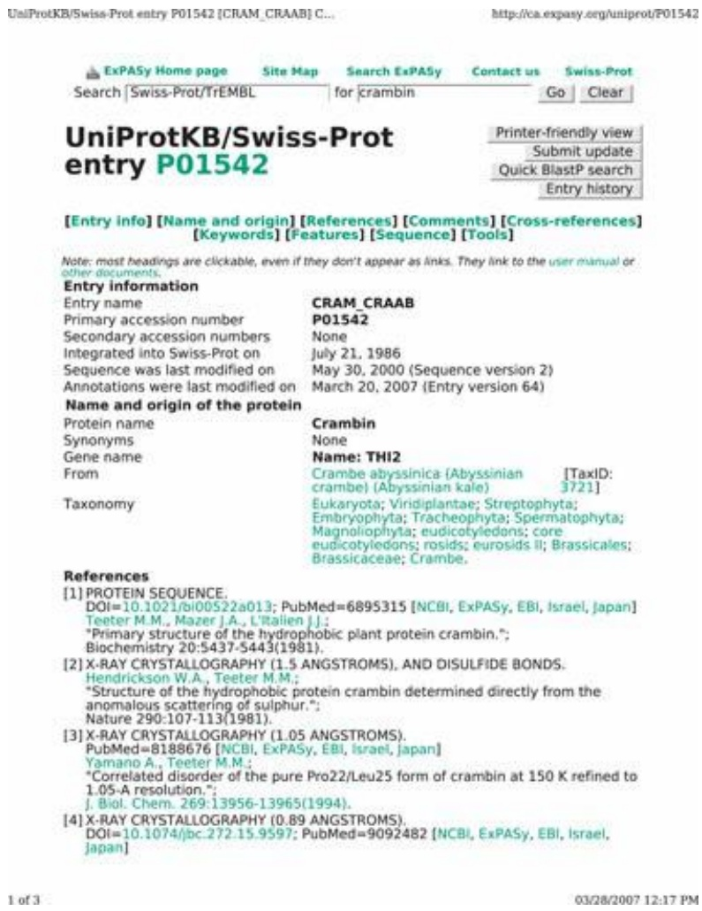

<details>
<summary>text_image</summary>

UniProtKB/Swiss-Prot entry P01542 [CRAM_CRAAB] C...
http://ca.expasy.org/uniprot/P01542
ExPA5y Home page Site Map Search ExPA5y Contact us Swiss-Prot
Search |Swiss-Prot/TrEMBL for |crambin Go Clear
UniProtKB/Swiss-Prot
entry P01542
Printer-friendly view
Submit update
Quick BlastP search
Entry history
[Entry info] [Name and origin] [References] [Comments] [Cross-references]
[Keywords] [Features] [Sequence] [Tools]
Note: most headings are clickable, even if they don't appear as links. They link to the user manual or
other documents.
Entry information
Entry name CRAM_CRAAB
Primary accession number P01542
Secondary accession numbers None
Integrated into Swiss-Prot on July 21, 1986
Sequence was last modified on May 30, 2000 (Sequence version 2)
Annotations were last modified on March 20, 2007 (Entry version 64)
Name and origin of the protein
Protein name Crambin
Synonyms None
Gene name Name: THI2
From Crambe abyssinica (Abyssinian [TaxID:
crambe) (Abyssinian kale) 3721]
Taxonomy Eukaryota; Viridiplantae; Streptophyta;
Embryophyta; Tracheophyta; Spermatophyta;
Magnoliophyta; eudicotyledons; core
eudicotyledons; rosids; eurosids II; Brassicales;
Brassicaceae; Crambe.
References
[1] PROTEIN SEQUENCE.
DOI=10.1021/bi00522a013; PubMed=6895315 [NCBI, ExPASy, EBI, Israel, Japan]
Teeter M.M., Mazer J.A., L'Italien J.J.;
*Primary structure of the hydrophobic plant protein crambin."]
Biochemistry 20:5437-5443(1981).
[2] X-RAY CRYSTALLOGRAPHY (1.5 ANGSTROMS), AND DISULFIDE BONDS.
Hendrickson W.A., Teeter M.M.;
*Structure of the hydrophobic protein crambin determined directly from the
anomalous scattering of sulphur."]
Nature 290:107-113(1981).
[3] X-RAY CRYSTALLOGRAPHY (1.05 ANGSTROMS).
PubMed=8188676 [NCBI, ExPASy, EBI, Israel, Japan]
Yamano A., Teeter M.M.;
*Correlated disorder of the pure Pro22/Leu25 form of crambin at 150 K refined to
1.05-A resolution."]
J. Biol. Chem. 269:13956-13965(1994).
[4] X-RAY CRYSTALLOGRAPHY (0.89 ANGSTROMS).
DOI=10.1074/jbc.272.15.9597; PubMed=9092482 [NCBI, ExPASy, EBI, Israel,
japan]
</details>

155

---

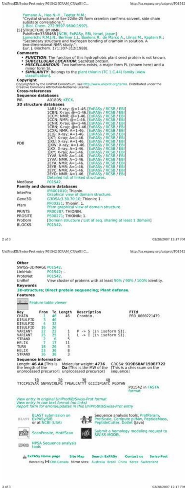

<details>
<summary>text_image</summary>

UniProtKB/Swiss-Prot entry P01542 [CRAM_CRAAB] C...
Yamano A., Heo N.-H., Teeter M.M.;
*Crystal structure of Ser-22/ile-25 form crambin confirms solvent, side chain
substate correlations.;
J. Biol. Chem. 272:9597-9600(1997).
[5] STRUCTURE BY NMR.
PubMed=3338468 [NCBI, ExPASy, EBI, Israel, Japan]
Lamerichs R.M.J.N., Berliner L.J., Boelens R., de Marco A., Llinas M., Kaptein R.;
*Secondary structure and hydrogen bonding of crambin in solution. A
two-dimensional NMR study.;
Eur. J. Biochem. 171:307-312(1988).
Comments
FUNCTION: The function of this hydrophobic plant seed protein is not known,
SUBCELLULAR LOCATION: Secreted protein.
MISCELLANEOUS: Two isoforms exists, a major form PL (shown here) and a
minor form SI.
SIMILARITY: Belongs to the plant thionin (TC 1.C.44) family [view
classification].
Copyright
Copyrighted by the UniProt Consortium, see http://www.uniprot.org/terms. Distributed under the
Creative Commons Attribution-NoDerivs License.
Cross-references
Sequence databases
PIR A01805; KECX.
3D structure databases
PDB 1AB1; X-ray; @=1-46. [ExPASy / RCSB / EBI]
1CBN; X-ray; @=1-46. [ExPASy / RCSB / EBI]
1CCM; NMR; @=1-46. [ExPASy / RCSB / EBI]
1CCN; NMR; @=1-46. [ExPASy / RCSB / EBI]
1CNR; X-ray; @=1-46. [ExPASy / RCSB / EBI]
1CRN; X-ray; @=1-46. [ExPASy / RCSB / EBI]
1CXR; NMR; A=1-46. [ExPASy / RCSB / EBI]
1EJG; X-ray; A=1-46. [ExPASy / RCSB / EBI]
1XT; X-ray; A=1-46. [ExPASy / RCSB / EBI]
1XU; X-ray; A=1-46. [ExPASy / RCSB / EBI]
1XW; X-ray; A=1-46. [ExPASy / RCSB / EBI]
1XX; X-ray; A=1-46. [ExPASy / RCSB / EBI]
1XY; X-ray; A=1-46. [ExPASy / RCSB / EBI]
1YVB; NMR; A=1-46. [ExPASy / RCSB / EBI]
1YVA; NMR; A=1-46. [ExPASy / RCSB / EBI]
2EYA; NMR; A=1-46. [ExPASy / RCSB / EBI]
2EYB; NMR; A=1-46. [ExPASy / RCSB / EBI]
2EYC; NMR; A=1-46. [ExPASy / RCSB / EBI]
2EYD; NMR; A=1-46. [ExPASy / RCSB / EBI]
Detailed list of linked structures.
ModBase P01542.
Family and domain databases
InterPro IPR001010; Thionin.
Graphical view of domain structure.
Gene3D G3DSA:3.30.70.10; Thionin: 1.
Pfam PF00321; Thionin: 1.
Pfam graphical view of domain structure.
PRINTS PR00287; THIONIN.
PROSITE PS00271; THIONIN: 1.
ProDom [Domain structure / List of seq. sharing at least 1 domain]
BLOCKS P01542.
2 of 3 03/28/2007 12:17 PM
UniProtKB/Swiss-Prot entry P01542 [CRAM_CRAAB] C...
Other
SWISS-3DIMAGE P01542.
LinkHub P01542; -.
ProtoNet P01542.
UniRef View cluster of proteins with at least 50% / 90% / 100% identity.
Keywords
3D-structure; Direct protein sequencing; Plant defense.
Features
Feature table viewer
Key From To Length Description FTId
CHAIN 1 46 46 Crambin. PRD_0000221479
DISULFID 3 40
DISULFID 4 32
DISULFID 16 26
VARIANT 22 22 1 P -> S (in isoform SI).
VARIANT 25 25 1 L -> I (in isoform SI).
STRAND 2 6 5
HELIX 7 17 11
TURN 18 20 3
HELIX 23 30 8
STRAND 36 38 3
Sequence information
Length: 46 AA [This is Molecular weight: 4736 CRC64: 919E68AF159EF722
the length of the Da [This is the MW of the [This is a checksum on the
unprocessed precursor] unprocessed precursor] sequence]
TTCCPSIVAR SNFNVCRPLPG TPEALCATYT GCIIIPGATC PGDYAN P01542 in FASTA
format
View entry in original UniProtKB/Swiss-Prot format
View entry in raw text format (no links)
Report form for errors/updates in this UniProtKB/Swiss-Prot entry
BLAST BLAST submission on Sequence analysis tools: ProtParam,
ExPASy/SIB ProtScale, Compute pl/Mw, PeptideMass,
or at NCBI (USA) PeptideCutter, Dotlet (Java)
ScanProsite, MotifScan Submit a homology modeling request to
SWISS-MODEL
NPSO Sequence analysis tools
ExPASy Home page Site Map Search ExPASy Contact us Swiss-Prot
Hosted by |+| CBR Canada Mirror sites Australia Brazil China Korea Switzerland
3 of 3 03/28/2007 12:17 PM
</details>

Figure 3.2 UniProtKB/SWISS-PROT entry for crambin.

• relevant reference information, some specific to the entry (for instance, bibliographical information about papers reporting the sequence and structure) or relevant but not specific to the entry (for instance, information about the taxonomic classification of the source organism);
• links to other databases, including InterPro, Gene3D, Pfam, PRINTS, PROSITE, ProDOM, and BLOCKS;

156

---

• the feature table, indicating annotations of structural roles of different residues, including the assignments of secondary structure: helices and strands of sheet.

The actual sequence is a very small portion of the entry!

Another important type of link launches a calculation, to analyse selected data. Consider the retrieval of amino acid sequences from UniProtKB (see Fig. 3.3). Searching for serpins in C. elegans returned 22 entries. It is possible to select any or all of them, by checking the boxes, and pass them directly to a multiple sequence alignment program by clicking on ‘Align’. It is not necessary to save the sequences, nor even to cut and paste them into a different window.

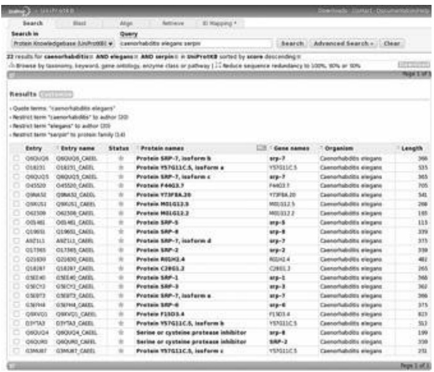

<details>
<summary>text_image</summary>

Search in
Protein Knowledgebase UniProtKB v
Query
caenorhabditis elegans serps
Search
Advanced Search
Clear
21 results for caenorhabditis AND elegans AND serps in UniProtKB sorted by score descending:
• Browse by Gasmacy, keyword, gene ontology, enzyme class or pathway |  reduce sequence redundancy to 100%, 80% or 50%
Results
• Quote terms: "caenorhabditis elegans"
• Restrict term "caenorhabditis" to author (20)
• Restrict term "elegans" to author (20)
• Restrict term "serpin" to protein family (14)
Entry
Entry name
Status
Protein names
Gene names
Organism
Length
Q9XVQ6
Q9XVQ5_CAMEL
Protein SRP-7, isoform b
srp-7
Caenorhabditis elegans
366
Q18JQ1
Q18JQ1_CAMEL
Protein Y57G11C.S, isoform a
Y57G11C.S
Caenorhabditis elegans
535
Q9XVQ5
Q9XVQ5_CAMEL
Protein SRP-7, isoform c
srp-7
Caenorhabditis elegans
365
Q45S20
Q45S20_CAMEL
Protein F44G3.7
F44G3.7
Caenorhabditis elegans
705
Q9NAS2
Q9NAS2_CAMEL
Protein Y73F8A.20
Y73F8A.20
Caenorhabditis elegans
541
Q9XU51
Q9XU51_CAMEL
Protein M01G12.3
M01G12.3
Caenorhabditis elegans
288
Q42S09
Q42S09_CAMEL
Protein M01G12.3
M01G12.3
Caenorhabditis elegans
185
Q5H4S1
Q5H4S1_CAMEL
Protein SRP-5
srp-5
Caenorhabditis elegans
115
Q19E53
Q19E53_CAMEL
Protein SRP-8
srp-8
Caenorhabditis elegans
379
A9ZJL3
A9ZJL3_CAMEL
Protein SRP-7, isoform d
srp-7
Caenorhabditis elegans
375
Q17N65
Q17N65_CAMEL
Protein SRP-2
srp-2
Caenorhabditis elegans
378
Q21E09
Q21E09_CAMEL
Protein R02G3.4
R02G3.4
Caenorhabditis elegans
482
Q18J97
Q18J97_CAMEL
Protein C29G3.2
C29G3.2
Caenorhabditis elegans
265
Q1SEK60
Q1SEK60_CAMEL
Protein SRP-1
srp-1
Caenorhabditis elegans
366
Q1SCY33
Q1SCY33_CAMEL
Protein SRP-3
srp-3
Caenorhabditis elegans
362
Q1SEPT33
Q1SEPT33_CAMEL
Protein SRP-7, isoform e
srp-7
Caenorhabditis elegans
366
Q1SEYN43
Q1SEYN43_CAMEL
Protein SRP-6
srp-6
Caenorhabditis elegans
375
Q9WVG03
Q9WVG03_CAMEL
Protein F12D3.4
F12D3.4
Caenorhabditis elegans
623
Q1PYTA3
Q1PYTA3_CAMEL
Protein Y57G11C.S, isoform b
Y57G11C.S<fcel>Caenorhabditis elegans
512<nl>Q9XVQ64
Q9XVQ64_CAMEL
Serine or cysteine protease inhibitor<fcel>srp-8<fcel>Caenorhabditis elegans<fcel>199<nl>Q42WPG3<fcel>Q42WPG3_CAMEL<fcel>Serine or cysteine protease inhibitor<fcel>SRP-2<fcel>Caenorhabditis elegans<fcel>378<nl>Q3MXRT7<fcel>Q3MXRT7_CAMEL<fcel>Protein Y57G11C.S, isoform c<fcel>Y57G11C.S<fcel>Caenorhabditis elegans<fcel>251<nl>Page 1 of 2
</details>

Figure 3.3 Results of search in UniProtKB for serpins in C. elegans, demanding no hypothetical molecules. The software permits selction of any or all sequences by checking boxes on the left, launching a BLAST search or submission to a multiple sequence alignment program directly.

The UniProt Consortium (2007). The Universal Protein Resource (UniProt). Nucl. Acids Res., **35**, D193–D197. [http://www.uniprot.org](http://www.uniprot.org).


## See Weblem 3.10

## Database interoperability

How can we deal with questions that require appeal to multiple databases at once? There are two general approaches:

1. merge several databases into a single one with the combined contents of the contributors;
2. develop methods for intercommunication between databases that allow dissection and distribution of queries, and recombination of responses.

Historically there were good reasons why databases maintained a pretty sharp focus on a selected topic. Database projects reflected the interests and expertise of small groups of dedicated individuals. The data representation and organization flowed from the natural properties of the information. Moreover, in the early days levels of support remained relatively small. With no earmarked categories of funding, databases had to compete with—and often were obliged to disguise (not really too strong a word) themselves as—research projects. This was another factor promoting specialization.

The overall growth, and consolidation of effort, in recent years, of genome sequencing and associated bioinformatics and database activities, has given a natural impetus to merging of

157

---

information resources. Some, for instance UniProtKB, have assimilated a number of separate databases into ‘the universal protein resource’, as they describe themselves. ENTREZ, maintained at the NCBI in the USA, close-couples 36 component databases, with facilities for simultaneous searching. Of course the common managerial superstructure facilitates the integration of these databases. One obvious component of integration is consistency checking and reconciling of disagreements in data or annotation.

The alternative approach is to leave individual databases separate, and to layer a query system on top of them. This system would:

1. disassemble information retrieval requests into partial questions that would be farmed out to different databases; and then
2. merge the responses into a coherent conclusion.

This is an active area of current research. Most people would not consider it a solved problem.

Common to all approaches is the goal of facile interaction among different databases. This involves both a careful specification of the ontology and schema of each database, so that the outside world can correctly interpret its contents, and create mechanisms for handling queries within a framework free of commitment to any specific database organization. CORBA—Common Object Request Broker Architecture—is such a system, which has many adherents in the bioinformatics community.

## Data mining

The examples we have discussed of information retrieval from databases have involved the framing by a user of a specific set of criteria, and the return of relevant entries, selected according to criteria. Consider alternatively a scientific field in the exploratory phase, where a large amount of data has become available, and the challenge is to understand what underlying patterns exist. The first step is to generate hypotheses about those patterns. Perhaps experts might guess what to look for. Testing and refining the experts’ hypotheses then requires computer programs that probe information archives with sets of queries, seeking relationships and correlations in the data. This is the traditional way that science has made progress.

Now, the power of programs permits them to take the initiative in data exploration, to some extent. For example, programs can be adapted to assign data to classes on the basis of ‘training’ with examples, even if it is not possible explicitly to specify the rules that define the classes. It is even possible for a program to suggest hypotheses about patterns implicit in our data. This amounts to a partial automation of scientific research.

Machine learning is a computational approach to data analysis in which, through analysis of relevant information resources, computer programs achieve the ability to infer properties of data. Two complementary aspects are:

1. knowledge discovery: descriptions, or even explanations, of regularities in the data; and
2. successful forecasting, or predictive modelling.

Sophisticated numerical methods applied to data analysis include the following.

Statistical techniques, including clustering and classification algorithms, and principal component analysis (identification of a small number of possibly composite parameters that account for most of the variation in a set of data). Hidden Markov models are the most powerful methods for

158

---

detecting homologous amino acid sequences of proteins.

• Artificial neural networks (See Chapter 6). Neural networks are the method of choice for prediction of secondary structures of proteins.
• Support vector machines are algorithms for classification that outperform neural networks in a number of applications.

Both artificial neural networks and support vector machines are data structures and algorithms for supervised learning. In supervised learning, the general framework of a program is constructed, but the details depend on choices of parameters. By exposing the program to a number of objects of known classification, and telling the program whether its prediction was correct or not (the supervision phase), the program can tune its parameters to give the optimal performance.

The computer programs that implement some machine-learning techniques, including artificial neural networks, have complex internal structures. Large numbers of variable parameters give them versatility; optimization of the parameters by training can achieve impressive accuracy in classifying input data. A disappointing aspect is that it is usually impossible to ‘pick apart’ a trained network, to harvest any insights into the structure of the data, that are expressible in a simple, understandable, form. (R. Hamming wrote, ‘The goal of computing is insight, not numbers.’ Today most people want both.) Some statistical methods do provide such insight, at least by identifying which are the important variables, or combinations of variables.

An example of a program that achieves unsupervised learning is T. Kohonen's self-organizing map (SOM). A two-dimensional SOM is a neural network that clusters similar items of highdimensional data and projects the relationships onto a plane (see Box 3.4). Reduction to two dimensions is most convenient because the results are easy to visualize; however, this is not a limitation of the SOM technique.

## Programming languages and tools

A computer program is a set of orders that a computer will execute. At the moment of execution, the orders must be specified in a form that can activate the computer; that is, the orders must be in a form that corresponds to the computer's limited repertoire of basic operations. Human beings would like to specify the orders in a human language. This has led to the development of ‘pidgin’ languages that allow people to write computer programs in languages as close as possible to natural mathematical discourse, but followed by translation into the computer's operation set. FORTRAN was the first of these.

## Box 3.4 Application of self-organizing maps to analyse olfactory perception space

Odours are an important component of our perceptual environment, and play crucial roles in the sensory lives of many mammals. From the molecular point of view, a set of receptor protein molecules mediates recognition and distinction of odours. Typically mammals express ≈1000 homologous odorant-receptor proteins. At the psychological level humans can distinguish ≈10 000 odours. However, it is difficult to classify odours: There is no natural distance measure, or ‘metric’, that would allow us to say, of the odours of banana, apple, and strawberry for example, which pair is the most similar. Moreover, judgements of smell have a component that varies with cultural background, and may be influenced by drugs or disease. Loss of acuity of smell is an early symptom of Alzheimer’s disease.

Ultimately, we should like to define mappings among (1) perceptual odour space, (2) the molecular structures of the active principles, and (3) the combinatorial code by which differential binding of ≈10 000 molecules to the

159

---

panel of ≈1000 odorant-receptor proteins creates sensation.

Madany Mamlouk, Martinetz, and Bower have applied T. Kohonen's SOMs to classification of odours.\* The Aldrich Flavor and Fragrance $\mathrm { C a t a l o g ^ { \dagger } }$ contains data for 851 chemicals, which are assigned profiles according to 278 odour descriptors, which is a high-dimensional space if there ever was one! The characterization of each chemical is not numerical but rather a record of which perceptual properties it possessed or lacked. Here is a small fragment:

| Odorant | Fruity | Pineapple | Sweet | Apple | Coconut | Nutty |
| --- | --- | --- | --- | --- | --- | --- |
| Hexyl butyrate | Yes | Yes | Yes | No | No | No |
| Methyl-2-methylbutyrate | Yes | No | Yes | Yes | No | No |
| 6-Amyl-α-pyrone | No | No | Yes | No | Yes | Yes |

From Madany Mamlouk, A. (2002). Quantifying Olfactory Perception. Diploma Thesis, University of Lübeck, Germany.

To each of the 851 chemicals corresponds a string of 278 bits. The Hamming distances between pairs of such profiles is the most obvious way to create a dissimilarity matrix. Applied to this matrix, the statistical technique of multidimensional scaling reduced the space to 32 dimensions but not farther.

The SOM neural network classified and clustered the data and projected it into two dimensions (see Fig. 3.4). Not surprisingly, citrus fruits form a class. A less obvious example of odours considered similar are caramel and vanilla. Moreover, as the map is a projection from many dimensions, orange and refreshing are also neighbours.

Do the clusters reflect similarities of chemical structure? Flavour and fragrance chemists have tried very hard to determine predictive rules for odours, based on molecular shape, and spectroscopic properties. Success has proved elusive. At the level of general chemical composition, Madany Mamlouk et al. mapped the nitrogen- and sulphur-containing compounds from their data set onto the clusters and found that they segregate into separated groups.

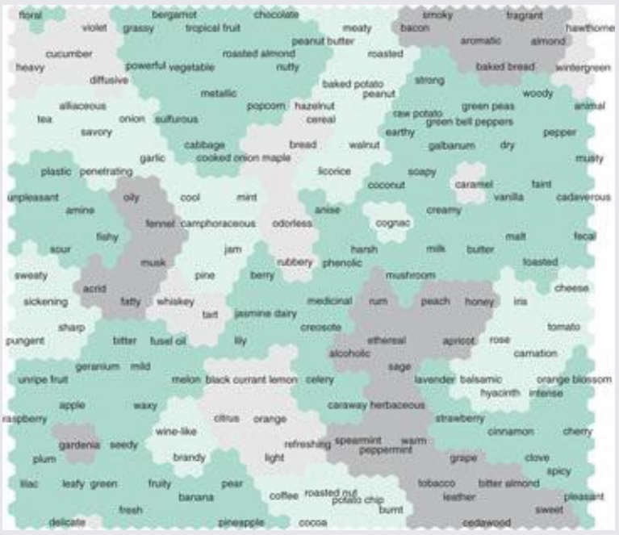

<details>
<summary>word_cloud</summary>

| Term | Color |
| --- | --- |
| floral | light green |
| violet | light green |
| bengarnot | light green |
| chocolate | light green |
| smoky | light green |
| fragrant | light green |
| hawthorne | light green |
| cucumber | light green |
| heavy | light green |
| diffusive | light green |
| artificial | light green |
| onion | light green |
| sugorous | light green |
| cabbage | light green |
| garlic | light green |
| cooked onion maple | light green |
| coconut | light green |
| caramel | light green |
| vanilla | light green |
| cadaverous | light green |
| unpleasant | light green |
| amine | light green |
| fishy | light green |
| fennet | light green |
| camphoraceous | light green |
| odorless | light green |
| honey | light green |
| milky | light green |
| butter | light green |
| toasted | light green |
| cheese | light green |
| sweet | light green |
| pungent | light green |
| bitter | light green |
| fusel oil | light green |
| lily | light green |
| alcoholic | light green |
| sage | light green |
| lavender | light green |
| balsamic | light green |
| orange blossom | light green |
| apple | light green |
| waxy | light green |
| citrus | light green |
| orange | light green |
| caraway herbaceous | light green |
| strawberry | light green |
| cinnamon | light green |
| cherry | light green |
| gardenia | light green |
| seedy | light green |
| wine-like | light green |
| white rice | light green |
| pineapple | light green |
| cocoa | light green |
| mint | light green |
| onion corn | light green |
| pineapple meal | light green |
| pineapple meal (low) | light green |
| pineapple meal (high) | light green |
| pineapple meal (very low) | light green |
| pineapple meal (very high) | light green |
| pineapple meal (very high) | light green |
| pineapple meal (very high) | light green |
| pineapple meal (very high) | light green |
| pineapple meal (very high) | light green |
| pineapple meal (very high) | light green |
| pineapple meal (very high) | light green |
| pineapple meal (very high) | light green |
| pineapple meal (very high) | light green |
| pineapple meal (very high) | light green |
| pineapple meal (very high) | light green |
| pineapple meal (very high) | light green |
| pineapple meal (very high) | light green |
| pineapple meal (very high) | light green |
| pineapple meal (very high) | light green |
| pineapple meal (very high) | light green |
| pineapple meal (very high) | light green |
| pineapple meal (very high) | light green |
| pineapple meal (very high) | light green |
| pineapple meal (very high) | light green |
| pineapple meal (very high) | light green |
| pineapple meal (very high) | light green |
| pineapple meal (very high) | light green |
| pineapple meal (very high) | light green |
| pineapple meal (very high) | light green |
| pineapple meal (very high) | light green |
| pineapple meal (very high) | light green |
| pineapple meal (very high) | light green |
| pineapple meal (veryhigh) | lightgreen |
| pineapple meal (veryhigh) | lightgreen |
| pineapple meal (veryhigh) | lightgreen |
| pineapple meal (veryhigh) | lightgreen |
| pineapple meal (veryhigh) | lightgreen |
| pineapple meal (veryhigh) | lightgreen |
| pineapple meal (veryhigh) | lightgreen |
| pineapple meal (veryhigh) | lightgreen |
| pineapple meal (veryhigh) | lightgreen |
| pineapple meal (veryhigh) | lightgreen |
</details>

Figure 3.4 Clustering by SOM technique of perceptual odorant space. The 851 chemicals cluster into 37 groups.

From Madany Mamlouk, A., Chee-Ruiter, C., Hofmann, U.G., and Bower, J.M. (2003). Quantifying olfactory perception: mapping olfactory perception space by using multidimensional scaling and self-organizing maps. Neurocomputing, **52–54**, 591–597.

<sup>\*</sup>Madany Mamlouk, A., Chee-Ruiter, C., Hofmann, U.G., and Bower, J.M. (2003). Quantifying olfactory perception: mapping olfactory perception space by using multidimensional scaling and self-organizing maps. Neurocomputing, **52–54**, 591–597.
†Sigma Aldrich Chemicals Company, Milwaukee, WI, USA, 1996.

160

---

Programming languages differ from natural human languages in many respects, including a restricted horizon of possibility of expression, and very strict intolerance to error. A similar intolerance to error affects the preparation and formatting of data to be read by computer programs. To serve as input to a program, data must be (1) presented according to specific rules—for example, terms restricted to a controlled vocabulary—and (2) properly formatted. There is a tension between user-friendliness and program-friendliness in the requirements.

Another distinction, which is not as sharp as it used to be, classifies programs into systems programs and applications programs. Applications programs are generally specific to one or more users. They solve a particular problem in a particular field. They are active in a computer for limited times, after which they report an answer and disappear. In contrast, systems programs govern the overall workflow of the computer, are common to all users, and are consistent with the use of the computer to solve a wide variety of problems (by means of individual applications programs). For instance, a program to superpose two or more protein structures would be an application program. The programs that create the general operating environment—for instance UNIX or Microsoft Windows—are systems programs.

Operating systems offer many specific facilities in addition to their overall ‘housekeeping’ functions. To create lists of orders invoking the facilities of the operating system is to write a program called a script.

The boundaries between systems and applications program are becoming fluid. All the features of the editor with which I am typing this paragraph are specific to the problem of accepting and editing text. However, many people use it, it was distributed with the operating system, and it remains active (in ‘background’) even when I am finished with this passage. Conversely, many programmers who put together large and powerful packages that address a variety of problems—for example, retrieval of genetic sequences from a database—boast of having written ‘program systems’ (rather than systems programs).

## Traditional programming languages

Previous generations of computer languages included FORTRAN, C, and C++. Usually, a separate program called the compiler translates a program in these languages into the appropriate set of computer instructions. The maturity of compiler technology, together with the understanding of algorithms provided by computer scientists, and the experience and skill of the community of programmers, combine to make these languages most suitable for large-scale computations which strain the available resources.

Another advantage of not writing in native machine language is code portability: the ability of one program, written in FORTRAN, C, or C++, to run on a large variety of platforms. It is true that each target machine language requires its own compiler. But writing a compiler needs be done only once per machine, and there is mature software that facilitates compiler construction. Then an entire literature of programs becomes executable.

## Scripting languages

Many extremely useful tasks require only minimal computer resources. For instance, the translation of a gene sequence into an amino acid sequence requires only a straightforward looking-up on a table for each codon (See Chapter 1). For these, a simple program achieves adequate throughput: what is important is to save programmer time. The computer time required is often negligible.

161

---

Indeed, there has been a steady trend in the relative costs of hardware and software. The balance is tipping, steeply, in the direction of high costs of creating software relative to purchasing and maintaining hardware. Programming practice has reacted with tools and languages that streamline the effort required to write code that works correctly, even at some cost in efficiency of execution.

Several languages provide such facilities, including PERL, PYTHON, and RUBY. At least in their initial versions they were interpreted languages. This means that the systems program that carried out the commands skipped the step of compilation to machine language, but simulated the stated operation on a line-by-line basis. In principle this makes for less-efficient execution. In any case, it is a legitimate price to pay for the ease of writing the program and the sharp curtailment of the ‘debugging’ phase. Often the difference in execution time is unnoticeable.

Some languages can be run in either interpretive or compiled mode, for instance LISP. Demonstration by a new interpreted language such as PERL of significant advantages and popular appeal will elicit writing of a compiler, or at least a more efficient interpreter. (A superficially attractive but ultimately ineffective idea is to write a translation program that will convert the scripting language into a language which can be compiled. This will often not speed up execution significantly if the original interpreter calls upon programs written in the compiled language.)

Useful skills in using a scripting language such as PERL are relatively easy to attain, relative to languages such as C or C++. Learning some PERL (or PYTHON or RUBY) is a good compromise for a research scientist who does not intend to specialize in software creation.

## Program libraries specialized for molecular biology

Programmers usually construct new programs by combining well-established components. For instance, an algorithm may contain a step that requires sorting a list, or solving linear equations. Subprograms for these steps are widely available. All programs depend on standard libraries for input and output. Almost never does one write a program completely ‘from scratch.’

In addition to standard libraries for numerical analysis and text processing there are libraries specialized for molecular biology. Different libraries are associated with different programming languages. For example, BioPERL ([http://www.bioperl.org](http://www.bioperl.org)) contains modules that implement common computational tasks in bioinformatics, written in PERL. Typical modules translate nucleic acid sequences to protein sequences, or perform sequence alignments. Modules can be integrated smoothly into a new program.

## Java: computing over the web

The Java language has a syntax with many similarities to C and C++. Its operating environment is designed to address the following problem: suppose the creator of a website wants to provide a program which users can run interactively from a browser. If the program is run on a computer at the website, and if many users simultaneously avail themselves of the facilities, the hardware on which the website is running will come under pressure. An example of this mode is the NCBI BLAST server, which in a typical month fields about 6.5 million enquiries, and runs them on a cluster with 300 CPUs.

An alternative is to ask each user to provide the computer power. Without leaving the website, the browser will dynamically download programs (called applets). The programs will be run on the user's computer. This, in turn, creates a security problem: the user must give the website access to resources on the user's computer. A website that can download executable code and gain access to

162

---

the local files can do considerable harm, including crashing the computer, or snooping around the file system to steal or damage confidential information, or carrying out unwanted invasive activity such as displaying unsolicited advertising material.

The basic idea of the way to protect the user is as follows: the downloaded Java program is not run directly by the user's operating system, but involves an intermediate agent. The user's system simulates an internal computer—called a virtual machine—which runs the Java program. (Each actual operating system requires its own Java virtual machine to provide the executable environment for programs written in Java. Automatic portability of Java programs is concomitant.) The virtual machine carefully restricts the resources to which the Java program running under its auspices has access. The local virtual machine imposes the rules; the distant website programmer must follow them.

Java is a compiled language. Although usually executed from a browser, Java programs can stand alone. In contrast, programs in JavaScript are interpreted by a browser.

## Markup languages

Algorithms + data structures = programs

N. Wirth

Markup languages implement data structures, which are as essential a component of programs as executable instructions. Data structures are the organization of the information on which a program acts. Choice of the proper data structure is a crucial aspect of programming.

The term markup originally described editors’ annotations to manuscripts, which control the appearance of the final published text without explicitly appearing in it. An example would be designation of certain words to appear in italics. Computer-typesetting systems include formatting commands: the UNIX facilities of the ‘roff’ family are an early example, and D. Knuth's TeX system is a development with all possible bells and whistles. HTML, or hypertext markup language, is primarily a presentational markup language.

The utility of the close coupling of annotation with contents extends, beyond presentation markup, to organization of data in files. Such a structure provides an alternative to traditional positional formatting. Positional formatting is specifying how to interpret an item in a file through rigid rules specifying where the item appears. Typical examples of positional formatting are: ‘The number of bases in the sequence appears in columns $1 0 { - } 1 6 ^ { \circ }$ or ‘Items, separated by white space, appear in the order: gene name, source organism, number of bases, sequence’. The markup approach achieves greater flexibility by associating each item with a local descriptor. The line:

$$
<   \text {number of bases} > 5 3 8 6 <   / \text {number of bases} >
$$

could appear anywhere in a file. A program or a human reader would recognize what the number 5386 signified. The syntax < descriptor > value < /descriptor> is common to many markup languages, including HTML. The descriptor is called a tag. The material enclosed by the beginning and end of the tag is called the element. Standardization of the syntax simplifies the construction of the software to interpret it.

Tag/element combinations provide self-describing data. Moreover the data description is local; that is, contiguous with individual data items. In contrast, the summaries that appear in the Learning goals at the beginning of each chapter in this book are descriptions of contents that are not local to the sections to which they refer.

163

---

Flexibility of format comes at a price, most obviously in a rather cumbersome and bloated appearance of the files. Nor is adult supervision entirely unnecessary: the ontology of the data must specify acceptable ranges of values. Programs could not be asked to swallow:

$$
<   \text {number of bases} > \text {Tuesday} <   / \text {number of bases} >
$$

Therefore, any file in a markup language requires a schema: a list of allowed element and attribute names, and allowed ranges of values. This permits validating a file for proper formatting and consistency. A Document Type Definition, itself written in a standardized language, specifies the schema. Note that < number of bases > Tuesday < /number of bases > is valid syntax but invalid with respect to any reasonable schema.

There are many markup languages, specialized for different types of data. One of the most general is XML (or extensible markup language), used in many databases and information-retrieval systems. XML assumes a tree-based, or hierarchical, structure of the material. Lower-level tags and elements can appear within higher-level ones.

An XML database of mammalian species might contain the following:

```txt
\<mammals>
    \<genus>Homo
        \<species>sapiens common_name=
            'human'</species>
        \<species>neanderthalis common_name=
            'neanderthal man'</species>
    \</genus>
\</mammals>
```

Note the three nested levels of tags: mammals, genus, species. The species elements include the common name as an attribute. In an alternative schema, the common name might be a separate tag within the species.

It would be more difficult to construct an XML database of information that is nonhierarchical. Consider a database of information about movies. It would be possible to define an XML schema in which the movie title was at a higher level in the hierarchy than the list of performers. Then it would be easy to probe the database with a movie title, and retrieve the cast. In contrast, it would be more difficult to retrieve all the movies in which Peter Sellers acted. In an alternative schema the performers could be at a higher level than the movies, making it easy to search for an actor or actress, but then it would be difficult to probe with a title and retrieve the cast. A relational database would be a more natural way to organize the data if one wanted to be able to query with either movie title or performer. However, facilities for such queries are not completely incompatibile with XML. Even in a database that is structured hierarchically with an XML schema, it is possible to index it in different ways to support versatile approaches to retrieval, including nonhierarchical ones.

XML, unlike HTML, is not directly concerned with appearance or presentation. On the other hand, it is perfectly possible to write formatting programs that control the presentation of the contents of an XML file such as the mammal-genus-species example. Such a program could follow convention to display genus and species names in italics. Different programs could impose independent decisions about how to display common names. One program could display common names in boldface, another in plain roman type.

In contrast, in an HTML file, the decision to display common names in boldface type would be irrevocably implemented by tags: < b > neanderthal man &lt;/b&gt;, which would force **neanderthal man** to appear in boldface. Moreover, it is impossible to make up novel tags for HTML format (without approval by an international commission). In other words, the schema of HTML has been fixed. This

164

---

has the advantage of complete portability and the disadvantage of inflexibility.

Markup languages in general, and XML and HTML in particular, are becoming standard in database construction and distribution:

Archiving and curating data. XML provides a general and flexible structure compatible with organizing information from many different fields and applications. Data validation—checking that the values of the elements are consistent with the schema—is straightforward. The results provide a format for data interchange, facilitating database interoperability.
• Providing data to programs. Insertion of a parser between an XML data file and an application program can simplify the input phase of a calculation.
Ease of data extraction and presentation. Selection of data and formatting into an HTML file can be a natural and fluent mapping that facilitates conversion of data into a form that is both humanfriendly and distributable over the web. Other markup languages provide facilities for describing graphics. These are profoundly concerned with both data structure and presentation.

## Natural language processing

Biomedical research depends crucially on the quality of the data and annotations in databases. Some annotations are generated from the data whereas others are extracted from articles in the scientific literature. Extraction from the literature is a labour-intensive activity that will not be able to keep up with the increasing rate of published articles. Will it be possible for computers to take over this task? Unlike most input prepared for computers in strictly defined formats, the literature, aimed primarily at human-to-human communication, appears in a natural language, although of course many articles contain equations and tables. Much of the contemporary scientific literature is written in English.

Natural language refers to the oral and/or textual forms of human-to-human communication. Natural language processing by computer means at least the analysis of a stream of spoken or written words that a human could interpret and at best a suitable reaction, such as acting on a command or providing a suitable response in the natural language. (Few people think it a realistic goal for computers to deal with the grunt-and-gesture communications especially common in certain cities.)

Natural language processing has been a goal of computing for decades. Early hopes, during the 1950s and 1960s, for achieving automatic language translation, were unfulfilled (see Box 3.5).

A major difficulty in natural language processing is the ambiguity of words and even phrases. If a man married to a lawyer asks his wife to ‘press his suit’, does he want sartorial or forensic action? Human beings extract the meaning from such phrases by using contextual clues to resolve ambiguities. No reader would interpret the third line of Keats's ‘Ode to a Nightingale’:

## Box 3.5 Automatic translation?

An apocryphal story about automatic translation concerns a program that converted English to Russian and back. From the input ‘The spirit is willing but the flesh is weak’ came back ‘The vodka is fine but the meat is rotten.’ (That this occurred in a computer system is an urban myth. The first traceable publication of this joke actually is in a newspaper over a century ago: The Decatur, Illinois, USA Herald, 20 January 1903, p. 5.) A true computer translation howler was the rendering of ‘…la Cour de Justice considére la création d'un sixiéme poste d'avocat général’ as ‘…the Court of Justice is considering the creation of a sixth general avocado station.’\*

<sup>\*</sup>Wheeler, P.J. and Lawson, V. (1982). Computing ahead of the linguists. Ambassador Int., March, 21–22.

165

---

My heart aches, and a drowsy numbness pains

My sense, as though of hemlock I had drunk,

Or emptied some dull opiate to the drains

One minute past, and Lethe-wards had sunk

as signifying that the poet had just poured his opiate down his kitchen sink. Keats was deliberately using archaic senses of words.

Turning from the sublime to the ridiculous, headlines, because of their enforced concision, are common sources of ambiguity. A standard machine parser ([http://www.link.cs.cmu.edu/link/](http://www.link.cs.cmu.edu/link/)) got this one wrong:

## British left waffles on Falklands<sup>5</sup>

It interprets ‘left’ as a verb and ‘waffles’ as a noun.

Computer programs have access to neither life experience nor context-related clues: is the lawyer's husband holding a garment or a folder of papers? Therefore, ambiguities are difficult to circumvent. A simplification is to restrict the field of discourse. For instance, an early natural languageprocessing system provided an interface to a database of information about the baseball team the Boston Red Sox.

A relatively successful approach to the specific problem of machine translation has been Google Translate. It works by searching a large corpus of paired documents produced by human translators. It is not immune from ambiguity: it translated, from English to French:

They fired the professor for showing up drunk in class.

as

Ils ont tiré le professeur pour se présenter ivre en classe.

but French tirer means fire in the sense of fire a gun, not a person.

## Natural language processing and mining the biomedical literature

Natural language processing in bioinformatics has set as goals the extraction of information from the relevant scientific literature and databases. Applications of textual analysis of databases of biomedical literature include the following.

## Identifying keywords and combinations of keywords

Given a list of names of genes and a list of names of diseases it should be possible to identify papers that contain references to combinations of genes and diseases, and to produce a list of gene/disease combinations based on co-occurrences in one or more papers. Several aspects of this problem make it more challenging than a simple keyword search. Many biological entities have multiple synonyms. Conversely, many terms appear in several technical categories and are used also as colloquial terms. As an extreme example, consider: ‘common cold’, ‘cold sore’, ‘cold shock protein’, ‘kept in a cold room’, ‘cold finger’, ‘paroxysmal cold haemogloburia’, ‘cold turkey’, ‘cold compresses’, ‘colicigonenic plasmid Cold-CA23’, and ‘Cold Spring Harbor Laboratory’, all of which appear in technical articles. Disambiguation challenges abound even in the restricted sphere of the biomedical literature.

166

---

Bioinformaticians have applied synonym dictionaries, syntactic analysers that parse sentences to assign parts of speech to words—cold is a noun in only two of the examples in the preceding paragraph—and a variety of machine learning models that try to assemble context information by analysing the groups of terms that accompany each potential meaning of a word.

## Knowledge extraction: protein–protein interactions

There are several approaches to compiling a database of protein–protein interactions, some experimental and some theoretical. One is to extract information automatically from the scientific literature. For instance, an article entitled: ‘Calnuc binds to Alzheimer's β-amyloid precursor protein and affects its biogenesis’ appeared in the Journal of Neurochemistry.<sup>6</sup> (Of course, it makes no difference whether the sentence is in the title or the text of the article.) A human reader could harvest for a protein interaction database the pair: calnuc and Alzheimer's β-amyloid precursor protein.

To extract this information automatically, it would help to have a list of protein names. The challenge is to write a program that can identify, within processed text, patterns of the form:

```txt
< protein name > ...
  < bind or some equivalent verb > ...
  < protein name >
```

The … allows for various kinds of intervening material. For instance, another article has the title: ‘Ubiquitin binds to and regulates a subset of SH3 domains’.<sup>7</sup> The program should recognize the verb ‘binds’ and ignore ‘to and regulates’. Alternatively, if one were trying to deduce regulatory networks, then a different verb would form part of the pattern. With respect to the proteins that bind ubiquitin, the title of this paper is relatively general. A sentence in the abstract of that paper: ‘The yeast endocytic protein Sla1, as well as the mammalian proteins CIN85 and amphiphysin, carry ubiquitin-binding SH3 domains’, would, if properly parsed, permit extraction of three specific SH3 domains that bind ubiquitin.

One word within the … that the pattern should not ignore is ‘not’: The sentence ‘Auxin-binding protein 1 does not bind auxin within the endoplasmic reticulum despite this being the predominant subcellular location for this hormone receptor’ <sup>8</sup> satisfies the pattern but is a false positive. It is not enough to check for the presence of ‘not’. Consider: ‘The human anti-apoptotic proteins cIAP1 and cIAP2 bind but do not inhibit caspases.’ <sup>9</sup>

To do a better job of data mining would seem to require a better analysis of the structures of the sentences used. A syntactic analyser is a program that parses natural language text. It identifies nouns, verbs, and other elements of a sentence. It specifies relationships among words; for instance, which noun or noun phrase is the subject of which verb (see Box 3.6).

Automatic text-mining software does not work perfectly. (See Problem 3.3.) Some people believe that there are fundamental limitations that will never be overcome. Nevertheless, for extracting information from the literature to create the complete and high-quality annotations in the databases on which

## Box 3.6 Syntactic analysis: parsing of English text

Applied to the sentence:

167

---

Mutations alter the base sequence of DNA.

a syntactic analyser would return:

```txt
[ROOT
  [S
    [NP [NNS Mutations]
      [VP [VBP alter
        [NP
          [NP [DT the [JJ nucleotide]
          [NN sequence]]
          [PP [IN of
            [NP [NNP DNA]]]]
        [...]]]
```

which could be displayed as a tree structure:

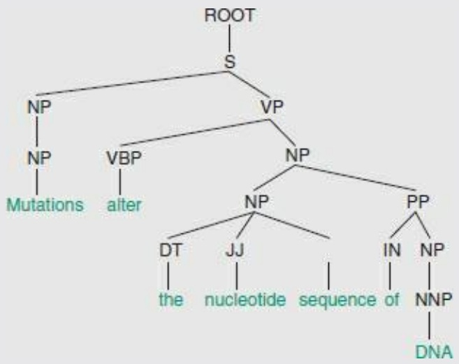

<details>
<summary>flowchart</summary>

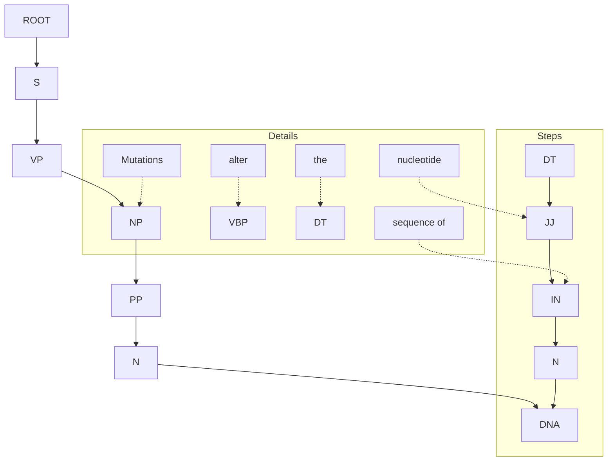
</details>

Here S = subject, NP = noun phrase, NN = singular noun, VP = verb phrase, VBP = verb (non-third-personsingular present tense), DT = determiner (article), JJ = adjective, IN = preposition, NNP = proper noun, singular (for a complete set of definitions see: [http://www.computing.dcu.ie/\~acahill/tagset.html](http://www.computing.dcu.ie/~acahill/tagset.html)).

research crucially depends, what else is there? Annotation by human action is labour-intensive and error-prone. Databases cannot augment their staff by sufficient numbers of well-trained annotation experts to do the job. The only real alternative to successful natural language processing is distributed annotation: authors of journal articles distill database annotations from their own results.

## Applications of text mining

Computational analysis of texts of articles in the biomedical literature offers a series of challenges. The results have been successful in supporting the identification of relevant information for collection into databases, and even in generating useful suggestions for treatments of diseases.

One goal is to identify papers that contain targetted types of information. For example, the protein sequence database SWISS-PROT stores information about protein function, and protein post-translational modifications. BIND is a database of protein–protein interactions. Identification of papers containing relevant information supports the work of the curators of these databases. Because the set of terms that might be relevant is so diffuse, simple keyword searches do not suffice. For instance, to identify post-translational modifications, a search for PHOSPHORYLATION would pick up not only papers describing the phosphorylation of proteins—which are relevant—but also the phosphorylation of glucose or fructose, which might well not be.

168

---

Selection of papers is already a useful result, even if a human curator must read them. The next step would be automatic extraction of the information from the paper. This is a challenge and focus of current research. CASP-like evaluations track progress.

The most basic task in computer analysis of an article is to identify the names that appear: names of genes, proteins, metabolites, drugs, and diseases (or more generally, phenotypes). Name identification depends heavily on dictionaries, but natural language processing contributes semantic information helpful in both recognizing names themselves and recognizing modifiers of names.

The next level is to identify associations and interactions. Examples include attempts to correlate genes or proteins with diseases, or, more generally, to assign function to genes or proteins. To extract interactions, the minimal pattern must include two names + one interaction, the interaction being specified by a word or a phrase. We have already seen examples of the combination:

$$
<   \text {protein name} > \dots \text {binds} \dots <   \text {protein name} >
$$

There are many other protein–protein interactions, such as:

$$
<   \text {protein name} > \dots \text {regulates} \dots <   \text {protein name} >
$$

More complex combinations are very important: a correlation between a set of interacting proteins and two or more apparently unrelated diseases can show a hidden relationship in the mechanism underlying the diseases.

## Identification of references to individual genes and proteins

A basic task is to identify in a body of text the names of the relevant objects, such as genes and proteins. The difficulty is the wide range and ambiguity of names, and the use of common words as parts of gene names. The problem of identifying the species from which a gene arises is very difficult, as many genes have equivalent names in different mammalian species. It is very important to recognize species differences in searching for correlations between genes and drug activities. Tamoxifen, used widely against breast cancer, was originally developed as a birth-control pill. It is a fine contraceptive for rats but promotes ovulation in women.

Chang, Schütze, and Altman developed a program called GAPSCORE that identifies gene and protein names within submitted text.<sup>10</sup> One might think that simply creating a dictionary and looking for its entries would suffice. Dictionaries are of course at the core of any identification procedure. But many genes names have other meanings. For instance, ‘ring’ (which stands for ‘really interesting new gene’) can also appear in articles in the biomedical literature in the context of chemical structure (‘histidine ring’) or histology (‘signet-ring cell’). Even the common colloquial sense of the word ring, as an item of jewellery, appears in the scientific literature in connection with metal-elicited contact dermatitis. Also, a dictionary should include a thesaurus, specifying, for example, that PTEN and MMAC1 are synonyms. (PTEN stands for phosphatase and tensin homolog and MMAC1 stands for mutated in multiple advanced cancers 1.)

GAPSCORE scores terms according to a statistical model based on:

dictionary lookup: a table of known gene names;
appearance: many gene names have the form NAT1; other gene or protein names end with -in. Many enzyme names end with -ase;
variations: the title of a recent paper included the phrase ‘conformational changes of apo- and

169

---

holocalmodulin’; the prefixes apo- and holo- are used only for proteins;

• syntax/context: the name of a protein or gene must be a noun. It is likely to be associated with certain other words, such as ‘expression’, ‘mutated’, or even ‘gene’ itself. To utilize such word combinations as effectively as possible requires syntactic analysis;
• word morphology: the derivation and formation of terms. For example, any short term that begins cdk… is likely to be a cyclin-dependent protein kinase.

Submitting to GAPSCORE only the title of a paper,<sup>11</sup> ‘Neuroprotection by transforming growth factor-β1 involves activation of nuclear factor-κB through phosphatidylinositol-3-OH kinase/Akt and mitogen-activated protein kinase-extracellular-signal regulated kinase1,2 signaling pathways’, returned the following:

<table><tr><td colspan="2">Gene or protein name</td><td>Quality (score)</td></tr><tr><td>1</td><td>Mitogen-activated protein kinase</td><td>Excellent (1.00)</td></tr><tr><td>2</td><td>Phosphatidylinositol-3-OH kinase</td><td>Excellent (1.00)</td></tr><tr><td>3</td><td>Transforming growth factor-beta1</td><td>Excellent (1.00)</td></tr><tr><td>4</td><td>Nuclear factor-kappaB</td><td>Good (0.60)</td></tr><tr><td>5</td><td>Activation</td><td>Poor (0.07)</td></tr><tr><td>6</td><td>Neuroprotection</td><td>Poor (0.04)</td></tr></table>

Note that the Greek letter β is spelt out in full.


## See Weblem 3.11

## Identification of interactions

R. Hofmann and A. Valencia developed a system for data mining PubMed by natural language processing to identify genes, proteins, and their interactions. Their results are available in a database named iHOP,<sup>12</sup> or Information Hyperlinked Over Proteins ([http://www.ihop-net.org/UniPub/iHOP/](http://www.ihop-net.org/UniPub/iHOP/)).

The basic item of iHOP data is a sentence from an abstract of an article appearing in PubMed. Appearances of any gene name, or synonym, in two different sentences provide a link. Currently the system contains 12 000 000 sentences, referring to 80 000 genes, from 1500 organisms.

An example of iHOP and its navigation facilities appears in Figure 3.5.

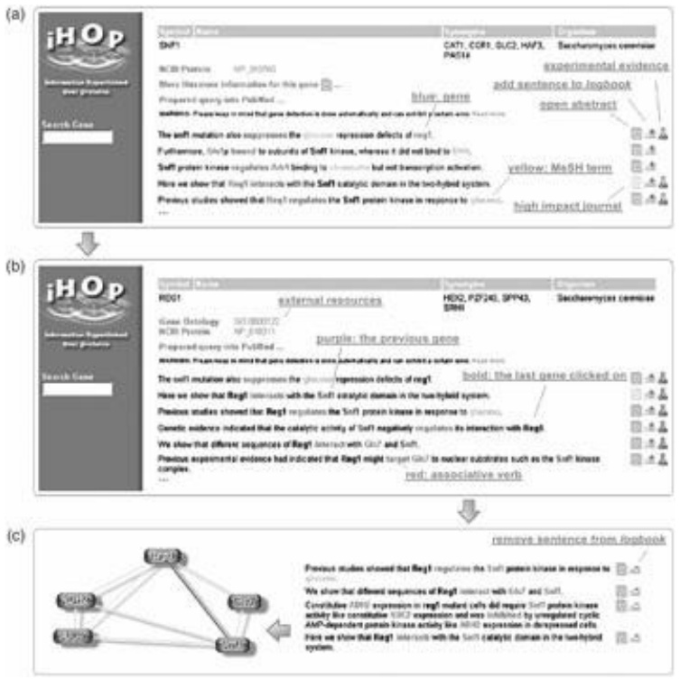

170

---

**Figure 3.5** Use of the iHOP website. (a) Choice of a gene—snf1 in this case—calls up presentation of information about that gene and its interactions. Panel (a) contains five sentences describing SNF1 (many others are omitted). Each sentence describes an interaction and/or function of SNF1. On the right is a link to the full abstract in which the sentence appeared. The top sentence links the current gene of focus, snf1, with another, reg1. Clicking on any mention of reg1 will shift the focus to it, opening another window. (b) The corresponding window for REG1. Note that the top sentences in this frame contain SNF1 as well as REG1. Information about the predecessor governs the ranking and ordering of the sentences in the new window. (c) In the course of navigation through iHOP, relationships can be collected into a logbook or gene model. The interaction network relating the selected proteins appears as a graph in a separate window.

From Hoffmann, R. and Valencia, A. (2005). Implementing the iHOP concept for navigation of biomedical literature. Bioinformatics, **21**(Suppl. 2), ii252–ii258.

## Interaction networks and diseases

Some genetic diseases show simple Mendelian inheritance. They are the effect of a single gene. Other genetic diseases may arise from mutations of any of several genes. This suggests the involvement of a pathway or network, that has several vulnerable points. Still more complex are several diseases that appear to share a common protein-interaction network.

Sam, Liu, Li, Friedman, and Lussier applied data-mining techniques based on natural language processing to identify relationships between diseases through sharing of components of a proteininteraction network. They combined two sets of data:

1. relationships between proteins and diseases: this data set associated 154 diseases with 1931 proteins;
2. a protein-interaction network: a set of relationships among proteins, including binary interactions and direct complex formation. This data set included 20 317 interaction pairs from 1140 proteins.

For each pair of diseases, the associated proteins were checked for identity or interaction. That is, one protein might be associated with both diseases. Or, one protein associated with one disease might be paired in the interaction network with another protein associated with the other disease. Either contributes to a link between the two diseases.

A pair of diseases that share both common proteins and interactions is xeroderma pigmentosum and Cockayne syndrome (see Box 3.7 and Fig. 3.6). Both diseases involve defects in DNA repair systems. Of the proteins shared by both diseases, some mutations in XPB lead to the combined syndrome called the XP/CS complex, with both sets of symptoms. Mutations in ERCC6 are associated with Cockayne syndrome. The tumour antigen p53—which does not interact with any of the other proteins—is likely to be not the primary lesion but the subject of unrepaired damage leading to enhanced cancer susceptibility.

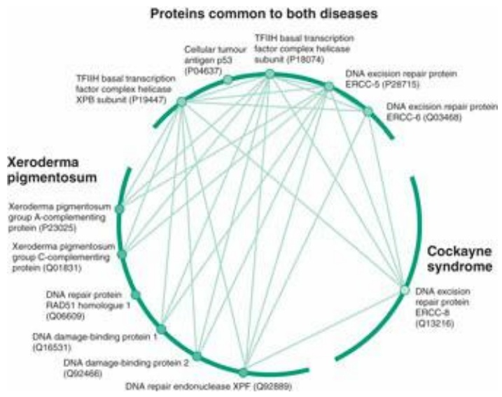

<details>
<summary>flowchart</summary>

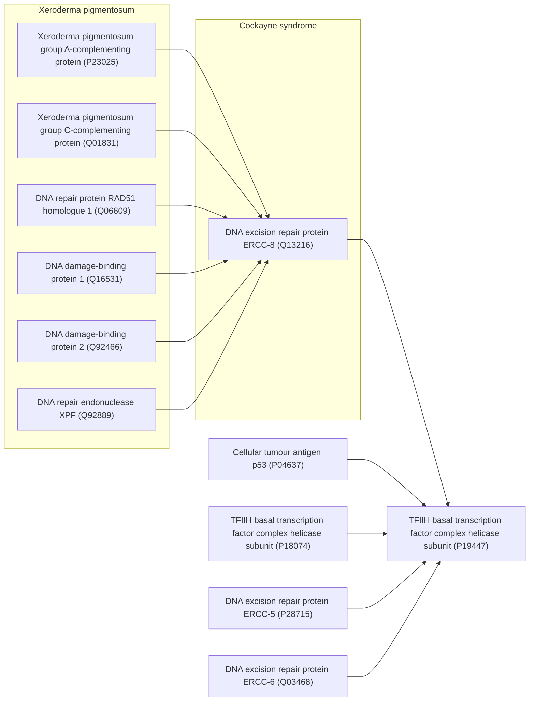
</details>

171

---

**Figure 3.6** Proteins associated with xeroderma pigmentosum and Cockayne syndrome, and their interactions. Arc at lower left: proteins associated with xeroderma pigmentosum. Arc at lower right: proteins associated with Cockayne syndrome. Arc at top: proteins associated with both. Lines indicate interaction pairs. Note that there is only one direct interaction between a protein associated with xeroderma pigmentosum only and another associated with Cockayne syndrome only.

From Sam, L., Liu, Y., Li, J., Friedman, C., and Lussier, Y.A. (2007). Discovery of protein interaction networks shared by diseases. Pacific Symposium on Biocomputing, **12**, 76–87.

At the time of this work, the close connection between xeroderma pigmentosum and Cockayne syndrome, both effects of repair dysfunction, was already known. What was and still is not well understood is what, beyond the known functional defects,

## Box 3.7 Xeroderma pigmentosum and Cockayne syndrome: two diseases of DNA repair

Xeroderma pigmentosum is a genetic disorder involving a defect in the ability to repair damage caused by ultraviolet light. This leads most obviously to great sensitivity to sunlight, including tendency, upon even short exposure, to sunburn, blisters, and freckles. More devastating is the predisposition to development of malignant tumours, presumably arising from unrepaired damage to tumour-suppressor genes.
Cockayne syndrome shares with xeroderma pigmentosum a sensitivity to sunlight, but involves other symptoms including abnormal growth and development leading to short stature, retinal and other neurological degeneration, and premature aging. Risk of skin cancer is normal, not elevated as in xeroderma pigmentosum.
A small number of cases of the xeroderma pigmentosum/Cockayne complex (XP/CS) syndrome are known. Patients show symptoms of both diseases.

| Disease | Genes in which mutations appear include |
| --- | --- |
| Xeroderma pigmentosum | XPA, XPB (ERCC3), XPC, XPD (ERCC2), XPE (DDB2), XPF (ERCC4), XPG (RAD2, ERCC5), XPV (POLH) |
| Cockayne syndrome | CSB ERCC6 (CSB), ERCC8 (CSA) |
| XP/CS complex | XPB (ERCC3), XPD (ERCC2), XPG (ERCC5) |

produces the differences in phenotype associated with the two diseases. In this respect, the mutations that produce the combined symptoms—the XP/CS complex—may be the ones that provide the clues.

## Hypothesis generation

The literature implicitly contains many unsuspected relationships. D.R. Swanson read papers that connected magnesium and epilepsy, and papers that connected epilepsy and migraine headaches. Taken together, these suggested to him that there should be a relationship between magnesium and migrane. Subsequent research confirmed such a link. Swanson had other successes, including the suggestion that fish oil would benefit patients with Raynaud's syndrome (a disorder affecting blood vessels of the extremities). Subsequent research confirmed this suggestion as well.

Automation of Swanson's approach is an obvious goal; implementation of effective methods is not so easy.

P. Srinivasan and B. Libbus developed software to apply Swanson's approach. They searched for applications of turmeric, a spice from the rhizomes of the plant Curcuma longa, containing the active compound curcumin.13 <sub>In</sub> Asia, turmeric is in common use in cooking. Its medicinal properties are also well known. It is an analgesic and an antiseptic, used for treatment of burns, stomach ulcers, skin diseases, and the common cold.

172

---

A PubMed search for TURMERIC OR CURCUMIN OR CURCUMA returned 1175 documents. From these, using natural language processing, Srinivasan and Libbus extracted terms with names of genes or genomes, enzymes, and amino acids, peptides, or proteins, and ranked these terms by how frequently they turned up in the articles identified. They then reprobed PubMed using these results as search terms, and extracted from the results, and ranked, terms referring to diseases or syndromes; neoplastic processes (= terms referring to cancer).

The idea is that this procedure would link turmeric with certain diseases through the medium of genes, genomes, enzymes, or proteins (see Fig. 3.7). The results embody suggestions that turmeric would have some relation with the diseases, and perhaps even be useful in their treatment.

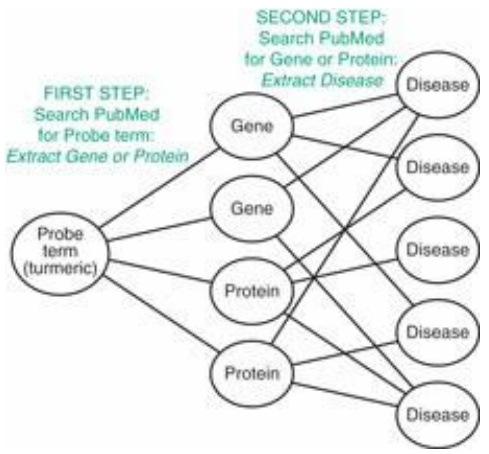

<details>
<summary>flowchart</summary>

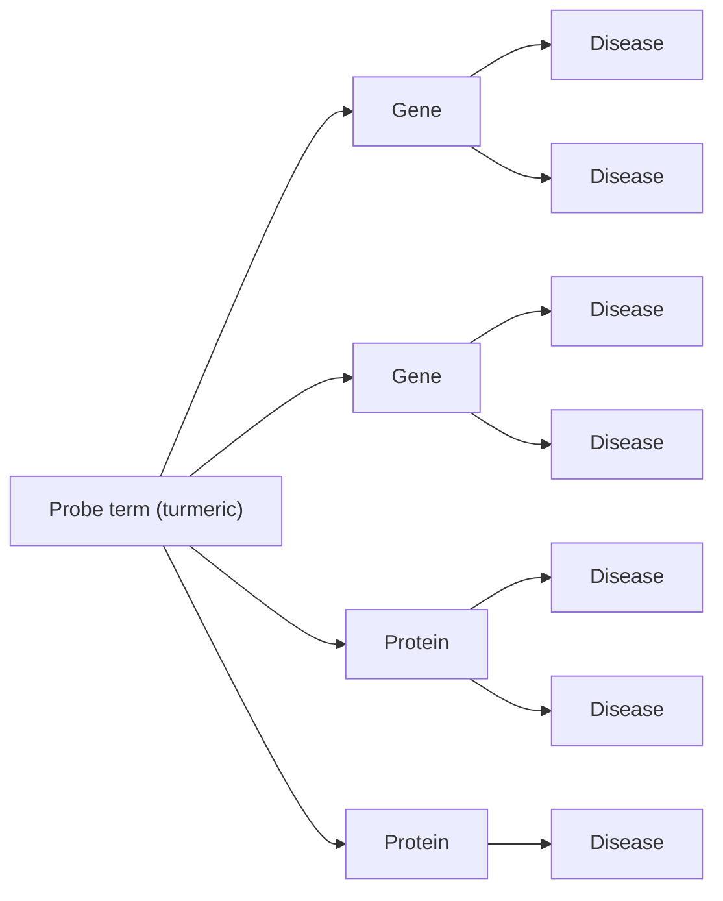
</details>

Figure 3.7 The goal is to link a probe term, such as turmeric, with a set of diseases. In a two-stage procedure, first probe PubMed with the probe term, and recover names of genes, genomes, enzymes, and proteins. These links from turmeric to molecules have a ‘strength’ proportional to the number of times the term appears in the articles that PubMed identifies as related to turmeric. A second stage probes PubMed again, separately, with each of the molecules identified in the first stage. This time analysis of the articles extracts names of diseases. Again the ranking of the molecule–disease link is proportional to the number of times the disease term appears in the articles that PubMed identified in the second stage. A connection between turmeric and a disease, through two strong links, is suggestive of a relationship between turmeric and the disease.

Srinivasan and Libbus discussed three diseases:

• retinal diseases, including diabetic retinopathy, inflammation, and glaucoma;
• Crohn disease;
• disorders related to the spinal core, including inflammation following injury, and an autoimmune disease resembling multiple sclerosis.

A common feature of all these diseases is inflammation. A common set of proteins linking turmeric with the disease includes TNFα, MAPK, NF-κB, COX-2, and other cytokines and interleukins. Knowing the molecules involved in the links between turmeric and diseases means that scientists can understand the mechanism by which turmeric might be expected to act. The result is not merely a correlation but supports a rationale of the relevance of the turmeric to the disease, which in turn usefully guides design of experiments to evaluate and elucidate the connection, and the clinical utility of the probe substance, turmeric.

## RECOMMENDED READING

## The transition to electronic publishing

Berners-Lee, T. (with Mark Fischetti|) (2000). Weaving the Web: The Original Design and Ultimate Destiny of the World Wide Web. Harper Business, New York.

173

---

- Berners-Lee, T. and Hendler, J. (2001). Publishing on the semantic web. Nature, 410, 1023–1024. From the inventor of the web.
- Butler, D. and Campbell, P. (2001). Future e-access to the primary literature. Nature Web Debates, 5 April. [http://www.nature.com/nature/debates/e-access/introduction.html](http://www.nature.com/nature/debates/e-access/introduction.html). Introduction to a continuing discussion, about the web, on the web.
- King, D.W. and Tenopir, C. (2004). Scholarly journal and digital database pricing: threat or opportunity? [http://web.utk.edu/\~tenopir/eprints/database\_pricing.pdf](http://web.utk.edu/~tenopir/eprints/database_pricing.pdf).
- King, D.W. (2007). The cost of journal publishing: a literature review and commentary. Learned Publishing, 20, 85–106.
- Lesk, A.M. (2004). Understanding Digital Libraries, 2nd edn. Morgan Kaufmann, San Francisco, CA. Introduction to the transition from traditional libraries to information provision by computer.
- Malakoff, D. (2003). Scientific publishing. Opening the books on open access. Science, 302, 550–554. Description of the journals published by the Public Library of Science.
- Spedding, V. (2003). Great data, but will it last? Research Information, Spring, 16–20. Problems of preservation of digital information. This journal has many articles of interest to scientists whose research depends on the quality and computer accessibility of data.
- SQW Ltd (2004). Costs and Business Models in Scientific Research Publishing. The Wellcome Trust, London.
- Winograd, S. and Zare, R.N. (1995). ‘Wired’ science or whither the printed pages. Science, 269, 615. The authors, among the most distinguished of contemporary scientists, raise questions that are still not answered after almost 20 years.
- Van Orsdel, L.C. and Born, K. (2006). Journals in the time of Google. Library Journal, 131(7), 39–44.

## Discussion of developments in access and pricing in scientific journals

Dewatriont, M., Ginsburgh, V., Legros, P., Walckiers, A., Devroey, J.-P. et al. (2006). Study on the Economic and Technical Evolution of the Scientific Publication Markets in Europe. European Commission, Directorate-General for Research, Brussels. A thorough exposition of the issues, and some recommendations.

Krallinger, M. and Valencia, A. (2005). Text-mining and information-retrieval services for molecular biology. Genome Biol., 6, 224.

Rebholz-Schuhmann, D., Oellrich, A., and Hoehndorf, R. (2012). Text-mining solutions for biomedical research: enabling integrative biology. Nat. Rev. Genet., 13, 829–839.

Shatkay, H. (2005). Hairpins in bookstacks: information retrieval from biomedical text. Briefings Bioinformatics, 6, 222–238.

## Reviews of the achievements, challenges, and resources for applications of natural language processing in bioinformatics

Bosak, J. and Bray, T. (1999). XML and the second-generation web. Sci. Am., 280(5), 89–93. An introduction to XML, including descriptions of the problems that motivated its development, and the solutions it provides.

Garson, L.R. (2004). Communicating original research in chemistry and related sciences. Accts. Chem. Res., 37, 141–148.

## EXERCISES AND PROBLEMS

Exercise 3.1 Suppose a university library purchases electronic access to a very broad spectrum of scientific journals. Information about usage patterns of different journals are recordable at the publishers’ websites. (a) How could a university librarian make use of this information to help make difficult choices in the face of budgetary pressure? (b) Is it to a publisher's financial advantage to make this information available to university librarians?

Exercise 3.2 Consider a database of audio clips (for example, recordings of broadcasts of speeches by Winston Churchill). You want to create software to make this database searchable by computer, using spoken English sentences as search objects. (a) Suppose you had software that would perform accurate speech recognition; that is, conversion of speech to text. How could you use this to solve the problem? (b) How, in general terms, might you try to solve the

174

---

problem without using speech→text conversion?

**Exercise 3.3** According to the data in Box 3.1, which amino acids satisfy the compound query discussed in the section entitled ‘Database organization’?

**Exercise 3.4** For what types of data are the following markup languages specialized? (a) VRML, (b) CML, (c) BSML, (d) LOGML.

**Exercise 3.5** Rewrite the XML fragment containing a database of mammals in the discussion about Markup languages, converting common name from an attribute to a tag.

**Exercise 3.6** The sentence ‘Time flies like an arrow’ is ambiguous. (a) Explain three potential meanings of this sentence, treating time as (1) a noun, (2) a verb, and (3) an adjective (modifying flies). (b) Could you reject any of these meanings because they do not correctly obey the rules of grammar? (c) Could you reject any of these meanings because they are not consistent with ordinary experience?

**Exercise 3.7** Compose a search pattern to detect interacting proteins analogous to < protein name > … < binds or some equivalent verb > … < protein name > based on the noun association instead of the verb binds.

**Exercise 3.8** A simple way to try to find enzyme names in text is to search for words that end in -ase. Think of 10 English words ending in -ase that are not names of enzymes. What is the longest word ending in -ase that you can find? Of the words you suggest, would any of them be likely to appear in an article in the biomedical literature? (Two obvious words ending in -ase that appear frequently in the biomedical literature are case and disease. To turn this exercise into a weblem, look for an online rhyming dictionary.)

**Problem 3.1** From the data in Figure 3.1, (a) for sales of subscriptions, what price per subscription would give a 5% profit over costs? and (b) how many subscriptions would be required to make a 5% profit while charging half the cost of subscription found in (a)? Assume for simplicity that the cost of reproduction does not increase, but that the cost of distribution is linearly proportional to the number of copies distributed. (c) What would have to be charged for an electronic subscription (no paper version produced) to make a 5% profit if there are still subscribers? Assume for simplicity zero reproduction and distribution costs.

**Problem 3.2** Consider the query: what are the three-letter codes of all amino acids that have volumes greater than 120 Å<sup>3</sup> with distal carboxyl or amide groups? Draw a Venn diagram showing, separately, the distributions of three-letter codes of sidechains, distal functional groups, and volumes. Show the overlaps of the distributions and indicate the residues that satisfy the query.

**Problem 3.3** Recall the ambiguous headline, ‘British left waffles on Falklands’. (a) Parse this text yourself and derive a graph comparable to that given in the text for the sentence 'Mutations alter the base sequence of DNA’ (Box 3.6). (b) In what ways does your analysis differ from that of the computer program? (c) Suppose you think that the example is unfair because waffles is not a verb in US English. Think of a sentence in which waffles must be a verb and submit it to the syntactic analyser at [http://www.link.cs.cmu.edu/link/](http://www.link.cs.cmu.edu/link/). Did it get your sentence right?

**Problem 3.4** Submit to the syntactic analyser the following sentence from Macbeth: ‘The raven himself is hoarse that croaks the fatal entrance of Duncan under my battlements’. Does it get this right? In particular, does it consider ‘under my battlements’ as modifying ‘hoarse’ or ‘entrance of Duncan’? Note that a human reader would use the relationship between entrance and battlements as a clue to disambiguation.

1 Dewatriont, M., Ginsburgh, V., Legros, P., Walckiers, A., Devroey, J.-P. et al. (2006). Study on the Economic and Technical Evolution of the Scientific Publication Markets in Europe. European Commission, Directorate-General for Research, Brussels.
2 For a directory of open-access journals see [http://www.doaj.org](http://www.doaj.org).
3 See [http://swift.cmbi.ru.nl/gv/pdbreport/](http://swift.cmbi.ru.nl/gv/pdbreport/) and Hooft, R.W.W., Vriend, G., Sander, C., and Abola, E.E. (1996). Errors in protein structures. Nature, 381, 272.
4 Park, Y.R., Kim, J., Lee, H.W., Yoon, Y.J., and Kim, J.H. (2011). GOChase-II: correcting semantic inconsistencies from Gene Ontology-based annotations for gene products. BMC Bioinformat., 12 (suppl. 1), S40.
5 Said to be a headline in The Guardian from April 1982, but perhaps apocryphal.
6 Lin, P., Fischer, T., Lavoie, C., Huang, H., and Farquhar, M.G. (2007). Calnuc plays a role in dynamic distribution of Gαi but not Gβ subunits and modulates ACTH secretion in AtT-20 neuroendocrine secretory cells. J. Neurochem., 100, 1505–1514.

175

---

7 Stamenova, S.D., French, M.E., He, Y., Francis, S.A., Kramer, Z.B., and Hicke, L. (2007). Ubiquitin binds to and regulates a subset of SH3 domains. Mol. Cell, 25, 273–284.
8 Tian, H., Klämbt, D., and Jones, A.M. (1995). Auxin-binding Protein 1 does not bind auxin within the endoplasmic reticulum despite this being the predominant subcellular location for this hormone receptor. J. Biol. Chem., 270, 26962–26969.
9 Eckelman, B.P. and Salveson, G.S. (2006). The human anti-apoptotic proteins cIAP1 and cIAP2 bind but do not inhibit caspases. J. Biol. Chem., 281, 3253–3260.
10 Chang, J.T., Schütze, H., and Altman, R.B. (2004). GAPSCORE: finding gene and protein names one word at a time. Bioinformatics, 20, 216–225.
11 Zhu, Y., Culmsee, C., Klumpp, S., and Krieglstein, J. (2004). Neuroscience, 123, 897–906. [http://bionlp.stanford.edu/gapscore/](http://bionlp.stanford.edu/gapscore/).
12 Unfortunately, the acronym also specifies a chain of restaurants in the USA. This is ironic, from a project that so successfully faced challenges of disambiguation.
13 Srinivasan, P. and Libbus, B. (2004). Mining MEDLINE for implicit links between dietary substances and diseases. Bioinformatics, 20 (suppl. 1), i290–i296.

176
