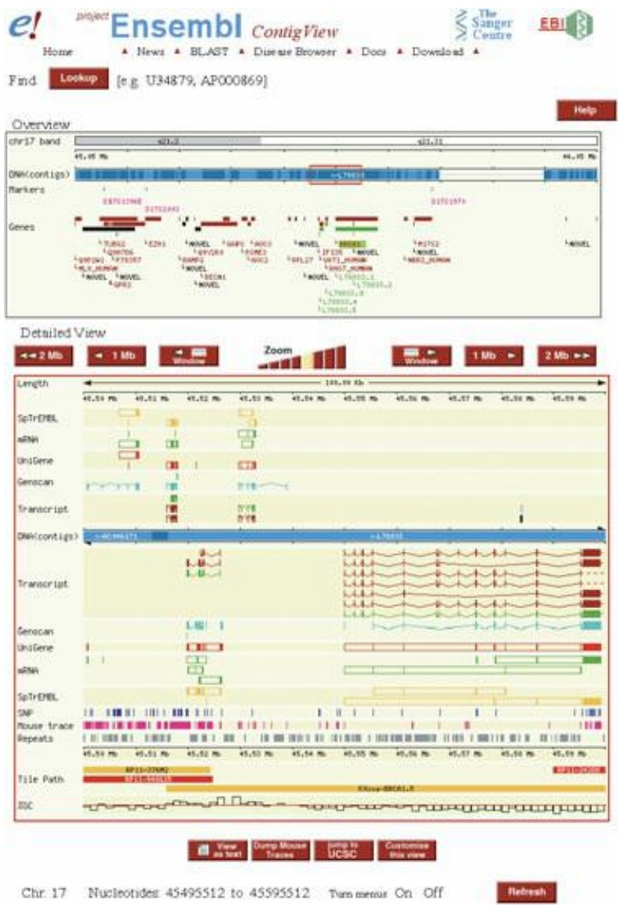
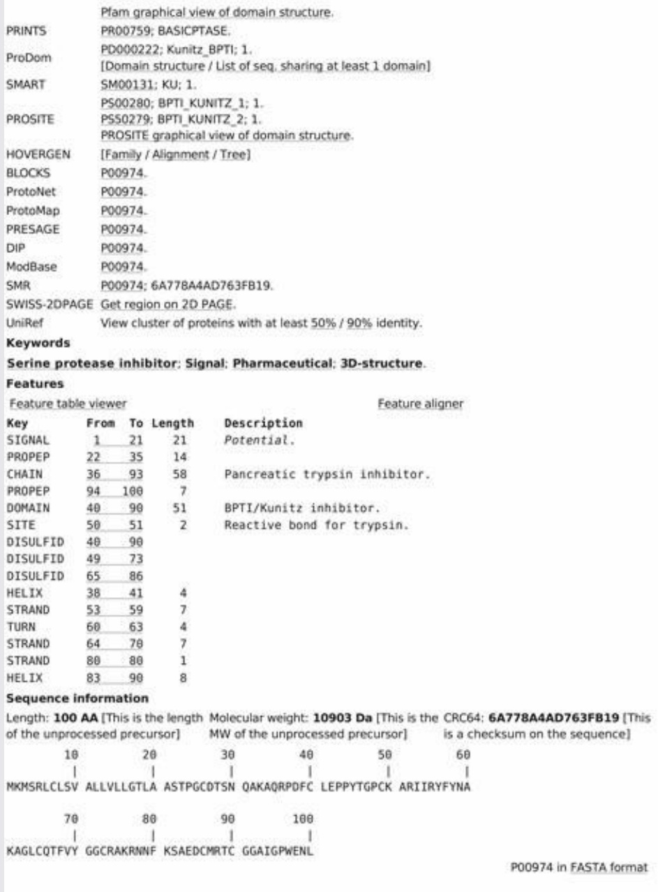
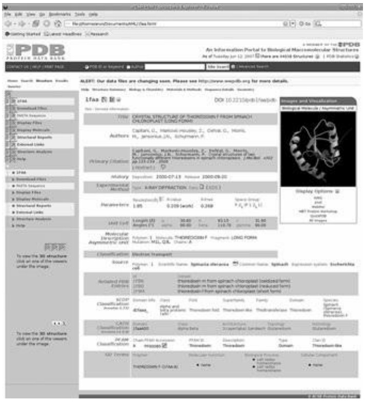
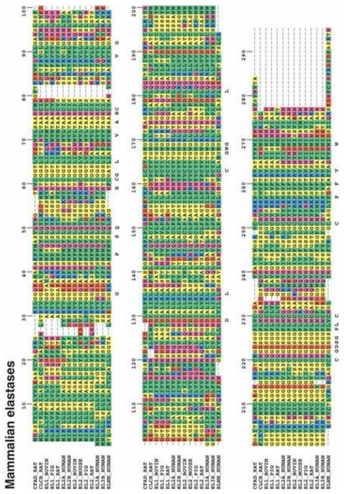

# 4 Archives and information retrieval

原始 PDF 第 177–214 页。

Archives and information retrieval

## LEARNING GOALS

• Understanding the general kinds of data describing the molecules and processes of life assembled in the data banks supporting research and applications in biology, medicine, agriculture, and technology.
• Knowing the basic infrastructure of bioinformatics, in terms of the sites and responsibilities of the major archival projects.
• Understanding the basic concepts of information retrieval, including how to frame queries.
• Gaining facility with general search engines on the web, and with specific websites for bioinformatics.
• Knowing how to search for specific information about sequences, structures, metabolic pathways, and relationships to disease, and how to launch analyses of the data retrieved.

This chapter introduces the specialized information-retrieval skills that will allow you to make effective use of the data banks in molecular biology. The goal is to give you familiarity with basic operations. It will then be easy to improve and develop your technique, and to learn in more detail the facilities, and interrelationships and interactions, of resources available on the web. Convenient sources of training materials include the tutorials embedded in many data banks. An example is the ENTREZ tutorial site at the US National Center for Biotechnology Information (NCBI): [http://www.ncbi.nlm.nih.gov/education/tutorials/](http://www.ncbi.nlm.nih.gov/education/tutorials/). The European Bioinformatics Institute (EBI) offers many tutorials on various aspects of experiments, databases, and bioinformatics.

## Database indexing and specification of search terms

An index is a set of pointers to information in a database. You have explored the entire worldwide web with a general search engine such as Google, and have visited specialized databases in molecular biology. You proposed one or more search terms, and the retrieval program checked for them in its tables of indices. The model is that the database is composed of entries: discrete, coherent parcels of information. The software identified entries with contents relevant to your interest. An example of the simplest paradigm is that you submit the term ‘horse’ and the program returns a list of entries that contain the term horse.

A full search of the web would turn up information about many different aspects of horses— molecular biology, breeding, racing, poems about horses—most of which you do not want to see. For a successful search, it is not enough to mention what you do want you must specialize your search to ensure that your desired responses don't get buried in a mass of extraneous rubbish. (Of course, rubbish is merely whatever other people are interested in.)

To focus the results, information-retrieval programs accept multiple query terms or keywords. A search for ‘horse liver alcohol dehydrogenase’ would produce responses specialized to this enzyme. The search would, most likely, identify entries that contain all four keywords that you submitted:

177

---

horse AND liver AND alcohol AND dehydrogenase. Poems about horses would be unlikely to appear among its top hits.

It is possible to ask for other logical combinations of indexing terms. For instance, if a search engine did not know about transatlantic spelling differences, it would be useful to be able to search for ‘hemoglobin OR haemoglobin’. Note that a search for ‘hemoglobin haemoglobin’ would probably be interpreted as ‘hemoglobin AND haemoglobin’ which would pick up documents written by international committees or orthographically challenged expatriates. (Some websites deliberately include both spellings, using a synonym dictionary.) Similar considerations apply to sulfur/sulphur, for example.

If you wanted to know about other dehydrogenases, you could ask for dehydrogenase NOT alcohol. This would retrieve entries that contain the term dehydrogenase but did not contain the word alcohol. You would find entries about lactate dehydrogenase, malate dehydrogenase, etc. You would miss references to review articles that compared alcohol dehydrogenases with other dehydrogenases, or alignments of the sequences of many dehydrogenases including alcohol dehydrogenase. You might regret missing these.

Many database search engines will allow complex logical expressions such as (haemoglobin OR hemoglobin) AND (dehydrogenase NOT alcohol). Construction of such expressions is an exercise in set theory. Drawing Venn diagrams helps in formulating the query. Although the logic of a search is independent of the software used to query a database, different programs demand different syntax to express the same conditions. For example the query for dehydrogenase NOT alcohol might have to be entered as DEHYDROGENASE -ALCOHOL or DEHYDOGENASE!ALCOHOL.

Specialized databases, including those in molecular biology, impose a structure on the information to separate different categories of data. This is essential. The biomedical scientific community includes people named E(lisabetta) Coli, (John D.) Yeast, (Patrice) Rat, and a large number of Rabbits, as well as several Crystals and Blots. If you wanted to find papers published by these investigators it would be naive to perform a general search of PubMed or some other molecular biology database with any of their names. Many databases provide separate indexing and searching of different categories of information. They permit searching for papers of which E. Coli is an author.

Some categories, such as taxonomy, have controlled vocabularies. Often a query system presents the vocabulary terms to the user as choices from pull-down menus. The structure of taxonomic information is important in retrieval. To do a search for ‘globin NOT mammal’, and pick out the relatively few entries about nonmammalian globins rather than the very many entries about globins, including human haemoglobins, that do not explicitly mention the term mammal, requires an information-retrieval system that ‘understands’ the taxonomic hierarchy. Controlled vocabularies— limited, explicit, and carefully defined sets of terms, known as ontologies—are also important for distributing queries among several databases.

A technical problem that frequently creates difficulty is how to enter terms containing nonstandard characters such as accent marks or umlauts, cedillas, Greek letters, and, as already mentioned, differences between British and US spelling. NCBI's ENTREZ can handle the US/British spelling differences with a synonym dictionary. Programs that index the entire web usually do not. Ignore the accent marks and hope for the best.

## Follow-up questions

When searching in databases, it is rare that you will find exactly what you want on the first round of

178

---

probing. Usually you have to modify the query on the basis of the results initially returned. Most information-retrieval software permits consecutive, cumulative searches, with altered sets of search terms and/or logical relationships. Conversely, once you find what you were looking for, you will often want to extend your search to find related material. If you find a gene sequence, you might want to know about homologous genes in other organisms, or whether a three-dimensional structure of the corresponding protein is available. Or you might want to read papers published about the sequence.

For these subsidiary queries you need links between entries in the same or different databases. This is an example of the question of how one ‘browses’ in electronic libraries, which is a difficult problem and the subject of current research.

Suppose that you are interested in a particular gene. To find homologous genes you would like links to other items in the same database (a database of gene sequences). To find structures, or bibliographical references, related to that gene you would like links between different databases (from the database of gene sequences to a database of three-dimensional structures, or to a bibliographical database). As the number of databases, and the variety of their contents, grows, intercommunication among them has become a high-priority goal. Indeed, the interactivity of the databases in molecular biology is growing more and more effective, so that these operations are fairly easy now – formerly one had to do separate searches on isolated databases. NCBI's ENTREZ allows selecting a set of databases to search. Alternatively, most entries in molecular biology databases contain large numbers of embedded links. This is a generalization of the original model of a database as a closed set of independent entries that can be selected only by their indexed contents. One must think of the web as a very high-dimensional space.

Database construction in bioinformatics involves activities that can be classified, to some extent, into archiving—with the major goals of conservation and curation of facts—and interpreting and annotating, the compilation of biological information in a form most useful to support research. (Include, within annotation, provision of links to other databases.)

Many archival databases specialize in different kinds of data—nucleic acid sequences, protein sequences, or macromolecular structures—for reasons in part historical and in part because of the different curatorial skills required. In many cases, archival and interpretative projects are carried out at the same institution and even by the same people. However, anyone who wishes to create a new database is free to combine and repackage information from any available sources. Practical laboratory experience and expert knowledge of the experimental techniques used to generate the data are essential for curating an archival database, but are only extremely desirable for an interpretative database.

Two aspects of the recent development of bioinformatics databases stand out. One is the appearance of many projects that recombine the archived data in different ways. The other is the combination of many individual databases into larger and larger conglomerates. These processes overlap and sometimes happen together. Most database unifications are outgrowths of prior collaborations, with varying degrees of intimacy in the result.

## Analysis and processing of retrieved data

Sometimes as a result of a search you will want to launch a program, using the results retrieved for its input. For instance, if you identify a protein sequence of interest, you might want to perform a PSI-BLAST search. This is somewhat different from a strictly keyword-based database entryretrieval problem. Formerly you would have to run one job to search for your data, store the results

179

---

of your search, and then run a separate, second, job, feeding the retrieved sequence to the application program by hand. However, like searches in multiple databases, several information-retrieval systems in molecular biology provide facilities for initiating such calculations. This makes for very much improved fluency in your sessions at the computer. We saw an example in Chapter 3, retrieving C. elegans serpins and feeding the sequences into a multiple alignment program.

## The archives

Although our knowledge of biological data is very far from complete, it is nevertheless of impressive size, and growing extremely rapidly. Many scientists are working to generate the data, and to carry out research projects analysing the results. There is a smooth and copious flow of results from the laboratory bench to data-banking organizations, for archiving, curation, and distribution to the research laboratory and the clinic.

Archiving of bioinformatics data was originally carried out by individual research groups motivated by an interest in the associated science. As the requirements for equipment and personnel grew—and the nature of the skills required multiplied, to include much more emphasis on computer science—national and in most cases international organizations have taken on the responsibility. To match the high volumes of data production these projects have become very large scale indeed. Anyone who has followed the entire history of the field cannot help being impressed by the replacement of tiny, low-profile, and ill-funded projects carried out by a few dedicated individuals to a multinational heavy industry subject to hostile takeovers and the scientific equivalent of leveraged buyouts.

## Primary data collections related to biological macromolecules

Nucleic acid sequences, including whole-genome projects

• Amino acid sequences of proteins
• Protein and nucleic acid structures
• Small-molecule crystal structures
• Protein functions
• Expression patterns of genes
• Networks: of metabolic pathways, of gene and protein interactions, and of control cascades
• Publications

## Nucleic acid sequence databases

The worldwide nucleic acid sequence archive is a triple partnership of the NCBI (USA), the European Nucleotide Archive (or ENA; at the EBI, UK), and the DNA Data Bank of Japan (National Institute of Genetics, Japan). These projects curate, archive, and distribute DNA and RNA sequences collected from genome projects, scientific publications, and patent applications. The groups exchange data daily. As a result the raw data are identical. However, the format in which they are presented, and the nature of the annotation, vary among these data banks. To ensure that these fundamental data are freely available, scientific journals require deposition of new nucleotide sequences, as a condition for publication of an article. Similar conditions apply to nucleic acid and

180

---

protein structures.

The nucleic acid sequence databases, as distributed, are collections of entries. Each entry has the form of a text file containing data and annotations for a single contiguous sequence. Some entries are assembled from several published papers reporting overlapping fragments of a complete sequence. More common now are deposition of the results of (a) sequencing and assembly of complete genomes and (b) sequences of fragments, without assembly, from metagenomic samples.

Entries have a life history. Because of the desire on the part of the user community for rapid access to data, new entries are made available before completion of annotation and checking. Entries mature through the classes:

$$
\text {Unannotated} \rightarrow \text {Preliminary} \rightarrow \text {Unreviewed} \rightarrow \text {Standard}
$$

Rarely, an entry ‘dies’: a few have been removed when they are determined to be erroneous.

A sample DNA sequence entry from the European Nucleotide Archive, including annotations as well as sequence data, is the ATP7A gene from the aardvark (see Box 4.1). It encodes a protein involved in regulating copper levels. Mutations in the human homologue are implicated in Menkes syndrome, a progressive neurodegenerative disorder of copper metabolism.

A feature table (lines beginning FT) is a component of the annotation of an entry that reports properties of specific regions, for instance coding sequences (CDS). The aardvark ATP7A gene contains only one exon. Because feature tables are designed to be readable by computer programs— for example, to extract the amino acid sequence (see Exercise 4.4)—they have a more carefully controlled format and a more restricted vocabulary.

The feature table may indicate regions that

perform or affect function;
• interact with other molecules;
• affect replication;
• are involved in recombination;
• are a repeated unit;

Box 4.1 The EMBL Nucleotide Database entry for ATP7A from the aardvark

```txt
ID AAG47427; SV 1; linear; genomic DNA; STD; MAM; 675 BP.
XX
PA AY011392.1
XX
DE Orycteropus afer (aardvark) ATP7A
XX
OS Orycteropus afer (aardvark)
OC Eukaryota; Metazoa; Chordata; Craniata; Vertebrata; Euteleostomi;
Mammalia;
OC Eutheria; Afrotheria; Tubulidentata; Orycteropodidae; Orycteropus.
OX NCBI_TaxID=9818;
XX
FH Key Location/Qualifiers
FH
FT source 1..675
FT /organism="Orycteropus afer"
```

181

---

```txt
FT                  /mol_type="genomic DNA"
FT CDS     AY011392.1:\<1..>675
FT                 /codon_start=1
FT                 /gene="ATP7A"
FT                 /product="ATP7A"
FT                 /db_xref="GOA:Q9BFP6"
FT                 /db_xref="HSSP:Q04656"
FT                 /db_xref="InterPro:IPR001757"
FT                 /db_xref="InterPro:IPR006121"
FT                 /db_xref="UniProtKB/TrEMBL:Q9BFP6"
FT                 /protein_id="AAG47427.1"
FT                 /translation="IYQPHLITVEEIKKQIEAVGFPAFIKKQPKYLTLGAIDIERLKN
FT                 TSARSSEGSLQKSPSYTNDSTATFIIDGMHCKSCVNSIESALSTLQYVSSIAISLENRS
FT                 AIVKYNASSVTPETLRKAIEAVSPGQYTVSIISDVESIPNSPFSSSHQKIPLNIVSQPL
FT                 TQETVINISGMTCNSCVQSIEGVISKKAGVKSVQVSLADSSGVVEYDPLLTSPETLREE
FT                 IEN"
XX
SQ Sequence 675 BP; 233 A; 136 C; 124 G; 182 T; 0 other; 264016655 CRC32;
        attgtttatc agcctcatct tatcacagta gaggaaataa aaaagcagat tgaagctgtg 60
        ggttttccag cattcatcaa aaaacagccc aagtacctta cattgggagc tattgacata 120
        gaacgtctaa agaacacatc tgccagatcc tcagaaggat cactgcaaaa gagtccatca 180
        tataccaatg attcaacagc cacttttatc atagatggca tgcattgtaa atcatgtgtg 240
        tcaaatattg aaagtgcttt atctacactc caatatgtaa gcagcatagc aatttcttta 300
        gagaataggt ctgccattgt aaaatataat gcaagctcag tcactccaga aaccctgaga 360
        aaggcaatag aggcaagtatc accagggcaa tatactgtta gtattataag tgatgttgag 420
        agtatcccaa actctccttt tagctcatct catcaaaaaa tccctttgaa catagtgagc 480
        cagcctctga ctcaagaaac tgtaataaac atcagtggca tgacttgtaa ttcttgtgta 540
        cagtctattg agggtgtcat atcaaaaaaag gcaggtgtaa aatccgtaca agtctccctt 600
        gcagatagca gtggagttgt tgaatatgat cctctactaa cctctccaga aaccttgaga 660
        gaagaaatag aaaac 675
//
```

have secondary or tertiary structure;
• are revised or corrected.

## Genome databases and genome browsers

The general nucleic acid databases focus on collecting individual sequences. Associated with many full-genome sequences are genome browsers, databases bringing together all molecular information available about a particular species.

## Ensembl

Ensembl ([http://www.ensembl.org](http://www.ensembl.org)) is intended to be the universal information source for the human and other genomes. A goal is to collect and annotate all available information about human DNA sequences, link it to the master genome sequence, and make it accessible to the many scientists who will approach the data with many different points of view and different requirements. To this end, in addition to collecting and organizing the information, very serious effort has gone into developing computational infrastructure, including establishment of suitable conventions of nomenclature. It is not trivial to devise a scheme for maintaining stable identifiers in the face of data that will be

182

---

undergoing not only growth but revision. The most visible result of these efforts is the website, very rich in facilities for both general browsing and focusing on details.

Ensembl is a joint project of the EBI and the Wellcome Trust Sanger Institute. However, Ensembl is organized as an open project; encouraging outside contributions. All but the most naive of readers must recognize the great demands that this will place on quality-control procedures.

Data collected in Ensembl includes genes, SNPs, repeats, and homologies. Genes may either be known experimentally or deduced from the sequence. Because the experimental support for annotation of the human genome is so variable, Ensembl records and presents the evidence for identification and annotation of every gene. Very extensive linking to other databases containing related information, such as Online Mendelian Inheritance in Man (OMIM), or expression databases, extend the accessible information.

Ensembl and other genome browsers are structured around the sequences themselves. To focus on a desired region, users have available several avenues of selective entry into the system:

• browsing, starting at the chromosome level then zooming in;
BLAST searches on a sequence or fragment;
• gene name;
relation to diseases, via OMIM;
• Ensembl ID if the user knows it;
• general text search.

A text search in the Ensembl human genome browser for BRCA1 produced the page displayed in Plate IV, showing the region around the BRCA1 locus. The upper frame shows a megabase, mapped to the q21.2 and q21.31 bands of chromosome 17. It reports markers and assigned genes. The bottom frame shows a more detailed view. Note the control panels between the two frames that permit navigation and ‘zooming’. The bottom frame shows a 0.1 megabase region, reporting many more details, including the detailed structure of the BRCA1 gene and the SNPs observed.

183

---



<details>
<summary>text_image</summary>

e! project Ensembl ContigView
Home ▲ News ▲ BLAST ▲ Disease Browser ▲ Docs ▲ Download ▲
Find Lookup [e.g. U34879, APO00869]
Overview
chr17 band 421.21 421.21
ONH(cont.lgs)
45.45 Mb 44.45 Mb
GENESOME 457243
MARKERS
BETA107a
TURKE 4293
KONTSX 4293
KORNE 4293
KIRKEL 4293
KINEL 4293
KIFL27 4293
KIFL27_0000_0000_0000_0000_0000_0000_0000_0000_0000_0000_0000_0000_0000_0000_0000_0000_0000_0000_0000_0000_000
Detailed View
← 2 Mb  ↑ 1 Mb  Zoom  ↑ 1 Mb → 2 Mb
Length 188.89 Kb
SpTREBL 45.51 Mb 45.51 Mb 45.52 Mb 45.53 Mb 45.54 Mb 45.55 Mb 45.56 Mb 45.57 Mb 45.58 Mb
mRNA 45.51 Mb 45.52 Mb 45.53 Mb 45.54 Mb 45.55 Mb 45.56 Mb 45.57 Mb 45.58 Mb
UniGene 45.51 Mb 45.52 Mb 45.53 Mb 45.54 Mb 45.55 Mb 45.56 Mb 45.57 Mb 45.58 Mb
Genscan 45.51 Mb 45.52 Mb 45.53 Mb 45.54 Mb 45.55 Mb 45.56 Mb 45.57 Mb 45.58 Mb
Transcript 45.51 Mb 45.52 Mb 45.53 Mb 45.54 Mb 45.55 Mb 45.56 Mb 45.57 Mb 45.58 Mb
ONH(cont.lgs) 421.21/421.21/421.21/421.21/421.21/421.21/421.21/421.21/421.21/421.21/421.21/421.21/421.21/421.21/421.21/4
Transcript 45.51 Mb 45.52 Mb 45.53 Mb 45.54 Mb 45.55 Mb 45.56 Mb 45.57 Mb 45.58 Mb
Genscan 45.51 Mb 45.52 Mb 45.53 Mb 45.54 Mb 45.55 Mb 45.57 Mb 45.58 Mb
UniGene 45.51 Mb 45.52 Mb 45.53 Mb 45.54 Mb 45.55 Mb 45.56 Mb 45.57 Mb 45.58 Mb
mRNA 45.51Mb 45.52Mb 45.53Mb 45.54Mb 45.55Mb 45.56Mb 45.57Mb 45.58Mb
SpTREBL 45.51Mb 45.52Mb 45.53Mb 45.54Mb 45.55Mb 45.56Mb 45.57Mb 45.58Mb
SNP 45.51Mb 45.52Mb 45.53Mb 45.54Mb 45.55Mb 45.56Mb 45.57Mb 45.58Mb
Mouse trace Repeats
BP16-CPNOSI BETA-CPNOSI BETA-CPNOSI BETA-CPNOSI BETA-CPNOSI BETA-CPNOSI BETA-CPNOSI BETA-CPNOSI BETA-CPNOSI BETA-CPNOSI BETA-CPNOSI BETA-CPNOSI BETA-CPNOSI BETA-CPNOSI BETA-CPNOSI BETA-CDKALR
File Path RP16-CPNOSI RP16-CPNOSI RP16-CPNOSI RP16-CPNOSI RP16-CPNOSI RP16-CPNOSI RP16-CPNOSI RP16-CPNOSI RP16-CPNOSI RP16-CPNOSI RP16-CPNOSI RP16-CPNOSI RP16-CPNOSI RP16-CPALER
View as text Dump Mouse Trains Jams to UCSC Customize this view
Chr: 17 Nucleotides: 4S49S312 to S39S312 Turn menu On Off Refresh
</details>

Plate IV Ensembl genome browser showing the region surrounding the BRCA1 locus (See Chapter 4).


## See Weblems 4.1 – 4.4

## Protein sequence databases

In 2002, three protein sequence databases—the Protein Information Resource (PIR; at the National Biomedical Research Foundation of the Georgetown University Medical Center in Washington, DC, USA), SWISS-PROT, and TrEMBL (from the Swiss Institute of Bioinformatics in Geneva, Switzerland and the EBI in Hinxton, UK)—coordinated their efforts, to form the UniProtKB consortium. The partners in this enterprise share the database but continue to offer separate information-retrieval tools for access.

The PIR grew out of the very first sequence database, developed by Margaret O. Dayhoff, the pioneer of the field of bioinformatics. SWISS-PROT was developed at the Swiss Institute of Bioinformatics. TrEMBL contains the translations of genes identified within DNA sequences in the European Nucleotide Archive. TrEMBL entries are regarded as preliminary, and are converted— after curation and extended annotation—to mature entries.

Today, almost all amino acid sequence information arises from translation of gene sequences. However, even the amino acid sequence of a protein is not in general inferrable with confidence from the gene sequence. The main reason, in eukaryotes, is ambiguity in splicing. In addition, information about ligands, disulphide bridges, subunit associations, post-translational modifications, effects of mRNA editing, etc., is not available from nucleic acid sequences. For instance, from genetic information alone one would not know that human insulin is a dimer linked by disulphide bridges. Protein-sequence data banks collect this additional information from the literature and

184

---

provide suitable annotations.

From UniProtKB, the entry for the amino acid sequence of the protein bovine pancreatic trypsin inhibitor, in SWISS-PROT format, is shown in the box. Note that the sequence itself occupies only a relatively small amount of space in the entry.

## Amino acid sequence entry for bovine pancreatic trypsin inhibitor

NiceProt View of Swiss-Prot: P00974

Entry information

| Entry name | BPT1_BOVIN |
| --- | --- |
| Primary accession number | P00974 |
| Secondary accession numbers | None |
| Entered in Swiss-Prot in | Release 01, July 1986 |
| Sequence was last modified in | Release 10, March 1989 |
| Annotations were last modified in | Release 44, June 2004 |

Name and origin of the protein

| Protein name | Pancreatic trypsin inhibitor [Precursor] |
| --- | --- |
| Synonyms | Basic protease inhibitorBPIBPTIAprotinin |
| Gene name | None |
| From | Bos taurus (Bovine) [TaxID: 9913] |
| Taxonomy | Eukaryota; Metazoa; Chordata; Craniata; Vertebrata; Euteleostomi;Mammalia; Eutheria; Cetartiodactyla; Ruminantia; Pecora; Bovidae; Bovinae; Bos. |

References

| [1] SEQUENCE FROM NUCLEIC ACID.MEDLINE=87283904; PubMed=2441071; [NCBI, ExPASy, EBI, Israel, Japan]Creighton T.E., Charles I.G.;"Sequences of the genes and polypeptide precursors for two bovine protease inhibitors.";J. Mol. Biol. 194:11-22(1987).REFERENCES 2-13 DELETED |
| --- |

Comments

| FUNCTION: Inhibits trypsin, kallikrein, chymotrypsin, and plasmin.SUBCELLULAR LOCATION: Secreted.PHARMACEUTICAL: Available under the name Trasylol (Mile). Used for inhibiting coagulation so as to reduce blood loss during bypass surgery.SIMILARITY: Contains 1 BPTI/Kunitz inhibitor domain.DATABASE: NAME=Trasylol; NOTE=Clinical information on Trasylol; WWW="http://www.trasylol.com/. |
| --- |

Copyright

| This Swiss-Prot entry is copyright. It is produced through a collaboration between the Swiss Institute of Bioinformatics and the EMBL outstation - the European Bioinformatics Institute. |
| --- |

Cross-references

| EMBL | M20934; AAD13685.1; -.[EMBL / GenBank / DDBJ] [CoDingSequence]5 ADDITIONAL CROSS-REFERENCES DELETED |
| --- | --- |
| PIR | S00277; TIBO.1K09; 10-JUL-02.[ExPASy / RCSB / EBI] |
| PDB | 46 ADDITIONAL STRUCTURES DELETEDDetailed list of linked structures. |
| InterPro | IPR002223; Kunitz_BPTI.Graphical view of domain structure. |
| Pfam | PF00014; Kunitz_BPTI; 1. |

185

---



<details>
<summary>text_image</summary>

Pfam graphical view of domain structure.
PRINTS PR00759; BASICPTASE.
ProDom PD000222; Kunitz_BPTI; 1.
[Domain structure / List of seq. sharing at least 1 domain]
SMART SM00131; KU; 1.
PS00280; BPTI_KUNITZ_1; 1.
PROSITE PSS0279; BPTI_KUNITZ_2; 1.
PROSITE graphical view of domain structure.
HOVERGEN [Family / Alignment / Tree]
BLOCKS P00974.
ProtoNet P00974.
ProtoMap P00974.
PRESAGE P00974.
DIP P00974.
ModBase P00974.
SMR P00974; 6A778A4AD763FB19.
SWISS-2DPAGE Get region on 2D PAGE.
UniRef View cluster of proteins with at least 50% / 90% identity.
Keywords
Serine protease inhibitor: Signal: Pharmaceutical; 3D-structure.
Features
Feature table viewer Feature aligner
Key From To Length Description
SIGNAL 1_21 21 Potential.
PROPEP 22_35 14
CHAIN 36_93 58 Pancreatic trypsin inhibitor.
PROPEP 94_100 7
DOMAIN 40_90 51 BPTI/Kunitz inhibitor.
SITE 50_51 2 Reactive bond for trypsin.
DISULFID 40_90
DISULFID 49_73
DISULFID 65_86
HELIX 38_41 4
STRAND 53_59 7
TURN 60_63 4
STRAND 64_70 7
STRAND 80_80 1
HELIX 83_90 8
Sequence information
Length: 100 AA [This is the length Molecular weight: 10903 Da [This is the CRC64: 6A778A4AD763FB19 [This is the unprocessed precursor] MW of the unprocessed precursor] is a checksum on the sequence]
10 20 30 40 50 60
| | | | | |
MKMSRLCLSV ALLVLLGTLA ASTPGCOTSN QAKAQRPDFC LEPPYTGPCK ARIIRYFYNA
70 80 90 100
KAGLCQTFVY GGCRAKRNNF KSAEDCMRTC GGAIGPWENL
P00974 in FASTA format
</details>

## The Swiss Institute for Bioinformatics

The Swiss Institute for Bioinformatics originally compiled SWISS-PROT. It carries out a wide range of activities, including additional databases, and collections of bioinformatics tools and links, called the Expert Protein Analysis System (ExPASy; [http://www.expasy.org](http://www.expasy.org)).

PROSITE is a set of signature patterns characteristic of protein families. Such a pattern (or motif, or signature, or fingerprint, or template) is common to related proteins, usually because of the requirements of binding sites that constrain the evolution of the protein family. For instance, the consensus pattern for inorganic pyrophosphatase is D-[SGDN]-D-[PE]-[LIVMF]-D-[LIVMGAC]. The three conserved Ds bind divalent metal cations. Often, such a pattern identifies distant relationships not otherwise detectable by comparing sequences.

ExPASy presents certain bioinformatics tools as servers on its website, and has links to many others. Categories of tools include proteomics, genomics, structural bioinformatics, systems biology, phylogeny/evolution, population genetics, transcriptomics, biophysics, imaging, IT infrastructure, and drug design. The full list of tools contains 325 entries, roughly half of which were created and are maintained ‘in house’, with the others being links to external sites.

## The Protein Information Resource (PIR) and associated databases

The PIR is one of the partners in UniProtKB. In addition, the PIR maintains several databases about

186

---

proteins:

PIRSF: the Protein Family Classification System provides clustering of the sequences in UniProtKB according to their evolutionary relationships;
• iProClass, an integrated Protein Knowledgebase, is a gateway providing uniform access to over 90 biological databases, with flexible retrieval and navigation facilities;
• iProLINK (integrated Protein Literature, Information and Knowledge) is a gateway to the literature.

## Databases of protein families

Evolutionary relationships are essential for making sense of biological data. Evolution provides the framework for an integrated appreciation of the properties of molecules and processes, and their similarities and difference in various species. Perhaps less obvious is that comparative studies illuminate, in an essential way, even individual molecules. Knowing only a single sequence, or structure, it is difficult to understand the significance of particular features. Patterns of conservation identify features that nature has found it necessary to retain. (PROSITE signatures are examples.) The challenge then is to figure out why.

Study of evolutionary patterns must begin with assembling a set of homologues. We again emphasize (1) the distinction between homology—descent from a common ancestor—a yes-or-no property, from similarity, which is some quantitative measure of the difference between two objects, and (2) that similarity can always be measured but it is rare to be able to observe homology directly; therefore, in most cases homology is an inference from similarity.

R. Doolittle suggested a general calibration of pairwise sequence similarity for homology detection. Two full-length protein sequences (≥100 residues) that have 25% or more identical residues in an optimal alignment are likely to be related. Below ≈15% identical residues in an optimal alignment and we become mired in the noise. In this range of similarity we have no reason to believe that the sequences are related, although they might be. Doolittle defined the range between 18 and 25% identity as ‘the twilight zone’, where there may be tantalizing suspicion of a relationship, but the evidence falls short of proof. In some cases the active site is better conserved than the bulk of the protein. In these cases the appearance of a motif—such as the PROSITE consensus pattern for inorganic pyrophosphatase, D-[SGDN]-D-[PE]-[LIVMF]-D-[LIVMGAC]—can support the case for homology.

Multiple sequence alignments are much more powerful than pairwise sequence alignments. First, the additional data allow more accurate alignments. Second, the conservation patterns stand out far more sharply. (See Problem 4.1).

Protein structure changes more conservatively than amino acid sequence. Therefore inference of homology from structural similarity can link more distant relatives than sequence similarity can. In cases that lie in the twilight zone where sequence similarity is suggestive but not convincing, structural similarity is the court of last resort. In many cases, structural similarity can identify homologues even if no signal whatever—at least no signal detectable by current techniques— remains in the sequences.

It is common to refer to a group of related proteins as a family. Many databases classify proteins into families. These include sequence-oriented databases such as InterPro, Pfam, and COG and structure-oriented databases such as SCOP and CATH. The assignment of proteins to families is similar but not identical in various sources.

187

---

Most protein families contain many clusters of closer relatives. These form subfamilies. Conversely, two or more families can be grouped into superfamilies. Whereas the distinction between homologous and nonhomologous proteins is objective (even if we cannot determine it with confidence in all cases), the clustering of homologues into subfamilies or superfamilies is partially a matter of convention or taste. Definition of subfamilies and superfamilies may legitimately differ among different databases.

## Databases of structures

Structure databases archive, annotate, and distribute sets of atomic coordinates. Started by the late Walter Hamilton at Brookhaven National Laboratories (Long Island, NY, USA) in 1971, the major database for biological macromolecular structures is now the Worldwide Protein Data Bank (wwPDB). It is a joint effort of the Research Collaboratory for Structural Bioinformatics (RCSB; a distributed organization based at Rutgers University in New Jersey, the San Diego Supercomputer Center in California, and the University of Wisconsin, all in the USA), the Protein Data Bank Europe (at the EBI in the UK), and the Protein Data Bank Japan (based at Osaka University). The wwPDB contains structures of proteins, nucleic acids, and a few carbohydrates. The parent website is [http://www.wwpdb.org](http://www.wwpdb.org).

The home pages of the wwPDB partners contain links to the data files themselves, to expository and tutorial material including short news items and the PDB Newsletter, to facilities for deposition of new entries, and to specialized search software for retrieving structures.

Box 4.2 shows part of a Protein Data Bank entry for a structure of spinach chloroplast thioredoxin.<sup>1</sup> The information contained includes:

• what protein is the subject of the entry, and what species it came from;
• who solved the structure, and literature references;
experimental details about the structure determination, including information related to the general quality of the result, such as resolution of an X-ray structure determination, and stereochemical statistics;
• the amino acid sequence;
• the atomic coordinates (lines beginning ATOM);
• what additional molecules appear in the structure, potentially including cofactors, inhibitors, and water molecules (the keyword HETATM identifies the coordinates of these moities);
• assignments of secondary structure: helices and sheets;
• disulphide bridges.

The wwPDB overlaps several other databases. The Cambridge Crystallographic Data Centre (CCDC) archives the structures of small molecules; oligonucleotides appear in both the CCDC and the wwPDB. The combination of structural data from these sources is extremely useful in studies of conformations of the component units of biological macromolecules, and for investigations of macromolecule–ligand interactions, including but not limited to applications to drug design. The Nucleic Acid Structure Databank (NDB) at Rutgers University also complements the wwPDB. The BioMagResBank, at the Department of Biochemistry, University of Wisconsin—a partner in the RCSB—archives protein structures determined by nuclear magnetic resonance.

The archives collect not only the results of structure determination, but also the measurements on which they are based. The wwPDB keeps the data from X-ray structure determinations, and the

188

---

BioMagResBank those from NMR.

Box 4.2 Protein Data Bank entry 1FAA, spinach chloroplast thioredoxin

```proteindb
HEADER ELECTRON TRANSPORT 13-JUL-00 1FAA
TITLE CRYSTAL STRUCTURE OF THIOREDOXIN F FROM SPINACH CHLOROPLAST
TITLE     2 (LONG FORM)
COMPND      MOL_ID: 1;
COMPND   2 MOLECULE: THIOREDOXIN F;
COMPND   3 CHAIN: A;
COMPND   4 FRAGMENT: LONG FORM;
COMPND   5 ENGINEERED: YES;
COMPND   6 MUTATION: YES
SOURCE       MOL_ID: 1;
SOURCE   2 ORGANISM_SCIENTIFIC: SPINACIA OLERACEA;
SOURCE   3 ORGANISM_COMMON: SPINACH;
SOURCE   4 CELLULAR_LOCATION: CHLOROPLAST;
SOURCE   5 EXPRESSION_SYSTEM: ESCHERICHIA COLI;
SOURCE   6 EXPRESSION_SYSTEM_COMMON: BACTERIA;
SOURCE   7 EXPRESSION_SYSTEM_PLASMID: PKK233-2 (MODIFIED)
KEYWDS      ELECTRON TRANSPORT
EXPDTA      X-RAY DIFFRACTION
AUTHOR     G.CAPITANI,Z.MARKOVIC-HOUSLEY,G.DELVAL,M.MORRIS,
AUTHOR   2 J.N.JANSONIUS,P.SCHURMANN
REVDAT    1 20-SEP-00 1FAA     0
JRNL           AUTH    G.CAPITANI,Z.MARKOVIC-HOUSLEY,G.DELVAL,M.MORRIS,
JRNL           AUTH 2 J.N.JANSONIUS,P.SCHURMANN
JRNL           TITL   CRYSTAL STRUCTURES OF TWO FUNCTIONALLY DIFFERENT
JRNL           TITL 2 THIOREDOXINS IN SPINACH CHLOROPLASTS
JRNL           REF     J.MOL.BIOL.                  V. 302   135 2000
JRNL           REFN   ASTM JMOBAK UK ISSN 0022-2836
REMARK    1
REMARK    2
REMARK   2 RESOLUTION. 1.85 ANGSTROMS.
REMARK    3
REMARK   3 REFINEMENT.
REMARK   3 PROGRAM          : X-PLOR 3.851
REMARK   3 AUTHORS          : BRUNGER
REMARK    3
```

Additional information about details of solution of structure omitted

```proteindb
REMARK 900 RELATED ENTRIES
REMARK 900 RELATED ID: 1F9M    RELATED DB: PDB
REMARK 900 THIOREDOXIN F FROM SPINACH CHLOROPLAST (SHORT FORM)
REMARK 900 RELATED ID: 1FB0    RELATED DB: PDB
REMARK 900 THIOREDOXIN M FROM SPINACH CHLOROPLAST (REDUCED FORM)
REMARK 900 RELATED ID: 1FB6    RELATED DB: PDB
REMARK 900 THIOREDOXIN M FROM SPINACH CHLOROPLAST (OXIDIZED FORM)
DBREF 1FAA A      1   121     SWS     P09856    THIF_SPIOL      69    189
SEQADV 1FAA MET A    -2     SWS    P09856             CLONING ARTIFACT
SEQADV 1FAA TYR A    -1     SWS    P09856             CLONING ARTIFACT
SEQADV 1FAA TYR A      0     SWS    P09856             CLONING ARTIFACT
SEQADV 1FAA LEU A      1     SWS    P09856    MET     69 ENGINEERED
```

189

---

<table><tr><td>SEQADV</td><td>1FAA</td><td>LEU A</td><td>3</td><td>SWS</td><td>P09856</td><td>GLN</td><td>71</td><td>ENGINEERED</td><td></td><td></td></tr><tr><td>SEQRES</td><td>1 A</td><td>124</td><td>MET</td><td>TYR</td><td>TYR</td><td>LEU</td><td>GLU</td><td>LEU ALA</td><td>LEU GLY</td><td>THR GLN GLU MET</td></tr><tr><td>SEQRES</td><td>2 A</td><td>124</td><td>GLU</td><td>ALA</td><td>ILE</td><td>VAL</td><td>GLY</td><td>LYS VAL</td><td>THR GLU VAL ASN LYS ASP</td><td></td></tr><tr><td>SEQRES</td><td>3 A</td><td>124</td><td>THR</td><td>PHE</td><td>TRP</td><td>PRO</td><td>ILE</td><td>VAL LYS ALA</td><td>ALA ALA GLY ASP LYS PRO</td><td></td></tr><tr><td>SEQRES</td><td>4 A</td><td>124</td><td>VAL</td><td>VAL</td><td>LEU</td><td>ASP</td><td>MET</td><td>PHE THR GLN TRP CYS GLY PRO CYS</td><td></td><td></td></tr><tr><td>SEQRES</td><td>5 A</td><td>124</td><td>LYS</td><td>ALA</td><td>MET</td><td>ALA</td><td>PRO LYS</td><td>TYR GLU LYS LEU ALA GLU GLU</td><td></td><td></td></tr><tr><td>SEQRES</td><td>6 A</td><td>124</td><td>TYR</td><td>LEU</td><td>ASP</td><td>VAL</td><td>ILE</td><td>PHE LEU LYS LEU ASP CYS ASN GLN</td><td></td><td></td></tr><tr><td>SEQRES</td><td>7 A</td><td>124</td><td>GLU</td><td>ASN LYS</td><td>THR</td><td>LEU</td><td>ALA LYS GLU LEU GLY ILE ARG VAL</td><td></td><td></td><td></td></tr><tr><td>SEQRES</td><td>8 A</td><td>124</td><td>VAL</td><td>PRO</td><td>THR</td><td>PHE</td><td>LYS ILE</td><td>LEU LYS GLU ASN SER VAL VAL</td><td></td><td></td></tr><tr><td>SEQRES</td><td>9 A</td><td>124</td><td>GLY</td><td>GLU</td><td>VAL</td><td>THR</td><td>GLY ALA LYS TYR ASP LYS LEU LEU GLU</td><td></td><td></td><td></td></tr><tr><td>SEQRES</td><td>10 A</td><td>124</td><td>ALA</td><td>ILE</td><td>GLN</td><td>ALA</td><td>ALA ARG SER</td><td></td><td></td><td></td></tr><tr><td>FORMUL</td><td>2</td><td>HOH</td><td colspan="8">*34 (H2 O1)</td></tr><tr><td>HELIX</td><td>1</td><td>1 GLY A</td><td>6</td><td>ALA A</td><td>12</td><td>1</td><td></td><td></td><td></td><td>7</td></tr><tr><td>HELIX</td><td>2</td><td>2 THR A</td><td>24</td><td>ALA A</td><td>32</td><td>1</td><td></td><td></td><td></td><td>9</td></tr><tr><td>HELIX</td><td>3</td><td>3 CYS A</td><td>46</td><td>TYR A</td><td>63</td><td>1</td><td></td><td></td><td></td><td>18</td></tr><tr><td>HELIX</td><td>4</td><td>4 ASN A</td><td>77</td><td>GLY A</td><td>85</td><td>1</td><td></td><td></td><td></td><td>9</td></tr><tr><td>HELIX</td><td>5</td><td>5 LYS A</td><td>108</td><td>ARG A</td><td>120</td><td>1</td><td></td><td></td><td></td><td>13</td></tr><tr><td>SHEET</td><td>1</td><td>A 5 VAL A</td><td>17</td><td>GLU A</td><td>19</td><td>0</td><td></td><td></td><td></td><td></td></tr><tr><td>SHEET</td><td>2</td><td>A 5 ILE A</td><td>67</td><td>ASP A</td><td>72</td><td>1</td><td>O PHE A</td><td>68 N</td><td>THR A</td><td>18</td></tr><tr><td>SHEET</td><td>3</td><td>A 5 VAL A</td><td>37</td><td>PHE A</td><td>42</td><td>1</td><td>N VAL A</td><td>38 O</td><td>ILE A</td><td>67</td></tr><tr><td>SHEET</td><td>4</td><td>A 5 THR A</td><td>91</td><td>LYS A</td><td>96</td><td>-1</td><td>O THR A</td><td>91 N</td><td>MET A</td><td>41</td></tr><tr><td>SHEET</td><td>5</td><td>A 5 SER A</td><td>99</td><td>THR A</td><td>105</td><td>-1</td><td>O SER A</td><td>99 N</td><td>LYS A</td><td>96</td></tr><tr><td>SSBOND</td><td>1</td><td>CYS A</td><td>46</td><td>CYS A</td><td>49</td><td></td><td></td><td></td><td></td><td></td></tr><tr><td>CISPEP</td><td>1</td><td>VAL A</td><td>89</td><td>PRO A</td><td>90</td><td></td><td>0</td><td>-0.06</td><td></td><td></td></tr><tr><td>CRYST1</td><td>30.600</td><td>63.100</td><td colspan="2">31.600</td><td>90.00</td><td>110.70</td><td colspan="3">90.00 P 1 21 1</td><td>2</td></tr><tr><td>ORIGX1</td><td colspan="2">1.000000</td><td colspan="2">0.000000</td><td colspan="2">0.000000</td><td colspan="3">0.00000</td><td></td></tr><tr><td>ORIGX2</td><td colspan="2">0.000000</td><td colspan="2">1.000000</td><td colspan="2">0.000000</td><td colspan="3">0.00000</td><td></td></tr><tr><td>ORIGX3</td><td colspan="2">0.000000</td><td colspan="2">0.000000</td><td colspan="2">1.000000</td><td colspan="3">0.00000</td><td></td></tr><tr><td>SCALE1</td><td colspan="2">0.032680</td><td colspan="2">0.000000</td><td colspan="2">0.012349</td><td colspan="3">0.00000</td><td></td></tr><tr><td>SCALE2</td><td colspan="2">0.000000</td><td colspan="2">0.015848</td><td colspan="2">0.000000</td><td colspan="3">0.00000</td><td></td></tr><tr><td>SCALE3</td><td colspan="2">0.000000</td><td colspan="2">0.000000</td><td colspan="2">0.033829</td><td colspan="3">0.00000</td><td></td></tr><tr><td>ATOM</td><td>1</td><td>N</td><td>LEU A</td><td>1</td><td></td><td></td><td>24.389</td><td>12.172</td><td>22.330</td><td>1.00</td></tr><tr><td>49.98</td><td></td><td></td><td>N</td><td></td><td></td><td></td><td></td><td></td><td></td><td></td></tr><tr><td>ATOM</td><td>2</td><td>CA</td><td>LEU A</td><td>1</td><td></td><td></td><td>23.617</td><td>11.064</td><td>22.997</td><td>1.00</td></tr><tr><td>51.12</td><td></td><td></td><td>C</td><td></td><td></td><td></td><td></td><td></td><td></td><td></td></tr><tr><td>ATOM</td><td>3</td><td>C</td><td>LEU A</td><td>1</td><td></td><td></td><td>22.228</td><td>10.829</td><td>22.381</td><td>1.00</td></tr><tr><td>51.55</td><td></td><td></td><td>C</td><td></td><td></td><td></td><td></td><td></td><td></td><td></td></tr><tr><td>ATOM</td><td>4</td><td>O</td><td>LEU A</td><td>1</td><td></td><td></td><td>21.316</td><td>11.634</td><td>22.547</td><td>1.00</td></tr><tr><td>50.88</td><td></td><td></td><td>O</td><td></td><td></td><td></td><td></td><td></td><td></td><td></td></tr><tr><td>ATOM</td><td>5</td><td>CB</td><td>LEU A</td><td>1</td><td></td><td></td><td>23.447</td><td>11.351</td><td>24.497</td><td>1.00</td></tr><tr><td>49.15</td><td></td><td></td><td>C</td><td></td><td></td><td></td><td></td><td></td><td></td><td></td></tr><tr><td>ATOM</td><td>6</td><td>CG</td><td>LEU A</td><td>1</td><td></td><td></td><td>24.373</td><td>10.670</td><td>25.513</td><td>1.00</td></tr><tr><td>47.15</td><td></td><td></td><td>C</td><td></td><td></td><td></td><td></td><td></td><td></td><td></td></tr><tr><td>ATOM</td><td>7</td><td>CD1</td><td>LEU A</td><td>1</td><td></td><td></td><td>23.831</td><td>10.905</td><td>26.924</td><td>1.00</td></tr><tr><td>45.33</td><td></td><td></td><td>C</td><td></td><td></td><td></td><td></td><td></td><td></td><td></td></tr><tr><td>ATOM</td><td>8</td><td>CD2</td><td>LEU A</td><td>1</td><td></td><td></td><td>24.488</td><td>9.185</td><td>25.215</td><td>1.00</td></tr><tr><td>44.91</td><td></td><td></td><td>C</td><td></td><td></td><td></td><td></td><td></td><td></td><td></td></tr><tr><td>ATOM</td><td>9</td><td>N</td><td>GLU A</td><td>2</td><td></td><td></td><td>22.076</td><td>9.713</td><td>21.674</td><td>1.00</td></tr><tr><td>53.58</td><td></td><td></td><td>N</td><td></td><td></td><td></td><td></td><td></td><td></td><td></td></tr><tr><td>ATOM</td><td>10</td><td>CA</td><td>GLU A</td><td>2</td><td></td><td></td><td>20.806</td><td>9.358</td><td>21.044</td><td>1.00</td></tr><tr><td>54.60</td><td></td><td></td><td>C</td><td></td><td></td><td></td><td></td><td></td><td></td><td></td></tr><tr><td>ATOM</td><td>11</td><td>C</td><td>GLU A</td><td>2</td><td></td><td></td><td>20.054</td><td>8.350</td><td>21.907</td><td>1.00</td></tr><tr><td>52.06</td><td></td><td></td><td>C</td><td></td><td></td><td></td><td></td><td></td><td></td><td></td></tr><tr><td>ATOM</td><td>12</td><td>O</td><td>GLU A</td><td>2</td><td></td><td></td><td>20.550</td><td>7.916</td><td>22.943</td><td>1.00</td></tr></table>

190

---

| 53.01 |  |  | O |  |  |  |  |  |  |
| --- | --- | --- | --- | --- | --- | --- | --- | --- | --- |
| ATOM | 13 | CB | GLU A | 2 | 21.043 | 8.762 | 19.650 | 1.00 |  |
| 60.19 |  |  | C |  |  |  |  |  |  |
| ATOM | 14 | CG | GLU A | 2 | 20.884 | 9.756 | 18.502 | 1.00 |  |
| 71.27 |  |  | C |  |  |  |  |  |  |
| ATOM | 15 | CD | GLU A | 2 | 19.687 | 10.694 | 18.678 | 1.00 |  |
| 77.29 |  |  | C |  |  |  |  |  |  |
| ATOM | 16 | OE1 | GLU A | 2 | 19.521 | 11.277 | 19.779 | 1.00 |  |
| 79.51 |  |  | O |  |  |  |  |  |  |
| ATOM | 17 | OE2 | GLU A | 2 | 18.910 | 10.850 | 17.705 | 1.00 |  |
| 81.98 |  |  | O |  |  |  |  |  |  |
| ATOM | 18 | N | LEU A | 3 | 18.857 | 7.975 | 21.477 | 1.00 |  |
| 48.15 |  |  | N |  |  |  |  |  |  |
| ATOM | 19 | CA | LEU A | 3 | 18.047 | 7.029 | 22.227 | 1.00 |  |
| 43.81 |  |  | C |  |  |  |  |  |  |
| ATOM | 20 | C | LEU A | 3 | 18.098 | 5.650 | 21.573 | 1.00 |  |
| 40.93 |  |  | C |  |  |  |  |  |  |
| ATOM | 21 | O | LEU A | 3 | 18.285 | 5.529 | 20.371 | 1.00 |  |
| 40.43 |  |  | O |  |  |  |  |  |  |
| ATOM | 22 | CB | LEU A | 3 | 16.598 | 7.531 | 22.280 | 1.00 |  |
| 44.07 |  |  | C |  |  |  |  |  |  |
| ATOM | 23 | CG | LEU A | 3 | 15.797 | 7.608 | 23.586 | 1.00 |  |
| 44.51 |  |  | C |  |  |  |  |  |  |
| ATOM | 24 | CD1 | LEU A | 3 | 15.534 | 6.207 | 24.087 | 1.00 |  |
| 52.05 |  |  | C |  |  |  |  |  |  |
| ATOM | 25 | CD2 | LEU A | 3 | 16.543 | 8.400 | 24.639 | 1.00 |  |
| 48.17 |  |  | C |  |  |  |  |  |  |

Coordinates of residues 4–121 of protein omitted

<table><tr><td>ATOM</td><td>937</td><td>N</td><td>SER A 121</td><td></td><td>8.850</td><td>-16.291</td><td>7.411</td><td>1.00</td></tr><tr><td>55.56</td><td></td><td></td><td>N</td><td></td><td></td><td></td><td></td><td></td></tr><tr><td>ATOM</td><td>938</td><td>CA</td><td>SER A 121</td><td></td><td>9.537</td><td>-17.581</td><td>7.231</td><td>1.00</td></tr><tr><td>60.26</td><td></td><td></td><td>C</td><td></td><td></td><td></td><td></td><td></td></tr><tr><td>ATOM</td><td>939</td><td>C</td><td>SER A 121</td><td></td><td>10.923</td><td>-17.478</td><td>6.558</td><td>1.00</td></tr><tr><td>62.65</td><td></td><td></td><td>C</td><td></td><td></td><td></td><td></td><td></td></tr><tr><td>ATOM</td><td>940</td><td>O</td><td>SER A 121</td><td></td><td>11.870</td><td>-18.086</td><td>7.107</td><td>1.00</td></tr><tr><td>64.76</td><td></td><td></td><td>O</td><td></td><td></td><td></td><td></td><td></td></tr><tr><td>ATOM</td><td>941</td><td>CB</td><td>SER A 121</td><td></td><td>8.656</td><td>-18.556</td><td>6.432</td><td>1.00</td></tr><tr><td>60.35</td><td></td><td></td><td>C</td><td></td><td></td><td></td><td></td><td></td></tr><tr><td>ATOM</td><td>942</td><td>OG</td><td>SER A 121</td><td></td><td>7.280</td><td>-18.401</td><td>6.747</td><td>1.00</td></tr><tr><td>60.82</td><td></td><td></td><td>O</td><td></td><td></td><td></td><td></td><td></td></tr><tr><td>ATOM</td><td>943</td><td>OXT</td><td>SER A 121</td><td></td><td>11.059</td><td>-16.809</td><td>5.503</td><td>1.00</td></tr><tr><td>63.39</td><td></td><td></td><td>O</td><td></td><td></td><td></td><td></td><td></td></tr><tr><td>TER</td><td>944</td><td colspan="2">SER A 121</td><td></td><td></td><td></td><td></td><td></td></tr><tr><td>HETATM</td><td>945</td><td>O</td><td>HOH</td><td>1</td><td>2.260</td><td>-3.687</td><td>15.041</td><td>1.00</td></tr><tr><td>21.56</td><td></td><td></td><td>O</td><td></td><td></td><td></td><td></td><td></td></tr><tr><td>HETATM</td><td>946</td><td>O</td><td>HOH</td><td>2</td><td>0.884</td><td>-6.116</td><td>15.287</td><td>1.00</td></tr><tr><td>24.15</td><td></td><td></td><td>O</td><td></td><td></td><td></td><td></td><td></td></tr><tr><td>HETATM</td><td>947</td><td>O</td><td>HOH</td><td>3</td><td>0.912</td><td>13.888</td><td>2.773</td><td>1.00</td></tr><tr><td>30.06</td><td></td><td></td><td>O</td><td></td><td></td><td></td><td></td><td></td></tr><tr><td>HETATM</td><td>948</td><td>O</td><td>HOH</td><td>4</td><td>14.616</td><td>-4.966</td><td>11.156</td><td>1.00</td></tr><tr><td>26.65</td><td></td><td></td><td>O</td><td></td><td></td><td></td><td></td><td></td></tr><tr><td>HETATM</td><td>949</td><td>O</td><td>HOH</td><td>5</td><td>4.640</td><td>10.330</td><td>9.025</td><td>1.00</td></tr><tr><td>23.93</td><td></td><td></td><td>O</td><td></td><td></td><td></td><td></td><td></td></tr></table>

191

---

| HETATM | 950 | O | HOH | 6 | 3.040 | -0.537 | 15.641 | 1.00 |
| --- | --- | --- | --- | --- | --- | --- | --- | --- |
| 28.46 |  |  | O |  |  |  |  |  |
| HETATM | 951 | O | HOH | 7 | 6.246 | -2.378 | 27.633 | 1.00 |
| 49.34 |  |  | O |  |  |  |  |  |

Coordinates of additional water molecules omitted

| CONECT | 358 | 375 |  |  |  |  |  |  |  |  |  |  |  |
| --- | --- | --- | --- | --- | --- | --- | --- | --- | --- | --- | --- | --- | --- |
| CONECT | 375 | 358 |  |  |  |  |  |  |  |  |  |  |  |
| MASTER |  | 211 | 0 | 0 | 5 | 5 | 0 | 0 | 6 | 977 | 1 | 2 | 10 |
| END |  |  |  |  |  |  |  |  |  |  |  |  |  |

The wwPDB assigns a four-character identifier to each structure deposited. The first character is a number from 1 to 9. Do not expect mnemonic significance. In many cases several entries correspond to one protein, solved in different states of ligation, or in different crystal forms, or re-solved using better crystals or more accurate data-collection techniques. For instance, there have been at least four generations of sperm whale myoglobin crystal structures.

It is easy to retrieve a structure if you know its identifier. From the RCSB home page, entering a PDB ID and selecting ‘Explore’ gives a one-page summary of the entry. Figure 4.1 shows part of the summary page for the spinach chloroplast thioredoxin structure, identifier 1FAA. Links from this page take you to:



<details>
<summary>text_image</summary>

PDB
An Information Portal for Biological Micro-Interferential Structure
As of Tuesday, 12, 2017
There are 4848 structures
Contact on WIP/PRINT NAME
PDB @ http://www.pdb.org
PDB & Method
AUXIA
File Source
Physical System
Alert: Our data files are changing seen. Please see http://www.expdb.org for more details.
Title: CHEMICAL STRUCTURE OF THEORECOSM FROM SPINACH CHLORoplast LONG FORM
Authors: Captur, C., Harvallou, Mouta, C., Chetak, G., Homi, H., Janshuk, JU., Schyrmann, R.
Primary Litigation: Captur, C., Harvallou, Mouta, C., Chetak, G., Homi, H., Janshuk, JU., Schyrmann, R. Copy annotations if yes; automatically effective information in spinach chloroplast (used as: pp.133-079, pp.133-079, pp.133-079).
Military Department: 2000-07-13 Author: 2000-09-02
Experimental Method: Type: A/B/M DIFFRACTION Form: E1001
Number of entries: Numbered by: 1.05 0.209 (each) 0.269 Space group:
Length (ft): 30.00 10.15 31.80
Angle (°): 90.00 110.70 90.00
Molecular Transcription Assymptomatic script: Pateman T, Mouta, THREOCOSM F Magnment LONG FORM
Huisman MLL QIL Zhao A
Chemical Action: Mechanic Transport
Book#: Pateman | Scientific Name | Ighustic distance | Common Name | Ighustic Expression | Expression system | Ischerichia coli
Avidated: PDB | Pateman | Threobium from spinach chloroplast (reduced form) | Threobium from spinach chloroplast (reduced form) | Threobium from spinach chloroplast (soft form)
BIDP Classification: Domain Info | Data and key problems | Part | Superfamily | Parent | Domain | Species | Ighustic Expression | Intense Expression
CATA Classification: Chain #1000 | Chain #1000 | Chain #1000 | Threobium fast | Threobium fast | Threobium fast | Threobium fast | Threobium fast |
PDA Classification: Chain #1000 to update a copy of PDA | PDA #1000 | Description | Type | Type | Type | Type | Type |
AD Forms: Numbering | Molecular Function | Biological Process | Cellular Component | Cellular Component | Cellular Component | Cellular Component | Cellular Component | Cellular Component |
</details>

Figure 4.1 The summary page for the wwPDB entry 1FAA, spinach chloroplast thioredoxin.

• the publication in which the entry was described, via the bibliographic database PubMed;
• pictures of the structure (some of these may require that you install a viewing program on your computer);
access to the file containing the entry itself;
• lists of related structures, according to several different classifications of protein structures;
stereochemical analysis: the distribution of bond lengths and angles, and conformational angles;
sources of other information about this entry;
• the sequence and secondary structure assignment;

192

---

• details about the crystal form and methods by which the crystals were produced.

## Searches for structures

Retrieval of a particular structure is easy, provided that you know its identifier. If not, how do you find it? A simple tool accessible from the RCSB home page permits a search for keywords. Entering SPINACH THIOREDOXIN returns 13 entries, including 1FAA and other crystal structures, of the same molecule or mutants, in different oxidation states. However, the search also returns several structures of glyceraldehyde-3-phosphate dehydrogenase. Why? This is because, embedded in the dehydrogenase structure entries is a reference to an article that contains the word thioredoxin in the title. Nevertheless, the information returned would easily permit you to choose structures to look at or analyse, according to your particular interest in this family of molecules.

The RCSB site also offers more complex browsers. Using these, you could insist that the keywords appear in the molecule name. This would exclude the glyceraldehyde-3-phosphate dehydrogenase entries. Or, with other goals, you could constrain the method of structure determination, and set limits on the resolution.

Here we have discussed searching the wwPDB with various types of keywords; that is, a text search. In Chapter 6 we shall treat the problem of searching a structural database with a probe structure.

The Macromolecular Structure Database at the EBI offers a useful list of facilities for searching and browsing the wwPDB. Another useful information source available at the EBI is the database of Probable Quaternary Structures (PQS) of the biologically active forms of proteins. Often the asymmetric unit of the crystal structure, as deposited in the PDB entry, contains only part of the active unit, or alternatively multiple copies of the active unit. For many entries it is not obvious how to go from information in the deposited entry to the active form. The EBI deserves credit and gratitude from the entire field for its success not only in creating databases, but for a large amount of extremely useful and well-documented software for data retrieval and analysis.


**See Weblems 4.5 – 4.10**

## Classifications of protein structures

Several websites offer hierarchical classifications of all proteins of known structure according to their folding patterns:

SCOP: Structural Classification of Proteins;
• CATH: Class/Architecture/Topology/Homology;
• DALI: based on extraction of similar structures from distance matrices;
• CE: a database of structural alignments.

These sites are useful general entry points to protein structural data. For instance, SCOP offers facilities for searching on keywords to identify structures, navigation up and down the hierarchy, generation of pictures, access to the annotation records in the PDB entries, and links to related databases (See Chapter 6).


**See Weblem 4.11**

193

---

## Accuracy and precision of protein structure determinations

## X-ray crystallography

X-ray crystallography produces estimates of the position of the atoms in a molecule. It also produces estimates of their effective sizes, called B factors. An important feature of the experimental data (usually measured are the absolute values of the Fourier coefficients of the electron density) is that all atoms contribute to all observations. It is difficult to estimate errors in individual atomic positions. For small molecules, forming well-ordered crystals, B factors reflect thermal vibrational amplitudes. For protein crystal structures B factors are a useful index of the precision of the position of the individual atoms. B factors for proteins do not report vibrational amplitudes exclusively, but include contributions from conformational variability. (A colleague who read this page in draft muttered darkly that for many protein structure determinations B factors ‘cover a multitude of sins’.) Indeed, crystal structure determinations are at the mercy of the degree of order in different parts of the molecule. (Order is the extent to which different unit cells of the crystal are exact and static copies of one another.) The degree of order governs the available resolution of the experimental data. Resolution is an index of potential quality of an X-ray structure determination, measuring the ratio of the number of parameters to be determined to the number of observations. In structure determinations of small organic molecules or of minerals this ratio is usually generous: ≈10. But for a typical protein crystal:

<table><tr><td></td><td colspan="6">Low resolution ... High</td></tr><tr><td>Resolution in Å</td><td>4.0</td><td>3.5</td><td>3.0</td><td>2.5</td><td>2.0</td><td>1.5</td></tr><tr><td>Ratio of observations to parameters</td><td>0.3</td><td>0.4</td><td>0.6</td><td>1.1</td><td>2.2</td><td>3.8</td></tr></table>

Resolution measures the fineness of the details that can be distinguished; hence, the lower the number, the higher the resolution.

In addition to disorder, errors in crystal structures reflect errors in both data measurement and solving the structure. A comparison of four independently solved structures of interleukin-1β showed an average variation in atomic position of 0.84 Å, higher than the expected experimental error.

Many crystallographers deposit their experimental data along with the solved structures. This permits detailed checks on the results. But in many cases the experimental data are not available. How can one then assess the quality of a structure? B factors provide important clues; high B factors in an entire region suggest that the region is not well determined. This usually reflects imperfect order in the crystal. Programs can flag stereochemical outliers: exceptions to regularities common to well-determined protein structures. The entries corresponding to the wwPDB entries in [http://www.cmbi.kun.nl/gv/pdbreport](http://www.cmbi.kun.nl/gv/pdbreport) describe diagnostic analysis and identification of problems and outliers.

But although outliers are relatively easy to detect, it is difficult to decide whether they are correct but unusual features of the structure, or the result of errors in building the model, or the inevitable result of crystal disorder. Proper assessment requires access to the experimental data; and fixing real errors may well require the attention of an experienced crystallographer. The conclusion seems inescapable that structure factors should be archived and available.

## Nuclear magnetic resonance

194

---

Nuclear magnetic resonance (NMR) is the second major technique for determining macromolecular structure. It produces structures that are correct in topology but often not as precise as a good X-ray structure determination. Crystallographers report a single structure, or only a small number. NMR spectroscopists usually produce a family of ≈10–20 related structures or even more, calculated from the same experimental data. Comparison across such an ensemble indicates precision; regions in which the local variation in structure is small are well defined by the data. This is a rough equivalent of the crystallographer's B factor.

There are two sources of structural variation among the models reported by NMR spectroscopists. One is genuine dynamic disorder, arising because the conformation is not locked in by crystal packing forces. The other is an uncomfortably low ratio of measurements to parameters that need to be determined. As a result, several different conformations may fit the experimental data comparably well.

Analysis of NMR measurements can distinguish these effects, but is carried out in only a minority of NMR protein structure determinations.

## Specialized, or ‘boutique’ , databases

Many individuals or groups select, annotate, and recombine data focused on particular topics, and include links affording streamlined access to information about subjects of interest. For instance, the protein kinase resource is a specialized compilation that includes sequences, structures, functional information, laboratory procedures, lists of interested scientists, tools for analysis, a bulletin board, and links.

The HIV protease database archives structures of human immunodeficiency virus 1 proteinases, human immunodeficiency virus 2 proteinases, and simian immunodeficiency virus proteinases, and their complexes, and provides tools for their analysis and links to other sites with AIDS-related information. This database contains some crystal structures not deposited in the PDB.

In the field of immunology:

IMGT, the international immunogenetics database, is a high-quality integrated database specializing in immunoglobulins (Ig), T-cell receptors (TcR), and major histocompatibility complex (MHC) molecules of all vertebrate species. The IMGT server provides a common access to all immunogenetics data. It includes IMGT/LIGM-DB, a comprehensive database of immunoglobulin and TcR gene sequences from human and other vertebrates, with translation for fully annotated sequences, and IMGT/MH-DB, a database of the human MHC, or human leucocyte antigens (HLA). See [http://www.imgt.org](http://www.imgt.org).
IEDB, the Immune Epitope Database and Analysis Resource, curated at the La Jolla Institute for Allergy and Immunology, containing data related to antibody and T-cell epitopes. See [http://www.iedb.org](http://www.iedb.org).
• DIGIT, the Database of Immunoglobulins with Integrated Tools, collects annotated sequences of annotated immunoglobulin variable domains and tools for analysing them. See [http://biocomputing.it/](http://biocomputing.it/).
The site [http://www.antibodyresource.com/antibody-database.html](http://www.antibodyresource.com/antibody-database.html) lists 19 different sites with information related to the databases and software related to antibodies.

## Expression and proteomics databases

195

---

Recall the central dogma: DNA makes RNA makes protein. Genomic databases contain DNA sequences. Expression databases record measurements of mRNA levels. Some record expressed sequence tags (ESTs; short terminal sequences of cDNA synthesized from mRNA) describing patterns of gene transcription. Proteomics databases record measurements on proteins, describing patterns of gene translation.

Comparisons of expression patterns give clues to (1) the function and mechanism of action of gene products, (2) how organisms coordinate their control over metabolic processes in different conditions (for instance, yeast under aerobic or anaerobic conditions), (3) the variations in mobilization of genes at different stages of the cell cycle, or of the development of an organism, (4) mechanisms of antibiotic resistance in bacteria and consequent suggestion of targets for drug development, (5) the response to challenge by a parasite, and (6) the response to medications of different types and dosages, to guide effective therapy.

There are many databases of ESTs. In most, the entries contain fields indicating tissue of origin and/or subcellular location, state of development, conditions of growth, and quantitation of expression level. In GenBank the dbEST collection currently contains over 74 million entries, from 2551 species, led by those in Table 4.1.

Table 4.1 Species with largest number of entries in dbEST

| Species | Number of entries |
| --- | --- |
| Homo sapiens (human) | 8 704 790 |
| Mus musculus + domesticus (mouse) | 4 853 570 |
| Zea mays (maize) | 2 019 137 |
| Sus scrofa (pig) | 1 669 337 |
| Bos taurus (cattle) | 1 559 495 |
| Arabidopsis thaliana (thale cress) | 1 529 700 |
| Danio rerio (zebrafish) | 1 488 275 |
| Glycine max (soybean) | 1 461 722 |
| Triticum aestivum (wheat) | 1 286 372 |
| Xenopus (Silurana) tropicalis (western clawed frog) | 1 271 480 |
| Oryza sativa (rice) | 1 253 557 |
| Ciona intestinalis | 1 205 674 |
| Rattus norvegicus + sp. (rat) | 1 162 136 |
| Drosophila melanogaster (fruit fly) | 821 005 |
| Panicum virgatum (switchgrass) | 720 590 |
| Xenopus laevis (African clawed frog) | 677 911 |
| Oryzias latipes (Japanese medaka) | 666 891 |
| Brassica napus (oilseed rape) | 643 881 |
| Gallus gallus (chicken) | 600 434 |
| Bombyx mori (domestic silkworm) | 568 825 |
| Hordeum vulgare + subsp. vulgare (barley) | 501 838 |
| Salmo salar (Atlantic salmon) | 498 245 |
| Vitis vinifera (wine grape) | 446 664 |
| Caenorhabditis elegans (nematode) | 396 687 |
| Phaseolus coccineus | 391 150 |
| Porphyridium cruentum | 386 903 |
| Canis lupus familiaris (dog) | 382 638 |

Some EST collections are specialized to particular tissues (e.g. muscle, tooth) or to species. In many cases there is an effort to link expression patterns to other knowledge of the organism. For instance, the Jackson Lab Gene Expression Information Resource Project for Mouse Development

196

---

coordinates data on gene expression and developmental anatomy.

Many databases provide connections between ESTs in different species, for instance, linking human and mouse homologues, or relationships between human disease genes and yeast proteins. Other EST collections are specialized to a type of protein, for instance cytokines. A large effort is focused on cancer: integrating information on mutations, chromosomal rearrangements, and changes in expression patterns, to identify changes during tumour formation and progression.

Although of course there is a close relationship between patterns of transcription and patterns of translation, direct measurements of protein contents of cells and tissues—proteomics—provides additional valuable information. Because of differential rates of translation and turnover of different mRNAs, measurements of proteins directly give a more accurate description of patterns of gene expression than measurements of transcription. Post-translational modifications can be detected only by examining the proteins.

Proteome analysis involves separation, identification, and quantitative determination of amounts of proteins present in the sample (See Chapter 9). Proteome databases store images of gels, and their interpretation in terms of protein patterns. For each protein, an entry typically records:

• identification of protein;
relative amount;
• function;
mechanism of action;
• expression pattern;
subcellular localization;
• related proteins;
• post-translational modifications;
• interactions with other proteins;
links to other databases.


## See Weblem 4.12

## Bibliographic databases

Medline (based at the US National Library of Medicine) integrates the medical literature, including very many papers dealing with subjects in molecular biology that are not overtly clinical in content. It is included in PubMed, a bibliographical database offering abstracts of scientific articles, integrated with other information-retrieval tools of the NCBI in the National Library of Medicine ([http://www.ncbi.nlm.nih.gov/PubMed/](http://www.ncbi.nlm.nih.gov/PubMed/)).

One very effective feature of PubMed is the option to retrieve related articles. This is a very quick way to ‘get into’ the literature of a topic. Combined with the use of a general search engine for websites that do not correspond to articles published in journals, fairly comprehensive information is readily available about most subjects. Here's a tip: if you are trying to start to learn about an unfamiliar subject, try adding the keyword tutorial to your search in a general search engine, or the keyword review to your search in PubMed.

Almost all scientific journals now place their tables of contents, and in many cases their entire issues, on websites. The US National Institutes of Health have established a centralized web-based library of scientific articles, called PubMed Central ([http://www.pubmedcentral.nih.gov/](http://www.pubmedcentral.nih.gov/)). In

197

---

collaboration with scientific journals, the NCBI is organizing the electronic distribution of the full texts of published articles.

## Surveys of molecular biology databases and servers

Lists of web resources in molecular biology are very common. It is difficult to explore any topic in molecular biology on the web without quickly bumping into a list of this nature. They contain, to a large extent, the same information, but vary widely in their ‘look and feel’. The real problem is that unless they are curated they tend to degenerate into lists of dead links. (A draft of this section featured a reference to a website that contained a reasonable survey. Returning to it 2 months later, the name of the site had changed and over half of the links had disappeared.)

This book does not contain a long annotated list of relevant and recommended sites, for the following reasons: (1) you don't want a long list, you need a short one and (2) the web is too volatile for such a list to stay useful for very long. It is much more ef ective to use a general search engine to find what you want at the moment you want it.

My advice is this: spend some time browsing; it won't take you long to find a site that appears reasonably stable and has a style compatible with your methods of work. Alternatively, the ExPASy site (see the section on The Swiss Institute for Bioinformatics) is comprehensive and shows signs of a commitment to remaining comprehensive and up to date.


**See Weblem 4.13**

## Gateways to archives

Databases in molecular biology maintain facilities for a very wide variety of information-retrieval and -analysis operations. Categories of these operations include the following.

1. Retrieval of sequences from a database. Sequences can be ‘called up’ on the basis of either features of the annotations or patterns found within the sequences themselves.
2. Sequence comparison. This is not a facility, this is a heavy industry! It was introduced in Chapter 1 and will be discussed in detail in Chapter 5. It includes the very important searches for relatives.
3. Identification of genes in genome sequences, and translation of protein-coding gene sequences to amino acid sequences.
4. Simple types of structure analysis and prediction, for example statistical methods for predicting the secondary structure of proteins from sequences alone, including hydrophobicity profiles, from which the transmembrane proteins can generally be identified. Other sites offer full threedimensional sequence-to-structure prediction.
5. Pattern recognition. It is possible to search for all sequences containing a pattern or combination of patterns, expressed as probabilities for finding certain sets of residues at consecutive positions. These patterns may extend over large regions of the sequence. Such patterns reflect the global folding pattern of a protein. Other patterns are short. In DNA sequences these patterns may reflect recognition sites for enzymes such as those responsible for splicing together interrupted genes. In proteins, short and localized patterns generally identify molecules that share a common function.
6. Molecular graphics are necessary to provide intelligible depictions of very complicated systems.

198

---

Typical applications of molecular graphics include:

• giving a useful overall impression of a protein folding pattern;
mapping residues believed to be involved in function on to the three-dimensional framework of a protein. Often this will isolate an active site;
• classifying and comparing the folding patterns of proteins;
analysing changes between closely related structures, or between two conformational states of a single molecule, and;
• studying the interaction of a small molecule with a protein, in order to attempt to assign function, or for drug development;
interactive fitting of a model to the noisy and fuzzy image of the molecule that arises initially from the measurements in solving protein structures by X-ray crystallography;
• design and modelling of new structures.

## Access to databases in molecular biology

## How to learn web skills

It would be difficult to learn to ride a bicycle by reading a book describing the sets of movements required, much less a treatise on the theory of the gyroscope. Similarly, the place to learn web skills is at a terminal, running a browser. True enough, but there is always a certain initial period of difficulty and imbalance. Here the goal is only to provide some temporary assistance to get you started. Then, off you go!

This section contains introductions to some of the major data banks and information-retrieval systems in molecular biology. In each case the illustrations show relatively simple searches and applications. When appropriate, unique features of each system will be emphasized.

## ENTREZ

The NCBI maintains databases and avenues of access to them. ENTREZ offers access via 35 database divisions (see Table 4.2).

Table 4.2 The ENTREZ database system of the NCBI

| Name | Contents |
| --- | --- |
| Nucleotide | Core subset of nucleotide sequence records |
| EST | Expressed sequence tag records |
| GSS | Genome Survey Sequence records |
| Protein | Sequence database |
| Genome | Whole-genome sequences |
| Structure | Three-dimensional macromolecular structures |
| Taxonomy | Organisms in GenBank |
| SNP | Short genetic variations |
| dbVar | Genomic structural variation |
| Gene | Gene-centred information |
| SRA | Sequence Read Archive |
| BioSystems | Pathways and systems of interacting molecules |
| HomoloGene | Eukaryotic homology groups |
| OMIM | Online Mendelian Inheritance in Man |

199

---

| OMIA | Online Mendelian Inheritance in Animals |
| --- | --- |
| Probe | Sequence-specific reagents |
| BioProject | Aggregated biological research project data |
| dbGaP | Genotype and phenotype |
| UniGene | Gene-oriented clusters of transcript sequences |
| CDD | Conserved protein domain database |
| Clone | Integrated data for clone resources |
| UniSTS | Markers and mapping data |
| PopSet | Population study data sets |
| GEO Profiles | Expression and molecular abundance profiles |
| GEO DataSets | Experimental sets of Gene Expression Omnibus (GEO) data |
| Epigenomics | Epigenetic maps and data sets |
| PubChem BioAssay | Bioactivity screens of chemical substances |
| PubChem Compound | Unique small molecule chemical structures |
| PubChem Substance | Deposited chemical substance records |
| Protein Clusters | A collection of related protein sequences |
| BioSample | Biological material description |
| PubMed | Biomedical literature citations and abstracts |
| PubMed Central | Free, full-text journal articles |
| Site Search | NCBI web and ftp sites |
| Books | Online books |

For a diagram showing all component ENTREZ databases, and the connections among them, see [http://www.ncbi.nlm.nih.gov/Database/datamodel/index.html](http://www.ncbi.nlm.nih.gov/Database/datamodel/index.html). The integration of the various databases, at least from the point of view of the search engines, are a strong point of NCBI's system.

Let us pick a molecule—human neutrophil elastase—and search for relevant entries in the different sections of ENTREZ.

## Searches in the ENTREZ protein database

Go to [http://www.ncbi.nlm.nih.gov/entrez/](http://www.ncbi.nlm.nih.gov/entrez/). Select Protein, enter the search terms HUMAN ELASTASE, and click on Go.

The results, of course, will change with time as the databases grow. (Disclosure: what is presented here are the results from the time of preparation of the previous edition, which were substantially clearer and more focused than the current ones.)

Box 4.3 shows 14 ‘hits’: the first three, plus selected interesting results from further down the list. The top hit is LEUKOCYTE ELASTASE PRECURSOR. Other responses include elastases from other species, inhibitors, a leech protein, and a transcriptional regulator. (Why should a leech protein and a transcriptional regulator—which presumably interacts with

## Box 4.3 Selected ENTREZ responses to human elastase in the Protein database

## 1: P08246

Leukocyte elastase precursor (Elastase-2) (Neutrophil elastase) (PMN elastase) (Bone marrow serine protease) (Medullasin) (Human leukocyte elastase) (HLE)

$$
\mathrm{gi} - 1 1 9 2 9 2 - \mathrm{sp} - \mathrm{P08246} - \text {ELNE\_HUMAN} [ 1 1 9 2 9 2 ]
$$

## 2: 1HNEE

Chain E, Human Neutrophil Elastase (HNE) (E.C.3.4.21.37) (Also Referred To As Human Leucocyte Elastase

200

---

```txt
(HLE)) Complex With Methoxysuccinyl-Ala-Ala-Pro-Ala Chloromethyl Ketone (MSACK) gi-230004-pdb-1HNE-E[230004]
```

## 3: 1PPFE

Chain E, Human Leukocyte Elastase (Hle) (Neutrophil Elastase (Hne)) (E.C.3.4.21.37) Complex With The Third Domain Of Turkey Ovomucoid Inhibitor (Omtky3)

```txt
gi - 809343 - pdb - 1PPF - E[809343]
```

…

## 14: P30740

Leukocyte elastase inhibitor (LEI) (Serpin B1) (Monocyte/neutrophil elastase inhibitor) (M/NEI) (EI)

```json
gi - 266344 - sp - P30740 - ILEU_HUMAN[266344]
```

## 15: AAB20263

Alzheimer's beta-amyloid precursor protein, Kunitz-type protease inhibitor, neutrophil elastase inhibitor, P1-Val-APP-KD [human, Peptide Partial Mutagenesis, 17 aa]

```txt
gi - 238492 - gb - AAB20263.1 -- bbm - 163757 - bbs - 65057[238492]
```

…

## 166: NP\_835455

pancreas specific transcription factor, 1a [Homo sapiens]

```json
gi - 30039710 - ref - NP_835455.1 - [30039710]
```

## 167: P23352

Anosmin-1 precursor (Kallmann syndrome protein) (Adhesion molecule-like X-linked)

```txt
gi - 134048661 - sp - P23352 - KALM_HUMAN[134048661]
```

## 168: NP\_982283

Notch homolog 2 N-terminal like protein [Homo sapiens]

```txt
gi - 46397353 - ref - NP_982283.2 - [46397353]
```

…

## 256: AAH76933

Elastase 2, neutrophil [Xenopus tropicalis]

```txt
gi - 49899920 - gb - AAH76933.1 - [49899920]
```

## 257: 1FZZA

Chain A, The Crystal Structure Of The Complex Of Non-Peptidic Inhibitor Ono-6818 And Porcine Pancreatic Elastase.

```txt
gi - 16975403 - pdb - 1FZZ - A[16975403]
```

## 258: BAA00166

pancreatic elastase 2 precursor [Sus scrofa]

```json
gi - 217686 - dbj - BAA00166.1 - [217686]
```

…

## 262: NP\_493468

human KALlmann syndrome homolog family member (kal-1) [Caenorhabditis elegans]

```json
gi - 25149859 - ref - NP_493468.2 - [25149859]
```

## 263: AAH95070

Elastase 3 like [Danio rerio]

```json
gi-63101424-gb-AAH95070.1-[63101424]
```

…

201

---

346: AAD09442

guamerin [Hirudo nipponia]

gi – 4096732 – gb – AAD09442.1 – [4096732]

DNA, not protein—show up in a search for human elastase?) We shall see how to tune the query to eliminate these extraneous responses.

The format of the responses is as follows: in each case, the first line contains an identifier, its form reflecting the source database. For example, in the first response, P08246 is a SWISS-PROT accession number; in the second, 1HNEE signifies chain E of wwPDB entry 1HNE. The next line gives the name and synonyms of the molecule, and the species of origin. Note that Greek letters are spelt out. The last line gives references to the source data banks: gi = geninfo identifier (see Box 1.7); gb = GenBank accession number; sp = SWISS-PROT; pdb = Protein Data Bank; pir = Protein Identification Resource; dbj = DNA Data Bank of Japan; ref = the Reference Sequence project of NCBI. The entries retrieved include elastases from human and other species, and also inhibitors of elastase.

Opening the entry that corresponds to the first hit retrieves a file containing the material shown in the Box 4.4. (The entire file is 469 lines long.) The

Box 4.4 US NCBI ENTREZ Protein database entry for human leukocyte elastase precursor

```csv
LOCUS     P08246 267 aa linear PRI 01-MAY-2007
DEFINITION Leukocyte elastase precursor (Elastase-2) (Neutrophil elastase)
(PMN elastase) (Bone marrow serine protease) (Medullasin) (Human
leukocyte elastase) (HLE).
ACCESSION  P08246
VERSION    P08246 GI:119292
DBSOURCE   swissprot: locus ELNE_HUMAN, accession P08246;
          class: standard.
          extra accessions:P09649,Q6B0D9,Q6LDP5
          created: Aug 1, 1988.
          sequence updated: Aug 1, 1988.
          annotation updated: May 1, 2007.
          xrefs: Y00477.1, CAA68537.1, M20203.1, AAA36359.1, M20199.1,
                  M20200.1, M20201.1, M34379.1, AAA36173.1, AY596461.1,
AAS89303.1,
          BC074816.2, AAH74816.1, BC074817.2, AAH74817.1, D00187.1,
          BAA00128.1, X05875.1, CAA29299.1, CAA29300.1, J03545.1,
AAA52378.1,
          M27783.1, AAA35792.1, ELHUL, 1B0FA, 1H1BA, 1H1BB, 1HNEE, 1PPFE,
          1PPGE
          xrefs (non-sequence databases): UniGene:Hs.99863,
MEROPS:S01.131,
          Ensembl:ENSG00000197561, KEGG:hsa:1991, HGNC:3309, MIM: 130130,
          MIM: 162800, DrugBank:BTD00002, LinkHub:P08246,
          ArrayExpress:P08246, GermOnline:ENSG00000197561,
           RZPD-ProtExp:F0319, GO:0009986, GO:0005576, GO:0008367,
GO:0019955,
          GO:0042708, GO:0006874, GO:0045079, GO:0050922, GO:0050728,
          GO:0045415, GO:0045416, GO:0043406, GO:0048661, GO:0030163,
```

202

---

```txt
GO:0009411, InterPro:IPR009003, InterPro:IPR001254,
InterPro:IPR001314, Gene3D:G3DSA:2.40.10.10, PANTHER:PTHR19355,
Pfam:PF00089, PRINTS:PR00722, SMART:SM00020, PROSITE:PS50240,
PROSITE:PS00134, PROSITE:PS00135
KEYWORDS 3D-structure; Direct protein sequencing; Disease mutation;
Glycoprotein; Hydrolase; Polymorphism; Protease; Serine protease;
Signal.
SOURCE Homo sapiens (human)
ORGANISM Homo sapiens
Eukaryota; Metazoa; Chordata; Craniata; Vertebrata;
Euteleostomi;
Mammalia; Eutheria; Euarchontoglires; Primates; Haplorrhini;
Catarrhini; Hominidae; Homo.
REFERENCE 1 (residues 1 to 267)
AUTHORS Nakamura,H., Okano,K., Aoki,Y., Shimizu,H. and Naruto,M.
TITLE Nucleotide sequence of human bone marrow serine protease (medullasin) gene
JOURNAL Nucleic Acids Res. 15 (22), 9601-9602 (1987)
PUBMED 3479752
REMARK NUCLEOTIDE SEQUENCE [GENOMIC DNA].
```

Material omitted …

```txt
COMMENT On or before Mar 21, 2006 this sequence version replaced
gi:74757422, gi:74724761, gi:67584.
[FUNCTION] Modifies the functions of natural killer cells,
monocytes and granulocytes. Inhibits C5a-dependent neutrophil
enzyme release and chemotaxis.
[CATALYTIC ACTIVITY] Hydrolysis of proteins, including elastin.
Preferential cleavage: Val- - -Xaa > Ala- - -Xaa.
[TISSUE SPECIFICITY] Bone marrow cells.
[DISEASE] Defects in ELA2 are a cause of cyclic haematopoiesis
(CH)
[MIM:162800]; also known as cyclic neutropenia. CH is an
autosomal
dominant disease in which blood-cell production from the bone
marrow oscillates with 21-day periodicity. Circulating
neutrophils
vary between almost normal numbers and zero. During intervals of
neutropenia, affected individuals are at risk for opportunistic
infection. Monocytes, platelets, lymphocytes and reticulocytes
also
cycle with the same frequency.
[SIMILARITY] Belongs to the peptidase S1 family. Elastase
subfamily.
[SIMILARITY] Contains 1 peptidase S1 domain.
[WEB RESOURCE] NAME=GeneReviews;
URL='http://www.genetests.org/query?gene=ELA2'.
[WEB RESOURCE] NAME=Wikipedia elastase entry;
URL='http://en.wikipedia.org/wiki/Elastase'.
FEATURES Location/Qualifiers
source 1..267
/organism="Homo sapiens"
/db_xref="taxon:9606"
```

203

---

```csv
gene 1..267
/gene="ELA2"
Protein 1..267
/gene="ELA2"
/product="Leukocyte elastase precursor"
/EC_number="3.4.21.37"
Region 30..267
/gene="ELA2"
/region_name="Mature chain"
/experiment="experimental evidence, no additional details recorded"
/note="Leukocyte elastase. /FTId=PRO_0000027704."]
Bond bond (55,71)
/gene="ELA2"
/bond_type="disulfide"
/experiment="experimental evidence, no additional details recorded"
Region 64..67
/gene="ELA2"
/region_name="Beta-strand region"
/experiment="experimental evidence, no additional details recorded"
Site 70
/gene="ELA2"
/site_type="active"
/experiment="experimental evidence, no additional details recorded"
/note="Charge relay system."
ORIGIN
1 mtlgrrlacl flacvlpall lggtalasei vggrrarpha wpfmvslqlr gghfcgatli
61 apnfvmsaah cvanvnvrav rvvlgahnls rreprqvfa vqrifengyd pvnllndivi
121 lqlngsatin anvqvaqlpa qgrrlgngvq clamgwgllg rnrgiasvlq elnvtvvtsl
181 crrsnvctlv rgrqagvcfg dsgsplvcng lihgiasfvr ggcasglypd afapvaqfvn
241 widsiiqrse dnpcphprdp dpasrth
//
```

first lines are mostly database housekeeping, such as accession numbers, molecule name, and date of deposition. Then comes descriptive material such as the source, in this case human, with the full taxonomic classification; credit to the scientists who deposited the entry; and literature references. There are extensive cross-references to other data banks. Finally is the particular scientific information: the location of the gene and its product (CDS = coding sequence), and the sequence (see Exercise 4.2). Again, note that the sequence itself occupies quite a small portion of the entry.


## See Weblem 4.14


## See Weblem 4.15

Many literature references, and many feature table entries, have been omitted. Keywords (site types or region names) associated with feature table entries include: Helical region, Beta-strand region, Domain, Hydrogen bonded turn, Disulphide bridge, Mature chain, Propeptide, Signal, Tryp\_SPc (signifying membership in the trypsin-like serine protease family), Variant (for example, an observed

204

---

SNP), Substrate-binding site, Charge relay system, and Glycosylation site.

## Searches in ENTREZ Gene database

Next we look again for HUMAN ELASTASE, this time in the Gene database. On the ENTREZ page, select Nucleotide from the pulldown menu at the left, type the following into the box following the word for, and then execute the search:

HOMO SAPIENS[ORGANISM] AND LEUKOCYTE[TITLE]

AND ELASTASE[TITLE] NOT INHIBITOR[TEXT WORD]

The search returns two hits, including DNA (see Box 4.5) and mRNA.

Box 4.5 The gene for human neutrophil elastase in the ENTREZ CoreNucleotide database

```txt
LOCUS Y00477 5292 bp DNA linear PRI 14-NOV-2006
DEFINITION Human bone marrow serine protease gene (medullasin) (leukocyte neutrophil elastase gene).
ACCESSION Y00477
VERSION Y00477.1 GI:34529
KEYWORDS elastase; medullasin; serine protease.
SOURCE Homo sapiens (human)
ORGANISM Homo sapiens
Eukaryota; Metazoa; Chordata; Craniata; Vertebrata;
Euteleostomi;
Mammalia; Eutheria; Euarchontoglires; Primates; Haplorrhini;
Catarrhini; Hominidae; Homo.
REFERENCE 1 (bases 1 to 5292)
AUTHORS Nakamura,H., Okano,K., Aoki,Y., Shimizu,H. and Naruto,M.
TITLE Nucleotide sequence of human bone marrow serine protease (medullasin) gene
JOURNAL Nucleic Acids Res. 15 (22), 9601-9602 (1987)
PUBMED 3479752
REFERENCE 2 (bases 1 to 5292)
AUTHORS Naruto,M.
TITLE Direct Submission
JOURNAL Submitted (09-NOV-1987) Naruto M., Basic Research Laboratories, Toray Insustries, Inc., 1111 Tebiro, Kamakura 248, Japan
COMMENT This cDNA encodes the full protein sequence of human leukocyte (neutrophil) elastase (HLE), which was reported by Sinha et al.
in
PNAS USA 84:2228-2232(1987).
FEATURES Location/Qualifiers
source 1..5292
/organism="Homo sapiens"
/mol_type="genomic DNA"
/db_xref="taxon:9606"
/clone_lib="tonsil genomic library in lambda gt WES lambda
```

205

---

B"

```txt
repeat_region 287..551
            /note="tandemly arranged direct repeats"
CAAT_signal 1114..1118
TATA_signal 1230..1234
CDS join(1287..1353,1786..1942,2173..2314,4485..4715,
            4882..5088)
            /codon_start=1
            /product=βerine protease"
            /protein_id="CAA68537.1"
            /db_xref="GI:296665"
            /db_xref="GDB:118792"
            /db_xref="GOA:P08246"
            /db_xref="HGNC:3309"
            /db_xref=InterPro:IPR001254"
            /db_xref=InterPro:IPR001314"
            /db_xref=InterPro:IPR009003"
            /db_xref="PDB:1B0F"
            /db_xref="PDB:1H1B"
            /db_xref="PDB:1HNE"
            /db_xref="PDB:1PPF"
            /db_xref="PDB:1PPG"
            /db_xref=UniProtKB/Swiss-Prot:P08246"
            /translation="MTLGRRLACLFLACVLPALLLGGTALASEIVGGRRARPHAWPFM
             VSLQLRGGHFCGATLIAPNFVMSAAHCVANVNVRAVRVVLGAHNLSRREPTRQVFAVQ
             RIFENGYDPVNLLNDIVILQLNGSATINANVQVAQLPAQGRRLGNGVQCLAMGWGLLG
             RNRGIASVLQELNVTVVTSLCRRSNVCTLVRGRQAGVCFGDSGSPLVCNGLIHGIASF
             VRGGCASGLYPDAFAPVAQFVNWIDSIIQRSEDNPCPHPRDPDPASRTH"
sig_peptide join(1287..1353,1786..1805)
mat_peptide join(1806..1942,2173..2314,4485..4715,4882..5085)
            /product=unnamed"
exon <1287..1353
                /number=1
intron 1354..1785
                /number=1
exon 1786..1942
                /number=2
intron 1943..2172
                /number=2
exon 2173..2314
                /number=3
intron 2315..4484
                /number=3
repeat_region 2538..2957
                /note="tandemly arranged direct repeats"
exon 4485..4715
                /number=4
intron 4716..4881
                /number=4
exon 4882..>5088
                /number=5
polyA_signal 5146..5151
ORIGIN
```

1 ttgtcagagc cccagctggt gtccagggac tgaccgtgag cctgggtgaa agtgagttcc

206

---

| 61 | ccgttggagg | caccagacga | ggagaggatg | gaaggcctgg | cccccaagaa | tgagccctga |
| --- | --- | --- | --- | --- | --- | --- |
| 121 | ggttcaggag | cggctggagt | gagccgcccc | cagatctccg | tccagctgcg | ggtcccagag |
| 181 | gcctgggtta | cactcggagc | tcctggggga | ggcccttgac | gtgctcagtt | cccaaacagg |
| 241 | aaccctggga | aggaccagag | aagtgcctat | tgcgcagtga | gtgcccgaca | cagctgcatg |
| 301 | tggccggtat | cacagggccc | tgggtaaact | gaggcaggcg | acacagctgc | atgtggccgg |
| 361 | tatcacaggg | ccctgggtaa | actgaggcag | gcgacacagc | tgcatgtggc | cggtatcaca |
| 421 | gggccctggg | taaactgagg | caggcgacac | agctgcatgt | ggccggtatc | acagggccct |
| 481 | gggtaaactg | aggcaggcga | cacagctgca | tgtggccggt | atcacggggc | cctggataaa |
| 541 | cagaggcagg | cgaggccacc | cccatcaagt | ccctcaggtc | taggtttggc | caggtttgga |
| 601 | aaaacacagc | aacgctcggt | aatctgaat | ttcgggtaag | tatatcctgg | gcctcatttg |
| 661 | gaagagactt | agattaaaaa | aaaaacgtcg | agaccagccc | ggccaacacg | tgaaaccccg |
| 721 | tctctactaa | aaatacaaaa | aattagccag | gcgcagtgt | cacgcctgtg | atcccagcac |
| 781 | tctgggaggt | gaggcaggcg | gatcacccga | ggtcagctgt | tcaagaccag | cctggccgag |
| 841 | tgggcgaaac | actgtctcta | ctacaaatac | aaaaattagc | cgggagtgg | ggcaggtgcc |
| 901 | tgtaatctca | gctattcagg | aggctgaggc | aggagaatca | cttgaacctg | ggaggcggag |
| 961 | gttgccgtga | gccgggatca | cgccaccgca | ctccagcctg | ggcgatagag | caagactctg |
| 1021 | tctccaaaaa | aataaattaa | aaaacccaca | ttgattatct | gacatttgaa | tgcgattgtg |
| 1081 | catcctgaat | tttgtctgga | ggccccaccc | gagccaatcc | agcgtcttgt | cccccttctc |
| 1141 | ccccttttca | tcaacgcctg | tgccagggga | gaggaagtgg | agggcgctgg | ccggccgtgg |
| 1201 | ggcaatgcaa | cggcctccca | gcacagggct | ataagaggag | ccgggcgggc | acggaggggc |
| 1261 | agagaccccg | gagccccagc | cccaccatga | ccctcggccg | ccgactcgcg | tgtcttttcc |
| 1321 | tcgcctgtgt | cctgccggcc | ttgctgctgg | ggggtgagtt | tttgagtcca | acctcccgct |
| 1381 | gctccctctg | tcccgggttc | tgttcccacc | tctccataga | gggccccacc | agtgtgggtc |
| 1441 | cctcatcctc | acaggggagg | tgccagctgg | gacaaggaga | ccagaagaga | ctgaggttct |
| 1501 | gagcgtgaa | gccaccacca | ggagcccaga | gttggggttt | gaaaaccggg | gagggggggg |
| 1561 | gtggcaggtc | gccctctggg | ttcaagtcca | ggtctgtctg | tgccttggag | gggcaccgtg |
| 1621 | gggaggtccc | tttgcctctc | cgtgcctcag | tttcctcatc | tgaacaacag | gggtgcgaac |
| 1681 | ggccccgatc | ccgtgggttc | ccggtggggg | atccagaggc | cccgtggccg | ggaggggaca |
| 1741 | ggctccttgg | caggcactca | gcacccgcac | ccggtgtgtc | cccaggcacc | gcgctggcct |
| 1801 | cggagattgt | ggggggccgg | cgagcgcggc | cccacgcgtg | gcccttcatg | gtgtccctgc |
| 1861 | agctgcgcgg | aggccacttc | tgcggcgcca | ccctgattgc | gcccaacttc | gtcatgtcgg |
| 1921 | ccgcgcactg | cgtggcgaat | gtgtgagtag | ccgggagtgt | gcgcgccgg | ctcggacccc |
| 1981 | gcgtccccggt | ctgtgaggtg | ggtggggga | ggccggggcc | ggggctgctg | gcgggggggg |
| 2041 | gtccgtccag | ggcccgcggg | gcccctcgag | caccttcgcc | ctcaggcccg | tcgccggatg |
| 2101 | gggacgacaa | ggcgcggctg | agccccgacc | cccggggccg | cccctgagcc | ccgcctctcc |
| 2161 | ctcttttggc | agaaacgtcc | gcgcggtgcg | ggtggtcctg | ggagcccata | acctctcgcg |
| 2221 | gcgggagccc | acccggcagg | tgttcgccgt | gcagcgcatc | ttcgaaaacg | gctacgaccc |
| 2281 | cgtaaacttg | ctcaacgaca | tcgtgattct | ccaggtgccg | ccgggcgggc | gggggcgagg |
| 2341 | ggcggaggcc | agaggcctgg | ggaggtgga | ggcctgggga | gggtggaggc | tgcgacggag |
| 2401 | gggcgcgtcg | gggccgctcg | tggggacctg | gggtggcatc | gtgggctggg | tggtcccctc |
| 2461 | tccgcgcctc | ggtctgcacc | tctgtgaaac | gggaaaatac | ccgccatggg | ccgttgaggg |
| 2521 | gttaaatgag | atcctgcagg | gaggccccga | tctgctgtca | atcaacaaac | ttactgagaa |
| 2581 | gggaggcccc | gatctgttgt | caatcaacaa | acttactgag | aagggaggcc | ccgatctgtt |
| 2641 | gtcaatcaac | aaacttactg | agaagggagg | ccccgatctg | ctgtcaatca | acaaacttac |
| 2701 | tgagaaggga | ggccccgatg | ttgtcaatca | acaaacttac | tgagaaggga | ggccccgatc |
| 2761 | tgctgtcaat | caaccaaaact | tactgagaag | ggaggccccg | atctgctgtc | aatcatcaaa |
| 2821 | cttactgaga | agggaggccc | cgatctgctg | tcaatcaaca | aacttactga | gaagggaggc |
| 2881 | ccccgatctg | ttgtcaatca | acaaacttac | tgagaaggga | ggccccgatc | tgctgtcaat |
| 2941 | caacaaactt | actgagattc | tgtgtgtctc | tccattcacc | agtcctgtgg | cccagggcag |
| 3001 | gggccgcctc | tgtctttggg | aaaaggggca | aaagtcccca | cctttccacc | cctgtccgcg |
| 3061 | gcttgcagtt | ctggttattt | cctgggcgcc | gggccccgtg | gctcaggcct | gtcatcccag |
| 3121 | cactttggga | ggctgaggcg | ggtggatcac | gaggtcaggt | gttcgagacc | agcctgagca |
| 3181 | acatagtgaa | accccgtctc | tactaaaata | cacaaaaaaa | aaattagccg | agtgtggttg |
| 3241 | tgggtgcctg | taatgccaac | tactcaggag | gctgaggaag | gagaatcgct | tgaaccccgg |

207

---

| 3301 | aggcggagat | tgcagtgc | tgagatcaca | ccactgcact | ccagcctggg | tctcaaaaaa |
| --- | --- | --- | --- | --- | --- | --- |
| 3361 | aaaaaaaaag | attcctccct | gggaaggtt | agagggagag | tttccttgtc | actaagtttt |
| 3421 | ctcatagctc | tcacccagtg | cagtggcgcg | atcgcagctc | actacacctc | catctcctgg |
| 3481 | gctcaagcca | ccctctcagc | ttggaatggg | gggtagctgg | aaccacaggt | gccaccacgt |
| 3541 | ggtccaccac | gtctggctaa | tatatatata | tacacacaca | catacatata | ttataaataa |
| 3601 | taaatatata | ttttatttaa | ataaaatata | taatatttat | aattatttta | taattataat |
| 3661 | aatatttata | taattataaa | tatcatttat | aattataata | tttattattt | tataaaataa |
| 3721 | taaatataaa | atatataaaa | atatttttat | aaataataaa | atatatatat | acacacatat |
| 3781 | atatatattt | tttgagacaa | gtctcgctct | gtcgcccagg | ctggagcgca | gtgcacaatc |
| 3841 | tcactcactg | cacctccgcc | tcccaggttc | aagcgattct | cctgcctcag | cctcccaggt |
| 3901 | agctgggact | acaggcgccc | gccaccacgc | ctggctaatt | tttggtattg | ttagtagaga |
| 3961 | cggggtttaa | ccatgttagc | caggatggtc | ttgatctcct | gaccttttga | ttggcccacc |
| 4021 | tcagcctccc | aaaatgctgg | gattataggc | gtgagcaccg | cacctggcaa | ttttttttta |
| 4081 | ttatttttgt | agacatgggg | ctttgccaca | ttgcccaggc | tggtcttgaa | tgcctggcct |
| 4141 | ggcctaagtg | atcctcctgc | ctcgccctcc | caaagtgctg | ggcttacaag | catgagccac |
| 4201 | cgcgccggc | tgtagttttt | ttgttaactg | agcacctact | gcttcctgca | ctcaagccac |
| 4261 | atccagggac | aacctccaac | gccctgagcc | ttggtgacgg | ctcccactct | acagatgggg |
| 4321 | aaaccgaggc | ttgccttggg | gagcagagtg | tggggtgggt | atcctgccct | gcaggatccc |
| 4381 | agaaccacag | tggaacctga | gatggggaaa | ctgaggcccg | gagaggggag | ggtcatcatc |
| 4441 | actgccccgt | gtgacgcgct | gacgatctgt | ccccaccgcc | acagctcaac | gggtcggcca |
| 4501 | ccatcaacgc | caacgtgcag | gtggcccagc | tgccggctca | gggacgccgc | ctgggcaacg |
| 4561 | gggtgcagtg | cctggccatg | ggctggggcc | ttctgggcag | gaaccgtggg | atcgccagcg |
| 4621 | tcctgcagga | gctcaacgtg | acggtggtga | cgtccctctg | ccgtcgcagc | aacgtctgca |
| 4681 | ctctcgtgag | gggccggcag | gccggcgtct | gtttcgtacg | tgccctgggt | gtccctctgc |
| 4741 | tccccacccg | ctcccagccc | ggtactgcag | caacaggcac | cgtggctaga | ccctaggatg |
| 4801 | ggacttccca | accctgacac | gtcggcgggc | aggtgggcag | ggcctcgcag | tccagcttcc |
| 4861 | ccaccttgtc | tgcctccaca | gggggactcc | ggcagcccct | tggtctgcaa | cgggctaatc |
| 4921 | cacggaattg | cctccttcgt | ccggggaggc | tgcgcctcag | ggctctaccc | cgatgccttt |
| 4981 | gccccggtgg | cacagtttgt | aaactggatc | gactctatca | tccaacgctc | cgaggacaac |
| 5041 | ccctgtcccc | acccccggga | cccgacccg | gccagcagga | cccactgaga | agggctgccc |
| 5101 | gggtcacctc | agctgcccac | acccacactc | tccagcatct | ggcacaataa | acattctctg |
| 5161 | ttttgtagaa | tgtgtttgat | gctccttggc | tgtgtgattg | ggtgttgaaa | atggtcagta |
| 5221 | ggtcgggcgt | ggtggctcac | acctgtaatc | ccagcacttt | gggaggttga | ggcaggcgga |
| 5281 | tcacttgagc | tc |  |  |  |  |

Compare this file with the result of searching in the Protein database (see Exercise 4.5).

## Searches in the bibliographic database PubMed

Perhaps it is time to look at what people have had to say about our molecule. Of course, the literature on elastase is huge. A search in PubMed for HUMAN ELASTASE returns 10 453 entries. To prune the results, let us try to find citations to articles describing the role of elastase in disease. A search for HUMAN ELASTASE DISEASE returns 2447 entries. What about specific elastase mutants related to human disease? A search for HUMAN ELASTASE DISEASE MUTATION returns 114 articles, in reverse chronological order. Here are the first eight.

1. Dickens JA, Lomas DA. Why has it been so difficult to prove the efficacy of alpha-1-antitrypsin replacement therapy? Insights from the study of disease pathogenesis. Drug Des Devel Ther. 2011;5:391–405.
2. Ye Y, Carlsson G, Wondimu B, Fahlén A, Karlsson-Sjöberg J, Andersson M, Engstrand L,

208

---

Yucel-Lindberg T, Modéer T, Pütsep K. Mutations in the ELANE gene are associated with development of periodontitis in patients with severe congenital neutropenia. J Clin Immunol. 2011 Dec;31(6):936–45.
3. Vogt SL, Green C, Stevens KM, Day B, Erickson DL, Woods DE, Storey DG. The stringent response is essential for Pseudomonas aeruginosa virulence in the rat lung agar bead and Drosophila melanogaster feeding models of infection. Infect Immun. 2011 Oct;79(10):4094-104.
4. Dunn CT, Skrypek MM, Powers AL, Laguna TA. The need for vigilance: the case of a falsenegative newborn screen for cystic fibrosis. Pediatrics. 2011 Aug;128(2):e446–9.
5. Wang D, Wang W, Dawkins P, Paterson T, Kalsheker N, Sallenave JM, Houghton AM. Deletion of Serpina1a, a murine α1-antitrypsin ortholog, results in embryonic lethality. Exp Lung Res. 2011 Jun;37(5):291–300.
6. Ding J, Yannam GR, Roy-Chowdhury N, Hidvegi T, Basma H, Rennard SI, Wong RJ, Avsar Y, Guha C, Perlmutter DH, Fox IJ, Roy-Chowdhury J. Spontaneous hepatic repopulation in transgenic mice expressing mutant human α1-antitrypsin by wild-type donor hepatocytes. J Clin Invest. 2011 May;121(5):1930–4.
7. Flotte TR, Mueller C. Gene therapy for alpha-1 antitrypsin deficiency. Hum Mol Genet. 2011 Apr 15;20(R1):R87–92.
8. Walkovich K, Boxer LA. Congenital neutropenia in a newborn. J Perinatol. 2011 Apr;31 Suppl 1:S22–3.

Two themes among these, and rest of the citations returned, are references to serpins, including α<sub>1</sub>- antitrypsin, which is an inhibitor of elastase, and to a relationship between mutations in neutrophil elastase and neutropenia, a low level of a type of white blood cells called neutrophils. To pursue cyclic neutropenia, we can look for elastase in the database of human genetic disease.

## Online Mendelian Inheritance in Man

Online Mendelian Inheritance in Man (OMIM™) is a database of human genes and genetic disorders. It was originally compiled by V.A. McKusick, M. Smith, and colleagues and published on paper. The NCBI has developed it into a database accessible from the web, and introduced links to other archives of related information, including sequence data banks and the medical literature. OMIM is now well integrated with the NCBI information-retrieval system ENTREZ. A related database, the OMIM Morbid Map, treats genetic diseases and their chromosomal locations.

The response to ELASTASE in a search of OMIM describes the results linking mutations in the gene to both cyclic and congenital (noncyclic) neutropenia. OMIM lists nine allelic variants (many more are known). Five are associated with cyclic neutropenia, of which three cause amino acid substitutions, one is in a splice site, and one is in an intron. Four variants, all substitutions, are associated with severe congenital neutropenia.

The collection of results on elastase that we have assembled would support research on the system; for instance, we could map elastase mutants onto the structure of the molecule to see whether we could derive clues to the causes of cyclic and noncyclic neutropenia.

## Evolution of elastase

In addition to looking at the clinical relevance of elastase, its interactions, and its mutants, we might be interested in its evolution. Although elastase has many homologues in the human genome—

209

---

digestive enzymes such as trypsin and chymotrypsin, and proteins involved in blood clotting—it is also of interest to see how widely distributed among species the family is.

There are several approaches:

we could submit the sequence of human leukocyte elastase to PSI-BLAST, collect the sequences found, and align them;
there are several databases collecting protein families, and showing their sequence alignments; an example is Pfam ([http://pfam.sanger.ac.uk](http://pfam.sanger.ac.uk)). SCOP and CATH also define families of proteins related by evolution, but they are restricted to proteins of known structure.

Plate V shows an alignment of 14 mammalian elastases.



<details>
<summary>other</summary>

| Chromosome | Sample | Sequence |
| --- | --- | --- |
| CLCR_RAT | CPAD_RAT | HHSSVYLVAVVLEAVCAQPRG |
| CLCR_RAT | CLCR_RAT | MLGTVLAALACAGCCGFBPAFDPN |
| ELI_BOVIN | CLCR_RAT | HLRLVPTSLSLYGHSTDQFPETN |
| ELI_BOVIN | CLER_BOVIN | HMLLVVASLYGHSTDQFPETN |
| ELI_BOVIN | ELI_BAT | HLRLIVFASLVIYGHSTDQFPETN |
| ELI_BOVIN | ELI_BAT | MIRALLSLLTAGALS GCGSTYAF |
| ELI_BOVIN | ELI2A_HUMAN | MIRALLSLLTAGALS GCGSTYAF |
| ELI2B_HUMAN | ELI2B_HUMAN | MIRALLSLLTAGALS GCGSTYAF |
| ELI2B_HUMAN | ELI2_BOVIN | MIRALLSLLTAGALS GCGSTYAF |
| ELI2B_HUMAN | ELI2_MOUSE | MIRALLSLLAGALS GCGSTYAF |
| ELI2B_HUMAN | ELI2_PIG | MIRALLSLLTAGALS GCGSTYAF |
| ELI2B_HUMAN | ELI2_RAT | MIRALLSLLAGALS GCGSTYAF |
| ELI3A_HUMAN | ELI3A_HUMAN | MHLRLSSELLAYAVSGYQPSHS |
| ELI3B_HUMAN | ELI3B_HUMAN | MHLRLSSELLAYAVSGYQPSHS |
| ELIE_HUMAN | ELIE_HUMAN | MTLGRRKACLFACVLPALLGGTA |
| CLCR_RAT | CPAD_RAT | EKFKHYLDVQSVVLHFGSPDSVED |
| CLCR_RAT | CLCR_RAT | EKGKYVAISVDZYVEKHEW |
| ELI_BOVIN | CLER_BOVIN | DGTQTYGVQTVVVRHSNSMNVAGYDIAVRLAOSATLMSVQ |
| ELI_BOVIN | ELI_PIG | DGTQTYGVQTVVVRHSNSMQVS |
| ELI_BOVIN | ELI_RAT | DGTQTYGVQTVVVRHSNSMQVS |
| ELI2A_HUMAN | CLER_A_HUMAN | EKGDAVSVSKIVVRKDMSKQIS |
| ELI2B_HUMAN | CLER_BOVIN | EKGDAVSVSKIVVRKDMSKQIS |
| ELI2_BOVIN | ELI2_MOUSE | GAGAAVVSVKLVVRQRMSKVQGYDIALKLASPVLTDKIQ |
| ELI2_BOVIN | ELI2_PIG | EKGDAVVSVKLVVRKDMSKQIS |
| ELI2_RAT | ELI3A_HUMAN | EKGDAVVSVKLVVRKDMSKQIS |
| ELI3A_HUMAN | ELI3B_HUMAN | EKGDAVVSVKLVVRKDMSKQIS |
| ELIE_HUMAN | CLER_HUMAN | ERTQVFAVQNTFEN |
| CLCR_RAT | CPAD_RAT | DGATTENHHCAMSH |
| CLCR_RAT | CLCR_RAT | FIKVERTHVCAGGDQVISACNGDSGGGLMCQADGDSHO |
| ELI_BOVIN | CLER_BOVIN | GSTVTTHVCAGGDQVISACNGDSGGGLMCQADGDSHO |
| ELI_BOVIN | ELI_PIG | GSTVTTHVCAGGDQVISACNGDSGGGLMCQADGDSHO |
| ELI_RAT | CLER_RAT | GSTVTTHVCAGGDQVISACNGDSGGGLMCQADGDSHO |
| ELI2A_HUMAN | CLER_A_HUMAN | GSTVTTHMCAGGDQVISACNGDSGGGLMCQADGDSHO |
| ELI2B_HUMAN | CLER_BOVIN | GSTVTTHMCAGGDQVISACNGDSGGGLMCQADGDSHO |
| ELI2_MOUSE | CLER_MOUSE | GSTVTTHMCAGGDQVISACNGDSGGGLMCQADGDSHO |
| ELI2_RAT | CLER_RAT | GSTVTTHMCAGGDQVISACNGDSGGGLMCQADGDSHO |
| ELI3A_HUMAN | CLER_HUMAN | GSTVTTHMCAGGDQVISACNGDSGGGLMCQADGDSHO |
| ELI3B_HUMAN | CLER_HUMAN | GSTVTTHMCAGGDQVISACNGDSGGGLMCQADGDSHO |
| ELIE_HUMAN | CLER_HUMAN | GSSVKTVMVCAGGD_IZSGCMGDSGGGLMCPTEDGGHQVGVGTFSVFGSLGCNYRKPSVTVSNYNDIMSVNM |
| CLER_HUMAN | CLER_HUMAN | GSSVKTVMVCAGGD_IZSGCMGDSGGGLMCPTEDGGHQVGVGTFSVFGSLGCNYRKPSVTVSNYNDIMSVNM |
| CLER_RAT | CLER_RAT | GSSVKTVMVCAGGD_IZSGCMGDSGGGLMCPTEDGGHQVGVGTFSVFGSLGCNYRKPSVTVSNYNDIMSVNM |
| ELI2A_HUMAN | CLER_A_HUMAN | GSSVKTVMVCAGGD_IZSGCMGDSGGGLMCPTEDGGHQVGVGTFSVFGSLGCNYRKPSVTVSNYNDIMSVNM |
| ELI2B_HUMAN | CLER_BOVIN | GSSVKTVMVCAGGD_IZSGCMGDSGGGLMCPTEDGGHQVGVGTFSVFGSLGCNYRKPSVTVSNYNDIMSVNM |
| ELI2_MOUSE | CLER_MOUSE | GSSVKTVMVCAGGD_IZSGCMGDSGGGLMCPTEDGGHQVGVGTFSVFGSLGCNYRKPSVTVSNYNDIMSVNM |
| ELI2_RAT | CLER_RAT | GSSVKTVMVCAGGD_IZSGCMGDSGGGLMCPTEDGGHQVGVGTFSVFGSLGCNYRKPSVTVSNYNDIMSVNM |
| ELI3A_HUMAN | CLER_HUMAN | GSSVKTVMVCAGGD_IZSGCMGDSGGGLMCPTEDGGHQVGVGTFSVFGSLGCNYRKPSVTVSNYNDIMSVNM |
| ELI3B_HUMAN | CLER_HUMAN | GSSVKTVMVCAGGD_IZSGCMGDSGGGLMCPTEDGGHQVGVGTFSVFGSLGCNYRKPSVTVSNYNDIMSVNM |
| ELIE_HUMAN | CLER_HUMAN | GSSVKTVMVCAGGD_IZSGCMGDSGGGLMCPTEDGGHQVGVGTFSVFGSLGCNYRKPSVTVSNYNDIMSVNM |
| CLER_HUMAN | CLER_HUMAN | GSSVKTVMVCAGGD_IZSGCMGDSGGGLMCPTEDGGHQVGVGTFSVFGSLGCNYRKPSVTVSN YNDIMSVNM |
| CLER_HUMAN | CLER_HUMAN | GSSVKTVMVCAGGD_IZSGCMGDSGGGLMCPTEDGGHQVGVGTFSVFGSLGCNYRKPSVT VSNYNDIMSVNM |
| CLER_HUMAN | CLER_HUMAN | GSSVKTVMVCAGGD_IZSGCMGDSGGGLMCPTEDGGHQVGVGTFSVFGSLGCNYRKPSVT VSNYNDIM SVNM |
| CLER_HUMAN | CLER_HUMAN | GSSVKTVMVCAGGD_IZSGCMGDSGGGLMCPTEDGGHQVGVGTFSVFGSLGCNYRKPSVT VSNYNDIM SVNM |
| CLER_HUMAN | CLER_HUMAN | GSSVKTVMVCAGGD_IZSGCMGDSGGGLMCPTEDGGHQVGVGTFSVFGSLGCNYRKPSVT VSWYNDIM SVNM |
| CLER_HUMAN | CLER_HUMAN | GSSVKTVMVCAGGD_IZSGCMGDSGGGLMCPTEDGGHQVGVGTFSVFGSLGCNYRKPSVT VSWYNDIM SVNM |
| CLER_HUMAN | CLER_HUMAN | GSSVKTVMVCAGGD_IZSGCMGDSGGGLMCPTEDGGHQVGVGTFSVFGSLGCNY RKPSVT VSWYNDIM SVNM |
| CLER_HUMAN | CLER_HUMAN | GSSVKTVMVCAGGD_IZSGCMGDSGGGLMCPTEDGGHQVGVGTFSVFGSLGCNY RKPSVT VSWYNDIM SVNM |
| CLER_HUMAN | CLER_HUMAN | GSSVKTVMVCAGGD_IZSGCMGDSGGGLMCPTEDGGHQVGVGTFS VFGSLGCNY RKPSVT VSWYNDIM SVNM |
| CLER_HUMAN | CLER_HUMAN | GSSVKTVMVCAGGD_IZSGCMGDSGGGLMCPTEDGGHQVGVGTFS VFGSLGCNY RKPSVT VSWYNDIM SVNM |
| CLER_HUMAN | CLER_HUMAN | GSSVKTVMVCAGGD_IZSGCMGDSGGGLMCPTEDGGHQ VGSFTPVPVPVPVPVPVPVPVPVPVPVPVPVPVPVPVPVPVPVPVPVPVPVPVPVPVPVPVPVPVPVPVPVPVPVPVPVPVPVPVPVPVPVPVPVPVPVPVPVPVPVPVPVPVPVPVPVPVPVPVPVPVPVPVPVPVPVPVPVPVPVPVPVPVPVPVPVPVPVPVPVPVPVPVPVPVPVPVPVPVPVPVPVPVPVPVPVPVPVPVP VPAPVFPCPGLP_C |
| CLER_HUMAN | CLER_HUMAN | GSSVKTVMVCAGGD_IZSGCMGDSGGGLMCPTEDGGHQVGVGTFS VFGSLGCNY RKPSVT VSWYNDIM SVNM |
| CLER_HUMAN | CLER_HUMAN | GSSVKTVMVCAGGD_IZSGCMGDSGGGLMCPTEDGGHQVGVGTFS VFGSLGCNY RKPSVT VSW YNDIM SVNM |
| CLER_HUMAN | CLER_HUMAN | GSSVKTVMVCAGGD_IZSGCMGDSGGGLMCPTEDGGHQ VGSFTPVPVPVPVPVPVPVPVPVPVPVPVPVPVPVPVPVPVPVPVPVPVPVPVPVPVPVPVPLP_VAPVFPCPGLP_C |
| CLER_HUMAN | CLER_HUMAN | GSSVKTVMVCAGGD_IZSGCMGDSGGGLMCPTEDGGHQ VGSFTPVPVPVPVPVPVPVPVPVPVPVPVPVPVPVPLP_VAPVFPCPGLP_C |
| CLER_HUMAN | CLER_HUMAN | GSSVKTVMVCAGGD_IZSGCMGDSGGGLMCPTEDGGHQ VGSFTPVPVPVPVPVPVPVPLP_VAPVFPCPGLP_C |
| CLER_HUMAN | CLER_HUMAN | GSSVKTVMVCAGGD_IZSGCMGDSGGGLMCPTEDGGHQ VGSFTPVPVPVPVPLP_VAPVFPCPGLP_C |
| CLER_HUMAN | CLER_HUMAN | GSSVKTVMVCAGGD_IZSGCMGDSGGGLMCPTEDGGHQ VGSFTPVPVPVLVDYMDTMMN |
| CLER_HUMAN | CLER_HUMAN | GSSVKTVMVCAGGD_IZSGCMGDSGGGLMCPTEDGGHQ VGSFTPIPVLVDYMDTMMN |
| CLER_HUMAN | CLER_HUMAN | GSSVKTVMVCAGGD_IZSGCMGDSGGGLMCPTEDGGHQ VGSFTPIPVLVDYMDTMMN |
| CLER_HUMAN | CLER_HUMAN | GSSVKTVMVCAGGD_IZSGCMGDSGGGLMCPTEDGGHQ VGSFTPIPVLVDYMDTMMN |
| ELIE_HUMAN | CLER_HUMAN | GSSVKTVMVCAGGD_IZSGCMGDSGGGLMCPTEDGGHQ VGSFTPIPVLVDYMDTMMN |
| ELIE_HUMAN | CLER_HUMAN | GSSVKTVMVCAGGD_IZSGCMGDSGGGLMCPTEDGGHQ VGSFTPIPVLVDYMDTMMN |
</details>

Plate V Alignment of amino acid sequences of mammalian elastases (See Chapter 5.).

## The Protein Identification Resource

The Protein Identification Resource (PIR) is an effective combination of a carefully curated database, information-retrieval access software, and a workbench for investigations of sequences. The PIR describes itself as an integrated protein informatics resource for genomic and proteomic research. Think of it as an analysis package sitting on top of a retrieval system. Its functionality includes browsing, searching and similarity analysis, and links to other databases. Users may:

• browse by annotation;

210

---

• search selected text fields for different annotations, such as superfamily, family, title, species, taxonomy group, keywords, and domains;
• analyse sequences using BLAST or FASTA searches, pattern match, or multiple alignment;
global and domain search, and annotation-sorted search;
• view statistics for superfamily, family, title, species, taxonomy group, keywords, domains, and features;
• view links to other databases, including PDB, COG, KEGG, WIT, and BRENDA;
• select specialized sequence groups such as human, mouse, yeast, and E. coli genomes.

A URL for a search of PIR using text terms is [http://pir.georgetown.edu/pirwww](http://pir.georgetown.edu/pirwww).

One feature of the PIR International system is the search for a specific peptide. (Identifying proteins from sequences of fragments also has applications in proteomics; See Chapter 9). Looking at the alignment of mammalian elastases in Plate V, we note at positions 220–228 a conserved motif: most of the sequences contain CNGDSGGPLN. In the PIR we can select Peptide Search in iProClass and retrieve exact matches for the subsequence CNGDSGGPLN, giving:

| 1 | ELRT2 pancreatic elastase II (EC 3.4.21.71) |
| --- | --- |
|  | 214 - 223 GVTSSCNGDSGGPLNCQASN |
| 2 | CPBOA3 procarboxypeptidase A complex compon |
|  | 183 - 192 DTRSGCNGDSGGPLNCPAAD |
| 3 | S68826 pancreatic elastase (EC 3.4.21.36) i |
|  | 212 - 221 GVISACNGDSGGPLNCQLEN |
| 4 | S68825 pancreatic elastase (EC 3.4.21.36) i |
|  | 212 - 221 GVISACNGDSGGPLNCQLEN |
| 5 | A29934 pancreatic elastase (EC 3.4.21.36) I |
|  | 213 - 222 YIRSGCNGDSGGPLNCPTED |
| 6 | B26823 pancreatic elastase II (EC 3.4.21.71 |
|  | 212 - 221 GVISSCNGDSGGPLNCQASD |
| 7 | C26823 pancreatic elastase II (EC 3.4.21.71 |
|  | 212 - 221 GVICTCNGDSGGPLNCQASD |
| 8 | A26823 pancreatic elastase II (EC 3.4.21.71 |
|  | 212 - 221 GIISSCNGDSGGPLNCQGAN |
| 9 | A25528 pancreatic elastase II (EC 3.4.21.71 |
|  | 214 - 223 GVTSSCNGDSGGPLNCRASN |
| 10 | JQ1473 pancreatic elastase (EC 3.4.21.36) I |
|  | 212 - 221 GVISACNGDSGGPLNCQAED |
| 11 | B29934 pancreatic elastase (EC 3.4.21.36) I |
|  | 213 - 222 DIRSGCNGDSGGPLNCPTED |
| 12 | S29239 chymotrypsin (EC 3.4.21.1) 1 precurs |
|  | 219 - 228 GGKSTCNGDSGGPLNLNGMT |
| 13 | T10495 chymotrypsin (EC 3.4.21.1) BII - pen |
|  | 214 - 223 GGKGTCNGDSGGPLNLNGMT |

Note that the molecule names are truncated, which can sometimes create misleading situations, especially if one tries to analyse the output with a computer program, with which it is often harder to see the obvious. For instance, it might appear that an identical 10-residue subsequence appears in carboxypeptidase, a molecule entirely unrelated to elastase. But entry CPBOA3, the second response, is actually the molecule bovine procarboxypeptidase A complex component III, an elastase

211

---

homologue. Chymotrypsin is of course a close homologue of elastase.

Returning to the alignment table (Plate V), variations in the pattern appear in some molecules. The more general search for C[RNQF]GDSG[GS]PL[HNV], in which [XYZ] means a position containing X or Y or Z, would pull out all the mammalian elastases in the alignment, plus a total of 82 sequences in all. Even these are not all the sequences related to elastase in the data bank, as one could find by running a PSI-BLAST search for any of the sequences, or, remaining strictly within PIR, by looking up elastase in the Pfam database. The pattern matches 20 families, all serine proteinases.

We are well on the way to generating a complete list of homologues.

## ExPASy: Expert Protein Analysis System

ExPASy is the information-retrieval and -analysis system of the Swiss Institute of Bioinformatics, which (in collaboration with the EBI) also produces the protein sequence databases SWISS-PROT and TrEMBL. TrEMBL contains translations of nucleotide sequences from the EMBL Nucleotide Database not yet fully integrated into SWISS-PROT.

Opening the main web page of ExPASy and selecting SWISS-PROT and TrEMBL gives access to a set of information-retrieval tools. There is also the option of searching SWISS-PROT directly. If we select Full Text Search and probe SWISS-PROT with the single term ELASTASE, we find ELNE\_HUMAN, the real goal of our search, and 180 other hits: 53 from SWISS-PROT and 127 from TrEMBL. These include many inhibitors. One elastase homologue found is from the blood fluke: CERC\_SCHMA. Both sequences are precursors (in the following alignment of these two sequences, upper-case letters indicate the mature enzyme):

```txt
CERC_SCHMA --msnrwrfvvvvtlftycltfervstwlIRSGEPVQHPAEFPFIAFLTTER-TMCTGSL
57ELNE_HUMAN mtlgrrlaclflacvlpalllggtalaseIVGGR-RARPHAWPFMVSLQLRGGHFCGATL 59
: ... * : ... : : * . : * .* . * * * * . * . : * .* *
CERC_SCHMA VSTRAVLTAGHCVCSPLPVIRVSFLTLRNGDQQGIHHQPSGVKVAPGYMPSCMSARQRRP 117
ELNE_HUMAN IAPNFVMSAAHCVAN----VNVRAVRVVLGAHNLSRREP----TRQVFAVQRIFENGYDP 111
: ... * : * * * * . : . : . *
CERC_SCHMA IAQTLSGFDIAIVMLAQMVNLQSGIRVISLPQPSDIPPPGTGVFIVGYGRDDNDRDPSRK 177
ELNE_HUMAN VNLLN---DIVILQLNGSATINANVQVAQLPAQGRRLGNGVQCLAMGWGLLGRNRG---- 164
: **.*: * ..::.:.:* .** . *. : *:* ..:*.
CERC_SCHMA NGGILKKGRATIMECRHATNGNPICVKAGQNFGQLPAPGDSGGPLLPS-LQGPVLGVVSH 236
ELNE_HUMAN IASVLQELNVTVVTS-LCRRSNVCTLVRGRQAG--VCFGDSGSPLVCNGLIHGIASFVRG 221
: ..*:: ..*:: . ...* : *:: * . ****.**: . * : ..*
CERC_SCHMA GVTLPNLPDIIVEYASVARMLDFVRSNI---------- 264
ELNE_HUMAN GCASGLYPDAFAPVAQFVNWIDSIIQRSEDNPCPHPRDPDPASRTH 267
* : ** : .. * .... : * : ..
```

The structure of human neutrophil elastase is known from X-ray crystallography, but that of the blood fluke elastase is not.

One of the facilities of the ExPASy server is the link to SWISS-MODEL, an automatic web server for building homology models. Opening SWISS-MODEL and choosing FIRST APPROACH MODE (the simplest), we can simply enter the SWISS-PROT code CERC\_SCHMA, and launch the application. Model building is not a trivial operation, so the job is done off-line and the results sent by e-mail.

We shall discuss SWISS-MODEL further in Chapter 6.

212

---

## Where do we go from here?

We have visited only a few of the many data banks in molecular biology accessible on the web. In the short term readers will explore these sites and others, and become familiar not only with the contents of the web but its dynamics: the appearance and disappearance of sites and links. There are various biological metaphors for the web; as an ecosystem that is evolving, or that is growing polluted by dead sites and links to dead sites.

Data banks are developing more effective avenues of intercommunication, to the point where ever more intimate links shade into apparent coalescence. The time is not far off when there will be one molecular biology data bank with many avenues of access. Scientists will be able to configure their own access to selected slices and views of the information, creating personal ‘virtual databases.

## RECOMMENDED READING

- Each year the January issue of Nucleic Acids Research contains a set of articles on databases in molecular biology. This should be kept at hand for ready reference.
- Doolittle, R.F. (1981). Similar amino acid sequences: chance or common ancestry? Science, 214, 149–159. Some basic ideas about the relationship between sequence similarity and homology.
- Hubbard, T.J. Aken, B.L., Beal, K., Ballester, B., Caccamo, M. et al. (2007). Ensembl 2007. Nucleic Acids Res., 35, D610–D617. Description of Ensembl.
- http://www.ornl.gov/sci/techresources/Human\_Genome/posters/chromosome/sequence.shtml Tutorial covering accessing records in NCBI's sequence databases, with links to tutorials about other ENTREZ databases.
- http://www.nlm.nih.gov/bsd/pubmed\_tutorial/m1001.html NCBI tutorial on the use of PubMed.
- Likić, V.A. (2006). Databases of metabolic pathways. Biochem. Mol. Biol. Educ., 6, 408–412. Expository comparison of BioCyc and KEGG.

## EXERCISES AND PROBLEMS

- Exercise 4.1 A database of vehicles has entries for the following: bicycle, tricycle, motorcycle, car. It stores only the following information about each entry: (1) how many wheels (a number) and (2) source of propulsion = human or engine. For every possible pair of vehicles, devise a logical combination of query terms referring to either the exact value or the range in the number of wheels, and to the source of propulsion, that will return the two selected vehicles and no others.
- Exercise 4.2 Box 4.4 shows the NCBI protein entry for human elastase 1 precursor. On a photocopy of this page, indicate which items are (a) purely database housekeeping, (b) peripheral data such as literature references, (c) the results of experimental measurements, (d) information inferred from experimental measurements, or (e) links to other databases exclusive of literature references.
- Exercise 4.3 Write a PERL script to extract the amino acid sequence or the encoded protein from an entry in the EMBL nucleotide sequence database, as shown in Box 4.1, and convert it to FASTA format.
- Exercise 4.4 Compare the files retrieved by a search in NCBI for human elastase under protein (Box 4.4) and nucleotide (Box 4.5). On photocopies of these two pages, mark with a highlighter all information that the two files have in common.
- Exercise 4.5 What is the latest common ancestor of the human and the aardvark? (Compare information in Boxes 4.1 and 4.4.)
- Exercise 4.6 Box 4.4 contains the amino acid sequence of human elastase 1 precursor. What sequence differences are there between this and the mature protein?
- Problem 4.1 The multiple sequence alignment of mammalian elastases in Plate V contains 34 conserved residues. (a) How many residues are conserved, in the alignment shown in Plate V, between EL2\_PIG and EL2\_RAT? (b) How

213

---

many residues are conserved, in the alignment shown in Plate V, between EL2\_BOVINE and EL2\_MOUSE? (c) How many of the positions found in parts (a) and (b) are common? (d) How many positions found in (a) are not conserved in the full alignment in Plate V? (e) How many positions found in (b) are not conserved in the full alignment? (f) How many positions found in (c) are not conserved in the full alignment? The point of this problem is to compare the efficacy of detection of conservation patterns between pairwise and multiple sequence alignments. In principle the reader should have been required to perform pairwise realignments of each pair of sequences treated separately. However, for sequences this closely related that would not make a very great difference. For distantly related sequences, it would have been essential.

1 Capitani, G., Marković-Housley, Z., DelVal, G., Morris, M., Jansonius, J.N., and Schürmann, P. (2000). Crystal structures of two functionally different thioredoxins in spinach chloroplasts. J. Mol. Biol., **302**, 135–154.

214
