# 5 Alignments and phylogenetic trees

原始 PDF 第 215–265 页。

# Alignments and phylogenetic trees

## LEARNING GOALS

• Understanding the concept of sequence alignment: the assignment of residue–residue correspondences.
• Knowing how to construct and interpret dotplots, and understanding the relationship between dotplots and alignments.
• Being able to define and distinguish the Hamming distance and Levenshtein distance as measures of dissimilarity of character strings.
• Understanding the basis of scoring schemes for string alignment, including substitution matrices and gap penalties.
• Appreciating the difference between global alignments and local alignments, and understanding the use of approximate methods for quick screening of databases.
• Understanding the significance of Z scores, and knowing how to interpret P values and E values returned by database searches.
• Being able to interpret multiple alignments of amino acid sequences, and to make inferences from multiple sequence alignments about protein structures.
• Being able to define and distinguish the concepts of homology, similarity, clustering, and phylogeny.
Becoming expert in the use of PSI-BLAST and related programs.
• Appreciating the use of profile methods and hidden Markov models in database searching.
• Understanding the contents and significance of phylogenetic trees, and the methods available for deriving them, including maximum parsimony and maximum likelihood; knowing the role and use of an outgroup in derivation of a phylogenetic tree.

## Introduction to sequence alignment

Given two or more sequences, we wish to:

• measure their similarity;
• determine the residue–residue correspondences;
observe patterns of conservation and variability;
infer evolutionary relationships.

If we can do these, we will be in a good position to go fishing in data banks for related sequences. A major application is to the annotation of genomes, involving assignment of structure and function to as many genes as possible.

How can we define a quantitative measure of sequence similarity? Before comparing the nucleotides or amino acids that appear at corresponding positions in two or more sequences, we must first assign those correspondences. Sequence alignment is the identification of residue–residue correspondences. It is the basic tool of bioinformatics.

Any assignment of correspondences that preserves the order of the residues within the sequences is

215

---

an alignment. Gaps may be introduced.

| Given two | first string | a b c d e |
| --- | --- | --- |
| text strings: | second string | a c d e f |

| A reasonable alignment would be: | a b c d e - |
| --- | --- |
|  | a - c d e f |

We must define criteria so that an algorithm can choose the best alignment. For the sequences gctgaacg and ctataatc:

An uninformative alignment:

<table><tr><td colspan="2">- - - - - - - g c t g c t a t a a t c</td></tr><tr><td colspan="2">c t a t a a t c - - - - - - - - - - - - -</td></tr><tr><td>An alignment</td><td>g c t g a a c g</td></tr><tr><td>without gaps:</td><td>c t a t a a t c</td></tr><tr><td>An alignment</td><td>g c t g a - a - - c g</td></tr><tr><td>with gaps:</td><td>- - c t - a t a a t c</td></tr><tr><td>And another:</td><td>g c t g - a a - c g</td></tr><tr><td></td><td>- c t a t a a t c -</td></tr></table>

Most readers would consider the last of these alignments the best of the four. To confirm this, and to decide whether it is the best of all possibilities, we need a way to examine all possible alignments systematically. Then we need to compute a score reflecting the quality of each possible alignment. Then we can identify the alignment with the optimal score. In many cases, the optimal alignment is not unique: several different alignments may give the same best score. Moreover, even minor variations in the scoring scheme may change the ranking of alignments, causing a different one to emerge as the best.

These examples illustrate pairwise sequence alignments. However, usually we can find large families of similar sequences by identifying homologues in different species. A mutual alignment of more than two sequences is called a multiple sequence alignment. Multiple sequence alignments are much more informative than pairwise sequence alignments in terms of revealing patterns of conservation.

## The dotplot

The dotplot is a simple picture that gives an overview of the similarities between two sequences. Less obvious is its close relationship to alignments.

The dotplot is a table or matrix. The rows correspond to the residues of one sequence and the columns to the residues of the other sequence. In its simplest form, the positions in the dotplot are left blank if the residues are different, and filled if they match. Stretches of similar residues show up as diagonals in the upper left–lower right (northwest–southeast) direction (see Examples 5.1, 5.2, and 5.3).

The dotplot gives a quick pictorial statement of the relationship between two sequences. Obvious features of similarity stand out. For example, a dotplot relating the mitochondrial ATPase-6 genes from a lamprey (Petromyzon marinus) and dogfish (Scyliorhinus canicula) shows that the similarity of the sequences is weakest near the beginning. This gene codes for a subunit of the ATPase complex. In the human, mutations in this gene cause Leigh syndrome, a neurological disorder of

216

---

infants produced by the effects of impaired oxidative metabolism on the brain during development.

Example 5.1 Dotplot showing identities between short name (DOROTHYHODGKIN) and full name (DOROTHYCROWFOOTHODGKIN) of a famous protein crystallographer

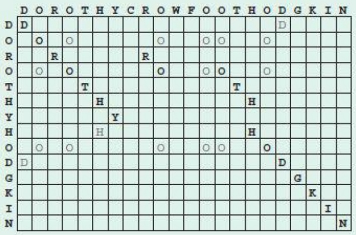

<details>
<summary>heatmap</summary>

| D | D | — | — | — | — | — | — | — | — | — | — | — | — | — | — | — | — | D | — | — | — |
| --- | --- | --- | --- | --- | --- | --- | --- | --- | --- | --- | --- | --- | --- | --- | --- | --- | --- | --- | --- | --- | --- |
| O | — | O | — | O | — | — | — | — | — | O | — | — | O | O | — | — | O | — | — | — | — |
| R | — | — | R | — | — | — | — | — | R | — | — | — | — | — | — | — | — | — | — | — | — |
| O | — | O | — | O | — | — | — | — | — | O | — | — | O | O | — | — | O | — | — | — | — |
| T | — | — | — | — | T | — | — | — | — | — | — | — | — | T | — | — | — | — | — | — | — |
</details>

Letters corresponding to isolated matches are shown in nonbold type. The longest matching regions, shown in boldface, are the first and last names DOROTHY and HODGKIN. Shorter matching regions, such as the OTH of dorOTHy and crowfoOTHodgkin, or the RO of doROthy and cROwfoot, are noise.

## Example 5.2 Dotplots showing identities between a repetitive sequence and itself

The first shows the result for the sequence ABRACADABRACADABRA. The repeats appear on several subsidiary diagonals parallel to the main diagonal. The second, in honour of the discovery of the remains of Richard III, shows the result for perhaps his famous line, ‘A horse! A horse! My kingdom for a horse!’ ([http://www.youtube.com/watch?v=Fk\_teL3QudI](http://www.youtube.com/watch?v=Fk_teL3QudI).)

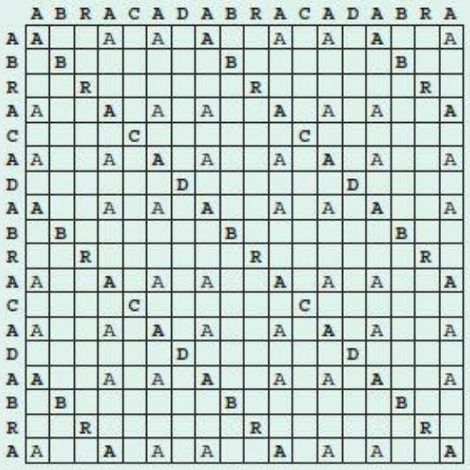

<details>
<summary>heatmap</summary>

| Row | A | B | R | A | C | A | D | A | B | R | A | C | A | D | A | B | R | A |
| --- | --- | --- | --- | --- | --- | --- | --- | --- | --- | --- | --- | --- | --- | --- | --- | --- | --- | --- |
| A | A | — | — | A | — | A | — | A | — | — | A | — | A | — | A | — | — | A |
| B | — | B | — | — | — | — | — | — | B | — | — | — | — | — | — | B | — | — |
| R | — | — | R | — | — | — | — | — | — | R | — | — | — | — | — | — | R | — |
| A | A | — | — | A | — | A | — | A | — | — | A | — | A | — | A | — | — | A |
| C | — | — | — | — | C | — | — | — | — | — | — | C | — | — | — | — | — | — |
| A | A | — | — | A | — | A | — | A | — | — | A | — | A | — | A | — | — | A |
| D | — | — | — | — | — | D | — | — | — | — | — | — | D | — | — | — | — | — |
| A | A | — | — | A | — | A | — | A | — | — | A | — | A | — | A | — | — | A |
</details>

217

---

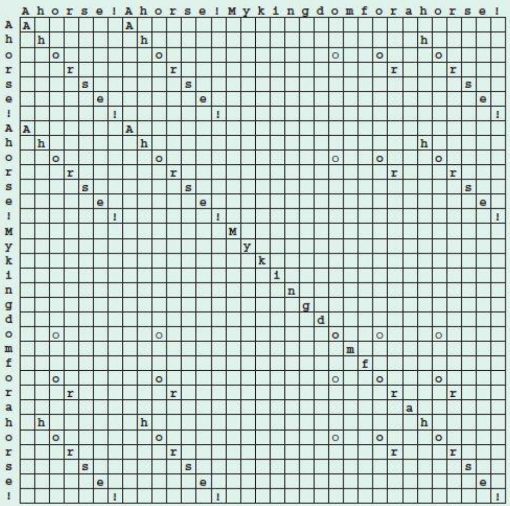

<details>
<summary>heatmap</summary>

| A | h | o | r | s | e | ! | h | o | r | s | e | ! | M | y | k | i | n | g | d | o | m | f |
| --- | --- | --- | --- | --- | --- | --- | --- | --- | --- | --- | --- | --- | --- | --- | --- | --- | --- | --- | --- | --- | --- | --- |
| b | h | o | r | s | e | ! | o | r | s | e | ! | ! | o | y | k | i | n | g | d | o | m | f |
| c | o | r | s | e | ! | ! | o | r | s | e | ! | ! | o | y | k | i | n | g | d | o | m | f |
| d | r | s | e | ! | ! | ! | o | r | s | e | ! | ! | o | y | k | i | n | g | d | o | m | f |
| e | s | e | ! | ! | ! | ! | o | r | s | e | ! | ! | o | y | k | i | n | g | d | o | m | f |
</details>

## Example 5.3 Dotplot showing identities between the palindromic sequence MAX I STAY AWAY AT SIX AM and itself

The palindrome reveals itself as a stretch of matches perpendicular to the main diagonal.

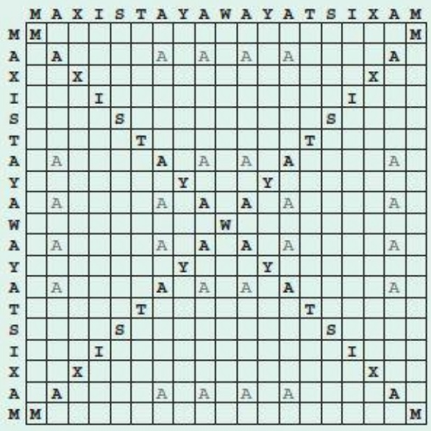

<details>
<summary>heatmap</summary>

|  | M | A | X | I | S | T | A | Y | A | W | A | Y | A | T | S | I | X | A | M |
| --- | --- | --- | --- | --- | --- | --- | --- | --- | --- | --- | --- | --- | --- | --- | --- | --- | --- | --- | --- |
| **M** | M | — | — | — | — | — | — | — | — | — | — | — | — | — | — | — | — | — | M |
| **A** | — | A | — | — | — | — | A | — | A | — | A | — | A | — | — | — | — | A | — |
| **X** | — | — | X | — | — | — | — | — | — | — | — | — | — | — | — | — | X | — | — |
| **I** | — | — | — | I | — | — | — | — | — | — | — | — | — | — | — | I | — | — | — |
| **S** | — | — | — | — | S | — | — | — | — | — | — | — | — | — | S | — | — | — | — |
| **T** | — | — | — | — | — | T | — | — | — | — | — | — | — | T | — | — | — | — | — |
| **A** | — | A | — | — | — | — | A | — | A | — | A | — | A | — | — | — | — | A | — |
</details>

This is not just word play: regions in DNA recognized by transcriptional regulators or restriction enzymes have sequences related to palindromes, crossing from one strand to the other:

EcoRI recognition site:

GAATTC

CTTAAG

Within each strand a region is followed by its reverse complement (see Exercise 5.9 and Problem 5.9). Longer regions of DNA or RNA containing inverted repeats of this form can form stem–loop structures. In addition, some transposable elements in plants contain true (approximate) palindromic sequences: inverted repeats of

218

---

noncomplemented sequences, on the same strand; the following example appears in the wheat dwarf virus genome: ttttcgtgagtgcgcggaggctttt.

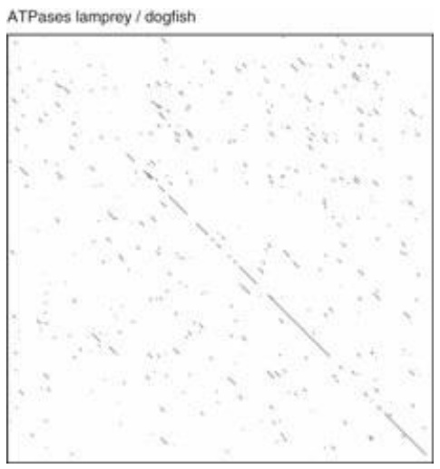

<details>
<summary>scatter</summary>

| Series | X (range) | Y (range) |
| --- | --- | --- |
| Data Points | 0~100 | 0~100 |
</details>


## See Weblem 5.1

A disadvantage of the dotplot is that its ‘reach’ into the realm of distantly related sequences is poor. In analysing sequences, one should always look at a dotplot to be sure of not missing anything obvious, but be prepared to apply more sensitive tools.

Often regions of similarity may be displaced, to appear on parallel but not collinear diagonals. This indicates that insertions or deletions have occurred in the segments between the similar regions. A dotplot relating the PAX-6 protein of mouse and the eyeless protein of D. melanogaster shows three extended regions of similarity with different lengths of sequence between them, two near the beginning of the sequences and one near the middle. Between the second and third of them, there is a longer intervening region in the mouse than in the Drosophila sequence.

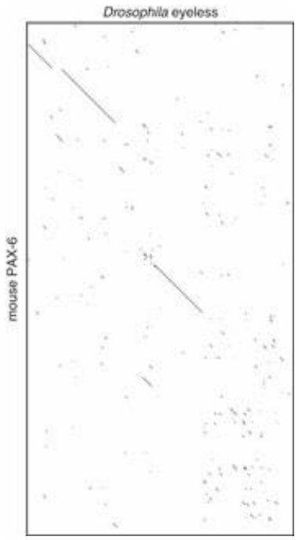

<details>
<summary>text_image</summary>

Drosophila eyeless
mouse PAX-6
</details>

Filtering the results can reduce the noise in a dotplot. In the comparison of the ATPase sequences, dots were not shown unless they were at the centre of a consecutive region of 15 residues containing at least six matches. The PERL program for dotplots (see Box 5.1) allows the user to set values for a window (length of region of consecutive residues) and a threshold (number of matches required within the window).

## Box 5.1 A PERL program to draw dotplots

219

---

The program shown reads the following.

**1.** A general title for the job, printed at the top of the output drawing. (First line of input.)
**2.** Parameters specifying the filtering parameters window and threshold (second line of input). A dot will appear in the dotplot if it is in the centre of a stretch of residues of length window in which the number of matches is ≥ threshold.
**3.** The two sequences, each beginning with a title line and ending with an \*.

The program draws a dotplot similar to those shown in the text. The output is in a graphical language called Post-Script™, which can be displayed or printed on many devices, or converted to the common pdf format.

```perl
#!/usr/bin/perl
#dotplot.pl -- reads two sequences and prints dotplot

# read input

$/ = "";
$_ = <DATA>; $_ =~ s/#(.*)\n/\n/g;
$_ =~ /^(.*)\n\s*(\d+)\s+(\d+)\s*\n(.*) \n([A-Z\n]*)\*\s*\n(.*)\n([A-Z\n]*)\*/;
\$title = \$1; \$nwind = \$2; \$thresh = \$3;
\$seq1 = \$4; \$seq1 = \$5; \$seq2 = \$6; \$seq2 = \$7;
\$seq1 =~ s/\n//g; \$seq2 =~ s/\n//g; \$n = length(\$seq1); \$m = length(\$seq2);
# postscript header

print <<EOF;
%!PS-Adobe-/s /stroke load def /l /lineto load def /m /moveto load def /r /rlineto load def
/n /newpath load def /c /closepath load def /f /fill load def
1.75 setlinewidth 30 30 translate /Helvetica findfont 20 scalefont setfont EOF

#print matrix

\$dx = 500.0/\$n; \$mdx = -\$dx; \$dy = 500.0/\$m;
if (\$dy < \$dx) {\$dx = \$dy;} \$dy = \$dx; \$xmax = \$n*\$dx; \$ymax = \$m*\$dx;
print "0 510 m (\$title NWIND = \$nwind) show\n";
printf "0 0 m 0 %9.2f 1 %9.2f %9.2f 1 %9.2f 0 l c s\n",
\$ymx,\$xmax,\$ymx,\$xmax;

for (\$k = \$nwind - \$m + 1; \$k < \$n - \$nwind; \$k++) {
    \$i = \$k; \$j = 1; if (\$k < 1) {\$i = 1; \$j = 2 - \$k;}
    while (\$i <= \$n - \$nwind && \$j <= \$m - \$nwind) {
        $_ = (substr(\$seq1,\$i -1,\$nwind) ^ substr(\$seq2,\$j -1,\$nwind));
        \$mismatch = (\$_ =~ s/[^\x0]//g);
        if (\$mismatch < \$thresh) {
            \$xl = (\$i - 1)*\$dx; \$yb = (\$m - \$j)*\$dy;
            printf "n %9.2f %9.2f m %9.2f 0 r 0 %9.2f r %9.2f 0 r c f\n",
                    \$xl,\$yb,\$dx,\$dy,\$mdx;
        }
        \$i++; \$j++;
    }
}
print "showpage\n";
__END__
```

220

---

```txt
ATPases lamprey / dogfish #TITLE
15 6 #WINDOW, THRESHOLD
Petromyzon marinus mitochondrion #SEQUENCE 1
ATGACACTAGATATCTTTGACCAATTTACCTCCCCAACA
ATATTTGGGCTTCCACTAGCCTGATTAGCTATACTAGCCCCTAGCTTA
ATATTAGTTTCACAAACACCAAAATTTATCAAATCTCGTTATCACACACTA
CTTACACCCATCTTAACATCTATTGCCAAACAACTCTTTCTTCCAATAAAC
CAACAAGGGCATAAATGAGCCTTAATTTGTATAGCCTCTATAATATTTATC
TTAATAATTAATCTTTTAGGATTATTACCATATACTTATACACCAACTACC
CAATTATCAATAAACATAGGATTAGCAGTGCCACTATGACTAGCTACTGTC
CTCATTGGGTTACAAAAAAAACCAACAGAAGCCCTAGCCCACTTATTACCA
GAAGGTACCCCAGCAGCACTCATTCCCATATTAATTATCATTGAAACTATT
AGTCTTTTTATCCGACCTATCGCCCTAGGAGTCCGACTAACCGCTAATTTA
ACAGCTGGTCACTTACTTATACAACTAGTTTCTATAACAACCTTTGTAATA
ATTCCTGTCATTTCAATTTCAATTATTACCTCACTACTTCTTCTATTA
CTAACAATTCTGGAGTTAGCTGTTGCTGTAATCCAGGCATATGTATTTATT
CTACTTTTAACTCTTTATCTGCAAGAAAACGTTT*
Scyliorhinuscanicula mitochondrion #SEQUENCE 2
ATGATTATAAGCTTTTTTGATCAATTCCTAAGTCCCTCCTTTCTAGGA
ATCCCACTAATTGCCCTAGCTATTTCAATTCCATGATTAATATTTCCAACACCAACC
AATCGTTGACTTAATAATCGATTATTAACTCTTCAAGCATGATTTATTAACCGATTTATT
TATCAACTAATACAACCCATAAATTTAGGAGGACATAAATGAGCTATCTTATTTACAGCC
CTAATATTATTTTAATTACCATCAATCTTCTAGGTCTCCTTCCATATACTTTTACGCCT
ACAACTCAACTTTCTCTTAATATAGCCTTTGCCCTGCCCTTATGGCTTACAACTGTATTA
ATTGGTATATTTAATCAACCAACCATTGCCCTAGGGCACTTATTACCTGAAGGTACCCCA
ACCCCTTTAGTACCAGTACTAATCATTATCGAAACCATCAGTTTATTTATTCGACCATTAG
GCCTTAGGAGTCCGATTAACAGCCAACTTAACAGCTGGACATCTCCTTATACAATTAATC
GCAACTGCGGCCTTTGTCCTTTTAACTATAATACCAACCGTGGCCTTACTAACCTCCCTA
GTCCTGTTCCTATTGACTATTTTAGAAGTGGCTGTAGCTATAATTCAAGCATACGTATTT
GTCCTTCTTTTAAGCTTATATCTACAAGAAAACGTATAA*
```

## Web resource: Dotplots

E.L. Sonnhammer’s program Dotter computes and displays dotplots. It allows the user to control the calculation and alter the appearance of the display by adjusting parameters interactively ([http://www.cgr.ki.se/cgr/groups/sonnhammer/Dotter.html](http://www.cgr.ki.se/cgr/groups/sonnhammer/Dotter.html)).

To use the full set of features of Dotter it is necessary to install it locally. A website that offers interactive dotplotting is: [http://myhits.isb-sib.ch/cgi-bin/dotlet](http://myhits.isb-sib.ch/cgi-bin/dotlet).

## Dotplots and sequence alignments

The dotplot captures in a single picture not only the overall similarity of two sequences, but also the complete set and relative quality of different possible alignments. Any path through the dotplot from upper left to lower right, moving from each point only in the east, south, or southeast directions, corresponds to a possible alignment. If two sequences are closely related, the alignment can be read directly off the dotplot.

Figure 5.1 shows an example based on the Dorothy Hodgkin dotplot. If the direction of the ‘move between successive cells is diagonal, two pairs of successive residues appear in the alignment without an insertion between them. If the direction of the move is horizontal, a gap is introduced in

221

---

the sequence indexing the rows. If the direction of the move is vertical, a gap would be introduced in the sequence indexing the columns. Note that no moves can be directed up or to the left, as this would correspond to aligning several residues of one sequence with only one residue of the other, or to introducing gaps in both sequences. The path indicated by the arrows corresponds to the obvious alignment:

DOROTHY––––––––HODGKIN

DOROTHYCROWFOOTHODGKIN

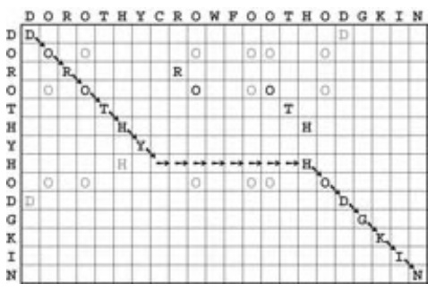

<details>
<summary>line</summary>

| Category | Value |
| --- | --- |
| D | 1 |
| O | 2 |
| R | 3 |
| O | 4 |
| T | 5 |
| H | 6 |
| Y | 7 |
| H | 8 |
| H | 9 |
| H | 10 |
| H | 11 |
| H | 12 |
| H | 13 |
| H | 14 |
| H | 15 |
| H | 16 |
| H | 17 |
| H | 18 |
| H | 19 |
| H | 20 |
| H | 21 |
| H | 22 |
| H | 23 |
| H | 24 |
| H | 25 |
| H | 26 |
| H | 27 |
| H | 28 |
| H | 29 |
| H | 30 |
| H | 31 |
| H | 32 |
| H | 33 |
| H | 34 |
| H | 35 |
| H | 36 |
| H | 37 |
| H | 38 |
| H | 39 |
| H | 40 |
| H | 41 |
| H | 42 |
| H | 43 |
| H | 44 |
| H | 45 |
| H | 46 |
| H | 47 |
| H | 48 |
| H | 49 |
| H | 50 |
| H | 51 |
| H | 52 |
| H | 53 |
| H | 54 |
| H | 55 |
| H | 56 |
| H | 57 |
| H | 58 |
| H | 59 |
| H | 60 |
| H | 61 |
| H | 62 |
| H | 63 |
| H | 64 |
| H | 65 |
| H | 66 |
| H | 67 |
| H | 68 |
| H | 69 |
| H | 70 |
| H | 71 |
| H | 72 |
| H | 73 |
| H | 74 |
| H | 75 |
| H | 76 |
| H | 77 |
| H | 78 |
| H | 79 |
| H | 80 |
| H | 81 |
| H | 82 |
| H | 83 |
| H | 84 |
| H | 85 |
| H | 86 |
| H | 87 |
| H | 88 |
| H | 89 |
| H | 90 |
| H | 91 |
| H | 92 |
| H | 93 |
| H | 94 |
| H | 95 |
| H | 96 |
| H | 97 |
| H | 98 |
| H | 99 |
| N | 100 |
</details>

Figure 5.1 Any path through the dotplot from upper left to lower right passes through a succession of cells, each of which picks out a pair of positions, one from the row and one from the column, that are matched in the alignment that corresponds to that path; or that indicates a gap in one of the sequences. The path need not pass through filled-in points only. However, the more filled-in points on the path, the more matching residues in the alignment.

Another way to think of a path through the dotplot is as an edit script; that is, a prescription of a series of operations that transforms the sequence that indexes the columns—the ‘horizontal’ sequence—into the sequence that indexes the rows, or the ‘vertical’ sequence. Each move tells us to perform an operation: a substitution, an insertion, or a deletion. When the end of the path is reached, the effect will be to change one sequence into the other. In many cases, several different sequences of edit operations may convert one string into the other in the same number of steps, but they induce different alignments.

It should be emphasized that although a sequence of edit operations derived from an optimal alignment may correspond to an actual set of evolutionary events, it is impossible to prove that it does. The larger the edit distance, the larger the number of reasonable evolutionary pathways between two sequences. Moreover, an alignment does not contain any information about the order of occurrence of the sequence changes during evolution. (See Case Study 5.1.)

## Measures of sequence similarity

To go beyond ‘alignment by eyeball’ via dotplots, we must define quantitative measures of sequence similarity and difference.

Given two character strings, two measures of the distance between them are:

1. the Hamming distance, defined between two strings of equal length, is the number of positions with mismatching characters;
2. the Levenshtein, or edit, distance, defined between two strings of not necessarily equal length, is the minimal number of ‘edit operations’ required to change one string into the other. An edit operation is a deletion, insertion, or alteration of a single character in either sequence. A given sequence of edit operations induces a unique alignment, but not vice versa.

For example:

222

---

```hcl
agtc                      Hamming distance = 2
cgta
ag-tcc                  Levenshtein distance = 3
cgctca
```

For applications to molecular biology, recognize that certain changes are more likely to occur than others. For example, amino acid substitutions tend to be

## CASE STUDY 5.1 Dotplots and alignments

Let us compare the appearance of dotplots between pairs of proteins with increasingly more distant relationships. Figure 5.2 shows the dotplot comparisons of the sulphydryl proteinase papain from papaya with four homologues: the close relative, kiwi fruit actinidin, and the successively more distant relatives, human procathepsin L, human cathepsin B, and Staphylococcus aureus staphopain. The sequence alignments are also shown. As the sequences progressively diverge, it becomes more and more difficult to spot the correct alignment in the dotplot. The alignments shown were derived from comparisons of the structures. For pictures of the superposed structures, see Introduction to Protein Science (Lesk, 2004).

223

---

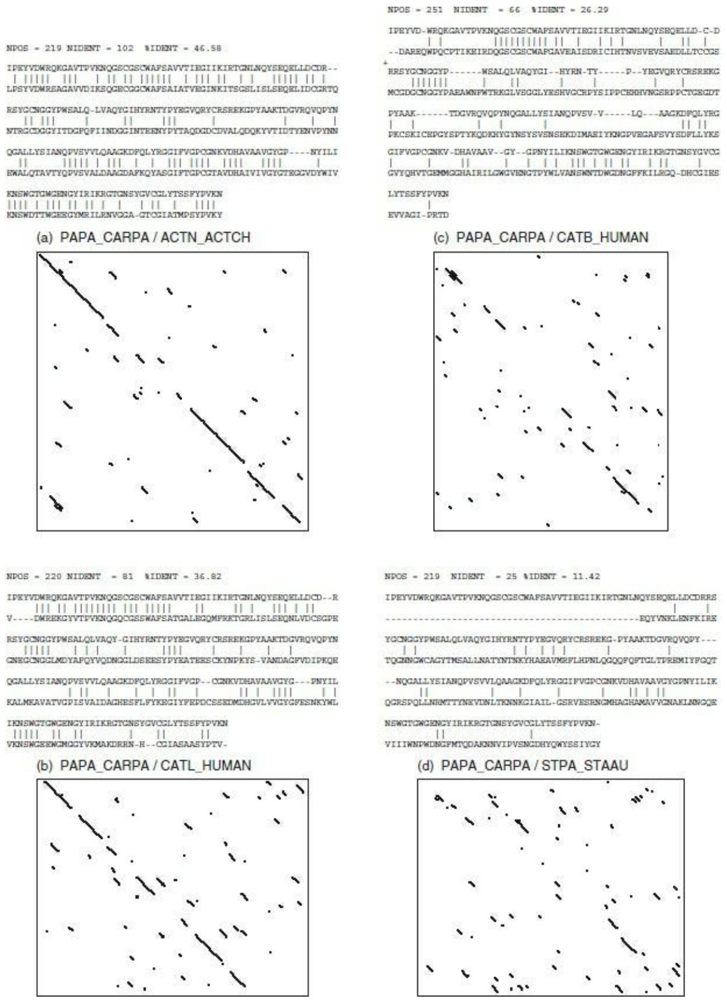

Figure 5.2 (a) Alignment of papaya papain and kiwi fruit actinidin, with the corresponding dotplot. (b) Alignment of papaya papain and human procathepsin L, with the corresponding dotplot. This dotplot shows that there are several similar regions, but it would be difficult to generate a complete sequence alignment from the dotplot. (c) Alignment of papaya papain and human liver cathepsin B, with the corresponding dotplot. Note, in both the sequence alignment and the dotplot, the higher similarity at the beginning and end of the sequences than in the middle region. (d) Alignment of papaya papain and S. aureus staphopain, with the corresponding dotplot. The alignment is not derivable from this dotplot.


## See Weblems 5.2, 5.3 and 5.4

conservative: the replacement of one amino acid by another with similar size or physicochemical properties is more likely to have occurred than its replacement by another amino acid with greater

224

---

differences. Or, the deletion of a succession of contiguous bases or amino acids is a more probable event than the independent deletion of the same number of bases or amino acids at noncontiguous positions in the sequences. Therefore, we may wish to assign variable weights to different edit operations. A computer program can then determine not just minimal edit distances but optimal alignments. It can score each path by adding up the scores of the individual steps. For substitutions, it adds the score of the mutation, depending on the pair of residues involved. For horizontal and vertical moves, it adds a suitable gap penalty.

## Scoring schemes

A scoring system must account for residue substitutions, and insertions or deletions. Deletions, or gaps in a sequence, will have scores that depend on their lengths.

Hamming and Levenshtein distances measure the dissimilarity of two sequences: similar sequences give small distances and dissimilar sequences give large distances. It is common in molecular biology to define scores as measures of sequence similarity. Then similar sequences give high scores and dissimilar sequences give low scores. These are equivalent formulations. Algorithms for optimal alignment can seek either to minimize a dissimilarity measure or to maximize a scoring function.

For nucleic acid sequences, it is common to use a simple scheme for substitutions: +1 for a match, −1 for a mismatch, or a more complicated scheme based on a higher frequency of transition mutations than transversion mutations. (See Example 5.4.)

For proteins, a variety of scoring schemes have been proposed. We might group the amino acids into classes of similar physicochemical type, and score +1 for a match within residue class and –1 for residues in different classes. We might try to devise a more precise substitution score from a combination of properties of the amino acids. Alternatively, we might try to let the proteins teach us an appropriate scoring scheme. M.O. Dayhoff did this first by collecting statistics on substitution frequencies in the protein sequences then known. Her results were used for many years to score alignments. They have been superseded by

## Example 5.4 Substitution matrix reflecting greater frequency of transition mutations than transversion mutations

Transition mutations (purine↔purine and pyrimidine↔pyrimidine, i.e. a↔g and t↔c) are more common than transversions [purine↔pyrimidine, i.e. (a, g)↔(t, c)]. Suggest a substitution matrix that reflects this. (The higher the value in the matrix, the more favourable the contribution to the alignment score.)

One possibility is:

|  | a | g | t | c |
| --- | --- | --- | --- | --- |
| a | 20 | 10 | 5 | 5 |
| g | 10 | 20 | 5 | 5 |
| t | 5 | 5 | 20 | 10 |
| c | 5 | 5 | 10 | 20 |

newer matrices based on the very much larger set of sequences that has subsequently become available.

225

---

## Derivation of substitution matrices: PAM and BLOSUM matrices

As sequences diverge, mutations accumulate. To measure the relative probability of any particular substitution, for instance serine→threonine, we can count the number of serine→threonine changes in pairs of aligned homologous sequences. We could use the relative frequencies of such changes to form a scoring matrix for substitutions. A common change should score higher than a rare one. But, what if there have been multiple substitutions at certain sites? This will bias the statistics. We can avoid this problem by restricting our samples to sequences that are sufficiently similar that we can assume that no position has changed more than once.

A measure of sequence divergence is the PAM, where 1 PAM = 1 per cent accepted mutation. Thus, two sequences 1 PAM apart have 99% identical residues. For pairs of sequences within the 1 PAM level of divergence, it is likely that there has been no more than one change at any position. Collecting statistics from pairs of sequences as closely related as this, and correcting for different amino acid abundances, produces the 1 PAM substitution matrix.

To produce a matrix appropriate for more widely divergent sequences, we can take powers of this matrix. The PAM250 level, corresponding to ${ \approx } 2 0 \%$ overall sequence identity, is the lowest sequence similarity for which we can hope to produce a correct alignment by simple pairwise sequence comparison alone. It is therefore the appropriate level to choose for practical work. (Several authors have derived substitution matrices appropriate in different ranges of overall sequence similarity.)

The occurrence of reversions, either directly or via one or more other changes, produces an apparent slowdown in mutation rates as sequences progressively diverge. The relationship between PAM score and percentage sequence identity is:

| PAM | 0 | 30 | 80 | 110 | 200 | 250 |
| --- | --- | --- | --- | --- | --- | --- |
| % Identity | 100 | 75 | 50 | 60 | 25 | 20 |

The PAM250 matrix of M.O. Dayhoff is shown in Box 5.2. It expresses scores as log-odds values:

$$
\begin{array}{l} \text {Score of mutation $i \leftrightarrow j =$} \\ \log_ {1 0} \frac {\text {observed $i \leftrightarrow j$ mutation rate}}{\text {mutation rate expected from amino}} \\ \text {acid frequencies} \end{array}
$$

## Box 5.2 Substitution matrices used for scoring amino acid sequence similarity

The entries are in alphabetical order of the three-letter amino acid names. Only the lower triangles of the matrices are shown, as the substitution probabilities are taken as symmetric. (This is not because we are sure that the rate of any substitution is the same as the rate of its reverse, but because we cannot determine the differences between the two rates.)

The Dayhoff PAM250 matrix (MDM78):

226

---

| Ala (A) | 2 |  |  |  |  |  |  |  |  |  |  |  |  |  |  |  |  |  |  |
| --- | --- | --- | --- | --- | --- | --- | --- | --- | --- | --- | --- | --- | --- | --- | --- | --- | --- | --- | --- |
| Arg (R) | -2 | 6 |  |  |  |  |  |  |  |  |  |  |  |  |  |  |  |  |  |
| Asn (N) | 0 | 0 | 2 |  |  |  |  |  |  |  |  |  |  |  |  |  |  |  |  |
| Asp (D) | 0 | -1 | 2 | 4 |  |  |  |  |  |  |  |  |  |  |  |  |  |  |  |
| Cys (C) | -2 | -4 | -4 | -5 | 12 |  |  |  |  |  |  |  |  |  |  |  |  |  |  |
| Gln (Q) | 0 | 1 | 1 | 2 | -5 | 4 |  |  |  |  |  |  |  |  |  |  |  |  |  |
| Glu (E) | 0 | -1 | 1 | 3 | -5 | 2 | 4 |  |  |  |  |  |  |  |  |  |  |  |  |
| Gly (G) | 1 | -3 | 0 | 1 | -3 | -1 | 0 | 5 |  |  |  |  |  |  |  |  |  |  |  |
| His (H) | -1 | 2 | 2 | 1 | -3 | 3 | 1 | -2 | 6 |  |  |  |  |  |  |  |  |  |  |
| Ile (I) | -1 | -2 | -2 | -2 | -2 | -2 | -2 | -3 | -2 | -5 |  |  |  |  |  |  |  |  |  |
| Leu (L) | -2 | -3 | -3 | -4 | -6 | -2 | -3 | -4 | -2 | 2 | 6 |  |  |  |  |  |  |  |  |
| Lys (K) | -1 | 3 | 1 | 0 | -5 | 1 | 0 | -2 | 0 | -2 | -3 | 5 |  |  |  |  |  |  |  |
| Met (M) | -1 | 0 | -2 | -3 | -5 | -1 | -2 | -3 | -2 | 2 | 4 | 0 | 6 |  |  |  |  |  |  |
| Phe (F) | -3 | -4 | -3 | -6 | -4 | -5 | -5 | -5 | -2 | 1 | 2 | -5 | 0 | 9 |  |  |  |  |  |
| Pro (P) | 1 | 0 | 0 | -1 | -3 | 0 | -1 | 0 | 0 | -2 | -3 | -1 | -2 | -5 | 6 |  |  |  |  |
| Ser (S) | 1 | 0 | 1 | 0 | 0 | -1 | 0 | 1 | -1 | -1 | -3 | 0 | -2 | -3 | 1 | 2 |  |  |  |
| Thr (T) | 1 | -2 | 0 | 0 | -2 | -1 | 0 | 0 | -1 | 0 | -2 | 0 | -1 | -3 | 0 | 1 | 3 |  |  |
| Trp (W) | -6 | 2 | -4 | -7 | -8 | -5 | -7 | -7 | -3 | -5 | -2 | -3 | -4 | 0 | -6 | -2 | -5 | 17 |  |
| Tyr (Y) | -3 | -4 | -2 | -4 | 0 | -4 | -4 | -5 | 0 | -1 | -1 | -4 | -2 | 7 | -5 | -3 | -3 | 0 | 10 |
| Val (V) | 0 | -2 | -2 | -2 | -2 | -2 | -2 | -1 | -2 | 4 | 2 | -2 | 2 | -1 | -1 | -1 | 0 | -6 | -2 |
|  | A | R | N | D | C | Q | E | G | H | I | L | K | M | F | P | S | T | W | Y |

The BLOSUM62 matrix:

| Ala (A) | 4 |  |  |  |  |  |  |  |  |  |  |  |  |  |  |  |  |  |
| --- | --- | --- | --- | --- | --- | --- | --- | --- | --- | --- | --- | --- | --- | --- | --- | --- | --- | --- |
| Arg (R) | -1 | 5 |  |  |  |  |  |  |  |  |  |  |  |  |  |  |  |  |
| Asn (N) | -2 | 0 | 6 |  |  |  |  |  |  |  |  |  |  |  |  |  |  |  |
| Asp (D) | -2 | -2 | 1 | 6 |  |  |  |  |  |  |  |  |  |  |  |  |  |  |
| Cys (C) | 0 | -3 | -3 | -3 | 9 |  |  |  |  |  |  |  |  |  |  |  |  |  |
| Gln (Q) | -1 | 1 | 0 | 0 | -3 | 5 |  |  |  |  |  |  |  |  |  |  |  |  |
| Glu (E) | -1 | 0 | 0 | 2 | -4 | 2 | 5 |  |  |  |  |  |  |  |  |  |  |  |
| Gly (G) | 0 | -2 | 0 | -1 | -3 | -2 | -2 | 6 |  |  |  |  |  |  |  |  |  |  |
| His (H) | -2 | 0 | 1 | -1 | -3 | 0 | 0 | -2 | 8 |  |  |  |  |  |  |  |  |  |
| Ile (I) | -1 | -3 | -3 | -3 | -1 | -3 | -3 | -4 | -3 | 4 |  |  |  |  |  |  |  |  |
| Leu (L) | -1 | -2 | -3 | -4 | -1 | -2 | -3 | -4 | -3 | 2 | 4 |  |  |  |  |  |  |  |
| Lys (K) | -1 | 2 | 0 | -1 | -3 | 1 | 1 | -2 | -1 | -3 | -2 | 5 |  |  |  |  |  |  |
| Met (M) | -1 | -1 | -2 | -3 | -1 | 0 | -2 | -3 | -2 | 1 | 2 | -1 | 5 |  |  |  |  |  |
| Phe (F) | -2 | -3 | -3 | -3 | -2 | -3 | -3 | -3 | -1 | 0 | 0 | -3 | 0 | 6 |  |  |  |  |
| Pro (P) | -1 | -2 | -2 | -1 | -3 | -1 | -1 | -2 | -2 | -3 | -3 | -1 | -2 | -4 | 7 |  |  |  |
| Ser (S) | 1 | -1 | 1 | 0 | -1 | 0 | 0 | 0 | -1 | -2 | -2 | 0 | -1 | -2 | -1 | 4 |  |  |
| Thr (T) | 0 | -1 | 0 | -1 | -1 | -1 | -1 | -2 | -2 | -1 | -1 | -1 | -1 | -2 | -1 | 1 | 5 |  |
| Trp (W) | -3 | -3 | -4 | -4 | -2 | -2 | -3 | -2 | -2 | -3 | -2 | -3 | -1 | 1 | -4 | -3 | -2 | 11 |
| Tyr (Y) | -2 | -2 | -2 | -3 | -2 | -1 | -2 | -3 | 2 | -1 | -1 | -2 | -1 | 3 | -3 | -2 | -2 | 2 |
| Val (V) | 0 | -3 | -3 | -3 | -1 | -2 | -2 | -3 | -3 | 3 | 1 | -2 | 1 | -1 | -2 | -2 | 0 | -3 |
|  | A | R | N | D | C | Q | E | G | H | I | L | K | M | F | P | S | T | W |

The numbers are multiplied by 10, simply to avoid decimal points. The matrix entries reflect the probabilities of mutational events. A value of +2—for instance, C↔S—implies that in related sequences the mutation would be expected to occur 1.6 times more frequently than random. The calculation is as follows: the matrix entry 2 corresponds to the actual value 0.2 because of the scaling. The value 0.2 is $\log _ { 1 0 }$ of the relative expectation value of the mutation. Therefore, this

227

---

expectation value is $1 0 ^ { 0 . 2 }   { = }   1 . 6 .$

The probability of two independent mutational events is the product of their probabilities. By using logs we have scores that we can add up rather than multiply, a computational convenience.

## The BLOSUM matrices

S. Henikoff and J.G. Henikoff developed the family of BLOSUM matrices for scoring substitutions in amino acid sequence comparisons. Their goal was to replace the Dayhoff matrix with one that would perform best in identifying distant relationships, making use of the much larger amount of sequence data that had become available since Dayhoff’s work.

The BLOSUM matrices are based on the BLOCKS database of aligned protein sequences; hence the name BLOcks SUbstitution Matrix. From regions of closely related proteins alignable without gaps, Henikoff and Henikoff calculated the ratio of the number of observed pairs of amino acids at any position to the number of pairs expected from the overall amino acid frequencies. Like the Dayhoff matrix, the results are expressed as log-odds. In order to avoid overweighting closely related sequences, the Henikoffs replaced groups of proteins that have sequence identities higher than a threshold by either a single representative or a weighted average. The threshold 62% produces the commonly used BLOSUM62 substitution matrix (see Box 5.2). This is offered by all programs as an option, and is the default in most. BLOSUM matrices have superseded the Dayhoff matrix.

## Scoring insertions/deletions, or ‘gap weighting

To form a complete scoring scheme for alignments, we need, in addition to the substitution matrix, a way of scoring gaps. How important are insertions and deletions relative to substitutions? Distinguish gap initiation:

aaagaaa

aaa–aaa

from gap extension:

aaaggggaaa

aaa––––aaa

For aligning DNA sequences, CLUSTAL-W recommends use of the identity matrix for substitution (+1 for a match, 0 for a mismatch) and gap penalties of 10 for gap initiation and 0.1 for gap extension by one residue. For aligning protein sequences, the recommendations are to use the BLOSUM62 matrix for substitutions, and gap penalties of 11 for gap initiation and 1 for gap extension by one residue.

## Computing the alignment of two sequences

Now that we have a scoring scheme, we can apply it to finding optimal alignments: we seek the alignment that maximizes the score. A famous algorithm to determine the global optimal alignments of two sequences is based on a mathematical technique called dynamic programming. (Details appear in the next section.) This algorithm has been extremely important in molecular biology. Some noteworthy features are as follows.

The good news is that the method is guaranteed to give an optimal global alignment. It will find the best alignment score, given the choice of parameters—substitution matrix and gap penalty—

228

---

with no approximation.

The bad news is that many alignments may give the same optimal score, and none of these need correspond to the biologically correct alignment. For instance, in comparing the α- and β-chains of chicken haemoglobin, W. Fitch and T. Smith found 17 alignments, all of which give the same optimal score and one of which is correct (on the basis of the structures, the court of last resort). There are 1317 alignments with scores within 5% of the optimum.
Another item of bad news is technical: the time required to align two sequences of lengths n and m is proportional to $n \times m ,$ , because this is the size of the edit matrix that must be filled in. This means that the dynamic-programming method is not convenient to use for searching in an entire sequence database for a match to a probe sequence, and even less convenient for ‘all-against-all’ alignments. The database search problem is in effect the problem of matching a probe sequence to a region of a very long sequence, the length of the entire database.

## Variations and generalizations

Variations of the dynamic-programming method apply to three related alignment questions: entire sequence against entire sequence, region of one sequence against entire other sequence, and region of one sequence against region of other sequence (see Box 1.8). The global alignment algorithm was first applied to biological sequence alignment by S.B. Needleman and C.D. Wunsch. T. Smith and M. Waterman modified it to identify local matches.

Box 5.3 BLAST programs come in several flavours

| Program | Type of query sequence | Search in database of: |
| --- | --- | --- |
| BLASTP | Amino acid sequence | Protein sequences |
| BLASTX | Translated nucleotide sequence | Protein sequences |
| TBLASTN | Amino acid sequence | Translated nucleotide sequences |
| TBLASTX | Translated nucleotide sequence | Translated nucleotide sequences |
| PSI-BLAST | Amino acid sequence | Protein sequence database |

All these programs compare amino acid sequences with amino acid sequences, using by default the BLOSUM62 matrix. Searches involving nucleotide sequences, either as query sequence or in the database searched, are carried out by translating nucleotide sequences to amino acid sequences in all six possible reading frames. BLASTN compares nucleic acid query sequences with nucleic acid data banks directly.

## Approximate methods for quick screening of databases

It is routine to screen genes from a new genome against the databases, for similarity to other sequences. Approximate methods can detect close relationships well and quickly but are inferior to the exact ones in picking up very distant relationships. In practice they give satisfactory performance in the many cases in which the probe sequence is fairly similar to one or more sequences in the data bank. They are therefore worth trying first. (We have already seen an example of PSI-BLAST in Chapter 1.)

A typical approximation approach would take a small integer k, and determine all instances of each k-tuple of residues in the probe sequence that occur in any sequence in the database. A candidate sequence is a sequence in the data bank containing a large number of matching k-tuples, with equivalent spacing in probe and candidate sequences.

229

---

There are several variations on this theme, including the original BLAST program and its variants (see Box 5.3). For a selected set of candidate sequences, approximate optimal alignment calculations are then carried out, with the time- and space-saving restriction that the paths through the matrix that can be considered are restricted to bands around the diagonals containing the many matching ktuples. It is clearest to show the procedure in terms of a dotplot (see Fig. 5.3).

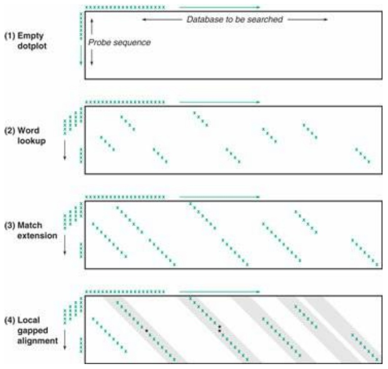

<details>
<summary>flowchart</summary>

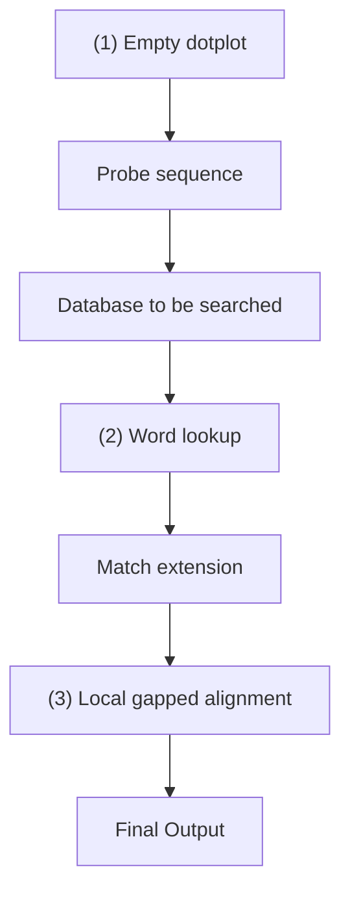
</details>

Figure 5.3 The mechanism of a BLAST search shown as a schematic. BLAST solves the problem of finding matches of a probe sequence in a full genome or a full database that is much longer than the probe sequence.

1. The ‘playing field’ of the algorithm is the outline of a dotplot, just as if the problem were going to be solved by application of an exact alignment method.
2. BLAST first divides the probe sequence into fixed-length words of length k; here, k = 4. It then identifies all exact occurrences of these words in the full database: no mismatches, no gaps. Note that the same four-letter word may occur several times in the probe sequence (shown here in green), and of course each four-letter word may match many times within the database. It is possible to do this step quickly after pre-processing the database to record the sites of appearance of all four-letter words.
3. Starting with each match, BLAST tries to extend the match in both directions. Still no mismatches, no gaps allowed.
4. Given the extended matches, BLAST tries to put them together by doing alignments allowing mismatches and gaps, but only within limited regions containing the preliminary matches (grey areas). The result of this step is to add to the matches the positions shown as ★. This produces longer matching regions.

It is the restriction of the more complex matching procedure to relatively small regions, rather than applying it to the entire matrix, that gives the method its speed. The price to pay is that if a combined match lies outside the grey area, the method will miss it. In the example illustrated, the matching regions at the right of the matrix, will not be combined, but reported as separate hits.

## The dynamic-programming algorithm for optimal pairwise sequence alignment1

A chart implicitly containing all possible alignments can be constructed as a matrix similar to that used in drawing the dotplot. The residues of one sequence index the rows, the residues from the other sequence index the columns. Any path through the matrix from upper left to lower right corresponds to an alignment. The task is to find the path that has the lowest cost, and the difficulty is that there are a very large number of paths to consider.

230

---

As an illustration, suppose you wanted to drive from Malmö in southern Sweden to Tromsø in northern Norway. Your route will consist of a number of segments, taking you through a succession of intermediate cities (see Fig. 5.4). There are many choices of different combinations of segments to produce a complete, continuous path.

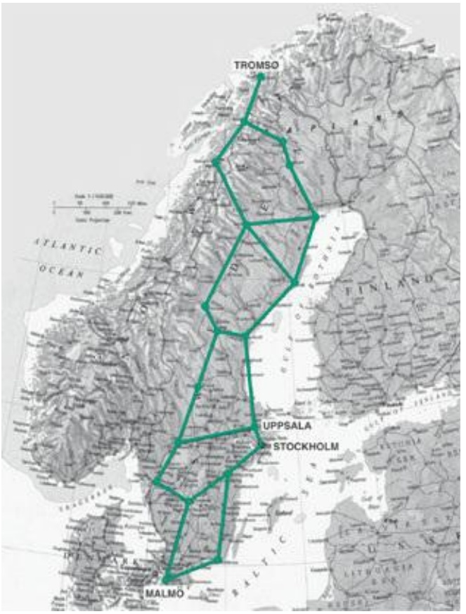

<details>
<summary>text_image</summary>

TROMSO
UPPSALA
STOCKHOLM
MALMO
</details>

Figure 5.4 Possible routes from Malmö to Tromsø. How can you determine an optimal route?

© Collins Bartholemew Ltd. 1980.

The computational approach to finding the optimal path begins by assigning a numerical measure of the ‘cost’ to each of the possible individual segments of the journey. This ‘cost’ is not simply the financial outlay, but a more general estimate of your relative preferences for different portions of the route. The distance travelled will clearly be an important component of the cost, but other factors such as the quality of the roads and the opportunities for sightseeing may also contribute. For any route selected, the overall cost of the trip is the sum of the costs of the individual segments. Clearly it is inefficient to repeat any leg of the journey, or to visit any city twice, so we will agree that every intermediate stop will be north of the previous one. This formalism is expressed in terms of minimizing a cost rather than maximizing a score; for our purposes the two approaches are equivalent. An algorithm can explore the possible combinations to determine an optimal overall route.

Here is an abstract version of the problem, which illuminates the essential idea of dynamic programming.

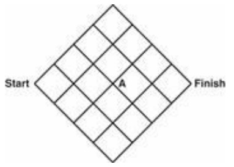

<details>
<summary>text_image</summary>

Start
A
Finish
</details>

Consider first: how many paths from Start to Finish pass through A? There are six paths from Start to A. (Write them all down.) Therefore, by symmetry, there are six paths from A to Finish, and a

231

---

total of 36 paths from Start to Finish passing through A. (Why?) Assuming that we have assigned costs to the individual steps, do we have to check all 36 paths to find the path of minimum cost that goes from Start to Finish, passing through A? No. Here is the crucial observation: the choice of the best path from A to Finish is independent of the choice of path from the Start to A. If we determine the best of the six paths from Start to A, and we determine the best of the six paths from A to Finish, the best path from Start to Finish passing through A is the best path from Start to A followed by the best path from A to Finish. No more than 12 of the paths through A need be considered.

Even greater simplification is possible by systematically re-subdividing the problem. The dynamic-programming method for finding the optimal path through the matrix is based on this idea.

A statement of the optimal alignment problem and the dynamic-programming solution are as follows. Given two character strings, possibly of unequal length— ${ \mathcal { A } } = a _ { 1 } a _ { 2 } { \cdots } a _ { n }$ and $B = b _ { 1 } b _ { 2 } . . . b _ { m } \mathrm { {  —  } }$ where each $a _ { i }$ and $b _ { j }$ is a member of an alphabet set $\mathcal { A } _ { 1 }$ , consider sequences of edit operations that convert A and B to a common sequence. Individual edit operations include:

Substitution of $b _ { j }$ for $a _ { i }$ is represented by $(a_{i},b_{j})$

Deletion of $a _ { i }$ from sequence A is represented by $(a_{i}, \phi)$

Deletion of $b_{j}$ from sequence B is represented by $( \phi , b _ { j } )$

If we extend the alphabet set to include the null character $\Phi : \mathcal { A } ^ { + } = \mathcal { A } \cup \{ \phi \}$ , a sequence of edit operations is a set of ordered pairs $( x , y )$ , with $x , y \in \mathcal { A }$

A cost function, $d ,$ is defined on edit operations:

which position i of sequence A corresponds to position $j$ of sequence $B _{ z }$ and the mutation

Define the minimum weighted distance between sequences A and B as:

$$
D (A, B) = \min _ {A \to B} \Sigma d (x, y)
$$

where $x , y \in \mathcal { A }$ and the minimum is taken over all sequences of edit operations that convert A and B into a common sequence.

The problem is to find $D ( A , B )$ and one or more of the alignments that correspond to it.

An algorithm that solves this problem, requiring execution time proportional to the product of the lengths of the two sequences, creates a matrix $\mathcal { D } ( i , j ) , i = 0 , \ldots n ; j = 0 , \ldots m ,$ such that $\mathcal { D } \left( i , j \right)$ is the minimal distance between the strings that consist of the first i characters of A and the first j characters of B. Then $\mathcal { D } ( n , m )$ will be the required minimal distance $D ( A , B )$

The algorithm computes $\varpi ( i , j )$ by recursion. The value of $\varpi ( i , j )$ corresponds to the conversion of the initial subsequences ${ \mathcal { A } } _ { i }   =   a _ { 1 } a _ { 2 } { \cdots } a _ { i }$ and $B _ { j }   =   b _ { 1 } b _ { 2 } . . . b _ { j }$ into a common sequence by L edit operations $S _ { k } , k = 1 , \ldots L ,$ , which can be considered to be applied in increasing order of position in the strings. Consider undoing the last of these edit operations. The resulting truncated sequence of edit

232

---

operations, $S _ { k } ,   k = 1 ,   \ldots   L ^ { - 1 }$ , is a sequence of edit operations for converting a substring of $A _ { i }$ and a substring of $B _ { j }$ into a common result. What is more, it must be an optimal sequence of edit operations for these substrings, for if some other sequence $\vec { S } _ { \vec { k } } ^ { \prime }$ were a lower-cost sequence of operations for these substrings, then followed by $S _ { L }$ would be a lower-cost sequence of operations than $S _ { k }$ for converting $A _ { i }$ to $B _ { j }$ . Therefore, there should be a recursive method for calculating the $\varpi ( i , j )$

Recognize the correspondence of steps between adjacent squares in the matrix, and individual edit operations (see Fig. 5.1):

$$
\begin{array}{l} \begin{array}{l} (i - 1, j - 1) \to (i, j) \text {corresponds to the} \\ \text {substitution} a _ {i} \to b _ {j} \end{array} \\ \begin{array}{l l} (i - 1, j) \to (i, j) & \text {corresponds to the} \\ & \text {deletion of a_{i} from A} \end{array} \\ \begin{array}{l l}(i, j - 1) \rightarrow (i, j)&\text {corresponds to the insertion}\\&\text {of b_{j} into A at position i}\end{array} \\ \end{array}
$$

Sequences of edit operations correspond to stepwise paths through the matrix:

$$
(i _ {0}, j _ {0}) = (0, 0) \rightarrow (i _ {1}, j _ {1}) \rightarrow \dots (n, m)
$$

where $0 \leq i _ { k + 1 } { - } i _ { k } \leq 1$ (for $0 \leq k \leq n { - } 1 )$ , $0 \leq j _ { k + 1 } - j _ { k } \leq 1$ (for $0 \leq k \leq m { - } 1 )$ . Considering the possible sequences of edit operations and the corresponding paths through the matrix, the predecessor of an optimal string of edit operations leading from $( 0 , \; 0 )$ to $( i , j )$ , where $i , j \geq 0$ , must be an optimal sequence of edit operations leading to one of the cells $( i { - } 1 , \; j ) , \; ( i { - } 1 , \; j { - } 1 )$ , or $( i ,   j { - } 1 )$ ; and, correspondingly, $\mathcal { D } ( i , j )$ must depend only on the values of $\scriptstyle { \mathcal { D } } ( i - 1 ,   j ) , \; { \mathcal { D } } ( i - 1 ,   j - 1 )$ , and $\mathcal { D } ( i , j { - } 1 )$ , together, of course, with the parameterization specified by the cost function d.

The algorithm is then as follows.

Compute the $( m + 1 ) \times ( n + 1 )$ matrix D by applying:

1. the initialization conditions on the top row and left column:

$$
\begin{array}{l} \mathcal {D} (i, 0) = \sum_ {k = 0} ^ {i} d (a _ {k}, \phi) \\ \mathcal {D} (0, j) = \sum_ {k = 0} ^ {j} d (\phi , b _ {k}) \\ \end{array}
$$

These values impose the gap penalty on unmatched residues at the beginning of either sequence.

And then:

2. the recurrence relationships:

$$
\begin{array}{l} \mathcal {D} (i, j) = \min \left\{\mathcal {D} (i - 1, j) + d (a _ {i}, \phi), \mathcal {D} (i - 1, j - 1) + \right. \\ d (a _ {i}, b _ {j}), \mathcal {D} (i, j - 1) + d (\phi , b _ {j}) \bigg \} \\ \end{array}
$$

for $i = 1 \ldots n ; j = 1 , \ldots m$ . This means, consider all three possible steps to $\varpi ( i , j )$

233

---

| Operation | Cumulative cost |
| --- | --- |
| Insert a gap in sequence A | $\mathcal{D}(i-1,j) + d(a_i, \phi)$ |
| Substitute $a_i \leftrightarrow b_j$ | $\mathcal{D}(i-1,j-1) + d(a_i, b_j)$ |
| Insert a gap in sequence B | $\mathcal{D}(i,j-1) + d(\phi, b_j)$ |

From these, choose the minimal value of the cumulative cost. For each cell, record not only the value $\mathcal { D } ( i , j )$ but a pointer back to (one or more of) the cell(s) $( i – 1 , j ) , ( i , – 1 , j – 1 )$ , or $( i , j { - } 1 )$ selected by the minimization operation. Note that more than one predecessor may give the same value.

When the calculations are complete, $\mathcal { D } ( n , ~ m )$ is the optimal distance $D ( A ,   B )$ . An alignment corresponding to the sequence of edit operations recorded by the pointers can be recovered by tracing a path back through the matrix from $( n ,   m )$ to (0, 0). This alignment, corresponding to the minimal distance $D ( A , B ) = \mathcal { D } ( n , m )$ , may well not be unique. (See Example 5.5.)

## Example 5.5 Dynamic-programming algorithm for sequence alignment

Align the strings $A = g g a a t g g$ and $B = a t g$ according to the simple scoring scheme of match = 0, mismatch = 20, and insertion or deletion = 25.

Here is the state of play after the top row and leftmost column have been initialized (italic), and the element in the second row and second column has been entered as **20** (boldface):

|  | $\phi$ | a | t | g |
| --- | --- | --- | --- | --- |
| $\phi$ | 0 | 25 | 50 | 75 |
| g | 25 | 20 |  |  |
| g | 50 |  |  |  |
| a | 75 |  |  |  |
| a | 100 |  |  |  |
| t | 125 |  |  |  |
| g | 150 |  |  |  |
| g | 175 |  |  |  |

The value of **20** was chosen as the minimum of $2 5 \pm 2 5$ (horizontal move, or insert gap into string atg), 0 + 20 (substitution $\alpha { \leftrightarrow } g ) ,$ , and $2 5 \pm 2 5$ (vertical move, or insert gap into string ggaatgg). Because the substitution (the diagonal move) provided the minimal value, the cell containing 0 in the upper left-hand corner of the matrix is the predecessor of the cell in which we have just entered the 20. For traceback purposes, we would also draw an arrow from the value of 20 just entered, back to the 0 at the upper left. (If two or even three of the possible moves produce the same value, the resulting cell has multiple predecessors.)

Here is the matrix after completion of the calculation:

234

---

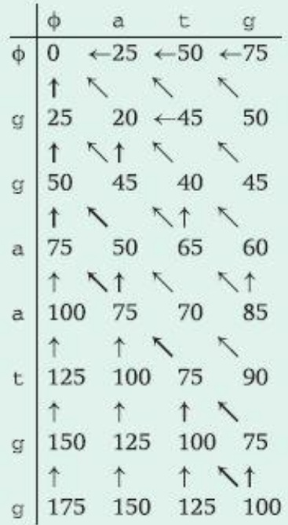

<details>
<summary>text_image</summary>

φ a t g
0 ←25 ←50 ←75
↑ ↘ ↘ ↘
g 25 20 ←45 50
↑ ↘ ↘ ↘
g 50 45 40 45
↑ ↘ ↘ ↘
a 75 50 65 60
↑ ↘ ↘ ↘ ↘
a 100 75 70 85
↑ ↑ ↘ ↘
t 125 100 75 90
↑ ↑ ↑ ↘
g 150 125 100 75
↑ ↑ ↑ ↘ ↗
g 175 150 125 100
</details>

It includes the traceback information in the form of arrows pointing from each cell to its predecessor(s). For some applications we may need only the value of D(A, B) but not an alignment; if so, it is unnecessary to save the pointers. Boldface arrows delineate the paths of optimal alignment retracing a trail of predecessors from lower right, back to upper left. In some cases, one cell may show two predecessors. These correspond to alternative alignments with the same score.

There are two cells at which the traceback path branches. This gives a total of four optimal alignments with equal score:

| ggaatgg | ggaatgg | ggaatgg | ggaatgg |
| --- | --- | --- | --- |
| ---atg- | ---at-g | --a-tg- | --a-t-g |

With a gap-weighting scheme that assigned a smaller penalty to gap extension than to gap initiation the first two of these would score better than the others, because they contain the smallest number of gaps, irrespective of the length of the individual gaps. However, more sophisticated gap-weighting schemes require more complicated recurrence formulas for filling the matrix.

This algorithm determines the optimal global alignment of two sequences. It is inappropriate for detection of local regions of high similarity within two sequences, or for probing a long sequence with a short fragment, because it imposes gap penalties outside the similar regions. The method of T. Smith and M. Waterman solves this problem. Their modifications of the basic dynamic-programming algorithm find optimal local alignments; that is, they select the substrings from both sequences that are most similar to each other. Their changes affect the following aspects.

Initialization of the matrix: setting the values of the top row and left column. In the Smith–Waterman method, the top row and left column are set to 0. As a result, either sequence can slide along the other before alignment starts, without incurring any gap penalty against the residues it passes by.
2. Filling in the matrix: in global alignment, at each step a choice is forced among match, insertion, or deletion, even if none of these choices is attractive and even if a succession of unattractive choices degrades the score along a path containing a well-fitting local region. The Smith–Waterman method adds the fourth option: end the region being aligned.
3. Scoring and traceback: the score of a global alignment is the number in the matrix element at the lower right. In the Smith–Waterman method it is the optimal value encountered, wherever in the matrix it appears. For global alignment, traceback to determine the actual alignment starts at the lower-right cell. In the Smith– Waterman method it starts at the cell containing the optimal value and continues back only as far as the region of local similarity continues.

The Smith–Waterman method would report a unique global optimum for our example:

Note that no gaps appear outside the region matched.

235

---

Example adapted from Tyler, E.C., Horton, M.R., and Krause, P.R. (1991). A review of algorithms for molecular sequence comparison. Computers and Biomedical Research, 24, 72–96.

## Significance of alignments

Suppose alignment reveals an intriguing similarity between two sequences. Is the similarity significant or could it have arisen by chance? (We raised this question in Chapter 1.) For some simple phenomena—tossing a coin or rolling dice—it is possible to calculate exactly the expected distribution of results, and the likelihood of any particular result. For sequences it is not trivial to define the population from which the alignment is selected. For instance, to take random strings of nucleotides or amino acids as controls ignores the bias arising from nonrandom composition.

A practical approach to the problem is as follows: if the score of the alignment observed is no better than might be expected from the corresponding alignment of a random permutation of the sequence, then it is likely to have arisen by chance. We may randomize one of the sequences many times, realign each result to the second sequence (held fixed) and collect the distribution of resulting scores. Figure 5.5 shows a typical result. For database searches we would use the population of results returned from the entire database as the population with which to measure the statistics.

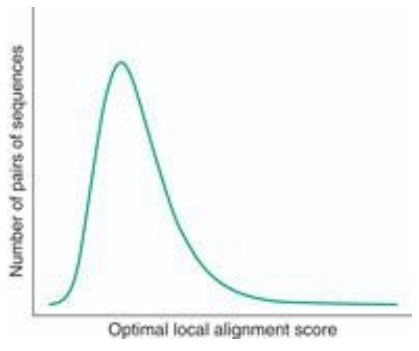

<details>
<summary>violin</summary>

| Optimal local alignment score | Number of pairs of sequences |
| --- | --- |
| Low | ~0.1 |
| Peak | ~0.9 |
| High | ~0.1 |
</details>

Figure 5.5 Optimal local alignment scores for pairs of random amino acid sequences of the same length follow an extreme value distribution. For any score x the probability of observing a score ≥ x is:

$$
P (\text {Score} \geq x) = 1 - \exp (- K e ^ {- \lambda x})
$$

where K and λ are parameters related to the position of the maximum and the width of the distribution. Note the long tail at the right. This means that a score several standard deviations above the mean has a higher probability of arising by chance (i.e. it is less significant) than if the scores followed a normal distribution.

Clearly, if the randomized sequences score as well as the original one then the alignment is unlikely to be significant. We can measure the mean and standard deviation of the scores of the alignments of randomized sequences and ask whether the score of original sequence is unusually high. The Z score reflects the extent to which the original result is an outlier from the population:

$$
Z \text { score } = \frac {\text { score - mean }}{\text { standard   deviation }}
$$

A Z score of 0 means that the observed similarity is no better than the average of random permutations of the sequence, and might well have arisen by chance. Other values used as measures of significance are P, or the probability that the observed match could have happened by chance, and, for database searching, E, which is the number of matches as good as the observed one that would be expected to appear by chance in a database of the size probed (see Box 5.4).

236

---

Many ‘rules of thumb’ are expressed in terms of percentage of identical residues in the optimal alignment. If two proteins have more than 45% identical residues in their optimal alignment they will have very similar structures and are very likely to have a common or at least a similar function. If two proteins have greater than 25% identical residues they are likely to have a similar general folding pattern. On the other hand, observations of a lower degree of sequence similarity cannot rule out homology. Recall R.F. Doolittle’s definition of the region of 18–25% sequence identity as the ‘twilight zone’ in which the suggestion of homology is tantalizing but dangerous. Below the twilight zone is a region where pairwise sequence alignments tell very little. Lack of significant sequence similarity does not preclude genuine homology.

Although the twilight zone is a treacherous region, we are not entirely helpless. In deciding whether there is a genuine relationship, the ‘texture’ of the alignment is important: are the similar residues isolated

## Box 5.4 How to play with matches but not get burned

Pairwise alignments and database searches often show tenuous but tantalizing sequence similarities. How can we decide whether we are seeing a true relationship? Statistics cannot answer biological questions directly, but can tell us the likelihood that a similarity as good as the one observed would appear, just by chance, among unrelated sequences. To do this we want to compare our result with alignments of the same sequences to a large population. This ‘control’ population should be similar in general features to our aligned sequences, but should contain few sequences related to them. Only if the observed match stands out from the population can we regard it as significant.

To what population of sequences should we compare our alignment? For pairwise alignments we can pick one of the two sequences, make many scrambled copies of it using a random-number generator, and align each permuted copy to the second sequence. For probing a database the entire database provides a comparison population.

Aligning our sequence to each member of the control population generates a large set of scores. How does the score of our original alignment rate? Several statistical parameters have been used to evaluate the significance of alignments, as follows.

The Z score is a measure of how unusual our original match is, in terms of the mean and standard deviation of the population scores. If the original alignment has score S,

$$
\text {Z score of } S = \frac {S - \text {mean}}{\text {standard deviation}}
$$

A Z score of 0 means that the observed similarity is no better than the average of the control population, and might well have arisen by chance. The higher the Z score, the greater the probability that the observed alignment has not arisen simply by chance. Experience suggests that Z scores ≥5 are significant.

Many programs report P, the probability that the alignment is better than random. The relationship between Z and P depends on the distribution of the scores from the control population, which do not follow the normal distribution.

A rough guide to interpreting P values:

| P≤10-100 | Exact match |
| --- | --- |
| P in range 10-100-10-50 | Sequences very nearly identical, e.g. alleles or SNPs |
| P in range 10-50-10-10 | Closely related sequences, homology certain |
| P in range 10-5-10-1 | Usually, distant relatives |
| P>10-1 | Match probably insignificant |

• For database searches, some programs (including PSI-BLAST) report E-values. The E value of an alignment is

237

---

the expected number of sequences that give the same Z score or better if the database is probed with a random sequence. E is found by multiplying the value of P by the size of the database probed. Note that E but not P depends on the size of the database. Values of P are between 0 and 1.0. Values of E are between 0 and the number of sequences in the database searched.

• A rough guide to interpreting E values:

| E ≤ 0.02 | Sequences probably homologous |
| --- | --- |
| E between 0.02 and 1 | Homology unproven but cannot be ruled out |
| E > 1 | You would have to expect this good a match just by chance |

Statistics are a useful guide, but not a substitute for thinking carefully about the results, and further analysis of ones that look promising!

and scattered throughout the sequence, or are there ‘icebergs’? Are there local regions of high similarity (another term of Doolittle’s) that may correspond to a shared active site? We may need to rely on other information, about shared ligands or function. Of course, if the structures are known we could examine them directly.

Some illustrative examples are listed here.

Sperm whale myoglobin and lupin leghaemoglobin have 15% identical residues in optimal alignment. This is even below Doolittle’s definition of the twilight zone. But we also know that both molecules have similar three-dimensional structures, and that both contain a haem group and both bind oxygen. They are indeed distantly related homologues.
The sequences of the N- and C- terminal halves of rhodanese have 11% identical residues in optimal alignment. If these appeared in independent proteins one could not conclude from the sequences alone that they were related. However, their appearance in the same protein suggests that they arose via gene duplication and divergence. The striking similarity of their structures confirms their relationship.
As a cautionary note, consider the proteinases chymotrypsin and subtilisin. They have 12% identical residues in optimal alignment. These enzymes have a common function and a common catalytic triad (see Fig. 8.5). However, they have dissimilar folding patterns, and are not related. Their common function and mechanism is an example of convergent evolution. This case serves as a warning against special pleading for relationships between proteins with dissimilar sequences on the basis of similarities of function and mechanism!

## Multiple sequence alignment

‘One amino acid sequence plays coy; a pair of homologous sequences whisper; many aligned sequences shout out loud.’ In nature, even a single sequence contains all the information necessary to dictate the fold of the protein. How does a multiple sequence alignment make that information more intelligible and useful? Alignment tables expose patterns of amino acid conservation, from which distant relationships may be more reliably detected. Structure-prediction tools also give more reliable results when based on multiple sequence alignments than on single sequences.

Visual examination of multiple sequence alignment tables is one of the most profitable activities that a molecular biologist can undertake away from the laboratory bench. Don’t even think about not displaying them with different colours for amino acids of different physiochemical type. A reasonable colour scheme (not the only possible one) is shown in Table 5.1.

238

---

Table 5.1 Distinguishing amino acids of different physico-chemical types in multiple sequence alignments

| Colour | Residue type | Amino acids |
| --- | --- | --- |
| Yellow | Small nonpolar | Gly, Ala, Ser, Thr |
| Green | Hydrophobic | Cys, Val, Ile, Leu, Pro, Phe, Tyr, Met, Trp |
| Magenta | Polar | Asn, Gln, His |
| Red | Negatively charged | Asp, Glu |
| Blue | Positively charged | Lys, Arg |

To be informative, a multiple alignment should contain a distribution of closely and distantly related sequences. If all the sequences are very closely related, the information they contain is largely redundant, and few inferences can be drawn. If all the sequences are very distantly related, it will be difficult to construct an accurate alignment (unless all the structures are available), and in such cases the quality of the results, and the inferences they might suggest, are questionable. Ideally, one has a complete range of similarities, including distantly related examples linked through chains of close relationships. (See Case Study 5.2.)

## CASE STUDY 5.2 Structural inferences from multiple sequence alignments of thioredoxins

Thioredoxins are enzymes found in all cells. They participate in a broad range of biological processes, including cell proliferation, blood clotting, seed germination, insulin degradation, repair of oxidative damage, and enzyme regulation. The common mechanism of these activities is the reduction of protein disulphide bonds.

Plate VI shows a multiple sequence alignment of 16 thioredoxins. The structure of E. coli thioredoxin contains a central five-stranded β sheet flanked on either side by α helices; these helices and strands are indicated by the symbols α and β. Other thioredoxins are expected to share most but not all of the secondary structure of the E. coli enzyme. The plate also shows a summary of the alignment as a sequence logo, in which letters of different sizes indicate different proportions of amino acids. (T. Schneider and M. Stephens designed sequence logos; this example was produced using the web server at [http://weblogo.berkeley.edu/logo.cgi](http://weblogo.berkeley.edu/logo.cgi)).

239

---

(a) Alignment of thioredoxins

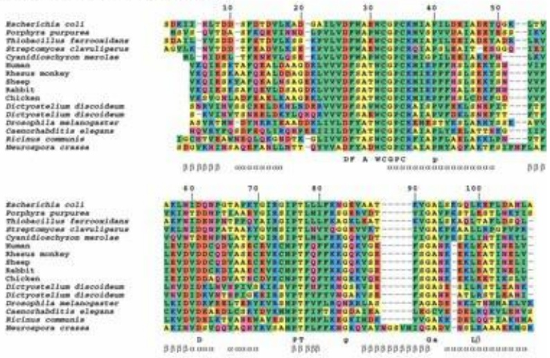

(b) Thioredoxin

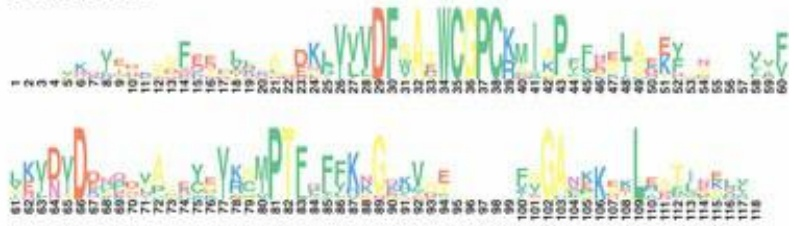

<details>
<summary>text_image</summary>

1
2
3
4
5
6
7
8
9
10
11
12
13
14
15
16
17
18
19
20
21
22
23
24
25
26
27
28
29
30
31
32
33
34
35
36
37
38
39
40
41
42
43
44
45
46
47
48
49
50
51
52
53
54
55
56
57
58
59
60
K Y D P C F E F K V V D W C P K M L P E F E F L E X E Y F Y F Y F Y F Y F Y F Y F Y F Y F Y F Y F Y F Y F Y F Y F Y F Y F Y F Y F Y F Y F Y F Y F Y F Y F Y F Y F Y F Y F Y F Y F Y F Y F Y F Y F Y F Y F Y F Y F Y F Y F Y F Y F Y F Y F Y F Y F Y F Y F Y F YF E E E E E E E E E E E E E E E E E E E E E E E E E E E E E E E E E E E E E E E E E E E E E E E E E E E E E E E E E E E E E E E E E E E E E E E E E E E E E E E E E E E E E E E E E E E E E E E E E E E EE A B C D D
</details>

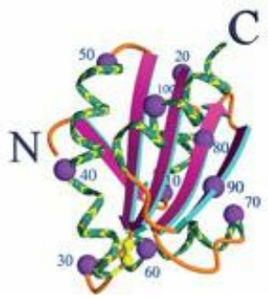

<details>
<summary>chemical</summary>

Protein secondary structure diagram showing helices and labeled amino acid residues (N, C)
</details>

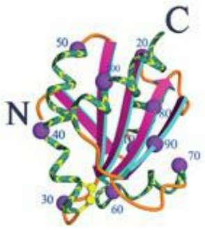

<details>
<summary>chemical</summary>

Protein secondary structure diagram with labeled amino acid residues and helices
</details>

Plate VI (a) Alignment of amino acid sequences of E. coli thioredoxin and homologues. Some of the sequences have been trimmed at their termini. Residue numbers in this table corresponds to positions in the E. coli sequence (top line). Helix α and strand β assignments for E. coli thioredoxin are from PDB entry 2TRX. (b) Sequence logo derived from this multiple-sequence alignment. (c) The structure of E. coli thioredoxin [2TRX] contains a central five-stranded β sheet flanked on either side by α helices. Residue numbers correspond to those in the multiple sequence alignment table. The N- and C-termini are also marked. Spheres indicate positions of the Cα atoms of every tenth residue. The reactive disulphide bridge between $^ { 3 2 } \mathrm { C y s }$ and $^ { 3 5 } \mathrm { C y s }$ appears in yellow (see Case Study 5.2).

Structural and functional features of thioredoxins that we might hope to identify from the multiple sequence alignment include the following (see Fig. 5.6 and Plate VI).

• The most highly conserved regions probably correspond to the active site. The disulphide bridge between residues 32 and 35 in E. coli thioredoxin is part of a WCGPC[K or R] motif conserved in the family. Other regions conserved in the sequences, including the PT at residues 75–77 and the GA at residues 92–93, are involved in substrate binding.
Regions rich in insertions and deletions probably correspond to surface loops. A position containing a conserved Gly or Pro probably corresponds to a turn. Turns correlated with insertions and deletions occur at positions 9, 20, 60, and 95. The conserved glycine at position 92 in E. coli thioredoxin is indeed part of a turn. It is in an unusual mainchain conformation, one that is easily accessible only to glycine (See Chapter 6). The conserved proline at position 76 in E. coli thioredoxin is also associated with a turn. It is in another unusual mainchain conformation, this one easily accessible only to proline.
• A conserved pattern of hydrophobicity with spacing 2 (i.e. every other residue)—with the intervening residues more variable and including hydrophilic residues—suggests a $\beta$ strand on the surface. This pattern is observable in the β strand between residues 50 and 60.
• A conserved pattern of hydrophobicity with spacing ≈4 suggests a helix. This pattern is observable in the region of helix between residues 40 and 49.

240

---

Thioredoxins are members of a superfamily including many more distantly related homologues. These include glutaredoxin (hydrogen donor for ribonucleotide reduction in DNA synthesis), protein disulphide isomerase (which catalyses exchange of mismatched disulphide bridges in protein folding), phosducin (a regulator of Gprotein signalling pathways), and glutathione-S-transferases (chemical defence proteins). Implicit in the multiple sequence alignment table of the thioredoxins themselves are patterns that should be applicable to identifying these more distant relatives.

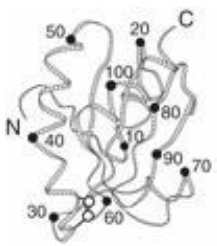

E. coli Thioredoxin

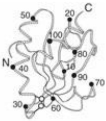

E. coli Thioredoxin

Figure 5.6 The structure of E. coli thioredoxin [2TRX] (see also Plate VI). Residue numbers correspond to those in the multiple sequence alignment table. The N- and C-termini are also marked. Spheres indicate the positions of the Cα atoms of every tenth residue. The reactive disulphide bridge between $^ { 3 2 } \mathrm { C y s }$ and $^ { 3 5 } \mathrm { C y s }$ appears between the numbers 30 and 60.


**See Weblem 5.5**

## Applications of multiple sequence alignments and database searching

Searching in databases for homologues of known proteins is a central theme of bioinformatics. Indeed, it brooked no delay; we introduced it in Chapter 1 with the application of PSI-BLAST. We reconsider database searching here, with the goal of trying to understand how we can best use available information to build effective procedures. The goals are high sensitivity—picking up even very distant relationships—and high selectivity—minimizing the number of sequences reported that are not true homologues. Here we discuss how to apply multiple sequence alignments to this problem. In Chapter 6 we shall discuss how to apply structural information in addition.

Great progress has been made during the last decade in devising methods for applying multiple sequence alignments of known proteins to identify related sequences in database searches. The results are central to contemporary applications of bioinformatics, including the interpretation of genomes. Three important methods are profiles, PSI-BLAST, and hidden Markov models (HMMs).

## Profiles

Profiles express the patterns inherent in a multiple sequence alignment of a set of homologous sequences. They have several applications.

• They permit greater accuracy in alignments of distantly related sequences.
• Sets of residues that are highly conserved are likely to be part of the active site, and give clues to function.
The conservation patterns facilitate identification of other homologous sequences.
• Patterns in the sequences are useful in classifying subfamilies within a set of homologues.
Sets of residues that show little conservation, and are subject to insertion and deletion, are likely to be in surface loops. This information has been applied to vaccine design, because such regions are

241

---

likely to elicit antibodies that will cross-react well with the native structure.

Most structure-prediction methods are more reliable if based on a multiple sequence alignment than on a single sequence. Homology modelling, for instance, depends crucially on correct sequence alignments, and can make effective use of the conformational variation seen in multiple parent structures.

To use profile patterns to identify homologues, the basic idea is to match the query sequences from the database against the sequences in the alignment table, giving higher weight to positions that are conserved than to those that are variable. If a region is absolutely conserved, such as the WGCPC motif in thioredoxins, the procedure should all but insist on finding it. But the risk of being too compulsive is to miss interesting distant relatives; some leeway should be allowed.

What is needed is a quantitative measure of conservation. Take an inventory of the distribution of amino acids for each position in the table of aligned sequences. For instance, for positions 25–30 of the thioredoxin alignment see Table 5.2.

Table 5.2 Position-dependent inventory of amino acids in residues 25–30 of 16 aligned thioredoxin sequences

<table><tr><td rowspan="2">Residue number</td><td colspan="20">Number of occurrences</td></tr><tr><td>A</td><td>C</td><td>D</td><td>E</td><td>F</td><td>G</td><td>H</td><td>I</td><td>K</td><td>L</td><td>M</td><td>N</td><td>P</td><td>Q</td><td>R</td><td>S</td><td>T</td><td>V</td><td>W</td><td>Y</td></tr><tr><td>25</td><td>1</td><td></td><td></td><td></td><td></td><td></td><td></td><td></td><td></td><td>2</td><td></td><td></td><td></td><td></td><td></td><td></td><td></td><td>13</td><td></td><td></td></tr><tr><td>26</td><td></td><td></td><td>16</td><td></td><td></td><td></td><td></td><td></td><td></td><td></td><td></td><td></td><td></td><td></td><td></td><td></td><td></td><td></td><td></td><td></td></tr><tr><td>27</td><td></td><td></td><td></td><td></td><td>16</td><td></td><td></td><td></td><td></td><td></td><td></td><td></td><td></td><td></td><td></td><td></td><td></td><td></td><td></td><td></td></tr><tr><td>28</td><td></td><td></td><td></td><td></td><td></td><td></td><td></td><td></td><td></td><td></td><td></td><td></td><td></td><td></td><td></td><td>7</td><td>1</td><td></td><td>5</td><td>3</td></tr><tr><td>29</td><td>16</td><td></td><td></td><td></td><td></td><td></td><td></td><td></td><td></td><td></td><td></td><td></td><td></td><td></td><td></td><td></td><td></td><td></td><td></td><td></td></tr><tr><td>30</td><td></td><td></td><td>1</td><td>4</td><td></td><td></td><td></td><td></td><td></td><td></td><td></td><td></td><td>2</td><td></td><td></td><td>1</td><td>7</td><td>1</td><td></td><td></td></tr></table>

Given a query sequence representing a potential thioredoxin homologue, we want to evaluate its similarity to the query sequence in such a way that agreement with the known sequences at the absolutely conserved positions—for instance 26, 27, and 29—contributes a very high score, and disagreement at these positions contributes a very low score. For moderately conserved positions, such as 28, we want a modest positive contribution to the score if the query sequence has an S or a W at this position, and a smaller contribution if it has T or Y. The general idea is to score each residue from the query sequence based on the amino acid distribution at that position in the multiple sequence alignment table.

It is tempting to use the inventories as scores directly. For example, if the residues in a query sequence that correspond to positions 25–30 in thioredoxin contain the sequence VDFSAE, this fragment would score $13+16+16+6+16+4=71$ . This is almost the greatest value possible. The alternative query sequence ACGVAP would score $1+0+0+5+16+2=24$ , a much lower value. Of course, for each query sequence we have to test all possible alignments with the multiple alignment table and take the largest total score. The highest scoring sequences best fit the patterns implicit in the table.

This simple approach would work if our table contained a large and unbiased sample of thioredoxin sequences. But only in that case would the simple inventory give a correct picture of the potential distributions of residues at each position. If our sample were small the pattern derived would be unlikely to reflect the complete repertoire. Or, if the sample contained a large subset of similar sequences, these would be over-represented in the inventories. For instance, we can see in Plate VI that vertebrate thioredoxins form a very closely related set. If we included 20 more vertebrate thioredoxins in the alignment the profile would recognize only vertebrate thioredoxins

242

---

effectively.

Substitution matrices suggest how to make the inventory ‘fuzzy’ and thereby more general.

The observed amino acid distribution at any residue position is a 20-membered array $( a _ { 1 } ,   a _ { 2 } ,   a _ { 3 }$ $\cdots a _ { 2 0 } )$ where $a _ { i }$ is the number of amino acids of type i observed at that position. (For position 25 of the thioredoxins, $a _ { 1 } = 1$ because one alanine is observed, and $a _ { 1 8 } = 1 3$ , representing the valines.) Then in the simple ‘inventory scoring’ scheme, the score of an alanine at position 25 is just 1; the score of a valine is 13; in general, the score of an amino acid of type i is $a _ { i } .$ In this scheme the rows of the inventory itself provide the arrays a needed for scoring each position.

A better scoring scheme would evaluate any amino acid according to its chance of being substituted for one of the observed amino acids. If $D ( i , j )$ is an amino acid substitution matrix— BLOSUM62, for example—then amino acid i could score $a _ { 1 } D ( i ,   1 ) + a _ { 2 } D ( i ,   2 )   \cdots   a _ { 2 0 } D ( i ,   2 0 )$ . This scheme distributes the score among observed amino acids, weighted according to the substitution probability. An amino acid in the query sequence could score high either if it appears frequently in the inventory at this position, or if it has a high probability of arising by mutation from residue types that are common at this position. This approach is more effective in detection of distant relatives from a limited set of known sequences. In this case, the scoring vector for amino acids at any position is a row in the product of the substitution matrix and the rows of the inventory array. An even better approach is to use as the amino acid distribution a combination of the observed inventory and a general background level of amino acid composition.

The result is a set of probability scores for each amino acid (or gap) at each position of the alignment, called a position-specific scoring matrix. An alternative method of deriving a positionspecific scoring matrix, based on three-dimensional structures, is described in Chapter 6.

Given a query sequence, and the position-specific scoring matrices derived from a profile, the calculations required to find the optimal score over all alignments of the query sequence with the profile are extensions of the dynamic-programming methods for aligning two sequences.

A weakness of simple profiles is that the multiple sequence alignment must be provided in advance, and is taken as fixed. PSI-BLAST and hidden Markov models gain power by integrating the alignment step with the collection of statistics.

## PSI-BLAST

PSI-BLAST is a program that searches a data bank for sequences similar to a query sequence. It is a development of the earlier program BLAST. The BLAST program and its variants check each entry in the data bank independently against a query sequence. PSI-BLAST begins with such a one-at-atime search. It then derives pattern information from a multiple sequence alignment of the initial hits, and reprobes the database using the pattern. Then it repeats the process, fine-tuning the pattern in successive cycles (see Fig. 5.7).

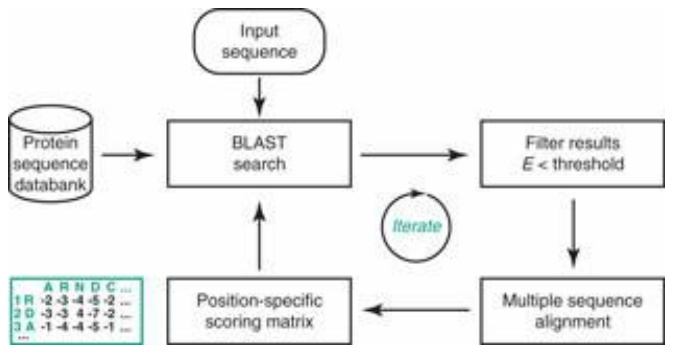

<details>
<summary>flowchart</summary>

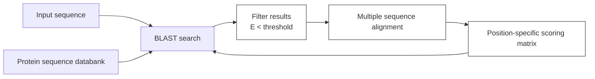
</details>

Figure 5.7 Schematic flowchart of a PSI-BLAST calculation to detect protein sequences in a database similar to a

243

---

probe sequence. The user submits an input sequence and chooses a protein sequence data bank to probe. First, using the input sequence and a standard substitution matrix such as BLOSUM62, a BLAST calculation identifies similar sequences in the database and assigns a statistical measure of significance, E, to each ‘hit’. For each sequence retrieved from the database, E is the number of sequences of equal or higher similarity to the probe sequence that would be expected to be found in the database, just by chance. The program will select those sequences for which E is no greater than a specified threshold, often chosen as 0.005, and perform a multiple sequence alignment of them. By counting the relative frequencies of different amino acids in each column of the multiple sequence alignment the program will derive a position-specific scoring matrix. The box at the lower left shows a part of a position-specific scoring matrix. The columns are labelled by the 20 natural amino acids. The rows are labelled by the sequence to be scored by the matrix. In this case the N-terminal sequence of the sequence to be scored is $\mathrm { R D A . . . }$ . The entries in the column are the log-odd scores of finding any amino acid at any position in the multiple alignment. For instance, the entry under A in row 3 is −1; therefore, the probability of finding an A at the third position is proportional to $1 0 ^ { - 1 }$ . To find the score of the sequence, add up the value in the R column of the first row, the D column of the second row, the A column of the third row, etc., to give: $1 0 ^ { - 3 } \pm 1 0 ^ { - 7 } \pm 1 0 ^ { - 1 }$ . In this example the probabilities are expressed unscaled and as logs to the base 10. Note that the sequence being scored may contain gaps. This matrix can be used as an alternative to the input sequence and substitution matrix in a BLAST search. Each subsequent BLAST search, based on the matrix derived in the previous step, will return a different set of ‘hits’. With a sensible choice of input parameters the procedure will usually converge, to produce a more reliable set of similar sequences than would be returned by the simple BLAST search of the input sequence performed in the first step.

The problem that BLAST was originally designed to solve is that full-blown dynamicprogramming methods are rather slow for complete searches in a large data bank. Often the data bank contains close matches to the query sequence. Less-sensitive but faster programs, such as BLAST, are quite capable of identifying the close matches. If that is what you want, fine. For example, if you want to search for homologues of a mouse protein in the human genome, the similarity is likely to be high and an approximate method likely to find it. But if you want to search for homologues of a human protein in C. elegans or yeast, the relationship may be more tenuous. More sophisticated, slower methods may be required. (It may come as a surprise, but computer time requirements are still a consideration. For although computing is becoming less expensive, the sizes of the data banks and the number of searches desired, on a worldwide basis, are growing. The net effect is that the pressure on computing resources is increasing.)

The method used by BLAST goes back, in a sense, to the dotplot approach, checking for wellmatching local regions. For each entry in the database it checks for short contiguous regions that match a short contiguous region in the query sequence, using a substitution scoring matrix but allowing no gaps. An approach in which candidate regions of fixed length are identified initially can be made very fast by the use of lookup tables.

Once BLAST identifies a well-fitting region, it tries to extend it. In some versions gaps are allowed. The output of BLAST is the set of local segment matches. In an example from Chapter 1:

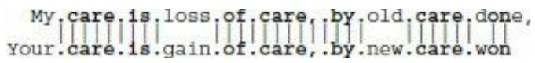

<details>
<summary>text_image</summary>

My.care.is.loss.of.care,.by.old.care.done,
Your.care.is.gain.of.care,.by.new.care.won
</details>

even a very simple algorithm could pick up all matching regions of five contiguous residues and then combine and extend them.

## A flowchart for PSI-BLAST

**1.** Probe each sequence in the chosen database independently for local regions of similarity to the query sequence, using a BLAST-type search but allowing gaps.
**2.** Collect significant hits. Construct a multiple sequence alignment table between the query sequence and the

244

---

significant local matches.

**3.** Form a profile from the multiple sequence alignment.
**4.** Reprobe the database with the profile, still looking only for local matches.
**5.** Decide which hits are statistically significant and retain these only.
**6.** Go back to step 2 until a cycle produces little or no change. This accounts for the ‘Iterated’ in the title of the PSI-BLAST program.

PSI-BLAST, using iterated pattern searching (see the box and Fig. 5.7), is much more powerful than simple pairwise BLAST in picking up distant relationships. PSI-BLAST correctly identifies three times as many homologues as BLAST in the region below 30% sequence identity. It is therefore a very useful method for analysing whole genomes. PSI-BLAST was able to match protein domains of known structure to 39% of the genes in M. genitalium, 24% of the genes in yeast, and 21% of the genes in C. elegans.

The only methods based entirely on sequence analysis that do better than PSI-BLAST are HMMs. These are described in the next section. To achieve significantly better performance it is necessary to make explicit use of structural information. This is discussed in Chapter 6.


## See Weblems 5.6 and 5.7

## Hidden Markov models

A hidden Markov model (HMM) is a computational structure for describing the subtle patterns that define families of homologous sequences. HMMs are powerful tools for detecting distant relatives and for prediction of protein folding patterns. They are the only method based entirely on sequences that is, without explicitly using structural information—competitive with PSI-BLAST for identifying distant homologues. They also perform well at identifying the folding pattern of a protein from the amino acid sequence, as assessed in CASP programmes.

Within an HMM is a multiple sequence alignment. However, HMMs are usually presented as procedures for generating sequences. A conventional multiple sequence alignment table could also be used to generate sequences by selecting amino acids at successive positions, each amino acid being chosen from a position-specific probability distribution derived from the profile. But HMMs are more general than profiles:

1. they include the possibility of introducing gaps into the generated sequence, with positiondependent gap penalties;
2. application of profiles requires that the multiple sequence alignment be specified up front; the pattern statistics are then derived from the alignment. HMMs carry out the alignment and the assignment of probabilities together.

The internal structure of an HMM shows the mechanism for generating sequences (Fig. 5.8). Begin at Start, and follow some chain of arrows until arriving at End. Each arrow takes you to a state of the system. At each state (1) you take some action—emit a residue, perhaps—and (2) choose an arrow to take you to the next state. The action and the choice of successor state are governed by sets of probabilities. Associated with each state that emits a residue are one probability distribution for the 20 amino acids and a second probability distribution for the choice of successor state. Both of these probability distributions are calibrated to encode information about a particular sequence family. In

245

---

this way the same general computational framework can be specialized to many different sequence families.

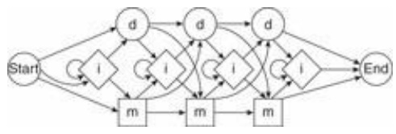

<details>
<summary>flowchart</summary>

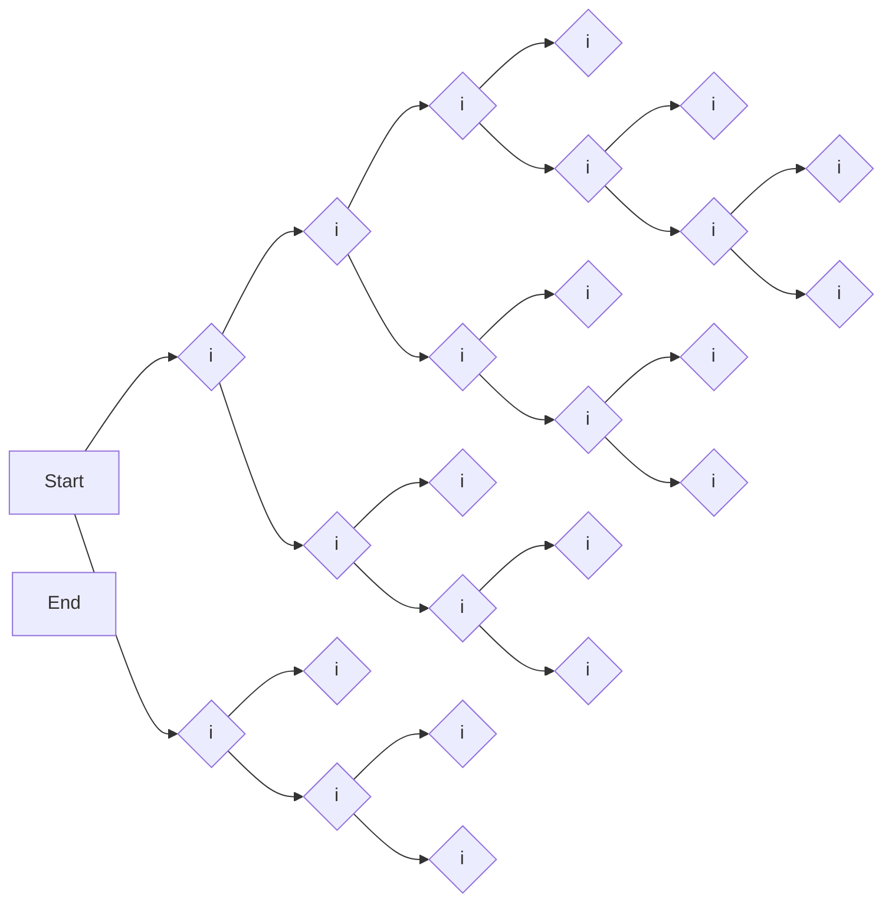
</details>

Figure 5.8 The structure of an HMM. Corresponding to each residue position in a multiple sequence alignment, the HMM contains a match state (m) and a delete state (d). Insert states (i) appear between residue positions, and at the beginning and end.

• Match states emit a residue. Here the term match means only that there is some amino acid both in the model underlying the HMM and in the sequence emitted, not that these are necessarily the same amino acid. The probability of emitting each of the 20 amino acids in each of the match states is a property of the model. As with profiles, the probabilities are position-dependent.
• Delete states skip a column in the multiple sequence alignment. Arriving at a delete state from a match or insert state corresponds to gap opening, and the probabilities of these transitions reflect a position-specific gap-opening penalty. Arriving at a delete state from a previous delete state corresponds to gap extension.
• Insert states appear between two successive positions in the alignment. If the system enters an insert state, a new residue that does not correspond to a position in the alignment table appears in the emitted sequence. An insert state can be followed by itself, to insert more than one residue. The succession of residues emitted from match and insert states generates the output sequence.

After taking the action appropriate to the type of state (m, d, or i), another probability distribution governs the choice of the next state. In every possible succession of states every column of the embedded alignment must be visited and either matched or deleted: there is no way to traverse the network without passing through either an m state or a d state at each position.

The dynamics of the system is such that only the current state influences the choice of its successor: the system has no ‘memory’ of its history. This is characteristic of processes studied by the 19th century Russian mathematician A.A. Markov. Distinguish the succession of states from the succession of amino acids emitted to form the output sequence. Several paths through the system can generate the same sequence. Only the succession of characters emitted is visible; the state sequence that generated the characters remains internal to the system; that is, hidden. By the probability distributions associated with the individual states the system captures—or models—the patterns inherent in a family of sequences. Hence the name, hidden Markov model.

Software for applying HMMs to biological sequence analysis can achieve the following.

1. Training: given a set of unaligned homologous sequences it can align them and adjust the transition and residue output probabilities to define an HMM capturing the patterns inherent in the sequences submitted.

## Web resource: Hidden Markov models

Two research groups specializing in biological applications of HMMs run web servers and distribute their programs:

R. Hughey, K. Karplus, and D. Haussler (University of California at Santa Cruz, CA, USA)

[http://cse.ucsc.edu/research/compbio/sam.html](http://cse.ucsc.edu/research/compbio/sam.html)

[http://cse.ucsc.edu/research/compbio/HMM-apps/HMM-applications.html](http://cse.ucsc.edu/research/compbio/HMM-apps/HMM-applications.html)

S. Eddy (Washington University, St Louis, MO, USA; now at HHMI Janelia Farm Research Campus)

[http://hmmer.janelia.org/](http://hmmer.janelia.org/)

246

---

Results of analysis of known sequences and structures are also available on the web:

Pfam is a database of multiple sequence alignments and HMMs for many protein domains, developed by A. Bateman, E. Birney, R. Durbin, S.R. Eddy, K.L. Howe, and E.L. Sonnhammer [http://www.sanger.ac.uk/Software/Pfam](http://www.sanger.ac.uk/Software/Pfam)

2. Detection of distant homologues: given an HMM and a test sequence, calculate the probability that the HMM would generate the test sequence. If an HMM trained on a known family of sequences would generate the test sequence with relatively high probability, the test sequence is likely to belong to the family.
3. Alignment of additional sequences: the probability of any sequence of states can be computed from the individual state-to-state transition probabilities. Finding the most likely succession of states that the HMM would use to generate one or more test sequences reveals their optimal alignment to the family.

## Phylogeny

We have now seen several examples of evolution, in proteins and in genomes. These represent the extension to the molecular level of concerns that have occupied biologists since Darwin and even before. The basic principle is that the origin of similarity is common ancestry. Although there are exceptions, arising from convergent evolution or horizontal gene transfer, the importance of this principle both for rationalizing contemporary observations and giving a window into the history of life cannot be underestimated.

The field of phylogeny has the goals of working out the relationships among species, populations, individuals, or genes. (The general term is ‘taxa.’) The observable taxa—for instance the extant species for which we wish to work out the pattern of ancestry—are called the ‘operational taxonomic units’, abbreviated to OTUs. Relationship is taken in the literal sense of kinship or genealogy; that is, assignment of a scheme of descendants of a common ancestor (see Box 5.5). Evolutionary relationships give us a glimpse at the historical development of life (see Box 5.6). Although molecules themselves cannot be dated, the evolutionary events as observed on the molecular level can be calibrated with the fossil record.

## Box 5.5 Concepts related to biological classification and phylogeny

Homology means, specifically, descent from a common ancestor.

Similarity is the measurement of resemblance or difference, independent of the source of the resemblance. Similarity is observable in data collectable now, and involves no historical hypotheses. In contrast, assertions of homology require inferences about historical events which are usually unobservable.

Clustering is bringing together similar items, distinguishing classes of objects that are more similar to one another than they are to other objects outside the classes. Most people would agree about degrees of similarity, but clustering is more subjective. When classifying objects, some people prefer larger classes, tolerating wider variation; others prefer smaller, tighter, classes. They are called groupers or splitters.

Hierarchical clustering is the formation of clusters of clusters of … .

Phylogeny is the description of biological relationships, usually expressed as a tree. A statement of phylogeny among objects assumes homology and depends on classification. Phylogeny states a topology of the relationships based on classification according to similarity of one or more sets of characters, or on a model of evolutionary processes. In many cases, phylogenetic relationships based on different characters are consistent,

247

---

and support one another. If different characters induce inconsistent phylogenetic relationships, they are all dubious. Note that the same similarity data may be consistent with different possible topologies or trees.

See also the section on Biological classification and nomenclature in Chapter 1.

## Box 5.6 Time scale of Earth history

Geological eras (e.g. Cenozoic), periods (e.g. Jurassic), and cataclysmic events (e.g. asteroid impact: mass extinction) are shown in black. First appearance of, or prevalence of, different life forms are in green (mya, millions of years ago).

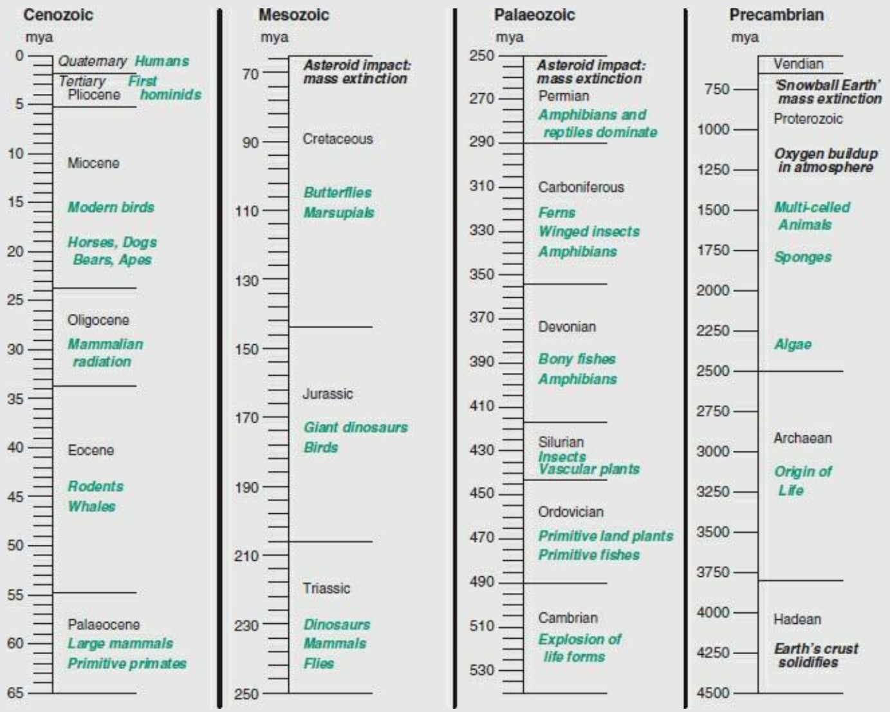

The results of phylogenetic analyses are usually presented in the form of an evolutionary tree. The taxonomy of the ratites—large flightless birds—is a typical example (Fig. 5.9a). The ancestor of the ratites is believed to be a bird that could fly, probably related to the extant tinamous.

248

---

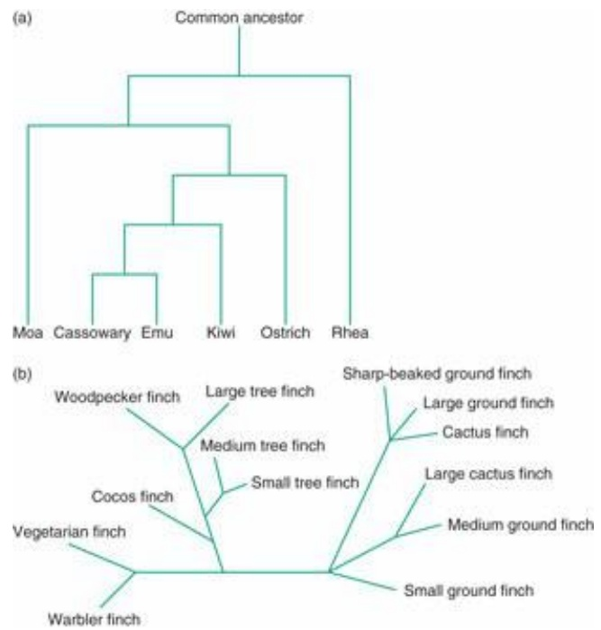

Figure 5.9 (a) Phylogenetic tree of ratites (large flightless birds) based on mitochondrial DNA sequences. The common ancestor is at the root of this tree. A surprising implication of these DNA sequences is that the moa and kiwi are not the closest relatives, and therefore that New Zealand must have been colonized twice by ratites or their ancestors. (b) Unrooted tree of relationships among finches from the Galapagos and Cocos Islands. Darwin studied the Galapagos finches in 1835, noting the differences in the shapes of their beaks and the correlation of beak shape with diet. Finches that eat fruits have beaks like those of parrots, and finches that eat insects have narrow, prying beaks. These observations were seminal to the development of Darwin’s ideas. As early as 1839 he wrote, in The Voyage of the Beagle, ‘Seeing this gradation and diversity of structure in one small, intimately related group of birds, one might really fancy that from an original paucity of birds in this archipelago, one species had been taken and modified for different ends’.

Such a tree, showing all descendants of a single original ancestral species, is said to be rooted. (The root of the tree typically appears at the top or the side; botanists will have to get used to this.) Alternatively, we may be able to specify relationships but not order them according to a history. The relationships among the finches of the Galapagos Islands, studied by Darwin, plus a related species from the nearby Cocos Island, are shown in an unrooted tree (Fig. 5.9b). Addition of data from species on the South American mainland ancestral to the island finches might allow us to root the tree.

Statement of a tree of relationships may reveal only the connectivity or topology of the tree, in which case the lengths of the branches contain no information. A more ambitious goal is to show the distances between taxa quantitatively, for instance to label the branches with the time since divergence from a common ancestor.

## Determination of taxonomic relationships from molecular properties

Given a set of data that characterize different groups of organisms—for example, DNA or protein sequences, or protein structures, or shapes of teeth from different species of animals—how can we derive information about the relationships among the organisms in which they were observed? It is rare for species relationships and ancestry to be directly observable. Evolutionary trees determined from genetic data are often based on inferences from the patterns of similarity. We generally assume that the more similar the characters the more closely related the species, although this is a dangerous assumption. Nevertheless, from the relationships among the characters we wish to infer patterns of ancestry: the topology of the phylogenetic relationships (informally, the ‘family tree’).

To what extent do the topologies of the relationships depend on the choice of character? In

249

---

particular, are there systematic discrepancies between the implications of molecular and palaeontological analysis?

Molecular approaches to phylogeny developed against a background of traditional taxonomy, based on a variety of morphological characters, embryology, and, for fossils, information about the geological context (stratigraphy). The classical methods have some advantages. Traditional taxonomists have much less restricted access to extinct organisms, via the fossil record. They can date appearances and extinctions of species by geological methods.

A crucial event in the acceptance of molecular methods occurred in 1967 when V.M. Sarich and A.C. Wilson dated the time of divergence of humans from chimpanzees at 5 mya, based on immunological data. At that time palaeontologists had dated this split at 15 mya, and were reluctant to accept the molecular approach. Reinterpretation of the fossil record led to acceptance of a more recent split, and broke the barrier to general acceptance of molecular methods. It is now generally accepted that human and chimpanzee lineages diverged between ≈6 and 8 mya.

Indeed, many molecular properties have been used for phylogenetic studies, some surprisingly long ago. Serological cross-reactivity was used from the beginning of the last century until superseded by direct use of sequences. In one of the most premature scientific studies I know of, E.T. Reichert and A.P. Brown published, almost a century ago, a phylogenetic analysis of fishes based on haemoglobin crystals. Their work was based on Stenö’s law (1669), which states that although different crystals of the same substance have different dimensions—some are big, some small—they have the same interfacial angles, reflecting the similarity in microscopic arrangement and packing of the atomic or molecular units within the crystals. Reichert and Brown demonstrated that the interfacial angles of crystals of haemoglobins isolated from different species showed patterns of similarity and divergence parallel to the species’ taxonomic relationships.

Reichert and Brown’s results are replete with significant implications. They show that proteins have definite, fixed shapes, an idea by no means recognized at the time. They imply that as species progressively diverge the structures of their haemoglobins also progressively diverge. In 1909 no one had a clue about nucleic acid or protein sequences. In principle, therefore, the recognition of evolution of protein structures preceded, by several decades, the idea of evolution of sequences.

Today, DNA sequences provide the best measures of similarities among species for phylogenetic analysis. The data are digital. It is even possible to distinguish selective from nonselective genetic change, using the third position in codons, or untranslated regions such as pseudogenes, or the ratio of synonymous to nonsynonymous codon substitutions. Many genes are available for comparison. This is fortunate because, given a set of species to be studied, it is necessary to find genes that vary at an appropriate rate. Genes that remain almost constant among the species of interest provide no discrimination of degrees of similarity. Genes that vary too much cannot be aligned. There is an analogous situation in radioactive dating requiring choice of an isotope with a half-life of the same general magnitude as the time interval to be determined.

Fortunately genes vary widely in their rates of change. The mammalian mitochondrial genome, a circular double-stranded DNA molecule approximately 16 000 bp long, provides a useful fastchanging set of sequences for study of evolution among closely related species. In contrast, rRNA sequences were used by C. Woese to identify the three major kingdoms: Archaea, Bacteria, and Eukarya (see Fig. 1.2).

Conversely, different rates of change of sequences of different genes can lead to different and even contradictory results in phylogenetic studies. This is especially true if what we want is not just the topology of the relationships but the branch lengths. In addition, horizontal gene transfer and convergent evolution are competing phenomena—that is, competing with descent—that interfere

250

---

with the deduction of phylogenetic relationships.

One limitation of sequence methods is the paucity of access to extinct species. Some subfossil remains of species which became extinct as recently as the last century or two have legible DNA, including specimens of the quagga (a relative of the zebra) and the thylacine (Tasmanian ‘wolf’, a marsupial), and some New Zealand birds (including moas). We have seen an example of a sequence from the mammoth. Extensive DNA sequences from Neanderthals have been recovered from individuals who died approximately 30 000 years ago.

It has been possible to sequence DNA amplified from ancient samples, given adequate preservation in continuously frozen environments. Most of the samples that provide useful sequences come from locations near the poles. A few are from mountaintop glaciers even in the tropics.

Holders of the current age record for extraction and analysis of ancient DNA are E. Willerslev and coworkers <sup>2</sup> who have sequenced DNA fragments from ice cores extracted from Greenland. The longest of these cores extended to depths of 2 and 3 km, reaching back 500 000 years or more.

Geologists have reconstructed ancient environments and ecologies from fossil material. Actual sequence data have the potential to offer a much sharper focus. One of the ice core samples, from the Dye 3 site in south-central Greenland $( 6 5 ^ { \circ } ~ 1 1 ^ { \prime } ~ \mathrm { N } , ~ 4 5 ^ { \circ } ~ 5 0 ^ { \prime } ~ \mathrm { W } )$ , contained sequences from several species of trees, including alder, spruce, pine, and yew. DNA from animals included butterflies and moths (definitely) and beetles, flies, spiders, and brushfoots (probably). These flora and fauna do not characterize the current ecology of southern Greenland. They suggest that at the time the samples were laid down the temperature did not fall below −17°C in the winter and rose higher than +10°C in the summer. This corresponds to current conditions in Helsinki, Finland, or Murmansk, Russia, warmer than current conditions in southern Greenland (see [http://worldclimate.com](http://worldclimate.com)).

## Phylogenetic trees

We describe phylogenetic relationships as trees. In computer science, a tree is a particular kind of graph. A graph is a structure containing nodes (abstract points) connected by edges (represented as lines between the points) (see box entitled Glossary of terms related to graphs). In a directed graph each edge has a direction, like a one-way street. A path from one node to another is a consecutive set of edges beginning at one point and ending at the other, like our trip from Malmö to Tromsø. A connected graph is a graph containing at least one path between any two nodes. From these we can define a tree: a connected graph in which there is exactly one path between every two points. A particular node may be selected as a root, but this is not necessary: abstract trees may be rooted or unrooted (see Fig. 5.9). Unrooted trees show the topology of relationship but not the pattern of descent. A rooted tree in which every node has two descendants is called a binary tree (see Box 5.7). A completely connected graph has an edge between every pair of nodes.

## Glossary of terms related to graphs

Graph An abstract structure containing nodes (points) and edges (lines connecting points).

Path A consecutive set of edges.

Connected graph A graph in which there is at least one path between every two nodes.

Tree A connected graph with exactly one path between every two points.

Edge length A number assigned to each edge signifying in some sense the distance between the nodes connected by the edge.

Path length The sum of the lengths of the edges that comprise the path.

251

---

Box 5.7 A PERL program to draw binary trees

The input (A((BC)D)(EF)) produces the following output, as a PostScript file, which can be printed on most printers and displayed on most terminals.

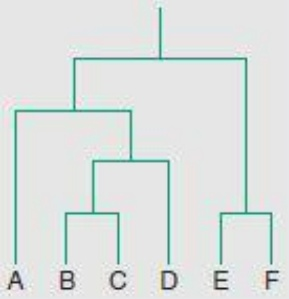

<details>
<summary>flowchart</summary>

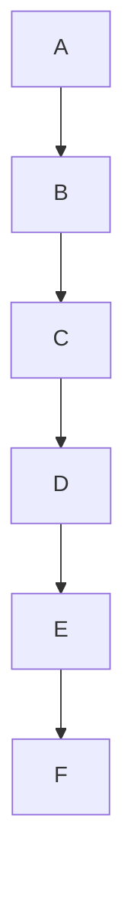
</details>

This representation of a tree is about as simple as possible. Many programs are available on the web to make fancier drawings, including those with curved lines, or three-dimensional representations for clarity in depiction of very complex trees.

```perl
#!/usr/bin/perl
#drawtree.pl -- draws binary trees (root at top)
#usage: echo '(A((BC)D)(EF))' | drawtree.pl > output.ps

print <<EOF;
%!PS-Adobe-
%%BoundingBox: atend
/n /newpath load def /m /moveto load def /l /lineto load def
/rm /rmoveto load def /rl /rlineto load def /s /stroke load def
1.0 setlinewidth 50 100 translate 2 2 scale
/Helvetica findfont 10 scalefont setfont
EOF

\$tree = <>; chop(\$tree); \$_ = reverse(\$tree); s/[]//g;

\$x = 0; \$y = 0;
while (\$nd = chop()) {
    print "\$x \$y m (\$nd) stringwidth pop -0.5 mul 0 rm (\$nd) show\n";
    \$xx{\$nd} = \$x; \$x+=20; \$yy{\$nd} = 10;
}
while (\$tree =~ s/\?(?([A-Z])([A-Z])?)?/\$1/) {
    print "n \$xx{\$1} \$yy{\$1} m\n";
    (\$yy{\$1} > \$yy{\$2}) || {\$yy{\$1} = \$yy{\$2}}; \$yy{\$1} += 20;
    print "\$xx{\$1} \$yy{\$1} l \$xx{\$2} \$yy{\$1} l \$xx{\$2} \$yy{\$2} l s\n";
    \$xx{\$1} = 0.5*(\$xx{\$1} + \$xx{\$2});
}
print "n \$xx{\$tree} \$yy{\$tree} m 0 20 rl s showpage\n";
\$rx = 2*\$x + 30; \$yt = 2*\$yy{\$tree} + 146;
print "%%BoundingBox: 40 95 \$rx \$yt\n";
```

Another special kind of graph is a directed graph in which each edge is a one-way street. Examples include the Gene Ontology subnetworks (See Chapter 8), the HMM diagram shown in Figure 5.8, and the neural networks illustrated in Chapter 6. Rooted phylogenetic trees are, implicitly, directed graphs, the ancestor–descendant relationship implying the direction of each edge.

It may be possible to assign numbers to the edges of a graph to signify, in some sense, a ‘distance’

252

---

between the nodes connected by the edges. The graph may then be drawn to scale, with the sizes of the edges proportional to the assigned lengths. The length of a path through the graph is the sum of the edge lengths.

In phylogenetic trees, edge lengths signify either some measure of the dissimilarity between two species or the length of time since their separation. The assumption that differences between properties of living species reflect their divergence times will be true only if the rates of divergence are the same in all branches of the tree. Many exceptions are known; for instance, among mammals, rodents show, for many proteins, relatively fast evolutionary rates.


## See Weblem 5.8.

Broadly, there are two approaches to deriving phylogenetic trees. One approach makes no reference to any historical model of the relationships. Proceed by measuring a set of distances between species, and generate the tree by a hierarchical clustering procedure. This is called the phenetic approach. The alternative, the cladistic approach, is to consider possible pathways of evolution, infer the features of the ancestor at each node, and choose an optimal tree according to some model of evolutionary change. Phenetics is based on similarity; cladistics is based on genealogy. (see Box 5.7.)

## Clustering methods

Phenetic, or clustering, approaches to determination of phylogenetic relationships are explicitly nonhistorical. Indeed, hierarchical clustering methods are perfectly capable of producing a tree even in the absence of evolutionary relationships. A department store has goods clustered into sections according to the type of product—for instance, clothing or furniture—and subclustered into more closely related subdepartments, such as men’s and women’s shoes. Men’s and women’s shoes have a common ancestor, but there is no implication that shoes and furniture do.

A simple clustering procedure works as follows: given a set of species, determine for all pairs a measure of the similarity or difference between them. This could depend on a physical body trait such as the difference between the average adult height of members of two species. Or one could use the number of different bases in alignments of mitochondrial DNA. To create a tree from the set of dissimilarities, first choose the two most closely related species and insert a node to represent their common ancestor. Then replace the two selected species by a set containing both, and replace the distances from the pair to the others by the average of the distances of the two selected species to the others. Now we have a set of pairwise dissimilarities, not between individual species, but between sets of species. (Regard each remaining individual

## Example 5.6 Generation of phylogenetic tree by progressive clustering

Consider four species characterized by homologous sequences ATCC, ATGC, TTCG, and TCGG. Taking the number of differences as the measure of dissimilarity between each pair of species, use a simple clustering procedure to derive a phylogenetic tree.

The distance matrix is:

|  | ATCC | ATGC | TTCG | TCGG |
| --- | --- | --- | --- | --- |
| ATCC | 0 | 1 | 2 | 4 |
| ATGC |  | 0 | 3 | 3 |
| TTCG |  |  | 0 | 2 |
| TCGG |  |  |  | 0 |

253

---

Because the matrix is symmetrical, we need fill in only the upper half. The smallest distance is 1 (in green), between ATCC and ATGC. Therefore, our first cluster is {ATCC, ATGC}. The tree will contain the fragment:


The reduced distance matrix is:

|  | {ATCC, ATGC} | TTCG | TCGG |
| --- | --- | --- | --- |
| {ATCC, ATGC} | 0 | $\frac{1}{2}(2+3)=2.5$ | $\frac{1}{2}(4+3)=3.5$ |
| TTCG |  | 0 | 2 |
| TCGG |  |  | 0 |

The next cluster is {TTCG, TCGG}, distance 2. Finally, linking the clusters {ATCC, ATGC} and {TTCG, TCGG} gives the tree:

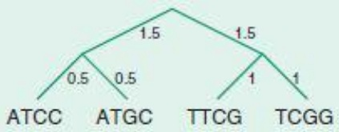

<details>
<summary>dendrogram</summary>

| Category | Value |
| --- | --- |
| ATCC | 0.5 |
| ATGC | 0.5 |
| TTCG | 1 |
| TCGG | 1 |
</details>

Branch lengths have been assigned according to the rule:

$$
\text { branch   length   of   edge   between   nodes } X \text { and } Y = \frac {1}{2} \text { distance   between } X \text { and } Y
$$

Whether the branch lengths are truly proportional to the divergence times of the taxa represented by the nodes must be determined from external evidence.

species as a set containing only one element.) Then repeat the process, as in Example 5.6.

This process of tree building is called the UPGMA method, for unweighted pair group method with arithmetic mean. A modification of the UPGMA method by N. Saitou and M. Nei, called neighbour-joining, is designed to correct for unequal rates of evolution in different branches of the tree.

## Cladistic methods

Cladistic methods deal explicitly with the patterns of ancestry implied by the possible trees relating a set of taxa. Their aim is to select the correct tree by utilizing an explicit model of the evolutionary process. The most popular cladistic methods in molecular phylogeny are the maximum parsimony and maximum likelihood approaches. They are specialized to sequence data, starting from a multiple sequence alignment. Neither maximum parsimony nor maximum likelihood could be applied to anatomic characters such as average adult height.

The maximum parsimony method of W. Fitch defines an optimal tree as the one that postulates the fewest mutations. For instance, given species characterized by homologous sequences ATCG, ATGG, TCCA, and TTCA, the tree:

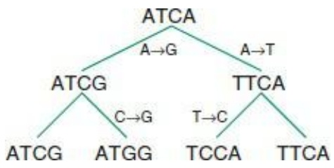

<details>
<summary>flowchart</summary>

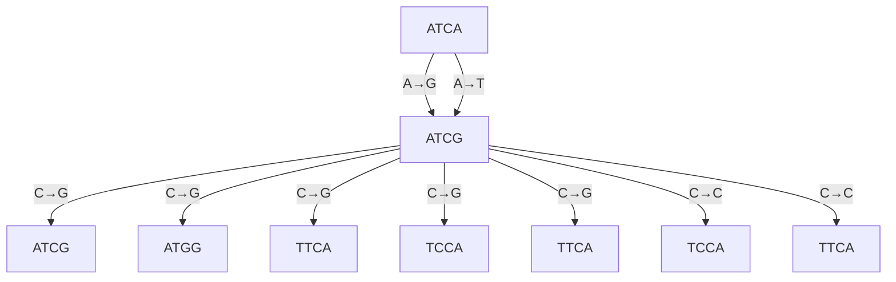
</details>

254

---

postulates four mutations. An alternative tree:

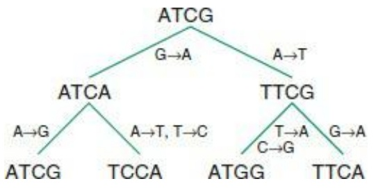

<details>
<summary>flowchart</summary>

This diagram illustrates the genetic relationships and mutation types between ATCG, ATCA, TTCG, and their respective transgenic lines (A→G, A→T, T→C, C→G).
</details>

postulates seven mutations. Note that the second tree implies that the G→A mutation in the fourth position occurred twice independently. The former tree is optimal according to the maximum parsimony method, because no other tree involves fewer mutations. In many cases, several trees may postulate the same number of mutations, fewer than any other tree. For such cases the maximum parsimony approach does not give a unique answer.

The maximum likelihood method assigns quantitative probabilities to mutational events, rather than merely counting them. Like maximum parsimony, maximum likelihood reconstructs ancestors at all nodes of each tree considered, but it also assigns branch lengths based on the probabilities of the mutational events postulated. For each possible tree topology the assumed substitution rates are varied to find the parameters that give the highest likelihood of producing the observed sequences. The optimal tree is the one with the maximum likelihood of generating the observed data.

Both maximum parsimony and maximum likelihood methods are superior to clustering techniques. This has been demonstrated with cases where independent evidence—for instance, from classical palaeontology—provides a correct answer, and also with simulated data: computed generation of evolving sequences.

## Reconstruction of ancestral sequences

Maximum likelihood methods of phylogenetic tree construction determine, as part of their procedures, the sequences expected in the ancestors of extant species. L. Pauling and E. Zuckerkandl suggested in a 1963 paper that if we could determine the sequences of proteins from extinct organisms then the proteins could be recreated by synthesis.<sup>3</sup> In some cases, such a synthesized sequence shows the expected biological activity. Although this does not prove that it is the correct ancestral sequence, the result is of course gratifying.

Steroid receptors are vertebrate proteins that detect hormones, including androgen, oestrogen, progesterone, glucocorticoid, and mineralocorticoid receptors (see Table 5.3). Upon activation they translocate from the cytoplasm to the nucleus and control gene expression. They belong to a larger superfamily of receptors with affinity for a wider variety of ligands, including thyroid hormones, prostaglandins, and 1,25-dihydroxyvitamin D. It is likely that the entire superfamily diverged from a single ancestral protein.

255

---

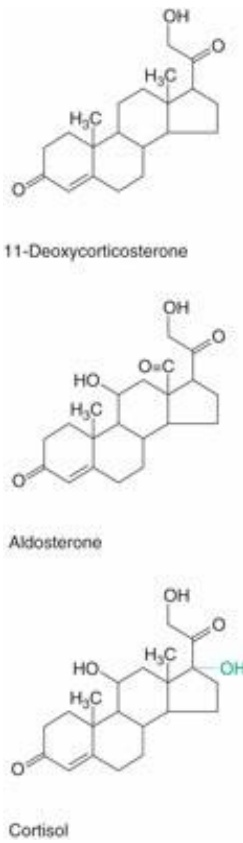

Table 5.3 Properties of two closely related receptors in higher vertebrates

| Receptor | Ligand | Physiological role includes |
| --- | --- | --- |
| Mineralocorticoid receptor | 11-Deoxycorticosterone (teleost fish)Aldosterone (tetrapods) | Electrolyte homeostasis |
| Glucocorticoid receptor | Cortisol | Regulation of metabolism, inflammation and immunity |

J.W. Thornton and colleagues have studied the species distribution and the evolution of these receptors.<sup>4</sup> The most primitive species in which natural steroid receptors appear are lamprey and hagfish. The receptors in these species show high affinity for 11-deoxycorticosterone, cortisol, and aldosterone. It is likely that 11-deoxycorticosterone is the natural ligand of the ancestral homologue. A gene duplication before the emergence of tetrapods gave rise to receptors with differential specificity for cortisol and aldosterone (see Fig. 5.10).

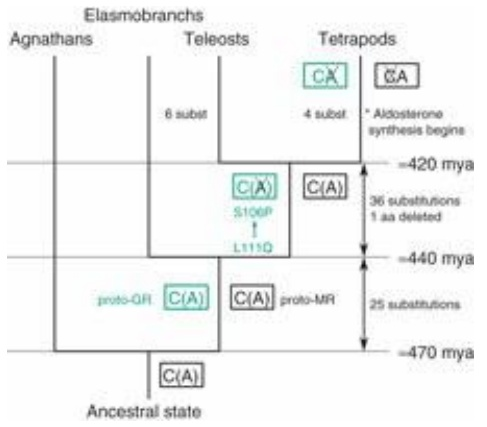

<details>
<summary>text_image</summary>

Agnathans
Elasmobranchs
Teleosts
Tetrapods
6 subst
CA
4 subst
CA
* Aldosterone synthesis begins
C(A)
S106P
L111Q
C(A)
-420 mya
36 substitutions
1 aa deleted
-440 mya
proto-QR
C(A)
proto-MR
25 substitutions
-470 mya
Ancestral state
</details>

**Figure 5.10** Evolutionary pathway of steroid receptors, inferred from ancestral sequence reconstruction, and synthesis and assay of predicted sequences. The ancestor of the vertebrate steroid receptor probably had affinity for aldosterone (A) as well as other steroids (C), notably 11-deoxycorticosterone and cortisol. This affinity is indicated by C(A), with the (A) in parentheses because aldosterone was not a natural ligand at that time. After gene duplication to form protoglucocorticord (proto-GR) and proto-mineralocorticoid (proto-MR) receptors, the protein diverged to attain differential specificity. In tetrapods, subsequent to the origin of aldosterone synthesis, two families of receptor show selectivity for aldosterone (MR) or cortisol. aa, amino acid; mya, million years ago; subst, substitutions.

These specificity profiles must be interpreted in light of the fact that aldosterone is not present in

256

---

primitive vertebrates. The affinity preceded the ligand. (How could a lock evolve millions of years before the appearance of the key?) Aldosterone was first synthesized along the line leading to tetrapods, when a mutation in the cytochrome P450 11β-hydroxylase gene produced a protein that would hydroxylate 11-deoxycorticosterone. The tetrapod glucocorticoid receptor must have lost aldosterone affinity (see Fig. 5.10).

Thornton and colleagues computed the maximum likelihood evolutionary tree of cortisol-specific and aldosterone-specific receptors. They inferred the ancestral sequence, and ‘resurrected’ it, following Pauling and Zuckerkandl: synthesizing the protein, determining its specificity, and solving its crystal structure. The computed and synthesized ancestral protein is activated by 11- deoxycorticosterone, aldosterone, and, with lower affinity, cortisol.

Thornton and colleagues computed the evolutionary pathway from the computed ancestral protein. By synthesizing and assaying proteins with different substitutions they identified two mutations as primarily reponsible for the loss of aldosterone affinity in tetrapod glucocorticosteroid receptors: S106P and L111Q. The L111Q substitution, by itself, has almost no effect on the affinity for any of the three ligands: aldosterone, deoxycorticosterone, and cortisol. The S106P substitution, by itself, largely destroys affinity for all three. That L111Q is functional and S106P is not suggests the scenario that L111Q appeared first, followed by S106P. In this way, the evolutionary pathway passed through functional intermediates only. Other substitutions, with less dramatic effects, acted to ‘tune the affinities to their current value.

Molecular modelling allowed inference of the structural consequences in the computed-ancestral protein structure of these two mutations, separately and together. In the hypothetical glucocorticoid receptor of the common ancestor of all jawed vertebrates, positions 106 and 111 appear in a loop adjacent to a helix. The mutation S106P on its own is predicted to reconform the loop, and the adjacent helix partially unwinds. However, a concomitant of these changes is to bring position 111 closer to the ligand, to the point where the L111Q mutation can form a hydrogen bond to the C17 hydroxyl of cortisol, stabilizing its binding. This hydroxyl is not present in aldosterone (or 11- deoxycorticosterone) so the hydrogen bond can form only to cortisol. Without the repositioning of position 111 by the S106P mutation it is unlikely that the L111Q mutation, on its own, could form the hydrogen bond to enhance cortisol binding (see Plate VII).

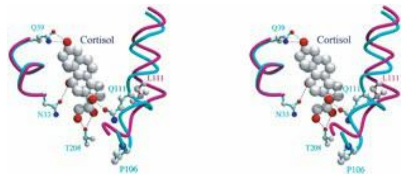

Plate VII Effect of mutations S106P and L111Q in evolution of differential specificity to aldosterone and cortisol in vertebrate steroid receptors. Magenta: experimental structure corresponding to predicted sequence ancestral to all jawed vertebrates. Cyan: experimental structure corresponding to predicted sequence ancestral to all bony vertebrates. A region from the binding site is shown. The mutation S106P reconforms the loop between helices 6 and 7 (H6 and H7). The mutation L111Q creates a hydrogen bond to the C17 hydroxyl which is present in cortisol but not in aldosterone nor 11-deoxycorticosterone (See Chapter 5, Reconstruction of ancestral sequences).

Although some aspects of this investigation are hypothetical, there is reason to be fairly confident that they are correct. In revealing a detailed evolutionary pathway, one can see the mechanism whereby gene duplication followed by divergence produces differential ligand specificity.

257

---

## The problem of varying rates of evolution

Suppose that the four species—A, B, C, and D—have the phylogenetic tree:

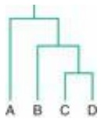

This tree is consistent with the dissimilarity matrix:

|  | A | B | C | D |
| --- | --- | --- | --- | --- |
| A | 0 | 3 | 3 | 3 |
| B |  | 0 | 2 | 2 |
| C |  |  | 0 | 1 |
| D |  |  |  | 0 |

Suppose, however, that species D has changed very fast, although the phylogeny is unaltered. The dissimilarity matrix might then be observed to be:

|  | A | B | C | D |
| --- | --- | --- | --- | --- |
| A | 0 | 3 | 3 | 20 |
| B |  | 0 | 2 | 20 |
| C |  |  | 0 | 20 |
| D |  |  |  | 0 |

From this we would derive the incorrect phylogenetic tree:

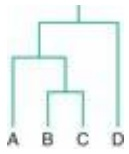

All the methods discussed here are subject to errors of this kind if the rates of evolutionary change vary along different branches of the tree. To test for varying rates, compare the species under consideration with an outgroup, a species more distantly related to all the species in question than any pair of them is to each other. For instance, if we are studying species of primates, a nonprimate mammal such as the cow would be a suitable outgroup. If the rates of evolution among the primate species were constant, we should expect to observe approximately equal dissimilarity measures between all primate species and the cow. If this is not observed, the suggestion is that evolutionary rates have varied among the primates, and the character being used may well not provide the correct phylogenetic tree.

## Are trees the correct way to present phylogenetic relationships?

In the classic model of evolution by descent and divergence, the biological process assures us that the relationship between species is a hierarchy. A tree structure is its natural and proper representation. The question of whether we can accurately and confidently determine the correct tree is a separate issue. However, in some cases a tree structure does not adequately account for the data. This is observed particularly often in viral evolution, or in situations in which there has been a large amount of horizontal gene transfer.

H.-J. Bandelt and A.W.M. Dress developed a more general graphical clustering method, called

258

---

split decomposition, that can better account for a set of distances than a tree structure (see Example 5.7).

## Example 5.7 Alternative representations of similarity data

Bandelt and Dress\* consider the following distance matrix:

|  | A | B | C | D | E | F | G |
| --- | --- | --- | --- | --- | --- | --- | --- |
| A | 0 | 4 | 5 | 7 | 13 | 8 | 6 |
| B | 4 | 0 | 1 | 3 | 9 | 12 | 10 |
| C | 5 | 1 | 0 | 2 | 8 | 13 | 11 |
| D | 7 | 3 | 2 | 0 | 6 | 11 | 13 |
| E | 13 | 9 | 8 | 6 | 0 | 5 | 7 |
| F | 8 | 12 | 13 | 11 | 5 | 0 | 2 |
| G | 6 | 10 | 11 | 13 | 7 | 2 | 0 |

Application of the UPGMA method gives the following tree representation:

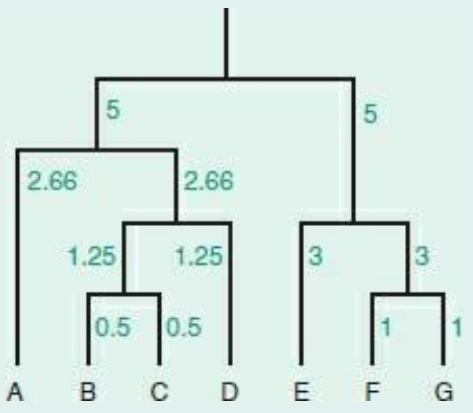

<details>
<summary>dendrogram</summary>

| Node | Value |
| --- | --- |
| A | 2.66 |
| B | 1.25 |
| C | 0.5 |
| D | 1.25 |
| E | 3 |
| F | 1 |
| G | 1 |
</details>

Note that the sum of the path labels between B and C is $0.5 + 0.5 = 1,$ which is equal to the B–C distance in the matrix. However, the sum of the path labels between A and D is $2.66 + 2.66 + 1.25 = 6.57$ which is only approximately equal to 7. The tree does not account precisely for all the distance data.

Bandelt and Dress represent the distance matrix by a more complex network based on the split decomposition method:

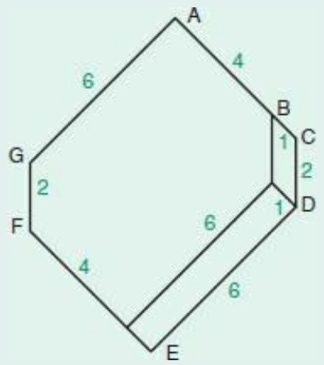

<details>
<summary>text_image</summary>

A
4
6
G
2
F
4
6
E
1
B
C
1
2
D
1
6
</details>

This is not a phylogenetic tree such as we are used to. But the sum of the indices of the edges linking any two nodes, along the shortest path, does reproduce the distance data. In this graph the distance between A and D, along a shortest path—which might pass through B and $C--is 4+1+2=7$ equal to the distance in the original data matrix. Observe that the graph contains some intermediary nodes that do not correspond to original data points.

From which representation do the clusters appear more naturally? Do you think that if the UPGMA graph were drawn so that the edge lengths were proportional to the distances indicated as the labels that the clustering would be more clear? (Try it!)

259

---

\*Bandelt, H.-J. and Dress, A.W.M. (1992). Split decomposition: a new and useful approach to phylogenetic analysis of distance data. Mol. Phylogenet. Evol., 1, 242–252.

## Computational considerations

Cladistic methods—maximum parsimony and maximum likelihood—are more accurate than simpler clustering methods such as UPGMA, but require large amounts of computer time if the number of species is appreciable. The total number of possible trees, which cladistic methods are committed to considering if they could, increases very rapidly with the number of species. As a result, in many cases of interest these methods can give only approximate answers, even with respect to their intrinsic assumptions.

Because calculated phylogenies are often approximations, it is important to try to test them. Methods include the following.

1. Comparison of phylogenies obtained from different characters describing the same set of taxa: are they consistent? If trees produced from different characters share a subtree, perhaps that portion of the phylogeny has been determined reliably and other portions have not.
2. Analysis of subsets of taxa should give the same answer—with respect to the subset—as appears within the full tree.
3. Formal statistical tests, involving rerunning the calculation on subsets of the original data, are known as jackknifing and bootstrapping.

**Jackknifing** is calculation with data sets sampled randomly from the original data. For phylogeny calculations from multiple sequence alignments, select different subsets of the positions in the alignment and rerun the calculation. Finding that each subset gives the same phylogenetic tree lends it credibility. If each subset gives a different tree, none of them is trustworthy.

**Bootstrapping** is similar to jackknifing except that the positions chosen at random may include multiple copies of the same position, to form data sets of the same size as the original, to preserve statistical properties of the sampling.

4. If there are very long edges, consider seriously the possibility of unequal variation in evolutionary rate that may have perturbed the calculation. Introduce outgroup taxa to check.

## Putting it all together

A fairly standard sequence of operations in bioinformatics involves:

1. selecting a sequence of interest, and using PSI-BLAST or some equivalent tool to extract a set of similar sequences;
2. performing a multiple alignment of the sequences retrieved;
3. from the multiple sequence alignment, deriving and studying the conservation patterns, and from the set of overall similarities and differences among the sequences computing and drawing a phylogenetic tree. (Some multiple sequence alignment packages, such as CLUSTAL-W, provide facilities to launch a phylogenetic tree calculation from the alignments they produce.)

Numerous tools are available to facilitate the individual steps of the process, and to smooth the transition from each to the next. We have already mentioned the feature of the PSI-BLAST that feeds

260

---

retrieved sequences into a multiple sequence alignment program such as CLUSTAL-W. CLUSTAL-W computes a tree based on the similarities of the input sequences, which can serve as input to one of a number of tree-drawing programs. The most popular current program for many aspects of phylogeny analysis is Molecular Evolutionary Genetics Analysis (MEGA) by K. Tamura, D. Peterson, N. Peterson, G. Stecher, M. Nei, and S. Kumar ([http://www.megasoftware.net](http://www.megasoftware.net)). See also [http://en.wikipedia.org/wiki/List\_of\_phylogenetics\_software](http://en.wikipedia.org/wiki/List_of_phylogenetics_software).


## See Weblems 5.9–5.15

## RECOMMENDED READING

- Altschul, S.F. and Koonin, E.V. (1998). Iterated profile searches with PSI-BLAST—a tool for discovery in protein databases. Trends Biochem. Sci., 23, 445–447. Description of one of the most important tools when database searching for sequence similarity.
- Altschul, S.F., Boguski, M.S., Gish, W., and Wootton, J.C. (1994). Issues in searching molecular sequence databases. Nat. Genet., 6, 119–129. General background to challenges in designing information-retrieval methods and interpreting the results.
- Doyon, J., Ranwez, V., Daubin, V., and Berry, V. (2011). Models, algorithms and programs for phylogeny reconstruction. Brief. Bioinform., 12, 392–400.
- Eddy, S. (1996). Hidden Markov models. Curr. Opin. Struct. Biol., 6, 361–365. Readable introduction to an important mathematical technique providing powerful tools for detection of distantly related sequences, and protein-fold recognition.
- Efron, B. and Gong, G. (1983). A leisurely look at the bootstrap, the jackknife, and cross-validation. Am. Stat., 37, 36–48. Classic paper on statistical methods for calibrating pattern-recognition procedures.
- Lesk, A.M. (2004). Introduction to Protein Science. Architecture, Function and Genomics. Oxford University Press, Oxford.
- Nei, M. and Kumar, S. (2000). Molecular Evolution and Phylogenetics. Oxford University Press, Oxford.
- Page, R.D. (2012). Space, time, form: viewing the Tree of Life. Trends Ecol. Evol., 27, 113–120.
- Penny, D., Hendy, M.D., Zimmer, E.A., and Hamby, R.K. (1990). Trees from sequences: panacea or Pandora’s box? Aust. Syst. Bot., 3, 21–38. Cautionary notes about determination of phylogenetic trees.
- Smith, T.F. (1999). The art of matchmaking: sequence alignment methods and their structural implications. Structure, 7, R7–R12. Explanation of different sequence alignment methods and what can confidently be concluded from them about similarity of structure. Gives due emphasis to structure-based alignment as a ‘gold standard’.
- Tamura, K., Peterson, D., Peterson, N., Stecher, G., Nei, M., and Kumar, S. (2011). MEGA5: molecular evolutionary genetics analysis using maximum likelihood, evolutionary distance, and maximum parsimony methods. Mol. Biol. Evol., 28, 2731–2739.

## EXERCISES AND PROBLEMS

**Exercise 5.1** What is the Hamming distance between the words DECLENSION and RECREATION?

**Exercise 5.2** What is the Levenshtein distance between the words BIOINFORMATICS and CONFORMATION?

**Exercise 5.3** The Levenshtein distance between the strings agtcc and cgctca is 3, consistent with the following alignment:

ag-tcc cgctca

Provide a sequence of three edit operations that convert agtcc to cgctca.

**Exercise 5.4** ‘I wasted time and now doth time waste me.’ (a) First sketch the expected appearance of a dotplot of this character string against itself. (b) Then calculate the dotplot exactly, recording only character identities as dots in the matrix, and compare with (a).

261

---

**Exercise 5.5** What values of window and threshold (see program, Box 5.1) could you use to eliminate the singletons in the DOROTHYHODGKIN dotplot, but retain the other matches shown?

**Exercise 5.6** For each of the matrices (a) PAM250 and (b) BLOSUM62, which substitution is more probable, W↔F or H↔R?

**Exercise 5.7** To what alignment does the path through the following dotplot correspond?

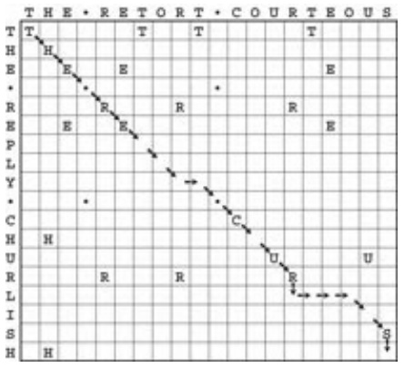

**Exercise 5.8** In planning your trip from Malmö to Tromsø (see section on The dynamic-programming algorithm for optimal pairwise sequence alignment), suppose that for personal reasons you wanted to include a visit to Uppsala. How could you adjust the costs of the segments to ensure that the minimal-cost route passed through Uppsala?

**Exercise 5.9** How would you use a dotplot to pick up palindromic DNA sequences of the type that appear partly on each strand, as in the specificity sites of restriction endonucleases?

**Exercise 5.10** Modify the PERL program in Box 5.1 that draws dotplots to accept sequences in FASTA format.

**Exercise 5.11** To what value of P would a Z score of 1 correspond in a normal distribution?

**Exercise 5.12** For each of the alignments in Figure 5.2, state whether it is in the twilight zone, more similar than the twilight zone or less similar than the twilight zone.

**Exercise 5.13** Figure 5.2a shows the sequence alignment of papaya papain and kiwi fruit actinidin, and the corresponding dotplot. The sequence alignment shows two places at which one or more residues are deleted from the papain sequence, and one place at which a residue is deleted from the actinidin sequence. On a photocopy of Figure 5.2a indicate in the dotplot the approximate positions of these insertions and deletions.

**Exercise 5.14** Suppose it were argued that randomizing a sequence is not an appropriate way to generate a control population for analysis of the statistical significance of pairwise sequence alignments, because natural sequences have nonrandom dipeptide or tripeptide frequencies. What improved way to generate a control population would you suggest?

**Exercise 5.15** Comparisons of DNA sequences of homologous chromosomes in different people show that, on average, one of every 700 bp of noncoding DNA is different. Ninety-five per cent of the human genome is noncoding. Estimate the number of polymorphisms in the human genome to give some idea of the number of potential DNA markers.

**Exercise 5.16** Show the calculations that led to the entry with value 65 in Example 5.6. What is the significance of the observation that there are two arrows coming from it?

**Exercise 5.17** The α helix formed by residues 32–49 in E. coli thioredoxin is interrupted. On a photocopy of Figure 5.6 indicate where this interruption appears. At what residue is this distortion likely to occur?

**Exercise 5.18** (a) Using simple ‘inventory’ scoring, what hexapeptide gives the greatest possible value for a match to positions 25–30 in the thioredoxin scoring table (see Table 5.2). (b) Using a scoring scheme distributed among all 20 amino acids according to the BLOSUM62 matrix, compare the score of this hexapeptide with the score of the hexapeptide VDFSAE.

**Exercise 5.19** (a) Make an inventory of the region from residues 90 to 95, similar to Table 5.2. What contribution would the following sequences aligned to these residues make to a simple profile score using inventories as weights? (b) ISSAVK. (c) FVGAKE.

**Exercise 5.20** (a) Is the following pair of trees identical in topology?

262

---

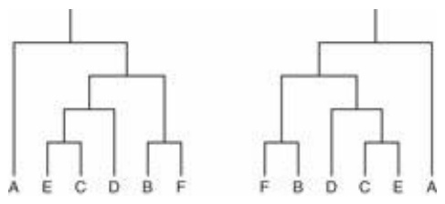

(b) Is the following pair of trees identical in topology?

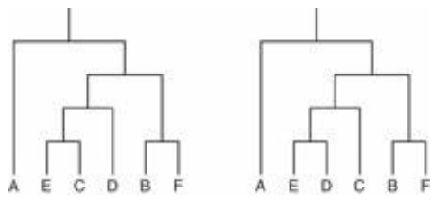

**Exercise 5.21** Draw all possible rooted trees relating three taxa. How many are there?

**Exercise 5.22** For the final graph in Example 5.6, how was the branch length 1.5 of the nodes joining the clusters {ATCC, ATGC} and {TTCG, TCGG} arrived at?

**Exercise 5.23** Using the original matrix of distances, and the final tree, in Example 5.6, for each pair of species compare the original distance between them with the sum of the lengths of the paths joining them in the tree.

**Exercise 5.24** Draw an example of a connected graph containing five nodes that is not a tree.

**Exercise 5.25** If a completely connected graph (a graph with an edge between every two nodes) is not a tree, what is the maximum number of nodes it can contain?

**Exercise 5.26** Mitochondrial DNA sequences of European, African, and Asian cattle suggest that European and African breeds are more closely related to each other than to Indian breeds. To exclude the appearance of this result as the spurious result of differential rates of evolution in the two lineages, suggest a reasonable choice of a species as an outgroup.

**Exercise 5.27** Draw the final tree in Example 5.6 to scale, with sizes of the edges proportional to the assigned branch lengths.

**Exercise 5.28** For the dynamic-programming method for alignment of two sequences of length n we noted that the execution time requirements scale as $n ^ { 2 } .$ In a naive implementation of the algorithm how would the storage space requirements scale with n: (a) if we want to determine an optimal alignment, so that traceback information must be stored? and (b) if we want only the score and not an alignment, so that traceback need not be stored? (Note: subtle ways of implementing the algorithm substantially reduce the space requirements over the naive implementation.)

**Problem 5.1** Draw a dotplot of the following sequence from the wheat dwarf virus genome —ttttcgtgagtgcgcggaggctttt—against itself. In what respects is it not a perfect palindrome?

**Problem 5.2** (a) How would you change the algorithm of the section entitled The dynamic-programming algorithm for optimal pairwise sequence alignment to find the optimal matches of a relatively short pattern $A   =   a _ { 1 } a _ { 2 } . . . a _ { n }$ in a long sequence $B   =   b _ { 1 } b _ { 2 } . . . b _ { m }$ with $n { < } { < } m$ . (No gap penalty in the regions of B that precede and follow the region matched by A.) This corresponds to motif matching as described in Chapter 1. (b) Redo the calculations of Example 5.5 for aligning the strings ggaatgg and $B = a t g$ as a motif-matching problem, using the same scoring scheme: match 0, mismatch 20, internal gap initiation 25, gap extension 22. (c) How do the results that you get differ from those derived in the example?

**Problem 5.3** At which residues in E. coli thioredoxin are there turns in the chain conformation that do not correspond to regions at or near which there are deletions in the multiple sequence alignment?

**Problem 5.4** How could you modify the profile method to retain its ability to pick up nonmammalian thioredoxins if a large number of additional mammalian, closely related, sequences were added to the table. Consider (a) methods that attempt to remove redundancy by ignoring certain sequences and (b) methods that retain all the sequences but include a weighting scheme to balance the representation of the closely related ones.

**Problem 5.5** Write a PERL program to make profile inventories from a multiple sequence alignment, and to score the matching of query sequences using BLOSUM62. Assume that the query sequence has already been aligned before it is presented to the program.

263

---

**Problem 5.6** (a) Write a PERL program to read in two character strings and report all matches of contiguous fourcharacter regions. Test this on the strings:

My.care.is.loss.of.care,.by.old.care.done

and

Your.care.is.gain.of.care,.by.new.care.won

(b) Develop this program to extend and combine the matches found, to the longest regions that contain perfectly matching 4-mers, without gaps, with no more than 25% mismatches overall.

**Problem 5.7** Extend the previous problem by writing a PERL program to illustrate, in a form based on dotplots, the progress of a BLAST-type algorithm at the stages when it (a) detects all matching substrings of length 5, (b) extends them to maximal contiguous matches, and (c) combines them to form a match with no more than k mismatches. You may make use of the PERL program for dotplots in the text.

**Problem 5.8** Write a program to animate the progress of a BLAST-type algorithm as described in the previous problem. As background, look on the web for examples of animation of string search algorithms. (This problem requires a relatively high level of experience with computing.)

**Problem 5.9** Single-stranded RNAs, such as tRNA or rRNAs, adopt conformations containing stem–loop regions, in which a region of the chain loops back on itself to form a double-stranded helix from complementary base pairs, with antiparallel strands. How would a program that would detect palindromes be useful in analysing RNA sequences to detect regions capable of forming perfect (i.e. no mismatched bases) stem–loop structures?

**Problem 5.10** Suppose that you have a pair of dice, one red and one green. Define a state of the pair of dice as the pair of numbers: the number appearing on the upper face of the red one followed by the number appearing on the upper face of the green one. Instead of rolling the dice, pass from state to state by tipping each of the dice by 90° in any direction with equal probability. Then a state in which 6 is up on one of die can by followed, with equal probability, by 2, 3, 4, or 5 up. (Dice are constructed so that the sum of the numbers on each of the three sets of opposite faces is 7. Therefore, the probability that 1 follows 6 is 0, because this would require a 180° rotation.) The probability of the sequence 6, 2, 6, 4 is (1/4)<sup>4</sup> = 1/256. The probability of generating the sequence 6, 2, 5, 4 is 0, because the transition 2→5 is not allowed, and the probability of the sequence 6, 6, 2, 3, 4 is 0 because the system must change its state, so 6 cannot be followed by 6. This procedure defines a first-order Markov process.

Write a program to answer the following questions (suppose the initial state has a 4 at the top of the red die and a 3 at the top of the green die). (a) What is the probability of another state in which the numbers add up to 7 appearing within five moves? (b) If the initial state is an 8, what is the probability that another 8 appears before a 7?

**Problem 5.11** Show that any (undirected) graph that has either of the following properties must also have the other: (a) there is a unique path between any two nodes and (b) The graph contains no cycles.

**Problem 5.12** How many paths are there altogether from Start to Finish in Figure 5.11? Count them in each of the following ways.

(a) Brute force: write down all the possibilities. This is actually less of a mindless exercise than it appears. It demonstrates that it is really not so difficult to do as it first seems. Secondly, it shows how you will get to sense patterns as you do it.
(b) In Figure 5.11, count the number of paths from Start to A and from A to Finish. Multiply these numbers together to get the total number of paths from Start to Finish that pass through A. Then count the number of paths from Start to B and from B to Finish. What is the relationship between these numbers? Multiply them together to get the total number of paths from Start to Finish that pass through B. Compute the total number of paths from Start to Finish as the sum of the number of paths from Start to Finish that pass through A, B, C, and D.
(c) Recognize that to go from Start to Finish requires six steps, including exactly three left turns and three right turns (else you won’t end up at the right place). Different choices of the order of right and left turns correspond to different paths. To count the number of paths, recognize that you need to decide only how many ways there are to choose the three steps at which you turn left (for then you must turn right at the other three steps). To assign three left turns to six steps, first we can choose one

264

---

of six steps for one left turn, then one of the five remaining steps for the next left turn, and then one of the four remaining steps for the final left turn. However, the product of these numbers overcounts the number of possibilities, because it includes the same sets of steps assigned in different order. Each triple can arise in six different ways, and it is necessary to correct for this. The result is equal to the binomial coefficient $\binom { 6 } { 3 } = 6 ! / ( 3 ! 3 ! )$

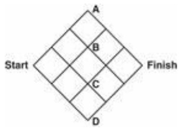

<details>
<summary>text_image</summary>

Start
A
B
C
D
Finish
</details>

Figure 5.11 Counting paths on a finite lattice.

**Problem 5.13** For the final tree in Example 5.6, derive possible ancestors at internal nodes chosen from a maximum parsimony criterion. Are there any ambiguities?

**Problem 5.14** A convenient notation for trees uses nested parentheses to indicate the clusters. (a) Expand the following into a rooted tree: ((A(BC))D). (b) Write the parenthesis notation for the trees shown in Exercise 5.20.

**Problem 5.15** Add a generous amount of comments to the PERL program for drawing dotplots and trees.

**Problem 5.16** Write a PERL program for the UPGMA method of deriving a phylogenetic tree from a matrix of distances. You may use the program for tree drawing to produce graphical output.

**Problem 5.17** For each pair of points in Example 5.7: (a) calculate the sum of indices of the edges along the path joining the two points in the tree representation of the data; (b) calculate the sum of indices of the edges along the shortest path joining the two points in the split-decomposition representation of the data; and (c) what is the average value of the absolute value of the difference between the numbers computed in (a) and the distances in the data matrix? (d) Confirm that the values computed in part (b) precisely reproduce all values in the data matrix.

**Problem 5.18** If you didn’t draw the UPGMA graph with edge lengths scaled according to the values of the indices, do it now. Compare with the split-decomposition representation. Now, from which representation do the clusters appear more naturally?

1 This is an optional section. Readers in doubt may consider the remarks in Lesk, A.M. (1988). TATA for now… . Trends Biochem. Sci., 13, 410.
2 Willerslev, E. et al. (2007). Ancient biomolecules from deep ice cores reveal a forested Southern Greenland. Science, 317, 111–113.
3 Pauling, L. and Zuckerkandl, E. (1963). Chemical paleogenetics: molecular restoration studies of extinct forms of life. Acta Chem. Scand., 17 (suppl.), 1, 9–16.
4 Bridgham, J.T., Carroll, S.M., and Thornton, J.W. (2006). Evolution of hormone-receptor complexity by molecular exploitation. Science, 322, 97–101; Ortlund, E.A., Bridgham, J.T., Redinbo, M.R., and Thornton, J.W. (2007). Crystal structure of an ancient protein: evolution by conformational epistasis. Science, 317, 1544–1548.

265
