# 8 Metabolic pathways

原始 PDF 第 346–380 页。

8

Metabolic pathways

## LEARNING GOALS

• To recognize that metabolic networks of any organism correspond to graphs, in which metabolites are the nodes and reactions connecting them are the edges. Enzymes label the edges that correspond to the reactions they catalyse.
• To understand that comparisons of metabolic pathways in different species shows regions of core overlap. Some pathways are special to certain groups of organisms. For instance, the Calvin–Benson cycle for fixation of carbon dioxide does not appear in (almost any) animals.1
• To know the defining principles of the Enzyme Commission and the Gene Ontology Consortium classifications of the functions of biological molecules. In what ways are they similar? In what ways do they differ?
• To appreciate the importance of accurate annotation of enzyme function in databases. To recognize that transfer of annotation among homologous proteins is by far the easiest way to proceed, but in the absence of experimental confirmation it is not trustworthy.
• To appreciate the physicochemical basis of enzymatic catalysis, and the quantities needed to characterize their kinetics. Such information is necessary if we are to consider modelling flows through metabolic networks.
• To understand how enzymes develop modified or novel functions. General categories are recruitment, divergence, and mixing and matching of domains.
• To see how the algorithms for comparison of nucleic acid and amino acid sequences can be generalized to compare metabolic pathways.
• To become familiar with databases of metabolic networks.

A metabolite is a molecule that undergoes transformation in a biological system, either under the action of enzymatic catalysis or by spontaneous reaction. It is conventional to think of metabolites as small molecules such as simple sugars or amino acids, rather than proteins and nucleic acids, but the distinction is arbitrary.

Metabolic pathways are the road maps defining the possible transformations of metabolites. They form a network, representable as a graph. Usually the metabolites are the nodes, and reactions connecting them are the edges. Irreversible reactions correspond to directed edges. The enzyme that catalyses each reaction labels the edge.


## See Weblem 8.1

To compile a metabolic network we need to know the possible reactions that can occur, and we need to know the catalytic activities of all the enzymes. These sets of data are really two sides of the same coin.

Generations of biochemists have charted metabolic pathways. These are fairly comprehensive for the best-studied organisms, which include E. coli, yeast, rat, and human. A sizable fraction of the pathways are common, and in many cases the enzymes that catalyse corresponding reactions are homologous over a broad range of species. Indeed, this often provides the most direct route to establishing the metabolic pathway network of a less-well-studied organism. Working out the

346

---

individual reactions using classical methods such as following radioactive tracers remains very labour-intensive. It is much easier to sequence the genome, infer the amino acid sequences of the enzymes, look for sequences similar to enzymes of known function, and assemble the metabolic networks from the assignable enzymatic functions. When this works, it is golden. The problem is that it often fails.

Clearly the basic infrastructure of this enterprise involves knowing the functions of enzymes. To impose some order on this information there have been several attempts to classify enzyme function.

## Classification and assignment of protein function

## The Enzyme Commission

The first detailed classification of protein functions was that of the Enzyme Commission (EC). In 1955, the General Assembly of the International Union of Biochemistry (IUB), in consultation with the International Union of Pure and Applied Chemistry (IUPAC), established an International Commission on Enzymes to systematize nomenclature. The EC published its classification scheme, first on paper and now on the web ([http://www.chem.qmul.ac.uk/iubmb/enzyme/](http://www.chem.qmul.ac.uk/iubmb/enzyme/)).

EC numbers (looking suspiciously like a computer's IP number) contain four fields, corresponding to a four-level hierarchy. For example, EC 1.1.1.1 corresponds to alcohol dehydrogenase, catalysing the general reaction:

<div class="docvortex-algorithm" style="white-space: pre-wrap; font-family:monospace;">
An alcohol+NAD$^{+}$=
the corresponding aldehyde or ketone+NADH+H$^{+}$
</div>

Several reactions, involving different alcohols, would share this number; but the same dehydrogenation of one of these alcohols by an enzyme using the alternative cofactor NADP + would be assigned EC 1.1.1.2.

The first field in an EC number indicates one of the six main divisions (classes) to which the enzyme belongs:

| Class 1 | Oxidoreductases |
| --- | --- |
| Class 2 | Transferases |
| Class 3 | Hydrolases |
| Class 4 | Lyases |
| Class 5 | Isomerases |
| Class 6 | Ligases |

The significance of the second and third numbers depends on the class. For oxidoreductases the second number describes the substrate and the third number the acceptor. For transferases, the second number describes the class of item transferred and the third number describes either more specifically what they transfer or in some cases the acceptor. For hydrolases, the second number signifies the kind of bond cleaved (e.g. an ester bond) and the third number the molecular context (e.g. a carboxylic ester or a thiolester). (Proteinases are treated slightly differently, with the third number indicating the mechanism: serine proteinases, thiol proteinases, and acid proteinases are classified separately.) For lyases the second number signifies the kind of bond formed (e.g. C─C or C─O) and the third number the specific molecular context. For isomerases, the second number indicates the type of reaction and the third number the specific class of reaction. For ligases, the

347

---

second number indicates the type of bond formed—for example, EC 6.1 for C─O bonds (enzymes acylating tRNA) and EC 6.2 for C─S bonds (acyl-CoA derivatives), etc—and the third number the type of molecule in which it appears. The fourth number gives the specific enzymatic activity.

Specialized classifications are available for some families of enzymes; for instance, the MEROPS database by N.D. Rawlings and A.J. Barrett provides a structure-based classification of peptidases and proteinases ([http://merops.sanger.ac.uk/](http://merops.sanger.ac.uk/)).

The EC produced a catalogue of reactions, not an assignment of function to proteins. The EC has emphasized that: ‘It is perhaps worth noting, as it has been a matter of long-standing confusion, that enzyme nomenclature is primarily a matter of naming reactions catalysed, not the structures of the proteins that catalyse them’ ([http://www.chem.qmul.ac.uk/iubmb/nomenclature/](http://www.chem.qmul.ac.uk/iubmb/nomenclature/)). Assigning EC numbers to proteins is a separate task. Such assignments appear in protein databases such as UniProtKB.

## The Gene Ontology Consortium protein function classification

In 1999, Michael Ashburner and many coworkers faced the problem of annotating the soon-to-becompleted D. melanogaster genome sequence. As a classification of function, the EC classification was unsatisfactory, if only because it was limited to enzymes. Ashburner organized the Gene Ontology Consortium to produce a standardized scheme for describing function.<sup>2</sup> (Recall that an ontology is a formal set of well-defined terms with well-defined interrelationships; that is, a dictionary and rules of syntax.)

The Gene Ontology Consortium ([http://www.geneontology.org](http://www.geneontology.org)) has produced a systematic classification of gene function, in the form of a dictionary of terms, and their relationships. As with the EC classification, GO provides a catalogue of functions, not an assignment of function to particular genes or proteins. Many databases contain attributions of EC and GO categories to individual proteins.

Organizing concepts of the GO project include three categories.

1. Molecular function: a function associated with what an individual protein or RNA molecule does in itself; either a general description such as enzyme, or a specific one such as alcohol dehydrogenase. This is function from the biochemists’ point of view.
2. Biological process: a component of the activities of a living system, mediated by a protein or RNA, possibly in concert with other proteins or RNA molecules; either a general term such as signal transduction, or a particular one such as cAMP synthesis. This is function from the cell's point of view.

Because many processes are dependent on location. GO also tracks:

3. Cellular component: the assignment of site of activity or partners; this can be a general term such as nucleus or a specific one such as ribosome.

An example of the GO classification is shown in Figure 8.1. The GO schemes are not strict hierarchies, but have a more general structure. They form ‘directed acyclic graphs’: Graphs, because they consist of nodes connected by edges. Directed because for any pair of nodes connected by an edge, one of the nodes represents a more general class than the other, so that (more inclusive) → (less inclusive) defines a direction, pointing away from the root. Acyclic means that any path that follows the directions specified by each edge cannot re-encounter any previous node in the path, for this would contradict the idea that the directions of the edges are always from the more general to the

348

---

more specific.


Figure 8.1 Selected portions of the three categories of GO, showing classifications of functions of proteins that interact with DNA. (a) Molecular function: including general DNA binding by proteins, and enzymatic manipulations of DNA. (b) Biological process: DNA metabolism. (c) Cellular component: Different places within the cell. These pictures illustrate the general structure of the GO classification. Each term describing a function is a node in a graph. Each node has one or more parents and one or more descendants: arrows indicate direct ancestor–descendant relationships. A path in the graph is a succession of nodes, each node the parent of the next. Nodes can have ‘grandparents’, and more remote ancestors.

Unlike the EC hierarchy, the GO graphs are not trees in the technical sense, because there can be more than one path from an ancestor to a decendant. For example, there are two paths in (a) from enzyme to ATP-dependent helicase.

349

---

Along one path helicase is the intermediate node. Along the other path adenosine triphosphatase is the intermediate node.

Although the nodes are shown on discrete levels to clarify the structure of the graph, all the nodes on any given level do not necessarily have a common degree of significance, unlike family, genus, and species levels in the Linnaean taxonomic tree, or the ranks in military, industrial, or academic organizations. GO terms could not have such a common degree of significance given that there can be multiple paths, of different lengths, between different nodes.


## See Weblem 8.2, 8.3 and 8.4

## Comparison of Enzyme Commission and Gene Ontology classifications

EC identifiers form a strict four-level hierarchy, or tree. For example, isopentenyl-diphosphate Δ- isomerase is assigned EC number 5.3.3.2. The initial 5 specifies the most general category, 5 = isomerases, 5.3 comprises intramolecular isomerases, 5.3.3 is those enzymes that transpose C═C bonds, and the full identifier 5.3.3.2 specifies the particular reaction. In the molecular function ontology, GO assigns the identifier 0004452 to isopentenyl-diphosphate Δ-isomerase. (The numbers themselves have no specific significance.)

Figure 8.2 compares the EC and GO classifications of isopentenyl-diphosphate Δ-isomerase. The figure shows a path from GO:0004452 to the root node of the molecular function directed acyclic graph (DAG), GO:0003674. In this case there are four intervening nodes, with progressively more general categories as we move up the figure. Note that the GO description of this enzyme as an oxidoreductase is inconsistent with the EC classification, in which a committed choice between oxidoreductase and isomerase must be made at the highest level of the EC hierarchy.


<details>
<summary>flowchart</summary>

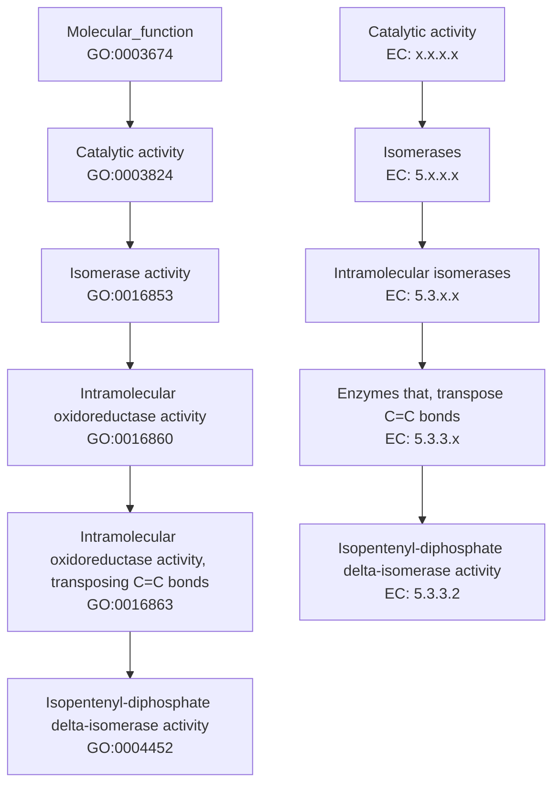
</details>

Figure 8.2 Comparison of Enzyme Commission and Gene Ontology Consortium classifications of isopentenyldiphosphate Δ-isomerase.

350

---

Proteomics has become an important field in bioinformatics, given the importance of accurate assignments of enzyme functions. Genomics and proteomics contribute to the development of the relevant databases, and also to the development of algorithms for comparing and analysing the patterns they contain.

## Catalysis by enzymes

Enzymes are examples of protein–ligand complexes. They bind substrates and cofactors selectively and in specific geometric orientations. In this way, they ensure that substrates are properly juxtaposed with catalytic residues of the protein. For multisubstrate reactions, enzymes force the two substrates to approach each other in the correct orientation for favourable reaction. If the same molecules, free in solution, were to collide in random orientation, the probability that any collision would result in a reaction would be very low.

Some enzyme-catalysed reactions follow the same pathway as the uncatalysed reactions, but with lower activation barriers. Other enzymes substitute different reaction mechanisms, with intermediates very different from those of the uncatalysed reaction. To understand rate enhancement by activation-barrier lowering, compare the affinities of the initial enzyme–substrate complex and the enzyme–transition state complex (see Fig. 8.3).


Figure 8.3 (a) A graph of energy (vertical) against ‘reaction coordinate’ (horizontal). The reaction coordinate is a measure of the progress of the reaction. Both reactants and products are stable. Therefore they appear at local minima in the energy. To convert from reactants to products requires traversing a barrier. The configuration at the top of the barrier is called the transition state. The height of the barrier above the energy level of the reactants—the activation energy $E _ { a }$ —controls the rate of reaction. The higher the barrier, the slower the reaction. (b) Comparison of the uncatalysed reaction (black) with the catalysed reaction (green). In the presence of a catalyst that does not change the energies of reactants and products, but which stabilizes the transition state, the barrier is lower and the reaction rate higher.

The Gibbs free energy G is a thermodynamic quantity such that the change in Gibbs free energy measures the ‘driving force’ for a reaction or other process that takes place at constant temperature and pressure. A process with a negative Gibbs free energy will be spontaneous. The height of a barrier in Gibbs free energy in a reaction diagram measures the difficulty in surmounting the barrier, and thereby governs the rate of reaction.

A superscript ‡ indicates a property of the transition state: the state at the top of a barrier $\mathrm{(S = substrate, S^{\dagger} =}$ transition state, E = enzyme, ES = enzyme–substrate complex, $\mathrm { E S } ^ { \ddagger } = \mathrm { e n z y m e - t r a n s i t i o n }$ state complex).

Free energy of activation in the presence of enzyme $= \mathrm { G } ( \mathrm { E S ^ { \ddagger } } ) - \mathrm { G } ( \mathrm { E S } )$ . Free energy of activation in the absence of enzyme $= \mathrm { G } ( \mathrm { S } ^ { \ddag } ) - \mathrm { G } ( \mathrm { S } )$

Subtracting:

351

---

$$
\begin{array}{l} \Delta \Delta G ^ {\ddagger} = [ G (E S ^ {\ddagger}) - G (E S) ] - [ G (S ^ {\ddagger}) - G (S) ] \\ = [ \mathrm{G} (\mathrm{ES} ^ {\ddagger}) - \mathrm{G} (\mathrm{S} ^ {\ddagger}) - \mathrm{G} (\mathrm{E}) ] - [ \mathrm{G} (\mathrm{ES}) ] - \\ \mathrm{G(S)-G(E)} \\ = \text {binding affinity of transition state} S ^ {\ddagger} \\ - \text {binding affinity of substrate S} \\ \end{array}
$$

The rate enhancement is directly related to the lowering of the activation energy, $\Delta \Delta \mathrm { G } ^ { \ddagger }$ . The effect of the enzyme on $\Delta \mathbf { G } ^ { \ddagger }$ is the dif erence between the affinity of the enzyme for the transition state $\mathbb { S } ^ { \frac { 1 } { \frac { 1 } { 2 } } }$ and for the substrate S. (Here $\Delta \mathrm { G }   =   \mathrm { G } ( \mathrm { E S } )   -   \mathrm { G } ( \mathrm { S } )   -   \mathrm { G } ( \mathrm { E } )$ is the Gibbs free energy change of the association reaction $\mathrm { E } + \mathrm { S } = \mathrm { E S }$ ; not shown in Fig. 8.3)

An efficient enzyme will bind its substrate adequately to get the process started, but bind the transition state more tightly. Some enzymes are rigid, and have better complementarity to the transition state than to the substrate. Others undergo conformational changes upon binding substrate, from a form adapted to bind the substrate to one adapted to bind the transition state, or, often, to exclude water from the reaction site. This is known as ‘induced fit’.

## Active sites

Many enzymes bind substrates in crevices, often but not always between domains. The picture of E. coli N-acetyl-L-glutamate kinase in Plate X shows a single-domain protein with substrate and cofactor swaddled in a cleft. These active sites both bind substrates and juxtapose specific catalytic residues with them.


Plate X An enzyme–substrate complex: E. coli N-acetyl-L-glutamate kinase binding the substrate N-acetylglutamate and the inhibitory cofactor analogue AMPPNP (instead of the natural cofactor ATP) [1GS5]. The substrate and inhibitor nestle snugly into the enzyme, which holds them in proper proximity and orientation for phosphate transfer.

In most cases the active site is a small portion of the protein, perhaps ≈10%. Why then is the rest of the protein necessary? Reasons include the following.

The rest of the protein is required to bring the active site residues into their correct spatial relationship. The active site residues are generally distant in the sequence, and it is the folding of the chain that brings them into proximity.
• In many enzyme mechanisms, proteins must undergo conformational changes. The entire structure is needed to provide the levers and fulcra for the mechanical activity.
In some proteins active sites are in strained conformations. The rest of the structure must provide the energy to stabilize this. Coupling of relief of this strain to interaction with a substrate can enhance binding affinity and catalytic power. Typically the enzyme becomes more rigid, thermostable, and protease-resistant with substrate bound.

352

---

## Cofactors

The natural amino acids have a range of chemical properties, but not enough for all biochemical reactions. Many metal ions and small organic molecules attach to enzymes or enzyme-substrate complexes and participate in catalysis. For example, $\mathrm { N A D ^ { + } }$ and $\mathrm { N A D P ^ { + } }$ accept electrons during dehydrogenation reactions. Several metal ions undergo reversible oxidation and reduction, for instance in the electron transport chains of respiration and photosynthesis.

Classes of cofactors tend to specialize in different types of reactions (see Table 8.1).

Table 8.1 Typical biochemical roles of different types of cofactor

| Type of cofactor | Example | Biological role |
| --- | --- | --- |
| Redox | NAD+, NADP+ | Electron or hydrogen transfer |
|  | Flavin adenine dinucleotide (FAD) |  |
|  | Coenzyme Q |  |
| Group transfer | Thiamine pyrophosphate | Aldehyde transfer |
|  | Coenzyme A | Acyl transfer |
|  | Pyridoxal phosphate | Amino group transfer |
|  | S-Adenosyl methionine | Methyl group transfer |
|  | Biotin | Carboxyl group transfer |
|  | Tetrahydrofolate | Methyl group transfer |
|  | UDP-glucose | Glucosyl group transfer |

Many cofactors are vitamins or related to vitamins. To say that a compound is a vitamin means that it is essential, but that the species never developed (or had, but subsequently lost) a biosynthetic pathway leading to the compound.

## Protein–ligand binding equilibria

Reversible binding of ligands to proteins involves equilibria of the form:

$$
\begin{array}{c} \text {Protein + Ligand = Protein\cdot Ligand} \\ \text {P + L = P\cdot L} \end{array}
$$

for a one-to-one complex, or:

$$
\text {Protein} + n \text {Ligand} = \text {Protein} \cdot \text {Ligand} _ {n}
$$

for the binding of n identical ligands to a single protein. These do not exhaust the possibilities. Many proteins bind two or more different ligands at the same time: enzymes binding a substrate and a cofactor provide many examples. A common index of the affinity of a complex is the dissociation constant, $K _ { \mathrm { D } } ,$ , the equilibrium constant for the reverse of the binding reaction:

$$
\text {Protein} \cdot \text {Ligand} = \text {Protein} + \text {Ligand} K _ {\mathrm{D}} = [ \mathrm{P} ] [ \mathrm{L} ] / [ \mathrm{PL} ]
$$

[P], [L], and [PL] denote the numerical values of the concentrations of protein, ligand, and protein– ligand complex, respectively, expressed in $\mathrm { m o l }   \cdot   \mathrm { l } ^ { - 1 }$ . The lower the $K _ { \mathrm { D } } ,$ the tighter the binding. $K _ { \mathrm { D } }$ corresponds to the concentration of free ligand at which half the proteins bind ligand and half are free: $[ \mathrm { P } ] = [ \mathrm { P L } ]$ . It is common parlance, although incorrect, to write equilibrium constants in terms of concentration, with the result that $K _ { \mathrm { D } }$ may appear to have units mol $\cdot \mathrm { I } ^ { - 1 }$ . One often reads, ‘The ligand binds with nanomolar affinity,’ to mean:<sup>3</sup>

353

---

$$
K _ {\mathrm{D}} = \frac {[ \mathrm{P} ] [ \mathrm{L} ]}{[ \mathrm{PL} ]} = 1 0 ^ {- 9} \mathrm{mol} \cdot \mathrm{l} ^ {- 1}
$$

The Michaelis constant of an enzyme is the dissociation constant of the enzyme–substrate complex, assumed in the Michaelis–Menten model to be at equilibrium with respect to enzyme + substrate (see next section, on Enzyme kinetics).

The $K _ { \mathrm { D } }$ is related to the Gibbs free energy change of dissociation by the relationship:

$$
\mathrm{PL} = \mathrm{P} + \mathrm{L} \quad \Delta G ^ {\ominus} = \Delta H ^ {\ominus} - T \Delta S ^ {\ominus} = - R T \ln K _ {\mathrm{D}}
$$

in which the ‘underground’ symbol ( ) designates a property of an agreed-upon standard state.

Assuming no structural change on ligation, the entropy term will favour dissociation, because two objects will have greater conformational freedom if they are kinetically independent than if they are tethered. Therefore, to achieve a stable complex the enthalpy term must provide attractive forces adequate to overcome the intrinsic entropic penalty. Raising the temperature, which gives more importance to the entropy term, will promote dissociation.

To get a feel for the numbers, at 300 K the purely kinetic entropy gain upon dissociation, $T \Delta S ^ { \circledast }$ ΔS , is about 20 kJ $\cdot \mathrm { m o l } ^ { - 1 }$ . This is equivalent, in terms of attractive interactions, to about a hydrogen bond, or burial of about 200 $\mathbb { A } ^ { 2 }$ of hydrophobic surface. A value of $\Delta G ^ { \circledast }$ of 50 kJ⋅mol<sup>−1</sup> for a dissociation reaction corresponds to a dissociation constant of $K _ { \mathrm { D } }   \approx   2 \times 1 0 ^ { - 9 }$ at 300 K.

Dissociation constants of protein–ligand complexes span a very wide range (see Table 8.2).

Table 8.2 Protein–ligand complexes show a very wide range of affinities

| Biological context | Ligand | Typical $K_{D}$ | $\Delta G^{\ominus}$ at 298 K (kJ·mol-1) |
| --- | --- | --- | --- |
| Allosteric activator | Monovalent ion | $10^{-4}$-$10^{-2}$ | 11–23 |
| Coenzyme binding | NAD+, for instance | $10^{-7}$-$10^{-4}$ | 23–40 |
| Antigen–antibody complexes | Various | $10^{-4}$-$10^{-16}$ | 23–91 |
| Thrombin inhibitor | Hirudin | $5 \times 10^{-14}$ | 76 |
| Trypsin inhibitor | Bovine pancreatic trypsin inhibitor | $10^{-14}$ | 80 |
| Streptavidin | Biotin | $10^{-15}$ | 85.6 |

Several databases collect data on the structures and thermodynamics of interaction of proteins with small ligands. A few examples, of many, are:

Relibase [http://www.ccdc.cam.ac.uk/free\_services/relibase\_free/](http://www.ccdc.cam.ac.uk/free_services/relibase_free/)

PDBcal http://www.pdbcal.org

Protein Ligand Database [http://www-mitchell.ch.cam.ac.uk/pld/](http://www-mitchell.ch.cam.ac.uk/pld/)

Protein–protein interaction databases are a separate speciality.

## Enzyme kinetics

Kinetics is the measurement of reaction rates and their dependence on conditions, including concentrations of reactants, products, and catalysts. Classically, the measurement of reaction velocity as a function of substrate concentration [S] involved mixing enzyme and substrate, and following the reaction by measuring disappearance of substrate or appearance of product. For instance, the fact that NADH but not $\mathrm { N A D ^ { + } }$ has an absorption maximum at 340 nm made it convenient to follow

354

---

dehydrogenation reactions of the form:

$$
\text {malate} + \mathrm{NAD} ^ {+} \rightleftharpoons \text {oxaloacetate} + \mathrm{NADH} + \mathrm{H} ^ {+}
$$

by running the reaction in a spectrophotometer and recording absorbance at 340 nm.

A simple model of an enzyme-catalysed reaction, by V. Henri, and by L. Michaelis and M. Menten, involves enzyme and substrate interacting to form an enzyme–substrate complex. The complex breaks down to release product and restore the original free enzyme:

$$
\mathrm{E+S} \xrightarrow [ k _ {- 1} ]{k _ {1}} \mathrm{ES} \xrightarrow {k _ {2}} \mathrm{P}
$$

where E is enzyme, S is substrate, ES is the enzyme–substrate complex, P is the product, and $k _ { 1 } , k _ { - 1 }$ and $k _ { 2 }$ are rate constants for the individual reaction steps. [S] means the concentration of substrate, [E] is the concentration of enzyme, and [ES] is the concentration of enzyme–substrate complex. More precisely, [E] is the concentration of active sites, for some enzyme molecules may contain more than one active site.

An important contribution of Michaelis and Menten was to emphasize the determination of the initial rate, $\nu _ { 0 } ,$ of the reaction, in the absence of product. In practice this requires following the time course of the reaction and extrapolating back to the moment of mixing enzyme and substrate. (There is also a transient stage as the enzyme and substrate mix and interact, before establishment of equilibrium. This stage lasts only milliseconds. It is observable only with special techniques, and does not affect extrapolated inferences of initial rates.) Under these circumstances there is no backreaction of product, if only because there is no product there to back-react. This assumption also avoids certain potentially complicating factors, such as product inhibition or enzyme degradation, which probably were not recognized in 1913.

Michaelis and Menten further assumed that the forward and reverse rates of the first step are faster than the formation of product; that is: $k _ { 1 } \gg k _ { 2 } ,$ and $k _ { - 1 } \gg k _ { 2 }$ . The picture is that ES is at equilibrium with $\mathbf { E } + \mathbf { S }$ , with product P ‘bleeding off’ slowly.

Michaelis and Menten derived the rate equation relating the initial velocity $\nu _ { 0 }$ as a function of substrate concentration [S]

$$
\nu_ {0} = \frac {V _ {\mathrm{max}} [ S ]}{K _ {\mathrm{M}} + [ S ]}
$$

The Michaelis constant $K _ { \mathrm { M } }$ has dual significance: (1) it is the substrate concentration at which the initial velocity is $V _ { 2 } V _ { \mathrm { m a x } }$ and (2) it is the dissociation constant of the enzyme–substrate complex ES:

$$
\mathrm{ES} \rightleftharpoons \mathrm{E+S} \quad K _ {\mathrm{M}} = \frac {[ \mathrm{E} ] [ \mathrm{S} ]}{[ \mathrm{ES} ]}
$$

Figure 8.4 shows the general features of the relationship between substrate concentration and initial velocity. Curves of this shape are quite common, arising from many phenomena that exhibit saturation, or, in general, follow a ‘law of diminishing returns’. I. Langmuir derived a version to describe the absorption of molecules on a surface. Such a graph could also describe the grade you will receive in your bioinformatics course, as a function of the number of hours you study.

355

---

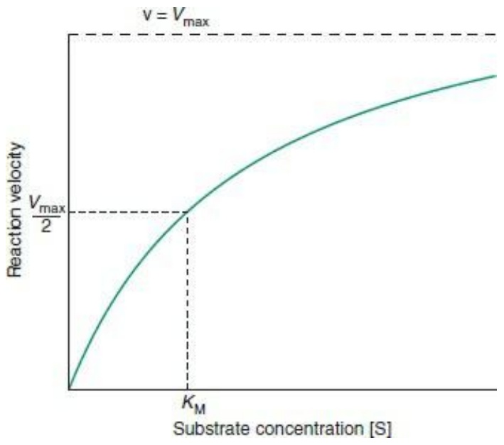

<details>
<summary>line</summary>

| Substrate concentration [S] | Reaction velocity |
| --- | --- |
| 0 | 0 |
| KM | Vmax/2 |
</details>

Figure 8.4 Typical dependence of reaction velocity of an enzyme-catalysed reaction on substrate concentration in the presence of a fixed amount of enzyme. The graph is linear at low substrate concentrations and approaches a maximum value at high substrate concentrations. These curves depend on two parameters: the maximum velocity, $V _ { \mathrm { m a x } }$ , and the substrate concentration corresponding to half the maximum velocity. In the Michaelis–Menten model the substrate concentration corresponding to the rate $V _ { 2 } V _ { \mathrm { m a x } }$ is the Michaelis constant, $K _ { \mathbf { M } }$ , interpreted as the dissociation constant of the enzyme–substrate complex.

For low values of [S], $\nu _ { 0 }$ and [S] are proportional. In this region, the enzyme is accommodating all substrate molecules equally well. The rate-limiting step is the encounter of substrate and free enzyme. As [S] increases, $\nu _ { 0 }$ as a function of [S] rises less and less steeply. With further increase in [S], $\nu _ { 0 }$ approaches a limiting value $V _ { \mathrm { m a x } }$ . This is attributable to saturation of the enzyme. Virtually all the enzyme is in the form of enzyme–substrate complex, ES (apply Le Chatelier's principle to the E $+ \mathbf { S } \rightleftharpoons \mathbf { E } \mathbf { S }$ equilibrium). The enzyme is running flat out to produce substrate. The rate of appearance of product is $V _ { \mathrm { m a x } }$ , independent of substrate concentration. The observed rate at the plateau corresponds to the rate of some step of the reaction that occurs after binding of the substrate.

Given a set of data recording $\nu _ { 0 }$ as a function of [S] for some enzyme–substrate combination, it is possible to use curve-fitting software to derive $K _ { \mathrm { M } }$ and $V _ { \mathrm { m a x } }$ . The values of $V _ { \mathrm { m a x } }$ and $K _ { \mathrm { M } }$ characterize the enzyme, the substrate, and the conditions of reaction, such as temperature, pH, and ionic strength.

## Measures of effectiveness of enzymes

At high substrate concentrations the velocities $\nu _ { 0 }$ and $V _ { \mathrm { m a x } }$ are proportional to the amount of enzyme present. How can we characterize an enzyme and a set of reaction conditions, independent of the amount of enzyme?

The turnover number of an enzyme, $k _ { \mathrm { c a t s } }$ is the ratio $( V _ { \mathrm { m a x } } ) / ( [ \mathrm { E } ] _ { \mathrm { t o t a l } } )$ , where $[ \mathrm { E } ] _ { \mathrm { t o t a l } }$ <sup>is</sup> the total concentration of enzyme. The turnover number is a measure of ‘throughput’ on a molecular basis: it represents the number of substrate molecules converted to product, per enzyme molecule, under conditions of saturation; that is, at high substrate concentrations.

More usually, enzymes operate at low substrate concentrations. $\mathrm{If} \left[ \mathrm{S} \right] \ll K_{\mathrm{M}}, \nu_0 = \left( k_{\mathrm{cat}} / K_{\mathrm{M}} \right) \left[ \mathrm{E} \right] \left[ \mathrm{S} \right]$ The ratio $k _ { \mathrm { c a t } } / K _ { \mathrm { M } }$ gives a measure of the catalytic efficiency of enzymes at low substrate concentrations. Two factors may contribute to increasing the value of $k _ { \mathrm { c a t } } / K _ { \mathrm { M } } ; ( 1 )$ a low $K _ { \mathrm { M } }$ implies a high affinity of substrate and enzyme and (2) a high $k _ { \mathrm { c a t } }$ implies that the enzyme–substrate complexes formed will turn over rapidly to product.

356

---

Different enzymes show a large range of $k _ { \mathrm { c a t } } / K _ { \mathrm { M } }$ values. However, no matter how efficient the catalytic mechanism itself, the rate of a reaction is limited by the rate of encounters of enzyme and substrate, which depends on the diffusion rate. If every encounter results in reaction—that is, the catalysis is $d i f f u s i o n \text { - } l i m i t e d \text {— } k _ { \mathrm { c a t } } / K _ { \mathrm { M } }$ would be ${ \approx } 1 0 ^ { 8 } \mathrm { ~ - ~ } 1 0 ^ { 9 } \mathrm { ~ ( m o l / l ) ^ { - 1 } ~ s ^ { - 1 } }$ under typical conditions. Some enzymes achieve this. No evolution of enhanced catalytic efficiency in the enzyme itself could improve turnover rate (see Table 8.3).

Table 8.3 Some enzymes that approach diffusion-limited rates

| Enzyme | Substrate | $k_{cat}, s^{-1}$ | $K_M, mol·l^{-1}$ | $k_{cat}/K_M, (mol/l)^{-1}s^{-1}$ |
| --- | --- | --- | --- | --- |
| Acetylcholinesterase | Acetylcholine | $1.4×10^4$ | $9×10^{-5}$ | $1.6×10^8$ |
| Catalase | $H_2O_2$ | $4×10^7$ | 1 | $4×10^7$ |
| Fumarase | Fumarate | $8×10^2$ | $5×10^{-6}$ | $1.6×10^8$ |

As the amino-acid sequences of enzymes diverge, their function can also diverge. In many cases, homologous enzymes in different species retain similar catalytic activities. This does not mean that they retain exactly the same specificities, or the same kinetic constants. The catalogues of function in the EC and GO are discrete and do not depend on details of kinetic parameters. Under moderate sequence divergence enzymes may typically retain the same EC and GO classifications.

## BRENDA: a database about enzymes

Biochemists have learned a lot about different enzymes in different species. The database BRENDA ([www.brenda-enzymes.info/](http://www.brenda-enzymes.info/)) collects information about enzymes, including description of the reaction catalysed, ‘classical’ biochemical kinetic information such as Michaelis constants and $V _ { \mathrm { m a x } } ,$ and links to other databases such as UniProtKB and the wwPDB.


**See Weblem 8.5**

## How do proteins evolve new functions?

Recall that enzymes have two types of specificity. They have substrate specificity, for which Fischer's lock-and-key analogy remains a useful description. They also have specificity with respect to the reaction catalysed.

Sequence divergence can modify both types of specificity, while conserving the basic reaction. For instance, humans have two homologous succinyl-CoA synthases, one linked to formation of GTP and the other to formation of ATP. Although most biochemists would regard this as only a change in substrate specificity, according to both EC and GO they catalyse different reactions.


## See Weblem 8.6

In other cases, homologous proteins have diverged to catalyse reactions with different substrates and products. In some cases they retain components of the mechanism. An example is a set of proteins from the enolase family (see Box 8.1).

As enzymes evolve, they may:

357

---

• change kinetic parameters;
• change substrate specificity;
• change reaction catalysed;
• change control mechanism;
• yet retain general mechanism of catalysis.

It is of the greatest importance, in comparing metabolic pathways between different species, to understand the general principles of the evolution of protein function.

## Box 8.1 Enolase, mandelate racemase, and muconate lactonizing enzyme catalyse different reactions but have related mechanisms

Enolase, mandelate racemase, and muconate lactonizing enzyme I are homologous enzymes. They have a common structure, closely related to the TIM-barrel fold. However, they catalyse different reactions.


## See Weblem 8.7

Looking only at sequence and structure runs the risk of overlooking a more subtle similarity. These enzymes share a common feature of their mechanism: each acts by abstracting a proton adjacent to a carboxylic acid to form an enolate intermediate (Figure 8.5). The stabilization of a negatively charged transition state is conserved. In contrast, the subsequent reaction pathway, and the nature of the product, vary from enzyme to enzyme. These enzymes have not only a similar overall fold, but each requires a divalent metal ion, bound by structurally equivalent ligands. However, other residues in the active site differ, to produce enzymes that catalyse different reactions.

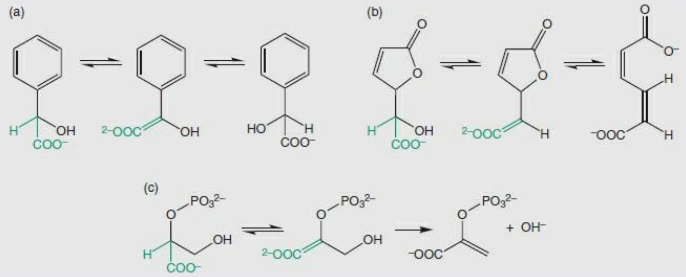

<details>
<summary>chemical</summary>

Three-step organic reaction mechanism showing phenol-catalyzed transformation and subsequent oxidation to form a ketone or ester product.
</details>

Figure 8.5 Common mechanism in the enolase family of enzymes: (a) mandelate racemase, (b) muconate lactonizing enzyme, and (c) enolase.

## Control over enzyme activity

For smooth operation of metabolic pathways it is essential to regulate the panoply of enzymatic activities. Discussions of ‘classical’ enzymology, treating kinetics as we have just done, would go on to discuss regulation of the velocities of enzymatic reactions by inhibitors and allosteric effectors. However, inhibition—the control of enzyme activity by modification of a mature enzyme by interaction with a ligand—is only one of the possible mechanisms of regulation. As shown in Figure 8.6 there are many different potential targets for control. Inhibition and allostery are only two of

358

---

them. This topic is the subject of Chapter 9.

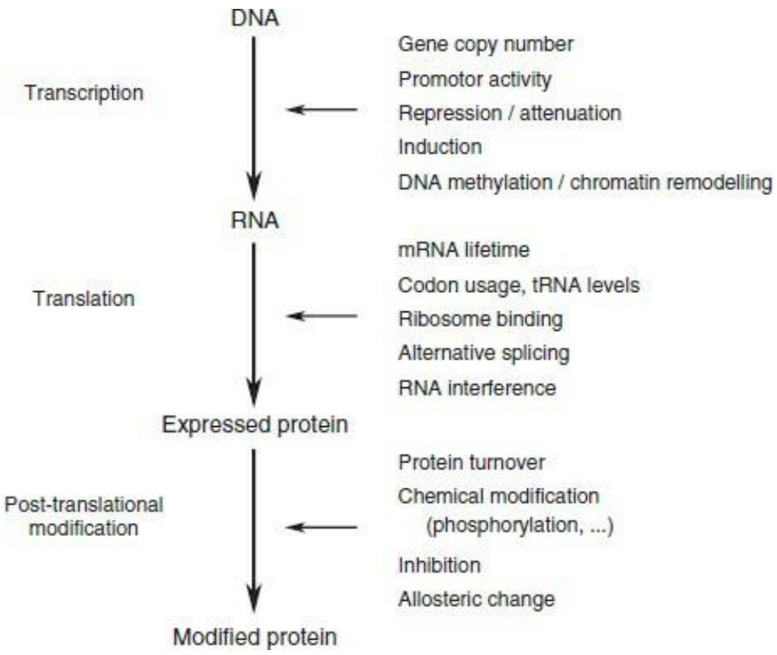

<details>
<summary>flowchart</summary>

```mermaid
graph TD
  A["DNA"] --> B["RNA"]
  B --> C["Expressed protein"]
  C --> D["Modified protein"]
  
  subgraph Transcription ["Transcription"]
    direction TB
    E["Gene copy number\nPromotor activity\nRepression / attenuation\nInduction\nDNA methylation / chromatin remodelling"]
  end
  
  subgraph Translation ["Translation"]
    direction TB
    F["mRNA lifetime\nCodon usage, tRNA levels\nRibosome binding\nAlternative splicing\nRNA interference"]
  end
  
  subgraph Post_translational_modification_Post_translational_modification["Post-translational modification [\"Post-translational modification\"]"]
    direction TB
    G["Protein turnover\nChemical modification (phosphorylation, ...)\nInhibition\nAllosteric change"]
  end
  
  A -.-> E
  A -.-> F
  A -.-> G
```
</details>

Figure 8.6 There are many mechanisms and types of target for regulation of enzyme activity. These include control over expression patterns, and control over the structures and activities of proteins in the cell. For instance, allosteric changes are ligand-induced conformational changes in proteins that modify activity, often leading to cooperative binding curves, as in haemoglobin.

## Structural mechanisms of evolution of altered or novel protein functions

Mechanisms of protein evolution that produce altered or novel functions include divergence, recruitment, and ‘mixing and matching’ of domains.

## Divergence

In families of closely related proteins, mutations usually conserve function but modulate specificity. We have seen several examples: the trypsin family of serine proteinases contains a specificity pocket, a surface cleft complementary in shape and charge distribution to the sidechain adjacent to the scissile bond. Mutations tend to leave the backbone conformation of the pocket unchanged but to affect the shape and charge of its lining, altering the specificity.

Malate and lactate dehydrogenases are related enzymes that catalyse similar reactions. They arose by gene duplication at an early stage of the history of life, and their sequences have diverged. (In an optimal alignment, human malate and lactate dehydrogenases have ≈20% identical residues.) Nevertheless, site-directed mutagenesis showed that a single residue change (Gln → Arg) could change the specificity of Bacillus stearothermophilus lactate dehydrogenase to malate. (Reports of that work may have been read by a trichomonad, which developed a malate dehydrogenase that, in an evolutionary tree of these enzymes, is much more similar to lactate dehydrogenases than to other malate dehydrogenases.) Indeed, it is arguable that the relationship between malate and lactate dehydrogenases is really more a change in specificity than a change in the reaction. But they do have different EC classifications.

Such families of enzymes illustrate the kinds of structural features that change, and those that stay the same. In some cases, the catalytic atoms occupy the same positions in molecular space, although the residues that present them are located at different points in the fold. In other cases the positions in

359

---

space of the catalytic residues are conserved even though the identities and functions of the catalytic residues vary. In these cases, there appears to be a set of conserved functional positions within the space of the molecule.

As evolution ventures farther afield, several enzyme families show an even greater degree of divergence. The apurinic/apyrimidinic endonuclease superfamily, a large diverse group of phosphoesterases, includes members that cleave DNA and RNA, and lipid phosphatases. Even catalytic residues vary between different subfamilies of this group. For example, a His essential for function of DNA repair enzyme DNaseI is not conserved in exonuclease III.

Conversely, many functions are provided by unrelated proteins. Chymotrypsin and subtilisin have produced the same catalytic mechanism for proteolysis by convergent evolution (Figure 8.7).

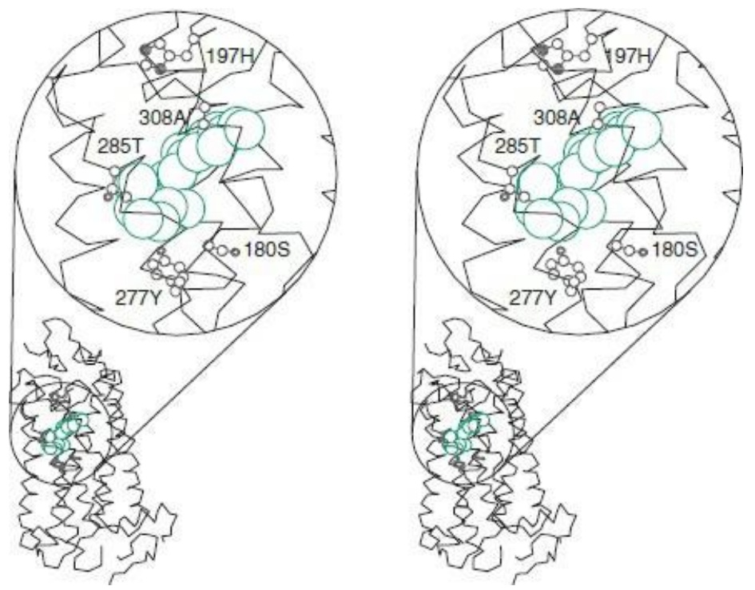

<details>
<summary>chemical</summary>

Molecular structure diagrams showing protein domains with labeled residues (197H, 308A, 285T, 277Y) and side chains (180S)
</details>

Figure 8.7 (a) Chymotrypsin and (b) subtilisin, two proteinases that even share a common Ser-His-Asp catalytic triad (green), are not homologous, and show entirely different folding patterns. The Ser-His-Asp triad appears also in other proteins, including lipases and a natural catalytic antibody.

## Recruitment

Many people ask how much a protein must change its sequence before its function changes. The answer is: not at all! There are numerous examples of proteins with multiple functions.

1. Eye lens proteins in the duck are identical in sequence to active lactate dehydrogenase and enolase in other tissues, although they do not encounter the substrates in the eye. They have been recruited to provide a structural and optical function. Several other avian eye lens proteins are identical or similar to enzymes. In some cases residues essential for catalysis have mutated, proving that the function of these proteins in the eye is not enzymatic. In those species, the coexistence of mutated, inactive, enzymes in the eye and active enzymes in other tissues implies that the gene must have been duplicated.
2. Some proteins interact with different partners to produce oligomers with different functions. In E. coli, a protein that functions on its own as lipoate dehydrogenase is also an essential subunit of pyruvate dehydrogenase, 2-oxoglutarate dehydrogenase, and the glycine cleavage complex.
3. Proteinase Do functions as a chaperone at low temperatures and as a proteinase at high temperatures. The logic, apparently, is that under conditions of moderate stress it attempts to salvage misfolded proteins; under conditions of higher stress it gives up and recycles them.

360

---

4. The activity of phosphoglucose isomerase (= neuroleukin = autocrine motility factor = differentiation and maturation mediator) depends on location. This protein functions as a glycolytic enzyme in the cytoplasm, but as a nerve growth factor and cytokine outside the cell.

Divergence and recruitment are at the ends of a broad spectrum of changes in sequence and function. Aside from cases of ‘pure’ recruitment such as the duck eye lens proteins or phosphoglucose isomerase, in which a protein adopts a new function with no sequence change at all, there are examples on the one hand of relatively small sequence changes correlated with very small function changes (which most people would think of as relatively pure divergence), relatively small sequence changes with quite large changes in function (which most people would think of as recruitment), but also many cases in which there are large changes in both sequence and function.

## ‘Mixing and matching’ of domains

There are many dehydrogenases, which catalyse a large number of reactions. Many of these are coupled to reduction of NAD+ or NADP + . Many are multidomain proteins (some multimeric as well) that contain a common NAD-binding domain, with a range of partner catalytic domains from at least a dozen different families, that vary with the reaction catalysed.

Many other examples are known, in which a change in partners, or even a change in order along the polypeptide chain, can create, ablate, or modify catalytic activity. It appears much easier for protein evolution to adapt existing structures to new functions than to create a new folding pattern. Domain recombination offers great opportunities for evolution of novel functions.

Domain recombination can modify catalytic function. In addition, the evolution of many enzymes involves accreting domains, or forming multimers, for regulation of activity. Most allosteric enzymes, and also haemoglobin, are multidomain proteins or multimers that achieve control through coupled changes in tertiary and quaternary structure. It is quite common for an enzyme to appear in fairly simple form in prokaryotes, and in more complex form in eukaryotes, with the addition of domains involved in regulation of activity.

## Protein evolution at the level of domain assembly

Comparisons of protein sequences and structures confirm that the domain is an important unit of protein evolution. Domains appear in different proteins in different combinations. Thereby, from a relatively small roster of domain families, evolution can assemble a large number of complete proteins.

Many large proteins contain tandem assemblies of domains which appear in different contexts and orders in different proteins (see Fig. 8.8).

361

---

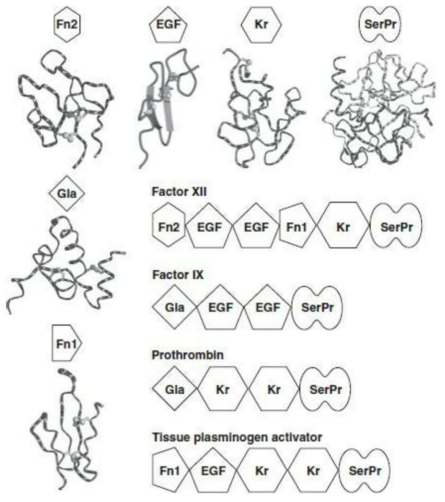

<details>
<summary>chemical</summary>

Molecular structures and functional groups of protein domains including Fn2, EGF, Kr, SerPr, Gla, Factor XII, Factor IX, Prothrombin, and Tissue plasminogen activator
</details>

Figure 8.8 Several proteins involved in the blood coagulation cascade show structures that share modules or domains. The composition and order of the modules is not preserved. Each module is a relatively small compact unit it its own right. The serine proteinases (SerPr) contain two halves with structural similarities, which arose by gene duplication and divergence, but which are never seen separately.

Censuses of genomes suggest that many proteins are multimodular. Of 4401 genes in E. coli, 287 correspond to proteins containing two, three, or four modules. The structural patterns of 510 E. coli enzymes involved in metabolism of small molecules can be accounted for in total or in part by 213 families of domains. Of the 399 that can be entirely divided into known domains, 68% are singledomain proteins, 24% contain two domains, and 7% three domains. Only four of the 399 have four, five, or six domains. There are marked preferences for pairing of different families of domains.

Multidomain proteins present particular problems for assignment of function in genome annotation, because the domains may possess independent functions, modulate one another's function, or act in concert to provide a single function that may depend on the domain composition and even order. On the other hand, in some cases the presence of a particular domain or combination of domains is associated with a specific function. For example, NAD-binding domains appear almost exclusively in dehydrogenases.

Based on known protein structures it has been possible to define ≈1000 domain superfamilies. Of the ≈21 000 human genes, almost two-thirds contain known domains. The ≈1000 domain superfamilies account for ≈30 000 matches in the human genes.

The population of domains encoded by known genes is unevenly distributed. Nine domain superfamilies account for 20% of the matched domains in human genes. These include those in Table 8.4.

Table 8.4 Most common domains assignable to human proteins

| Domain | Number of matches in human genome |
| --- | --- |
| CH2 and C2HC zinc fingers | 3693 |

362

---

| Immunoglobulin | 1778 |
| --- | --- |
| P-loop nucleoside triphosphate hydrolase | 1024 |
| G-protein-coupled receptors: family A | 824 |
| Fibronectin type III | 802 |
| EGF/laminin | 697 |
| Cadherins | 686 |
| Protein kinases | 539 |
| PH domains | 491 |

From Chothia, C. and Gough, J. (2009). Genomic and structural aspects of protein evolution. Biochem. J., 419, 15–28.


## See Weblem 8.8

Similar results apply to other eukaryotic genomes—fugu fish, D. melanogaster, and C. elegans— although the rank order is not the same.

The distribution of domains depends on the functional class of the protein. The number of proteins in a given functional class scales exponentially with the size of the genome:

<div class="docvortex-algorithm" style="white-space: pre-wrap; font-family:monospace;">
Number of proteins involved in transcription regulation=constant×genome size $^{1.9}$ 
Number of proteins involved in protein biosynthesis=constant×genome size $^{0.13}$
</div>

Our discussion so far has primarily treated the functions of individual proteins. Let us now turn to assembly of these functions into networks.

## Databases of metabolic pathways

The full panoply of metabolic reactions forms a complex network. The structure of the network corresponds to a graph in which metabolites are the nodes, and the substrate and product of each reaction form an edge. The dynamics of the network depend on the flow capacities of the individual links, analogous to traffic patterns on the streets of a city.

Some patterns within the metabolic network are linear pathways. Others form closed loops, such as the Krebs (tricarboxylic acid) cycle. Many pathways are highly branched and interlock densely. However, metabolic networks also contain recognizable clusters or blocks; for instance, catabolic and anabolic reactions form clustered subnetworks. There is a relatively high density of internal connections within clusters and relatively few connections between them.

Several databases contain information on metabolic pathways in different organisms. They organize this information, collecting it within a coherent and logical structure, with links to other databases that provide different data selections and different modes of organization. EcoCyc treats E. coli. It is the model for—and linked with—numerous parallel databases, with uniform web interfaces, treating other organisms. BioCyc is the ‘umbrella’ collection. KEGG, the Kyoto Encyclopedia of Genes and Genomes, contains information from multiple organisms.

| Database | Home page |
| --- | --- |
| EcoCyc | http://ecocyc.org |
| BioCyc | http://www.biocyc.org |
| KEGG | http://www.genome.jp/kegg/ |
| Plant metabolic pathway database | http://www.plantcyc.org |

363

---

## EcoCyc

EcoCyc is a database representing what we know about the biology of E. coli strain K-12 MG1655. It contains:

• the genome: the complete sequence, and for each gene its position, and function if known;
transcription regulation: operons, promoters, and transcription factors and their binding sites;
• metabolism: the pathways, including details of the enzymology of individual steps; for each enzyme it gives the reaction, activators, inhibitors, and subunit structure;
• membrane transporters: transport proteins and their cargo;
• links to other databases: of protein and nucleic acid sequence data, literature references, and comparisons of different E. coli strains.

A tiny subset of the E. coli metabolic network is the pathway for synthesis of methionine from aspartate (see Box 8.2).

## The Kyoto Encyclopedia of Genes and Genomes

The Kyoto Encyclopedia of Genes and Genomes (KEGG) collects individual genomes and gene products and their functions, but its special strengths lie in its integration of biochemical and genetic

Box 8.2 Methionine synthesis in E.coli

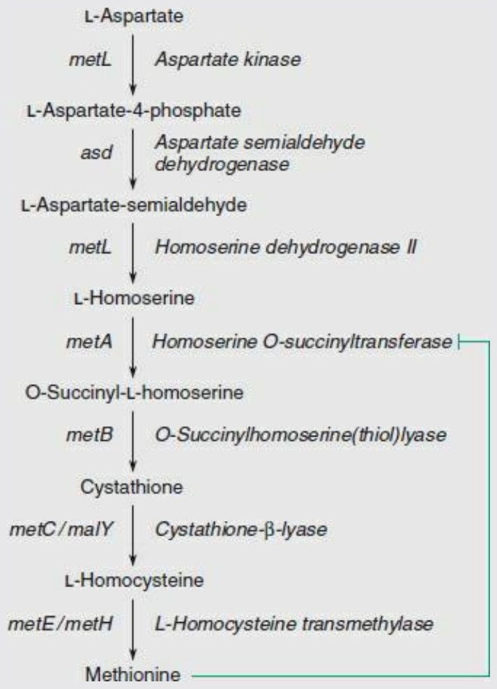

<details>
<summary>flowchart</summary>

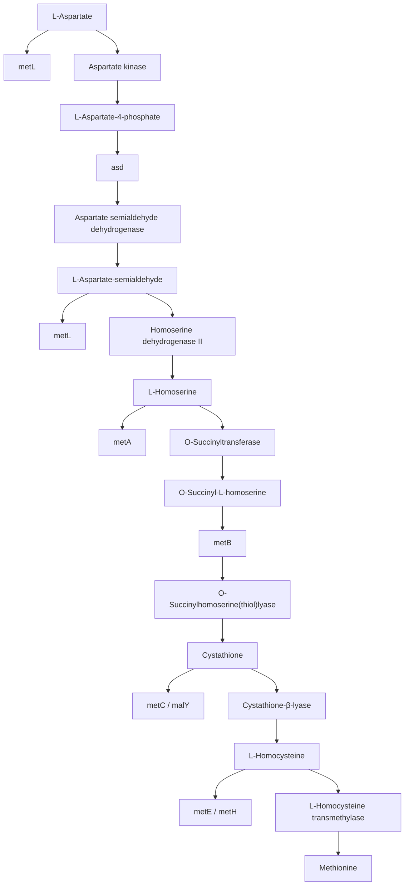
</details>

The diagram shows the seven-step synthesis of methionine from L-aspartate. Methionine inhibits homoserine Osuccinyltransferase, a classic example of feedback control. Both the reaction sequence, and the associated control mechanisms, are embedded in much larger networks.

364

---

The first step, phosphorylation of L- aspartate, is common to the biosynthesis of methionine, lysine, and threonine. E. coli contains three aspartate kinases, encoded by three separate genes, each specific for one of the end-product amino acids. They catalyse the same reaction, but are subject to separate regulation.
The third step, conversion of L-aspartate-semialdehyde to L-homoserine, is common to the methionine and threonine synthesis pathways. Two homoserine dehydrogenases are separately encoded. Regulation of expression of the aspartate kinases and homoserine dehydrogenases suffices to control all three pathways.
After synthesis, methionine is converted to S-adenosyl-methionine, a common participant in methyl group transfers. S-Adenosyl-methionine activates the met repressor. In classic feedback inhibition, a product interacts directly with an enzyme that produces one of its precursors. This is a more complicated form of feedback: the product interacts with a repressor, which reduces the expression—not the activity—of enzymes that produce its precursors.

In the EcoCyc web page that contains the information corresponding to this diagram, the items are active. Links to other internal pages expand information about metabolites, cofactors, enzymes, genes, and regulators. It is possible to ‘zoom’ in or out by controlling the level of detail. For instance, asking for less detail than the contents of the preceding diagram would first eliminate the information about the genes and enzymes, then reduce the pathway to an outline showing only critical intermediates:

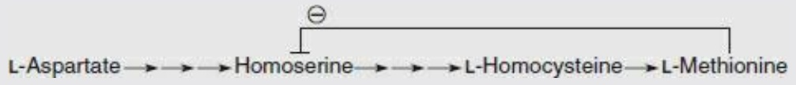

<details>
<summary>flowchart</summary>

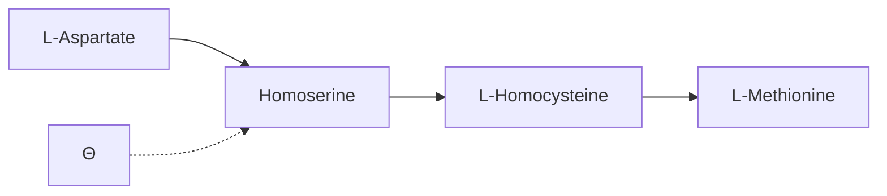
</details>

It is also possible to explore in other dimensions. The methionine synthesis pathway is embedded in larger networks. One of these involves synthesis of amino acids lysine and threonine in addition to methionine, all starting with aspartate (see Figure 8.9).

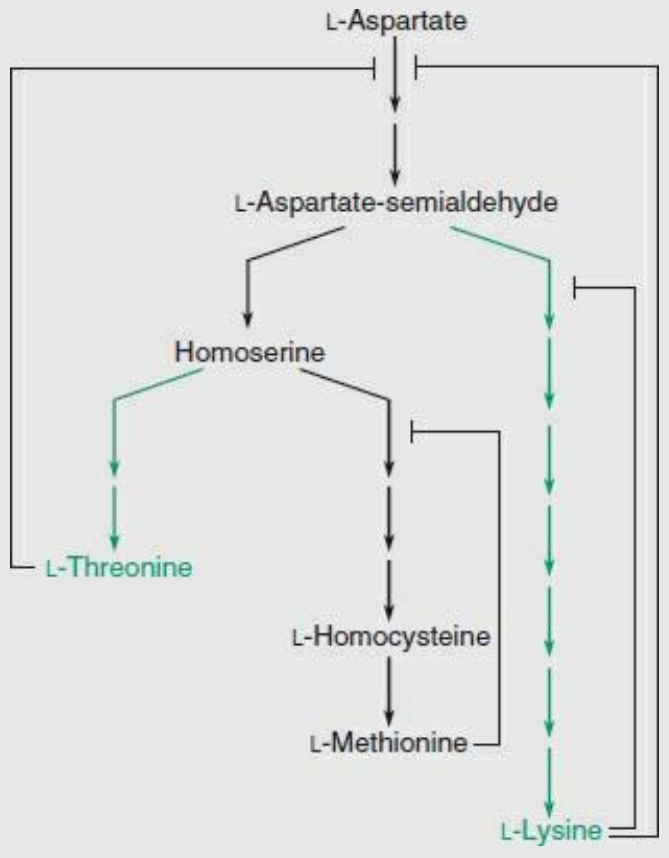

<details>
<summary>flowchart</summary>

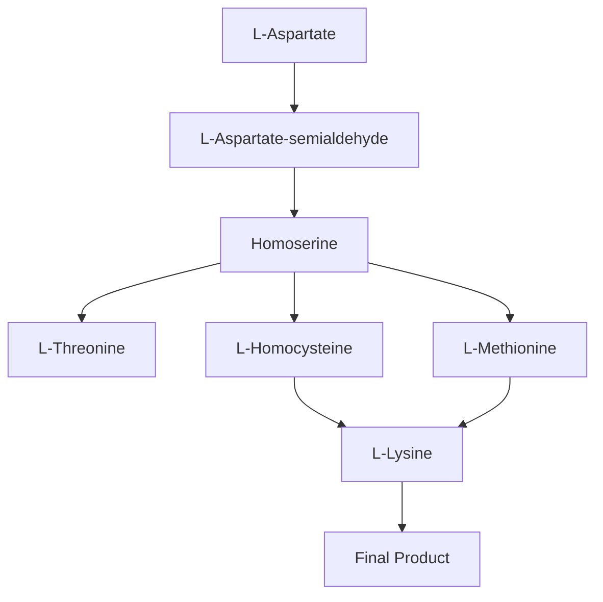
</details>

Figure 8.9 The pathway of amino acid biosynthesis from asparate branches after asparate semialdehyde. In this figure, the black sequence corresponds to the previous example, and the green pathways are the immediate context. The aspartate → methionine sequence is a subnetwork of the network shown here. Each amino acid plays a regulatory role, exerting feedback inhibition over its own synthesis, without affecting the others. It looks as if threonine and lysine both individually inhibit the first step of the synthesis of all three products, but this step is catalysed by three separate aspartate kinases, allowing specialized regulation.


## See Weblems 8.9, 8.10, and 8.11

Readers are urged to explore the EcoCyc website on their own, deliberately or serendipitiously, or guided by weblems in this chapter.

365

---

#

See Weblems 8.12 and 8.13

information. KEGG focuses on interactions: molecular assemblies, and metabolic and regulatory networks. It has been developed under the direction of M. Kanehisa. Figure 8.10 shows a pathway from KEGG, the reductive carboxylate cycle in photosynthetic bacteria. (This pathway is basically the Krebs cycle, running backwards.)

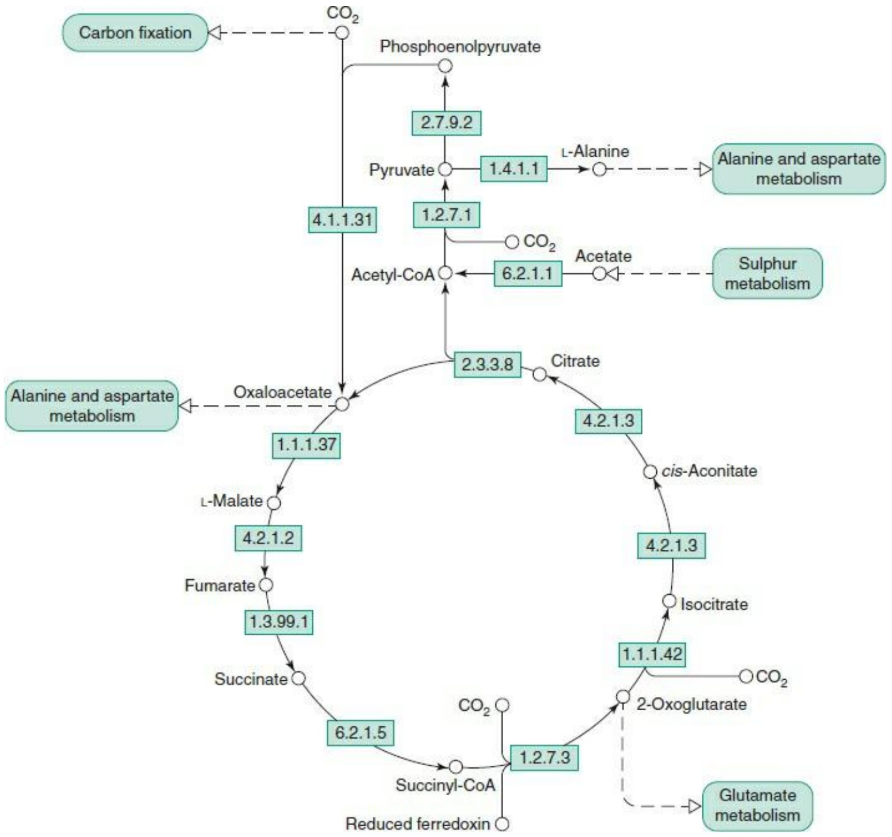

<details>
<summary>flowchart</summary>

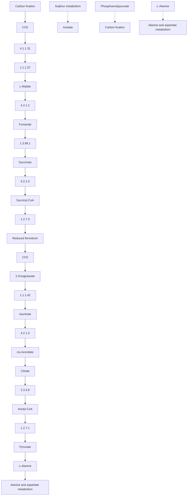
</details>

Figure 8.10 Metabolic pathway map from the Kyoto Encyclopedia of Genes and Genomes (KEGG). This figure shows the reductive carboxylate cycle, and its links to other metabolic processes. The numbers in square boxes are EC numbers identifying the reactions at each step.


## See Weblem 8.14

KEGG organizes five types of data into a comprehensive system:

1. catalogues of chemical compounds in living cells;
2. gene catalogues;
3. genome maps;
4. pathway maps;
5. orthologue tables.

366

---

The catalogues of chemical compounds and genes—items 1 and 2—contain information about particular molecules or sequences. Item 3, genome maps, integrates the genes themselves according to their appearance on chromosomes. In some cases knowing that a gene appears in an operon can provide clues to its function.

Item 4, the pathway maps, describe potential networks of molecular activities, both metabolic and regulatory. A metabolic pathway in KEGG is an idealization corresponding to a large number of possible metabolic cascades. It can generate a real metabolic pathway of a particular organism by matching the proteins of that organism to enzymes within the reference pathways.

One enzyme in one organism would be referred to in KEGG in its orthologue tables, item 5, which link the enzyme to related ones in other organisms. This permits analysis of relationships between the metabolic pathways of different organisms.

KEGG derives its power from the very dense network of links among these categories of information, and additional links to many other databases to which the system maintains access. Two examples of the kinds of question that can be treated by KEGG are given here.

1. It has been suggested that simple metabolic pathways evolve into more complex ones by gene duplication and subsequent divergence. Searching the pathway catalogue for sets of enzymes that share a folding pattern will reveal clusters of linked paralogues.
2. KEGG can take the set of enzymes from some organism and check whether they can be integrated into known metabolic pathways. A gap in a pathway suggests a missing enzyme or an unexpected alternative pathway. The archaeal shikimate kinase, not homologous to its bacterial counterparts, is an example. (See next section.)

## Evolution and phylogeny of metabolic pathways

Most organisms share many common metabolic pathways. But there are many individual variations.

## Pathway comparison

Of particular interest for comparative genomics are facilities to compare pathways among different organisms. Alignment and comparison of pathways can expose how pathways have diverged between species. Even if the pathways are the same, in some cases the enzymes are nonhomologous.

Pathway comparison can be useful for annotation of genomes. It is often possible to assign function to proteins on the basis of similarity to sequences of proteins of known function in other organisms. However, sometimes there are several weak similarities to other proteins and it is unclear which is the true homologue. Conversely, sometimes an organism has a metabolic pathway but no annotated enzyme for an essential step. Confronting the unannotated proteins with the unassigned functions can sometimes identify the protein that fills the gap in the pathway.

If an enzyme needed for a pathway cannot be identified even by weak sequence similarity, it may be that the organism has evolved a nonhomologous enzyme for the task. For example, the archaeon M. jannaschii has a pathway for biosynthesis of chorismate from 4-dehydroquinate. Enzymes for most of the steps have homologues in bacteria and/or eukaryotes. However, shikimate kinase was not identifiable from sequence similarity. Because the metabolic pathway is not interrupted, M. jannaschii must have some protein with this function. How can it be found?

Although in bacteria, genes consecutive in pathways are often consecutive in operons in the genome, this is not true of M. jannaschii. However, the genes for successive steps of the chorismate

367

---

biosynthesis pathway are clustered and consecutive in another archaeon, Aeropyrum pernix. It was possible to propose a gene for a shikimate kinase in A. pernix, and to identify a homologue of that gene in M. jannaschii.

Experiment confirmed the prediction that the M. jannaschii gene so identified (MJ1440) encodes a shikimate kinase. It has no sequence similarity to bacterial or eukaryotic shikimate kinases. A protein from a different family has been recruited for the archaeal pathway. (For more details, see Introduction to Genomics, pp. 378–379; Lesk, 2011.)


## See Weblem 8.15

In some cases, a particular species or strain may show a variant metabolic pathway. For instance, the normal Krebs cycle, memorized by generations of biochemistry students, includes the conversion of 2-oxoglutarate (aka α-ketoglutarate) to succinyl-CoA. Cyanobacteria, however, lack the enzyme 2-oxoglutarate dehydrogenase. Instead, they convert 2-oxoglutarate to succinate via succinic semialdehyde (Fig. 8.11).

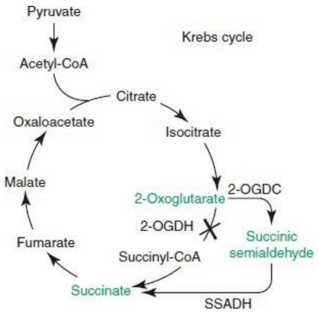

<details>
<summary>flowchart</summary>

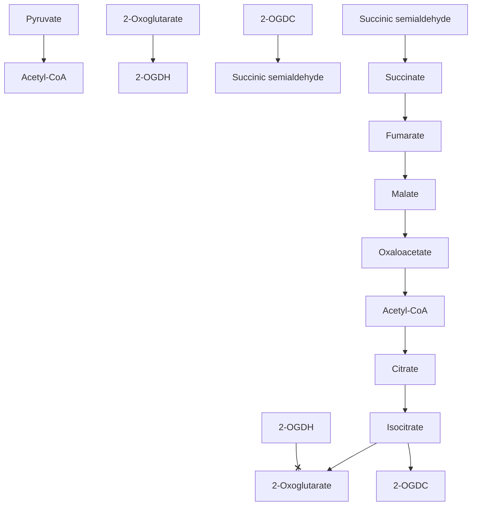
</details>

Figure 8.11 Cyanobacterial succinic semialdehyde shunt. 2-OGDH, 2-Oxoglutarate dehydrogenase; 2-OGDC, 2- oxoglutarate decarboxylase; SSADH, succinic semialdehyde dehydrogenase.

From Zhang, S. and Bryant, D.A. (2011). The tricarboxylic acid cycle in cyanobacteria. Science, 334, 1551–1553.

The cyanobacterial Krebs cycle is, after all, a relatively minor variation on a very common theme. In more extreme cases, organisms have metabolic competence that is completely absent from others. We expect plants but not humans to have enzymes for reactions involved in photosynthesis and cellwall formation.

Some organisms achieve the same overall metabolic transformation but use alternative pathways; that is, different sets of intermediates. For instance, classical glycolysis (the Embden–Meyerhof pathway) and the Entner–Doudoroff pathway are alternative routes from glucose to pyruvate (Fig. 8.12). Often, organisms will share many steps in a metabolic transformation but some will extend or truncate the pathway. Many parasites have dispensed with substantial biosynthetic competence.

368

---


Figure 8.12 (a) Embden–Meyerhof glycolytic pathway. (b) Entner–Doudoroff pathway. Note that the enzymatic conversion of glyceraldehyde-3-phosphate to pyruvate is the same in both pathways (green branch).

Using the representations of metabolic networks of different species as graphs, we can compare the graphs to get a quantitative measure of the divergence (see Box 8.3). Intuitively, we expect that the divergence in metabolic network should correspond to the divergence between species as measured from comparing genome sequences.


## See Weblem 8.16

## Box 8.3 Carbohydrate metabolism in archaea

The common pathway from glucose to pyruvate in bacteria and eukaryotes is the Embden–Meyerhof glycolytic route (see Fig. 8.12). B. Siebers and P. Schönheit have studied the metabolic pathways of carbohydrate metabolism in archaea. In the initial conversion of glucose to pyruvate they observed a number of differences in the pathway, from either the standard Embden–Meyerhof glycolytic pathway or the Entner–Doudoroff alternative.

Sulfolobus solfataricus and Haloarcula marismortui use a modified Entner–Doudoroff pathway (Fig. 8.13). Pyrococcus furiosus, Thermococcus celer, Archaeoglobus fulgidus strain 7324, Desulfurococcus amylolyticus, and Pyrobaculum aerophilum use a modified Embden–Meyerhof pathway (Fig. 8.14). Thermoproteus tenax uses both.

369

---


<details>
<summary>flowchart</summary>

This image displays a complex metabolic pathway diagram representing the conversion of glucose into various metabolites (ADP, ATP, H2O, Pyruvate, GA, Glycerate) and their subsequent metabolites.
</details>

Figure 8.13 Modifications of the Entner–Doudoroff (ED) pathway in archaea. (a) The nonphosphorylative ED pathway in Thermoplasma acidophilum. (b) The semiphosphorylative ED pathway in halophilic archaea. A branched ED, combining (a) and (b), appears in S. solfataricus and T. tenax. 1.3-BPG, 1,3-bisphosphoglycerate; $\mathrm { F d } _ { \mathrm { o x } }$ and $\mathrm { F d } _ { \mathrm { r e d } } ,$ , oxidized and reduced ferredoxin; GA, glyceraldehyde; GAP, glyceraldehyde-3 phosphate; KDG, 2-keto-3-deoxy-gluconate; KDPG, 2-keto-3-deoxy-6-phosphogluconate; PEP, phosphoenolpyruvate; 2-PG, 2- phosphoglycerate; 3-PG, 3-phosphoglycerate. Enzymes are numbered as follows: 1, glucose dehydrogenase; 2, gluconate dehydratase; 3, KD(P)G aldolase; 4, glyceraldehyde dehydrogenase (proposed for T. acidophilum), glyceraldehyde:ferredoxin oxidoreductase (proposed for T. tenax), or glyceraldehyde oxidoreductase (proposed for Sulfolobus acidocaldarius); 5, glycerate kinase; 6, enolase; 7, pyruvate kinase; 8, KDG kinase; 9, GAPDH; 10, phosphoglycerate kinase; 11, GAPN; 12, phosphoglycerate mutase.

From Siebers, B. and Schönheit, P. (2005). Unusual pathways and enzymes of central carbohydrate metabolism in Archaea. Curr. Opin. Microbiol., 8, 695–705.

370

---


<details>
<summary>flowchart</summary>

This flowchart illustrates the metabolic pathway of glucose in various gut microbiota species (Pyrococcus, Desulfurococcus, Pyrobaculum, and Thermoproteus), showing enzymatic reactions between enzymes like GLK, PGI, PFK, FBA, TIM, GAPOR, GAPN, PGM, Enolase, PK, and their interactions with metabolites such as G-6-P, F-6-P, F-1,6-BP, DHAP, 3-PG, 2-PG, PEG, and Pyruvate.
</details>

Figure 8.14 Modifications of the Embden–Meyerhof pathway in archaea. In this case most of the reactions are the same as in the unmodified pathway. The enzymes are not homologous to those that catalyse the corresponding reactions in bacteria and eukarya. Note the differences in cofactors. aFBA, archaeal class I FBA; cPGI, cupin PGI; DHAP, dihydroxyacetone phosphate; FBA, fructose-1,6-bisphosphatae aldolase; F-1,6-BP, fructose-1,6-bisphosphate; $\mathrm { F d } _ { \mathrm { o x } }$ and $\mathrm { F d } _ { \mathrm { r e d } ; }$ oxidized and reduced ferredoxin; F-6-P, fructose-6-phosphate; GAP, glyceraldehyde-3-phosphate; GAPN, nonphosphorylative glyceraldehyde-3-phosphate dehydrogenase; GAPOR, glyceraldehyde-3-phosphate-ferredoxin oxidoreductase; GLK, glucokinase (ADP- or ATP-dependent); G-6-P, glucose-6-phosphate; PEP, phosphoenolpyruvate; PFK, 6-phosphofructokinase; 2-PG, 2-phosphoglycerate; 3- PG, 3-phosphoglycerate; PGI/PMI, bifunctional phosphoglucose/phosphomannose isomerase); PGI, phosphoglucose isomerase; PGM, phosphoglycerate mutase; PK, pyruvate kinase; TIM, triosephosphate isomerase.

From Siebers, B. and Schönheit, P. (2005). Unusual pathways and enzymes of central carbohydrate metabolism in Archaea. Curr. Opin. Microbiol., 8, 695–705.

In addition to the differences in the sequence of metabolites—that is, in the pathway—the enzymes that catalyse even the same reactions are almost always not homologues of bacterial or eukaryotic ones. (The M. jannaschii shikimate kinase is an example of this.) Many of them use different cofactors. Bacterial and eukaryotic phosphofructokinases (that convert fructose-6-phosphate to fructose-1,6-bisphosphate) use ATP as the phosphoryl donor. The archaeal enzymes that catalyse this reaction can use ATP, ADP, or even inorganic pyrophosphate. In addition, some of the familiar enzymes are under allosteric control. The control relationships are also not retained in the corresponding archaeal enzymes.

## Alignment of metabolic pathways

Metabolic pathways provide interesting examples of the generalization of ideas of alignment from sequences to more general networks.

Alignment of two or more character strings is the assignment of correspondences between

371

---

positions in the strings, usually preserving the relative order. The constraint that relative order must be conserved means that:


is an allowable alignment, but


is not. The concept of alignment, including the relative-order constraint, carries over fairly directly to protein structures, because of the linear chemistry of the polypeptide chain: a structural alignment is still a correspondence between the amino acid sequences, despite an appeal to three-dimensional data to determine it. (An exception would be the case of two multidomain proteins composed of homologous domains in different order.)

However, many objects of interest in bioinformatics have a fundamentally nonlinear structure. These include the most general networks, such as sets of regulatory interactions among transcription factors. How does the concept of alignment generalize?

Metabolic pathways are an interesting example. Some present themselves as linear sequences, others are higher-dimensional.

The alignments discussed deal with a static and nonquantitative picture of metabolic networks. Either a transformation is possible, or it is not. It is entirely possible that enzymes that catalyse corresponding steps in the networks have very different kinetic constants in two species, or are subject to different kinds of regulation. In this case the dynamic patterns of traffic through the networks might be quite different, even if the topologies of the networks are the same. (That is, the graphs are isomorphic.) Think of the difference in traffic flow through a city during rush hour and at midnight. The roads haven't changed, but the kinetics has.

## Comparing linear metabolic pathways

Many linear metabolic pathways are extractable from general metabolic networks. In principle, alignment of linear metabolic pathways is directly analogous to alignment of any other sequences. The extension to alignment of nonlinear metabolic pathways takes us out of our comfort zone.

How we characterize steps in metabolic pathways depends on the kinds of questions we want to explore. In its simplest form, a metabolic pathway is a sequence of metabolites. Associated with each step, in each organism, is an enzyme. Associated with each enzyme is a gene. In some cases, for example the tryptophan synthesis pathway in E. coli, the genes for successive steps of the pathway are collinear in the genome with the steps of the pathway (see Fig. 2.1). Alignment methods can detect this.

In studies of evolution of metabolic pathways it also is useful to associate cofactors with reactions. Well known to biochemistry students is the succinyl-CoA synthetase reaction, converting succinyl-CoA to succinate in the Krebs cycle. The reaction is coupled to phosphorylation of GDP in mammals and ADP in bacteria and plants.

Some differences in pathways between organisms are common knowledge. A vitamin is by definition not the product of a metabolic pathway. Humans and other primates require a diet containing vitamin C because we cannot synthesize it. Most animals can synthesize vitamin C. All

372

---

those animals that cannot do so lack the enzyme L-gulano-γ-lactone oxidase, which catalyses the last step in the pathway, the conversion of L-gluonate to vitamin C. From the point of view of alignment of metabolic sequences, the pathway in humans is truncated, relative to that of animals such as the mouse that are competent to synthesize vitamin C. In primates there is a deletion of a large component of the gene for L-gulano-γ-lactone oxidase.


## See Weblem 8.17

Similar considerations apply to catabolic pathways. The end product of purine metabolism—the form in which nitrogen is excreted—differs among animals in different phyla (Fig. 8.15). Organisms with more water available in their immediate surroundings use more of the reactions. Most mammals degrade purines to allantoin, produced from uric acid by urate oxidase. Primates (and dalmatian dogs) lack functional urate oxidase, and consequently excrete its subtrate, uric acid.


<details>
<summary>flowchart</summary>

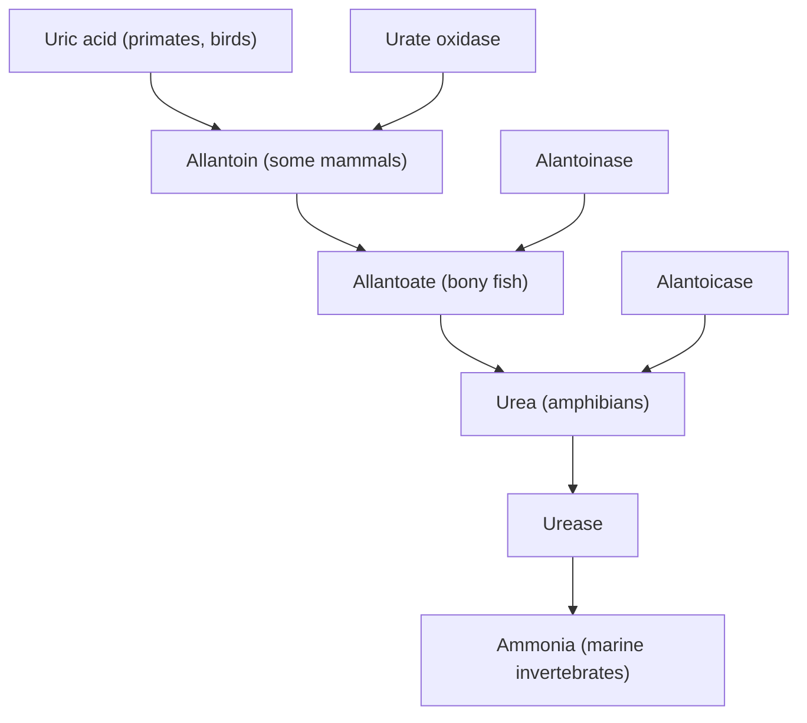
</details>

Figure 8.15 Succession of reactions to produce excreted forms of end products of nitrogen metabolism.

The much lower solubility of uric acid relative to allantoin creates clinical problems in humans including kidney stones and gout. The drug allopurinol inhibits xanthine oxidase, the enzyme that converts hypoxanthine → xanthine → uric acid. The precursors, hypoxanthine and xanthine, are more soluble than uric acid, and are cleared much faster by the kidneys. Moreover, in a mixture of hypoxanthine, xanthine, and uric acid each solute has independent solubility. Therefore formation of a precipitate is less likely from a mixed solution of hypoxanthine, xanthine, and uric acid, than from a solution of the same total concentration of uric acid alone.

The enzyme hypoxanthine-guanine phosphoribosyltransferase (HGPRT) recovers degraded purines for nucleic acid synthesis. It converts hypoxanthine and guanine to AMP and GMP. Absence of HGPRT activity causes a build up of uric acid, associated with Lesch–Nyhan syndrome, an inherited metabolic disease. Gout and kidney stones are common symptoms, together with mental retardation and behavioural syndromes including uncontrollable lip and finger biting. (Lesch–Nyhan syndrome was the first unambiguous correlation of a biochemical defect with a psychological abnormality.)

Comparing nonlinear metabolic pathways: the pentose phosphate pathway and the Calvin–Benson cycle

373

---

The pentose phosphate pathway, and the Calvin–Benson cycle in photosynthesis, are two metabolic pathways involving transformations of sugars.

Metabolism of glucose can proceed through glycolysis and the Krebs cycle, to couple glucose oxidation to production of ATP. The pentose phosphate pathway is an alternative, which produces NADPH and ribose-5-phosphate. A cell that needs reducing power or ribose-5-phosphate for nucleic acid synthesis will divert some of its glucose metabolism through the pentose phosphate pathway. Several intermediates in the pentose phosphate pathway can be shuttled back into glycolysis.

The Calvin–Benson cycle is the route of carbon dioxide fixation in photosynthesis. The enzyme ribulose-1,5-bisphosphate carboxylase (RUBISCO) couples carbon dioxide to ribulose-1,5- bisphosphate to form an intermediate that breaks down spontaneously to two molecules of glyceraldehyde-3-phosphate. Of every six molecules of glyceralde-3-phosphate produced, five are used to reconstitute three molecules of ribulose-1,5-bisphosphate and the sixth is harvested for energy. (Five 3-carbon molecules → three 5-carbon molecules.)

The pentose phosphate pathway and the Calvin–Benson cycle share many intermediates. Several intermediates link each pathway with ‘mainstream’ glycolysis.

A. Sillero, V.A. Selivanov, and M. Cascante presented three-dimensional diagrams of these two metabolic subnetworks, which brings out the similarities more clearly than standard two-dimensional textbook presentations do (see Fig. 8.16).


<details>
<summary>flowchart</summary>

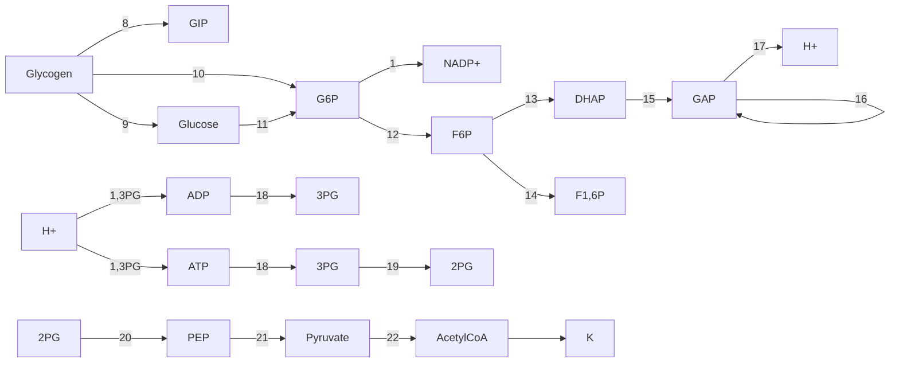
</details>

374

---


<details>
<summary>flowchart</summary>

This diagram illustrates the metabolic pathway of glucose in a starch system, showing how glucose is converted into various metabolites (F6P, E4P, XL5P, RL5P) and their interactions with various metabolites like GAP, DHAP, and 3PG.
</details>

Figure 8.16 (a) The pentose phosphate cycle. (b) The Calvin–Benson cycle. In both panels, numbers in the figure correspond to the following enzymes: 1, glucose-6-P dehydrogenase; 2, gluconolactonase; 3, 6-P-gluconate dehydrogenase; 4, ribulose-5-P 3-epimerase; 5, ribulose-5-P-isomerase; 6, transketolase; 7, transaldolase; 8, enzymes acting in the interconversion between glucose-1-P and glycogen; 9, phosphoglucomutase; 10, glucose-6-phosphatase; 11, hexokinase; 12, phosphoglucose isomerase; 13, 6-phosphofructokinase; 14, fructose-1,6-bisphosphatase; 15, aldolase; 16, triosephosphate isomerase; 17, glyceraldehyde-3-P dehydrogenase; 18, phosphoglycerate kinase; 19, phosphoglycerate mutase; 20, enolase; 21, pyruvate kinase; 22, pyruvate dehydrogenase. K represents the Krebs cycle. In (b), 23, phosphoribulose kinase; 24, RUBISCO; 25, transaldolase; 26, sedoheptulose-1,7-bisphosphatase.

From Sillero, A., Selivanov, V.A., and Cascante, M. (2006). Pentose phosphate and Calvin cycles: similarities and three-dimensional views. Biochem. Mol. Biol. Educ., 34, 275–277.

## Dynamics of metabolic networks

We have discussed metabolic networks as static objects. They differ between species, but for any organism in any particular physiological state at any particular instant, they are fixed. What about the dynamics? What can we say about the traffic patterns in the network? What about the response of the network to changing conditions? Is it robust? If it is, how is this accomplished?

375

---

## Robustness of metabolic networks

In principle, networks can achieve robustness through an extension of the mechanism by which redundancy confers stability. The most direct approach is simple substitutional redundancy: if two proteins are each capable of doing a job, knock out one and the other takes over. In the London Underground, this would correspond to a second line running over the same route. For instance, when the Circle line is not running, passengers travelling between Paddington and King's Cross stations can use the Hammersmith and City line that runs on the same tracks. In yeast, for example, single-gene knockouts of over 80% of the 6200 open reading frames are survivable injuries.

Some duplicated genes contribute to substitutional redundancy. For example, in studying animal models for diabetes it appears that mice and rats (but not humans) have two similar but nonallelic insulin genes. Substitutional redundancy requires equivalence not only of function but of expression levels. In the mouse, knocking out either insulin gene leads to compensatory increased expression of the other, producing a normal phenotype.

Coordinated expression patterns are more probable among duplicated genes than among unrelated ones. For example, E. coli contains two fructose-1,6-bisphosphate aldolases. One, expressed only in the presence of special nutrients, is nonessential under normal growth conditions. However, the other is essential. In this case, functional redundancy does not provide robustness. These two enzymes are probably homologous, but if so they are very distant relatives, not the product of a recent gene duplication. One is a member of a family of fructose-1,6-bisphosphate aldolases typical of bacteria and eukaryotes, whereas the other is a member of another family that occurs in archaea. E. coli is unusual in containing both.

An alternative mechanism of network robustness is distributed redundancy: equivalent effects achieved through different routes. In normal E. coli, approximately two-thirds of the NADPH produced in metabolism arises via the pentose phosphate shunt, which requires the enzyme glucose-6-phosphate dehydrogenase. Knocking out the gene for this enzyme leads to metabolic shifts, after which increased levels of NADH produced by the Krebs cycle are converted to NADPH by a transhydrogenase reaction. The growth rate of the knockout strain is comparable to that of the parent.

## Dynamic modelling of metabolism

Can we model the dynamics of a metabolic network? What would it mean to do so?

A challenge that might—naively—appear relatively simple would be to predict the effect of knocking out an enzyme. An easy guess would be to expect a build up of the substrate of the missing enzyme. However, if the metabolic pathways branch in the vicinity of that metabolite, the consequences of a knockout are more complex. For example, the disease phenylketonuria results most commonly from a specific dysfunctional (i.e. knocked-out) enzyme, phenylalanine hydroxylase. The normal function of phenylalanine hydroxylase is to convert phenylalanine to tyrosine. In phenylketonuria, phenylalanine does indeed build up. However, the excess phenylalanine is converted by phenylalanine transaminase to phenylpyruvic acid:


<details>
<summary>chemical</summary>

Chemical reaction diagram showing the conversion of Phenylalanine to Phenylpyruvic acid via a hydrolysis step
</details>

Both compounds accumulate. As phenylpyruvic acid is less readily absorbed by the kidneys than

376

---

phenylalanine, it is excreted into the urine, giving the disease its name. (Phenylalanine is not a ketone.) The Guthrie test for phenylketonuria measures the concentration of phenylpyruvic acid in the blood of newborns.

A challenge greater than predicting the effect of a single knockout would be to simulate the entire metabolic network—given an initial set of metabolite concentrations—to predict the concentrations as a function of time. The idea would be to combine predictions of the rates of individual reactions, assuming a simple model such as Michaelis–Menten kinetics, or more complex models of allosteric enzymes. This requires knowing accurately the kinetic constants of all of the enzymes, including the consequences of inhibitors and effectors. It requires being able to give a sensible treatment of the idea of ‘substrate concentration’ within a cell divided into compartments and to deal with questions of rates of diffusion in a crowded intercellular environment. Longer-term simulation would require knowing the kinetics of transcription regulation, for which no simple model analogous to the Michaelis–Menten equation is available. There are also serious computational issues involving how precisely the kinetic parameters must be known, and the extent to which simplifying assumptions— for instance, the steady-state approximation—are justified.

Accurate simulation of metabolic patterns of entire cells is a clear target for research in the field. However, it is quite a daunting challenge, and a very long-term goal. The hope is to find pieces of the general problem that are both interesting and tractable. Efforts have included the following.

Attempts at detailed numerical analysis of simple networks. For instance, a simulation of the asparate → threonine pathway (see Fig. 8.9) in E. coli represented the enzymatic transformations and feedback inhibition as a set of coupled equations.<sup>4</sup> Changes in expression pattern were not included. Steady-state solutions were compared with experimental measurements on cell extracts. It was possible to:

• simulate the time course of threonine synthesis and the effects of changes in initial metabolite concentrations;

• predict the steady-state concentrations of intermediates;

predict the effects of changes in concentrations of individual enzymes on overall throughput, expressed as flux control coef icients; such data can help to guide development of microbial factories for increased yield of particular products; (the flux control coefficient is the percentage change in flux divided by the percentage change in amount of enzyme. It is not a property of the enzyme, but a property of a reaction within a metabolic network. A flux control coefficient equal to 1 would correspond to a rate-limiting step);

• for different steps, distinguish whether the substrates and products are approximately at equilibrium.

Focusing not on individual enzymes but on potential sets of flow rates. The metabolic network is represent by a graph. Metabolites are the nodes. Edges correspond to reactions: an edge connects two compounds if there is a reaction, or possibly several reactions, that interconvert them. The goal is to predict the flow rate through each edge. Recently the models have been generalized to include regulation of expression. There are general constraints on the set of flow rates:

• under steady-state conditions the fluxes through each node must add up to 0; i.e. for each compound, the amount that is synthesized or supplied externally must equal the amount used up or secreted;
• flux control coefficients of all of the reactions contributing to a single flux must add up to 1;
• the flux through any edge is limited by the values of the Michaelis–Menten parameter $V _ { \mathrm { m a x } }$ for

377

---

all enzymes contributing to the edge; and

the thermodynamic properties of each reaction determine whether or not the reaction is reversible: this is a property of the substrate and product of the reaction, not of the enzyme; the flux of an irreversible reaction must be greater than or equal to 0.

It will be interesting to see whether the space of possible metabolic states is connected or broken up into separated regimens.

In general, many possible flow patterns, or metabolic states, are consistent with the constraints. To determine a single metabolic state to compare with experiments it is possible to select from the feasible states the one that is optimal for ATP production or for growth rate. A variety of observable quantities are predictable.

• The effects of changes of medium or gene knockouts: which enzymes are essential for growth on different carbon sources?
• What are limiting factors in growth?
• What are maximal theoretical yields of ATP, or assimilation of carbon, etc?
• What are the fluxes through individual pathways? This is difficult but not impossible to measure.
What are the flux control coefficients of different enzymes?
• For optimal growth, how much oxygen and carbon source are taken up?

Such models have been constructed for several organisms, including prokaryotes and eukaryotes. Predictions have generally achieved good agreement with experiments.

## RECOMMENDED READING

- Bashton, M. and Chothia, C. (2007). The generation of new protein functions by the combination of domains. Structure, 15, 85–99.
- Csermely, P., Korcsmáros, T., Kiss, H.J., London, G., and Nussinov, R. (2013). Structure and dynamics of molecular networks: a novel paradigm of drug discovery: a comprehensive review. Pharmacol. Ther., 138, 333–408.
- Kruse K., Chalancon, G., and Babu, M.M. (2012). Metabolic networks and their applications. In: W. Dubitzky, O. Wolkenhauer, K. Cho, and H. Yokota | (eds), Encyclopedia of Systems Biology. Springer Science + Business Media, New York.
- Lacroix, V., Cottret, L., Thébault, P., and Sagot, M.-F. (2008). An introduction to metabolic networks and their structural analysis. IEEE/ACM Trans. Comput. Biol. Bioinform., 5, 594–617.
- Lesk, A.M. (2011). Introduction to Genomics, 2nd edn. Oxford University Press, Oxford.
- Terzer, M., Maynard, N.D, Covert, M.W., and Stelling, J. (2009). Genome-scale metabolic networks. Wiley Interdiscip. Rev. Syst. Biol. Med., 1, 285–297.

## EXERCISES AND PROBLEMS

**Exercise 8.1** On a photocopy of Figure 8.3, mark the following distances: (1) on part (a) of the figure, the free energy difference between reactant and product. (All these distances are purely vertical distances.); (2) on part (b) of the figure, the difference in activation energy of the forward reaction between uncatalysed and enzyme-catalysed reactions.

**Exercise 8.2** The Michaelis–Menten model implies the following relationship between substrate concentration [S] and initial velocity v<sub>0</sub>:

378

---

$$
v _ {0} = \frac {V _ {\text {max}} [ S ]}{K _ {M} + [ S ]}
$$

**Problem 8.1** The network of metabolic pathways must obey constraints of thermodynamics and physical-organic chemistry. E. Meléndez-Hevia and colleagues suggested the principle that metabolic pathways are optimized, subject to the constraints, for the minimum number of steps.

The nonoxidative phase of the pentose phosphate pathway converts six 5-carbon sugars to five 6- carbon sugars:

$$
6 \text { Ribulose - 5 - phosphate } \rightarrow 5 \text { glucose - 6 - phosphate }
$$

A simplified model of a pathway for this conversion is a series of steps, each of which is either:

1. transfer of a 2-carbon unit from one sugar to another (a transketolase reaction), or
2. transfer of a 3-carbon unit from one sugar to another (a transaldolase or aldolase reaction).

Represent each sugar only by a number of carbon atoms. Starting with five 5-carbon sugars, one possible initial step would be a transketolase step converting two 5-carbon sugars to a 3-carbon sugar and a 7-carbon sugar. Assume that all intermediates must have at least three carbon atoms.

Create a tableau with the following initial and final states (an initial transketolase (TK) step is also shown):

<table><tr><td>Step</td><td colspan="6">Number of carbons in sugar molecules</td></tr><tr><td>0</td><td>5</td><td>5</td><td>5</td><td>5</td><td>5</td><td>5</td></tr><tr><td>1</td><td>3</td><td>7</td><td>5</td><td>5</td><td>5</td><td>5</td></tr><tr><td>N</td><td>6</td><td>6</td><td>6</td><td>6</td><td>6</td><td>0</td></tr></table>

Copy and fill in the tableau to find the shortest route from top (step 0, six 5-carbon sugars) to bottom (five 6-carbon sugars). Identify the intermediates created. Compare with the observed metabolic pathway.

**Problem 8.2** (a) Suppose an enzyme with known values of $K _ { \mathrm { M } }$ and $V _ { \mathrm { m a x } }$ irreversibly converts A to B. Write a program that, given initial concentrations of substrate [A] and enzyme and assuming that the initial concentration of $\mathrm { ~ B ~ } = \mathrm { ~ } 0$ , computes and draws a graph of the value of the substrate concentration at subsequent times. (b) Suppose that a second enzyme, also with known values of $K _ { \mathrm { M } }$ and $V _ { \mathrm { m a x } }$ (which need not be the same as those of the first enzyme) irreversibly converts B to C. Write a program that, given initial concentrations of substrate [A] and both enzymes and assuming that the initial concentrations of B and C are 0, computes and draws a graph of the concentrations of A, B, and C as a function of time.

1 Have a look at the sea slug Elysia chlorotica, and even, possibly, the salamander Ambystoma maculatum.
2 Ashburner, M. (2006). Won for All: How the Drosophila Genome Was Sequenced. Cold Spring Harbor aboratory Press, Cold Spring Harbor, NY.

379

---

3 This is indeed colloquial phraseology, but, strictly speaking, one should write: $K _ { D } = \frac { [ P ] [ L ] } { [ P L ] C ^ { \ominus } } = 1 0 - 9$ with $c ^ { \phi } = 1 m o H ^ { - 1 }$ Equilibrium constants must be dimensionless! (If not, how could you take their logs?)
4 Chassagnole, C., Raïs, B., Quentin, E., Fell, D.A., and Mazat, J.P. (2001). An integrated study of threoninepathway enzyme kinetics in Escherichia coli. Biochem. J., 356, 415–423.

380
