# 9 Gene expression and regulation

原始 PDF 第 381–421 页。

9

# Gene expression and regulation

## LEARNING GOALS

• Understanding the goals of proteomics: the measurement of amounts and distributions of proteins within a cell or organism.
• Becoming familiar with the data derivable from microarrays and their application to inferring and interpreting similarities and differences in gene expression patterns. Grasping the relationship between typical ‘raw’ microarray data (see for instance Plate XI) and the gene expression table.

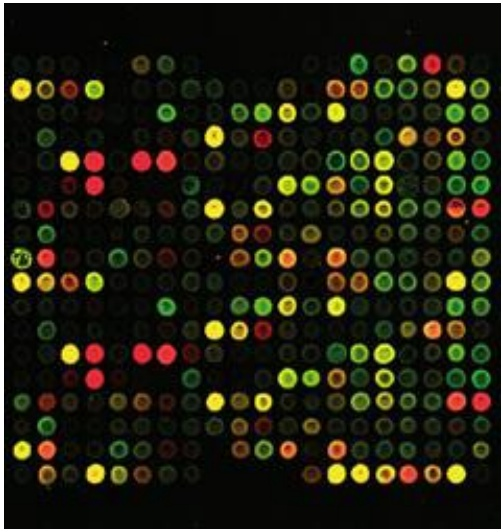

<details>
<summary>bubble</summary>

| Row | Column 1 | Column 2 | Column 3 | Column 4 | Column 5 | Column 6 | Column 7 | Column 8 | Column 9 | Column 10 | Column 11 | Column 12 |
| --- | --- | --- | --- | --- | --- | --- | --- | --- | --- | --- | --- | --- |
| 1 | Yellow | Green | Red | Green | Green | Green | Green | Red | Green | Yellow | Green | Green |
| 2 | Green | Green | Green | Green | Green | Green | Green | Green | Green | Yellow | Green | Green |
| 3 | Green | Green | Green | Green | Green | Green | Green | Green | Green | Yellow | Green | Green |
| 4 | Green | Red | Red | Red | Red | Red | Red | Red | Red | Red | Red | Red |
| 5 | Green | Green | Green | Green | Green | Green | Green | Green | Green | Yellow | Green | Green |
| 6 | Green | Yellow | Red | Red | Red | Red | Red | Red | Red | Red | Red | Red |
| 7 | Green | Green | Green | Green | Green | Green | Green | Green | Green | Yellow | Green | Green |
| 8 | Green | Yellow | Red | Red | Red | Red | Red | Red | Red | Red | Red | Red |
| 9 | Green | Green | Green | Green | Green | Green | Green | Green | Green | Yellow | Green | Green |
</details>

Plate XI Comparison of gene expression patterns in liver (red) and brain (green). The liver RNA is tagged with a red fluorophore, the brain RNA with a green one, then both are exposed to the array. Red spots correspond to genes active in the liver but not in the brain. Green spots correspond to genes active in the brain but not in the liver. Yellow spots correspond to genes active in both brain and liver (See Chapter 9).

Courtesy Dr P.A. Lyons.

Understanding the applications of mass spectrometry to analysis of mixtures of proteins, to partial protein sequencing, and to high-throughput nucleic acid sequencing and searching for variant genetic sequences.
• Understanding the structure and some of the building blocks of regulatory networks.
• Knowing the essential structural features of protein–protein and protein–nucleic acid complexes.
• Recognizing the regulatory networks are ‘reprogrammable’ under changes of physiological state.
• Integrating the logical and physical interactions in the real but relatively simple case of phage λ.

For a cell to be in a healthy state it must control which of its genes are being expressed, and at what levels. The effect of this control is to achieve the proper inventory of proteins and RNA molecules appropriate to the developmental and physiological state of the cell. In our bodies, largely irreversible differentiation events create different tissues. These play different metabolic roles. Differentiation gives cells tissue-specific structures, and also tissue-specific gene expression patterns. Moreover, when environmental conditions change, most cells can change physiological state in response. The diauxic shift in yeast, in switching between aerobic and anaerobic environments, is

381

---

one example. The change requires an altered pattern of gene expression. (This takes a little time, accounting for the lag phase observed by Monod in his original observations of diauxy.) Two relatively simple systems that have been examined in very great detail are the Lac operon in E. coli, and the lytic–lysogenic switch in phage λ. In those two cases we know not only the abstract logic of the system, but the details of how this logic is implemented at the level of atomic-resolution molecular structures.

Nucleotide sequences of genomes give a static picture of an organism's potential. The results of gene expression are the proteins and RNA molecules that underlie cellular activity. Study of patterns of proteins in a cell, as a function of state and conditions, is a mature enterprise, and has produced copious amounts of useful data. These data are interesting in themselves as revealing the state of cellular activity, and also for what they can tell us, albeit indirectly, about how gene expression is being controlled. Of course, the field is moving towards the goal of direct observations of mechanisms of expression control.

Proteomics is the study of the distribution and interactions of proteins in time and space in a cell or organism. High-throughput experimental methods of data analysis, including microarray analysis and mass spectrometry, are giving us a large-scale picture of the protein economy in living things. Some of the interactions are active in control of transcription and translation. These include binding of transcription regulatory proteins to DNA, and interaction of specific RNAs with mRNA, inhibiting translation.

The goal of systems biology is the synthesis of genomic, transcriptomic, proteomic, and other data into an integrated picture of the structure, dynamics, logistics, and ultimately the logic of living things. A systems biologist will combine study of proteins and RNAs, the genes that encode them, the molecules that control their expression or activity once expressed, and the set of other proteins and nucleic acids with which they interact. A systems biologist will assemble into a metabolic network the chemical reactions catalysed by the enzymes of a cell (see Chapter 8), and assemble into control networks the mechanisms that regulate their activities and expression.

Measurement of distributions of proteins in cells is a mature technology, but one that is also in flux. Competing with the classical microarray technique is RNAseq, the high-throughput sequencing of RNAs in a sample.

## DNA microarrays

DNA microarrays analyse the mRNAs in a cell to reveal the expression patterns of proteins; or genomic DNAs, to reveal absent or mutated genes.

1. For an integrated characterization of cellular activity, we want to determine what proteins are present, where, and in what amounts. To determine the expression pattern of a cell's genes, we measure the relative amounts of many different mRNAs. Hybridization is an accurate and sensitive way to detect whether any particular nucleic acid sequence is present. The key to highthroughput analysis is to run many hybridization experiments in parallel.
2. Measuring expression patterns can help to identify genes associated with propensities to diseases. Some diseases, such as cystic fibrosis, arise from mutations in single genes. For these, isolating a region by classical genetic mapping can lead to pinpointing the lesion. Other diseases, such as asthma, depend on interactions among many genes, with environmental factors as complications. To understand the aetiology of multifactorial diseases requires the ability to determine and analyse expression patterns of multiple genes, which may be distributed around

382

---

different chromosomes.

DNA microarrays, or DNA chips, are devices for checking a sample simultaneously for the presence of many sequences.

The basic idea is this: to detect whether one oligonucleotide has a particular known sequence, test whether it can bind to an oligo with the complementary sequence (a ‘one-to-one’ test). To detect the presence or absence of a query oligo in a mixture, spread the mixture out and test each component of the mixture for binding to the oligo complementary to the query (a ‘many-to-one’ test). This is a northern or Southern blot. To detect the presence or absence of many oligonucleotides in a mixture, synthesize a set of oligos, one complementary to each sequence of the query list, and test each component of the mixture for binding to each member of the set of complementary oligos (a ‘manyto-many’ test). Microarrays provide an efficient, high-throughput way of carrying out these tests in parallel.

To achieve parallel hybridization analysis, a large number of DNA oligomers are affixed to known locations on a rigid support, in a regular two-dimensional array. The mixture to be analysed is prepared with fluorescent tags to permit detection of the hybrids. After exposing the array to the mixture, each element of the array to which some component of the mixture has become attached bears the tag. Because we know the sequence of the oligomeric probe in each spot in the array, measurement of the positions of the probes identifies their sequences. This analyses the components present in the sample.

DNA microarrays are distributed on a small wafer of glass or nylon, typically 2 cm square. Oligonucleotides are attached in an array at densities between 10 000 and 250 000 positions per square centimetre. The spot size may be as small as ≈150 µm in diameter. The grid is typically a few centimetres across. A yeast chip contains over 6000 oligonucleotides, covering all known genes of S. cerevisiae. A DNA array, or DNA chip, may contain 400 000 probe oligomers. Note that this is larger than the total number of genes even in higher organisms (excluding immunoglobulin genes).

To analyse a mixture, expose it to the microarray under conditions that promote hybridization, then wash away any loose probe. To compare two sets of oligos, tag the samples with differently coloured fluorophores (Plate XI). Scanning the array collects the data in computer-readable form.

Different types of chip designed for different investigations differ in the types of DNA immobilized. (The immobilized material on the chip is the probe. The sample tested is the target.)

1. In an expression chip, the immobilized oligos are cDNA samples, typically 20–80 bp long, derived from mRNAs of known genes. The target sample might be a mixture of mRNAs from normal or diseased tissue.
2. In genomic hybridization, one looks for gains or losses of genes or changes in copy number. The target sequences, fixed on the chip, are large pieces of genomic DNA, from known chromosomal locations, typically 500–5000 bp long. The probe mixtures contain genomic DNA from normal or disease states. For instance, some types of cancer arise from chromosome deletions, which can be identified by microarrays.
3. In mutation microarray analysis one looks for patterns of SNPs.

## Microarray data are quantitative but imprecise

Microarrays are capable of comparing concentrations of probe oligos. This allows investigation of responses to changed conditions. However, the

383

---

Box 9.1 Microarray databases

Microarrays provide another high-throughput stream of data production in bioinformatics. A standard called MIAME (which stands for Minimum Information About a Microarray Experiment) describes the contents and format of the information to be recorded in the experiment and deposited. Major publicly available microarray databases include the following.

The European Bioinformatics Institute hosts a database, ArrayExpress: [http://www.ebi.ac.uk/arrayexpress/](http://www.ebi.ac.uk/arrayexpress/)

The US NCBI hosts the Gene Expression Omnibus database: [http://www.ncbi.nlm.nih.gov/geo/](http://www.ncbi.nlm.nih.gov/geo/)

The Stanford Microarray Database: [http://genome-www5.stanford.edu/MicroArray/SMD/](http://genome-www5.stanford.edu/MicroArray/SMD/)

A listing of microarray databases for plants appears in: [http://www.plexdb.org](http://www.plexdb.org)

precision is low. Moreover, mRNA levels, detected by the array, do not always quantitatively reflect protein levels. Indeed, usually mRNAs are reverse transcribed into more stable cDNAs for microarray analysis; the yields in this step may also be nonuniform. Microarray data are therefore semiquantitative, in that distinction between presence and absence is possible, determination of relative levels of expression in a controlled experiment is more difficult, and measurement of absolute expression levels is beyond the capacity of current microarray techniques. (See Box 9.1.)

## Analysis of microarray data

The raw data of a microarray experiment are displayed as an image, in which the colour and intensity of the fluorescence reflect the extent of hybridization to alternative probes. The two sets of probes are tagged with red and green fluorophores. If only one probe hybridizes, the spot appears red; if only the other probe hybridizes, the spot appears green. If both hybridize, the colour of the corresponding spot appears red + green = yellow (see Plate XI).

The initial goal of data processing is a gene expression table. This is a matrix in which the rows correspond to different genes, and the columns to different samples. Different spots in a microarray pattern such as that shown in Plate XI correspond to different genes. For each gene, results from different sets of samples appear in the red or green channel (or neither, or both). There is extensive redundancy in the oligos in a microarray: each gene may be represented by several spots, corresponding to different regions of the gene sequence; inclusion of controls with a deliberate mismatch allows data verification. Typically one gene may correspond to ≈30–40 spots.

The samples may vary according to experimental conditions and/or physiological states, or they may be extracted from different individuals, or different tissues or developmental stages.

The process of data reduction to produce the gene expression matrix involves many technical details of image processing, checking internal controls, dealing with missing data, selecting reliable measurements, and putting the results of different arrays on consistent scales. The derived gene expression table indicates relative expression levels. A change in expression levels of a gene between two samples by a factor of 1.5–2 or more is generally considered significant.

Extraction of reliable biological information from a gene expression table is not straightforward. Despite extensive internal controls, there is considerable noise in the experimental technique. In many cases, variability is inherent within the samples themselves. Microorganisms can be cloned; animals can be inbred to a comparable degree of homogeneity. However, experiments using RNA from human sources—for example, a set of patients suffering from a disease and a corresponding set of healthy controls—are at the mercy of the large individual variations that humans present. Indeed,

384

---

inbred animals, and even apparently identical eukaryotic tissue-culture samples, show extensive variability.

Another intrinsic disadvantage—and a severe one—in interpreting gene expression data, is the fact that the number of genes is much larger than the number of samples. Computationally we are trying to understand the relationship of a space of very many variables (the genes) to a space of observations (the phenotype), from only a few measured points (the samples). The sparsity of the observations does not give us anywhere near adequate coverage. Statistical methods bear a heavy burden in the analysis to give us confidence in the significance of our conclusions.

Two general approaches to the analysis of a gene expression matrix involve (1) comparisons focused on the genes—that is, comparing distributions of expression patterns of different genes by comparing rows in the expression matrix—and (2) comparisons focused on samples; that is, comparing expression profiles of different samples by comparing columns of the expression matrix.

1. Comparisons focused on genes. How do gene expression patterns vary among the dif erent samples? Suppose a gene is known to be involved in a disease, or to a change in physiological state in response to changed conditions. Other genes coexpressed with the known gene may participate in related processes contributing to the disease or the change in state. More generally, if two rows (two genes) of the gene expression matrix show similar expression patterns across the samples, this suggests a common pattern of regulation, and possibly some relationship between their functions, including but not limited to a possible physical interaction.
2. Comparisons focused on samples. How do samples dif er in their gene expression patterns? A consistent set of differences among the samples may characterize the classes which the samples represent. If the samples are from different controlled groups (for instance, diseased and healthy animals), do samples from different groups show consistently different expression patterns? If so, given a novel sample, we can assign it to its proper class on the basis of its observed gene expression pattern.

How then do we measure the similarity of different rows or columns? Each row or column of the expression matrix can be considered as a vector, in a space of many dimensions. The row-vectors (a row corresponds to a gene), each entry of which refers to the same gene in different samples, has as many elements as there are samples. The column-vectors (a column corresponds to a sample), each entry of which refers to a different gene in a single sample, has as many elements as there are genes reported. It is possible to calculate the ‘angle’ between different row-vectors, or between different column-vectors, to provide a measure of their similarities. It is then natural to ask whether subsets of the points form natural clusters—points with high mutual similarity—characterizing either sets of genes or sets of samples.

Depending on the origin of the samples, what is already known about them, and what we want to learn, data analysis can proceed in different ways.

1. The simplest case is a carefully controlled study, using two different sets of samples of known characteristics. For instance, the samples might be taken from bacteria grown in the presence or absence of a drug, from juvenile or adult fruit flies, or from healthy humans and patients with a disease. We can focus on the question, what differences in gene expression pattern characterize the two states? Can we design a classification rule such that, given another sample, we can assign it to its proper class? This would be applicable in diagnosis of disease. For instance, determination of the subtype of a leukaemia permits more accurate treatment and prognosis. Subject to the availability of adequate data, such an approach can be extended to systems of more

385

---

than two classes.

Computationally, training such a classification algorithm is called ‘supervised learning’. The expression pattern of each sample is given by a vector corresponding to a single column of the matrix. This corresponds to a point in a many-dimensional space; as many dimensions as there are genes. In favourable cases, the points may fall in separated regions of space. Then a scientist, or a computer program, will be able to draw a boundary between them. In other cases, separation of classes may be more difficult. Consider the distribution of football players during a match. At the start of play, a line drawn across the midfield separates the teams; that is, the midfield line divides the field into two regions, each region containing exclusively the players of one of the teams. During play, the teams become commingled, and it is impossible to draw a single line that divides the field into regions that separate the teams.

2. In a different experimental situation, we might not be able to preassign different samples to different categories. Instead, we hope to extract the classification of samples from the analysis. The goal is to cluster the data to identify classes of samples and the differences between the genes that characterize them.

Many clustering algorithms have been applied to microarray data, including those that try to work out simultaneously both the number of clusters and the boundaries between them. All algorithms must face the difficulty arising from the sparsity of sampling of the very highdimensional space of the measurement. Sometimes it is possible to simplify the problem by identifying a small number of combinations of genes that account for a large portion of the variability. This is called reduction of dimensionality (see Box 9.2, and compare with discussion of odour classification by neural networks, Chapter 3).

## Box 9.2 Reduction of dimensionality

The distribution of gene expression data in a space of a large number of dimensions means that (1) coverage of the space with a limited number of samples is sparse and (2) it is difficult to visualize the distribution of sample points. In some cases, the distribution may depend primarily on fewer equivalent variables, and it is very advantageous to find them and transform the data accordingly.

A simple example illustrates the basic idea. Consider a distribution of groups of people picnicking on a beach. Represent the position of each person by the x, y, and z coordinates of the tip of his or her nose. Make the x axis parallel to the shoreline, the y axis perpendicular to the shoreline, and the z axis vertical. Obviously height is irrelevant: this is really a two-dimensional, not a three-dimensional, distribution. To cluster the people into groups (perhaps families, or surfing clubs) the x and y coordinates carry all the significant data, and the z coordinate carries only irrelevant information, such as the heights of the people and whether or not they are standing up or sitting on the sand. In this case, to reduce the dimensionality from 3 to 2 we need only ignore the z coordinate. (Indeed, if the tide comes in and the beach area becomes narrower, the dimension along the shoreline carries the bulk of the information and the dimensionality could be further reduced from 2 to 1.)

Alternatively, suppose that groups of people are climbing a vertical rock face rising parallel to the shoreline. This also is really a two-dimensional, not a three-dimensional, distribution, but in this case it is the x and z coordinates that carry the information.

In more complex cases, reduction in dimension requires more than simply picking coordinates to ignore. Suppose the people are distributed on a ski slope. To reduce the distribution from three to two dimensions, we could not simply ignore a coordinate, but would have to project the data onto the oblique plane parallel to the slope. This idea of projection of the data onto a lower-dimensional space that contains the important components of the variation is the key to the methods.

Practical problems of data analysis are harder than these simple illustrations. For one thing, the starting dimensions are much higher than three and the reduction in dimensionality is potentially much greater. For another, it is not obvious how to achieve the dimensionality reduction because we don't have the easily

386

---

visualizable picture of the physical space and the distribution of people on a beach, rock face, or ski slope.

Nevertheless, the questions to be answered remain: along what directions should we project the data to retain the largest discrimination using the fewest dimensions? Mathematical methods known as principal-component analysis (PCA) using the singular value decomposition (SVD) can solve this problem. These methods automatically select a new coordinate system that best represents the variability of the data along the fewest axes, and, for each new coordinate axis, the calculation gives a measure of the contribution of that coordinate to accounting for the overall variability of the data.

Although two dimensions may well not contain all important components of the variation, we can always pick the best two-dimensional projection and plot the result on a graph; this has the immense advantage of allowing scientists to stare at the data and think about them. (Three-dimensional distributions can also be represented visually, with somewhat greater difficulty.)

## CASE STUDY 9.1 Interpretation of microarray data: regulation of genes by BRCA1 and implications for the role of BRCA1 dysfunction or silencing in tumour development

The BRCA1 gene encodes a tumour suppressor. It is mutated in approximately 90% of patients with familial predisposition to breast and ovarian cancer. A single defective BRCA1 allele is sufficient to increase risk, for in any cell the normal copy of the gene may be lost, or, in a small fraction of cases, rendered inactive by promotor methylation.

BRCA1 is an 1863-residue protein. It has an N-terminal ring finger domain, followed by a predicted helical coiled-coil region, followed by two tandem BRCT domains, that bind other proteins and also regulate transcription. (BRCT abbreviates BRCA C-terminal domain.)

BRCA1 interacts with many other proteins to form functional complexes and is thereby involved in several different activities, including:

• sensing and signalling of lesions in DNA: BRCA1 responds to several types of DNA damage—for instance, double-strand breaks—and activates repair mechanisms appropriate to each;
• preserving chromosome structure: chromosome integrity may suffer as a consequence of inaccurate repair of DNA damage. These functions are related;
• mediating checkpoint tests at points in the cell cycle, in part at least by regulating transcription of genes encoding proteins involved in checkpoint enforcement.

A unifying idea about BRCA1 is that the protein encoded mediates responses to DNA damage by eliciting repair mechanisms and, in case repair is unsuccessful, checkpoint mechanisms that stop cells with unrepaired damage from propagating. Loss of BRCA1 function leads to the accumulation of damaged DNA in cells, enhancing the chances of transition to a cancerous state.

The variety and complexity of the processes involving BRCA1 make it difficult to sort out the detailed mechanism of its relation to cancer.

1. Is tumour formation a direct consequence of loss of one or more functions of BRCA1 and its interacting partners? If so, which one(s)?
2. What is the importance of transcriptional regulation, of BRCA1 by products of other genes, of other genes by BRCA1, or both? To what extent do changing expression patterns involving BRCA1 lead indirectly to tumourigenesis? We shall see that the distinction between direct and indirect effects is not really a hard and fast one: BRCA1 binds directly to some of the proteins the expression of which it regulates.
3. DNA repair mechanisms are common to many types of cells. Why does BRCA1 dysfunction or silencing specifically lead to increased risk of cancers of the breast and ovary (and other epithelial tissues, including pancreas and prostate)?

One function of BRCA1 is control over transcription. In order to investigate the regulatory context of the relationship of BRCA1 to cancer risk, Welcsh et al. used microarray analysis to compare the expression patterns

387

---

of genes in cells producing high and low levels of BRCA1, with a cell line in which BRCA1 expression was selectively inducible. (See Plate XII.) The chip used for detection of the response contained oligonucleotides representing ≈6800 human genes. (Note that this is a relatively small fraction of the total human proteome.)

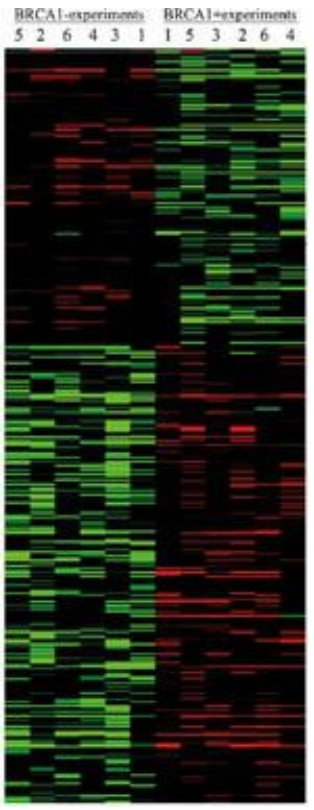

<details>
<summary>heatmap</summary>

| Sample | BRCA1-experiments::5 | BRCA1-experiments::2 | BRCA1-experiments::6 | BRCA1-experiments::4 | BRCA1-experiments::3 | BRCA1-experiments::1 | BRCA1-experiments::1 | BRCA1-experiments::5 | BRCA1-experiments::3 | BRCA1-experiments::2 | BRCA1-experiments::6 | BRCA1-experiments::4 |
| --- | --- | --- | --- | --- | --- | --- | --- | --- | --- | --- | --- | --- |
| 1 | Green | Green | Green | Green | Green | Green | Green | Green | Green | Green | Green | Green |
| 2 | Red | Red | Red | Red | Red | Red | Red | Red | Red | Red | Red | Red |
| 3 | Green | Green | Green | Green | Green | Green | Green | Green | Green | Green | Green | Green |
| 4 | Green | Green | Green | Green | Green | Green | Green | Green | Green | Green | Green | Green |
| 5 | Green | Green | Green | Green | Green | Green | Green | Green | Green | Green | Green | Green |
| 6 | Green | Green | Green | Green | Green | Green | Green | Green | Green | Green | Green | Green |
| 7 | Green | Green | Green | Green | Green | Green | Green | Green | Green | Green | Green | Green |
| 8 | Green | Green | Green | Green | Green | Green | Green | Green | Green | Green | Green | Green |
| 9 | Green | Green | Green | Green | Green | Green | Green | Green | Green | Green | Green | Green |
| 10 | Green | Green | Green | Green | Green | Green | Green | Green | Green | Green | Green | Green |
</details>

**Plate XII** Clustering of gene expression data in cells expressing high and low levels of BRCA. BRCA1¯ experiments, with low expression levels of BRCA1, appear in the left-hand six columns. BRCA1+ experiments, with high expression levels of BRCA1, appear in the right-hand six columns. The intensity of the colour reflects the ratio of the expression to that of a control. Red reflects genes with higher expression levels in response to BRCA1. Green reflects genes with lower expression levels in response to BRCA1. (See Chapter 9.)

From Welcsh, P.L., Lee, M.K., Gonzales-Hernandez, R.M., Black, D.J., Mahadevappa, M. et al. (2002). BRCA1 transcriptionally regulates genes involved in breast tumourigenesis. Proc. Natl. Acad. Sci. USA, **99**, 7560–7566. Reproduced by permission.

The results implicated 373 genes, differentially expressed by significant and reproducible amounts in response to higher levels of BRCA1 expression. Standing out among these were 57 upregulated genes and 15 downregulated genes, for which expression levels changed by factors of 2 or more. These candidates for involvement in functions of BRCA1 relevant to tumourigenesis were checked for differential expression in cancer tissues from patients and normal controls.

Clustering the gene expression matrix shows the clear distinction between up- and downregulated genes, and gives an impression of the variability among replicates. (See Plate XII.) Many of the proteins encoded by upregulated genes are hormone receptors and structural proteins. Many of the proteins encoded by downregulated genes are involved in DNA replication and translation.

Notable among the genes identified in the study are the following.

Consistent with the tissue-specific appearance of tumours as a result of BRCA1 dysfunction, some of the genes with altered expression patterns are involved in oestrogen-mediated control pathways, suggesting a possible link to the tissue-specificity enigma. The set of proteins implicated includes cyclin D1 and Myc, which are upregulated by lower levels of BRCA1. (For comparison with the clinical setting, low levels of BRCA1 expression correspond to patients with reduced or absent BRCA1 function, that is, the high-risk group; and high levels are analogous to normal controls. However, the experiments of Welcsh et al. did not try to reproduce actual endogenous BRCA1 expression levels observed in patients and normal counterparts.) Cyclin D1 and Myc are observed to be overexpressed in 20% of breast cancers, consistent with their repression by functional BRCA1.
2. Conversely, JAK and STAT proteins are downregulated by decreased levels of BRCA1. These proteins are implicated as growth inhibitors in control pathways that govern proliferation, differentiation, apoptosis, and transformation. Loss of BRCA1 activity would be expected to reduce JAK1 and STAT1 levels, promoting

388

---

cellular proliferation and reducing apoptosis. This is consistent with the observation that Stat1-null mice develop tumours more readily than normals.

The relationships detected by Welcsh et al. are part of the cell's control network. However, some of the products of genes regulated by BRCA1 are also known to be involved in formation of functional complexes with BRCA1. For instance, Myc—the product of a potent oncogene—binds to BRCA1, suggesting a direct inhibition of Myc by BRCA1. Thus reduced BRCA1 levels would have the dual effect of reducing the inhibition of Myc through binding, and increasing the expression of Myc through loss of transcriptional repression.

Thus, Myc is linked to BRCA1 through both physical and regulatory interactions. We have seen in an earlier chapter that the idea of two parallel interaction networks in cells—physical interactions and regulatory interactions—is a useful distinction. However, it is one that is difficult to maintain in a system such as BRCA1 function in which the two are so closely intertwined.

## Mass spectrometry

Mass spectrometry is a physical technique that characterizes molecules by measurements of the masses of their ions. Investigations of large-scale expression patterns of proteins require methods that give high throughput rates as well as fine accuracy and precision. Mass spectrometry achieves this, which has stimulated its development into a mature technology in widespread use. Applications to molecular biology include:

rapid identification of the components of a complex mixture of proteins;
• sequencing of proteins and nucleic acids, including high-throughput genomic sequencing and surveying populations for genetic variability;
• analysis of post-translational modifications, or substitutions relative to an expected sequence.

## Identification of components of a complex mixture

First the components are separated by electrophoresis. Then the isolated proteins are digested by trypsin to produce peptide fragments with 800–4000 amino acids. (Fig. 9.1). Trypsin cleaves proteins after lysine and arginine residues. Given a typical amino acid composition, a protein of 500 residues yields about 50 tryptic fragments. The mass spectrometer measures the masses of the fragments with very high accuracy (Fig. 9.2). The list of fragment masses, called the peptide mass fingerprint, characterizes the protein (Fig. 9.3). Searching a database of fragment masses identifies the unknown sample.

389

---

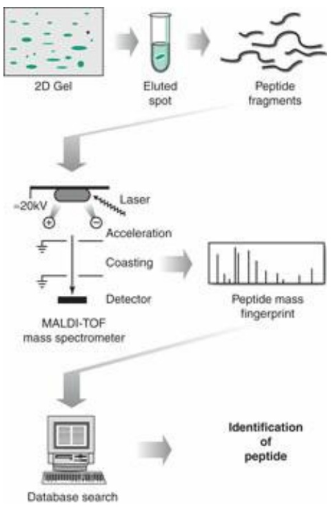

<details>
<summary>flowchart</summary>

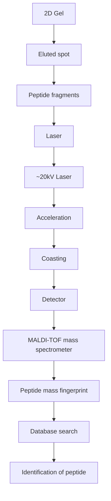
</details>

Figure 9.1 Identification of components of a mixture of proteins by elution of individual spots, digestion and fingerprinting of the peptide fragments by matrix-assisted laser desorption ionization-time of flight (MALDI-TOF) mass spectrometry, followed by looking up the set of fragment masses in a database.

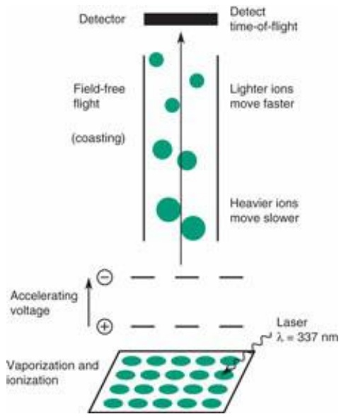

<details>
<summary>text_image</summary>

Detector
Detect time-of-flight
Field-free flight
(coasting)
Lighter ions move faster
Heavier ions move slower
Accelerating voltage
Laser
λ = 337 nm
Vaporization and ionization
</details>

Figure 9.2 Schematic diagram of mass spectrometry experiment.

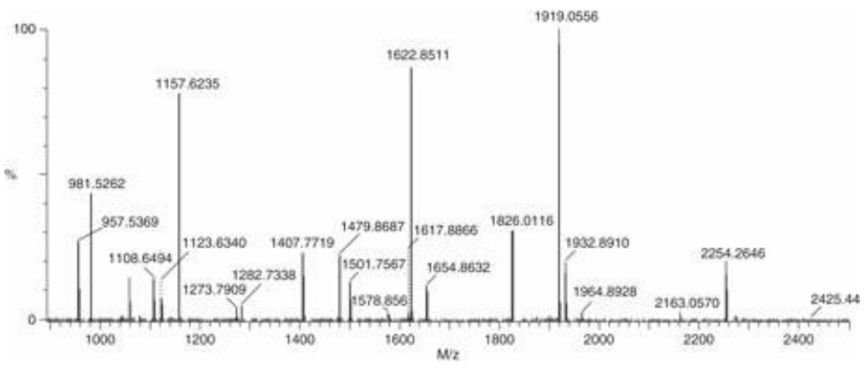

<details>
<summary>spectrogram</summary>

| M/z | Relative Abundance (%) |
| --- | --- |
| 981.5262 | ~35 |
| 957.5369 | ~20 |
| 1108.6494 | ~15 |
| 1157.6235 | ~85 |
| 1123.6340 | ~10 |
| 1273.7909 | ~5 |
| 1282.7338 | ~5 |
| 1407.7719 | ~25 |
| 1479.8687 | ~15 |
| 1501.7567 | ~10 |
| 1578.856 | ~5 |
| 1622.8511 | ~90 |
| 1617.8866 | ~15 |
| 1654.8632 | ~10 |
| 1826.0116 | ~30 |
| 1919.0556 | 100 |
| 1932.8910 | ~20 |
| 1964.8928 | ~5 |
| 2163.0570 | ~5 |
| 2254.2646 | ~20 |
| 2425.44 | ~5 |
</details>

Figure 9.3 Mass spectrum of a tryptic digest. Of the 21 highest peaks (shown in black), 15 match expected tryptic peptides of the 39 kDa subunit of cow mitochondrial complex I. This easily suffices for a positive identification. Figure courtesy of Dr I. Fearnley.

Construction of a database of fragment masses is a simple calculation from the amino acid sequences of known proteins, translations of open reading frames in genomes, or (at a pinch) of segments from EST libraries. The fragments correspond to segments cut by trypsin at lysine and arginine residues, and the masses of the amino acids are known. (Note that trypsin doesn't cleave

390

---

Lys–Pro peptide bonds, and may also fail to cleave Arg–Pro peptide bonds.)

Mass spectrometry is sensitive and fast. Peptide mass fingerprinting can identify proteins in subpicomole quantities. Measurement of fragment masses to better than 0.1 mass units is quite good enough to resolve isotopic mixtures. It is a high-throughput method, capable of processing 100 spots/day (though sample preparation time is longer). However, there are limitations. Only proteins of known sequence can be identified from peptide mass fingerprints, because only their predicted fragment masses are included in the databases. (As with other fingerprinting methods, it would be possible to show that two proteins from different samples are likely to be the same, even if no identification is possible.) Also, posttranslational modifications interfere with the method because they alter the masses of the fragments.

The results shown in Figure 9.3 are from an experiment in which the molecular masses of the ions were determined from their time of flight over a known distance, as illustrated in Figures 9.1 and 9.2. The operation of the spectrometer involves these steps.

1. Production of the sample in an ionized form in the vapour phase.
2. Acceleration of the ions in an electric field. Each ion emerges with a velocity proportional to its charge/mass ratio.
3. Passage of the ions into a field-free region, where they ‘coast’.
4. Detection of the times of arrival of the ions. The ‘time of flight’ (or TOF) indicates the mass-to-charge ratio of the ions.
5. The result of the measurements is a trace showing the flux as a function of the mass-to-charge ratio of the ions detected.

Proteins being fairly delicate objects, it has been challenging to vaporize and ionize them without damage. Two ‘soft-ionization’ methods that solve this problem are described here.

1. The matrix-assisted laser desorption ionization (MALDI), in which the sample is introduced into the spectrometer in dry form, mixed with a substrate or matrix that moderates the delivery of energy. A laser pulse, absorbed initially by the matrix, vaporizes and ionizes the protein. The MALDI-TOF combination that produced the results shown in Figure 9.3 is a common experimental configuration.
2. The electrospray ionization (ESI) method starts with the sample in liquid form. Spraying it through a small capillary with an electric field at the tip creates an aerosol of highly charged droplets. As the solvent evaporates, the droplets contract, bringing the charges closer together and increasing the repulsive forces between them. Eventually the droplets explode into smaller droplets, each with less total charge. This process repeats, creating ions, which may be multiply charged, devoid of solvent. These ions are transferred into the high vacuum region of the mass spectrometer. Because the sample is initially in liquid form, ESI lends itself to automation in which a mixture of tryptic peptides passes through a high-performance liquid chromatograph (HPLC) into the mass spectrometer directly.

## Protein sequencing by mass spectrometry

Fragmentation of a peptide produces a mixture of ions. Conditions under which cleavage occurs primarily at peptide bonds yield series of ions differing by the masses of single amino acids (Fig. 9.4). The amino acid sequence of the peptide is therefore deducible from analysis of the mass spectrum (Fig. 9.5), subject to ambiguities: Leu and Ile have the same mass and cannot be

391

---

distinguished, and Lys and Gln have almost the same mass and usually cannot be distinguished. Discrepancies from the masses of standard amino acids signal posttranslational modifications. In practice, the sequence of about 5–10 amino acids can be determined from a peptide of less than 20–30 residues.

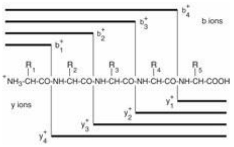

<details>
<summary>chemical</summary>

Chemical structure diagram showing b and y ion coordination with labeled atoms and substituents R1–R5
</details>

Figure 9.4 Fragments produced by peptide bond cleavage of a short peptide: b ions contain the N-terminus; y ions contain the C-terminus. The difference in mass between successive b ions or successive y ions is the mass of a single residue, from which the peptide sequence can be determined. Two ambiguities remain: Leu and Ile have the same mass and cannot be distinguished, and Lys and Gln have almost the same mass and usually cannot be distinguished. In CID (defined in the text), bond breakage can be largely limited to peptide linkages by keeping to low-energy impacts. Higher-energy collisions can fragment sidechains, occasionally useful to distinguish Leu/Ile and Lys/Gln.

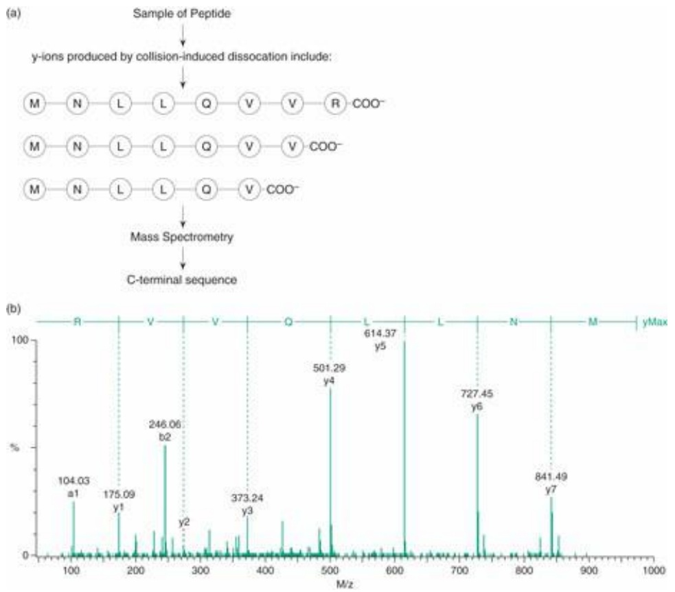

<details>
<summary>spectrogram</summary>

| M/z | % |
| --- | --- |
| 104.03 | ~25 |
| 175.09 | ~20 |
| 246.06 | ~50 |
| 373.24 | ~20 |
| 501.29 | ~80 |
| 614.37 | 100 |
| 727.45 | ~60 |
| 841.49 | ~30 |
</details>

Figure 9.5 Peptide sequencing by mass spectrometry. CID (defined in the text) produces a mixture of ions. (a) The mixture contains a series of ions, differing by the masses of successive amino acids in the sequence. In CID the ions are not produced in sequence as suggested by this list, but the mass-spectral measurement automatically sorts them in order of their mass/charge ratio. (b) Mass spectrum of fragments suitable for C-terminal sequence determination. The greater stability of y ions over b ions in fragments produced from tryptic digests simplifies the interpretation of the spectrum. The mass differences between successive y ion peaks are equal to the individual residue masses of successive amino acids in the sequence. Because y ions contain the C-terminus, the y ion peak of smallest mass contains the C-terminal residue, etc., and therefore the sequence comes out ‘in reverse’. The two leucine residues in this sequence could not be distinguished from isoleucine in this experiment.

From Carroll, J., Fearnley, I.M., Shannon, R.J., Hirst, J., and Walker, J.E. (2003). Analysis of the subunit composition of complex I from bovine heart mitochondria. Mol. Cell. Proteomics, 2, 119–126 (Supplementary figure S138).

In current practice, the fragments are produced in situ: first the peptide is vaporized, then it is fragmented by collision-induced dissociation (CID) with argon gas. This approach requires two mass

392

---

analysers, operating in tandem in the same instrument (called MS/MS). The vaporized sample first passes through one mass analyser, to separate an ion of interest. The selected ion passes into the collision cell where impact with Argon atoms excite and fragment it. By keeping the energy of impact low, the fragmentation can be limited largely to peptide bond breakage (Fig. 9.5). The second mass analyser determines the masses of the fragments. (see Table 9.1.)

Table 9.1 Masses of amino acid residues, standard isotopes

| Gly | 57.02146 | Ala | 71.03711 | Ser | 87.03203 |
| --- | --- | --- | --- | --- | --- |
| Pro | 97.05276 | Val | 99.06841 | Thr | 101.04768 |
| Cys | 103.00919 | Leu | 113.08406 | Ile | 113.08406 |
| Asn | 114.04293 | Asp | 115.02694 | Gln | 128.05858 |
| Lys | 128.09496 | Glu | 129.04259 | Met | 131.04049 |
| His | 137.05891 | Phe | 147.06841 | Arg | 156.10111 |
| Tyr | 163.06333 | Trp | 186.07931 |  |  |


## See Weblem 9.1

## Measuring deuterium exchange in proteins

If a protein is exposed to $\mathrm { D } _ { 2 } \mathrm { O } _ { : }$ , mobile hydrogen atoms will exchange with deuterium at rates dependent on the protein conformation. By exposing proteins to $\mathrm { D } _ { 2 } \mathrm { O }$ for variable amounts of time, mass spectrometry can give a conformational map of the protein. Applied to native proteins, the results give information about the structure. Using pulses of exposure the method can give information about intermediates in folding.

## Genome sequence analysis by mass spectrometry

Mass spectrometry of nucleic acids provides a very precise and high-throughput technique for quantitative analysis of DNA and RNA sequences in individuals and in populations. Its advantages include:

• high precision: the standard deviation of typical mass-spectral concentration measurement replicates is $\approx   3 \% ,$ , compared with ≈200% for microarray measurements;
• more data per sample: a mass spectrum contains many peaks rather than a single value. This allows analysis of mixtures; and permits ‘multiplexing’, or simultaneous analysis of features of a set of mixed samples;
high specificity and sensitivity: very small sample sizes are required. PCR amplification can be pushed to very high gain, as there is little risk of mistaking a contaminant for a true sample amplicon. In fact, it is possible to determine sequences from individual cells or even single DNA strands.

To prepare for the measurement, samples undergo gene-specific PCR amplification by allele-specific primer extension, to produce single-stranded oligonucleotides. Products are purified and embedded in a matrix suitable for MALDI vaporization and mass analysis. No hybridization step is required for detection. Assembly of many subjects on an array allows for automation of data collection. (Throughput rates can reach $1 0 ^ { 5 }$ spectra per instrument per day.)

The typical relative molecular mass of an oligonucleotide measured is ≈6000, corresponding to

393

---

about 20 bases. Under conditions where the amplified products of different alleles contain different numbers of bases the mass difference is 300 or more, a very large difference relative to the accuracy of mass spectrometry. In fact, it is feasible to pick up a single-base substitution in oligos of the same length, or even the methylation of a gPc site. For nucleotide substitutions, the mass differences between bases range from ±9 for t ↔ a to ±40 for c ↔ g.

Applications include the following.

Measurement of allele frequencies in populations, or detection of alleles in individuals, by identification of SNPs. For population studies, samples from several individuals in the selected groups can be pooled, and genotype frequencies measured to about 3% accuracy. Several SNPs can be determined from a single spectrum. Such studies have impact on a wide variety of fields, including anthropology, agriculture, and forensics, but medical applications are the major driving force. For example, controlled comparisons between healthy populations and those predisposed to a disease can identify genetic factors of clinical importance.
2. Characterization of individual genotypes. A selection of 100 000 SNPs offers about three polymorphisms per gene, enough for fairly thorough characterization of the protein-coding portion of an individual person's genome. Determination of one individual's SNP profile is achievable using one instrument for one day. Clinical applications include: (a) diagnosis, based on systematic differences, between healthy individuals and those with a disease, previously established from controlled population studies, and (b) pharmacogenomics, to distinguish patients who will benefit from treatment with a drug from those who will not benefit or even risk severe side effects.
3. Measurement of individual haplotypes. Haplotypes are local combinations of genetic polymorphisms that tend to be co-inherited (see Chapter 2). Haplotypes simplify the search for phenotype–genotype correlations because they reduce the number of variables with which to characterize the genotype. Mass-spectrometric methods based on amplifying regions around SNPs in a sample containing a single DNA molecule provide an accurate and high-throughput method of individual haplotype determination.
4. Measurement of gene expression levels on an absolute scale, with a precision of ≈3%. This is achieved by spiking the RNA extracted from a sample with a known amount of a related oligoribonucleotide, and measuring the relative amounts of signal from the calibrating oligo and the natural ones.
5. Noninvasive prenatal diagnosis based on the small amount of foetal DNA that leaks into maternal blood. Because of the 95–99% maternal DNA background, only paternal contributions to the foetus can be identified. However, the technique is sensitive enough to detect the SRY gene, demonstrating that the foetus is male, or other paternal alleles that may be useful in diagnosing genetic abnormalities. It should be emphasized that the use of only a maternal blood sample avoids the significant risks of an invasive procedure to sample amniotic fluid.
6. Genomic sequencing. Mass spectrometry has the potential to compete in accuracy and throughput with gel-based methods for large-scale DNA sequence determination (see Case Study 9.2), but perhaps not with next-generation methods.

## CASE STUDY 9.2 Application of combined genomic, proteomic, and structural methods to antibiotic resistance in tuberculosis

394

---

Tuberculosis is an infectious disease caused by Mycobacterium tuberculosis. Despite development of vaccines and drugs, it remains a potent killer. Tuberculosis is the most common cause of death from infectious disease, claiming about 2 million victims per year. Of the 9 million new cases per year (estimated by the World Health Organization) 80% occur in developing countries in Asia and sub-Saharan Africa. HIV infection, also more prevalent in developing countries, exacerbates the mortality of tuberculosis infection by lowering resistance.

Our bodies' front-line defences against most bacterial infections include macrophages, which are cells of the immune system that engulf bacteria and attack them with a variety of chemical and biochemical agents. M. tuberculosis, exceptionally, is adapted to survive within the macrophage. Part of its adaptation is structural: cells of M. tuberculosis and close relatives surround themselves with a waxy coat. The low permeability of the coat shields them from the inhospitable environment within the macrophage, including low pH and oxidative stress. The bacteria also make substantial changes to gene expression patterns to adapt their physiological state to these surroundings.

After several decades of decline following the development of effective drugs, the incidence of tuberculosis began to increase in the mid-1980s. One reason is emergence of resistant strains. A primary drug used in prevention and therapy of tuberculosis is isoniazid (isonicotinic acid hydrazide). Isoniazid attacks M. tuberculosis by interfering with synthesis of its cell wall, without which the bacterium cannot survive. Targets of isoniazid include an NADH-dependent enoyl-acyl carrier protein (ACP) reductase (InhA) and a β-keto-acyl ACP synthase (KasA). These enzymes participate in synthesis of mycolic acids, major components of the cell wall.

Isoniazid must be converted to an active form after absorption by the bacterial cell. The enzyme that effects the conversion, KatG, is a natural suspect for involvement in resistance. Its natural function is to detoxify peroxides.

Several methods have been applied to elucidate the adaptations responsible for isoniazid resistance:

1. changes in gene expression patterns were detected using microarrays;
2. genes that change expression were sequenced in susceptible and resistant strains, and mutations observed;
3. the crystal structure of isoniazid bound to InhA has been determined.

## Changes in gene expression patterns

Wilson and colleagues <sup>1</sup> examined susceptible and resistant strains of M. tuberculosis at times up to 8 h of exposure to isoniazid (Plate XIII). The array included almost all open reading frames identified in the M. tuberculosis genome. (The genome of M. tuberculosis is about 4.4 Mb long and contains about 4000 genes.) Although biochemical studies had already implicated some proteins in resistance, a general screen was carried out in order to identify as many drug targets as possible.

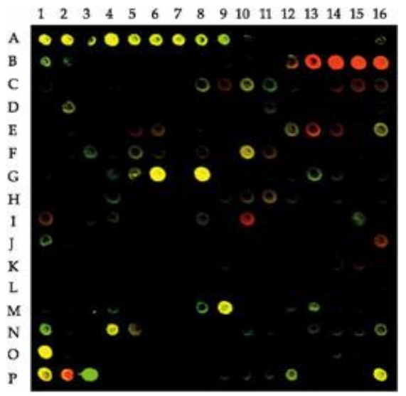

<details>
<summary>heatmap</summary>

| Category | 1 | 2 | 3 | 4 | 5 | 6 | 7 | 8 | 9 | 10 | 11 | 12 | 13 | 14 | 15 | 16 |
| --- | --- | --- | --- | --- | --- | --- | --- | --- | --- | --- | --- | --- | --- | --- | --- | --- |
| A | Yellow | Yellow | Green | Yellow | Yellow | Yellow | Yellow | Green | — | — | — | — | — | — | — | — |
| B | Green | Green | — | — | — | — | — | — | — | — | — | Red | Red | Red | Red | Red |
| C | — | — | — | — | — | — | — | Green | Red | Green | Green | — | — | Red | Red | Green |
| D | — | Green | — | — | — | — | — | — | — | — | — | — | — | — | — | — |
| E | — | — | — | — | Red | Red | — | — | — | — | — | Green | Red | Red | Green | — |
</details>

Plate XIII The effect of 4 h treatment by isoniazid on the mRNA expression profiles of 203 open reading frames from M. tuberculosis. Red, expressed in cells treated with isoniazid; green, expressed in untreated cells; yellow, expressed in both treated and untreated cells. The row of red spots at the upper right corresponds to genes of the FAS-II gene cluster. (See Case Study 9.2.)

From Wilson, M., DeRisi, J., Kristensen, H.H., Imboden, P., Rane, S. et al. (1999) Exploring drug-induced

395

---

alterations in gene expression in Mycobacterium tuberculosis by microarray hybridization. Proc. Natl. Acad. Sci. USA, **96**, 12833–12838.

Exposure to isoniazid greatly enhanced the transcription of two classes of genes. One set is involved in cellwall synthesis, including an operon-like cluster encoding components of a fatty-acid synthase complex (FAS-II). Additional genes, including a subunit of alkyl hydroxyperoxide reductase (AhpC), that handle oxidative stress, were also upregulated. The logic of the experiment is that the treated cells are recognizing the effects of the drug, and feedback mechanisms are acting to try to compensate for reduced activities by enhanced expression.

## Mutations conferring resistance to isoniazid

On the basis of the changed expression profiles, Ramaswamy et al. (2003) sequenced a total of 2.6 Mb from 124 M. tuberculosis isolates.<sup>2</sup> These include mutations in KatG that impede activation of isoniazid, and mutations in InhA to escape inhibition by the activated form.

Note that because oxidative stress is part of the host's natural defence to infection, simple knockout of KatG could be a dangerous strategy for the bacterium. Ideally the bacterium would reduce the activity of the enzyme in isoniazid activation but retain activity against small peroxides. In this way it would reduce susceptibility to the drug while maintaining its general fitness in the environment within the macrophage. Precisely this balance is achieved by the most common KatG mutation in resistant strains, $^ { 3 1 5 } \mathrm { S e r } \rightarrow$ Thr.

The most common mutation in InhA is $^ { 9 4 } \mathrm { S e r } \rightarrow$ Ala. The inhibitory effectiveness of activated isoniazid is reduced in this modified protein.

## Crystallography

Rozwarski et al. (1998) solved the structure of the complex between the activated form of isoniazid and InhA (Fig. 9.6). The drug is covalently attached to the nicotinamide ring of NAD, bound to the active site of InhA. The sidechain of<sup>94</sup>Ser is also shown. In the inhibitory complex the protein binds the NAD-activated isoniazid adduct. The coupling of these molecules can occur only on the enzyme (in solution activated isoniazid and NADH do not react).

How does the <sup>94</sup>Ser → Ala mutant achieve resistance? In the absence of inhibitor, the enzyme can either bind substrate first and then cofactor, or cofactor first and then substrate. Because the substrate occupies the same site on the enzyme as the inhibitor, only if cofactor is bound first can an inhibitory complex form. Two pathways are possible, the first leading exclusively to product, the other producing an inhibitory complex (E = enzyme, S = substrate, C = cofactor and I = inhibitor):

If substrate binds first:

If cofactor binds first:

If substrate binds first (1a and 1b), the inhibitory complex cannot form. If cofactor binds first (2a and 2b), a stable inhibitory complex may form, taking the enzyme out of the game permanently.

The $^ { 9 4 } \mathrm { S e r } \rightarrow$ Ala mutation reduces the affinity of the enzyme for NADH. This enhances the substrate-boundfirst pathway (1a and 1b), lowering the amount of inhibitory complex produced (2b), and also enhancing the dissociation rate of the inhibitory complex.

It is also possible that $^ { 9 4 } \mathrm { S e r } \rightarrow \mathrm { A }$ la and other mutations reduce the affinity of the adduct. Research and development of anti-tuberculosis drugs is a continuing challenge. This example shows the effectiveness of

396

---

coordinated application of many different techniques.


## See Weblem 9.2

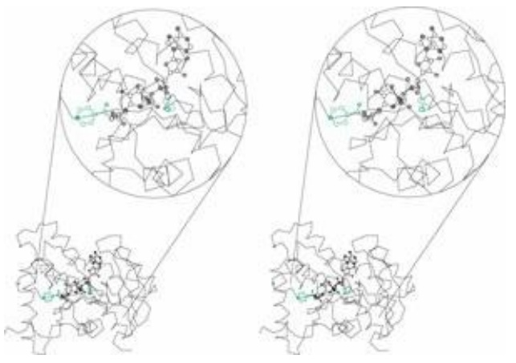

<details>
<summary>chemical</summary>

Molecular structure diagram showing two identical protein domains with labeled hydrogen atoms and side chains
</details>

Figure 9.6 Structure of long fatty acid chain enoyl-ACP reductase (InhA) in complex with inhibitor [1ZID]. The ligand is an adduct of activated isoniazid and NADH. Shown in green are the isoniazid moiety of the inhibitor (centre of blown-up circle), and the sidechain of <sup>94</sup>Ser (left in blown-up circle). The mutation <sup>94</sup>Ser → Ala contributes to isoniazid resistance.

See Rozwarski, D.A., Grant, G.A., Barton, D.H., Jacobs, Jr, W.R., and Sacchettini, J.C. (1998). Modification of the NADH of the isoniazid target (InhA) from Mycobacterium tuberculosis. Science, 279, 98–102.

## Protein complexes and aggregates

The basis of our understanding of how life within a cell is organized and regulated is the set of protein–protein and protein–nucleic acid interactions. The development of high-throughput methods for detecting interactions has been a focus of recent interest.

Interacting proteins and nucleic acids span a range of structures and functions:

• simple dimers or oligomers in which the monomers appear to function independently;
• oligomers with functional ‘cross-talk’, including ligand-induced dimerization of receptors, and allosteric proteins such as haemoglobin, phosphofructokinase, and asparate carbamoyltransferase;
• large fibrous proteins such as actin or keratin;
• nonfibrous structural aggregates such as viral capsids;
• large aggregates with dynamic properties such as F1-ATPase, pyruvate kinase, the GroEL–GroES chaperonin, and the proteasome;
protein–nucleic acid complexes, including ribosomes, nucleosomes, transcription regulation complexes, splicing and repair particles, and viruses. In many cases initial binding is followed by recruitment of additional proteins to form large complexes;
many proteins, whether monomeric or oligomeric, function by interacting with other proteins. These include all enzymes with protein substrates, and many antibodies, inhibitors, and regulatory proteins;
protein interactions are frequently associated with disease, as misfolded or mutant proteins are prone to aggregation (see Table 9.2).

Table 9.2 Diseases associated with protein aggregates.

| Disease | Aggregating protein | Comment |
| --- | --- | --- |

397

---

| Sickle-cell anaemia | Deoxyhaemoglobin-S | Mutation creates hydrophobic patch on surface |
| --- | --- | --- |
| Classical amyloidoses | Immunoglobulin light chains, transthyretin, and many others | Extracellular fibrillar deposits |
| Emphysema associated with Z-antitrypsin | Mutant α1-antitrypsin | Destabilization of structure facilitates aggregation |
| Huntington's | Altered huntingtin | One of several polyglutamine repeat diseases |
| Parkinson's | α-Synuclein | Found in Lewy bodies |
| Alzheimer's | Aβ, τ | Aβ = 40–42-residue fragment |
| Spongiform encephalopathies | Prion proteins | Infectious, despite containing no nucleic acid |

## Properties of protein–protein complexes

Enzyme catalysis involves protein–ligand complexes. We discussed some fundamental ideas in Chapter 8. From the point of view of the thermodynamics, protein–protein binding is just another example of protein–ligand association. However, the biological significance of the complexes tends to be quite dissimilar. Also, the structure and energetics of protein–protein complexes exhibits numerous features unlike those of proteins binding small metabolites. We shall therefore now focus on the special properties of protein–protein association.

## Stoichiometry: what is the composition of the complex?

Stable oligomeric proteins may contain many copies of one protein, or combine different ones. Among aggregates of a single protein, complexes containing odd numbers of molecules are less common than those containing even numbers. Oligomers (complexes containing a few copies of the same protein: dimers, trimers, …) usually show symmetry. For instance, insulin forms a hexamer with three-fold and two-fold axes.

Some prokaryotic proteins containing identical subunits are homologous to eukaryotic proteins containing related but nonidentical subunits, arising by gene duplication and divergence. The proteasome is an example. Some viruses achieve diversity without duplication, by combining proteins with the same sequence but different conformations.

Protein complexes vary widely in the numbers and variety of molecules they contain. Some complexes contain only a few proteins, but others are very large: for example, pyruvate dehydrogenase contains hundreds of subunits, and some viral capsids contain thousands.

Many very large aggregrates have clinical importance, including bovine spongiform encephalopathy (BSE, or so-called mad cow disease), Alzheimer’s and Huntington’s disease (see Table 9.2). Amyloidoses are diseases characterized by extracellular fibrillar deposits, usually with a common crossed-β-sheet structure. They arise from a variety of causes, including destabilizing mutations, overproduction of a protein, and inadequate clearance in renal failure. Misfolded proteins are more prone to aggregate, and mutated proteins are more prone to misfold. Large local concentrations, such as can occur in myelomas that overproduce immunoglobulin light chains, also aggravate the threat of aggregation.

## Af inity: how stable is the complex?

A common index of the affinity of a complex is the dissociation constant, $K _ { \mathrm { D } } ,$ , the equilibrium constant for the reverse of the binding reaction:

398

---

$$
\text {Protein} \cdot \text {Ligand} = \text {Protein} + \text {Ligand} K _ {\mathrm{D}} = \frac {[ \mathrm{P} ] [ \mathrm{L} ]}{[ \mathrm{PL} ]}
$$

[P], [L], and [PL] denote the numerical values of the concentrations of protein, ligand, and protein– ligand complex, respectively, expressed in $\mathrm { m o l }   \cdot   \mathrm { l } ^ { - 1 }$ . The lower the $K _ { \mathrm { D } }$ , the tighter the binding. $K _ { \mathrm { D } }$ corresponds to the concentration of free ligand at which half the proteins bind ligand and half are free: $[ \mathrm { P } ] = [ \mathrm { P L } ]$ . (Recall that the Michaelis constant of an enzyme is the dissociation constant of the enzyme–substrate complex.)

The $K _ { \mathrm { D } }$ is related to the Gibbs free energy change of dissociation by the relationship:

$$
\begin{array}{l} \mathrm{PL} = \mathrm{P} + \mathrm{L} \quad \Delta G ^ {\ominus} = \Delta H ^ {\ominus} - T \Delta S ^ {\ominus} \\ = - R T \ln K _ {\mathrm{D}} \\ \end{array}
$$

Dissociation constants of protein–ligand complexes span a very wide range (see Table 8.2).

Structural studies have elucidated several important features of the interactions between soluble proteins, contributing to affinity.

• What holds the proteins together? Burial of hydrophobic surface, hydrogen bonds and salt bridges.
Do proteins change conformation upon formation of complexes? In some cases they do. In these cases the interaction energy has to ‘pay for’ the conformational change, and the interface tends to be larger. The site [http://molmovdb.mbb.yale.edu/molmovdb](http://molmovdb.mbb.yale.edu/molmovdb) contains numerous movies illustrating protein conformational changes.
What determines specificity? Complementarity of the occluding surfaces, in shape, hydrogenbonding potential, and charge distribution. Prediction of protein complexes from the structures of the partners is the docking problem. Reliable solution of this problem, together with progress in structural genomics, would permit in silicio screening of proteomes for interacting partners.

## Kinetics of formation and breakup, average lifetime

The dissociation constant of a complex indicates the fraction of time that the components spend in the bound state and the fraction of time in which they are unbound. But the average lifetime of the bound state can vary without affecting $K _ { \mathrm { D } }$ . Defining individual rate constants for association and dissociation, $k _ { \mathrm { o n } }$ and $k _ { \mathrm { o f f } } ,$ the dissociation constant is equal to their ratio:

$$
\mathrm{P} + \mathrm{L} \xrightarrow [ k _ {\mathrm{off}} ]{k _ {\mathrm{on}}} [ \mathrm{PL} ] \quad K _ {\mathrm{D}} = k _ {\mathrm{off}} / k _ {\mathrm{on}}
$$

A short average lifetime, corresponding to large values of both $k _ { \mathrm { o f f } }$ and $k _ { \mathrm { o n } } ,$ or a long average lifetime, corresponding to small values of both $k _ { \mathrm { o f f } }$ and $k _ { \mathrm { o n } } ,$ can produce the same $K _ { \mathrm { D } }$ . Lifetimes are important: if you want to purify a complex it is important that its average lifetime is longer than the duration of the isolation procedure! Conversely, if a protein–protein complex is to mediate transmission of a signal, a short lifetime provides a natural ‘reset mechanism’ to preclude the signal's being locked ‘on’ for too long.

The ‘on rate’ is limited by diffusion rates. Under ordinary conditions $k _ { \mathrm { o n } } \leq 1 0 ^ { - 9 } \mathrm { M } ^ { - 1 } \cdot \mathrm { s } ^ { - 1 } . k _ { \mathrm { o n } }$ may

399

---

be considerably smaller if, for example, a conformational change is required for binding. Typical $k _ { \mathrm { o n } }$ values are $1 0 ^ { - 6 }     -     1 0 ^ { - 7 }   \mathrm { M } ^ { - 1 }   \cdot   \mathrm { s } ^ { - 1 }$ , and typical lifetimes ≈1 s.

## How are complexes organized in three dimensions $1 \begin{array} { l } { 2 } \\ { \notag } \\ { \notag } \end{array}$

When two proteins form a complex, each leaves a ‘footprint’ on the surface of the other, defining the portion of the surface involved in the interaction. If two proteins interact using the same surface on both, the complex is closed. If two proteins interact through dif erent surfaces, the complex is open. The significance is that a closed complex does not allow additional proteins to bind with the same interaction. An open complex, in which the surface of potential interaction is not occluded, can grow by accretion of additional subunits. Thus, open but not closed complexes are compatible with formation of repetitive aggregates.

## Do proteins change conformation upon complex formation?

Some protein complexes form by the coming together of rigid subunits. The subunits in these complexes have the same structure in the complex that they have separately. Other protein complexes involve structural changes upon complex formation. These include complexes of subunits that are not stable separately. (See Box 9.3.)

## Box 9.3 Features of protein–protein interfaces

Burial of protein surface: the surface buried by formation of a complex is the difference between the accessible surface area (ASA) of the complex and the sum of the ASAs of the components separately.

A typical protein–protein interface might involve 22 residues, 90 atoms of which 20% would be mainchain atoms, with the occasional water molecule. A histogram of surface area buried in binary protein complexes shows a peak centred at 1600 $\mathrm { A } ^ { 2 }$

The minimum buried surface for stability of a protein–protein complex is about 1000 $\mathrm { A ^ { 2 } } .$ Complexes that bury $> 2000   \AA ^2$ tend to involve conformational changes upon complex formation.

Each square angstrom of hydrophobic surface buried contributes about 105 J to the free energy of stabilization.

The composition of the interface. The chemical character of protein–protein interfaces is intermediate between that of the surfaces and interiors of monomeric globular proteins. Interfaces are enriched in neutral polar atoms at the expense of charged atoms. The amino acid composition of interfaces are enriched in aromatic residues— His, Phe, Tyr, Trp—relative to remaining exposed surface. There is a lesser degree of enrichment in aliphatic sidechains—Leu, Ile, Val, Met—and Arg (but, surprisingly, not Lys).

Complementarity of interfaces is responsible for specificity. Complementarity involves both good packing at the occluding surfaces and proper juxtaposition of hydrogen-bonded and charged atoms. Typically there is one hydrogen bond per 170 $\mathrm { A } ^ { 2 }$ of interface area. Isolated water molecules occupy sites in many interfaces.

Typically there is one fixed water molecule per 100 $\mathrm { A } ^ { 2 }$ of interface.

## Protein interaction networks

The units from which interaction networks are assembled are:

for physical networks, a protein–protein or protein–nucleic acid complex;
for logical networks, a dynamic connection in which the activity of a process is affected by a

400

---

change in external conditions, or by the activity of another process.

Most experiments reveal only pairwise interactions. The challenges are to integrate pairwise interactions into a network and then to study the structure and dynamics of the system.

Many techniques detect physical interactions directly. These include:

• X-ray and NMR structure determinations can not only identify the components of the complex, but reveal how they interact, and whether conformational changes occur upon binding;
two-hybrid screening systems: transcriptional activators such as Gal4 contain a DNA-binding domain and an activation domain. Suppose these two domains are separated, and one test protein is fused to the DNA-binding domain and a second test protein is fused to the activation domain. Then a reporter protein will be expressed only if the components of the activator are brought together by formation of a complex between two test proteins. High-throughput methods allow parallel screening of a ‘bait’ protein for interaction with a large number of potential ‘prey proteins (see Table 9.3);

• chemical crosslinking fixes complexes so that they can be isolated. Subsequent proteolytic digestion and mass spectrometry permits identification of the components;

• co-immunoprecipitation: an antibody raised to a ‘bait’ protein binds the bait together with any other ‘prey’ proteins that interact with it. The interacting proteins can be purified and analysed, for instance by western blotting, or mass spectrometry;

• chromatin immunoprecipitation identifies DNA sequences that bind proteins. Treatment with formaldehyde crosslinks proteins and DNA, fixing the complexes that exist within a cell. Then, isolation of the chromatin and breaking the DNA into small fragments allows separation of proteins by binding to specific antibodies, carrying the DNA sequences along with them. Reversal of the crosslink followed by sequencing of the DNA identifies the specific DNA sequence to which each protein binds;

phage display: genes for a large number of proteins are individually fused to the gene for a phage coat protein, to create a population of phage each of which carries copies of one of the extra proteins exposed on its surface. Affinity purification against an immobilized ‘bait’ protein selects phage displaying potential ‘prey’ proteins. DNA extracted from the interacting phages reveals the amino acid sequences of these proteins;

surface plasmon resonance analyses the reflection of light from a gold surface to which a protein has been attached. The signal changes if a ligand binds to the immobilized protein (The method detects localized changes in the refractive index of the medium adjacent to the gold surface. This is related to the mass being immobilized.);

• fluorescence resonance energy transfer: if two proteins are tagged by different chromophores, transfer of excitation energy can be observed over distances up to about 60 Å.

Table 9.3 Protein interactions detected by two-hybrid screening systems\*

|  | H. pylori | S. cerevisiae | C. elegans | D. melanogaster |
| --- | --- | --- | --- | --- |
| Total proteome size | 1576 | 5585 | 33 469 | 13 843 |
| Proteins tested | 732 | 987/790 | 1415 | 4685 |
| Interactions detected | 1465 | 936/800 | 2131 | 4876 |

The two sets of numbers for yeast are the results of independent investigations.

\*From Aloy, P. and Russell, R.B. (2004). Ten thousand interactions for the molecular biologist. Nat. Biotechnol., **22**,

401

---

1319–1321.

Other methods provide complementary information.

Domain recombination networks. Many eukaryotic proteins contain multiple domains. A feature of eukaryotic evolution is that a domain may appear in different proteins with different partners. In some cases proteins in a bacterial operon catalysing successive steps in a metabolic pathway are fused into a single multidomain protein in eukarya. The domains of the eukaryotic protein are individually homologous to the separate bacterial proteins. (Examples of proteins fused in eukarya and separate in prokaryotes are also known.) It is possible to create a network by defining an interaction between two protein domains whenever homologues of the two domains appear in the same protein. This is evidence for some functional link between the domains, even in species where the domains appear in separate proteins.
Coexpression patterns. Clustering of microarray data identifies proteins with common expression patterns. They may have the same tissue distribution, or be up- or downregulated in parallel in different physiological states. This is also suggestive evidence that they share some functional link. In the response of M. tuberculosis to isoniazid (Case Study 9.2), genes for the fatty acid synthesis complex are coordinately upregulated. They are on an operon-like gene cluster, and in fact these proteins do form a physical complex. On the other hand, alkyl hydroperoxidase (AHPC) is also upregulated in response to isoniazid. AHPC acts to relieve oxidative stress. There is no evidence that it physically interacts with the fatty acid synthesis complex, or that it mediates a metabolic transformation coupled to fatty acid synthesis. It is a second component of the response to isoniazid.
Phylogenetic distribution patterns. The phylogenetic profile of a protein is the set of organisms in which it and its homologues appear. Proteins in a common structural complex or pathway are functionally linked and expected to coevolve. Therefore proteins that share a phylogenetic profile are likely to have a functional link, or at least to have a common subcellular origin. There need be no sequence or structural similarity between the proteins that share a phylogenetic distribution pattern. A welcome feature of this method is that it derives information about the function of a protein from its relationship to nonhomologous proteins.

There are many ways to link proteins, including direct physical protein–protein interactions, twohybrid complementarity (see Table 9.3), domain recombination, coexpression patterns, and phylogenetic profiles. Each provides a basis for a protein interaction network. The networks formed by combining each set of interactions are different, although they overlap to a greater or lesser extent. They give different views of the kinds of relationships between proteins that exist in cells. It is possible to form a more comprehensive network by combining different types of interactions. For instance, the DIP database ([http://dip.doe-mbi.ucla.edu/](http://dip.doe-mbi.ucla.edu/)) is a curated collection of experimentally determined protein–protein interactions. It contains data about 44 349 interactions between 17 048 proteins from 107 organisms.

Plate XIV shows a portion of an interaction network of yeast proteins, based on sets of proteins that have been found together in solved structures.

402

---

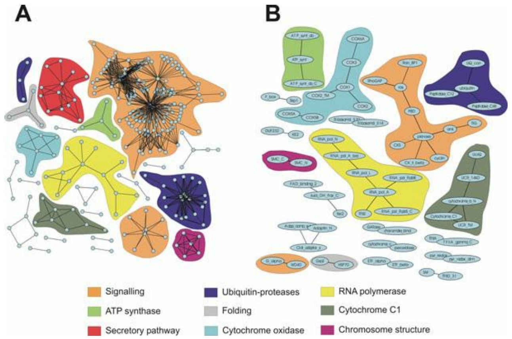

Plate XIV A portion of an interaction network of yeast proteins. Part A (left) describes the interactions of individual proteins, and part B (right) shows the interactions within a subnetwork based on representations of different protein families, in different functional categories, linked in part A. This figure is based on structural data and modelling. Each relationship implies a physical interaction between the proteins. Some of the interactions involve stable complexes (for instance, RNA polymerase II); others involve transient complexes. (See Chapter 9.)

Picture courtesy P. Aloy and R.B. Russell.

## Web resource: Interaction databases

Intact: an open source molecular interaction database [http://www.ebi.ac.uk/intact/](http://www.ebi.ac.uk/intact/)

DIP: Database of Interacting Proteins

[http://dip.doe-mbi.ucla.edu/](http://dip.doe-mbi.ucla.edu/)

MIPS Comprehensive Yeast Genome Database

[http://mips.gsf.de/](http://mips.gsf.de/)

BIND: Biomolecular Interaction Network Database

[http://bind.ca/](http://bind.ca/)

MINT: a molecular interactions database

[http://cbm.bio.uniroma2.it/mint/](http://cbm.bio.uniroma2.it/mint/)

GRID: General Repository for Interaction Data Sets

[http://thebiogrid.org/](http://thebiogrid.org/)

Biogrid: a list of interaction databases

[http://wiki.thebiogrid.org/doku.php/tools](http://wiki.thebiogrid.org/doku.php/tools)

Visualization tools

[http://www.scowlp.org/scowlp/](http://www.scowlp.org/scowlp/)

A useful review article

Tuncbag, N., Kar, G., Keskin, O., Gursoy, A., and Nussinov, R. (2009). A survey of available tools and web

403

---

servers for analysis of protein–protein interactions and interfaces. Brief. Bioinform., 10, 217–232.

See Weblem 9.3

## CASE STUDY 9.3 Components of the primosome assembly in Bacillus subtilis

The first step in DNA replication in B. subtilis is the binding of initiator proteins to specific DNA sequences that serve as origins of replication. These then recruit a nucleoprotein complex called the primosome. A major component of the primosome is DnaC, a hexameric replicative helicase.3

It is believed that steps in the process include:

1. binding of an initiator protein, DnaA or PriA, to an appropriate single-stranded DNA sequence;
2. other proteins—DnaB, DnaC, and DnaI—are recruited. DnaB and DnaI are regulators of DnaC activity;
3. DnaC is loaded onto the single-stranded DNA, forming a hexameric assembly;
4. DnaG is recruited to prime DNA synthesis.

Scientists at the Institut National de la Récherche Agronomique created a database of the protein interaction network of B. subtilis.4

Figure 9.7 shows a small fragment of the network, limited to immediate neighbours of DnaC. The website is active: clicking on a node either adds the interaction partners of the node to the graph, or replaces the graph with another centred on the selected protein. By adding partners, one can look at more extended neighbourhoods of DnaC. By replacing the graph, one can walk through the network.

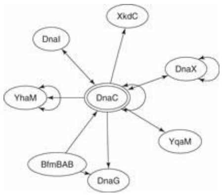

<details>
<summary>flowchart</summary>

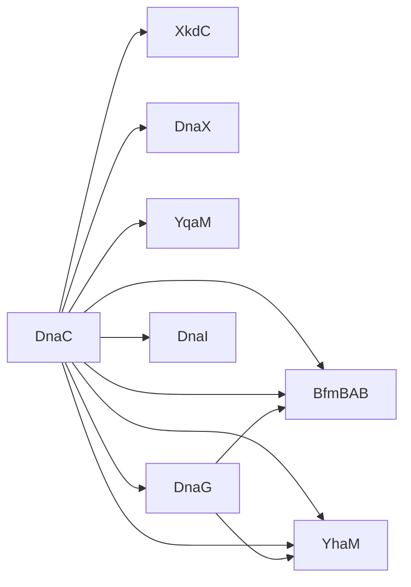
</details>

Figure 9.7 DnaC and proteins that interact directly with it. Arrows linking partners point from ‘bait’ to ‘prey bidirectional arrows indicated cases where the interaction was detected in reciprocal experiments. In the original website the arrows are colour-coded according to the nature of the evidence for the interaction. Reproduced by permission.

## Regulatory networks

Regulatory networks pervade living processes. Control interactions are organized into linear or branched signal transduction cascades, and reticulated into control networks.

Any individual regulatory action requires (1) a stimulus, (2) transmission of a signal to a target, (3) a response, and (4) a ‘reset’ mechanism to restore the resting state (see Fig. 9.8). Many regulatory actions are mediated by protein–protein complexes. Transient complexes are common in regulation, as dissociation provides a natural reset mechanism.

404

---

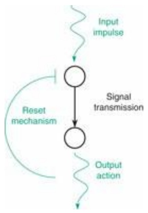

<details>
<summary>flowchart</summary>

```mermaid
graph TD
  Input["Input impulse"] --> Sum((" ))
  ResetMechanism["Reset mechanism"] --> Sum
  Sum --> SignalTransmission["Signal transmission"]
  SignalTransmission --> OutputAction["Output action"]
  OutputAction --> Output["Output action"]
```
</details>

Figure 9.8 The elementary step in a regulatory network. An input impulse is received by a node, which transmits a signal to a downstream node, causing an output action. This is followed by reset of the upstream node to its inactive state. Combination of such elementary diagrams gives rise to the complex regulatory networks in biology.

Some stimuli arise from genetic programs. Some regulatory events are responses to current internal metabolite concentrations. Others originate outside the cell: a signal detected by surface receptors is transmitted across the membrane to an intracellular target.

Control may be exerted:

‘in the field’: by several mechanisms, such as: inhibitors, dimerization, ligand-induced conformational changes including but not limited to allosteric effects, GDP–GTP exchange or kinase-phosphorylase switches, and differential turnover rates;
• ‘at headquarters:’ through control over gene expression.

One signal can trigger many responses. Each response may be stimulatory (increasing an activity) or inhibitory (decreasing an activity). Transmission of signals may damp out stimuli or amplify them. There are ample opportunities for complexity, opportunities of which cells have taken extensive advantage.

G-protein-coupled receptors (GPCRs) illustrate the components of signal transduction. Recall that GPCRs contain seven transmembrane helices, with a binding site for triggering ligands on the extracellular side, and a binding site for the downstream recipient of the signal, a heterotrimeric G protein on the intracellular side.

G proteins consist of three subunits: $\mathbf { G } _ { \mathfrak { a } } , \mathbf { G } _ { \mathfrak { \beta } } ,$ and $\mathbf { G } _ { \gamma } , \mathbf { G } _ { \alpha }$ and $\mathbf { G } _ { \gamma }$ are anchored to the membrane. In the resting, inactive state, $\mathbf { G _ { a } }$ binds GDP. An activated GPCR binds to a specific G protein and catalyses GDP–GTP exchange in the $\mathbf { G _ { a } }$ subunit. This destabilizes the trimer, dissociating $\mathbf { G _ { a } }$

$$
\mathrm{G} _ {\alpha} (\mathrm{GDP}) \mathrm{G} _ {\beta} \mathrm{G} _ {\gamma} \rightleftharpoons \mathrm{G} _ {\alpha} (\mathrm{GTP}) + \mathrm{G} _ {\beta} \mathrm{G} _ {\gamma}
$$

The separated components, $\mathbf { G _ { a } }$ and $\mathbf { G } _ { \beta } \mathbf { G } _ { \gamma _ { 1 } }$ , activate downstream targets, such as adenylyl cyclase.

A single activated GPCR can interact successively with many G protein molecules, amplifying the signal. It is therefore essential to turn the signal off after it has had its effect. Mutations that render a GPCR constitutively active cause a number of diseases, the symptoms emerging from a war between the rogue receptor and the feedback mechanisms that are unequal to the task of restraining its effects. Different GPCRs have different mechanisms for restoring the resting state. Rhodopsin, for example, is inactivated by cleavage of the isomerized chromophore.

The activity of the heterotrimeric G proteins is turned off by the GTPase activity of $\mathbf { G } _ { \mathbf { a } } ,$ converting $\mathrm { G } _ { \mathfrak { q } } ( \mathrm { G T P } ) \rightarrow \mathrm { G } _ { \mathfrak { q } } ( \mathrm { G D P } ) . \mathrm { G } _ { \mathfrak { q } } ( \mathrm { G D P } )$ does not bind to its receptors, shutting down that pathway of signal transmission. Instead, $\mathrm { G _ { d } ( G D P ) }$ rebinds the $\mathbf { G } _ { \beta } \mathbf { G } _ { \gamma }$ subunits. This resets the system.

405

---

## Signal transduction and transcriptional control

The signal transduction network exerts control ‘in the field’ by a variety of mechanisms, including inhibitors, dimerization, ligand-induced conformational changes including but not limited to allosteric effects, GDP–GTP exchange or kinase-phosphorylase switches, and differential turnover rates. This component acts fast, on subsecond timescales. The transcriptional regulatory network exerts control ‘at headquarters’, through control over gene expression. This component is slower, acting on a timescale of minutes.

## General characteristics of all control pathways

• a single signal can trigger a single response or many responses;
• a single response can be controlled by a single signal or influenced by many signals;
• each response may be stimulatory (increasing an activity) or inhibitory (decreasing an activity);
• transmission of signals may damp out stimuli or amplify them.

## Structures of regulatory networks

Think of control, or regulatory networks, as assemblies of activities. Although mediated in part by physical assemblies of macromolecules—protein–protein and protein–nucleic acid complexes— regulatory networks:

1. tend to be unidirectional: a transcription activator may stimulate the expression of a metabolic enzyme, but the enzyme may not be involved directly in regulating the expression of the transcription factor;
2. have a logical component: it is not enough to describe the connectivity of a regulatory network. Any regulatory action may stimulate or repress the activity of its target. If two interactions combine to activate a target, activation may require both stimuli (logical ‘and’) or either stimulus may suffice (logical ‘or’);
3. produce dynamic patterns: signals may produce combinations of effects with specified time courses. Cell-cycle regulation is a classic example.

The structure of a regulatory network can be described by a graph in which edges indicate steps in pathways of control. Regulatory networks are directed graphs: the influence of vertex A on vertex B is expressed by a directed edge connecting A and B. An edge directed from vertex A to vertex B is called an outgoing connection from A and an incoming connection to B.

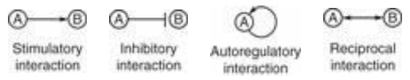

Conventionally, an arrow indicates a stimulatory interaction, and a T symbol indicates an inhibitory interaction. An edge connecting a vertex to itself indicates autoregulation. A doubleheaded arrow indicates reciprocal stimulation of two nodes; note that this is not the same as an undirected edge.

## Databases of regulatory networks

406

---

KEGG, which began as a database of metabolic pathways (See Chapter 8) is now also assembling regulatory networks ([http://www.genome.jp/kegg/pathway.html](http://www.genome.jp/kegg/pathway.html)).

The website of a project based at the San Diego Supercomputer Center, with the goal of providing an integrated research environment for investigation and analysis of molecular mechanisms, including but not limited to networks: [http://biologicalnetworks.net](http://biologicalnetworks.net).

Tools for network visualization are available at: [http://www.genmapp.org/](http://www.genmapp.org/)

## Structural biology of regulatory networks

Any regulatory interaction involves one or more proteins and nucleic acids. Examples of regulatory mechanisms include a protein binding a ligand, undergoing chemical modification such as phosphorylation/dephosphorylation, changing conformation, or all of the above. X-ray crystallography and NMR spectroscopy have helped us to elucidate some of the general mechanisms underlying control processes.

Many molecules involved in regulation are multidomain proteins. A domain is a segment of a protein that has independent stability and can appear in conjunction with different partners through evolutionary recombination. A multidomain protein contains a linear sequence of domains each of which is relatively free to interact with other molecules. Assembly of a protein from domains therefore permits the joining into one molecule of a set of functions. ‘Mixing and matching’ of domains gives evolution access to a wide variety of functional combinations. (See Figures 2.4 and 8.8.)

One important feature of regulatory proteins is recognition. An interaction domain is a part of a protein that confers specificity in ligation of a partner. Regulatory proteins contain a limited number of types of interaction domains, which have diverged to form large families with different individual specificities. For instance, the human genome contains 115 SH2 domains, and 253 SH3 domains. (Src-homology domains SH2 and SH3 are named for their homologies to domains of the src family of cytoplasmic tyrosine kinases.) Many individual interaction domains even interact with different partners as they participate in successive steps of a control cascade. Initial interactions may also trigger recruitment of additional proteins to form large regulatory complexes.

Many interaction domains are sensitive to the state of post-translational modification of their ligands, for instance binding preferentially to states of a ligand in which specific tyrosines, serines, or threonines are phosphorylated. These and other post-translational modifications function as switches, turning on or interrupting/resetting a signalling cascade.

Protein–protein complex formation allows a cell to detect a signal molecule in the external medium, and report its arrival to the cell interior, without the signal molecule itself ever needing to enter the cell. Many receptors use an ingenious dimerization mechanism: the receptor has external, transmembrane, and internal segments. An external ligand binds to two molecules of receptor. The juxtaposition of the external portions brings the internal portions together also, because they are tethered to the external regions by the transmembrane segments. Interaction between the interior segments triggers a conformational change that activates a process such as phosphorylation of a protein. This may initiate a signal transduction cascade that can amplify the original stimulus.

Figure 9.9 shows types of interaction domain complexes with ligands, including binding of peptides (which may be attached to proteins), protein–protein complexes, extracellular dimer formation upon binding a hormone, and a protein–nucleic acid complex.

407

---

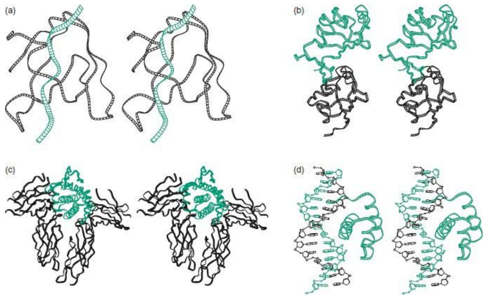

Figure 9.9 Types of interaction involved in regulatory signalling. (a) Binding of a peptide by an SH3 domain [1CKA]. SH3 domains are common constituents of regulatory proteins. Functions of SH3 domains include signal transduction, protein and vesicle trafficking, cytoskeletal organization, cell polarization, and organelle biosynthesis. (b) Domain–domain interaction: PDZ domains in syntrophin (black) and neuronal nitric oxide synthase (green) [1QAV]. (c) Binding of a molecule of human growth hormone (green) to two molecules of the external segment of the human growth hormone receptor (black) (d) The homeodomain antennapedia–DNA complex [9ANT]. Homeodomains are highly conserved eukaryotic proteins, active in control of animal development. They regulate homeotic genes; that is, genes that specify locations of body parts. Antennapedia is a Drosophila protein responsible for initiating leg development. The earliest mutations found in antennapedia produced ectopic legs at the positions of, and instead of, antennae. Loss-of-function mutations convert legs into antennae. As with many DNA-binding proteins, an α-helix binds in the major groove of the DNA.

A more extensive album of protein–nucleic acid complexes appears in Introduction to Genomics (Lesk, 2011).

Understanding the mechanism of regulation will require the structures of large protein and protein– nucleic acid complexes. The sizes of many of the large complexes challenges the limits of NMR spectroscopy. X-ray diffraction has had major successes, but is at the mercy of being able to grow adequate crystals. Cryo-electron microscopy is another approach to structure determination of larger assemblies.

Electron microscopy of specimens at liquid nitrogen temperatures has revealed structures in the range $M_{\mathrm{r}} = 500\ 000$ to $4   \times   1 0 ^ { 8 }$ , 100–1500 Å in diameter. These results do not achieve atomic resolution. However, if the structures of individual components of a complex are known to high resolution from X-ray diffraction or NMR spectroscopy, the component structures can be fitted into the low-resolution structure determined by electron microscopy, to produce a detailed model of the entire assembly. (See Lesk, 2010, p. 119 ff.)

A limitation that remains is the difficulty of determining structures of transient complexes, or of systems showing substantial conformational changes upon assembly. The situation is shared with much of current molecular biology: we are coming to grips with static structures of increasing size, but awaiting the development of methods for treating the dynamics.

408

---

## The genetic switch of bacteriophage λ

Two classic control systems in biology are well understood at the molecular level: the E. coli Lac operon, and the lytic/lysogenic switch in bacteriophage λ. These are also the simplest examples of developmental pathways.

• The Lac operon is a set of genes appearing in tandem on the genome of E. coli that are jointly regulated in response to the presence of lactose and glucose in the medium. (A discussion of the lac operon appears in Lesk, 2011, chapter 7.)
• Phage λ can adopt an active or passive lifestyle, effected by alternative gene expression profiles. It is probably the simplest form of life that makes a decision.

λ is a bacteriophage, a virus that infects E. coli (see Fig. 9.10). The mature virion contains an icosahedral head that encapsulates the viral DNA, and a tail, which recognizes and attaches to the host, and functions as a syringe to inject the viral DNA. The virion contains ≈15 different proteins. The genome is a single molecule of double-stranded DNA 58 402 bp long, containing 50 genes, organized into seven operons. As in bacteria, an operon is a set of successive genes under coordinated transcriptional control.

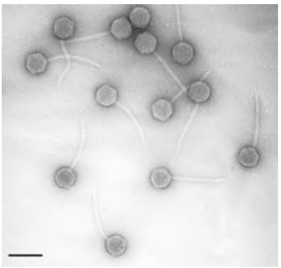

<details>
<summary>natural_image</summary>

Microscopic view of rod-shaped bacterial cells with visible internal structures (no text or labels)
</details>

Figure 9.10 Bacteriophage λ. Bar at lower left indicates 100 nm.

Picture courtesy Professor R.B. Inman, University of Wisconsin. From ICTVdB – The Universal Virus Database, version 4, [http://www.ncbi.nlm.nih.gov/ICTVdb/ICTVdB/](http://www.ncbi.nlm.nih.gov/ICTVdb/ICTVdB/)

After attaching to an E. coli cell and injecting its DNA, the phage may follow either of two paths:

• in the lytic state, replication and intracellular reconstitution of daughter phage particles is followed, in about 45 min, by rupture of the host cell and release of the ≈100 progeny. The expression patterns of several distinct sets of genes are under control of a developmental programme during this process;
in the lysogenic state, the phage DNA becomes integrated into the bacterial genome, to form a prophage. Only one phage gene is expressed: the cI protein, which acts as a repressor to inhibit the expression of phage genes responsible for initiating viral multiplication, thereby maintaining the lysogenic state.

Here we shall focus on the subset of the λ regulatory network involved in the switch between lytic and lysogenic states.

Given a healthy host population, the lytic state perpetuates itself as progeny viruses infect additional bacterial cells.

The lysogenic state of the phage is stable under normal conditions. The viral DNA, integrated into

409

---

the bacterial genome, replicates with the bacterial DNA. This creates a population of infected bacteria. Although the virus does not reproduce completely to form intact progeny phage, the viral DNA is replicated, as a passenger in the dividing cells.

Sleeping Beauty can be awakened, by damage, such as UV radiation, that threatens the host cell. The virus resumes active replication to escape conditions that endanger its host. Of course, this ensures that the host cell will not survive.

The strategy of the virus is to take advantage of a thriving host population to reproduce lytically, but to adopt lysogeny to get through ‘lean’ periods.

M. Ptashne and colleagues, and a large community of virologists, have clarified the molecular biology of phage λ in very great detail. Here we focus on the logic of the switch.

## What are the characteristics of the switch that must be implemented by DNA–protein interactions?

• The states of the switch must be mutually incompatible. Each state must repress the other.
• Under constant conditions each state must be self-maintaining. In other words, not only is the choice of one or the other commitment enforced; once selected, the chosen state persists until conditions change.
• In response to changing conditions it must be possible to move from one state to the other. We expect to find a simple trigger that leads to a complex cascade of consequences.

To implement this logic, the system has the following variables at its disposal.

• DNA sequences: in particular the sequences at sites of promotors and operators (see Box 9.4).

## Box 9.4 Sites of protein–DNA interactions in transcription control

A promoter is a site on DNA—typically ≈60 bp in prokaryotes—near the beginning of a gene. It binds RNA polymerase, required for initiation of transcription. RNA polymerase is a bacterial enzyme. However, part of the developmental programme of lytic phage λ takes place through the modification of the bacterial polymerase by viral proteins, to alter its response to termination signals. The result is to extend the region of transcription of viral genes in successive stages of the lytic cycle.

An operator is a site on DNA that binds regulatory proteins. A repressor, or negative regulator, blocks the site where RNA polymerase binds to the operator, preventing transcription. A positive regulator interacts with RNA polymerase to enhance its binding affinity to a promoter.

• Local flexibility in DNA structure: the ability of the DNA to form loops, bridged by interacting proteins bound to sites distant in the DNA sequence.
• DNA–protein interactions: relative affinities of different proteins for different sites, including RNA polymerase and regulatory proteins.
Interactions among protein–DNA complexes:
• positive cooperativity: enhancement of binding by stabilizing protein–protein interactions on the DNA;
negative cooperativity (or anticooperativity): especially the blocking, by binding of one protein, of the binding site of another.

Which proteins will bind DNA, and where, depends on the:

410

---

• intrinsic affinity of different sites for different proteins (a DNA-binding protein will choose the available site to which it has the highest affinity);
• cooperativity of protein binding;
• competition of proteins for sites.

Availability of a site may be denied by occlusion, caused by binding of another protein at or near the site. Conversely, favourable interaction with another protein bound at a neighbouring site may enhance affinity (cooperative binding). These effects may involve interactions among regulatory proteins, or of regulatory proteins with RNA polymerase (Table 9.4).

Table 9.4

| Protein(s) | Relative affinity |
| --- | --- |
| RNA polymerase itself | cro promoter > cI promoter |
| cro | OR3 > OR2 ≈ OR1 |
| cI | OR1 ≈ OR2 > OR3 |
| 2 × cI | OR1 + OR2 high, cooperative binding |
| 2 × cro | Non-cooperative binding |
| cro + RNA polymerase | cro promoter > 0,cl promoter=0 |
| cI + RNA polymerase | cI promoter > 0,cro promoter=0 |
| High concentration of cI + RNA polymerase | cI promoter = 0,cro promoter=0 |

## The materials

## 1. Proteins

• RNA polymerase, the enzyme that transcribes DNA into RNA. RNA polymerase binds to available promoter sites.
• cro, a transcription regulator that inhibits synthesis of cI.
• cI, or repressor, a transcription regulator that inhibits expression of cro, and regulates its own expression.

## 2. Sites on the phage DNA

• The accessibility of two adjacent promoters control the transcription of cI and cro.
Three operator sites, one within each promoter and a third overlapping both, that are binding sites for cro and cI. Figure 9.11 shows (a) the layout of promoter and operator sites on the DNA and (b, c) the two mutually exclusive states in which cro or cI are expressed.

411

---

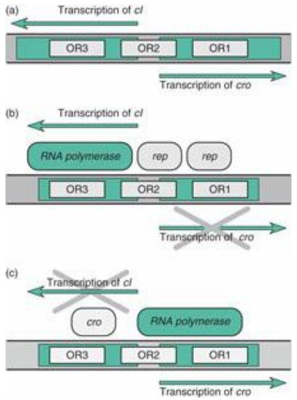

Figure 9.11 (a) Region of phage λ genome containing promoters for cro and cI. (b) In the lytic state cro is expressed and cI is off. (c) In the lysogenic state, cro is off and cI (encoding repressor) is expressed. OR1, OR2, and OR3 are operator sites, binding sites for regulatory proteins. Each is about 15–20 bp long, or roughly two turns of DNA. OR1 overlaps the cro promoter, OR3 overlaps the cI promotor, and OR2 overlaps both. The relative affinities of cro and cI for the operator sites:

| Protein | Relative affinity | Effect |
| --- | --- | --- |
| cro | OR3 > OR1 = OR2 | Binding of cro to OR3 prevents cI synthesis |
| CI | OR1 ≈ OR2 > OR3 | Binding of 2 × cI to OR1/OR2 prevents cro synthesis |

create alternative states:

| State | cro | cI |
| --- | --- | --- |
| Lytic | on | off |
| Lysogenic | off | on |

The operation of the system depends on the relative values of the affinities of different operator sites for different proteins and for different combinations of proteins

The cI concentration— ≈ 100 molecules per cell—is high enough to prevent lytic infection by phage λ of an E. coli cell already containing lysogenized λ. This scheme—in particular the relative affinities of cI and cro for the different operator sites—explains the configurations of Figure 9.11b and c. The mutual incompatibility of the two states results from binding of transcriptional regulatory proteins to the operators, repressing one of the two genes and enhancing expression of the other. Binding of cI, preferentially and cooperatively to OR1 and OR2, turns off transcription of cro and, through favourable interaction with RNA polymerase on the DNA, stimulates transcription of cI. At higher concentrations of cI, after titration of the OR1 and OR2 sites, cI will bind to OR3, turning off cI transcription. This acts to regulate the ambient cI concentration.

The diagram shows the logical relationships between these two components. High concentrations of cro inhibit its further expression. The combination of both stimulatory and repressive links from cI to itself signifies the regulation of cI concentration: the autostimulatory link is active at low cI concentration and the autorepressive link is active at high cI concentration. The phage protein cII also activates expression of cI but using a different promoter.


412

---

cI binds as a tetramer to OR1/OR2. There is an additional set of promoters and operators OL1, OL2, and OL3 ≈2.3 kb from OR1, OR2, and OR3. A tetramer of cI, bound to OR1/OR2, and another tetramer of cI bound to OL1/OL2 can form an octamer, enhancing the affinity for DNA. To do this the DNA must loop around to allow apposition of the two tetramers.

## How to 'throw' the switch

To change from the lysogenic to the lytic state: UV irradiation or other hindrance to DNA replication causes bacterial protein RecA to cleave cI. This frees the OR1/OR2 sites to bind RNA polymerase, to express cro. cro has its highest affinity for the OR3 site, turning off synthesis of cI. As the concentration of cro builds up, it binds also to OR1 and OR2, turning off its own expression. Expression of cro also initiates a cascade of events that effect the transition to the lytic state.
• The switch from lytic to lysogenic state can occur only upon infection, of necessity by a phage that has emerged from a lytic event. The phage may either remain lytic (the default) or become lysogenic.

The choice appears to be determined primarily by the concentration of a phage protein cII. cII activates transcription of:

• cI, the repressor (but via a different operator than that shown in Fig. 9.11);
• int, a protein required for integration of phage DNA into bacterial genome;
• an antisense RNA that prevents the viral modification of bacterial RNA polymerase. This shuts down the lytic programme.

The transition to lysogeny requires build up of concentration of cII. The concentrations of cII and cIII appear to depend primarily on the dose of viral DNA. About 1% of cells infected by one virus become lysogenic. About 50% of cells infected simultaneously by two or more viruses become lysogenic.

A high multiplicity of infection implies a low ratio of bacteria to phage. For the phage to remain lytic under these conditions would threaten to deplete the population of bacteria, to the point where progeny phase could not find hosts to infect. Similar considerations rationalize the greater frequency of lysogenation if the host cell is starved.

A bacterial protease HflB destroys cII, and a viral protein cIII inhibits HflB. Readers may wonder why the cell would synthesize a molecule that promotes lysis, and why the phage would synthesize one that promotes lysogeny. Both the bacterium and the phage appear to be acting to reduce the number of their own immediate progeny. However, there may be long-term benefits for the populations as a whole. In a population of lysogenized bacteria occasionally a cell spontaneously goes lytic. The progeny phage do not damage the bacterial population—remember that lysogeny confers ‘immunity’ to phage infection—but may protect the bacterial population against competition with foreign invading susceptible bacteria. Sociobiologists may see this as an example of altruism.

It is interesting that the lytic/lysogenic choice of phage λ can be extracted as a fairly simple subset of a far more complicated regulatory network.

## The genetic regulatory network of Saccharomyces cerevisiae

A classic study of transcription regulation in yeast treated a network containing 3562 genes,

413

---

corresponding to approximately half the known proteome of S. cerevisiae.<sup>5</sup> The genes included 142 that encode transcription regulators and 3420 that encode target genes exclusive of transcription regulators. There are 7074 known regulatory interactions among these genes, including effects of regulators on one another, and of regulators on nonregulatory targets.

Analysis of the overall network architecture reveals the following.

• The distribution of incoming connections to target genes has a mean value of 2.1 and is distributed exponentially. Most target genes receive direct input from about two transcriptional regulators. The probability that a gene is controlled by k transcription regulators, $k = 1 , 2 , \ldots ,$ is proportional to $e ^ { - a k } ,$ , with $\mathbf { q } = 0 . 8$
The distribution of outgoing connections has a mean value of 49.8, and obeys a power law. The probability that a given transcriptional regulator controls k genes is proportional to $k ^ { - \beta } ,$ with $\beta =$ 0.6. Power-law behaviour characterizes topologies in which a few nodes—the ‘hubs’—have many connections, and many nodes have few. In regulatory networks, hubs tend to be fairly far upstream, forming important foci of regulation with far-reaching control.
• The average number of intermediate nodes in a minimal path between a transcriptional regulator and a target gene is 4.7. The maximal number of intermediate nodes in a path between two nodes is 12.
The clustering coefficient of a node is a measure of the degree of local connectivity within a network. If all neighbours of a node are connected to one another, the clustering coefficient of the node = 1. If no pair of neighbours of a node is connected to each other, the clustering coefficient of the node = 0. The mean clustering coefficient, averaged over all nodes, is a measure of the overall density of the network. For the yeast transcriptional regulatory network, the mean clustering coefficient is 0.11.

Figure 9.12 is a cartoon-like sketch of a fragment of such a network, indicating rather loosely some of its general features. Nodes are divided into transcriptional regulators, shown as circles, and target genes, shown as squares. Target genes are distinguished by having no output connections. There is extensive interregulation among the transcription factors, to a much higher density of interconnections than can intelligibly be shown in this diagram. Think of a seething broth of transcription factors, within the shaded area, sending out signals to target genes. The shaded area indicates only the logical clustering of the transcriptional regulators. There is no suggestion about physical localization; indeed, transcriptional regulators interact with DNA, and almost never interact physically with the proteins, the expression of which they control.

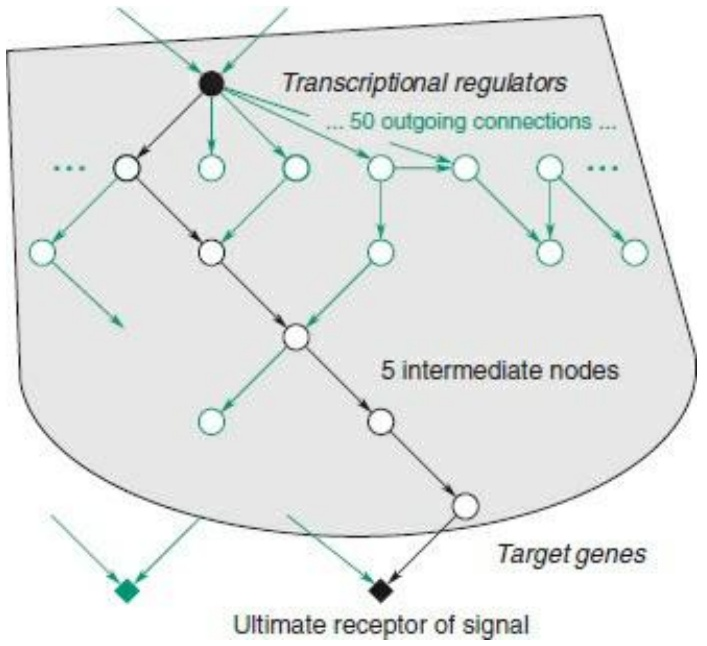

<details>
<summary>flowchart</summary>

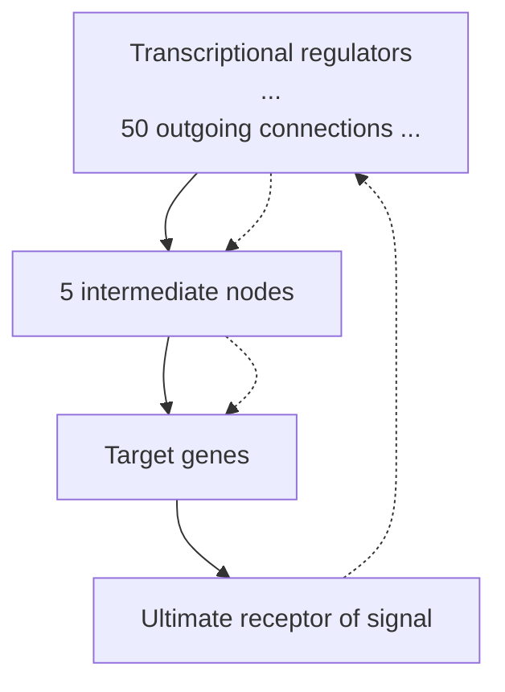
</details>

414

---

**Figure 9.12** Simplified sketch illustrating some features of an ‘average’ segment of the pathways in the yeast interaction network. Transcriptional regulators appear as circles. Target genes appear as squares. A transcriptional regulator typically has direct influence over about 50 genes, indicated by multiple connections from the filled black circle to the circles on the line below it. Roughly one in 10 of the neighbours of any node is connected to another neighbour, indicated by the horizontal arrow on the second row. The ultimate receptor of the signal lies at the end of a pathway typically containing about five intermediate nodes (shown in black). This ultimate target gene receives on the average about two inputs. This diagram shows only a small fragment of a network that is in fact quite dense.

Each transcriptional regulator directly influences approximately 50 genes on average, although, as with other ‘small-world’ networks following power-law distributions of connectivities, the distribution is very skewed: some ‘hubs’ have very many output connections, but most nodes have very few. A few of the interregulatory connections between transcription factors are shown in green in the figure. In about 10% of the cases, two neighbours of the same transcription factor interact with each other. A pathway from one regulator (filled black circle) to one ultimate receptor (filled black square), through five intermediate nodes, is shown in black. The intermediate nodes are other transcriptional regulators, connected both within the path drawn in black, and off this path. Even the transcription factor used as the origin of the path receives input connections. Although it is possible to identify target genes from the absence of outgoing connections, it is more difficult to identify ultimate initators of signal cascades.

The ultimate receptor is a target gene that receives regulatory input but itself has no output links. This target is expected to receive (on average) a second control input. The black target node receives input via a black arrow, along the selected path, and via a green arrow suggesting the second input. Of course the second input may arrive via a path that shares common nodes with the black path, including other routes from the filled black circle.

The dense forest of additional pathways, from which this fragment is extracted, is not shown. Some ‘back-of-the-envelope’ calculations: There are ≈3500 nodes, each receiving on the average of 2 input connections. There are ≈140 transcription factors, making an average of 50 output connections. The number of input connections must equal the number of output connections, and indeed 3500 × 2 = 140 × 50 = 7000.

Given the complexity, it is difficult to illustrate larger segments of the network in more detail than the simplified version appearing in Figure 9.12. However, dissections of yeast and other regulatory networks have defined certain recurrent motifs that serve as building blocks. These might be considered the ‘secondary structures’ of network architectures. (See Box 9.5.)

The high ratio of interactions to transcription regulators implies that we cannot expect to associate individual regulatory molecules with single, dedicated, activities (as we can, for the most part, with metabolic enzymes). Instead, the activity of the network involves the coordinated activities of many individual regulatory molecules.

## Adaptability of the yeast regulatory network

The yeast regulatory network achieves versatility and responsiveness by reconfiguring its activities. This is seen by comparing the changes in the activities of networks controlling yeast gene expression patterns in different physiological regimes: cell cycle, sporulation, diauxic shift (the change from anaerobic

## Box 9.5 Common motifs in biological control networks

415

---

Within the high complexity of typical regulatory networks, certain common patterns appear frequently. In the architecture of networks, these form building blocks that contribute to higher levels of organization. Shen-Orr, Milo, Mangan, and Alon\* have described examples, including the fork, the scatter, and the ‘one-two punch’ (a phrase from the boxing ring):

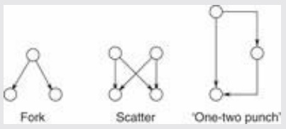

<details>
<summary>flowchart</summary>

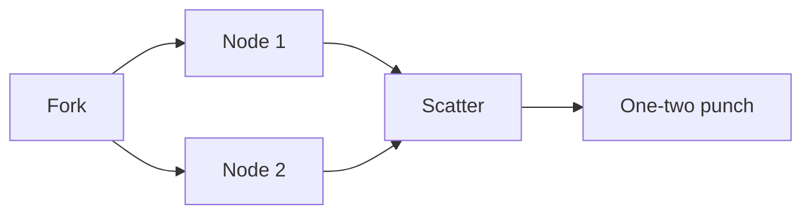
</details>

The fork, also called the single-input motif, transmits a single incoming signal to two outputs. Successive forks, or forks with higher branching degrees, are an effective way to activate large sets of genes from a single impulse. Generalizations of the binary fork include more downstream genes under common control (more tines to the fork), and autoregulation of the control node. Forks can achieve general mobilization. Moreover, if the regulatory genes have different thresholds for activation, the dynamics of building up the signal can produce a temporal pattern of successive initiation of the expression of different genes.

The scatter configuration, also called the multiple input motif, can function as a logical ‘or’ operation: both downstream targets become active if either of the input impulses is active. Generalizations of the square scatter pattern shown may contain different numbers of nodes on both layers. Note that scatter patterns are superpositions of forks.

The ‘one-two punch’, also called the ‘feed-forward loop’, affects the output both directly through the vertical link; and indirectly and subsequently through the intermediate link. This motif can show interesting temporal behaviour if activation of the target requires simultaneous input from both direct and indirect paths (logical ‘and’). Because build up of the intermediate requires time, the direct signal will arrive before the indirect one. Therefore a short pulsed input to the complex will not activate the output: by the time the indirect signal builds up, the direct signal is no longer active. The system can thereby filter out transient stimuli in noisy inputs. Conversely, the active state of the system can shut down quickly upon withdrawal of the external trigger.

\*Shen-Orr, S.S., Milo, R., Mangan, S., and Alon, U. (2002). Network motifs in the transcriptional regulation network of Escherichia coli. Nat. Genet., **31**, 64–68.

fermentative metabolism to aerobic respiration as $\mathbf { O } _ { 2 }$ levels increase), DNA damage, and stress response. Cell cycling and sporulation involve the unfolding of endogenous gene expression programs; the others are responses to environmental changes.

Different states are characterized both by similarities and differences in gene expression patterns, and by the components of the regulatory network that are active. There is considerable shift in expression of target genes. About a quarter of the target genes are specialized to individual physiological states. That is, of the total of 3420 target genes, the expression of almost half (1514) do not show major changes in the different states. Of the 1906 that show altered expression levels in different states, almost half of them (803) are specialized to a single physiological state.

In contrast, different states show much more overlap in the usage of transcriptional regulators. For instance, for cell-cycle control, 280 target genes (8%) are differentially regulated by 70 (49%) of the transcription regulators. Clearly there is a much greater degree of specialization in the target genes. In general, half the transcription factors are active in at least three out of the five physiological regimes. However, in contrast with the high overlap of usage of the transcriptional regulators (the nodes), the overlap of the activities within the network (the connections) is relatively low. Different components of the interaction network organize the different gene expression patterns in different states.

Whereas different physiological states are characterized by substitutions of different sets of synthesized proteins, the regulatory network uses much of the same structure but reconfigures the pattern of activity. Think of the transcription factors as ‘hardware’ and the connections as

416

---

reprogrammable ‘software’. The molecules do not change but the interactions do: in different states, many transcription regulators change most, or a substantial part, of their interactions. In particular, the set of transcription regulators that form the hubs of the network—those with many outgoing nodes that form foci of control—are not a constant feature of the system. Some hubs are common to all states, but others step forward to take control in different physiological regimes. The result of the reconfiguration of activity is that over half of the regulatory interactions are unique to the different states.

The effect of the changes in the active interaction patterns is to alter the topological characteristics of the network in different states. For instance, under panic conditions—DNA damage and stress— the average number of genes under control of individual transcriptional regulators increases, the average minimal path length between regulator and target decreases, and the clustering becomes less dense (that is, there is less interregulation among transcription factors). This can be understood in terms of a need for fast and general mobilization: the equivalent of broadcasting ‘Go! Go! Go!’ over the radio. Normal circumstances—cell-cycle control for instance—allow for a more dignified and precise regulatory state, which permits finer control over the temporal course of expression patterns. In cell-cycle control and sporulation there is a much denser interregulation among transcription factors, and longer minimal path lengths between transcriptional regulators and target genes.

Different physiological states also differ in their usage of the common motifs: fork, scatter, and ‘one-two punch’ (see Box 9.5). Scatter motifs are more used in conditions of stress, diauxic shift, and DNA damage. They are appropriate to the need for quick action. Requirements for build up of intermediates would delay the response. Conversely, the ‘one-two punch’ motif is more common in cell-cycle control. This is consistent with the need for a signal from one stage to be stabilized before the cell enters the next stage.

Much of evolution proceeds towards greater specialization. The human eye is a classic example. It is an intricate and fine-tuned structure, features that were once adduced as evidence against Darwin's theory. Many evolutionary pathways show a trade-off between specialized adaptation and generalized adaptability.

Regulatory networks are an exception. Evolution has produced structures that are both specialized and versatile. The reconfigurability of regulatory networks allows them to respond robustly to changes in conditions by creating many different structures specialized to the conditions that elicit them.

## RECOMMENDED READING

- Babu, M.M., Luscombe, N.M., Aravind, L., Gerstein, M., and Teichmann, S.A. (2004). Structure and evolution of transcriptional regulatory networks. Curr. Opin. Struct. Biol., 14, 283–291.
- Chalancon, G., Kruse. K., and Babu, M.M. (2012). Reconfiguring regulation: How cells adapt to changing environments? Science, 335, 1050–1051.
- Court, D.L., Oppenheim, A.B., and Adhya, S.L. (2007). A new look at bacteriophage λ genetic networks. J. Bacteriol., 198, 298–304.
- Dodd, I.B., Shearwin, K.E., and Egan, J.B. (2005). Revisited gene regulation in bacteriophage λ. Curr. Opin. Gen. Devel., 15, 145–152.
- Lesk, A.M. (2010). Introduction to Protein Structure: Architecture, Function, and Genomics, 2nd edn. Oxford University Press, Oxford.
- Lesk, A.M. (2011). Introduction to Genomics, 2nd edn. Oxford University Press, Oxford.
- Ptashne, M. (2004). A Genetic Switch: Phage Lambda Revisited. Cold Spring Harbor Laboratory Press, Cold Spring Harbor, NY.

417

---

Ptashne, M. (2005). Regulation of transcription: from lambda to eukaryotes. Trends Biochem. Sci., **30**, 275–279. Tyers M., and Mann M. (2003). From genomics to proteomics. Nature, **422**, 193–197.

## EXERCISES AND PROBLEMS

**Exercise 9.1** Hen egg white lysozyme has a relative molecular mass of about 14 300. If mass spectroscopy can measure mass to within 0.01%, could the following be confidently distinguished from the unmodified protein: (a) Nterminal acetylation, (b) phosphorylation of a single serine residue, (c) a single Lys → Gln substitution?

**Exercise 9.2** On photocopies of Figure 9.5, indicate the positions of the peaks if the sequence were: (a) MNLVQVR, (b) GNLQVVR, (c) MNLQVVG.

**Exercise 9.3** (a) What is the sequence of the fragment $\mathrm { y _ { 6 } }$ in Figure 9.5b? (b) To which peak in Figure 9.5b does the fragment correspond?

**Exercise 9.4** Oligonucleotide samples may vary by the binding of a $\mathrm { N a } ^ { + }$ or $\mathrm { K } ^ { + }$ ion to a phosphate, instead of a proton. (a) What is the difference in mass between an oligonucleotide binding a proton or a $\mathrm { N a } ^ { + }$ ion at a single site? (b) What base change has the closest mass difference to the $\mathrm { H ^ { + } \mathrm { - N a } ^ { + } }$ mass difference? (c) Would measuring mass to within 1 D be sufficient accuracy to distinguish this base change from the binding of a $\mathrm { N a } ^ { + }$ ion instead of a proton, at a single site? (d) In a mass spectrum of an oligonucleotide, what is the difference in mass between an oligonucleotide with a proton or a $\mathrm { M g } ^ { 2 + }$ ion at a single site? (e) What base change has the closest mass difference to the $\mathrm { H ^ { + } \mathrm { - } M g ^ { 2 + } }$ mass difference? (f) Would measuring mass to within 1 D be sufficient accuracy to distinguish this base change from the binding of a $\mathrm { M g } ^ { 2 + }$ ion instead of a proton, at a single site?

**Exercise 9.5** Assuming a typical SNP density of 1 SNP/5 kb in a human genome, and only two possible bases observed at the position of any SNP, how many sequences could you expect to find throughout a population, within a 100 kb region, if recombination were common at every position in the region? If only three of the possible combinations of SNPs—that is, three haplotypes—are observed, what fraction of possible sequences does this represent?

**Exercise 9.6** For which of the methods for determining interacting proteins (see section on Protein interaction networks) (a) must one of the proteins be purified, (b) must both of the proteins be purified?

**Exercise 9.7** In a typical protein–protein interface of area 1700 $\mathrm { A } ^ { 2 } ,$ , (a) how many intermolecular hydrogen bonds would you expect to be formed? (b) How many fixed water molecules would you expect to find in the interface? (c) If the entire buried area were hydrophobic, what contribution to the free energy of stabilization would you estimate it to make?

**Exercise 9.8** From the fragment of the B. subtilis protein interaction network shown in Figure 9.6, what is the clustering coefficient of DnaC? (See Exercise 7.3 for the definition of clustering coefficient.)

**Exercise 9.9** On a photocopy of the simplified fragment of the yeast regulatory network (Fig. 9.12) indicate examples of the following network control motifs: (a) fork, (b) ‘one-two punch’. (c) Add one arrow to create a scatter motif.

**Exercise 9.10** In the dimer between syntrophin and neuronal nitric oxide synthase (Fig. 9.9b), (a) is the dimer structure open or closed? (b) What secondary structure element is shared between the two domains?

**Exercise 9.11** In the overall yeast transcriptional regulatory network the number of incoming connections to target genes follows an exponential distribution. That is, the probability that a gene is controlled by k transcriptional regulators is proportional to $e ^ { - a k } ,$ , with $a = 0.8, k = 1, 2, \ldots$ . What is the ratio of the number of target genes receiving four input connections to the number receiving two input connections?

**Exercise 9.12** Define the following terms: (a) interactome, (b) metabolome, (c) signalome. (d) More difficult: can you think of, and define, a reasonable ‘-ome’ that has not yet been proposed?

**Problem 9.1** (a) How many positions in all are there in the microarray in Plate XI? (b) How many are complementary to RNAs from liver? (c) How many are complementary to RNAs from brain? (d) How many are complementary to RNAs from liver and brain? (e) How many are complementary to neither?

**Problem 9.2** For dissociation of a complex involving a simple equilibrium: $\mathrm { A B } \rightleftharpoons \mathrm { A } + \mathrm { B }$ , the equilibrium constant, $K _ { \mathrm { D } }$ $= ( [ \mathrm { A } ] [ \mathrm { B } ] ) / [ \mathrm { A B } ]$ , is equal to the ratio of forward and reverse rate constants: $K _ { \mathrm { D } }   =   k _ { \mathrm { o f f } } / k _ { \mathrm { o n } }$ . For avidin-biotin, $K _ { \mathrm { D } }   =$

418

---

$1 0 ^ { - 1 5 }$ . Suppose $k _ { \mathrm { o n } }$ were as fast as the diffusion limit, ${ \approx } 1 0 ^ { - 9 }   \mathrm { { M \cdot s ^ { - 1 } } }$ . (a) What is the value of $k _ { \mathrm { o f f } } ? \left( \mathsf { b } \right)$ What would be the half-life of the avidin-biotin complex? (c) Suppose $k _ { \mathrm { o n } }$ for avidin-biotin were $1 0 ^ { - 7 }   \mathrm { M } ^ { - 1 }   \cdot \mathrm { s } ^ { - 1 }$ . What would be the half-life of the complex?

**Problem 9.3** The anti-tuberculosis drug isoniazid requires activation by the M. tuberculosis enzyme KatG (a catalaseperoxidase), but the related drug ethionamide does not require activation. Suppose expression profiles were measured for the following: (a) a strain with active $\operatorname { K a t G } ,$ not exposed to either drug, (b) a strain with active KatG, exposed to isoniazid, (c) a strain without active $\operatorname { K a t G } ,$ exposed to isoniazid, (d) a strain with active $\operatorname { K a t G } ,$ exposed to ethionamide, (e) a strain without active KatG, exposed to ethionamide. The genes for which expression was enhanced, relative to (a), would be the same for which two? Why would you expect enhancement pattern to be similar in (b), (d), and (e) but not (c)?

**Problem 9.4** J. Foote and G. Winter compared the dissociation constants of a natural mouse antilysozyme antibody (D1.3), an engineered ‘humanized’ antibody in which the antigen-binding site was grafted onto a human framework (Human-original) and several mutants of the ‘humanized form’, including Human-mutated. The antigen was hen egg white lysozyme.

(a) Calculate the ‘off-rate’ $k _ { \mathrm { o f f } }$ for each antibody. (b) Which has the major effect on the dissociation constant: differences in ‘on-rate’ or differences in ‘off-rate’?

**Problem 9.5** In the overall yeast transcriptional regulatory network the number of incoming connections to nodes follows an exponential distribution. That is, the probability $P _ { k }$ that a gene is controlled by k transcription regulators is given by $P_{k} = Ce^{-\alpha k}, k = 1, 2$ , with $\alpha = 0 . 8 .$ . (a) Determine the constant of proportionality C in terms of α, by summing the series $\Sigma_{k = 1}^{\infty} \mathbb{C} e^{- \alpha k} = 1. \quad (b) \quad  If  \alpha = 0.8$ what is the maximum value of k for which at least 1% of the nodes would be expected to have at least k incoming connections? (c) If $\mathbf { a }   =   0 . 8 ,$ , plot the expected histogram for $1 \leq k \leq 7 .$ (d) Determine the mean value of k in terms of α. (Hint: in the solution of (a) you expressed $\sum _ { k = 1 } ^ { \infty } e ^ { - a k }$ as a function f(α). Differentiate this relationship with respect to α to produce the equation: $\sum_{k = 1}^{\infty} - k e^{- a k} = f^{\prime}(\alpha)$ Then the mean value of k is given by $- f ( a ) / f ( a ) . )$ (e) What is the mean value &lt;k&gt; corresponding to $a = 0 . 8 7   ( \mathrm { f } )$ What is the median value of k? This is the value κ such that half the nodes have ≤κ incoming connections, and half the nodes have ≥κ incoming connections. Find κ in terms of α. (Hint: if $\sum_{k = 1}^{\infty} C e^{- ax} = 1,$ then $\Sigma_{k = k + 1}^{\infty}C\mathrm{e}^{- ak} = 1/2$ But $\Sigma_{k = k + 1}^{\infty}C\mathrm{e}^{- ak} = \mathrm{e}^{- ak}\Sigma_{k = k + 1}^{\infty}C\mathrm{e}^{- ak}$ In general, this approach will provide a nonintegral estimate of κ; just round this result to the nearest integer.) (g) I $\mathrm { f }   \alpha   =   0 . 8$ , what is the median value κ? How does it compare with the average value $<   k   > ?$ Are the two values approximately equal?

| Antibody | Number of sequence differences to D1.3 | ${k}_{\text{on }}\left( {{\mathrm{M}}^{-1} \cdot {\mathrm{s}}^{-1}}\right)$ | ${K}_{\mathrm{D}}$ |
| --- | --- | --- | --- |
| D1.3 | 0 | ${1.4} \times {10}^{-6}$ | ${3.7} \times {10}^{-9}$ |
| Human-original | 48 | ${0.7} \times {10}^{-6}$ | ${260} \times {10}^{-9}$ |
| Human-mutated | 44 | ${1.3} \times {10}^{-6}$ | ${14} \times {10}^{-9}$ |

**Problem 9.6** Indicate how to connect a selection of the three common network control motifs so that a single input node can influence three output nodes.

**Problem 9.7** On a photocopy of the diagram at the end of the section The materials, add the interactions involving viral proteins cII and cIII, and bacterial protease HflB.

**Problem 9.8** On a photocopy of the diagram at the end of the section The materials, indicate which if any of the regulatory interactions would be altered (and how they would be affected) by mutations in OR1, OR2, or OR3 that destroyed their affinities for (a) cro and (b) cI.

1 Wilson, M., DeRisi, J., Kristensen, H.H., Imboden, P., Rane, S. et al. (1999) Exploring drug-induced alterations in gene expression in Mycobacterium tuberculosis by microarray hybridization. Proc. Natl. Acad. Sci. USA, 96, 12833–12838.
Ramaswamy, S.V., Reich, R., Dou, S.J., Jasperse, L., Pan, X., Wanger, A., Quitugua, T., and Graviss, E.A. (2003). Single nucleotide polymorphisms in genes associated with isoniazid resistance in Mycobacterium tuberculosis. Antimicrob. Agents Chemother., 47, 1241–1250.
3 Be aware that the nomenclature of these proteins differs between E. coli and B. subtilis.
4 Hoebeke, M., Chiapello, H., Noirot, P., and Bessières, P. (2001). SPiD: a subtilis protein interaction

419

---

- database. Bioinformatics, 17, 1209–1212; Noirot-Gros, M.F., Dervyn, E., Wu, L.J., Mervelet, P., Errington, J., Erlich, S.D., and Noirot, P. (2002). An expanded view of bacterial DNA replication. Proc. Natl. Acad. Sci. USA. 99, 8342–8347.
- 5 Luscombe, N.M., Babu, M.M., Yu, H., Snyder, M., Teichmann, S.A., and Gerstein, M. (2004). Genomic analysis of regulatory network dynamics reveals large topological changes. Nature, 431, 308–312.

420

---

## CONCLUSION

How can we extrapolate from the current state of play to the bioinformatics of the future? Clearly, data collection will proceed and continue to accelerate. New high-throughput techniques will provide additional types of data, including information about the integration and control of life processes. Computing facilities of increasing power will be applied to the storage, distribution, and analysis of the results. New databases will appear on the web, and links between databases will become more effective. Improved algorithms will be devised to analyse and interpret the information given us and to transmute it from data to knowledge to wisdom.

Sequencing power will continue to increase, and the amount of sequence data will attain immense proportions. It is not too soon to plan for the time when a large fraction of people will have their genomes sequenced completely. Metagenomics will provide another prolific source of data.

One threshold will be reached when our knowledge of sequences and structures becomes more nearly complete, in the sense that a fairly dense subset of the available data from contemporary living forms has been collected. (Of course there is no question of being able to know everything.) This will be recognized operationally when a random dip into the pot of a genome, or the isolation of a new protein structure, is far more likely to turn up something already known, rather than to uncover something new. Nature is, after all, a system of unlimited possibilities but finite choices.

Applications will become more feasible, and mature ever more quickly from ‘blue-sky’ research to standard industrial and clinical practice. Some of the higher levels of biological information transfer such as the programmes of genetic development during the lifetime of individuals, and the activities of the human mind—will come to be included in the processes we can describe quantitatively and analyse at the level of molecules and their interactions.

In Michelangelo’s frescos on the ceiling of the Sistine Chapel, the serpent offering Eve the fruit of the tree of knowledge is represented with its legs coiled around the tree in the form of a double helix. We can hope that our new temptation to knowledge embodied in another double helix will have more fortunate consequences.

421
