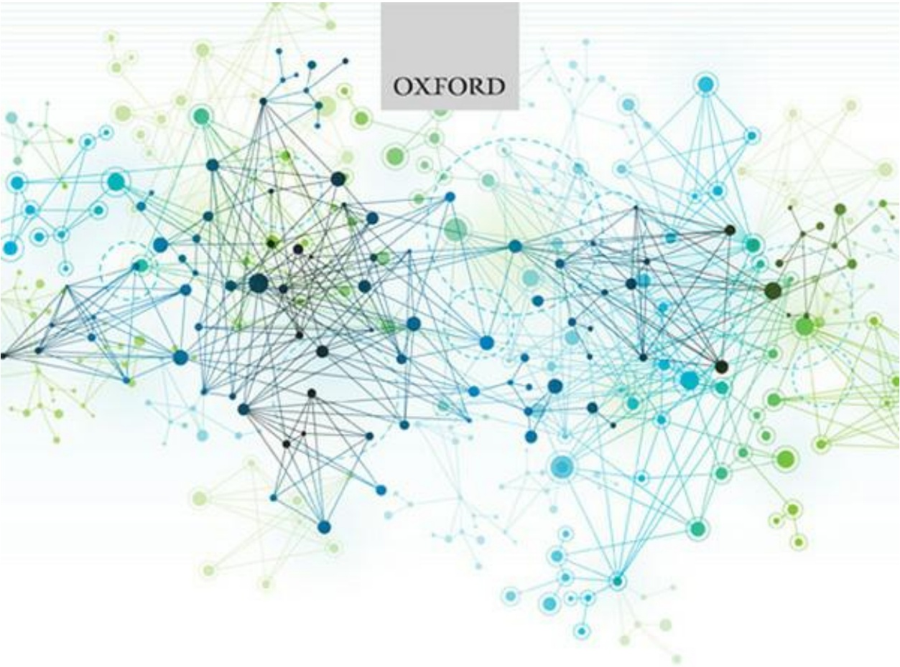

bubble

| Node Type | Color |
| --- | --- |
| Nodes | Dark Blue, Light Blue, Green, Yellow |

# Introduction to Bioinformatics

Fourth Edition

Arthur M. Lesk

bubble

| Entity | Connection Type |
| --- | --- |
| Oxford | Network Graph |

# Introduction to Bioinformatics

Fourth Edition

Arthur M. Lesk

Introduction to Bioinformatics

## INTRODUCTION TO BIOINFORMATICS

**FOURTH EDITION**

Arthur M. Lesk

The Pennsylvania State University

In nature’s infinite book of secrecy A little I can read.

Antony and Cleopatra

OXFORD UNIVERSITY PRESS

## OXFORD

## UNIVERSITY PRESS

Great Clarendon Street, Oxford, OX2 6DP, United Kingdom

Oxford University Press is a department of the University of Oxford. It furthers the University’s objective of excellence in research, scholarship, and education by publishing worldwide. Oxford is a registered trade mark of Oxford University Press in the UK and in certain other countries

© Arthur M. Lesk 2014

The moral rights of the author have been asserted

First Edition copyright 2002

Second Edition copyright 2005

Third Edition copyright 2008

Impression: 1

All rights reserved. No part of this publication may be reproduced, stored in a retrieval system, or transmitted, in any form or by any means, without the prior permission in writing of Oxford University Press, or as expressly permitted by law, by licence or under terms agreed with the appropriate reprographics rights organization. Enquiries concerning reproduction outside the scope of the above should be sent to the Rights Department, Oxford University Press, at the address above

You must not circulate this work in any other form and you must impose this same condition on any acquirer

British Library Cataloguing in Publication Data

Data available

ISBN 978–0–19–965156–6

Printed in Italy by L.E.G.O. S.p.A—Lavis TN

Links to third party websites are provided by Oxford in good faith and for information only. Oxford disclaims any responsibility for the materials contained in any third party website referenced in this work.

Dedicated to Eda, with whom I have merged my genes.

## CONTENTS

**Preface to the first edition**

**Preface to the second edition**

**Preface to the third edition**

**Preface to the fourth edition**

**Plan of the book**

**Introduction to bioinformatics on the web**

**Acknowledgements**

## 1 Introduction

**Life in space and time**

**Phenotype = genotype + environment + life history + epigenetics**

**Evolution is the change over time in the world of living things**

**Dogmas: central and peripheral**

Statics and dynamics

Networks

**Observables and data archives**

A database without effective modes of access is merely a data graveyard

Information flow in bioinformatics

Curation, annotation, and quality control

**The world-wide web**

**Electronic publication**

**Computers and computer science**

Programming

**Biological classification and nomenclature**

**Use of sequences to determine phylogenetic relationships**

Use of SINES and LINES to derive phylogenetic relationships

**Searching for similar sequences in databases: PSI-BLAST**

**Introduction to protein structure**

**The hierarchical nature of protein architecture**

**Classification of protein structures**

**Protein structure prediction and engineering**

Critical Assessment of Structure Prediction

Protein engineering

**Proteomics and transcriptomics**

DNA microarrays

Transcriptomics and RNA sequencing

Mass spectrometry

**Systems biology**

**Clinical implications**

The future

**Recommended reading**

**Exercises and problems**

## 2 Genome organization and evolution

**Genomes, transcriptomes, and proteomes**

Genes

Proteomics and transcriptomics

**Eavesdropping on the transmission of genetic information**

Identification of genes associated with inherited diseases

Mappings between the maps

**High-resolution maps**

**Genome-wide association studies**

**Picking out genes in genomes**

**Genome-sequencing projects**

**Genomes of prokaryotes**

The genome of the bacterium Escherichia coli

The genome of the archaeon Methanococcus jannaschii

The genome of one of the simplest organisms: Mycoplasma genitalium

**Metagenomics: the collection of genomes in a coherent environmental sample**

The human microbiome

**Genomes of eukarya**

Gene families

The genome of Saccharomyces cerevisiae (baker's yeast)

The genome of Caenorhabditis elegans

The genome of Drosophila melanogaster

The genome of Arabidopsis thaliana

## The genome of Homo sapiens (the human genome)

Protein-coding genes

Repeat sequences

RNA

Single-nucleotide polymorphisms and haplotypes

Systematic measurements and collections of single-nucleotide polymorphisms

Ethical, legal, and social issues

## Genetic diversity in anthropology

DNA sequences and languages

Genetic diversity and personal identification

## Evolution of genomes

Please pass the genes: horizontal gene transfer

## Comparative genomics of eukarya

## Recommended Reading

## Exercises and problems

## 3 Scientific publications and archives: media, content, and access

## The scientific literature

## Economic factors governing access to scholarly publications

Open access

The Public Library of Science

## Traditional and digital libraries

How to populate a digital library

## The information explosion

The web: higher dimensions

New media: video, sound

Searching the literature

Bibliography management

## Databases

Database contents

The literature as a database

Database organization

Annotation

Database quality control

Database access

Links

Database interoperability

Data mining

## Programming languages and tools

Traditional programming languages

Scripting languages

Program libraries specialized for molecular biology

Java: computing over the web

Markup languages

## Natural language processing

Natural language processing and mining the biomedical literature

Applications of text mining

## Recommended reading

## Exercises and problems

## 4 Archives and information retrieval

## Database indexing and specification of search terms

Follow-up questions

Analysis and processing of retrieved data

## The archives

Nucleic acid sequence databases

Genome databases and genome browsers

Protein sequence databases

Databases of protein families

Databases of structures

Classifications of protein structures

Accuracy and precision of protein structure determinations

Specialized, or ‘boutique’, databases

Expression and proteomics databases

Bibliographic databases

Surveys of molecular biology databases and servers

## Gateways to archives

Access to databases in molecular biology

ENTREZ

The Protein Identification Resource

ExPASy: Expert Protein Analysis System

## Where do we go from here?

## Recommended reading

**Exercises and problems**

## 5 Alignments and phylogenetic trees

**Introduction to sequence alignment**

**The dotplot**

**Dotplots and sequence alignments**

**Measures of sequence similarity**

Scoring schemes

Derivation of substitution matrices: PAM and BLOSUM matrices

## Computing the alignment of two sequences

Variations and generalizations

Approximate methods for quick screening of databases

## The dynamic-programming algorithm for optimal pairwise sequence alignment

**Significance of alignments**

**Multiple sequence alignment**

## Applications of multiple sequence alignments and database searching

Profiles

PSI-BLAST

Hidden Markov models

## Phylogeny

Determination of taxonomic relationships from molecular properties

## Phylogenetic trees

Clustering methods

Cladistic methods

Reconstruction of ancestral sequences

## The problem of varying rates of evolution

Are trees the correct way to present phylogenetic relationships?

Computational considerations

## Putting it all together

## Recommended reading

## Exercises and problems

## 6 Structural bioinformatics and drug discovery

## Introduction

## Protein stability and folding

The Sasisekharan–Ramakrishnan–Ramachandran plot describes allowed mainchain conformations

The sidechains

Protein stability and denaturation

## Protein folding

## Applications of hydrophobicity

Coiled-coiled proteins

## Superposition of structures, and structural alignments

DALI and MUSTANG

## Evolution of protein structures

Classifications of protein structures

## Protein structure prediction and modelling

A priori and empirical methods

Critical Assessment of Structure Prediction

Secondary structure prediction

Homology modelling

Fold recognition

Conformational energy calculations and molecular dynamics

## Assignment of protein structures to genomes

## Prediction of protein function

Divergence of function: orthologues and paralogues

## Drug discovery and development

The lead compound

Improving on the lead compound: quantitative structure-activity relationships

Bioinformatics in drug discovery and development

Molecular modelling in drug discovery

## Recommended reading

## Exercises and problems

## 7 Introduction to systems biology

## Introduction

## Networks and graphs

Connectivity in networks

## Dynamics, stability, and robustness

## Some sources of ideas for systems biology

Complexity of sequences

Computational complexity

Static and dynamic complexity

Chaos and predictability

**Recommended reading**

**Exercises and problems**

## 8 Metabolic pathways

**Classification and assignment of protein function**

The Enzyme Commission

The Gene Ontology Consortium protein function classification

**Catalysis by enzymes**

**Active sites**

Cofactors

**Protein–ligand binding equilibria**

**Enzyme kinetics**

**Measures of effectiveness of enzymes**

**How do proteins evolve new functions?**

Control over enzyme activity

Structural mechanisms of evolution of altered or novel protein functions

**Protein evolution at the level of domain assembly**

**Databases of metabolic pathways**

EcoCyc

The Kyoto Encyclopedia of Genes and Genomes

**Evolution and phylogeny of metabolic pathways**

Pathway comparison

**Alignment of metabolic pathways**

Comparing linear metabolic pathways

Comparing nonlinear metabolic pathways: the pentose phosphate pathway and the Calvin–Benson cycle

**Dynamics of metabolic networks**

Robustness of metabolic networks

Dynamic modelling of metabolism

**Recommended reading**

**Exercises and problems**

## 9 Gene expression and regulation

**DNA microarrays**

Microarray data are quantitative but imprecise

Analysis of microarray data

## Mass spectrometry

Identification of components of a complex mixture
Protein sequencing by mass spectrometry
Measuring deuterium exchange in proteins
Genome sequence analysis by mass spectrometry

## Protein complexes and aggregates

Properties of protein–protein complexes

## Protein interaction networks

## Regulatory networks

Signal transduction and transcriptional control
Structures of regulatory networks
Structural biology of regulatory networks

## The genetic switch of bacteriophage λ

What are the characteristics of the switch that must be implemented by DNA–protein interactions?

The materials

How to ’throw’ the switch

## The genetic regulatory network of Saccharomyces cerevisiae

Adaptability of the yeast regulatory network

## Recommended reading

## Exercises and problems

## Conclusion

## Index

# PREFACE TO THE FIRST EDITION

On June 26, 2000, the sciences of biology and medicine changed forever. Prime Minister of the United Kingdom Tony Blair and President of the United States Bill Clinton held a joint press conference, linked via satellite, to announce the completion of the draft of the Human Genome. The New York Times ran a banner headline: ‘Genetic Code of Human Life is Cracked by Scientists’. The sequence of 3 billion bases was the culmination of over a decade of work, during which the goal was always clearly in sight and the only questions were how fast the technology could progress and how generously the funding would flow. The Table shows some of the landmarks along the way.

Next to the politicians stood the scientists. John Sulston, Director of the Wellcome Trust Sanger Institute in the UK, had been a key player since the beginning of high-throughput sequencing methods. He had grown with the project from the earliest ‘one man and a dog’ stages to the current international consortium. In the US, appearing with President Clinton were Francis Collins, director of the US National Human Genome Research Institute, representing the US publicly-funded efforts; and J. Craig Venter, President and Chief Scientific Officer of Celera Genomics Corporation, representing the commercial sector. It is difficult to introduce these two without thinking, ‘In this corner … and in this corner …’. Although never actually coming to blows, there was certainly intense competition, in the later stages a race.

The race was more than an effort to finish first and receive scientific credit for priority. Indeed, it was a race after which the contestants would be tested not for whether they had taken drugs, but whether they and others could discover them. Clinical applications were a prime motive for support of the Human Genome Project. Once the courts had held that gene sequences were patentable—with enormous potential payoffs for drugs based on them—the commercial sector rushed to submit patents on sets of sequences that they determined, and the academic groups rushed to place each bit of sequence that they determined into the public domain to prevent Celera—or anyone else—from applying for patents.

The academic groups lined up against Celera were a collaborating group of laboratories primarily but not exclusively in the UK and USA. These included the Wellcome Trust Sanger Institute in England, Washington University in St. Louis, Missouri, the Whitehead Institute at the Massachusetts Institute of Technology in Cambridge, Massachusetts, Baylor College of Medicine in Houston, Texas, the Joint Genome Institute at Lawrence Livermore National Laboratory in Livermore, California, and the RIKEN Genomic Sciences Center, now in Yokahama, Japan.

Both sides could dip into deep pockets. Celera had its original venture capitalists; its current parent company, PE Corporation; and, after going public, anyone who cared to take a flutter. The Wellcome Trust Sanger Institute was supported by the UK Medical Research Council and The Wellcome Trust. The US academic labs were supported by the US National Institutes of Health and Department of Energy.

On June 26, 2000 the contestants agreed to declare the race a tie, or at least a carefully out-of-focus photo finish.

**Landmarks in the Human Genome Project**

| 1953 | Watson–Crick structure of DNA published. |
| --- | --- |
| 1975 | F. Sanger, and independently A. Maxam and W. Gilbert, develop methods for sequencing DNA. |
| 1977 | Bacteriophage $\phi$X-174 sequenced: first ‘complete genome’. |
| 1980 | US Supreme Court holds that genetically-modified bacteria are patentable. This decision was the original basis for patenting of genes. |
| 1981 | Human mitochondrial DNA sequenced: 16 569 base pairs. |
| 1984 | Epstein–Barr virus genome sequenced: 172 281 base pairs |
| 1990 | International Human Genome Project launched: target horizon 15 years. |
| 1991 | J. Craig Venter and colleagues identify active genes via expressed sequence tags, sequences of initial portions of DNA complementary to messenger RNA. |
| 1992 | Complete low-resolution linkage map of the human genome. |
| 1992 | Beginning of the Caenorhabditis elegans sequencing project. |
| 1992 | Wellcome Trust and UK Medical Research Council establish the Sanger Centre for large-scale genomic sequencing, directed by J. Sulston. |
| 1992 | J. Craig Venter forms the Institute for Genome Research (TIGR), associated with plans to exploit sequencing commercially through gene identification and drug discovery. |
| 1995 | First complete sequence of a bacterial genome, Haemophilus influenzae, by TIGR. |
| 1996 | High-resolution map of human genome: markers spaced by ≈600 000 base pairs. |
| 1996 | Completion of yeast genome, first eukaryotic genome sequence. |
| May 1998 | Celera claims to be able to finish human genome by 2001. Wellcome responds by increasing funding to Sanger Centre. |
| 1998 | Caenorhabditis elegans sequence published. |
| September 1, 1999 | Drosophila melanogaster genome sequence announced, by Celera Genomics; released Spring 2000. |
| 1999 | Human Genome Project states goal: working draft of human genome by 2001 (90% of genes sequenced to >95% accuracy). |
| December 1, 1999 | Sequence of first complete human chromosome published. |
| June 26, 2000 | Joint announcement of complete draft sequence of human genome. |
| 2003 | Fiftieth anniversary of discovery of the structure of DNA. Announcement of completion of human genome sequence. |

The human genome is only one of the many complete genome sequences known. Taken together, genome sequences from organisms distributed widely among the branches of the tree of life give us a sense, only hinted at before, of the very great unity in detail of all life on Earth. They have changed our perceptions, much as the first pictures of the Earth from space engendered a unified view of our planet.

The sequencing of the human genome sequence ranks with the Manhattan project that produced atomic weapons during the Second World War, and the space program that sent people to the Moon, as one of the great bursts of technological achievement of the last century. These projects share a grounding in fundamental science, and large-scale and expensive engineering development and support. For biology, neither the attitudes nor the budgets will ever be the same. Soon a ‘one man and a dog project’ will refer only to an afternoon’s undergraduate practical experiment in sequencing and comparison of two mammalian genomes.

The human genome is fundamentally about information, and computers were essential both for the determination of the sequence and for the applications to biology and medicine that are already flowing from it. Computing contributed not only the raw capacity for processing and storage of data, but also the mathematically-sophisticated methods required to achieve the results. The marriage of biology and computer science has created a new field called bioinformatics.

Today bioinformatics is an applied science. We use computer programs to make inferences from