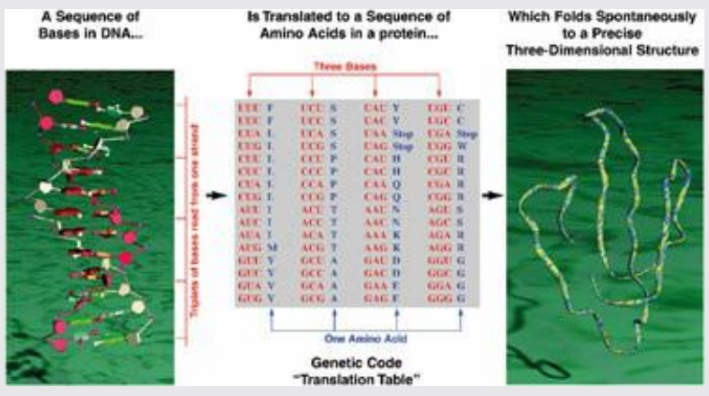

RNA. Most genes in higher organisms contain internal untranslated regions, or introns. Some regions of the DNA sequence are devoted to control mechanisms, and a substantial amount of the genomes of higher organisms has been termed ‘junk’, which may mean merely that we do not yet understand its function.

A major effort to understand the function of the genome has produced the results of the ENCODE project (see Box 1.3).

## Box 1.3 The ENCODE project

The goal of the ENCODE project (derived from Encylopaedia of DNA Elements) is to understand the function of the entire human genome. Almost 500 scientists in 32 research groups formed the consortium that tackled the problem. The current effort is the result of a scaling up from a pilot project started in 2007, which focused on a selected 1% (about 30 Mb) of the human genome deemed likely to be of interest. The current results, a landmark burst of 30 papers published coordinately in Nature, Genome Research, and Genome Biology, assign function (meaning that they specify biological activity) to about 80% of the human genome. It is entirely possible that the functions of the remaining 20% will be identified. The Nature ENCODE Explorer offers web access to the project and its results (http://www.nature.com/encode/#/threads).

When the human genome was first sequenced it appeared that there were only about 23 000 protein-coding genes, accounting for about 1.5% of the genome. The number of genes was smaller than expected (earlier, much larger estimates, if scrutinised, had no reliable basis). It is true that variable splicing means that the number of proteins is not limited to the number of protein-coding genes. (The immune system generates the vast majority of the individual proteins in our bodies, but uses a different splicing system—at the DNA rather than the RNA level.)

In addition to proteins, regions of DNA encode non-messenger RNA molecules, including but not limited to the RNA components of the ribosome, and transfer RNAs (tRNAs).

Nevertheless, the function of the more than 99% non-protein-coding DNA was a mystery. Although clearly some of the noncoding regions were regulatory, there was still a tendency to talk about the large amounts of ‘junk’ DNA. For, although the fugu fish genome is only one-eighth the size of the human genome, fugu has a protein repertoire of a similar size to humans. If fugu could get along without seven-eighths of our DNA, the suggestion was that much of this excess must be ‘junk’. (Sydney Brenner distinguished junk, meaning useless stuff you keep around, from garbage, or useless stuff you get rid of.)

There are two ways for a noncoding region of DNA to have a function. Even if not transcribed, it could be involved in sequence-dependent physical interactions, within chromatin, that either expose it to or block it from protein ligands. If transcribed, it can form RNAs with various possible functions, the most common of which is regulation of transcription.

Categories of results of the ENCODE analysis include:

- evidence that $75\%$ of the human genome is transcribed;
- a mapping and dictionary of regulatory sites in the genome, regions of the DNA that bind proteins to control transcription. The 8.4 million such sites amount to twice as much DNA as codes for protein. The affinity is many-to-one; that is, many proteins can bind to the same regulatory region;
- a sketch of the structure of the regulatory network. The interactions that enhance or inhibit gene expression have a detailed and intricate logic, including feedback loops. Many interactions contribute to the ultimate decision;
- a mapping of exposed sites in chromatin, which are unprotected from DNase 1 cleavage. These sites mark regulatory regions typically adjacent to genes, and provide sites for binding of regulators of expression.

The data provided by the ENCODE project will be the launching pad for many future research projects. A colleague admitted to hearing an echo: ‘Now this is not the end. It is not even the beginning of the end. But it is, perhaps, the end of the beginning.’

In DNA the molecules comprising the alphabet are chemically similar, and the structure of DNA is, to a first approximation, uniform (although some DNA–protein interactions distort the DNA structure). Proteins, and structural RNAs, in contrast, show great variety in their three-dimensional conformation. These are necessary to support their very diverse structural and functional roles.

The amino acid sequence of a protein dictates its three-dimensional structure. For each natural amino acid sequence there is a unique stable native state that under proper conditions is adopted spontaneously (see Box 1.4). If a purified protein is heated, or otherwise brought to conditions far from the normal physiological environment, it will ‘unfold’ to a disordered and biologically inactive structure. (This is why our bodies contain mechanisms to maintain nearly constant internal conditions.) When normal conditions are restored, protein molecules will generally readopt the native structure, indistinguishable from the original state. There are important exceptions, however. Irreversible denaturation leading to formation of insoluble aggregates is most familiar to us when we hard-boil an egg. Such aggregates are associated with many diseases, including Alzheimer’s disease and bovine spongiform encephalopathies (such as so-called mad-cow disease).

The functions of proteins depend on their adopting their native three-dimensional structure. For example, the native structure of an enzyme may have a cavity on its surface that binds a small molecule and juxtaposes

## Box 1.4 From one dimension to three

The spontaneous folding of proteins to form their native states is the point at which nature makes the giant leap from the one-dimensional world of gene and protein sequences to the three-dimensional world that we inhabit. There is a paradox: the translation of DNA sequences to amino acid sequences is very simple to describe logically; it is specified by the genetic code. The folding of a polypeptide chain into a precise three-dimensional structure is very difficult to describe logically. However, translation requires the immensely complicated machinery of the ribosome, tRNAs, and associated molecules, but protein folding occurs spontaneously (see Plate II).



<details>
<summary>flowchart</summary>

```mermaid
graph LR
  A["A Sequence of Bases in DNA..."] --> B["Is Translated to a Sequence of Amino Acids in a protein..."]
  B --> C["Three Bases"]
  C --> D["Three-Dimensional Structure"]
  D --> E["Which Folds Spontaneously to a Precise Three-Dimensional Structure"]
  E --> F["Genetic Code\n"Translation Table"
```
</details>

Plate II Expression of gene sequences as three-dimensional structures of proteins. A DNA sequence encodes an amino acid sequence. The polypeptide chain of a protein folds spontaneously into the correct native structure.

it to catalytic residues. Many regulatory mechanisms depend on the binding of proteins to other proteins or to DNA. We thus have the paradigm:

• DNA sequence determines protein sequence;
• protein sequence determines protein structure;
• protein structure determines protein function;
• regulatory mechanisms, including but not limited to control of expression patterns, deliver the

right amount of the right function to the right place at the right time.

Much of the organized activity of bioinformatics has been focused on the analysis of the data related to these processes.

## Statics and dynamics

The genome sequence of a cell, and its implied repertoire of RNAs and proteins, expresses what the cell could be and could do. But cells make choices. Dense, logically integrated, networks of control mechanisms govern the dynamic state of cellular metabolic and transcriptional activity. (See Chapter 7.)

The dynamics of the molecular biology of cells and organisms include levels higher than the molecular, of structure and organization. Examples are such questions as how tissues become specialized during development or, more generally, how environmental effects exert control over genetic events. In some cases of simple feedback loops it is understood at the molecular level how increasing the amount of a reactant causes an increase in the production of an enzyme that catalyses its transformation. The lac operon of Escherichia coli is an example.

More complex are the programmes of development that unfold during the lifetime of an organism. Learning, which must ultimately be reflected in changes in structure and dynamics of the nervous system, is really a developmental process. These fascinating problems about the information flow and control in an organism have now come within the scope of mainstream bioinformatics. For example, it was reported recently $^{3}$ in honeybees that patterns of DNA methylation—that is, epigenetic signals—reversibly control behaviour patterns.

Many novel data streams reflect experiments on dynamic aspects of molecular biology. These include new techniques, such as:

- sequencing of cells' RNA content to measure the transcriptome;
• determination of DNA methylation patterns;
- identification of splice variants and post-translational modifications of proteins;
• identifying the partners in:
- protein–protein interactions,
- DNA–protein interaction in transcription regulation: both the DNA region and the proteins that bind to it;
- integration of individual regulatory steps into networks.

Systematic application of both old and new techniques permits controlled comparisons:

• large-scale surveys of single-nucleotide polymorphisms (SNPs) in human populations;
- phylogenetic studies, to understand the origin and changes of particular genes during the course of evolution;
- tissue-specific, disease-specific, and age-specific measurements of sequences, epigenetic signals, and expression patterns.

## Networks

Crucial to biology is how components of living systems interact. Any molecule may have several partners with which it interacts in different ways. The sets of interactions of different molecules form networks.

There are networks of genes, proteins, and metabolites. Indeed, the same set of molecules may be connected by different types of interaction or relationship, to form different networks (see Table 1.1).

Table 1.1

| Network | Element of network | Connection between elements |
| --- | --- | --- |
| Genomes | Gene | Homology |
|  |  | Linkage |
|  |  | Shared expression pattern |
| Protein | Protein | Homology |
|  |  | Regulatory relationship |
|  |  | Shared expression pattern |
|  |  | Physical complex formation |
| Metabolite | Chemical compound | Substrate and product of an enzymatic reaction |
|  |  | Similarity in structure |
|  |  | Similarity in reactivity |

In cells, the two types of interaction network are in operation: a physical network of protein–protein and protein–nucleic acid complexes, and a logical network of control cascades. Physical and logical networks operate in parallel. Interactions may be physical or logical—often they are both. A macromolecular complex such as the ribosome is a network of proteins and RNAs, interacting through the physical contacts in their assembly. A transcription-regulatory network is a network of genes, exerting logical control over expression patterns via the synthesis of specific DNA-binding proteins. A transcription factor that acts by binding to DNA may never interact physically with the proteins the expression of which it controls. Metabolic pathways have a similar duality: many but not all metabolic pathways are mediated by physical protein–protein interactions and regulated by logical ones.

Even though particular complexes may participate in both physical and logical networks, the two remain distinct in terms of their organization and their biological function, and it is useful to keep the distinction between them in mind, especially when they overlap.

## Observables and data archives

Bioinformatics deals with biological data, their collection, curation, distribution, and analysis. The ‘unit’ of distribution of a collection of some type of biological information is a database. There has been a great deal of growth and proliferation of databases and, perhaps paradoxically, there is a trend towards integration into larger and more comprehensive ones, to combine different categories of information that were formerly the provinces of individual projects. This is being driven by both academic and political forces.

A database includes (1) an archive of information, (2) a logical organization or ‘structure’ of that information, called a schema, and (3) tools to gain access to it. Databases in molecular biology contain nucleic acid and protein sequences, macromolecular structures and functions, expression patterns, and networks of metabolic pathways and control cascades. They include:

\- archival databases of biological information:

• DNA and protein sequences, including annotation (see Box 1.5);
- variations, such as compilations of haplotypes, or disease-associated mutations;

- nucleic acid and protein structures, including annotation;
- databases focused on organisms, including genome databases;
- databases of protein expression patterns;
- databases of metabolic pathways;
- databases of interactions and of regulatory networks;

\- derived databases: these contain information collected from the archival databases, and inferred from analysis of their contents. For instance:

- sequence motifs (characteristic ‘signature patterns’ of families of proteins);
- classifications or relationships (connections between, and common features of, entries in archives). Examples include databases of protein sequence families, or hierarchical classifications of protein folding patterns);

## Box 1.5 Archives of nucleic acid and protein sequences

The archive of nucleic acid sequences is maintained by a triple partnership, the International Nucleotide Sequence Database Collaboration, comprising GenBank, based at the US National Center for Biotechnology Information, in Bethesda, Maryland; the European Nucleotide Archive, or ENA, based at the European Bioinformatics Institute (EBI), in Hinxton, UK, and the Center for Information Biology and DNA Data Bank of Japan, at the National Institute of Genetics in Mishima, Japan. The three sites exchange incoming submissions daily to ensure common coverage. However, the format, annotation, and embedded links differ among the corresponding entries released by the different databases.


## See Weblem 1.4

The archive of amino acid sequences of proteins, now determined almost exclusively from translation of gene sequences, is maintained by the United Protein Database (UniProtKB), a merger of the databases SWISS-PROT, the Protein Identification Resource (PIR), and Translated EMBL (TrEMBL).

Associated with the archives are tools for selection and retrieval of sequences. The EBI has a number of search engines pointed at different components of its databases. The US National Center for Biotechnology Information offers ENTREZ. Both allow parallel searches in multiple data archives.

Many full-genome sequencing projects maintain databases focused on individual species. Notable are the Ensembl (Wellcome Trust Sanger Institute, Hinxton, UK), University of California at Santa Cruz browsers for the human and other genomes, and FlyBase.

Many derived databases assemble families of proteins or subunits based on the similarities of their sequences. An ‘umbrella’ database, InterPro, integrates the contents, features, and annotation of several individual databases of protein families, domains, and functional sites, and contains links to others, including the Gene Ontology Consortium functional classification. Interpro intends to assimilate additional databases, including structural databases. (Resistance is futile.)

- bibliographic databases. The scientific literature itself is data. PubMed is a database. Researchers ‘datamine’ PubMed as they do any other database;
- databases of websites:
- databases of databases containing biological information;
- links between databases.

A database without effective modes of access is merely a data graveyard

Useful access to data requires a set of tools for answering questions, such as:

- ‘Does the database contain the information I require?’ (Example: can I retrieve the amino acid sequence of human alcohol dehydrogenase?)
- ‘How can I assemble selected information from the database in a useful form?’ (Example: compile a list of globin sequences; or even better, a table of aligned globin sequences.)
- Indices of databases are useful in asking ‘Where can I find some specific piece of information?’ (Example: what databases contain the amino acid sequence of porcupine trypsin?) Of course, if I know and can specify exactly what I want, the problem is relatively straightforward.

Mechanisms that allow effective access are an issue of database design that ideally should remain hidden from users. It has become clear that effective access cannot be provided by bolting a query system onto an unstructured archive. Instead, the logical organization of the storage of the information must be designed with the access in mind, considering what kinds of questions users will want to ask. The structure of the archive must mesh smoothly with the information-retrieval software.

A variety of database queries arise in bioinformatics. Compare the following typical examples:

1. Given a sequence, or fragment of a sequence, find sequences in the database that are similar to it. This is a central problem in bioinformatics. We share such string-matching problems with many fields of computer science. For instance, word processing and editing programs support string-search functions.
2. Given a protein structure, or fragment, find protein structures in the database that are similar to it. This is the generalization of the string-matching problem to three dimensions.
3. Given a sequence of a protein of unknown structure, find structures in the database that adopt similar three-dimensional structures. One might be tempted to cheat, to look in the sequence data banks for proteins with sequences similar to the probe sequence. For if two proteins have sufficiently similar sequences, they will have similar structures. However, the converse is not true, and one can hope to create more powerful search techniques that will find proteins of similar structure even though their sequences have diverged beyond the point where they can be recognized as similar by sequence comparison.
4. Given a protein structure, find sequences in the data bank that correspond to similar structures. Again, one can cheat by using the structure to probe a structure data bank, but this can give only limited success because there are so many more sequences known than structures. It is therefore desirable to have a method that can pick out the structure from the sequence.

Points 1 and 2 are solved problems; such searches are carried out thousands of times a day. Points 3 and 4 are active fields of research.

## Information flow in bioinformatics

Data enter the bioinformatics establishment when a scientist deposits an experimental result in an archive, or a database records a result appearing in the literature. The archive curates and annotates the data to create an entry of proper contents and format. Quality checks are part of the curation process. The new entry then appears in the public release of the archive.

The division of the archive into entries is determined by the provenance of the data; that is, an entry corresponds to one coherent set of experimental measurements, often corresponding to one published article. In some cases, fragments of a complete sequence appear in several articles. A database can join the results to form an entry containing the complete biological entity. Currently, many nucleotide sequence data sets enter the databases as annotated genomes, or as unassembled metagenomic fragments.

Other information-retrieval projects, either associated with an archive or independent, may integrate newly released entries into their individual systems. They may select or reorganize the data structure, and provide novel tools for analysis.

Reorganization of the data may involve:

- simply integrating the new entries into a general or specialized search engine;
- extracting useful subsets of the data. Examples include (1) identification of genes in a connected DNA sequence, such as a bacterial genome or a eukaryotic chromosome, and (2) the extraction of a nonredundant set of protein sequences, to both shorten searches and reduce statistical bias;
- deriving new types of information from the original data. A simple example: release of a protein-coding gene by a DNA sequence archive will trigger the appearance of its amino acid sequence translation in databases of protein sequences. (A not-so-simple aspect: DNA sequences don’t tell us about splice variants or about other important information related to the protein);
- recombining data in different ways. Many projects group sequences or structures of families of homologous proteins, or proteins that share function. Examples include the MEROPS protease database and the Protein Kinase Resource. Some archives tend to keep related entries separate to preserve clarity of provenance. Some databases integrate data about a particular organism or sets of related organisms: FlyBase is an example;
- reannotating the data, including provision of different constellations of links. The integration may be horizontal or vertical. That is, links may indicate relationships to other entries of the same type (for instance, correspondences within a genome among homologous genes or among genes associated with the same metabolic pathway). Or, links may adduce a variety of information about a gene or protein (for instance, links between a gene and the clinical consequences of mutations).

Many sites serve as gateways between the archives and the computational tools available for data analysis. Information retrieval permits selection and extraction of data to provide the ingredients of a research project. Many bioinformatics resources not only offer information retrieval, but facilitate the ‘downstream’ processing of the entries selected. A typical example would be to retrieve the sequences of a set of homologous genes and then to align them. The goal is to provide smooth integration of all the data-processing steps required for a research project, by intimate links among the tools for data storage, retrieval, and analysis.

The growing importance of simultaneous access to databases has led to research in database interactivity: how can databases ‘talk to one another’ without too great a sacrifice of the freedom of each one to structure its own data in ways appropriate to the individual features of the material it contains?

On the other hand there is a very strong trend towards merging and integration of data resources in bioinformatics. Some of the reasons for this are political: the ‘empire-building’ allele is present at fairly high frequency in the scientific population, and then the ‘too big to fail’ argument for continued and enhanced funding takes over. Scientifically, integrating databases allows for ‘one-stop shopping’, makes for ease of handling queries that require access to different categories of information, and facilitates of cross-category consistency checks in curating the data. Moreover, large database organizations have the personnel to provide tutorial guides: to usage of the site and to present scientific background. A large organization can support a help desk. Frustrated users may retort that the integration of the data produces a site so complex as to require guidance. However, there are plenty of small specialized databases that users also find confusing.

Indeed, only national or commercial rivalries impede fusion into a single world-wide database. Because of the danger that the result will prove unwieldy, it will be possible to tailor access to the needs of particular projects. The unification of the archives will be accompanied by a fragmentation of the routes of access.

Although there are good arguments for unique, or no more than partnership, control over the archives, there is no need to limit the ways to access them: colloquially, the design of the ‘front end’ of the database. Specialized user communities may extract subsets of the data, or recombine data from different sources, and provide specialized avenues of access. Such ‘boutique’ databases depend on the primary archives as the source of the information they contain, but redesign the organization and presentation. Indeed, different derived databases can slice and dice the same information in different ways. This accounts for much of the great proliferation of specialized databases reported in the annual Nucleic Acids Research compendium.

A reasonable extrapolation suggests the concept of specialized ‘virtual databases’ (a concept first suggested almost 50 years ago), grounded in the archives but providing individual scope and function, tailored to the needs of individual research groups or even individual scientists.

## Curation, annotation, and quality control

The scientific and medical communities are dependent on the quality of databases. Indices of quality, even if they do not permit correction of mistakes, may help us avoid arriving at wrong conclusions.

Database entries comprise raw experimental results, and supplementary information or annotations. Each of these has its own sources of error.

The most important determinant of the quality of the data themselves is the state of the art of the experiments. Older data were limited by older techniques; for instance, amino acid sequences of proteins were once determined by peptide sequencing, but are now translated from DNA sequences (except for partial sequencing by mass spectrometry). One consequence of the data explosion is that most data are new data, governed by current technology, which in most cases does quite a good job.

Annotations include information about the source of the data and the methods used to determine them. They identify the investigators responsible and cite relevant publications. They provide links to related information in other databases. In some sequence databases the annotations include feature tables, which are lists of segments of the sequences that have biological significance; for instance, regions of a DNA sequence that code for proteins. These appear in computer-parsable formats, their contents restricted to a controlled vocabulary. Note that a statement by each database on a controlled vocabulary, and the definitions of the terms that appear in the vocabulary, is essential for information-retrieval operations involving interactions among multiple databases, and distributed queries. (This is like a ‘convention card’ at a bridge tournament.)

Formerly, a typical DNA sequence entry was produced by a single research group, investigating a gene and its products in a coherent way. Annotations were grounded in experimental data and written by specialists. In contrast, full-genome sequencing projects offer no experimental confirmation of the expression of most putative genes, nor characterization of their products. Curators at databases base much of their annotation on the analysis of the sequences by computer programs.

Annotation is the weakest component of the genomics enterprise. Automation of annotation is possible only to a limited extent; getting it right remains labour-intensive, and allocated resources are inadequate. But the importance of proper annotation cannot be underestimated. P. Bork has commented that errors in gene assignments vitiate the high quality of the sequence data themselves.

Growth of genomic data will permit improvement in the quality of annotation as statistical methods increase in accuracy. This will allow improved reannotation of entries. The improvement of annotations will be a good thing. It implies, however, the disturbing concomitant that annotation will be in flux. The problem is aggravated by the proliferation of websites with increasingly dense networks of links. Networks of websites provide useful avenues for applications. But the web is also a vector of contagion, propagating errors in raw data, in immature data subsequently corrected but the corrections not passed on, and in variant annotations.

Perhaps the only possible solution is a distributed and dynamic error-correction and annotation process. Distributed in that database staff will have neither the time nor the expertise for the job; specialists will have to act as curators. Dynamic in that progress in automation of annotation and error identification/correction will permit reannotation of databases. We will have to give up the safe idea of a stable database composed of entries that were correct when first distributed and which will stay fixed. Databases will become a seething broth of information, growing in size and maturing—we must hope—in quality.

Tasks of greater subtlety arise when one wishes to study relationships between information contained in separate databases. This requires links that facilitate simultaneous access to several databases. Here is an example: for which proteins of known structure involved in diseases of purine biosynthesis in humans are there related proteins in yeast? We are setting conditions on known structure, specified function, detection of relatedness, correlation with disease, and specified species. Today the quality of a database depends not only on the information it contains but on the effectiveness of its links to other related sources of information. This one of the reasons for integration of databases.

## The worldwide web


## See Weblem 1.5

All readers will have used the worldwide web, for reference material, for news, for access to databases in molecular biology, for checking out personal information about individuals—friends or colleagues or celebrities—or just for browsing. The web is a means of interpersonal and intercomputer contact over networks. It provides a complete global village, containing the equivalent of library, post office, shops, and schools.

As a repository, the web can be thought of as a giant worldwide multimedia notice board. It contains text, images, cinema, and sound. Virtually anything that can be stored on a computer can be made available and accessed via the web. An interesting example is a site treating the poetry of Walt Whitman (http://www.whitmanarchive.org). The highest-level page contains a table of contents. The site contains printed text of different poems. You can compare different editions. You can access critical analysis of the poems. You can see versions of some poems in manuscripts. There is even a link to an audio file, from which you can hear Whitman himself reading part of a poem.

Links embedded in a website can be internal or external. Internal links take you to other portions of the text of a current document, or to associated images, cinema, or sounds. External links may allow you to move down to more specialized documents, up to more general ones (perhaps providing background to technical material), sideways to parallel documents (other papers on the same subject), or over, to directories that show what other relevant material is available.

Nor is the web solely a one-way street. Many web documents include forms in which you can enter information, and launch a program. Search engines are common examples. Many calculations in bioinformatics are now launched via such web servers (see Box 1.6). If the calculations are lengthy the results may not be returned within the session, but sent by e-mail.


## See Weblem 1.6

## Box 1.6 Submitting a BLAST search

A BLAST search is a common and typical example of the use of a web server in bioinformatics. Pointing a browser at a web server, one can paste in a sequence of interest, choose options, and submit the calculation. Subsequently the result will appear in the window.

The calculation is done remotely. If you are using the BLAST server at the EBI (http://www.ebi.ac.uk/Tools/sss/ncbiblast/nucleotide.html) the computations will be done at a data centre in London. External users initiate  $\approx3.7 \times 10^{6}$  sequence-similarity-related jobs per month (most but not all are BLAST searches). Currently, the EBI dedicates a 216-node cluster to this service.

Very soon we shall examine the results of such a search in detail.

The main thing to do, to get started using the web effectively, is to find useful entry points. Once a session is launched, links will take you where you want to go. Among the most important sites are search engines, such as Google, that index the entire web and permit retrieval by keywords. You can enter one or more terms, such as ‘phosphorylase’, ‘allosteric change’, or ‘crystal structure’, and the search program will return a list of links to sites on the web that contain these terms.

Once you have completed a successful session, when you next log in the intersession memory facilities of the browsers allow you to pick up cleanly where you left off. During any session, should you find yourself viewing a document to which you will want to return, you can save the link in a file of bookmarks or favourites. In a subsequent session you can return directly to any site on this list, not needing to follow the trail of links that led you there in the first place.

A personal home page is a short autobiographical sketch (with links, of course). You and your colleagues will have your own home pages which typically include name, institutional affiliation, addresses for paper and electronic mail, telephone and fax numbers, a list of publications, and current research interests. It is not uncommon for home pages to include personal information, such as hobbies, pictures of the individual with his or her spouse and children, and even with the family dog! (It is important, however, not to include information that would create vulnerability to identity theft.)

## Electronic publication

We are in an era of a transition to paper-free publishing. More and more publications are appearing on the web. A scientific journal may post only its table of contents, or a table of contents together with abstracts of articles, or complete articles. Many institutional publications—newsletters and technical reports—appear on the web. Many other magazines and newspapers are showing up as well. You might want to try http://www.nytimes.com. Many printed publications now contain references to web links containing supplementary material that never appears on paper.

Major forces in the conversion of paper to electronic libraries are the advent of electronic-format-only journals and Google's project to scan in the contents of a number of academic libraries. There is movement towards open access publication. We shall develop this topic in Chapter 3.

## Computers and computer science

Bioinformatics would not be possible without advances in computing hardware and software. Fast and high-capacity storage media are essential even to maintain the archives. Information retrieval and analysis require programs: some fairly straightforward and others extremely sophisticated. Distribution of the information requires the facilities of computer networks and the worldwide web.

Computer science is a relatively young and flourishing field with the goal of making the most effective use of information technology hardware. Certain areas of computer science impinge most directly on bioinformatics. Consider their application to a specific biological problem, that of retrieving from a database all sequences similar to the human PAX-6 sequence. A good solution to this problem would appeal to computer science for:

- Analysis of algorithms. An algorithm is a complete and precise specification of a method for solving a problem. For the retrieval of similar sequences, we need to measure the similarity of the probe sequence to every sequence in the database. It is possible to do much better than the naive approach of checking every pair of positions in every possible juxtaposition, a method that even without allowing gaps would require a time proportional to the product of the number of characters in the probe sequence times the number of characters in the database. A speciality in computer science, known colloquially as ‘stringology’, focuses on developing efficient methods for this type of problem, and analysing their effective performance.
- Data structures and information retrieval. How can we organize our data for efficient response to queries? For instance, are there ways to index or otherwise ‘preprocess’ the data to make our sequence-similarity searches more efficient? How can we provide interfaces that will assist the user in framing and executing queries?
- Software engineering. Hardly ever anymore does anyone write programs in the native language of computers. Programmers work in higher-level languages, such as C, C++, PERL, PYTHON, JAVA, or even FORTRAN. The choice of programming language depends on the nature of the algorithm and associated data structure, and the expected use of the program. Of course, most complicated software used in bioinformatics is now written by specialists, which brings up the question of how much programming expertise a bioinformatician needs.

## Programming

Programming is to computer science what bricklaying is to architecture. Both are creative; one is an art and the other a craft.

Many students of bioinformatics ask whether it is essential to learn to write complicated computer programs. My advice (not agreed upon by everyone in the field) is: ‘Don’t. Unless you want to specialize in it.’ To work in bioinformatics, you will need to develop expertise in using tools available on the web. Learning how to create and maintain a website is essential. And of course you will need facility in the use of the your computer’s operating system, including general-purpose application programs such as word processors and presentation tools. Some skill in writing simple scripts in a language like PERL provides an essential extension to the basic facilities of the operating system.

On the other hand, the size of the data archives, and the growing sophistication of the questions we wish to address, demand respect. Truly creative programming in the field is best left to specialists, with advanced training in computer science. Nor does using programs, via highly polished (not to say flashy) web interfaces, provide any indication of the nature of the activity involved in writing and debugging programs. Bismarck once said: ‘Those who love sausages or the law should not watch either being made.’ Perhaps computer programs should be added to his list.

I recommend learning some basic skills with PERL, or with one of the related languages PYTHON or RUBY. PERL is a very powerful tool, and is available for all computer systems. PERL makes it very easy to carry out many very useful simple tasks, but can also be effective in projects demanding heavy computation.

How should you learn enough PERL to be useful in bioinformatics? Many institutions run courses. Learning from colleagues is fine, depending on the ratio of your aptitude to their patience. Books are available. A very useful approach is to find lessons on the web: ask a search engine for ‘PERL tutorial’ and you will turn up many useful sites that will lead you by the hand through the basics. And, of course, use it as much as you can. This book will not teach you PERL, but it will provide opportunities to practise what you learn elsewhere. Should your programming ambitions go beyond simple tasks, check out the BioPERL project, a source of freely available PERL programs and components in the field of bioinformatics (http://bio.perl.org).

Examples of simple PERL programs appear in this book. The strength of PERL at character-string handling make it suitable for sequence-analysis tasks in biology. Here is a very simple PERL program to translate a nucleotide sequence into an amino acid sequence according to the standard genetic code. The first line, #!/usr/bin/perl, is a signal to the UNIX (or LINUX) operating system that what follows is a PERL program. Within the program, all text commencing with a ‘#’, through to the end of the line on which it appears, is merely comment. The line \_\_END\_\_ signals that the program is finished and what follows is the input data. (All material that the reader might find useful to have in computer-readable form, including all programs, appears in the online resource centre associated with this book: http://www.oxfordtextbooks.co.uk/orc/leskbioinf4e/. )

Even the simple program in Case Study 1.1 displays several features of the PERL language. The file contains background data (the standard genetic code translation table), statements that tell the computer to do something, and the input data (appearing after the \_\_END\_\_ line). Comments summarize sections of the program and describe the effect of each statement.

The program is structured as blocks enclosed in curly brackets,  $\{\ldots\}$ , which are useful in controlling the flow of execution. Within blocks, individual statements (each ending in a semicolon,;) are executed in order of appearance. However, the outer block is a loop:

```txt
while ($line = <DATA>) {
    ...
}
```

## CASE STUDY 1.1 Translation of a DNA sequence to an amino acid sequence using the standard genetic code

```perl
#!/usr/bin/perl
#translate.pl -- translate nucleic acid sequence to protein sequence
#                    according to standard genetic code
#     set up table of standard genetic code
%standardgeneticcode = (
"ttt"=> "Phe",    "tct"=> "Ser", "tat"=> "Tyr",    "tgt"=> "Cys",
"ttc"=> "Phe",    "tcc"=> "Ser", "tac"=> "Tyr",    "tgc"=> "Cys",
"tta"=> "Leu",    "tca"=> "Ser", "taa"=> "TER",    "tga"=> "TER",
```

```perl
"ttg" => "Leu",    "tcg" => "Ser", "tag" => "TER",    "tgg" => "Trp",
"ctt" => "Leu",    "cct" => "Pro", "cat" => "His",    "cgt" => "Arg",
"ctc" => "Leu",    "ccc" => "Pro", "cac" => "His",    "cgc" => "Arg",
"cta" => "Leu",    "cca" => "Pro", "caa" => "Gln",    "cga" => "Arg",
"ctg" => "Leu",    "ccg" => "Pro", "cag" => "Gln",    "cgg" => "Arg",
"att" => "Ile",    "act" => "Thr", "aat" => "Asn",    "agt" => "Ser",
"atc" => "Ile",    "acc" => "Thr", "aac" => "Asn",    "agc" => "Ser",
"ata" => "Ile",    "aca" => "Thr", "aaa" => "Lys",    "aga" => "Arg",
"atg" => "Met",    "acg" => "Thr", "aag" => "Lys",    "agg" => "Arg",
"gtt" => "Val",    "gct" => "Ala", "gat" => "Asp",    "ggt" => "Gly",
"gtc" => "Val",    "gcc" => "Ala", "gac" => "Asp",    "ggc" => "Gly",
"gta" => "Val",    "gca" => "Ala", "gaa" => "Glu",    "gga" => "Gly",
"gtg" => "Val",    "gcg" => "Ala", "gag" => "Glu",    "ggg" => "Gly"
);
# process input data
while ($line = <DATA>) { # read in line of
input
 print "$line"; # transcribe to
output
 chop(); # remove end-of-
line character
 @triplets = unpack("a3" x (length($line)/3), $line); # pull out
successive triplets
 foreach $codon (@triplets) { # loop over
triplets
 print "$standardgeneticcode{$codon}"; # print out
translation of each
} # end loop on
triplets
 print "\n\n"; # skip line on
output
} # end loop on
input lines
# what follows is input data
__END__
atgcatccctttaat
tctgtctga
Running this program on the given input data produces the output:
atgcatccctttaat
MetHisProPheAsn
tctgtctga
SerValTER
```

Here &lt;DATA&gt; refers, successively, to the lines of input data (appearing after \_\_END\_\_). The block is executed once for each line of input; that is, while there is any line of input remaining.

Three types of data structures appear in the program. The line of input data, referred to as \$line, is a simple character string. It is split into an array or vector of triplets. An array stores several items in a linear order, and individual items of data can be retrieved from their positions in the array. Then, for ease of looking up the amino acid coded by any triplet, the genetic code is stored as an associative array. An associative array, or hash table, is a generalization of a simple or sequential array. Elements of a simple array are indexed by consecutive integers. Elements of an associative array are indexed by any character strings, in this case the 64 triplets. We utilize the input triplets in order of their appearance in the nucleotide sequence, but we need to access the elements of the genetic code table in an arbitrary order as dictated by the succession of triplets in the input data. A simple array or vector of character strings is appropriate for processing successive triplets, and the associative array is appropriate for looking up the amino acids that correspond to them (see Case Study 1.2).


## See Weblems 1.7 and 1.8

## CASE STUDY 1.2 Assembly of overlapping fragments

Here is another PERL program, that illustrates additional aspects of the language. It continues to emphasize the importance of descriptive comments as an essential part of good programming style. This program reassembles the sentence:

All the world's a stage,

And all the men and women merely players;

They have their exits and their entrances,

And one man in his time plays many parts.

after it has been chopped into random overlapping fragments (\n in the fragments represents end-of-line in the original):

the men and women merely players;\n

one man in his time

All the world's

their entrances,\nAnd one man

stage,\nAnd all the men and women

They have their exits and their entrances,\n

world's a stage,\nAnd all

their entrances,\nAnd one man

in his time plays many parts.

merely players;\nThey have

This kind of calculation is important in assembling DNA sequences from overlapping fragments.

```perl
#!/usr/bin/perl
#assemble.pl -- assemble overlapping fragments of strings

# input of fragments
while ($line = <DATA>) { # read in fragments, 1 per line
    chop($line); # remove trailing carriage
return
    push(@fragments,$line); # copy each fragment into array
}
# now array @fragments contains fragments

# we need two relationships between fragments:
# (1) which fragment shares no prefix with suffix of another fragment
# * This tells us which fragment comes first
# (2) which fragment shares longest suffix with a prefix of another
# * This tells us which fragment follows any fragment
```

```prolog
# First set array of prefixes to the default value "noprefixfound".
# Later, change this default value when a prefix is found.
# The one fragment that retains the default value must be come first.

# Then loop over pairs of fragments to determine maximal overlap.
# This determines successor of each fragment
# Note in passing that if a fragment has a successor then the
# successor must have a prefix

foreach \$i (@fragments) { # initially set prefix of each fragment
\$prefix{\$i} = "noprefixfound"; # to "noprefixfound"
} # this will be overwritten when a prefix is found
# for each pair, find longest overlap of suffix of one with prefix of the other
# This tells us which fragment FOLLOWS any fragment
foreach \$i (@fragments) { # loop over fragments
\$longestsuffix = ""; # initialize longest suffix to null
foreach \$j (@fragments) { # loop over fragment pairs
unless (\$i eq \$j) { # don't check fragment against itself
\$combine = \$i . "XXX" . \$j; # concatenate fragments, with fence XXX
\$combine =~ /([\S]{2,})XXX\1/; # check for repeated sequence
if (length(\$1) > length(\$longestsuffix)) { # keep longest overlap
\$longestsuffix = \$1; # retain longest suffix
\$successor{\$i} = \$j; # record that \$j follows \$i
}
}
}
\$prefix{\$successor{\$i}} = "found"; # if \$j follows \$i then \$j must have a prefix
}
foreach (@fragments) { # find fragment that has no prefix; that's the start
if (\$prefix{\$_} eq "noprefixfound") {\$outstring = \$_;}
}
\$test = \$outstring; # start with fragment without prefix
while (\$successor{\$test}) { # append fragments in order
\$test = \$successor{\$test}; # choose next fragment
\$outstring = \$outstring . "XXX" . \$test; # append to string
\$outstring =~ s/([\S]+)XXX\1/\1/; # remove overlapping segment
}
\$outstring =~ s/\n/\n/g; # change signal \n to real carriage return
print "\$outstring\n"; # print final result

__END__
the men and women merely players;\n
one man in his time
```

```txt
All the world's
their entrances,\nand one man
stage,\nAnd all the men and women
They have their exits and their entrances,\n
world's a stage,\nAnd all
their entrances,\nand one man
in his time plays many parts.
merely players;\nThey have
```

## Biological classification and nomenclature

Back to the eighteenth century when academic life was simpler, at least in some respects.

Biological nomenclature is based on the idea that living things are divided into units called species: groups of similar organisms with a common gene pool. (Why living things should be ‘quantized’ into discrete species is a very complicated question.) Linnaeus, a Swedish naturalist, classified living things according to a hierarchy: kingdom, phylum, class, order, family, genus, and species. Modern taxonomists have added additional levels. For identification it generally suffices to specify the binomial genus and species; for instance, Homo sapiens for human or Drosophila melanogaster for fruit fly. Each binomial uniquely specifies a species that may also be known by one or more common names; for instance, Bos taurus = cow. Of course, most species have no common names.


## See Weblems 1.9, 1.10, 1.11

Taxonomic classifications of human and fruit fly

|  | Human | Fruit fly |
| --- | --- | --- |
| Kingdom | Animalia | Animalia |
| Phylum | Chordata | Arthropoda |
| Class | Mammalia | Insecta |
| Order | Primata | Diptera |
| Family | Hominidae | Drosophilidae |
| Genus | Homo | Drosophila |
| Species | sapiens | melanogaster |

Originally the Linnaean system was only a classification based on observed similarities. Once evolution was understood it emerged that the system largely reflects biological ancestry. But which similarities truly reflect common ancestry? Characteristics derived from a common ancestor are homologous; for instance, an eagle's wing and a human's arm. Other apparently similar characteristics may have arisen independently by convergent evolution; for instance, an eagle's wing and a bee's wing: the most recent common ancestor of eagles and bees did not have wings. Conversely, truly homologous characters may have diverged to become very dissimilar in structure and function. The bones of our middle ears are homologous to bones in the jaws of primitive fishes; our eustachian tubes are homologues of gill slits. In most cases experts can distinguish true homologies from similarities resulting from convergent evolution.

Sequence analysis gives the most unambiguous evidence for the relationships among species. The system works well for higher organisms, for which sequence analysis and the classical tools of comparative anatomy, palaeontology, and embryology usually give a consistent picture.