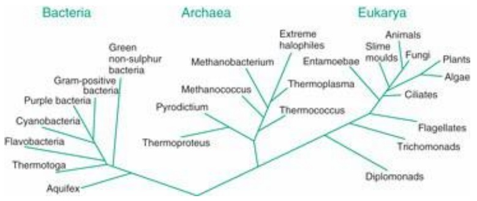
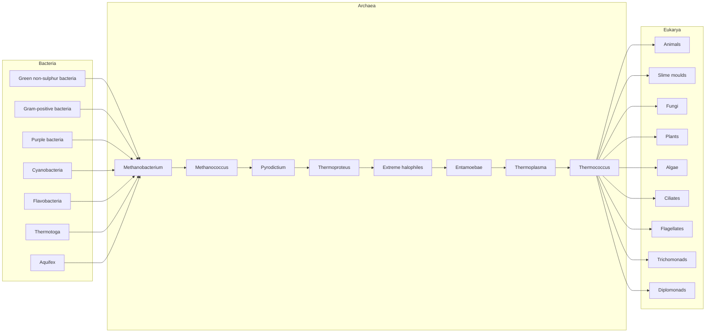
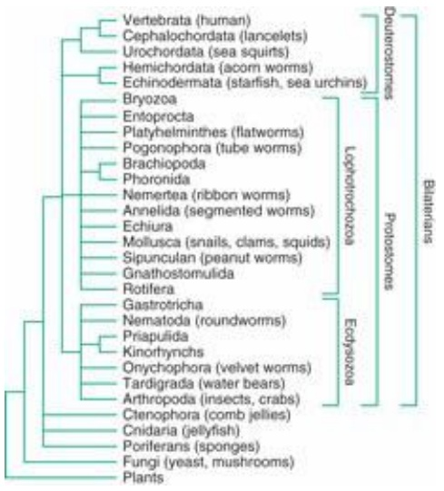
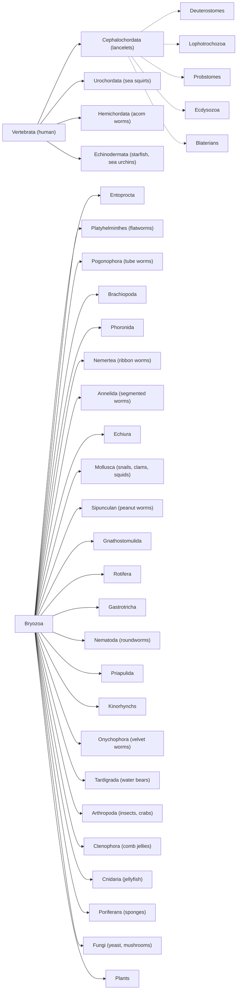
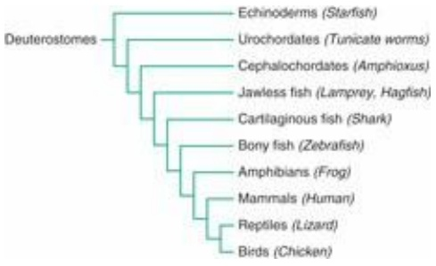
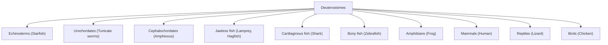
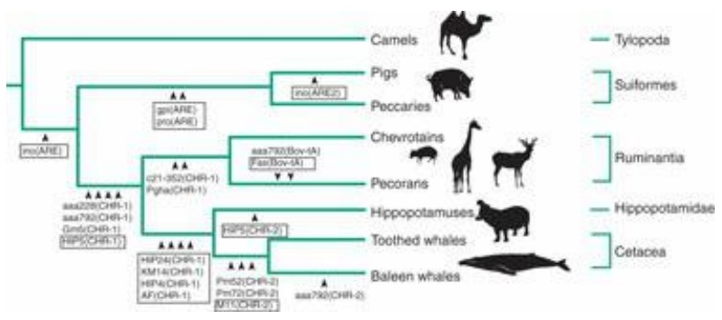
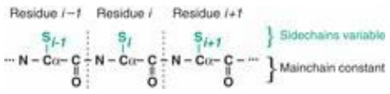
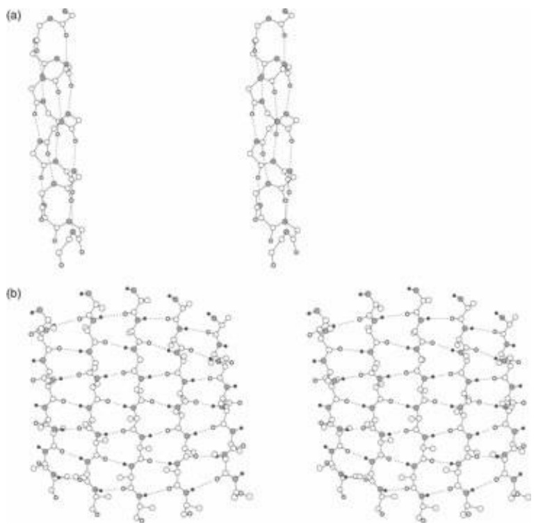

Classification of microorganisms is more difficult, partly because it is less obvious how to select the features on which to classify them and partly because a large amount of lateral gene transfer threatens to overturn the picture entirely.

Ribosomal RNAs (rRNAs) turned out to have the essential feature of being present in all organisms, with the right degree of divergence. (Too much or too little divergence and relationships become invisible, as is apparent when looking into phylogenetic relationships among elephants and mammoths; see Case Study 1.5).

On the basis of 15S rRNAs, C. Woese divided living things most fundamentally into three domains (a level above kingdom in the hierarchy): Bacteria, Archaea, and Eukarya (see Fig. 1.2). Bacteria and archaea are prokaryotes; their cells do not contain nuclei. Bacteria include the typical microorganisms responsible for many infectious diseases, and, of course, Escherichia coli, the mainstay of molecular biology. Archaea include, but are not limited to, extreme thermophiles and halophiles, sulphate reducers, and methanogens. We ourselves are Eukarya—organisms containing cells with nuclei—as are yeasts and all other multicellular organisms.



<details>
<summary>flowchart</summary>


</details>

Figure 1.2 Major divisions of living things, derived by C. Woese on the basis of 15S RNA sequences.

A census of the species with sequenced genomes reveals emphasis on bacteria, because of their clinical importance, and for the relative ease of sequencing genomes of prokaryotes. However, despite the obvious differences in lifestyle, and the absence of a nucleus, Archaea are in some ways more closely related on a molecular level to Eukarya than to Bacteria. It is also likely that the Archaea are the closest living organisms to the root of the tree of life.

Figure 1.2 shows the deepest levels of the tree. The Eukarya branch includes animals, plants, and fungi. At the ends of the eukarya branch are the metazoa (multicellular organisms) (Fig. 1.3). We and our closest relatives are deuterostomes (Fig. 1.4).



<details>
<summary>flowchart</summary>


</details>

Figure 1.3 Phylogenetic tree of metazoa (multicellular animals). Bilaterians include all animals that share a left/right symmetry of body plan. Protostomes and deuterostomes are two major lineages that separated at an early stage of evolution, estimated at 670 million years ago. They show very different patterns of embryological development, including different early cleavage patterns, opposite orientations of the mature gut with respect to the earliest

invagination of the blastula, and the origin of the skeleton from mesoderm (deuterostomes) or ectoderm (protostomes). Protostomes comprise two subgroups distinguished on the basis of 18S RNA (from the small ribosomal subunit) and HOX gene sequences. Morphologically, Ecdysozoa have a moulting cuticle: a hard outer layer of organic material. Lophotrochozoa have soft bodies.

Based on Adouette, A., Balavoine, G., Lartillot, N., Lespinet, O., Prud'homme, B., and de Rosa, R. (2000). The new animal phylogeny: reliability and implications. Proc. Natl. Acad. Sci. USA, 97, 4453–4456.



<details>
<summary>flowchart</summary>


</details>

Figure 1.4 Phylogenetic tree of vertebrates and our closest relatives. Chordates, including vertebrates, and echinoderms are all deuterostomes.

## Use of sequences to determine phylogenetic relationships

Previous sections have introduced sequence databases and biological relationships. Case Studies 1.3, 1.4, and 1.5 are examples of the application of sequence retrieval from databases, and the use of sequence comparisons to analyse biological relationships.


See Weblems 1.13, 1.14

## CASE STUDY 1.3 Retrieve the amino acid sequence of horse pancreatic ribonuclease

Use the ExPASy server at the Swiss Institute for Bioinformatics. The URL is http://www.expasy.org.

Type in the keywords:

horse pancreatic ribonuclease

followed by the ENTER key. Select RNP\_HORSE and then FASTA format. The ID code RNP\_HORSE comprises abbreviations of the molecule and the species (see Box 1.7). This will produce the following (the first line has been truncated):

```txt
>sp|P00674|RNP_HORSE RIBONUCLEASE PANCREATIC (EC 3.1.27.5) (RNASE 1) ...
KESPAMKFERQHMDSGSTSSSNPTYCNQMMKRRNMTQGWCKPVNTFVHEP
LADVQAICLQKNITCKNGQSNCYQSSSSSMHITDCRLTSGSKYPNCAYQTS
QKERHIIVACEGNPYVPVHFDASVEVST
```

For example, we could retrieve several sequences and align them (see Box 1.8). Analysis of patterns of similarity among aligned sequences are useful properties in assessing closeness of relationships.

## Box 1.7 FASTA format

A very common format for sequence data is derived from conventions of FASTA, a program for fast alignment by W.R. Pearson. Many programs use the FASTA format for reading sequences, or for reporting results.

A sequence in FASTA format:

- Begins with a single-line description. The symbol $>$ must appear in the first column. The rest of the title line is arbitrary but should be informative.
- Subsequent lines contain the sequence, one character per residue.
- Use one-letter codes for nucleotides or amino acids specified by the International Union of Biochemistry and International Union of Pure and Applied Chemistry (IUB/IUPAC): http://www.chem.qmw.ac.uk/iupac/misc/naabb.html and http://www.chem.qmw.ac.uk/iupac/AminoAcid/
- Use Sec and U as the three-letter and one-letter codes for selenocysteine: http://www.chem.qmw.ac.uk/iubmb/newsletter/1999/item3.html
- Lines can have different lengths; that is, ‘ragged right’ margins.
- Most programs will accept lower-case letters as amino acid codes.

An example of FASTA format for bovine glutathione peroxidase:

```csv
>gi|121664|sp|P00435|GSHC_BOVIN GLUTATHIONE PEROXIDASE
MCAAQRSAAALAAAAPRTVYAFSARPLAGGEPFNLSSLRGKVLLIENVASLUGTTVRDYTQMNDLQRRLG
PRGLVVLGFPCNQFGHQENAKNEEILNCLKYVRPGGGFEPNFMLFEKCEVNGEKAHPLFAFLREVLPTPS
DDATALMTDPKFITWSPVCRNDVSWNFEKFLVGPDGVPVRRYSRRFLTIDIEPDIETLLSQGASA
```

The title line contains the following fields:

- > is obligatory in column 1.
- gi|121664 is the geninfo (gi) number, an identifier assigned by the US National Center for Biotechnology Information (NCBI) to every sequence in its ENTREZ data bank. The NCBI collects sequences from a variety of sources, including primary archival data collections and patent applications. Its gi numbers provide a common and consistent ‘umbrella’ identifier, superimposed on different conventions of source databases. When a source database updates an entry, the NCBI creates a new entry with a new gi number if the changes affect the sequence, but updates and retains its entry if the changes affect only non-sequence information, such as a literature citation.
- sp|P00435 indicates that the source database was SWISS-PROT, and that the accession number of the entry in SWISS-PROT was P00435.
- GSHC\_BOVIN GLUTATHIONE PEROXIDASE is the SWISS-PROT identifier of sequence and species (GSHC\_BOVIN), followed by the name of the molecule.

## Box 1.8 Alignment

Sequence alignment is the assignment of residue–residue correspondences. We may wish to find:

\- a Global match: align all of one sequence with all of the other.

```txt
And.--so,.from.hour.to.hour,.we.ripe.and.ripe
|||| ||||||||||||||||||||||||||||
And.then,.from.hour.to.hour,.we.rot-.and.rot-
```

This illustrates mismatches, insertions, and deletions.

\- a Local match: find a region in one sequence that matches a region of the other.

```javascript
My.care.is.loss.of.care,.by.old.care.done,
|||||||||| |||||||||||||| ||||||||
Your.care.is.gain.of.care,.by.new.care.won
```

For local matching, overhangs at the ends are not treated as gaps. In addition to mismatches, seen in this example, insertions, and deletions within the matched region are also possible.

\- a Motif match: find matches of a short sequence in one or more regions internal to a long one.

A perfect match:

```txt
match
|||||
The match is made; she seals it with a curtsy.
One can allow mismatching characters:
```

```txt
match
    | |
    for the watch to babble and to talk is most tolerable

or: match match
    | |
    And witch the world with noble horsemanship.
```

or insertions and/or deletions:

```txt
mat--ch mat-ch
|| | || |
Fear not, Macbeth; no man that's born of woman
Shall e'er have power upon thee.
```

\- a Multiple alignment: a mutual alignment of many sequences.

```txt
no.sooner.--met.--------but.they.-look'd
no.sooner.look'd.--------but.they.-lo-v'd
no.sooner.lo-v'd.--------but.they.-sigh'd
no.sooner.sigh'd.--------but.they.--asked.one.another.the.reason
no.sooner.knew.the.reason.but.they.--------sought.the.remedy
no.sooner. .but.they.
```

The last line shows characters conserved in all sequences in the alignment.

See Chapter 5 for an extended discussion of alignment.


## See Weblem 1.12

CASE STUDY 1.4 Determine, from the sequences of pancreatic ribonuclease from horse (Equus caballus), minke whale (Balaenoptera acutorostrata), and red kangaroo (Macropus rufus), which two of these species are most closely related

Knowing that horse and whale are placental mammals and kangaroo is a marsupial, we expect horse and whale to be the closest pair. Retrieving the three sequences as in the previous example, and pasting the following:

```txt
>RNP_HORSE
```

```txt
KESPAMKFERQHMDSGSTSSSNPTYCNQMMKRRNMTQGWCKPVNTFVHEP
LADVQAICLQKNITCKNGQSNCYQSSSSSMHITDCRLTSGSKYPNCAYQTS
QKERHIIVACEGNPYVPVHFDASVEVST
>RNP_BALAC
RESPAMKFQRQHMDSGNSPGNNPNYCNQMMMRRKMTQGRCKPVNTFVHES
LEDVKAVCSQKNVLCKNGRTNCYESNSTMHITDCRQTGSSSKYPNCAYKTS
QKEKHIIVACEGNPYVPVHFDNSV
>RNP_MACRU
ETPAEKFQRQHMDTEHSTASSSNYCNLMMKARDMTSGRCKPLNTFIHEPK
SVVDAVCHQENVTCKNGRTNCYKSNSRLSITNCRQTGASKYPNCQYETSN
LNKQIIVACEGQYVPVHFDAYV
```

into the multiple sequence alignment program CLUSTAL-W (http://www.ebi.ac.uk/Tools/msa/clustalw2/) or, alternatively, T-Coffee (http://www.ch.embnet.org/software/TCoffee.html) produces the following:

```txt
CLUSTAL W (1.8) multiple sequence alignment
RNP_HORSE KESPAMKFERQHMDSGSTSSSNPTYCNQMMKRRNMTQGWCKPVNTFVHEPLADVQAICLQ 60
RNP_BALAC RESPAMKFQRQHMDSGNSPGNNPNYCNQMMMRRKMTQGRCKPVNTFVHESLEDVKAVCSQ 60
RNP_MACRU -ETPAEKFQRQHMDTEHSTASSSNYCNLMMKARDMTSGRCKPLNTFIHEPKSVVDAVCHQ 59
*:** **:********: :......*** ** *.**.* ***:***:**. *.*:* *
RNP_HORSE KNITCKNGQSNCYQSSSSSMHITDCRLTSGSKYPNCAYQTSQKERHIIVACEGNPYVPVHF 120
RNP_BALAC KNVLCKNGRTNCYESNSTMHITDCRQTGSSSKYPNCAYKTSQKEKHIIIVACEGNPYVPVHF 120
RNP_MACRU ENVTCKNGRTNCYKSNSRLSITNCRQTGASKYPNCQYETSNLNKQIIVACEG-QYVPVHF 118
*:****::***:*.* : **:**.**:********* *:*: :::********* *****
RNP_HORSE DASVEVST 128
RNP_BALAC DNSV---- 124
RNP_MACRU DAYV---- 122
* *
```

In this table, a \* under the sequences indicates a position that is conserved (the same in all sequences), and : and . indicate positions at which all sequences contain residues of very similar physicochemical character (:) or somewhat similar physicochemical character (.).

Large patches of the sequences are identical. There are numerous substitutions but only one internal deletion. By comparing the sequences in pairs, the number of identical residues shared among pairs in this alignment (not the same as counting \*s) is:

| Number of identical residues in aligned ribonuclease | A sequences (out of a total of 122–128 residues) |
| --- | --- |
| Horse and minke whale | 95 |
| Minke whale and red kangaroo | 82 |
| Horse and red kangaroo | 75 |

Horse and whale share the highest number of identical residues. The result appears significant, and therefore confirms our expectations. Warning: or is the logic really the other way round?

Let's try a hard one: are mammoths more closely related to Indian or African elephants?

- We ‘know’ that African and Indian elephants and mammoths must be close relatives: just look at them. But could we tell from these sequences alone that they are from closely related species?
- Given that the differences are so few, do they represent true evolutionary divergence or merely random noise or drift?

As background to such questions, let us re-emphasize the distinction between similarity and homology. Similarity is the observation or measurement of resemblance and difference, independent of the source of the resemblance. Homology means, specifically, that the sequences and the organisms in which they occur are descended from a common ancestor, with the implication that the similarities are shared ancestral characteristics. Similarity of sequences (or of macroscopic biological characters) is observable in data collectable now, and involves no historical hypotheses. In contrast, assertions of homology are statements of historical events that are almost always unobservable. Homology must be an inference from observations of similarity. Only in a few cases is homology directly

## CASE STUDY 1.5 Phylogeny of Elephantidae

The two living genera of elephant are represented by the African elephant (Loxodonta africana) and the Indian elephant (Elephas maximus). Can we decide, from the sequences of the haemoglobin  $\alpha$ -chains of these species, to which modern elephant the Siberian mammoth Mammuthus primigenius is more closely related?

Retrieving the amino acid sequences, and running CLUSTAL-W:

| E. maximus | -VLSDKDKTNVKATWSKVGDHASDYVAEALERMFFSFPTTKTYFPHFDLS 49 |
| --- | --- |
| L. africana | -VLSDNDKTNVKATWSKVGDHASDYVAEALERMFFSFPTTKTYFPHFDLG 49 |
| M. primigenius | MVLSDNDKTNVKATWSKVGDHASDYVAEALERMFFSFPTTKTYFPHFDLS 50 |
|  | ****:**********. |
| E. maximus | HGSGQVKGHGKKVGEALTQAVGHLDDLPSALSALSDLHAHKLRVDPVNFK 99 |
| L. africana | HGSGQVKAHGKKVGEALTQAVGHLDDLPSALSALSDLHAHKLRVDPVNFK 99 |
| M. primigenius | HGSGQVKGHGKKVGEALTQAVGHLDDLPSALSALSDLHAHKLRVDPVNFK |
| 100 |  |
|  | **********.**********. |
| E. maximus | LLSHCLLVTLSSHQPTEFTPEVHASLDKFLSNVSTVLTSKYR 141 |
| L. africana | LLSHCLLVTLSSHQPTEFTPEVHASLDKFLSNVSTVLTSKYR 141 |
| M. primigenius | LLSHCLLVTLSSHQPTEFTPEVHASLDKFLSNVSTVLTSKYR 142 |
|  | **********.**********. |

The mammoth and African elephant sequences have two mismatches, and the mammoth and Indian elephant sequences have one mismatch, but not at the position of a mammoth/African elephant mismatch. Forced to form a conclusion, we would have to suggest that the mammoth is more closely related to the Indian elephant. However, this result is less satisfying than the previous one. There are so few differences! Are they significant? (In this case, it is harder to decide whether the differences are significant because we have no preconceived idea of what the answer should be.) The data strongly suggest that we should identify and compare other sets of sequences from these species.

observable; for instance in pedigrees of families showing unusual phenotypes such as the Hapsburg lip, or in laboratory populations, or in clinical studies that follow the course of viral infections at the sequence level in individual patients. The new field of metagenomics will provide other examples (See Chapter 2, and Introduction to Genomics; Lesk 2011).

The assertion that the haemoglobin  $\alpha$ -chains from African and Indian elephants and mammoths are homologous means that there was a common ancestor, presumably containing a unique haemoglobin  $\alpha$ -chain, that by alternative mutations gave rise to the proteins of mammoths and modern elephants. Is the very high degree of similarity of the sequences proof that they are homologous, or are there other possible explanations?

\- It might be that a functional haemoglobin $\alpha$-chain requires so many conserved residues that haemoglobins from all animals must be as similar to one another as the elephant and mammoth proteins are, whether or not they are homologues. We can test this by looking at haemoglobin  $\alpha$ -chain sequences from other species. The result is that the corresponding sequences from other animals differ substantially from those of elephants and mammoths.

- A second possibility is that there are special physiological requirements for a haemoglobin $\alpha$-chain to function well in an animal with the size and form of an elephant, that the three sequences started out from independent ancestors, and that common selective pressures forced them to become similar. (Remember that we are asking what can be deduced from these sequences alone.)
- The mammoth may be more closely related to the African elephant, but since the time of the last common ancestor the haemoglobin  $\alpha$ -chain sequence of the African elephant may have evolved faster than that of the Indian elephant or the mammoth, accumulating more mutations.
- A fourth hypothesis is that all common ancestors of elephants and mammoths had very dissimilar sequences, but that living elephants and mammoths gained a common gene by transfer from a species in some other family via a virus.

Suppose, however, that we are satisfied that the similarity of the elephant and mammoth sequences is high enough to imply homology: what then about the ribonuclease sequences in Case Study 1.4? Are the larger differences among the pancreatic ribonucleases of horse, whale, and kangaroo evidence that they are not homologues?

How can we answer these questions? Specialists have undertaken careful calibrations of sequence similarities and divergences, among many proteins from many species for which the taxonomic relationships have been worked out by classical methods. In the example of pancreatic ribonucleases, the reasoning from similarity to homology is justified. In the second edition of this book, I wrote: 'The question of whether mammoths are closer to African or Indian elephants was decided only recently, in favour of African elephants.' Since then, expert opinion—including that of some of the same experts—has shifted to the conclusion that Indian elephants are the closest extant relatives of mammoths. Why has this question proved so difficult? It reflects the limited power of our tools, applied to the available data, to resolve events that happened very close to each other, very long ago.


## See Weblems 1.15, 1.16, 1.17

The three major groups of elephants are: African elephants, Asian elephants, and mammoths. These taxa comprise a family, the Elephantidae, containing three main genera: Loxodonta, including the African species L. africana; Elephas, including the Asian species E. maximus; and Mammuthus, including the Siberian species M. primigenius. (At the family level in our lineage, humans, chimpanzees, gorillas, and orangutans comprise the hominidae.)

The genera in the family Elephantidae diverged about 6 million years ago in Africa, at approximately the same time as the divergence of human and chimpanzee ancestors. Today, ‘mammoth’ connotes an extinct Arctic animal. However, our ancestors hunted mammoths in Southern Europe, as depicted in cave-wall paintings (see Box 1.9).

The challenging phylogenetic problem is to determine the branching order of Asian and African elephants and mammoths. Which group split off first? It took only  $\approx$ 500 000 years to establish the three lineages. The shortness of this time makes great demands on our analytical tools.

Other factors that make the identification of the true branching pattern difficult include:

\- is the sequence of a close relative available to serve for comparison (as an outgroup). The earliest work on the mammoth genome used dugong or hyrax as the outgroup. These diverged from elephants  $\approx$ 65 million years ago. Sequences from the American mastodon (Mammut americanum) have provided a more suitable outgroup in recent investigations;

- small population sizes may increase the importance of fluctuations;
- the assumption of constant rates of evolution in the different lineages may be unjustified.

Current data and analysis suggest that mammoths are more closely related to Asian elephants.

Despite the difficulty of the elephant/mammoth problem, analysis of sequence similarities in genomes and proteins is now sufficiently well established that it is considered the most reliable method for

## Box 1.9 Mammoth fossils helped shape ideas about species extinction

Cuvier himself first distinguished the African, Asian, and mammoth lineages, in a 1796 paper. Cuvier accepted the idea that species could become extinct, a prerequisite to development of ideas about evolution. Many contemporaries believed instead in the immutability of species. US President Thomas Jefferson was one. He instructed Meriwether Lewis and William Clark, explorers of the Louisiana Territory purchased from France in 1803, to look out for living mammoths.

establishing phylogenetic relationships, even though sometimes the results may not be significant and in other cases they even give incorrect answers. Except for many—but not all—attempts to treat extinct species, there are copious data available, effective tools for retrieving what is necessary to bring to bear on a specific question, and powerful analytical tools. None of this replaces the need for thoughtful scientific judgement.

## Use of SINES and LINES to derive phylogenetic relationships

Major problems with inferring phylogenies from comparisons of gene and protein sequences are (1) the wide range of variation of similarity, which may dip below statistical significance, and (2) the effects of different rates of evolution along different branches of the evolutionary tree. In many cases, even if sequence similarities confidently establish relationships, it may be very difficult or impossible to decide the order in which sets of taxa have split. (The Elephantidae are an example.) The phylogeneticist's dream—features that have an ‘all-or-none’ character, the appearance of which is irreversible so that the order of branching events can be decided—is in some cases afforded by certain noncoding sequences in genomes.

Short and long interspersed nuclear elements, or SINES and LINES, are repetitive noncoding sequences that form large fractions of eukaryotic genomes; that is, at least 30% of human chromosomal DNA and over 50% of some higher plant genomes. Typically, SINES are  $\approx$ 70–500 base pairs long, and up to  $10^{6}$  copies may appear. LINES may be up to 7000 base pairs long, and up to  $10^{5}$  copies may appear. SINES enter the genome by reverse transcription of RNA. Most SINES contain a 5' region homologous to tRNA, a central region unrelated to tRNA, and a 3' AT-rich region.

Features of SINES that make them useful for phylogenetic studies include the following.

- A SINE is either present or absent. Presence of a SINE at any particular position is a property that entails no complicated and variable measure of similarity.
- SINES are inserted at random in the noncoding portion of a genome. Therefore appearance of similar SINES at the same locus in two species implies that the species share a common ancestor in which the insertion event occurred. No analogue of convergent evolution muddies this picture, because there is no selection for the site of insertion.

- SINE insertion appears to be irreversible: no mechanism for loss of SINES is known, other than rare large-scale deletions or translocations that include the SINE site. Therefore if two species share a SINE at a common locus, absence of this SINE in a third species implies that the first two species must be more closely related to each other than either is to the third.
- Not only do SINES show relationships, they imply which species branched off first. The last common ancestor of species containing a common SINE must have come after the last common ancestor linking these species and another that lacks this SINE.

N. Okada and colleagues applied SINE sequences to questions of phylogeny.

Whales, like Australians, are mammals that have adopted an aquatic lifestyle. But what—in the case of the whales—are their closest land-based relatives? Classical palaeontology linked the order Cetacea—comprising whales, dolphins, and porpoises—with the order Artiodactyla, the even-toed ungulates (including cows and sheep, for instance). Cetaceans were thought to have diverged before the common ancestor of the three extant artiodactyl suborders: Suiformes (pigs), Tylopoda (including camels and llamas), and Ruminantia (including deer, cows, goats, sheep, antelopes, giraffes, etc.). To place cetaceans properly among these groups, several studies were carried out with DNA sequences. Comparisons of mitochondrial DNA, and genes for pancreatic ribonuclease,  $\gamma$ -fibrinogen, and other proteins, suggested that the closest relatives of the whales are hippopotamuses, and that cetaceans and hippopotamuses form a separate group within the artiodactyls, most closely related to the Ruminantia.

Analysis of SINES confirms this relationship. Several SINES are common to Ruminantia, hippopotamuses, and cetaceans. Four SINES appear in hippopotamuses and cetaceans only. These observations imply the phylogenetic tree shown in Figure 1.5, in which the SINE insertion events are marked.


See Weblems 1.18, 1.19



<details>
<summary>flowchart</summary>

This diagram illustrates the evolutionary relationships and genetic markers of various animal species, showing how specific genetic loci (such as mo(ARE), gns(ARE), etc.) are merged into a central cluster.
</details>

Figure 1.5 Phylogenetic relationships among cetaceans and other artiodactyl subgroups, derived from analysis of SINE sequences. Arrowheads mark insertion events. Each arrowhead indicates the presence of a particular SINE or LINE at a specific locus in all species to the right of the arrowhead. Lower-case letters identify loci, upper-case letters identify sequence patterns. For instance, the ARE2 pattern appears only in pigs, at the ino locus. The ARE pattern appears twice in the pig genome, at loci gpi and pro, and in the peccary genome at the same loci. The ARE insertion occurred in a species that was ancestral to pigs and peccaries but to no other species in the diagram. This implies that pigs and peccaries are more closely related to each other than to any of the other animals studied.

From Nikaido, M., Rooney, A.P., and Okada, N. (1999). Phylogenetic relationships among cetartiodactyls based on insertions of short and long interspersed elements: hippopotamuses are the closest extant relatives of whales. Proc. Natl. Acad. Sci. USA, 96, 10261–10266. Copyright 1999, National Academy of Sciences, USA. Reproduced by permission.



<details>
<summary>text_image</summary>

Residue i-t Residue i Residue i+t
S_{i-t} S_I S_{i+1} } Sidechains variable
... N - Cα - C_|| - N - Cα - C_|| - N - Cα - C_|| ... } Mainchain constant
</details>

Figure 1.6 The polypeptide chains of proteins have a mainchain of constant structure and sidechains that vary in sequence. Here $S_{\mathrm{i-1}}$, $S_{\mathrm{i}}$, and $S_{\mathrm{i+1}}$ represent sidechains. The sidechains may be chosen, independently, from the set of 20 standard amino acids. It is the sequence of the sidechains that gives each protein its individual structural and functional characteristics.



Figure 1.7 Standard secondary structures of proteins. (a) $\alpha$-Helix. Hydrogen atoms not shown. (b) $\beta$-Sheet. (b) Illustrates a parallel $\beta$-sheet, in which all strands point in the same direction. Antiparallel $\beta$-sheets, in which all pairs of adjacent strands point in opposite directions, are also common. In fact, $\beta$-sheets can be formed by any combination of parallel and antiparallel strands.

Recently discovered fossils of land-based ancestors of whales confirm the link between whales and artiodactyls. This is a good example of the complementarity between molecular and palaeontological methods: DNA sequence analysis can specify relationships among living species quite precisely, but fossils reveal relationships among their extinct ancestors.

## Searching for similar sequences in databases: PSI-BLAST

A common theme of the examples we have treated is the search of a database for items similar to a probe. For instance, if you are studying a novel gene, or if you identify within the human genome a gene responsible for some disease, you will wish to determine whether related genes appear in other species. The ideal method is both sensitive—that is, it picks up even very distant relationships—and selective—that is, all the relationships that it reports are true (see Box 1.10).

A powerful tool for searching sequence databases with a probe sequence is PSI-BLAST, from the NCBI. PSI-BLAST stands for Position Specific Iterated – Basic Local Alignment Search Tool. A previous program, BLAST, worked by identifying local regions of similarity without gaps and then piecing them together. The PSI in PSI-BLAST refers to enhancements that identify patterns within the sequences at preliminary stages of the database search, and then progressively refine them. Recognition of conserved patterns can sharpen both the selectivity and sensitivity of the search. PSI-BLAST involves a repetitive (or iterative) process, as the emergent pattern becomes better defined in successive stages of the search. (See Case Study 1.6 and Chapter 5.)

The few PSI-BLAST hits to the probe sequence PAX-6 shown later appear in the format:

paired box protein Pax-6 isoform a [Homo sapiens]

A longer list of hits would of course include multiple sequences from many of the species, and contributions from many more species. How would we extract these species names from the results? The following is a typical example of the pattern-identification facilities of PERL (Case Study 1.7).

## Box 1.10 Sensitivity and selectivity

Database search methods involve a tradeoff between sensitivity and selectivity. Does the method find all or most of the examples that are actually present, or does it miss a large fraction? Conversely, how many of the ‘hits’ that it reports are incorrect? Suppose a database contains 1000 globin sequences and that a search of this database for globins reported 900 results, 700 of which were really globin sequences and 200 of which were not. This result would be said to have 300 false negatives (misses) and 200 false positives. There is a tradeoff between sensitivity and selectivity: lowering a tolerance threshold will increase the numbers of both false negatives and false positives. Often one is willing to work with low thresholds to be sure of not missing anything that might be important, but this requires detailed examination of the results to eliminate the false positives.

## Et in terra PAX hominibus, muscisque...

The eyes of the human, fly, and octopus are very different in structure. Conventional wisdom, noting the immense selective advantage conferred by the ability to see, held that eyes arose independently in different phyla. It therefore came as a great surprise that a gene controlling human eye development has a homologue governing eye development in Drosophila.

The PAX-6 gene was first cloned in the mouse and human. It is a master regulatory gene, controlling a complex cascade of events in eye development. Mutations in the human gene cause the clinical condition aniridia, a developmental defect in which the iris of the eye is absent or deformed. The PAX-6 homologue in Drosophila—called the eyeless gene—has a similar function of control over eye development. Flies mutated in this gene develop without eyes; conversely, expression of this gene in a fly’s wing, leg, or antenna produces ectopic (i.e. out-of-place) eyes. (The Drosophila eyeless mutant was first described in 1915. Little did anyone then suspect a relation to a mammalian gene.)

Not only are the insect and mammalian genes similar in sequence, they are so closely related that their function crosses species boundaries. Expression of the mouse $PAX-6$ gene in the fly causes ectopic eye development just as expression of the fly's own eyeless gene does. (It should not, however, be thought that eye development is under the control of a single gene. The expression of mouse $PAX-6$ in the fly triggers a complex cascade of fly genes.)

PAX-6 has homologues in other phyla, including flatworms, ascidians, sea urchins, and nematodes. The observation that rhodopsins—a family of proteins containing retinal as a common chromophore—function as light-sensitive pigments in different phyla is supporting evidence for a common origin of different photoreceptor systems. The genuine structural differences in the macroscopic anatomy of different eyes reflect the divergence and independent development of higher-order structure.

## CASE STUDY 1.6 PAX-6 genes

## Homologues of the human PAX-6 gene

PAX-6 genes control eye development in a widely divergent set of species (see Et in terra PAX hominibus, muscisque...). The human PAX-6 gene encodes the protein appearing in UniProtKB/SWISS-PROT entry P26367. (Tip: the easiest way to retrieve the sequence is to type HUMAN PAX-6 into a Google search.)

To run PSI-BLAST, go to the following URL: http://www.ncbi.nlm.nih.gov/BLAST. Enter the sequence and use the default options for selections of the database to search, and the similarity matrix to use, and select PSI-BLAST as the algorithm.

The program returns a list of entries similar to the probe, sorted in decreasing order of statistical significance. (Extracts from the response are shown in the box entitled Results of a PSI-BLAST search for human PAX-6 protein. Only a few lines are shown, merely to illustrate the format.) A typical line appears as follows:

pir ||I45557 eyeless, long form - fruit fly (Drosophila melano... 250 2e-64

The first item on the line is the database and corresponding entry number (separated by  $\mid\mid$ ), in this case Protein Identification Resource (PIR) entry I45557. It is the Drosophila homologue eyeless. The number 250 is a score for the match detected, and the significance of this match is measured by  $E = 2 \times 10^{-64}$ . E is related to the probability that the observed degree of similarity could have arisen by chance: E is the number of sequences that would be expected to match as well or better than the one being considered, if the same database were probed with random sequences.  $E = 2 \times 10^{-64}$  means that it is extremely unlikely that even one random sequence would match as well as the Drosophila homologue. Values of E below about 0.05 would be considered significant; at least they might be worth considering. For borderline cases, you would ask: are the mismatches conservative? Is there any pattern or are the matches and mismatches distributed randomly through the sequences? There is an elusive concept, the texture of an alignment, that you will become sensitive to. The court of last resort is whether the structures are similar, but often this information is not available.

Note that if there are many sequences in the database that are very similar to the probe sequence, they will head the list. In this example, there are many very similar PAX genes in other mammals. You may have to scan far down the list to find a distant relative that you consider to be interesting.

Even in the case of Drosophila eyeless, a very close relative of the probe sequence, the program reports only a local match to a portion of the sequences. The full alignment is shown in the box entitled Complete pairwise sequence alignment of human PAX-6 protein and Drosophila melanogaster eyeless.

## Results of a PSI-BLAST search for human PAX-6 protein

One iteration of PSI-BLAST was run, using human PAX-6 as the query sequence, searching the nonredundant (nr) database. The NCBI nr database is a set of unique sequences selected from the full databases to eliminate multiple hits to very similar sequences. The output contains a list of sequences identified. A few are shown below, just to illustrate the format. A more complete list appears in the online resource centre associated with this book: http://www.oxfordtextbooks.co.uk/orc/leskbioinf4e/.

```ini
paired box protein Pax-6 isoform a [Homo sapiens]
paired box protein Pax-6 isoform a [Homo sapiens]
paired box protein Pax-6 isoform 2 [Mus musculus]
paired box protein Pax-6 isoform 2 [Mus musculus]
paired box protein Pax-6 isoform 1 [Sus scrofa]
paired box protein Pax-6 isoform 1 [Sus scrofa]
paired box protein Pax-6 isoform a [Homo sapiens]
paired box protein Pax-6 isoform a [Homo sapiens]
paired box protein Pax-6 [Macaca mulatta]
PREDICTED: paired box protein Pax-6 isoform 1 [Cricetulus griseus]
PREDICTED: paired box protein Pax-6 [Callithrix jacchus]
PREDICTED: paired box protein Pax-6 isoform 2 [Callithrix jacchus]
PREDICTED: paired box protein Pax-6 [Callithrix jacchus]
PREDICTED: paired box protein Pax-6 [Otolemur garnettii]
PREDICTED: paired box protein Pax-6 isoform 1 [Pan paniscus]
PREDICTED: paired box protein Pax-6 isoform 2 [Pan paniscus]
PREDICTED: paired box protein Pax-6 isoform 3 [Pan paniscus]
PREDICTED: paired box protein Pax-6 isoform 1 [Saimiri boliviensis boliviensis]
```

PREDICTED: paired box protein Pax-6 isoform 2 [Saimiri boliviensis boliviensis]

Even the short list shows that (1) multiple sequences—different isoforms—appear from the same species and (2) some of the taxonomic names are classic binomials (for instance, Homo sapiens) and others are trinomials indicating subspecies designations.

PSI-BLAST also returns pairwise alignments of well-matching regions from the query and the retrieved sequences. Three selected alignments are shown following the alignments results: PAX-6 from Danio rerio, Drosophila eyeless, and a Drosophila circadian clock protein, for which the matching is both shorter and less perfect.

```txt
Query= sp|P26367|PAX6_HUMAN Paired box protein Pax-6(Oculorhombin)
(Aniridia, type II protein) - Homo sapiens (Human).
(422 letters)
```

```csv
Database: All non-redundant GenBank CDS
translations+PDB+SwissProt+PIR+PRF
    2,738,511 sequences; 768,166,133 total letters
```

```txt
Results of PSI-Blast iteration 5
Score E
```

Sequences producing significant alignments: (Bits) Value

```txt
gb|AAA59962.1| oculorhombin >gb|AAA59963.1| oculorhombin 600 6e-170
ref|NP_000271.1| paired box gene 6 isoform a [Homo sapiens] >... 600 7e-170
gb|ABI98848.1| paired box 6 transcript variant 3 [Columba livia] 599 9e-170
ref|NP_001035735.1| paired box gene 6 (aniridia, keratitis) [... 599 1e-169
gb|EAW68233.1| paired box gene 6 (aniridia, keratitis), isofo... 599 1e-169
gb|ABA90484.1| paired box protein PAX6 isoform a [Oryctolagus cu 598 2e-169
ref|NP_037133.1| paired box gene 6 [Rattus norvegicus] >sp|P6... 598 2e-169
dbj|BAA24025.1| PAX6 SL [Cynops pyrrhogaster] 596 8e-169
ref|NP_038655.1| paired box gene 6 [Mus musculus] >emb|CAA453... 596 1e-168
dbj|BAC25729.1| unnamed protein product [Mus musculus] 595 2e-168
emb|CAC80516.1| paired box protein [Mus musculus] 594 2e-168
ref|NP_001595.2| paired box gene 6 isoform b [Homo sapiens] >... 594 3e-168
gb|AAH41712.1| MGC52531 protein [Xenopus laevis] 594 3e-168
ref|NP_990397.1| paired box gene 6 [Gallus gallus] >dbj|BAA23... 594 3e-168
gb|ABO70134.1| PAX6 [Canis familiaris] 593 5e-168
gb|EAW68236.1| paired box gene 6 (aniridia, keratitis), isofo... 593 6e-168
emb|CAF29075.1| putative pax6 isoform 5a [Rattus norvegicus] 593 8e-168
ref|NP_001075686.1| paired box protein PAX6 isoform b [Orycto... 593 9e-168
emb|CAE45868.1| hypothetical protein [Homo sapiens] 593 9e-168
prf||1902328A PAX6 gene 592 1e-167
gb|AAS48919.1| paired box 6 isoform 5a [Rattus norvegicus] >g... 592 1e-167
gb|AAB36681.1| paired-type homeodomain Pax-6 protein [Xenopus la 592 1e-167
gb|AAF73271.1|AF154555_1 paired domain transcription factor v... 590 5e-167
gb|AAB05932.1| Xpax6 [Xenopus laevis] 589 7e-167
sp|P47238|PAX6_COTJA Paired box protein Pax-6 (Pax-QNR) >pir|... 589 1e-166
dbj|BAA24024.1| PAX6 LL [Cynops pyrrhogaster] 589 1e-166
sp|P55864|PAX6_XENLA Paired box protein Pax-6 >gb|AAB36683.1| Pa 588 2e-166
emb|CAA68838.1| PAX-6 protein [Astyanax mexicanus] 588 3e-166
...
emb|CAE66896.1| Hypothetical protein CBG12277 [Caenorhabditis br 44.7 0.010
gb|AAP79287.2| hox 7 [Saccoglossus kowalevskii] 44.7 0.010
gb|AAS07621.1| homeobox protein Lox18 [Perionyx excavatus] 44.7 0.010
gb|AAL04488.1|AF365974_1 transcription factor SOHo [Oryzias lati 44.7 0.010
```

```txt
ref|NP_186796.1| ATHB-1 (Homeobox-leucine zipper protein HAT5... 44.7 0.010
ref|XP_001076009.1| PREDICTED: similar to gooseberry-neuro CG... 44.7 0.010
ref|XP_001060443.1| PREDICTED: similar to double homeobox 4c [Ra 44.7 0.010
gb|EAT37245.1| lim homeobox protein [Aedes aegypti] 44.7 0.010
gb|AAW70293.1| invected [Heliconius pachinus] 44.7 0.010
ref|NP_174164.1| HB-1 (homeobox-1); transcription factor [Arabid 44.7 0.010
ref|NP_001029316.1| NK-3 transcription factor, locus 1 [Rattu... 44.7 0.010
dbj|BAE44266.1| hoxB3a [Oryzias latipes] >dbj|BAE53473.1| hox... 44.7 0.010
dbj|BAE06563.1| transcription factor protein [Ciona intestinalis 44.7 0.010
gb|EAT43388.1| homeobox protein [Aedes aegypti] 44.7 0.010
gb|AAS21413.1| HOX11 [Oikopleura dioica] 44.7 0.010
```

Additional ‘hits’ are not shown.

The three selected alignments follow. PAX-6 from human (the query sequence) and Danio rerio:

```txt
ref|NP_571379.1| paired box gene 6a [Danio rerio]
    emb|CAA44867.1| pax-6 [Danio rerio]
    emb|CAM16650.1| paired box gene 6a [Danio rerio]
Length=451
    Score = 662 bits (1707), Expect = 0.0, Method: Composition-based stats.
    Identities = 404/436 (92%), Positives = 409/436 (93%), Gaps = 18/436 (4%)
Query 1 MQNSHSGVNQLGGVFVNGRPLPDSTRQKIVELAHSGARPCDISRILQ-----------------
- 47
MQNSHSGVNQLGGVFVNGRPLPDSTRQKIVELAHSGARPCDISRILQ
Sbjct 20 MQNSHSGVNQLGGVFVNGRPLPDSTRQKIVELAHSGARPCDISRILQTHADAKVQVLDNE 79
Query 48 -
VSNGCVSKILGRYYETGSIRPRAIGGSKPRVATPEVVSKIAQYKRECPSIFAWEIRDRL 106
VSNGCVSKILGRYYETGSIRPRAIGGSKPRVATPEVV KIAQYKRECPSIFAWEIRDRL
Sbjct 80 NVSNGCVSKILGRYYETGSIRPRAIGGSKPRVATPEVVGKIAQYKRECPSIFAWEIRDRL 139
Query 107 LSEGVCTNDNIPSVSSINRVLRNLASEKQQMGADGMYDKLRMLNGQTGSWGTRPGWYPGT 166
LSEGVCTNDNIPSVSSINRVLRNLASEKQQMGADGMY+KLRMLNGQTG+WGTRPGWYPGT
Sbjct 140 LSEGVCTNDNIPSVSSINRVLRNLASEKQQMGADGMYEKLRMLNGQTGTWGTRPGWYPGT 199
Query 167 SVPGQPTQDGCQQQEGGGENTNSISSNGEDSDEAQMRLQLKRKLQRNRTSFTQEIEALE 226
SVPGQP QDGCQQ +GGGENTNSISSNGEDSDE QMRLQLKRKLQRNRTSFTQEIEALE
Sbjct 200 SVPGQPNQDGCQQSDGGGENTNSISSNGEDSDETQMRLQLKRKLQRNRTSFTQEIEALE 259
Query 227 KEFERTHYPDVFARERLAAKIDLPEARIQVWFSNRRAKWRRREEKLRNQRRQASNTPSHIP 286
KEFERTHYPDVFARERLAAKIDLPEARIQVWFSNRRAKWRRREEKLRNQRRQASN+ SHIP
Sbjct 260 KEFERTHYPDVFARERLAAKIDLPEARIQVWFSNRRAKWRRREEKLRNQRRQASNSSSHIP 319
Query 287 ISSSFSTSVYQPIPQPTTPVSSFTSGSMLGRTDTALTNTYSALPPMPSFTMANNLPMQPP 346
ISSSFSTSVYQPIPQPTTPV SFTSGSMLGR+DTALTNTYSALPPMPSFTMANNLPMQP
Sbjct 320 ISSSFSTSVYQPIPQPTTPV-
SFTSGSMLGRSDTALTNTYSALPPMPSFTMANNLPMQP- 377
Query 347 VPSQTSSYSCMLPTSPSVNGRSYDTYTPPHMQTHMNSQPMGTSGTTSTGLISPGVSVPVQ 406
SQTSSYSCMLPTSPSVNGRSYDTYTPPHMQ HMNSQ M SGTTSTGLISPGVSVPVQ
Sbjct 378 --
SQTSSYSCMLPTSPSVNGRSYDTYTPPHMQAHMNSQSMAASGTTSTGLISPGVSVPVQ 435
```

```txt
Query 407 VPGSEPDMSQYWPRLQ 422
VPGSEPDMSQYWPRLQ
Sbjct 436 VPGSEPDMSQYWPRLQ 451
```

Human PAX-6 and Drosophila eyeless:

```txt
>pir||I45557 eyeless, long form - fruit fly (Drosophila melanogaster)
    emb|CAA56038.1| UniGene info transcription factor [Drosophila melanogaster]
Length=838
Score = 224 bits (572), Expect = 8e-59, Method: Composition-based stats.
Identities = 133/212 (62%), Positives = 143/212 (67%), Gaps = 2/212 (0%)

Query 2 QNSHSGVNQLGGVFVNGRPLPDSTRQKIVELAHSGARPCDISRILQVSNGCVSKILGRYY 61
        HSGVNQLGGVFV GRPLPDSTRQKIVELAHSGARPCDISRILQVSNGCVSKILGRYY

Sbjct 35 HKGHSGVNQLGGVFVGGRPLPDSTRQKIVELAHSGARPCDISRILQVSNGCVSKILGRYY 94

Query 62 ETGSIRPRAIGGSKPRVATPEVVSKIAQYKRECPSIFAWEIRDRLLSEGVCTNDNIPSVS 121
        ETGSIRPRAIGGSKPRVAT EVVSKI+QYKRECPSIFAWEIRDRLL E VCTNDNIPSVS

Sbjct 95 ETGSIRPRAIGGSKPRVATAEVVSKISQYKRECPSIFAWEIRDRLLQENVCTNDNIPSVS 154

Query 122 SINRVLRNLASEKQQMGADGMYDKLRMLNGQTGSWGTRPGWYPGTSVPGQPTQDGCQQQE 181
        SINRVLRNLA++K+Q N + G G

Sbjct 155 SINRVLRNLAAQKEQQSTGSGSSSTSAGNSISAKVSVSIGGNVSNVASGSRGTLSSTDL 214

Query 182 GGGENT--NSISSNGEDSDEAQMRLQLKRKLQ 211
        +S S +S E + + KL+

Sbjct 215 MQTATPLNSSESGGATNSGEGSEQEAIIYEKLR 246
```

Human PAX-6 and Drosophila circadian clock protein:

```txt
>gb|AAB94890.1| circadian clock protein [Drosophila melanogaster]
Length=1398
Score = 33.5 bits (75), Expect = 0.42, Method: Composition-based stats.
Identities = 22/145 (15%), Positives = 37/145 (25%), Gaps = 31/145 (21%)
Query 113 TNDNIPSVSSINRVLRN-----LASEKQQMGADGMYDK-----
LRMLNGQTGSWGTRPG 161
N P+ S+ L N + A K + G +
Sbjct 411 NNTTNPTSSAPQGCLGNEPFKPPPPLPVRASTSAHAQMQKFNESSYASHVSAVKLGQKSP 470
Query 162 WYPGTSV-----
PGQPTQDGCQQQEGGGENTNSISSNGEDSDEAQMRLQLKR 208
+ Q C EN SIS++ D D Q + Q ++
Sbjct 471 HAGQLQLTKGKCCPQKRECPSSQSELSDCGYGT-
QVENQESISTSSNDDDGPQGKPQHQK 529
Query 209 K-----LQRNRTSFTQEQIEALEK 227
+ RT + + L +
Sbjct 530 PPCNTKPRNKPRTIMSPMDKKELRR 554
```

Complete pairwise sequence alignment of human PAX-6 protein and Drosophila melanogaster eyeless

```txt
PAX6_human          -------------------MQNSHSGVNQLGGVFVNGRPLPDSTRQ
27
eyeless         MFTLQPTPTAIGTVVPPWSAGTLIERLPSLEDMAHKGHSGVNQLGGVFVGGRPLPDSTRQ
60
                        :::.*************************.*************************
PAX6_human         KIVELAHSGARPCDISRILQVSNGCVSKILGRYYETGSIRPRAIGGSKPRVATPEVVSKI
87
eyeless         KIVELAHSGARPCDISRILQVSNGCVSKILGRYYETGSIRPRAIGGSKPRVATAEVVSKI
120
                      ************************.*************************
PAX6_human         AQYKRECPSIFAWEIRDRLLSEGVCTNDNIPSVSSINRVLRNLASEKQQ--------
136
eyeless         SQYKRECPSIFAWEIRDRLLQENVCTNDNIPSVSSINRVLRNLAAQKEQQSTGSGSSSTS
180
                      :*************************.*.*************************:::**
PAX6_human         ------MG----------ADG
141
eyeless         AGNSISAKVSVSIGGNVSNVASGSRGTLSSSTDLMQTATPLNSSESGGATNSGEGSEQEA
240
                      .*                             ..
PAX6_human         MYDKLRMLNGQTGS--------WGTRP-------------------
160
eyeless         IYEKLRLLNTQHAAGPGPLEPARAAPLVGQSPNHLGTRSSHPQLVHGNHQALQQHQQQSW
300
                      :::.***:** * .:
                      ***.
PAX6_human         ------GWYPG------TSVP----------GQP-----
172
eyeless         PPRHYSGSWYPTSLSEIPISSAPNIASVTAYASGPSLAHSLSPPNDIKSLASIGHQRNCP
360
                      .***        :::*
PAX6_human         ------TQDGCQQQEGG---GENTNSISSNGEDSDEAQMRLQLKRKLQRNRTSFTQ
219
eyeless         VATEDIHLKKELDGHQSDETGSGEGENSNGGASNIGNTEDDQARLILKRKLQRNRTSFTN
420
                      ** *.:.*  ***:.:* * ::::* ** *************************:
PAX6_human         EQIEALEKEFERTHYPDVFARERLAAKIDLPEARIQVWFSNRRAKWRREEKLRNQRRQAS
279
eyeless         DQIDSLEKEFERTHYPDVFARERLAGKIGLPEARIQVWFSNRRAKWRREEKLRNQRRTPN
480
                      :::.*************************.**.*************************..
PAX6_human         NTPSHIPISSSFSTSVYQPIPQPTTPVSSFTSGSMLG---------
316
eyeless         STGASATSSSTSATASLTDSPNSLSACSSLLSGSAGGPSVSTINGLSSPSTLSTNVNAPT
540
                      .* : . **: *:  *:. . **: *** *
```