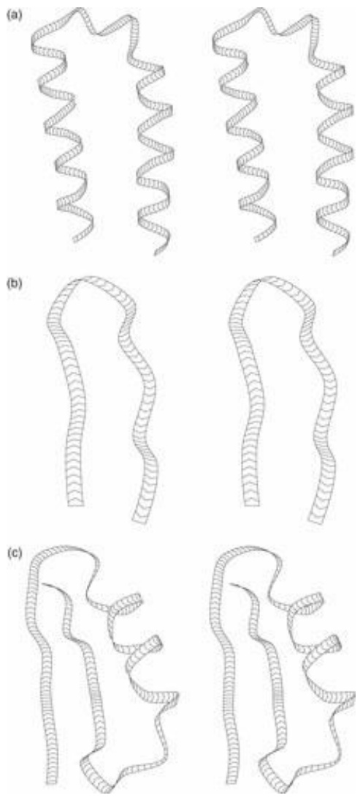
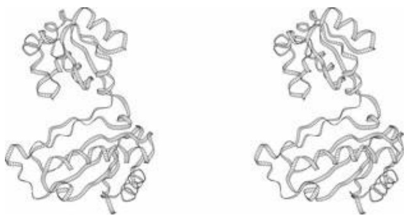
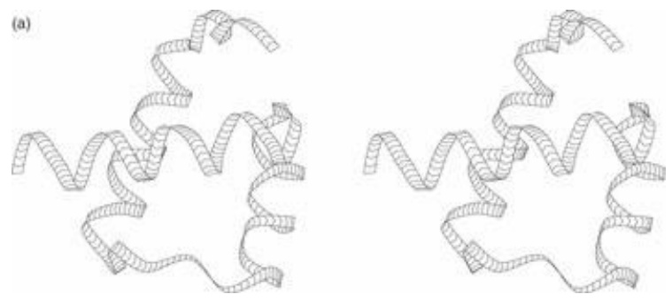
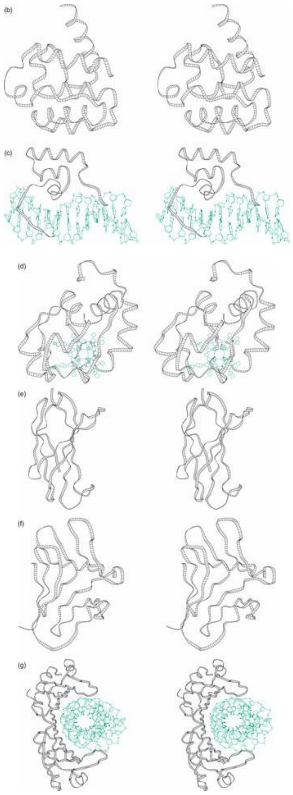
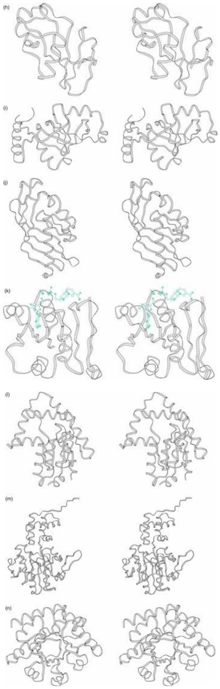
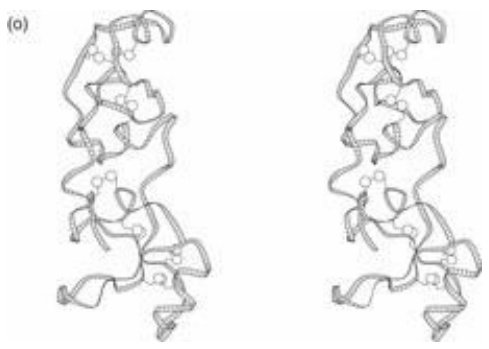
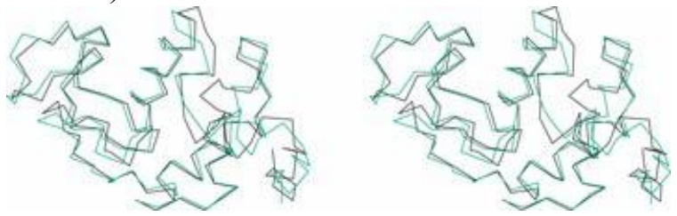
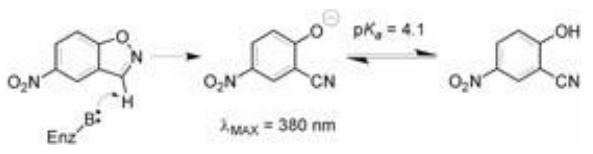

```txt
PAX6_human -----------------
eyeless LGAGIDSSESPTPIPHIRPSCTSDNDNGRQSEDCRRVCSPCPLGVGGHQNTHHIQSNGHA
600
PAX6_human ----------RTDTALTNTYSALPPMPSFTMANNLPMQPPVP
348
eyeless QGHALVPAISPRLNFNSGSFGAMYSNMHHTALSMSDSYGAVTPIPSFNHSAVGPLAPPSP
660
:* ::::::*.*:.*:***. : *: ** *
PAX6_human S-------QTSSYSCMLPTSP-------------------SVNGRS
368
eyeless IPQQGDLTPSSLYPCHMTLRPPPMAPAHHHIVPGDGGRPAGVGLGSGQSANLGASCSGSG
720
:* *.* :.  *
* .* .
PAX6_human YDTYTP----------PHMQTHMNSQP--------MGTS
389
eyeless YEVLSAYALPPPPMASSSAADSSFSAASSASANVTPHHTIAQESCPSPCSSASHFGVAHS
780
*:. . .          **   :*  *           :.  *
PAX6_human GTTSTGLISPGVS----------VPVQVPGS----EPDMSQYWPRLQ----- 422
eyeless SGFSSDPISPAVSSYAHMSYNYASSANTMTPSSASGTSAHVAPGKQQFFASCFYSPWV 838
. *:. ***.* *      .* ...*:     *.*.*:.
```

## CASE STUDY 1.7 What species contain homologues to human PAX-6 detectable by PSI-BLAST?

PSI-BLAST reports the species in which the identified sequences occur (see box entitled Results of a PSI-BLAST search for human PAX-6 protein). These appear, embedded in the text of the output, in square brackets; for instance:

```txt
emb|CAA56038.1| (X79493) transcription factor [Drosophila melanogaster]
```

(In the section reporting E values, the species names may be truncated.)

The following PERL program extracts species names from the PSI-BLAST output:

```perl
#!/usr/bin/perl
#extract species from psiblast output
# Method:
#     For each line of input, check for a pattern of form [Drosophila melanogaster]
#   Use each pattern found as the index in an associative array
#   The value corresponding to this index is irrelevant
#   By using an associative array, subsequent instances of the same
#       species will overwrite the first instance, keeping only a unique set
#   After processing of input complete, sort results and print.
while (<>) {
    if (/\\[((A-Z][a-z]+ [a-z]+)\]/) {      # read line of input
        # select lines containing strings of form
            #     [Drosophila melanogaster]
    $species{$1} = 1;                 # make or overwrite entry in
```

```txt
}
}
foreach (sort(keys(%species)) {
    print "\$_\n";
}
```

The program makes use of PERL’s rich pattern-recognition resources to search for character strings of the form [Drosophila melanogaster]. We want to specify the following pattern:

• a square bracket,
• followed by a word beginning with an upper-case letter,
• followed by a variable number of lower-case letters,
• then a space between words,
then a word all in lower-case letters,
then a closing square bracket.

This kind of pattern is called a regular expression and appears in the PERL program in the following form: [([A-Z][a-z]+ [a-z]+)].

Building blocks of the pattern specify ranges of characters:

[A-Z] = any letter in the range A, B, C, …Z

[a-z] = any letter in the range a, b, c, …z

We can specify repetitions:

[A-Z] = one upper-case letter

[a-z]+ = one or more lower-case letters

and combine the results:

[A-Z][a-z]+ [a-z]+ = an upper-case letter followed by one or more lower-case letters (the genus name), followed by a blank, followed by one or more lower-case letters (the species name).

Enclosing these in parentheses: ([A-Z][a-z]+ [a-z]+) tells PERL to save the material that matched the pattern for future reference. In PERL this matched material is designated by the variable \$1. Thus if the input line contained [Drosophila melanogaster] the statement:

\$species{\$1} = 1;

would effectively be:

\$species {"Drosophila melanogaster"} = 1;

Finally, we want to include the brackets surrounding the genus and species name, but brackets signify character ranges. Therefore we must precede the brackets by backslashes \[…\] to give the final pattern: \[([A-Z] [a-z]+ [a-z]+)\].

The use of the associative array to retain only a unique set of species is another instructive aspect of the program. Recall that an associative array is a generalization of an ordinary array or vector, in which the elements are not indexed by integers but by arbitrary strings. A second reference to an associative array with a previously encountered index string could change the value in the array but not the list of index strings. In this case we do not care about the value but just use the index strings to compile a unique list of species detected. Multiple references to the same species will merely overwrite the first reference, not make a repetitive list. The set of indices (or ‘keys’) in the associated array %species collects the names of the species found.

Newer versions of PSI-BLAST report the taxonomic distribution of the hits. However, the program in this example would be useful if one wanted to retrieve the alignments, or perform other types of analysis on the results.

Would the program handle correctly identifiers containing subspecies; for example, [Saimiri boliviensis boliviensis]?

## Introduction to protein structure

With protein structures we leave behind the one-dimensional world of nucleotide and amino acid sequences and enter the spatial world of molecular structures. Some of the facilities for archiving and retrieving molecular biological information survive this change pretty well intact, some must be substantially altered, and others do not make it at all.

Biochemically, proteins play a variety of roles in life processes: there are structural proteins (for example, viral coat proteins, the horny outer layer of human and animal skin, and proteins of the cytoskeleton); proteins that catalyse chemical reactions (the enzymes); transport and storage proteins (haemoglobin); regulatory proteins, including hormones and receptor/signal transduction proteins; proteins that control gene transcription; and proteins involved in recognition, including cell adhesion molecules, and antibodies and other proteins of the immune system.

Proteins are large molecules. In many cases only a small part of the structure—an active site—is directly functional, the rest existing only to create and fix the spatial relationship among the active site residues. Proteins evolve by structural changes produced by mutations in the amino acid sequence and genetic rearrangements that bring together different combinations of structural subunits.

Approximately 100 000 protein structures are now known. Most were determined by X-ray crystallography or nuclear magnetic resonance (NMR). From these we have derived our understanding both of the functions of individual proteins—for example, the chemical explanation of catalytic activity of enzymes—and of the general principles of protein structure and folding.

Chemically, protein molecules are long polymers typically containing several thousand atoms, composed of a uniform repetitive backbone (or mainchain) with a particular sidechain attached to each residue (see Fig. 1.6). The amino acid sequence of a protein records the succession of sidechains.

The polypeptide chain folds into a curve in space; the course of the chain defines a folding pattern. Proteins show a great variety of folding patterns. Underlying these are a number of common structural features. These include the recurrence of explicit structural paradigms—for example, α- helices and β-sheets (Fig. 1.7)—and common principles or features such as the dense packing of the atoms in protein interiors. Folding may be thought of as a kind of intramolecular condensation or crystallization.

## The hierarchical nature of protein architecture

The Danish protein chemist K.U. Linderstrøm-Lang described the following levels of protein structure. The amino acid sequence—the set of primary chemical bonds—is called the primary structure. The assignment of helices and sheets—the hydrogen-bonding pattern of the mainchain—is called the secondary structure. The assembly and interactions of the helices and sheets is called the tertiary structure. For proteins composed of more than one subunit, J.D. Bernal called the assembly of the monomers the quaternary structure. In some cases, evolution can merge proteins, changing quaternary to tertiary structure. For example, five separate enzymes in the bacterium E. coli that catalyse successive steps in the pathway of biosynthesis of aromatic amino acids underwent a gene fusion. These separate genes in E. coli correspond to five regions of a single protein in the fungus

Aspergillus nidulans. Sometimes homologous monomers form oligomers in different ways; for instance, globins form tetramers in mammalian haemoglobins, and dimers—using a different interface—in the ark clam Scapharca inaequivalvis.

It has proved useful to add additional levels to the hierarchy, as follows.

• Supersecondary structures. Proteins show recurrent patterns of interaction between helices and sheets close together in the sequence. These supersecondary structures include the α-helix hairpin, the β-hairpin, and the β-α-β unit (Fig. 1.8).
Domains. Many proteins contain compact units within the folding pattern of a single chain that look as if they should have independent stability. These are called domains. (Do not confuse domains as substructures of proteins with domains as general classes of living things: Archaea, Bacteria, and Eukarya.) The RNA-binding protein L1 (Fig. 1.9) has features typical of multidomain proteins: the binding site appears in a cleft between the two domains, and the relative geometry of the two domains is flexible, allowing ligand-induced conformational changes. In the hierarchy, domains fall between supersecondary structures and the tertiary structure of a complete monomer.
Modular proteins. Modular proteins are multidomain proteins that often contain many copies of closely related domains. Domains recur in many proteins in different structural contexts; that is, different modular proteins can ‘mix and match’ sets of domains. For example, fibronectin, a large extracellular protein involved in cell adhesion and migration, contains 29 domains including multiple tandem repeats of three types of domain, called F1, F2, and F3. It is a linear array of the form $( \mathrm { F } 1 ) _ { 6 } ( \mathrm { F } 2 ) _ { 2 } ( \mathrm { F } 1 ) _ { 3 } ( \mathrm { F } 3 ) _ { 1 5 } ( \mathrm { F } 1 ) _ { 3 }$ . Fibronectin domains also appear in other modular proteins. (See [http://www.bork.embl-heidelberg.de/Modules/](http://www.bork.embl-heidelberg.de/Modules/) for pictures and nomenclature.)


## See Weblem 1.21



Figure 1.8 Common supersecondary structures. (a) α-Helix hairpin. (b) β-Hairpin. (c) β-α-β Unit. The chevrons indicate the direction of the chain.



Figure 1.9 Ribosomal protein L1 from Methanococcus jannaschii [1CJS]. ([1CJS] is the Protein Data Bank identification code for the entry.)

## Classification of protein structures

The most general classification of families of protein structures is based on the secondary and tertiary structures of proteins (see Table 1.2).

Table 1.2 Classification of protein structures based on secondary and tertiary structure

<table><tr><td>Class</td><td>Characteristic</td></tr><tr><td>α-Helical</td><td>Secondary structure exclusively or almost exclusively α-helical</td></tr><tr><td>β-Sheet</td><td>Secondary structure exclusively or almost exclusively β-sheet</td></tr><tr><td>α + β</td><td>α-Helices and β-sheets separated in different parts of the molecule; absence of β-α-β supersecondary structure</td></tr><tr><td>α/β</td><td>Helices and sheets assembled from β-α-β units</td></tr><tr><td>α/β-Linear</td><td>Line through centres of strands of sheet roughly linear</td></tr><tr><td>α/β-Barrels</td><td>Line through centres of strands of sheet roughly circular</td></tr><tr><td colspan="2">Proteins with little or no secondary structure</td></tr></table>

Within these broad categories, protein structures show a variety of folding patterns. Among proteins with similar folding patterns there are families that share enough features of structure, sequence, and function to suggest an evolutionary relationship. However, unrelated proteins often show similar structural themes.

Classification of protein structures occupies a key position in bioinformatics, not least as a bridge between sequence and function. We shall return to this theme to describe results and relevant websites. Meanwhile, an album of small structures provides opportunities for practising visual analysis and recognition of the important spatial patterns (Fig. 1.10). Trace the chains visually, picking out helices and sheets. (The chevrons indicate the direction of the chain.)









<details>
<summary>natural_image</summary>

Two identical 3D protein structure diagrams showing helical and ribosomal conformations (no labels or text)
</details>

Figure 1.10 An album of protein structures: (a) engrailed homeodomain [1ENH], (b) utrophin calmodulin homology domain [1BHD], (c) HIN recombinase, DNA-binding domain [1HCR] (d) rice embryo cytochrome c [1CCR], (e) fibronectin cell-adhesion module type III-10 [1FNA], (f) mannose-specific agglutinin (lectin) [1NPL], (g) TATA-boxbinding protein core domain [1CDW] (h) barnase [1BRN], (i) lysyl-tRNA synthetase [1BBW], (j) scytalone dehydratase [3STD], (k) alcohol dehydrogenase, NAD-binding domain [1EE2] (l) adenylate kinase [3ADK], (m) chemotaxis receptor methyltransferase [1AF7], (n) thiamin phosphate synthase [2TPS], and (o) porcine pancreatic spasmolytic polypeptide [2PSP].

Can you see supersecondary structures? Into which general classes do these structures fall? (See Exercises 1.13 and 1.14, and Problem 1.2.) Many other examples appear in Introduction to Protein Architecture: The Structural Biology of Proteins (Lesk, 2001) and Introduction to Protein Science (Lesk, 2004; see Recommended reading).


## See Weblem 1.22

## Web resource: Web access to macromolecular structures

The Worldwide Protein Data Bank (wwPDB) is a collaboration between three primary archival projects to integrate the archiving and distribution of biological macromolecular structures:

• The Research Collaboratory for Structural Bioinformatics (RCSB) (USA);
• The Protein Databank Europe Database (PDBe) (at the EBI, Hinxton, UK);
The Protein Data Bank/Japan (Osaka, Japan).


## See Weblem 1.23

The wwPDB sites accept depositions, process new entries, and maintain the archives. Other databases reorganize, and provide access to the data, including:

Structural Classification of Proteins (SCOP) and Class, Architecture, Topology, Homologous superfamily (CATH) are carefully curated databases of all protein domains, classified according to structure, function, and evolution;
the Molecular Modeling DataBase (MMDB) is the project within the NCBI ENTREZ system, treating experimentally determined macromolecular structures.

Naturally there is considerable overlap between the sites. Each has its own strengths, based in many cases on the research interests of the contributing scientists. For instance, the Macromolecular Structure Database at the EBI maintains the Protein Quaternary Structure site, which gives the probable state of assembly of multichain proteins in their biologically active forms. Indeed, the EBI group has been active in creating a series of very useful software tools for analysis of protein structures. One example is PDBeMotif, a fast and powerful search tool that combines searching protein sequences, chemical structures (e.g. of ligands), and three-dimensional coordinate data, into a single operation. Different sites differ also in their ‘look and feel’, and users will discover their own preferences.

These and many other sites provide search facilities to identify structures of interest. For instance, to locate a protein of interest in SCOP the user can traverse the structural hierarchy, or search via keywords, such as protein name, PDB code, function (including Enzyme Commission number), or name of fold (for instance, barrel). For each structure, SCOP provides textual information (including the full text of the entry), pictures, and links to other databases.


**See Weblem 1.24**

## Protein structure prediction and engineering

The amino acid sequence of a protein dictates its three-dimensional structure. In a medium of suitable solvent and under temperature conditions, such as provided by a cell interior, proteins fold spontaneously into their active states. Chaperones help proteins to fold properly, but they catalyse the process rather than direct it.

If amino acid sequences contain sufficient information to specify three-dimensional structures of proteins it should be possible to devise an algorithm to predict protein structure from amino acid sequence. This has proved elusive, although recent progress has been impressive. In consequence, in addition to pursuing the fundamental problem of a priori prediction of protein structure from amino acid sequence, scientists have defined less-ambitious goals, as follows.

1. Secondary structure prediction: which segments of the sequence form helices and which form strands of sheet?
2. Fold recognition: given a library of known protein structures and their amino acid sequences, and the amino acid sequence of a protein of unknown structure, can we find the structure in the library that is most likely to have a folding pattern similar to that of the protein of unknown structure?
3. Homology modelling: suppose a target protein, of known amino acid sequence but unknown structure, is homologous to one or more proteins of known structure. Then we expect that much of the structure of the target protein will resemble that of the known protein, and it can serve as a basis for a model of the target structure. The completeness and quality of the result depend crucially on how similar the sequences are. As a rule of thumb, if the sequences of two related proteins have 50% or more identical residues in an optimal alignment, the structures are likely to have similar conformations over more than 90% of the model. (This is a conservative estimate, as the following illustration shows.)

Here are the aligned sequences, and superposed structures, of two related proteins, hen egg white lysozyme (black) and baboon α-lactalbumin (green). The sequences are closely related (37% identical residues in the aligned sequences), and the structures are very similar. Each protein could serve as a good model for the other, at least as far as the course of the mainchain is concerned (see Table 1.3).



Table 1.3

| Chicken lysozyme | KVFGRCELAAAMKRHGLDNYRGYSLGNWVCAAKFESNFNTQATNRNTDGS |
| --- | --- |
| Baboon α-lactalbumin | KQFTKCELSQNLY-DIDGYGRIALPELICTMFHTSGYDTQAIVEND-ES |
| Chicken lysozyme | TDYGILQINSRWWCNDGRTPGSRNLCNIPCSALLSSDITASVNCAKKIVS |

## Critical Assessment of Structure Prediction

Judging of techniques for predicting protein structures requires blind tests. To this end, J. Moult initiated biennial Critical Assessment of Structure Prediction (CASP) programmes. Crystallographers and NMR spectroscopists in the process of determining a protein structure are invited to (1) publish the amino acid sequence several months before the expected date of completion of their experiment and (2) commit themselves to keeping the results secret until an agreed date. Predictors submit models, which are held until the deadline for release of the experimental structure. Then the predictions and experiments are compared, to the delight of a few and the chagrin of most.

The results of CASP evaluations record progress in the effectiveness of predictions, which has occurred partly because of the growth of the databases but also because of improvements in the methods. We shall discuss protein structure prediction in Chapter 6.

## Protein engineering

Molecular biologists used to be like astronomers, in that we could observe our subjects but not modify them. This is no longer true. In the laboratory we can modify nucleic acids and proteins at will. We can probe them by exhaustive mutation to see the effects on function. We can endow old proteins with new functions, as in the development of catalytic antibodies. We can even create new ones.



<details>
<summary>chemical</summary>

Chemical reaction scheme showing conversion of a bipyridine derivative to a benzothiazole derivative under specified conditions
</details>

From Merski, M. and Shoichet, B.K. (2012). Engineering a model protein cavity to catalyze the Kemp elimination. Proc. Natl. Acad. Sci. USA, **109**, 16179–16183.

Many rules about protein structure were derived from observations of natural proteins. These rules do not necessarily apply to engineered proteins. Natural proteins have features required by general principles of physical chemistry, and by the mechanism of protein evolution. Engineered proteins must obey the laws of physical chemistry but not the constraints of evolution. Engineered proteins can explore new territory. This includes enhancing thermostability and catalytic effectiveness, features useful for industrial processes. Methods of approach include directed evolution to modify a starting structure, and de novo design, and combinations of techniques. Fields of application of engineered proteins include, but are not limited to, medicine, the chemical industry, biofuel production, and bioremediation (the destruction of toxic pollutants in the environment).<sup>4</sup> A particular challenge is to create novel activities, for either specific binding or even catalysis. It has proved possible to engineer proteins that catalyse the Kemp elimination, an activity unknown among natural enzymes.

## Proteomics and transcriptomics

The proteome, in analogy with the genome, is the set of proteins of an organism. Proteomics combines the census, distribution, interactions, dynamics, and expression patterns of the proteins within living systems. It is a data-intensive subject, depending on high-throughput measurements. These include DNA microarrays, RNA sequencing, and mass spectrometry.

## DNA microarrays

DNA microarrays, or DNA chips, are devices for checking a sample simultaneously for the presence of many sequences. DNA microarrays can be used (1) to determine expression patterns of different proteins by detection of mRNAs or (2) for genotyping, by detection of different variant gene sequences, including but not limited to single-nucleotide polymorphisms (SNPs). It is possible to measure simple presence or absence, or to quantitate relative abundance. A caveat is that because of differential mRNA lifetimes and translation rates, the concentrations of mRNAs and the corresponding proteins are not necessarily proportional. (see Box 1.11.)

From the point of view of bioinformatics, DNA arrays are yet another prolific stream of data creation. They demand effective design of archives and information retrieval systems. One advantage is that the data are all so new that the field is not encumbered with data structures and formats based on older generations of hardware and programs.

## Box 1.11 Applications of DNA microarrays

Identifying genetic individuality in tissues or organisms, or genotyping. Detection of SNPs is one example. In humans and animals this permits correlation of genotype with susceptibility to disease. In bacteria it permits identifying mechanisms of development of drug resistance by pathogens.
Investigating cellular states and processes. Patterns of expression that change with cellular state or growth conditions can give clues to the mechanisms of processes such as sporulation, or the change from aerobic to anaerobic metabolism.
Diagnosis of genetic disease. Testing for the presence of mutations can confirm the diagnosis of a suspected genetic disease. Detection of carriers can help in counselling prospective parents.
Diagnosis of infectious disease. Microarrays can detect viruses or other pathogens in blood samples. It may be possible to recognize strains resistant to certain antibiotics, guiding optimal treatment and isolation protocols.
Specialized diagnosis of disease. Different types of leukaemia, for example, can be identified by different patterns of gene expression. Knowing the exact type of the disease is important for prognosis, and for selecting treatment. More generally, expression profiling of tumours permits analysis of development and progression of the disease.
Genetic warning signs. Some diseases are not determined entirely and irrevocably by genotype, but the probability of their development is correlated with genes or their expression patterns. A person aware of an enhanced risk of developing a condition can in some cases improve his or her prospects by adjustments in lifestyle, or in some cases even prophylactic surgery.
Drug selection. Genetic factors can be detected that govern responses to drugs, that in some patients render treatment ineffective and in others cause unusual serious adverse reactions.
Target selection for drug design. Proteins showing enhanced transcription in particular disease states might be candidates for attempts at pharmacological intervention. Detection of genes expressed in pathogens are useful for identification of the pathogen, and for choosing targets for drug design.
Pathogen resistance. Comparisons of genotypes or expression patterns, between bacterial strains susceptible and resistant to an antibiotic, point to the proteins involved in the mechanism of resistance.
Measuring temporal variations in protein expression. This permits timing the course of many interesting processes, including (1) responses to pathogen infection, (2) responses to environmental change, and (3) changes during the cell cycle.

## Transcriptomics and RNA sequencing

The direct sequencing of RNA is replacing microarrays as the method of choice for detecting patterns of transcription. Reverse transcription into complementary DNA (cDNA) of RNA extracted from a sample of cells allows the application of high-throughput DNA sequencing techniques. Both static versus dynamic, and isolated versus distributed information is available: from the sequences of particular cells at a particular time it is possible to detect, for example, abundances, splice variants, SNPs, and RNA editing. It is also possible to compare different tissues, samples of healthy versus diseased tissues, and dependence on cell and organism age.

## Mass spectrometry

Mass spectrometry is a physical technique that characterizes molecules by measuring the masses of their ions. Applications to proteomics include:

• rapid identification of the components of a complex mixture of proteins;
• partial sequencing of proteins and nucleic acids;
• analysis of post-translational modifications, or substitutions relative to an expected sequence;
measuring extents of hydrogen–deuterium exchange, to reveal the solvent exposure of individual sites. This provides information about static conformation, dynamics—including folding and aggregation—and interactions.

## Systems biology

The watchword of systems biology is integration. Integration has two aspects. One is the study of patterns within a cell or an organism: patterns of protein–protein and protein–nucleic acid interactions, patterns of metabolic pathways and control cascades, and patterns of protein expression. Patterns have both static and dynamic aspects. Identification of pairs of proteins that bind to each other, and the assembly of pairwise interactions into a network, produces a static pattern. The flow of metabolites through a network of enzymes, or the flow of information down a control cascade, is a dynamic pattern.

The other aspect of integration is the comparison of occurrence, activities, and interactions of genes and proteins across dif erent species. The reason why the comparative approach is so powerful in biology is that the systems we are trying to understand arose through processes of evolution. Different species illuminate one another. To understand what it means to be human we must appreciate both what we have in common with other species and how we differ.

High-throughput methods of genomics and proteomics provide data about sequences, expression patterns, and interactions. From genome sequences we can infer the amino acid sequences of an organism’s complement of proteins. Proteomics tells us how expression patterns of these proteins vary within the organism, how they change during development or in response to changes in conditions, and how they cooperate with one another. Systems biology takes these data as pieces of a jigsaw puzzle that extends in both space and time. To understand the complex and delicate instrument that is the living cell, we must fit the pieces into their frame.

## Clinical implications

There is consensus that the sequencing of human and other genomes will lead to improvements in human health. Even discounting some of the more outrageous claims—hype springs eternal— categories of applications include the following.

1. Diagnosis of disease and disease risks. DNA sequencing can detect the absence of a particular gene, or a mutation. Identification of specific gene sequences associated with diseases will permit fast and reliable diagnosis of conditions (1) when a patient presents with symptoms, (2) in advance of appearance of symptoms, as in tests for inherited late-onset conditions such as Huntington’s disease (see Box 1.12 and Box 1.13), (3) for in utero diagnosis of potential abnormalities such as cystic fibrosis, and (4) for genetic counselling of couples contemplating having children.


## See Weblem 1.25

In many cases our genes do not irrevocably condemn us to contract a disease, but raise the probability that we will. An example of a risk factor detectable at the genetic level involves $\mathbf { a } _ { 1 ^ { - } }$ antitrypsin, a protein that normally functions to inhibit elastase in the alveoli of the lung. People homozygous for the Z mutant of $a_{1} - \mathrm{antiryps}$ $( ^ { 3 4 2 } \mathrm { G l u } \rightarrow \mathrm { L y s } )$ express only a dysfunctional protein. They are at risk of emphysema, because of damage to the lungs from endogenous elastase unchecked by normal inhibitory activity, and also of liver disease, because of accumulation of a polymeric form of the mutant $a_{1} - \mathrm{antiryps}$ in hepatocytes where it is synthesized. Smoking makes the development of emphysema all but certain. In these cases the

## Box 1.12 Huntington’s disease

Huntington’s disease is an inherited neurodegenerative disorder affecting 5–10 people in every 100 000 worldwide. Its symptoms are quite severe, including uncontrollable dance-like (choreatic) movements, mental disturbance, personality changes, and intellectual impairment. Death usually follows within 10–15 years after the onset of symptoms. The gene arrived in New England during the colonial period, in the 17th century. It may have been responsible for some accusations of witchcraft. The gene has not been eliminated from the population, because the age of onset—30–50 years—is after the typical reproductive period.

Formerly, members of affected families had no alternative but to face the uncertainty and fear, during youth and early adulthood, of not knowing whether they had inherited the disease. The discovery of the gene for Huntington’s disease in 1993 made it possible to identify affected individuals. The gene contains expanded repeats of the trinucleotide CAG, corresponding to polyglutamine blocks in the corresponding protein, huntingtin. (Huntington’s disease is one of a family of neurodegenerative conditions resulting from trinucleotide repeats.) The larger the block of CAGs, the earlier the onset and more severe the symptoms. The normal gene contains 11–28 CAG repeats. People with 29–34 repeats are unlikely to develop the disease, and those with 35–41 repeats may develop only relatively mild symptoms. However people with more than 41 repeats are almost certain to suffer full Huntington’s disease.

The inheritance is marked by a phenomenon called anticipation: the repeats grow longer in successive generations, progressively increasing the severity of the disease and reducing the age of onset. For some reason this effect is greater in paternal than in maternal genes. Therefore, even people in the borderline region, who might bear a gene containing 29–41 repeats, should be counselled about the risks to their offspring.

## Box 1.13 Two clinical applications of human genome sequencing

Two examples involve subjects who have voluntarily disclosed information about their own medical histories.

James D. Watson, discoverer of the double helix with Francis Crick in 1953, was later in his life treated for high blood pressure with a type of drug called a β-blocker. β-Blockers target the β-adregenic receptor, active in stress response. Watson found that the drug was making him inappropriately sleepy. His genome sequence revealed that he was homozygous for a variant of a gene for cytochrome P450, resulting in unusually slow metabolism of the drug. Reducing the dosage avoided the unwanted side effects.

Michael Snyder, of Stanford University, found from his genome sequence a predisposition to type 2 diabetes. Tests of his blood sugar levels did subsequently show development of the condition, which was reversed by lifestyle changes. The genomic sequence ‘tip off’ gave Snyder the advantages of prompt detection, and prompt treatment.

disease is brought on by a combination of genetic and environmental factors. (‘Genetics loads the gun and environment pulls the trigger’, J. Stern)

Often the relationship between genotype and disease risk is much more difficult to pin down. Some diseases such as asthma depend on interactions of many genes, as well as environmental factors. In other cases a gene may be all present and correct, but a mutation elsewhere may alter its level of expression or distribution among tissues. Such abnormalities must be detected by measurements of protein activity. Analysis of protein expression patterns is also an important way to measure response to treatment.

Genome-wide association studies (GWAS) are a common approach to determining sites responsible for diseases. Comparing of genome sequences of patients with a control group permits statistical analysis of the correlation of the disease with sequence changes. The changes usually take the form of SNPs. It might be thought that such studies are simplified by limiting them to exon sequences. However, the ENCODE project has shown that more disease-associated SNPs lie in regulatory than in coding regions.

2. Genetics of responses to therapy: customized treatment. Because people differ in their ability to metabolize drugs, different patients with the same condition may require different dosages (see Box 1.13). Sequence analysis permits selecting drugs and dosages optimal for individual patients, a fast-growing field called pharmacogenomics. Physicians can thereby avoid experimenting with different therapies, a procedure that is dangerous in terms of side effects—often even fatal—and in any case expensive. Treatment of patients for adverse reactions to prescribed drugs consumes billions of dollars in healthcare costs.


## See Weblem 1.26

For example, the very toxic drug 6-mercaptopurine is used in the treatment of childhood leukaemia. A small fraction of patients used to die from the treatment because they lacked the enzyme thiopurine methyltransferase, needed to metabolize the drug. Testing of patients for this enzyme identifies those at risk.

Conversely, it may become possible to use drugs that are safe and effective in a minority of patients, but which have been rejected before or during clinical trials because of inefficacy or severe side effects in the majority. We are on the cusp of personal genome sequences having widespread application in routine clinical medicine.

3. Identification of drug targets. Many drugs will affect the symptoms or underlying causes of a disease by interaction with a specific protein to alter its function. This protein is the target of the drug-discovery process. The specificity of the interaction is important: interaction of the drug with other proteins may lead to unacceptable side effects. Identification of a target provides the focus for subsequent steps in the drug-design process. Among drugs now in use, the targets of about half are receptors, about a quarter are enzymes, and about another quarter are hormones. Approximately 7% act on unknown targets.

The growth in bacterial resistance to antibiotics is creating a crisis in disease control. There is a very real possibility that our descendants will look back at the second half of the twentieth century as a narrow window during which bacterial infections could be controlled, and before and after which they could not.

The urgency of finding new drugs is mitigated by the increasing availability of data on which to base their development. Genomics can suggest targets. Dif erential genomics, and comparison of protein expression patterns, between drug-sensitive and -resistant strains of pathogenic bacteria, can pinpoint the proteins responsible for drug resistance. The study of genetic variation between tumour and normal cells can identify differentially expressed proteins as potential targets for anticancer drugs.

4. Gene therapy. If a gene is missing or defective, we’d like to replace it or at least supply its product. If a gene is overactive, we’d like to turn it off.

Direct supply of proteins is possible for many diseases, of which insulin replacement for diabetes and Factor VIII for a common form of haemophilia are perhaps the best known.


## See Weblem 1.27

Gene transfer has succeeded in animals, for production of human proteins in the milk of sheep and cows. In human patients there have been clinical successes in treating immunodeficiency, Leber’s congenital amaurosis, adrenoleukodystrophy, chronic myelogenous leukemia, and Parkinson’s disease.

One approach to blocking genes is called ‘antisense therapy.’ The idea is to introduce a short stretch of DNA or RNA that binds in a sequence-specific manner to a region of a gene. Binding to endogenous DNA can interfere with transcription; binding to mRNA can interfere with translation. Antisense therapy has shown some efficacy against cytomegalovirus and Crohn disease.

Antisense therapy is very attractive because going directly from target sequence to blocker short circuits many stages of the drug-design process.

## The future

This century will see a revolution in healthcare development and delivery. Barriers between ‘blue sky’ research and clinical practice are tumbling down. It is possible that a reader of this book will discover a cure for a disease that would otherwise kill him or her. It is extremely likely that Szent-Gyorgi’s quip, ‘Cancer supports more people than it kills’, will come true. One hopes that this will happen because the research establishment succeeds in developing therapeutic or preventative measures against tumours rather than merely by imitating their uncontrolled growth.

## RECOMMENDED READING

Lesk, A.M. (2011). Introduction to Genomics, 2nd edn. Oxford University Press, Oxford.

## A glimpse of the future?

Blumberg, B.S. (1996). Medical research for the next millennium. The Cambridge Review, **117**, 3–8. Still interesting

- reading. A fascinating prediction of things to come, some of which are already here.
- Ouzounis, C.A. (2012). Rise and demise of bioinformatics? Promise and progress. PLoS Comput. Biol., 8(4), e1002487.
- Mayr, E. (2004). What Makes Biology Unique? Considerations on the Autonomy of a Scientific Discipline. Cambridge University Press, Cambridge. Perspectives from a self-described ‘dirty-fingernails biologist’ with an unequalled clarity of mind.
- Doolittle, W.F. (2000). Uprooting the tree of life. Sci. Am., 282 (2), 90–95. Implications for analysis of sequences for our understanding of the relationships between living things.
- Hedges, S.B. and Kumar, S. (eds) (2009). The Timetree of Life. Oxford University Press, Oxford. A comprehensive combination of phylogenetic trees linked to timescale.
- Ashburner, M. (2006). Won for All: How the Drosophila Genome Was Sequenced. Cold Spring Harbor Laboratory Press, Cold Spring Harbor.
- Sulston, J. and Ferry, G. (2002). The Common Thread: A Story of Science, Politics, Ethics and the Human Genome. Bantam, New York.
- Desai, N., Antonopoulos, D., Gilbert, J.A., Glass, E.M., and Meyer, F. (2012). From genomics to metagenomics. Curr. Opin. Biotechnol., 23, 72–76.
- Didelot, X., Bowden, R., Wilson, D.J., Peto, T.E.A., and Crook, D.W. (2012). Transforming clinical microbiology with bacterial genome sequencing. Nat. Rev. Genet., 13, 601–612.
- Gonzaga-Jauregui, C., Lupski, J.R., and Gibbs, R.A. (2012). Human genome sequencing in health and disease. Annu. Rev. Med., 63, 35–61.
- Nagarajan, N. and Pop, M. (2013). Sequence assembly demystified. Nat. Rev. Genet., 14, 157–167.
- Ottman, N., Smidt, H., de Vos, W.M., and Belzer, C. (2012). The function of our microbiota: who is out there and what do they do? Front. Cell Infect. Microbiol., 2, 104.
- Shokralla, S., Spall, J.L., Gibson, J.F., and Hajibabaei, M. (2012). Next-generation sequencing technologies for environmental DNA research. Mol. Ecol., 21, 1794–1805.
- Teeling, H. and Glöckner, F.O. (2012). Current opportunities and challenges in microbial metagenome analysis - a bioinformatic perspective. Brief Bioinform., 13, 728–742.

## The intellectual setting

## The overall biological context

## Genomic sequence determination: first-hand accounts

## Genomic sequence determination: applications to medicine and biology

## Sequencing the genomes of extinct organisms: ‘ancient DNA’

- Rizzi, E., Lari, M., Gigli, E., De Bellis, G., and Caramelli, D. (2012). Ancient DNA studies: new perspectives on old samples. Genet. Sel. Evol., 44, 21.
- Rohland, N., Reich, D., Mallick, S., Meyer, M., Green, R.E. et al. (2010). Genomic DNA sequences from mastodon and woolly mammoth reveal deep speciation of forest and savanna elephants. PLoS Biol., 8(12), e1000564.

## Databases and information retrieval

- Jensen, L.J., Saric, J., and Bork, P. (2006). Literature mining for the biologist: from information retrieval to biological discovery. Nat. Rev. Genet., 7, 119–129.
- Kortagere, S., Lill, M., and Kerrigan, J. (2012). Role of computational methods in pharmaceutical sciences. Methods Mol. Biol., 929, 21–48.