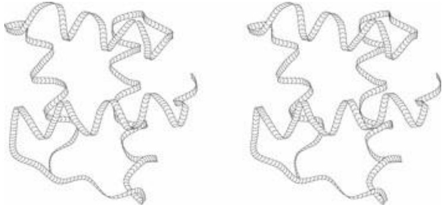
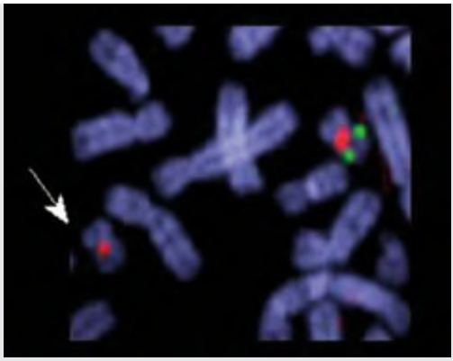

- Wang, J., Kong, L., Gao, G., and Luo, J. (2013). A brief introduction to web-based genome browsers. Brief Bioinform., 14, 131–143.
- Yandell, M. and Ence, D. (2012). A beginner’s guide to eukaryotic genome annotation. Nat. Rev. Genet., 13, 329–342.

## Epigenetics

Herb, B.R., Wolschin, F., Hansen, K.D., Aryee, M.J., Langmead, B. et al. (2012). Reversible switching between epigenetic states in honeybee behavioral subcastes. Nat. Neurosci., 15, 1371–1373.

Martín-Subero, J.I. (2011). How epigenomics brings phenotype into being. Pediatr. Endocrinol. Rev., 9 Suppl 1, 506–510.

## Proteins

Branden, C.I. and Tooze, J. (1999). Introduction to Protein Structure, 2nd edn. Garland, New York. A fine introductory text.

Lesk, A.M. (2001). Introduction to Protein Architecture: The Structural Biology of Proteins. Oxford University Press, Oxford.

Lesk, A.M. (2004). Introduction to Protein Science. Architecture, Function and Genomics. Oxford University Press, Oxford. Companion volumes to Introduction to Bioinformatics, with a focus on protein structure, function, and evolution.

## The transition to electronic publishing, and text mining

Berners-Lee, T. and Hendler, J. (2001). Publishing on the semantic web. Nature, 410, 1023–1024. From the inventor of the worldwide web.

Harmston, N., Filsell, W., and Stumpf, M.P. (2010). What the papers say: text mining for genomics and systems biology. Hum. Genomics, 5, 17–29.

Neylon, C. (2012). More than just access: delivering on a network-enabled literature. PLoS Biol. 10:e1001417.

Valencia, A. (2002). Search and retrieve. EMBO Reports 3, 396–400.

## Legal aspects

Cook-Deegan, R. and Heaney, C. (2010). Patents in genomics and human genetics. Annu. Rev. Genomics Hum. Genet., 11, 383–425.

Greenbaum, D., Sboner, A., Mu, X.J., and Gerstein, M. (2011). Genomics and privacy: implications of the new reality of closed data for the field. PLoS Comput. Biol., 7, e1002278.

Yadav, D., Anand, G., Dubey, A.K., Gupta, S., and Yadav, S. (2012). Patents in the era of genomics: an overview. Recent Pat. DNA Genet., 6, 127–144.

## EXERCISES AND PROBLEMS

Exercise 1.1 (a) The Sloan Digital Sky Survey is a mapping of the northern sky over a 5-year period. The data in release 5 amount to about 15 terabytes (1 byte = 1 character; 1 $\mathrm { T B } = 1 0 ^ { 1 2 }$ bytes). To how many human genome equivalents does this correspond? (b) The Earth Observing System/Data Information System (EOS/DIS)—a series of long-term global observations of the Earth—is estimated to require 15 petabytes of storage $( 1 \; \mathrm { p e t a b y t e } = 1 0 ^ { 1 5 }$ bytes). To how many human genome equivalents will this correspond? (c) Compare the data storage required for EOS/DIS with that required to store the complete DNA sequences of every inhabitant of the USA (population 314 million). (Ignore savings available using various kinds of storage-compression techniques. Assume that each person’s DNA sequence requires 1 byte/nucleotide.)

Exercise 1.2 (a) How many CDs would be required to store the entire human genome? (c) How many DVDs would be required to store the entire human genome? (In all cases assume that the sequence is stored as 1 byte/character, uncompressed.)

**Exercise 1.3** Suppose you were going to prepare Box 1.12, on Huntington’s disease, for a website. For which words or phrases would you provide links?

**Exercise 1.4** The end of the human β-haemoglobin gene has the nucleotide sequence:

…ctg gcc cac aag tat cac taa

(a) What is the translation of this sequence into an amino acid sequence? (b) Write the nucleotide sequence of a single base change producing a silent mutation in this region. (A silent mutation is one that leaves the amino acid sequence unchanged.) (c) Write the nucleotide sequence, and the translation to an amino acid sequence, of a single base change producing a missense mutation in this region. (d) Write the nucleotide sequence, and the translation to an amino acid sequence, of a single base change producing a mutation in this region that would lead to premature truncation of the protein. (e) Write the nucleotide sequence of a single base change producing a mutation in this region that would lead to improper chain-termination resulting in extension of the protein.

**Exercise 1.5** On a photocopy of the box entitled Complete pairwise sequence alignment of human PAX-6 protein and Drosophila melanogaster eyeless indicate with a highlighter pen the regions aligned by PSI-BLAST.

**Exercise 1.6** On a photocopy of the box entitled Complete pairwise sequence alignment of human PAX-6 protein and Drosophila melanogaster eyeless highlight the regions in the human PAX-6 protein aligned to the Drosophila circadian clock protein.

**Exercise 1.7** (a) What cutoff value of E would you use in a PSI-BLAST search if all you want to know is whether your sequence is already in a database? (b) What cutoff value of E would you use in a PSI-BLAST search if you want to locate distant homologues of your sequence?

**Exercise 1.8** In designing an antisense sequence, estimate the minimum length required to avoid exact complementarity to many random regions of the human genome.

**Exercise 1.9** It is suggested that all living humans are descended from a common ancestor called Eve, who lived ≈190 000–200 000 years ago. (a) Assuming six generations per century, how many generations have there been between Eve and the present? (b) If a bacterial cell divides every 20 minutes, how long would be required for the bacterium to go through that number of generations?

**Exercise 1.10** Name an amino acid that has physicochemical properties similar to (a) leucine, (b) aspartic acid, and (c) threonine. We expect that such substitutions would in most cases have relatively little effect on the structure and function of a protein. Name an amino acid that has physicochemical properties very different from (d) leucine, (e) aspartic acid, and (f) threonine. Such substitutions might have severe effects on the structure and function of a protein, especially if they occur in the interior of the protein structure.

**Exercise 1.11** In Figure 1.7a, does the direction of the chain from N-terminus to C-terminus point up the page or down the page? In Figure 1.7b, do the directions of the chain from N-terminus to C-terminus point up the page or down the page?

**Exercise 1.12** From inspection of Figure 1.9, how many times does the chain pass between the domains of M. jannaschii ribosomal protein L1?

**Exercise 1.13** On a photocopy of Figure 1.10 k and l, indicate with highlighter pen the helices (in pink) and strands of sheet (in green). On a photocopy of Figure 1.10 g and m, divide the protein into domains.

**Exercise 1.14** Which of the structures shown in Figure 1.10 contains the following domain?



**Exercise 1.15** On a photocopy of the superposition of chicken lysozyme and baboon α-lactalbumin structures, indicate with a highlighter pen two regions in which the conformation of the mainchain is different.

**Exercise 1.16** In the PERL program in Case Study 1.1, estimate the fraction of the text of the program that contains

comment material. (Count full lines and half lines.)

**Exercise 1.17** Modify the PERL program that extracts species names from PSI-BLAST output so that it would also accept names given in the form [D. melanogaster].

**Exercise 1.18** Modify the PERL program that extracts species names from PSI-BLAST output so that it would count the number of sequences from each species occurring in the list.

**Exercise 1.19** What is the nucleotide sequence of the molecule shown in Plate I?

**Problem 1.1** The following table contains a multiple alignment of partial sequences from a family of proteins called ETS domains. Each line corresponds to the amino acid sequence from one protein, specified as a sequence of letters each specifying one amino acid. Looking down any column shows the amino acids that appear at that position in each of the proteins in the family. In this way patterns of preference are made visible.

```txt
TYLWEFLLKLLQDR.EYCPRFIKWTNREKGVFKLV..DSKAVSRLWGMHKN.KPD
VQLWQFLLEILTD..CEHTDVIEWVG.TEGEFKLT..DPDRVARLWGEKKN.KPA
IQLWQFLLELLTD..KDARDCISWVG.DEGEFKLN..QPELVAQKWGQRKN.KPT
IQLWQFLLELLSD..SSNSSCITWEG.TNGEFKMT..DPDEVARRWGERKS.KPN
IQLWQFLLELLTD..KSCQSFISWTG.DGWEFKLS..DPDEVARRWGKRKN.KPK
IQLWQFLLELLQD..GARSSCIRWTG.NSREFQLC..DPKEVARLWGERKR.KPG
IQLWHFILELLQK..EEFRHVIAWQQGEYGEFVIK..DPDEVARLWGRRKC.KPQ
VTLWQFLLQLLRE..QGNGHIISWTSRDGGEFKLV..DAEEVARLWGLRKN.KTN
ITLWQFLLHLLLD..QKHEHLICWTS.NDGEFKLL..KAEEVAKLWGLRKN.KTN
LQLWQFLVALLDD..PTNAHFIAWTG.RGMEFKLI..EPEEVARLWGIQKN.RPA
IHLWQFLKELLASP.QVNGTAIRWIDRSKGIFKIE..DSVRVAKLWGRRKN.RPA
RLLWDFLQQLLNDRNQKYSDLIAWKCRDTGVFKIV..DPAGLAKLWGIQKN.HLS
RLLWDYVYQLLSD..SRYENFIRWEDKESKIFRIV..DPNGLARLWGNHKN.RTN
IRLYQFLLDLLRS..GDMKDSIWWVDKDKGTFQFSSKHKEALAHRWGIQKGNRKK
LRLYQFLLGLLTR..GDMRECVWWVEPGAGVFQFSSSKHKELLARRWGQQKGNRKR
```

On a photocopy of this page: (a) Using coloured highlighter, mark, in each sequence, the residues in different classes in different colours:

| Small residues | G A S T |
| --- | --- |
| Medium-sized nonpolar residues: | C P V I L |
| Large nonpolar residues: | F Y M W |
| Polar residues: | H N Q |
| Positively charged residues: | K R |
| Negatively charged residues: | D E |

(b) For each position containing the same amino acid in every sequence, write the letter symbolizing the common residue in upper case below the column. For each position containing the same amino acid in all but one of the sequences, write the letter symbolizing the preferred residue in lower case below the column. (c) What patterns of periodicity of conserved residues suggest themselves? (d) What secondary structure do these patterns suggest in certain regions? (e) What distribution of conservation of charged residues do you observe? Propose a reasonable guess about what kind of molecule these domains interact with.

**Problem 1.2** Classify the structures appearing in Fig. 1.10 in the following categories: α-helical, β-sheet, α + β, α/β- linear, α/β-barrels, little or no secondary structure.

**Problem 1.3** Generalize the PERL program in Case Study 1.1 to print the translations of a DNA sequence in all six possible reading frames.

**Problem 1.4** Write a PERL program to read a CLUSTAL-W alignment, such as the alignment of pancreatic ribonuclease from horse (Equus caballus), minke whale (Balaenoptera acutorostrata), and red kangaroo (Macropus rufus), to count the number of sequence mismatches between each pair of proteins.

**Problem 1.5** Write a PERL program to find motif matches as illustrated in Box 1.8. (a) Demand exact matches. (b) Allow one mismatch, not necessarily at the first position as in the examples, but no insertions or deletions.

**Problem 1.6** PERL is capable of great concision. Here is an alternative version of the program to assemble overlapping fragments:

```perl
#!/usr/bin/perl
$/ = "";
@fragments = split("\n",<DATA>);
foreach (@fragments) { $firstfragment{$_} = $_; }
foreach $i (@fragments) {
    foreach $j (@fragments) { unless ($i eq $j) {
        ($combine = $i . "XXX" . $j) =~ /([\S]{2,})XXX\1/;
        (length($1) <= length($successor{$i})) || { $successor{$i} = $j };
    }
    undef $firstfragment{$successor{$i}};
}
$test = $outstring = join "", values(%firstfragment);
while ($test = $successor{$test}) { ($outstring .= "XXX" . $test) =~ s/([\S]+)XXX\1/\1/; }
$outstring =~ s/\n/\n/g; print "$outstring\n";
__END__
the men and women merely players;\n
one man in his time
All the world's
their entrances,\nand one man
stage,\nAnd all the men and women
They have their exits and their entrances,\n
world's a stage,\nAnd all
their entrances,\nand one man
in his time plays many parts.
merely players;\nThey have
```

This is a good example of what to avoid. Anyone who produces code like this should be fired immediately. The absence of comments, and the tricky coding and useless brevity, make it difficult to understand what the program is doing. A program written in this way is difficult to debug and virtually impossible to maintain. Someday you may succeed someone in a job and be presented with such a program to work on. You will have my sympathy. (a) Photocopy the concise program listed in this problem and the original version in Case Study 1.2 so that they appear side-by-side on a page. Wherever possible, map each line of the concise program into the corresponding set of lines of the long one. (b) Prepare a version of the concise program with enough comments to clarify what it is doing (for this you could consider adapting the comments from the original program) and how it is doing it. Do not change any of the executable statements (back to the original version or to anything else); just add comments.

1 We use 1 billion = 109 .
2 For the history of the discovery of the double helix, see Introduction to Genomics (Lesk, 2011), chapter 1.
3 Herb et al. (2012); see Recommended reading.
4 An extensive table appears in Li, S., Yang, X., Yang, S., Zhu, M., and Wang, X. (2012). Technology prospecting on enzymes: Application, marketing and engineering. Comput. Struct. Biotechnol., 2, e201209017, [http://journals.sfu.ca/rncsb/index.php/csbj/article/view/csbj.201209017/160](http://journals.sfu.ca/rncsb/index.php/csbj/article/view/csbj.201209017/160).

## LEARNING GOALS

• Knowing the basic sizes, contents, and organizing principles of simple and complex genomes.
• Understanding how genomes are analysed, and the relation of gene sequences to phenotypic features, including inherited diseases.
• Recognizing the importance and the difficulty of deriving from a complete genome sequence the amino acid sequences of the proteins encoded, and assigning functions to these proteins.
• Understanding how to find genes associated with inherited diseases, and how the availability of the complete human genome has changed such investigations. Compare the identification of the gene for cystic fibrosis, by classical methods, with modern genome-wide association studies.
• Knowing the general ideas of the contents of particular genomes, and how the genomes of prokaryotes and eukaryotes differ systematically, and appreciating the implications of general surveys of genomes of different organisms.
Realizing that many published genomes record the characteristics of only a single individual, and that there is considerable variation within populations and great variation between separated populations of organisms belonging to the same species. For humans there has been extensive collection of polymorphisms and their distribution in different populations, complete sequencing of many individuals, and investigation of the effects of disease. Genome variation within other species has been the subject of some study, but to a minor extent compared to humans.
• Appreciating the power of DNA sequences in studying human history, including inference of human migration patterns, and as records of plant and animal domestication.
• Recognizing the power of DNA sequencing for personal identification, its application in paternity and criminal cases, and the questions of social policy it raises.
• Appreciating the power of comparative genomics to identify features responsible for differences between species: what is it that makes us human?

## Genomes, transcriptomes, and proteomes

The genome of a typical bacterium comes as a single DNA molecule of about 5 million characters, about the same as a fairly large book. The number of characters in the E. coli genome and in the first folio edition of Shakespeare’s plays differ by less than 0.1%. If extended, the bacterial genome would be about 2 mm long. (It has to fit into a cell with a diameter of about 0.001 mm!). The DNA of higher organisms is organized into chromosomes: normal human cells contain 23 chromosome pairs. The total amount of genetic information per cell—the sequence of nucleotides of DNA—is very nearly constant for all members of a species, but varies widely between species, as shown in the table (see Box 2.1 for a longer list). There is no simple proportionality between genome size and number of proteins encoded.

| Organism | Genome size (base pairs) |
| --- | --- |
| Epstein-Barr virus | 0.172 × 106 |
| Bacterium (Escherichia coli) | 4.6 × 106 |
| Yeast (Saccharomyces cerevisiae) | 12.5 × 106 |
| Nematode worm (Caenorahbditis elegans) | 100.3 × 106 |
| Thale cress (Arabidopsis thaliana) | 115.4 × 106 |
| Fruit fly (Drosophila melanogaster) | 128.3 × 106 |
| Human (Homo sapiens) | 3223 × 106 |

Different patterns of transcribed RNAs and translated proteins also characterize different species, and different tissues within an organism.

Some RNAs, such as mRNA involved in protein coding, are transient. Some, such as the RNA components of the ribosome, are stable. Some RNAs are involved in gene regulation. These include microRNAs (miRNAs), small interfering RNAs (siRNAs), and piwi-interacting RNAs (piRNAs), which interact with mRNA to inhibit translation. It is clear that cellular RNA is a far more complex domain than was for a long time adequately appreciated.

The relationship between DNA content and protein content is not direct. As a very rough rule of thumb, all metazoa have slightly over 20 000 protein-coding genes. But not all DNA codes for proteins. Conversely, some genes exist in multiple copies. In eukarya, many genes produce several different proteins by alternative splicing. Therefore, the amount of protein sequence information in a cell, much less the number and pattern of different proteins expressed, cannot easily be estimated from the genome size (see Box 2.1).

## Genes

A single gene coding for a particular protein corresponds to a sequence of nucleotides along one or more regions of a molecule of DNA. In cells, genes may appear on either strand of DNA. Bacterial genes are continuous regions of DNA. The nucleotide sequence of the DNA and the amino acid sequence of the corresponding protein are collinear. Therefore, the functional unit of genetic sequence information from a bacterium is a string of 3N nucleotides encoding a string of N amino acids, or a string of N nucleotides encoding a structural RNA molecule of N nucleotides, together with associated control sequences. Such a string, equipped with annotations, would form a typical entry an archive of genetic sequences.


## See Weblems 2.1 – 2.6

In eukarya the nucleotide sequences that encode amino acid sequences of proteins are organized in a more complex manner. Frequently one gene appears split into separate segments in the genomic DNA. An exon—an **ex**pressed regi**on**—is a stretch of DNA retained in the mature mRNA that the ribosome translates into protein. An intron is an **int**ervening regi**on** between two exons. Cellular machinery splices together segments of initial RNA transcripts, based on signal sequences flanking the exons in the sequences themselves. Many introns are very long, in some cases substantially longer than the exons.

The genes that code for proteins, and for structural RNA molecules, present only a static picture of the genome.

Control information organizes the expression of genes. Control mechanisms may turn genes on and off, or regulate gene expression more finely. Cascades of controls respond to concentrations of nutrients, or to stress, or to control the cell cycle. Regulatory networks orchestrate complex programmes of development during the lifetimes of higher organisms.

Many control regions of DNA lie near the segments coding for proteins. They contain signal sequences that serve as binding sites for the molecules that transcribe the DNA sequence, or sequences that bind regulatory molecules that can block transcription. Bacterial genomes contain examples of contiguous genes, coding for several proteins that catalyse successive steps in an integrated sequence of reactions, all under the control of the same regulatory sequence. F. Jacob, J. Monod, and E. Wollman named

Box 2.1 Genome sizes

| Organism | Number of base pairs | Number of genes | Comment |
| --- | --- | --- | --- |
| ΦX-174 | 5386 | 10 | Virus infecting E. coli |
| Human mitochondrion | 16 569 | 37 | Subcellular organelle |
| Epstein-Barr virus | 172 282 | 80 | Cause of mononucleosis |
| Mycoplasma pneumoniae | 816 394 | 680 | Cause of cyclic pneumonia epidemics |
| Rickettsia prowazekii | 1 111 523 | 878 | Bacterial cause of epidemic typhus |
| Treponema pallidum | 1 138 011 | 1039 | Bacterial cause of syphilis |
| Borrelia burgdorferi | 1 471 725 | 1738 | Bacterial cause of Lyme disease |
| Aquifex aeolicus | 1 551 335 | 1749 | Bacterium from hot springs |
| Thermoplasma acidophilum | 1 564 905 | 1509 | Archaeal prokaryote lacking a cell wall |
| Campylobacter jejuni | 1 641 481 | 1708 | Frequent cause of food poisoning |
| Methanococcus jannaschii | 1 664 970 | 1783 | Archaeal prokaryote thermophile |
| Helicobacter pylori | 1 667 867 | 1589 | Chief cause of stomach ulcers |
| Haemophilus influenzae | 1 830 138 | 1738 | Bacterial cause of middle ear infections |
| Thermotoga maritima | 1 860 725 | 1879 | Marine bacterium |
| Archaeoglobus fulgidus | 2 178 400 | 2437 | Another archaeon |
| Deinococcus radiodurans | 3 284 156 | 3187 | Radiation-resistant bacterium |
| Synechocystis | 3 573 470 | 4003 | Cyanobacterium, 'blue-green alga' |
| Vibrio cholerae | 4 033 460 | 3890 | Cause of cholera |
| Mycobacterium tuberculosis | 4 411 529 | 4275 | Cause of tuberculosis |
| Bacillus subtilis | 4 214 814 | 4779 | Popular in molecular biology |
| Escherichia coli | 4 639 221 | 4406 | Molecular biologists' all-time favourite |
| Pseudomonas aeruginosa | 6 264 403 | 5570 | Largest prokaryote yet sequenced |
| Saccharomyces cerevisiae | $12.1 \times 10^6$ | 6172 | Yeast; first eukaryotic genome sequenced |
| Caenorhabditis elegans | $95.5 \times 10^6$ | 19 099 | The worm |
| Arabidopsis thaliana | $1.17 \times 10^8$ | 25 498 | Flowering plant (angiosperm) |
| Drosophila melanogaster | $1.8 \times 10^8$ | 13 601 | The fruit fly |
| Takifugu rubripes | $3.9 \times 10^8$ | 30 000 | Fugu fish |
| Human | $3.2 \times 10^9$ | 21 000 |  |
| Wheat | $16 \times 10^9$ | 30 000 |  |
| Psilotum nudum | $71 \times 10^9$ | ? | Whisk fern, a simple plant |
| Necturus lewisi | $118 \times 10^9$ |  | Gulf coast waterdog (salamander) |
| Paris japonica | $149 \times 10^9$ |  | Canopy plant |

Some of the largest genomes have arisen by polyploidization.

these operons. One can readily understand the utility of a parallel control mechanism.

In higher organisms, epigenetic signals such as DNA methylation and histone modification direct tissue-specific expression of developmentally regulated genes. DNA methylation is stable during tissue differentiation, surviving cell division. When a cell divides, enzymes copy the methylation patterns, preserving the settings of the regulatory switches.

Products of certain genes cause cells to commit suicide, a process called apoptosis. Defects in the apoptotic mechanism leading to uncontrolled growth are observed in some cancers, and stimulation of these mechanisms is a general approach to cancer therapy.

Eukaryotic chromosomes contain complexes of DNA with histones. Chromatin remodelling is an important mechanism of transcriptional control. Reversible chemical modification of histones, by a variety of reactions including deacetylation, methylation, decarboxylation, phosphorylation, ubiquitinylation, and sumoylation, leads to alterations of the DNA–histone interactions that render transcription-initiation sites more or less accessible.

The conclusion is that to reduce genetic data to individual coding sequences is to disguise the very complex nature of the interrelationships among them, and to ignore the historical and integrative aspects of the genome. Robbins has expressed the situation unimprovably:

Consider the 3.2 gigabytes of a human genome as equivalent to 3.2 gigabytes of files on the mass-storage device of some computer system of unknown design. Obtaining the sequence is equivalent to obtaining an image of the contents of that mass-storage device. Understanding the sequence is equivalent to reverse engineering that unknown computer system (both the hardware and the 3.2 gigabytes of software) all the way back to a full set of design and maintenance specifications.

‘Reverse engineering the sequence is complicated by the fact that the resulting image of the massstorage device will not be a file-by-file copy, but rather a streaming dump of the bytes in the order they were entered into the device. Furthermore, the files are known to be fragmented. In addition, some of the device contains erased files or other garbage. Once the garbage has been recognized and discarded and the fragmented files reassembled, the reverse engineering of the codes can be undertaken with only a partial, and sometimes incorrect, understanding of the CPU on which the codes run. In fact, deducing the structure and function of the CPU is part of the project, since some of the 3.2 gigabytes are the binary specifications for the computer-assisted-manufacturing process that fabricates the CPU. In addition, one must also consider that the huge database also contains code generated from the result of literally millions of maintenance revisions performed by the worst possible set of kludge-using, spaghetti-coding, opportunistic hackers who delight in clever tricks like writing self-modifying code and relying upon undocumented system quirks.’

Robbins, R.J. (1992). Challenges in the human genome project. IEEE Eng. Med. Biol., **11**, 25–34 (©1992 IEEE).

## Proteomics and transcriptomics

An organism’s genome gives a complete specification of the potential life of that individual. What reveals the activity of a cell at any instant, at the molecular level, is the set of RNAs being transcribed and the set of proteins synthesized. These also show the state of development of different tissues, and can in some cases mark the presence of disease. The DNA does contain some clues, notably in epigenetic markers. However, inventories of RNA molecules and proteins in cells deal in a more direct and integral way with cellular status and activity. These data are the subjects of the transcriptome and proteome projects.

What kinds of data would we like to measure, and what mature experimental techniques exist to determine them? The basic goal is a spatiotemporal description of the inventory and deployment of RNAs and proteins in the organism. These vary among different tissues and different cell types and states of activity. Methods are available for efficient analysis of transcription patterns of multiple genes.

## Proteomics

Measurement of protein-coding RNA transcripts provides more information about the cell’s proteins than genome sequences do. However, because proteins are both synthesized and ‘turned over’ at different rates, it is also necessary to measure proteins directly. High-resolution two-dimensional polyacrylamide gel electrophoresis (2D PAGE) shows the pattern of protein content in a sample. Mass-spectrometric techniques identify the proteins into which the sample has been separated. We shall develop these topics in Chapter 9.

Application of these methods provides a picture of the protein-based activity of an organism, as the genome provides a complete set of potential proteins. R. Simpson has drawn an analogy: if the genome is a list of the instruments in an orchestra, the proteome is the orchestra in the process of playing a symphony.

Historically the chemical problem of determining amino acid sequences of proteins directly was solved before the genetic code was established and before methods for determination of nucleotide sequences of DNA were developed. (F. Sanger’s sequencing of insulin in 1955 first proved that proteins had definite amino acid sequences, a proposition that until then was hypothetical.) However, much—although not all—information about the amino acid sequences of an organism’s proteins are inherent in its genome sequence, by virtue of the genetic code. Indeed, new protein sequence data are now being determined by translation of DNA sequences, rather than by direct sequencing of proteins.


## See Weblem 2.7

Yet it is important to distinguish amino acid sequences inferred by translation from DNA, and actual sequences of proteins. First we must assume that it is possible correctly to identify within DNA sequences the regions that encode proteins. The pattern-recognition programs that address this question are subject to three types of error: a genuine protein sequence may be missed entirely, an incomplete protein may be reported, or a gene may be incorrectly spliced. Several variations on the theme add to the complexity: genes for different proteins may overlap; or genes may be assembled from exons in different ways, in different tissues, or even in individual cells. In rare cases, the genetic code of a species may contain slightly different codon/amino acid mappings than the standard. In some cases, mRNA is edited before translation, altering amino acid sequences in ways not inferrable from the gene sequences. Conversely, some genetic sequences that appear to code for proteins may in fact be defective or not expressed. A protein inferred from a genome sequence is a hypothetical object until an experiment verifies its existence.

Several other important features of proteins are not available from genome sequences, even if protein-coding regions are identified accurately. Genome sequences give no clue to the quaternary structure of a protein; for instance, how could one deduce from the genome sequence that adult haemoglobin is a tetramer containing two α- and two β-chains? Many proteins bind prosthetic groups; these are invisible in the genome. Patterns of disulphide bridges—primary chemical bonds between cysteine residues—cannot be deduced directly from the amino acid sequence.

In addition to binding ligands integral to the native structure, many proteins undergo covalent alterations within a cell, to make a mature protein that differs significantly from the one suggested by translation of the gene sequence. In many cases the missing details of post-translational modifications—the molecular analogues of body piercing—are quite important. Post-translational modifications include addition of ligands (for instance, the covalently bound haem group of cytochrome c), glycosylation, methylation, phosphorylation, excision of peptides, and many others.

Cleavage of a peptide is a common post-translational modification. In some cases, cleavage converts an inactive form of a protein to an active one. The proteases active in digestion of our food are examples. In other cases, the effect is to promote correct folding. For instance, insulin is synthesized as a single-chain precursor that folds properly, after which excision of a peptide produces the mature oligomeric form.

Most post-translational cleavage reactions are carried out by proteases. Alternatively, inteins are proteins that have a ‘self-splicing’ activity. They autocatalytically excise internal peptides and join the ends. (In contrast, peptide excision from proinsulin leaves two chains that are not joined by a peptide bond.)

## Transcriptomics

‘Between the genome and the proteome lies the transcriptome.’ This rather glib statement is not so much untrue but incomplete. In some ways analogous to proteomics, transcriptomics deals with the inventory of RNA molecules in the cell. Some of the RNA is transient, such as mRNA. Much is stable, such as the RNA components of the ribosome, which typically accounts for over 90% of cellular RNA. Some RNA molecules exert control over translation.

We now recognize that the RNA world is much more complex than previously suspected. Indeed, we now know that 60–70% of the human genome is not transcriptionally inert, although we don’t know the function of many of the RNAs produced. The implication is that the transcriptome and proteome are not as closely related as once thought. Many RNA transcripts are not protein-coding.

The RNAseq method applies modern sequencing techniques to inventory RNA molecules. RNA fragments are converted to cDNA, and high-throughput sequencing methods applied. Because variation in the yields of the RNA → cDNA step may bias the results, there is current effort to develop methods to sequence RNA directly. RNA sequencing methods are competitive with, if they have not entirely superseded, classical microarray methods. An advantage of RNA sequencing is that one need not know in advance the information required to create microarray chips.

## Eavesdropping on the transmission of genetic information

How hereditary information is stored, passed on, and implemented is perhaps the fundamental problem of biology. Three types of maps have been essential (see Box 2.2):

1. linkage maps of genes,
2. banding patterns of chromosomes,
3. DNA sequences.

These maps represent three very different types of data. Genes, as discovered by Mendel, were entirely abstract entities. Chromosomes are physical objects, banding patterns their visible landmarks. Only with DNA sequences are we dealing directly with stored hereditary information in its physical form.

It was the very great achievement of biology during the last century to forge connections between these three types of data. The first steps—which were indeed giant strides—proved that, for any chromosome, the maps are one-dimensional arrays, and that they are collinear. Any school child now knows that genes are strung out along chromosomes, and that each gene corresponds to a DNA sequence. But the proofs of these statements earned a large number of Nobel prizes.

Splitting a long molecule of DNA—for example, the DNA in an entire chromosome—into fragments of convenient size for cloning and sequencing requires additional maps to report the order of the fragments, to facilitate assembly of the entire sequence from the sequences of the fragments. A restriction endonuclease is an enzyme that cuts DNA at a specific sequence, usually about 6 bp long. Cutting DNA with several restriction enzymes with different specificities produces sets of overlapping fragments. From the sizes of the fragments it is possible to construct a restriction map, stating the order and distance between the restriction enzyme cleavage sites. A mutation in one of these cleavage sites will change the sizes of the fragments produced by the corresponding enzyme, allowing the mutation to be located in the map.

Restriction enzymes can produce fairly large pieces of DNA. Cutting the DNA into smaller pieces, which are cloned and ordered by sequence overlaps, produces a finer dissection of the DNA called a contig map (which stands for contiguous clone map). In contemporary sequencing technology, random shearing or nebulization produces the set of fragments.

## Identification of genes associated with inherited diseases

In the past, the connections between chromosomes, genes, and DNA sequences were essential for identifying the molecular deficits underlying inherited diseases, such as Huntington’s disease or cystic fibrosis. Sequencing of the human genome has changed the situation radically.

Given a disease attributable to a defective protein:

• if we know the protein involved, we can pursue rational approaches to therapy;
• if we know the gene involved, we can devise tests to identify sufferers or carriers;

## Box 2.2 Gene maps, chromosome maps, and sequence maps

**1.** A gene map is classically determined by observed patterns of heredity. Linkage groups and recombination frequencies can detect whether genes are on the same or different chromosomes, and, for genes on the same chromosome, how far apart they are. The principle is that the farther apart two linked genes are, the more likely they are to recombine, by crossing over during meiosis. Indeed, two genes on the same chromosome but very far apart will appear to be unlinked. The unit of length in a gene map is the Morgan, defined by the relation that 1 cM corresponds to a 1% recombination frequency. (We now know that 1 cM ${ \approx } 1 \times 1 0 ^ { 6 }$ bp in humans, but it varies with the location in the genome and with the distance between genes.)


## See Weblem 2.8

**2.** Chromosome banding pattern maps. Chromosomes are physical objects. Banding patterns are visible features on them. The nomenclature is as follows: in many organisms, chromosomes are numbered in order of size, 1 being the largest. The two arms of chromosomes, separated by the centromere, are called the p (petite = short) arm and q (queue) arm. Regions of the chromosome are numbered p1, p2,… and q1, q2,… outward from the centromere. Subsequent digits indicate subdivisions of bands. For example, certain bands on the q arm of human chromosome 15 are labelled 15q11.1, 15q11.2, 15q12. Originally bands 15q11 and 15q12 were defined; subsequently 15q11 was divided into 15q11.1 and 15q11.2.

Deletions of substantial segments of DNA are observable in changes in banding patterns. (Smaller deletions are observable by fluorescent in situ hybridization, or FISH; see Plate III.) The observation of banding patterns was crucial to the identification of chromosomes as the vessels of heredity (see Introduction to Genomics, Lesk 2011, chapter 1).



<details>
<summary>natural_image</summary>

Microscopic image of stained chromosomes with a white arrow pointing to a specific cell (no text or symbols present)
</details>

**Plate III** FISH can detect the presence of locus-specific probes and visualize their chromosomal positions. Shown in red is a probe for the centromeric region of chromosome 20, to identify the two homologous copies of the chromosome that appear at metaphase. Shown in green is a probe for D20S108, within the region 20q11.2–13.1, which is present in one copy of chromosome 20 and deleted from the other (see arrow). This cell came from a patient suffering from polycythaemia rubra vera (an abnormal increase in blood cells, primarily erythrocytes, arising from abnormality in bone marrow). The region deleted in the long arm of chromosome 20 is believed to contain tumour-suppressor gene(s), the loss of which contributes to the development of leukaemias. (See Chapter 1.)

Courtesy of Dr E. Nacheva, Department of Academic Haematology, Royal Free & University College London School of Medicine, London.


## See Weblem 2.9

Many deletions are associated with inherited diseases. For instance, deletion in the 15q region in the human are associated with Prader–Willi and Angleman syndromes. These syndromes have the interesting feature that the alternative clinical consequences depend on whether the affected chromosome is paternal or maternal. This observation of genomic imprinting shows that the genetic information in a fertilized egg is not simply the bare DNA sequences contributed by the parents. Chromosomes of paternal and maternal origin have different states of methylation: epigenetic signals for differential expression of their genes. The process of modifying the DNA which takes place during differentiation in development is already present in the zygote.

**3.** The DNA sequence itself. Physically a sequence of nucleotides in the molecule, computationally a string of characters: A, T, G, and C. Genes are regions of the sequence, in many cases interrupted by noncoding regions.

in many cases, knowledge of the chromosomal location of the gene is unnecessary for either therapy or detection; it is required only for identifying the gene, providing a bridge between the patterns of inheritance and the DNA sequence. (This is not true of diseases arising from chromosome abnormalities.) For instance, in the case of sickle-cell anaemia, we know the protein involved. The disease arises from a single point mutation in haemoglobin. We can proceed directly to drug design. We need the DNA sequence only for genetic testing and counselling.


## See Weblem 2.10

In contrast, if we know neither the protein nor the gene, we must somehow retrace the steps back to the gene from the phenotype, a process called positional cloning or reverse genetics. Positional cloning used to involve a kind of ‘Tinker to Evers to Chance’ (see [http://www.1907cubs.com/tinkers-to-evers-to-chance.php](http://www.1907cubs.com/tinkers-to-evers-to-chance.php)) cascade from the gene map to the chromosome map to the DNA sequence. Recent developments have short-circuited this process.

Patterns of inheritance identify the type of genetic defect responsible for a condition. Simple Mendelian inheritance patterns show, for example, that Huntington’s disease and cystic fibrosis are caused by single genes. To find the gene associated with cystic fibrosis it was necessary to begin with the gene map, using linkage patterns of heredity in affected families to localize the affected gene to a particular region of a particular chromosome. Knowing the general region of the chromosome, it was then possible to search the DNA of that region to identify candidate genes, and finally to pinpoint the particular gene responsible and sequence it (see Boxes 2.3 and 2.4.) In contrast, many diseases do not show simple inheritance or, even if only a single gene is involved, heredity creates only a predisposition, the clinical consequences of which depend on environmental, including lifestyle, factors. The full human genome sequence, and measurements of expression patterns, are essential to identify the genetic components of these more complex cases.

## Mappings between the maps

A gene linkage map can be calibrated to chromosome banding patterns through observation of individuals

## Box 2.3 Identification of the cystic fibrosis gene

Cystic fibrosis, a disease known to folklore since at least the Middle Ages and to science for about 500 years, is an inherited recessive autosomal condition. Its symptoms include intestinal obstruction, reduced fertility including anatomical abnormalities (especially in males), and recurrent clogging and infection of lungs, which is the primary cause of death now that there are effective treatments for the gastrointestinal symptoms. Approximately half the sufferers die before the age of 25 years, and few survive beyond 50. Cystic fibrosis affects 1 in 2500 individuals in the American and European populations. Approximately 1 in 25 white people carry a mutant gene, as do 1 in 65 African-Americans. The protein that is defective in cystic fibrosis also acts as a receptor for uptake of Salmonella typhi, the pathogen that causes typhoid fever. Increased resistance to typhoid in heterozygotes—who do not develop cystic fibrosis itself but are carriers of the mutant gene—probably explains why the gene has not been eliminated from the population.

The pattern of inheritance showed that cystic fibrosis was the effect of a single gene. However, the actual protein involved was unknown. It had to be found via the gene. Note that this work was carried out before the human genome sequence was available.

Clinical observations provided the gene hunters with useful clues. It was known that the problem had to do with chloride transport in epithelial tissues. Folklore had long recognized that children with excessive salt in their sweat—tasteable when kissing an infant on the forehead—were short-lived. Modern physiological studies showed that epithelial tissues of cystic fibrosis patients cannot reabsorb chloride. When closing in on the gene, the expected distribution—among tissues—of its expression and of the type of protein implicated were useful guides.

In 1989 the gene for cystic fibrosis was isolated and sequenced. This gene—called cystic fibrosis transmembrane conductance regulator (CFTR)—codes for a 1480-amino acid protein that normally forms a cyclic AMP (cAMP)-regulated epithelial chloride channel. The gene, comprising 24 exons, spans a 250 kilobase (kb) region. For 70% of mutant alleles the mutation is a 3 bp deletion, deleting the residue <sup>508</sup>Phe from the protein. This mutation is denoted del508. The effect of the deletion is defective translocation of the protein, which is degraded in the endoplasmic reticulum rather than being transported to the cell membrane.

An in utero test for cystic fibrosis is based on recovery of foetal DNA. A PCR primer is designed to give a 154 bp product from the normal allele and a 151 bp product from the del508 allele.

To experiment with gene therapy clinicians have taken advantage of the fact that the affected tissues of the airways are easily accessible. A delivery system using inhaled liposomes is currently in clinical trials. Alternative approaches using viral carriers of the normal gene are under investigation.

## Box 2.4 Positional cloning: finding the cystic fibrosis gene

The process by which the gene responsible for cystic fibrosis was found has been called positional cloning or reverse genetics.

A search in family pedigrees for a linked marker showed that the cystic fibrosis gene was close to a known variable-number tandem repeat (VNTR), DOCR-917. Somatic cell hybrids placed this on chromosome 7, band $\mathrm { q 3 }$
Other markers found were linked more tightly to the target gene. It was thereby bracketted by a VNTR in the MET oncogene and a second VNTR, D7S8. The target gene lies 1.3 cM from MET and 0.9 cM from D7S8: localizing it to a region of approximately 1–2 million bp. A region this long could well contain 100–200 genes.
The inheritance patterns of additional markers from within this region localized the target more sharply to within 500 kb. A technique called chromosome jumping made the exploration of the region more efficient.
A 300 kb region at the right distance from the markers was cloned. Probes were isolated from the region, to look for active genes, characterized by an upstream CCGG sequence. (The restriction endonuclease HpaII is useful for this step: it cuts DNA at this sequence, but only when the second C is not methylated; that is, when the gene is active.)
• Identification of genes in this region by sequencing.
Checking in animals for genes similar to the candidate genes turned up four likely possibilities. Checking these possibilities against a cDNA library from sweat glands of cystic fibrosis patients and healthy controls identified one probe with the right tissue distribution for the expected expression pattern of the gene responsible for cystic fibrosis. One long coding segment had the right properties, and indeed corresponded to an exon of the cystic fibrosis gene. Most cystic fibrosis patients have a common alteration in the sequence of this gene: a 3 bp deletion, deleting the residue <sup>508</sup>Phe from the protein.

Proof that the gene was correctly identified included:

70% of cystic fibrosis alleles have the deletion. It is not found in people who are neither sufferers nor likely to be carriers;
• expression of the wild-type gene in cells isolated from patients restores normal chloride transport;
• knockout of the homologous gene in mice produces the cystic fibrosis phenotype;
• the pattern of gene expression matches the organs in which it is expected;
the protein encoded by the gene would contain a transmembrane domain, consistent with involvement in transport.

with deletions or translocations of parts of chromosomes. The genes responsible for phenotypic changes associated with a deletion must lie within the deletion. Translocations are correlated with altered patterns of linkage and recombination.

There have been several approaches to coordinating chromosome banding patterns with individual DNA sequences of genes.

In FISH, a probe sequence is labelled with fluorescent dye. The probe is hybridized with the chromosomes and the chromosomal location where the probe is bound shows up directly in a photograph (see Plate III). Typical resolution is ${ \approx } 1 0 ^ { 5 }$ bp, but specialized new techniques can achieve high resolution, down to 1 kbp. Simultaneous FISH with two probes can detect linkage and even estimate genetic distances. This is important in species for which the generation time is long enough to make standard genetic approaches inconvenient. FISH can also detect chromosomal abnormalities.
Somatic cell hybrids are rodent cells containing few, one, or even partial human chromosomes. (Chromosome fragments are produced by irradiating the human cells prior to fusion. Such lines are called radiation hybrids.) Hybridization of a probe sequence with a panel of somatic cell hybrids, detected by fluorescence, can identify which chromosome contains the probe. This approach has been superseded by use of clones of yeast, bacteria, or phage containing fragments of human DNA in artificial chromosomes (named YACs, BACs, and PACs, respectively; that is, yeast, bacterial, and bacteriophage P1 artificial chromosomes).

Of course, with sequences from the human or other organisms for which the complete genome sequence is known, one could localize most genes just by looking them up in the sequence.


**See Weblem 2.11**


**See Weblem 2.12**

## High-resolution maps

Formerly, genes were the only visible portions of genomes. Now, markers are no longer limited to genes with phenotypically observable effects, which are anyway too sparse for an adequately highresolution map of the human genome. Now that we can interrogate DNA sequences directly, any features of DNA that vary among individuals can serve as markers, including the following.

Variable-number tandem repeats (VNTRs), also called minisatellites. VNTRs contain regions 10–100 bp long, repeated a variable number of times (same sequence, different number of repeats). In any individual, VNTRs based on the same repeat motif may appear only once in the genome; or several times, with different lengths on different chromosomes. The distribution of the sizes of the repeats is the marker. Inheritance of VNTRs can be followed in a family and mapped to a disease phenotype like any other trait. VNTRs were the first genetic sequence data used for personal identification—genetic fingerprints—in paternity and in criminal cases.

Formerly, VNTRs were observed by producing restriction-fragment length polymorphisms (RFLPs) from them. VNTRs are generally flanked by recognition sites for the same restriction enzyme, which will neatly excise them. The results can be spread out on a gel, and the distribution of their lengths detected by Southern blotting. (Distinguish: VNTRs are characteristics of genome sequences; RFLPs are artificial mixtures of short stretches of DNA created in the laboratory in order to identify VNTRs.) However, it is much easier and more efficient to measure the sizes of VNTRs by amplifying them with PCR, and this method has replaced the use of restriction enzymes.

• Short tandem-repeat polymorphisms (STRPs), also called microsatellites. STRPs are regions of only 2–5 bp but repeated many times; typically 10–30 consecutive copies. They have several advantages as markers over VNTRs, one of which is a more even distribution over the human genome.

There is no reason why these markers need lie within expressed genes, and usually they do not. (The CAG repeats in the gene for Huntington and certain other disease genes are exceptions.)

Panels of microsatellite markers greatly simplify the identification of genes. It is interesting to compare a recent project to identify a disease gene now that the human genome sequence is available, with such classic studies as the identification of the gene for cystic fibrosis.

Additional mapping techniques deal more directly with the DNA sequences, and can short-circuit the process of gene identification:

• A contig, or contiguous clone map, is a series of overlapping DNA clones of known order along a chromosome from an organism of interest—for instance, human—stored in yeast or bacterial cells as YACs or BACs. A contig map can produce very fine mapping of a genome. In a YAC, human DNA is stably integrated into a small extra chromosome in a yeast cell. A YAC can contain up to $1 0 ^ { 6 }$ bp. In principle, the entire human genome could be represented in 10 000 YAC clones. In a BAC, human DNA is inserted into a plasmid in an E. coli cell. (A plasmid is a small piece of double-stranded DNA found in addition to the main genome, usually but not always circular.) A BAC can carry about 250 000 bp. Despite their smaller capacities, BACs are preferred to YACs because of their greater stability and ease of handling.

• A sequence tagged site (STS) is a short, sequenced region of DNA, typically 200–600 bp long, that appears in a unique location in the genome. It need not be polymorphic. An STS can be mapped into the genome by using PCR to test for the presence of the sequence in the cells containing a contig map.

One type of STS arises from an expressed sequence tag (EST), a piece of cDNA (complementary DNA; that is, a DNA sequence derived from the mRNA of an expressed gene). The sequence contains only the exons of the gene, spliced together to form the sequence that encodes the protein. cDNA sequences can be mapped to chromosomes using FISH, or located within contig maps.

How do contig maps and STSs facilitate identifying genes? If you are working with an organism for which the full genome sequence is not known, but for which full contig maps are available for all chromosomes, you would identify STS markers that are tightly linked to your gene and then locate these markers in the contig maps.

## Genome-wide association studies

The goal of genome-wide association studies is the correlation between phenotypic traits and specific locations in the genome. Of particular interest is understanding the genetics of appearance or risk of diseases (see Box 2.5). In cases of simple Mendelian inheritance, one specific allele may govern the observed trait. In other cases, multiple sites in the genome may influence the trait. In addition there may be contributions to the observed phenotype from epigenetic signals and from the environment.

The genetic data most often used in genome-wide association studies are a set of SNPs. To isolate the genetic concomitants of disease, studies compare cases and controls: people with a disease, and healthy people. It is not necessary to examine every possible SNP. The human genome consists of a succession of ‘haplotype blocks’—coinherited regions with relatively little recombination within them. (Haplotype blocks vary in length but 100-150 kb is typical.) A correlation between disease, or other phenotype, with any representative locus within some haplotype points to this region as containing some gene of interest. More fine-grained studies of the regions of interest can pinpoint a specific site. (see Box 2.5.)


## See Weblem 2.13

## Box 2.5 The genetics of age-related macular degeneration

Macular degeneration is a common cause of loss of visual acuity in the elderly. The macula is the central region of the retina, required for registration of fine detail, including but not limited to reading and face recognition. Its degeneration does not always cause complete blindness (peripheral vision may remain), but nevertheless is a great handicap in normal activity. Although environmental factors are involved, notably smoking, there is a