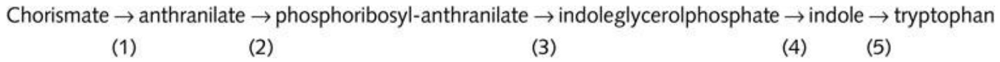
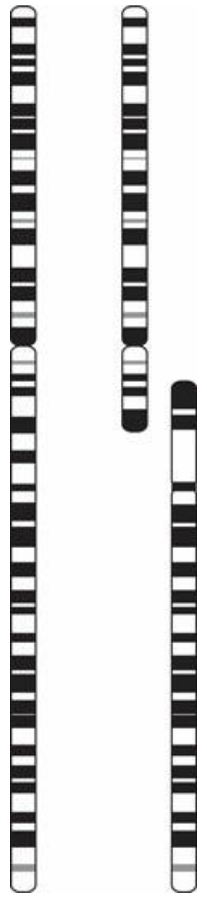
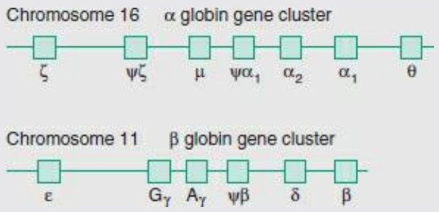
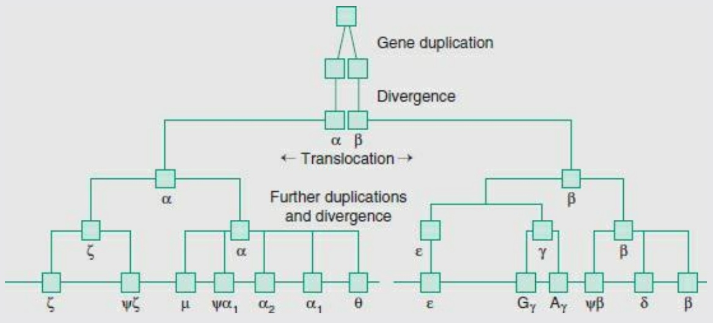
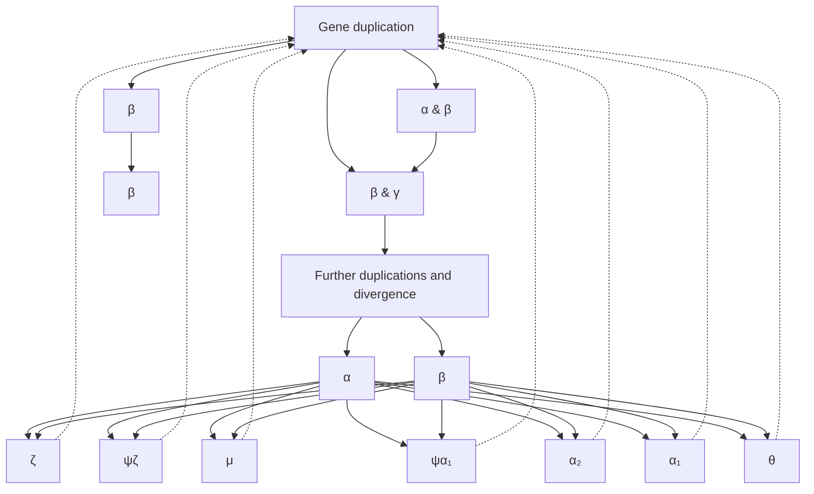

strong genetic component.

Genome-wide association studies show that the genetics of age-related macular degeneration are multifactorial. Several genes implicated are involved in the immune response and related processes.

| Complement factor H | Immune response |
| --- | --- |
| SERPING1 | Inhibitor of the inflammatory process |
| PLEKHA1 | Mediates cellular processes related to the immune response |
| C-reactive protein | Response to inflammation |
| Complement C3 | Complement cascade |
| Complement factor B | Complement cascade |
| Complement component 2 | Complement cascade |
| Toll-like receptor 3 | Immune response |
| Interleukins IL-6 and IL-8 | Immune response |
| Chemokine (C-C motif) ligand 2 | Immune response |

Other genes implicated include:

| ARMS/HTRA1 | HTRA1 is a serine proteinase |
| --- | --- |
| LOC387715 | Proposed mitochondrial function (?) |
| HMCN1/FBLN6 | Immunoglobulin superfamily |
| FBLN5 | Fibulin-5 |
| ApoE | Apolipoprotein E; transports of fats in blood (also involved in Alzheimer’s disease) |
| Cluster of differentiation 36 | Scavenger of toxins |

These results have several implications.

**1.** They give some clue about the underlying biology. For instance, the prevalence of genes coding for proteins involved in the immune response has led to the suggestion that development of macular degeneration is related to inflammation.
**2.** They allow for evaluation of risk. In particular, a correlation of LOC387715 with enhanced risk of development of macular degeneration as a result of smoking suggests that protective lifestyle changes may be made.
**3.** The correlation of individual alleles with effectiveness of treatment suggests gene-sequence-guided therapy. For example, the high-risk genotype of complement factor H limits the benefits of zinc and antioxidant therapy. This is an example of pharmacogenomics, the tailoring of treatment to the patient on the basis of genetic information.

## See Weblem 2.14

## Picking out genes in genomes

Computer programs for genome analysis identify open reading frames or ORFs. An ORF is a region of DNA sequence that begins with an initiation codon (ATG) and ends with a stop codon. An ORF is a potential protein-coding region.

Approaches to identifying protein-coding regions choose from or combine two possible approaches.

Detection of regions similar to known coding regions from other organisms. These regions may encode amino acid sequences similar to known proteins, or may be similar to ESTs. Because ESTs are derived from mRNA they correspond to genes known to be transcribed. It is necessary to sequence only a few hundred initial bases of cDNA to give enough information to identify a gene. Characterization of genes by ESTs is like indexing poems or songs by their first lines.

2. Ab initio methods that seek to identify genes from the properties of the DNA sequences themselves.

Computer-assisted annotation of genomes is more complete and accurate for bacteria than for eukarya. Bacterial genes are relatively easy to identify because they are contiguous—they lack the introns characteristic of eukaryotic genomes—and the intergene spaces are small. In higher organisms, identifying genes is harder. Identification of exons is one problem, assembling them is another. Alternative splicing patterns present a particular difficulty.

A framework for ab initio gene identification in eukaryotic genomes includes the following features.

The initial (5′) exon starts with a transcription start point, preceded by a core promotor site such as the TATA box typically ≈30 bp upstream. It is free of in-frame stop codons and ends immediately before a dinucleotide GT splice signal. (Occasionally a noncoding exon precedes the exon that contains the initiator codon.)
Internal exons, like initial exons, are free of in-frame stop codons. They begin immediately after an AG splice signal and end immediately before a GT splice signal.
The final (3′) exon starts immediately after an AG splice signal and ends with a stop codon, followed by a polyadenylation signal sequence. (Occasionally a noncoding exon follows the exon that contains the stop codon.)

All coding regions have nonrandom sequence characteristics, based partly on codon-usage preferences. Empirically, it is found that statistics of hexanucleotides perform best in distinguishing coding from noncoding regions. Starting from a set of known genes from an organism as a training set, pattern-recognition programs can be tuned to particular genomes.

Accurate gene detection is a crucial component of genome sequence analysis. This problem is an important focus of current research.

## Genome-sequencing projects

Completely sequenced genomes currently include several hundred bacteria, over 20 archaea, many viruses and organelles, and over 30 eukarya (see Table 2.1 for some examples). Almost all the results are freely available on the web. Many others are in progress (not counting assemblies from metagenomics sequencing projects).

Table 2.1 A sample of completed eukaryotic genomes

<table><tr><td colspan="2">Mammals</td></tr><tr><td>Human</td><td>Homo sapiens</td></tr><tr><td>Chimpanzee</td><td>Pan troglodytes</td></tr><tr><td>Macaque</td><td>Macaca mulatta</td></tr><tr><td>Mouse</td><td>Mus musculus</td></tr><tr><td>Norway or brown rat</td><td>Rattus norvegicus</td></tr><tr><td>Dog</td><td>Canis familiaris</td></tr><tr><td>Cow</td><td>Bos taurus</td></tr><tr><td>African elephant</td><td>Loxodonta africana</td></tr><tr><td>Opossum</td><td>Monodelphis domestica</td></tr><tr><td colspan="2">Other chordates</td></tr><tr><td>Chicken</td><td>Gallus gallus</td></tr><tr><td>Frog</td><td>Xenopus tropicalis</td></tr><tr><td>Zebrafish</td><td>Danio rerio</td></tr><tr><td>Fugu fish</td><td>Takifugu rubripes</td></tr><tr><td>Puffer fish</td><td>Tetraodon nigroviridis</td></tr><tr><td>Sea squirt (tunicate)</td><td>Ciona intestinalis</td></tr><tr><td>Tunicate</td><td>Ciona savignyi</td></tr><tr><td colspan="2">Higher plants</td></tr><tr><td>Thale cress</td><td>Arabidopsis thaliana</td></tr><tr><td>Rice</td><td>Oryza sativa</td></tr><tr><td>Maize (corn)</td><td>Zea mays</td></tr><tr><td>Lotus</td><td>Lotus japonicus</td></tr><tr><td>Barrel medic</td><td>Medicago truncatula</td></tr><tr><td>Tomato</td><td>Lycopersicon esculentum</td></tr><tr><td>Black cottonwood</td><td>Populus trichocarpa</td></tr><tr><td>Cacao tree</td><td>Theobroma cacao</td></tr><tr><td colspan="2">Other eukarya</td></tr><tr><td>Fruit fly</td><td>Drosophila melanogaster</td></tr><tr><td>Anopheles mosquito</td><td>Anopheles gambiae</td></tr><tr><td>Dengue mosquito</td><td>Aedes aegypti</td></tr><tr><td>Honeybee</td><td>Apis mellifera</td></tr><tr><td>Nematode worm</td><td>Caenorhabditis elegans</td></tr><tr><td>Baker's yeast</td><td>Saccharomyces cerevisiae</td></tr><tr><td>Fission yeast</td><td>Schizosaccharomyces pombe</td></tr><tr><td>Fungus</td><td>Candida glabrata CBS138</td></tr><tr><td>Fungus</td><td>Debaryomyces hansenii CBS767</td></tr><tr><td>Microsporidian</td><td>Encephalitozoon cuniculi</td></tr></table>

Sequencing of the genomes of many other organisms is in progress. The site [http://www.ncbi.nlm.nih.gov/genome/reports](http://www.ncbi.nlm.nih.gov/genome/reports):

<table><tr><td colspan="2">Complete genome projects</td></tr><tr><td>Viruses</td><td>3843</td></tr><tr><td>Prokaryotes</td><td>22 030</td></tr><tr><td>Eukaryotes</td><td>3324</td></tr></table>

As of 29 July 2013.

## See Weblem 2.15

Groups involved in many full-genome sequencing projects create and maintain databases focused on individual species. Scientists with specialized expertise assume responsibility for curation and annotation of the data. The analysis includes identification of genes, and assignment of function to their products. The results embed the genome in the context of other information about the individual species, arising from other data streams such as proteomics.

For instance, the Comprehensive Yeast Genome Database (CYGD), based at the Munich Information Center for Protein Sequences (MIPS), organizes and presents information on sequence, structure, function, and molecular interactions in S. cerevisiae ([http://mips.gsf.de/genre/proj/yeast/](http://mips.gsf.de/genre/proj/yeast/)).The MIPS group, one of the leading bioinformatics groups in Europe, has provided the nexus of computational support for numerous other collaborative sequencing projects, including that of yeast and A. thaliana.

Several groups, including MIPS, have developed tools specialized for information retrieval and comparative analysis of genomes. Others include the ENSEMBL (at the Wellcome Trust Sanger Institute; [http://www.ensembl.org](http://www.ensembl.org)) and University of California at Santa Cruz genome browsers ([http://genome.ucsc.edu](http://genome.ucsc.edu)).

## Genomes of prokaryotes

The genetic material of most prokaryotic cells takes the form of a large single circular piece of double-stranded DNA, usually less than 5 Mb long. In addition, the cells may contain plasmids.

The protein-coding regions of bacterial genomes do not contain introns. In many prokaryotic genomes the protein-coding regions are partially organized into operons: tandem genes transcribed into a single mRNA molecule, under common transcriptional control. In bacteria, the genes of many operons code for proteins with related functions. For instance, successive genes in the trp operon of E. coli code for proteins that catalyse successive steps in the biosynthesis of tryptophan (see Fig. 2.1). In archaea, a metabolic relationship between genes in operons is less frequently observed.

Figure 2.1 The trp operon in E. coli begins with a control region containing promoter, operator, and leader sequences. Five structural genes encode proteins that catalyse successive steps in the synthesis of the amino acid tryptophan from its precursor chorismate:

flowchart

Reaction step (1): trpE and trpD encode two components of anthranilate synthase. This tetrameric enzyme, comprising two copies of each subunit, catalyses the conversion of chorismate to anthranilate. Reaction step (2): the protein encoded by trpD also catalyses the subsequent phosphoribosylation of anthranilate. Reaction step (3): trpC encodes another bifunctional enzyme, phosphoribosylanthranilate isomerase–indoleglycerolphosphate synthase. It converts phosphoribosyl anthranilate to indoleglycerolphosphate, through the intermediate, carboxyphenylaminodeoxyribulose phosphate. Reaction steps (4) and (5): trpB and trpA encode the β and α subunits, respectively, of a third bifunctional enzyme, tryptophan synthase (an α2β2 tetramer). A tunnel in the structure of this enzyme delivers, without release to the solvent, the intermediate produced by the α subunit—indoleglycerolphosphate to indole—to the active site of the β subunit, which converts indole to tryptophan.

A separate gene, trpR, not closely linked to this operon, codes for the trp repressor. The repressor can bind to the operator sequence in the DNA (within the control region) only when binding tryptophan. Binding of repressor blocks access of RNA polymerase to the promoter, turning the pathway off when tryptophan is abundant. Further control of transcription in response to tryptophan levels is exerted by the attenuator element in the mRNA, within the leader sequence. The attenuator region (a) contains two tandem trp codons and (b) can adopt alternative secondary structures, one of which terminates transcription. Levels of tryptophan govern levels of trp-tRNAs, which govern the rate of progress of the tandem trp codons through the ribosome. Stalling on the ribosome at the tandem trp codons in response to low tryptophan levels reduces the formation of the mRNA secondary structure that terminates transcription.

The typical prokaryotic genome contains only a relatively small amount of noncoding DNA (in comparison with eukarya), distributed throughout the sequence. In E. coli only ≈11% of the DNA is noncoding.

## The genome of the bacterium Escherichia coli

E. coli, strain K-12, has long been the workhorse of molecular biology. The genome of strain MG1655, published in 1997 by the group of F. Blattner at the University of Wisconsin, contains 4

639 221 bp in a single circular DNA molecule, with no plastids. Approximately 89% of the sequence codes for proteins or structural RNAs. An inventory reveals:

• 4284 protein-coding genes,
• 122 structural RNA genes,
noncoding repeat sequences,
• regulatory elements,
transcription/translation guides,
transposases,
• prophage remnants,
• insertion sequence elements,

patches of unusual composition, likely to be foreign elements introduced by horizontal transfer.

Analysis of the genome sequence required identification and annotation of protein-coding genes and other functional regions. Many E. coli proteins were known before the sequencing was complete, from the many years of intensive investigation: 1853 proteins had been described before publication of the genome sequence. Other genes could be assigned functions from identification of homologues by searching in sequence data banks. The narrower the range of specificity of the function of the homologues, the more precise could be the assignment. Currently, over 60% of proteins can be assigned at least a general function (see Box 2.6). Other regions of the genome are recognized as regulatory sites, or mobile genetic elements, also on the basis of similarity to homologous sequences known in other organisms.

We visualize the contents of bacterial and organelle genomes as concentric circular diagrams, looking vaguely like ‘tie-dyed’ patterns. (Introduction to Genomics contains several examples.) Complex patterns of colour-coding serve as a visual ‘feature table.’ The website [http://wishart.biology.ualberta.ca/BacMap/index.html](http://wishart.biology.ualberta.ca/BacMap/index.html)

Box 2.6 Distribution of E. coli proteins among 22 functional groups

| Functional class | Number | % |
| --- | --- | --- |
| Regulatory function | 45 | 1.05 |
| Putative regulatory proteins | 133 | 3.10 |
| Cell structure | 182 | 4.24 |
| Putative membrane proteins | 13 | 0.30 |
| Putative structural proteins | 42 | 0.98 |
| Phage, transposons, plasmids | 87 | 2.03 |
| Transport and binding proteins | 281 | 6.55 |
| Putative transport proteins | 146 | 3.40 |
| Energy metabolism | 243 | 5.67 |
| DNA replication, recombination, modification, and repair | 115 | 2.68 |
| Transcription, RNA synthesis, metabolism, and modification | 55 | 1.28 |
| Translation, post-translational protein modification | 182 | 4.24 |
| Cell processes (including adaptation, protection) | 188 | 4.38 |
| Biosynthesis of cofactors, prosthetic groups, and carriers | 103 | 2.40 |
| Putative chaperones | 9 | 0.21 |
| Nucleotide biosynthesis and metabolism | 58 | 1.35 |
| Amino acid biosynthesis and metabolism | 131 | 3.06 |
| Fatty acid and phospholipid metabolism | 48 | 1.12 |
| Carbon compound catabolism | 130 | 3.03 |
| Central intermediary metabolism | 188 | 4.38 |
| Putative enzymes | 251 | 5.85 |
| Other known genes (gene product or phenotype known) | 26 | 0.61 |
| Hypothetical, unclassified, unknown | 1632 | 38.06 |

From Blattner, F.R., Plunkett, 3rd, G., Bloch, C.A., Perna, N.T., Burland, V. et al. (1997). The complete genome sequence of Escherichia coli K12. Science, 277, 1453–1462.

contains an atlas of bacterial genome diagrams.1

The distribution of protein-coding genes over the genome of E. coli does not seem to follow any simple rules, either along the DNA or on different strands. Indeed, comparison of strains suggests that the genes are mobile.

The E. coli genome is relatively gene dense. Genes coding for proteins or structural RNAs occupy ≈89% of the sequence. The average size of an ORF is 317 amino acids. If the genes were evenly distributed, the average intergenic region would be 130 bp; the observed average distance between genes is 118 bp. However, the sizes of intergenic regions vary considerably. Some intergenic regions are large. These contain sites of regulatory function, and repeated sequences. The longest intergenic region, 1730 bp, contains noncoding repeat sequences.

Approximately three-quarters of the transcribed units contain only one gene; the rest contain several consecutive genes, or operons. It is estimated that the E. coli genome contains 630–700 operons. Operons vary in size, although few contain more than five genes. The genes in operons tend to have related functions.

In some cases, the same DNA sequence encodes parts of more than one polypeptide chain. One gene codes for both the τ and γ subunits of DNA polymerase III. Translation of the entire gene forms the τ subunit. The γ subunit corresponds approximately to the N-terminal two-thirds of the τ subunit. A frameshift on the ribosome at this point leads to chain termination 50% of the time, causing a 1:1 ratio of expressed τ and γ subunits. There do not appear to be any overlapping genes in which different reading frames both code for expressed proteins.

In other cases, the same polypeptide chain appears in more than one enzyme. A protein that functions on its own as lipoate dehydrogenase is also an essential subunit of pyruvate dehydrogenase, 2-oxoglutarate dehydrogenase, and the glycine cleavage complex.

Having the complete genome, we can examine the protein repertoire of E. coli. The largest class of proteins is the enzymes, accounting for ≈30% of the total genes. Many enzymatic functions are shared by more than one protein. Some of these sets of functionally similar enzymes are very closely related, and appear to have arisen by duplication, either in E. coli itself or in an ancestor or gene donor species. Other sets of functionally similar enzymes have very dissimilar sequences, and differ in specificity, regulation, or intracellular location.

Several features of E. coli’s generous endowment of enzymes give it a versatile metabolic competence, which allow it to grow and compete under varying conditions.

• It can synthesize all components of proteins and nucleic acids (amino acids and nucleotides), and cofactors.
• It has metabolic flexibility: both aerobic and anaerobic growth are possible, utilizing different pathways of energy capture. It can grow on many different carbon sources. Not all metabolic pathways are active at any given time: the alternatives allow response to changes in conditions.

• Even for specific metabolic reactions there are many cases of multiple enzymes. These provide redundancy, and contribute to an ability to tune metabolism to varying conditions, through complementary control mechanisms.
• However, E. coli does not possess a complete range of enzymatic capacity. It cannot fix $\mathrm { C O } _ { 2 }$ or $\mathrm{N}_{2}$

We have described here some of the static features of the E. coli genome and its protein repertoire. Current research has elucidated dynamic aspects, including the mechanisms that govern protein expression patterns in time and space.

## See Weblem 2.16

## The genome of the archaeon Methanococcus jannaschii

S. Luria once suggested that to determine common features of all life one should not try to survey everything, but rather identify the organism most different from us and see what we have in common with it. The assumption was that the way to do this would be to find an organism adapted to the most different environment.

Deep-sea exploration has revealed environments as far from the familiar as those portrayed in science fiction. Hydrothermal vents are underwater volcanoes emitting hot lava and gases through cracks in the ocean floor. They create niches for communities of living things disconnected from the surface, which depend on the minerals exuded from the vent as inorganic nutrients. They support living communities of microorganisms that are the only known forms of life not dependent on sunlight, directly or indirectly, for their energy source.

The microorganism M. jannaschii was collected from a hydrothermal vent 2600 m deep off the coast of Baja California, Mexico, in 1983. It is a thermophilic organism, surviving at temperatures from 48 to $9 4 ^ { \circ } \mathrm { C }$ , with an optimum at $8 5 ^ { \circ } \mathrm { C }$ . It is a strict anaerobe, capable of self-reproduction from inorganic components. Its overall metabolic equation is to synthesize methane from $\mathrm { H } _ { 2 }$ and $\mathrm { C O } _ { 2 }$

M. jannaschii belongs to the archaea, one of the three major divisions of life along with the bacteria and eukarya (see Fig. 1.2). The archaea comprise groups of prokaryotes, including organisms adapted to extreme environmental conditions such as high temperature and pressure, or high salt concentration. However, many archaea are not extremophiles.

The genome of M. jannaschii was sequenced in 1996 by The Institute for Genomic Research (TIGR). It was the first archaeal genome sequenced. It contains a large chromosome containing a circular double-stranded DNA molecule of 1 664 976 bp long, and two extrachromosomal elements of 58 407 and 16 550 bp. There are 1784 predicted protein-coding regions, of which 1728 are on the chromosome, and 44 and 12 on the large and small extrachromosomal elements, respectively. Some RNA genes contain introns. As in other prokaryotic genomes there is little noncoding DNA.

M. jannaschii would appear to satisfy Luria’s goal of finding our most distant extant relative. Comparison of its genome sequence with others shows that it is distantly related to other forms of life. Only 42% of the genes have been assigned a function. However, to everyone’s great surprise, archaea are in some ways more closely related to eukarya than to bacteria! They are a complex mixture. In archaea, proteins involved in transcription, translation, and regulation are more similar to those of eukarya. Archaeal proteins involved in metabolism are more similar to those of bacteria.

The genome of one of the simplest organisms: Mycoplasma genitalium

M. genitalium is an infectious bacterium, the cause of nongonococcal urethritis. Its genome was sequenced in 1995 by a collaboration of groups at TIGR, Johns Hopkins University, and the University of North Carolina. The genome is a single DNA molecule containing 580 070 bp. At the time, this was the smallest cellular genome yet sequenced. So far, is the closest we have to a minimal organism, the smallest capable of independent life. (Viruses, in contrast, require the cellular machinery of their hosts.)

The genome is dense in coding regions: 468 genes have been identified as expressed proteins. Some regions of the sequence are gene-rich, others gene-poor, but overall 85% of the sequence is coding. The average length of a coding region is 1040 bp. As in other bacterial genomes the coding regions do not contain introns. Further compression of the genome is achieved by overlapping genes. It appears that many of these have arisen through loss of stop codons.

The gene repertoire of M. genitalium includes some that encode proteins essential for independent reproduction, such as those involved in DNA replication, transcription, and translation, plus ribosomal and transfer RNAs. Other genes are specific for the infectious activity, including adhesins that mediate binding to infected cells, other molecules for defence against the host’s immune system, and a large number of transport proteins. As an adaptation to the parasitic lifestyle of the organism there has been widespread loss of metabolic enzymes, including those responsible for amino acid biosynthesis.

**See Weblem 2.17**

## Metagenomics: the collection of genomes in a coherent environmental sample

Classically, the goal of microbiology was the identification of pathogenic organisms responsible for infectious disease. Isolation and cloning of pure strains facilitated diagnosis, and allowed testing of drugs. Powerful as the methods were, and important as they were for clinical applications, they were also blinders that prevented full appreciation of the variety and interactions of species in natural environments. Indeed, it is the lack of independence under natural conditions of many species that makes it impossible to clone them. Conversely, study of entire microbial communities is essential to illuminate general principles of ecology and evolution.

From natural samples containing complex mixtures it is possible to determine sequences directly, without culturing individual strains. This provides access to information about species that cannot be cloned in the traditional way. A millilitre of ocean water may contain 100–200 species. A gram of soil may contain 4000. The human gut contains on the order of 500 different species of microorganisms (although 10% of those species probably account for 99% of the total bacterial population.)

In addition to prokaryotes, many natural samples contain a rich mixture of viruses.

## Subjects of metagenomic sequencing

Subjects of metagenomic sequencing include:

the human microbiome: samples from different parts of the body, comparison of healthy and disease states, and during infant development, including observation of distinct differences between breast- and formula-fed babies, and between babies delivered normally or by Caesarean section;

general environmental samples: including oceans (see Box 2.7), glaciers, soils, mine tailings, and (even) windshield splatter. Such studies consider spatial and temporal (diurnal and seasonal) variation;
agricultural samples: the flora of the rhizosphere (the immediate vicinity of roots) of wheat, rice, maize, and soybean.

Application of new high-throughput sequencing techniques to metagenomic samples generates very large quantities of data. Sequencing of samples from the human gut identifies over $3   \times   1 0 ^ { 6 }$ genes, from 567.7 Gb of sequence data. These numbers are more than impressive: they are daunting. Recognize that the data are noisy, fragmented, and arise from a complex mixture of sources. (A crucial feature, the read length, depends on the sequencing technique used.) For many metagenomic data sets it is not possible to assemble complete genomes.

However, it is often possible to perform BLAST searches on the fragments to identify source and —in cases of protein-coding sequences—function. This can be enough to estimate an inventory of which species are present and in what proportions. Comparative studies can clarify spatial and temporal variation,

## Box 2.7 The Sorcerer II Global Ocean Sampling Expedition

A very ambitious harvesting of metagenomics data came from the Sorcerer II Global Ocean Sampling Expedition.2 During a round-the-world trip between 8 August 2003 and 22 May 2004, samples were collected at ≈320 km intervals along a more than 8000 km route that started in Halifax, Nova Scotia, Canada, along the East Coast of the USA, the Gulf of Mexico, the Galapagos Islands, across the Pacific Ocean to Australia, through the Indian Ocean, to South Africa and back across the Atlantic to the USA. The expedition was inspired by the HMS Challenger expedition of 1872–1876, a survey of ocean geology, climate, and biology.

| Phylum or class | Fraction |
| --- | --- |
| α-Proteobacteria | 0.32 |
| Unclassified proteobacteria | 0.155 |
| γ-Proteobacteria | 0.132 |
| Bacteriodetes | 0.13 |
| Cyanobacteria | 0.079 |
| Firmicutes | 0.075 |
| Actinobacteria | 0.046 |
| Marine group A | 0.022 |
| β-Proteobacteria | 0.017 |
| OP11 | 0.008 |
| Unclassified bacteria | 0.008 |
| δ-Proteobacteria | 0.005 |
| Planctomycetes | 0.002 |
| ε-Proteobacteria | 0.001 |

From Rusch, D.B., Halpern, A.L., Sutton, G., Heidelberg, K.B., Williamson, S. et al. (2007). The Sorcerer II Global Ocean Sampling Expedition: Northwest Atlantic through Eastern Tropical Pacific. PLoS Biol., **13**, e77.

Selected fractions with cells of size 0.1–0.8 µm were filtered to focus on bacteria. Of 7.7 million sequencing reads from these samples, amounting in total to $6 . 3 \times 1 0 ^ { 9 }$ bp, there remained, upon counting for overlaps, almost 6 Gb of unique sequence. Over half the reads were unique; that is, they had 98% or less sequence similarity to previously reported sequences. Contigs were assemblable into over 3 million whole genome scaffolds.

The 16S RNA data from shotgun sequencing revealed 811 distinct sequence types (below 97% identity). Over half represented putative novel species. Note the absence of Archaea from the most highly represented taxa.

Translations of gene sequences identified over 6 million bacterial and viral proteins. Of these, 6000 have no similarity to previously known proteins. If all are indeed novel—remember that sequence-based tools do not always successfully identify structural similarity in distantly related proteins—the results will almost double the number of known protein families.

and even evolutionary relationships among different samples. Harder to achieve is an understanding of the functional relationships and interactions among the different components of an ecosystem.

It was formerly common to characterize individual species in metagenomic samples by 16S rRNA sequences, as in the original work of Woese. However, copy-number variation make this an unreliable index of species frequency. Horizontal gene transfer further erodes its accuracy.

Even worse, viruses do not contain ribosomes and therefore are invisible to probes for 16S rRNA. Viruses are the ‘dark matter’ of nature: they exist in unsuspected numbers and variety. It has been estimated that there are 1030 tailed bacteriophages in nature. In the oceans, viruses outnumber cells by at least an order of magnitude (although, as they are so much smaller than cells, they account for no more than 5% of the total biomass). Many viral proteins are very different from the sets of molecules from cellular organisms with which we are familiar: typically 90% of viral proteins found in a metagenomic sample don’t match anything in GenBank. Anyone with the ambition of deriving a catalogue of protein-folding patterns, on the basis of the results of current structural genomics projects, should live in dire fear of what the combined viral proteome will reveal. In addition to exposing our ignorance, marine viruses are a mechanism of horizontal gene transfer between cells, thereby contributing to establishment of prokaryotic genetic diversity.

Fields of application of metagenomics include the following.

Human health: Our bodies contain about 10 times as many bacterial cells as human cells. They contribute to healthy states by aiding digestion, synthesizing essential vitamins and amino acids, detoxifying certain harmful chemicals in food, and helping defend against pathogens. They can signal, and of course even cause, disease. Recall the famous story of (subsequent) Nobel laureate Barry Marshall. To prove that H. pylori caused peptic ulcers in the face of a consensus of disbelief, Marshall ingested a sample and induced the disease in himself.

Another illuminating anecdote describes a patient with a recalcitrant unilateral ear infection. After physicians tried everything in their armamentarium, the patient cured himself by transplanting a sample of earwax (and its associated microflora) from his good ear to the infected one. What is perhaps misleading about these examples is that the human microbiome is complex, and its variation in health and disease may in general be far more subtle. The same principles apply to health and disease of animals.

• Agriculture: microorganisms symbiotic with plants, of which the best known are the nitrogenfixing bacteria associated with root nodules of legumes, can provide crop plants with essential nutrients and protect against pathogens.
Environmental remediation: profiles of microbial communities can monitor acute environmental damage, and track long-term changes such as climate change. Bacteria can even help detoxify damaged environments: after the release of $4 \times 1 0 ^ { 6 }$ barrels of oil into the Gulf of Mexico following the sinking of the Deepwater Horizon oil rig, bacteria contributed to the cleanup by digesting components of the hydrocarbons.
• Anthropology: human microbiome profiles are more variable than human genomic DNA variation. They provide data for tracing of migration patterns, using the genetic diversity of H. pylori strains in different human populations. They are an index to social organization and diet.

Biotechnology: although the core of metabolism is common to most life forms, individual species develop unusual enzymes that are applicable to synthesis of useful products on the industrial scale. This includes, but is not limited to, the development of economic alternative energy sources. For instance, leaf-cutter ants harbour symbiotic bacteria that effectively degrade cellulose and lignin to sugars, which can be fermented to ethanol for fuel.

## The human microbiome

The human body contains several ecological niches that harbour flourishing microbial communities. These include internal habitats such as the gut, and exposed regions such as the skin and nasal mucosa which more readily exchange microorganisms with the environment. In all, the microbiome contains about 10 times as many cells as human cells, contributing several kilograms of body weight; these cells contain millions of genes, dwarfing the 21 000 of the human genome (excluding the immune system).

Recognition of the significance of the human microbiome in health and disease is a recent development. Many people feel that its importance continues to be seriously underestimated. The large number of new discoveries in this field support this point of view.

The US National Institutes of Health has established the Human Microbiome Project to characterize the microorganisms living in and on our bodies, and to determine their roles in health and disease. What are the biodiversities and structures of these microbial communities? How do they interact, with one another and with the surroundings? How do they vary from individual to individual, from place to place on Earth? How do they reveal and contribute to health and disease?

Altogether, human microbiome projects have identified 30 human-associated bacterial phyla (less than half of all known bacterial phyla), 51 classes, 125 orders, 493 families, and 939 genera. The distribution is highly skewed: most sites in the body show a few dominant species and a ‘tail’ of rare ones.

The distribution differs from external environments such as soil and sea, showing that we are not merely reflecting our surroundings. For instance, the human microbiome is rich in Firmicutes, Actinobacteria, Proteobacteria, and Bacteriodetes; in contrast, Firmicutes are rarer in external environments.

Different habitats on and within the human body are characterized by different patterns of microflora. Different sites show different person-to-person variation. For example, the mouth shows the least variation among individuals. The mouth flora is also the most stable when remeasured at intervals of several months.

Clinical applications of the human microbiome project depend on recognizing the effects of microflora on health and disease. In addition to the H. pylori–ulcer connection, gut flora are known to be involved in irritable bowel syndrome, Crohn disease, ulcerative colitis, and a variety of gastrointestinal infections. Two specific mechanisms affecting human health are:

1. bacteria in the gut metabolizing dietary choline to produce a substance leading to arteriosclerosis, and, thereby, cardiovascular disease. Antibiotic treatment is effective;
2. bacteria in the gut metabolizing orally administered drugs. For instance, Eggerthella lenta can inactivate the drug digoxin. Individual and population-specific variation in the population of E. lenta can cause variant responses to treatments with ‘standard’ dosages. This new field is called pharmacomicrobiomics.

## Genomes of eukarya

It is rare in science to encounter a completely new world containing entirely unsuspected phenomena. The complexity of the eukaryotic genome is such a world (see Box 2.8).

In eukaryotic cells, the majority of DNA is in the nucleus, separated into bundles of nucleoprotein, the chromosomes. Each chromosome contains a single double-stranded DNA molecule. Smaller amounts of

Box 2.8 Inventory of a eukaryotic genome

Moderately repetitive DNA

- Functional
  - Dispersed gene families
    - e.g. actin, globin
  - tandem gene family arrays
    - rRNA genes (250 copies)
    - tRNA genes (50 sites with 10–100 copies each in humans)
    - histone genes in many species

- Without known function
  - short interspersed nuclear elements (SINEs)
    - Alu is an example
    - 200–300 bp long
    - 100 000s of copies (300 000 Alu)
    - scattered locations (not in tandem repeats)
  - long interspersed nuclear elements (LINEs)
    - 1–5 kb long
    - 10–10 000 copies per genome
  - pseudogenes

Highly repetitive DNA

- Minisatellites
  - composed of repeats of 14–500 bp segments
  - 1–5 kb long
  - many different ones
  - scattered throughout the genome
- Microsatellites
  - composed of repeats of up to 13 bp
  - ≈ 100s of kb long
  - ≈ $10^{6}$ copies/genome
  - most of the heterochromatin around the centromere

- Telomeres
  - contain a short repeat unit (typically 6 bp: TTAGGG in human genome, TTGGGG in Paramecium, TAGGG in trypanosomes, TTTAGGG in Arabidopsis)
  - 250–1000 repeats at the end of each chromosome

DNA appear in organelles: mitochondria and chloroplasts. The organelles originated as intracellular parasites. Organelle genomes usually have the form of circular double-stranded DNA, but are sometimes linear and sometimes appear as multiple circles. The genetic code by which organelle genes are translated differs from that of nuclear genes.

Nuclear genomes of different species vary widely in size (see Box 2.1). The correlation between genome size and complexity of the organism is very rough. It certainly does not support any preconception that humans stand on a pinnacle. In many cases differences in genome size reflect different amounts of simple repetitive sequences.

In addition to variation in DNA content, eukaryotic species vary in the number of chromosomes and distribution of genes among them. Some differences in the distribution of genes among chromosomes involve translocations, or chromosome fragmentations or joinings. For instance, humans have 23 pairs of chromosomes; chimpanzees have 24. Human chromosome 2 is equivalent to a fusion of chimpanzee chromosomes 12 and 13 (see Fig. 2.2). Such differences in chromosome structures can cause fatal difficulty in chromosome pairing during mitosis in a zygote, and thereby contribute to the reproductive isolation associated with species separation.

natural_image

Black and white abstract pattern resembling vertical stripes or chromosome pairs (no text or symbols)

Figure 2.2 Left: human chromosome 2. Right: matching chromosomes from a chimpanzee.

Other differences in chromosome complement reflect duplication or hybridization events. The wheat first used in agriculture, in the Middle East at least 10 000–15 000 years ago, was a diploid called einkorn (Triticum monococcum), containing 14 pairs of chromosomes. Emmer wheat (Triticum turgidum ssp. dicoccum), also cultivated since Palaeolithic times, and durum wheat (T. turgidum ssp. durum), are merged hybrids of relatives of einkorn with other wild grasses, to form tetraploid species. Additional hybridizations, with different wild grasses, gave hexaploid forms, including spelt (Triticum aestivum ssp. spelta) and modern common wheat (T. aestivum ssp. aestivum. Triticale, a robust crop developed in modern agriculture and currently used primarily for animal feed, is an artificial genus arising from crossing durum wheat (T. turgidum ssp. durum) and rye (Secale cereale). Most triticale varieties are hexaploids. (see Table 2.2).

Table 2.2 Development of polyploidy in wheat

| Variety of wheat | Classification | Chromosome complement |
| --- | --- | --- |
| Einkorn | Triticum monococcum | AA |
| Emmer wheat | Triticum turgidum ssp. dicoccum | AABB |
| Durum wheat | Triticum turgidum ssp. durum | AABB |
| Spelt | Triticum aestivum ssp. spelta | AABBDD |
| Common wheat | Triticum aestivum ssp. aestivum | AABBDD |
| Triticale | Triticosecale | AABBRR |

A, genome of original diploid wheat or a relative; B, genome of a wild grass Aegilops speltoides or Triticum speltoides or a relative; D, genome of another wild grass, Triticum tauschii, or a relative; R, genome of rye Secale cereale.

All these species are still cultivated—some to only minor extents—and have their individual uses in cooking. Spelt, or farro in Italian, is the basis of a well-known soup; pasta is made from durum wheat; and bread from ssp. aestivum.

Recent investigations of the history of wheat go beyond simple chromosome counts, to studies of relationships between species and subspecies at the genomic level. General results have measured the decay of synteny between orthologous regions after polyploidization, and mapping of insertions and deletions. Particular results include identification of mutations that confer properties favourable for agriculture. These properties include survival under stressful climate or soil conditions; and firmer attachment of grains to spikes, preserving them for harvesting against dispersal by wind.

A species that undergoes a revolutionary genomic change such as polyploidization is threatened with a penalty in the form of loss of genetic diversity. For the change must have occurred initially in only one or a few individuals, founders of new populations. Evidence for gene flow between domestic and wild forms of wheat suggests a mechanism for recovery and maintenance of genetic diversity. (For a corresponding discussion of maize domestication see Introduction to Genomics, chapter 3.)

## Gene families

In addition to duplications of entire chromosomes, duplications of individual genes are common, as a result of unequal crossing over. Therefore, gene families on single chromosomes are common in eukarya.

Some family members are paralogues—related genes that have diverged to provide separate functions in the same species. (Orthologues, in contrast, are homologues that perform the same function in different species. For instance, human α and β globin are paralogues, and human and horse myoglobin are orthologues.) Other related sequences may be pseudogenes, which may have arisen by duplication, or by retrotransposition from mRNA, followed by the accumulation of mutations to the point of loss of function. The human globin gene cluster is a good example (see Box 2.9).

## The genome of Saccharomyces cerevisiae (baker’s yeast)

Yeast is one of the simplest known eukaryotic organisms. Its cells, like our own, contain a nucleus and other specialized intracellular compartments. The sequencing of its genome, by an unusually effective international consortium involving ≈100 laboratories, was completed in 1992. The yeast genome contains 12 057 500 bp of nuclear DNA, distributed over 16 chromosomes. The chromosomes range in size

## Box 2.9 The globin gene clusters

Human haemoglobin genes and pseudogenes appear in clusters on chromosomes 11 and 16. The normal adult human synthesizes primarily three types of globin chain: α- and β-chains, which assemble into haemoglobin α2β2 tetramers, and myoglobin, a monomeric protein found in muscle. Other forms of haemoglobin, encoded by different genes, are synthesized in the embryonic and foetal stages of life. Other globins are unlinked; they arose long before this cluster diverged.

## See Weblems 2.18 and 2.19

The α gene cluster on chromosome 16 extends over 28 kbp. It contains three functional genes: $\zeta$ and two α genes identical in their coding regions, $\mathfrak { a } _ { 1 }$ and $\mathbf { a } _ { 2 } ;$ three pseudogenes, ψζ, ψα1, and possibly μ; and another homologous gene the function of which is obscure, θ. The β gene cluster on chromosome 11 extends over 50 kbp. It includes five functional genes: ε, two γ genes $( \mathbf { G } _ { \gamma }$ and $\mathbf { A } _ { \gamma } )$ , which differ in one amino acid, δ, and β; and one pseudogene, ψβ. The genes for myoglobin, neuroglobin and cytoglobin are unlinked from both of these clusters.

All human haemoglobin and myoglobin genes have the same intron/exon structure. They contain three exons separated by two introns.

| E1 | I1 | E2 | I2 | E3 |
| --- | --- | --- | --- | --- |

Here E means exon and I means intron. The lengths of the regions in this figure reflect the human β globin gene. This exon/intron pattern is conserved in most expressed vertebrate globin genes, including haemoglobin α- and β-chains and myoglobin. In contrast, the genes for plant globins have an additional intron, genes for Paramecium globins have one fewer intron, and genes for insect globins contain none. The gene for human neuroglobin, a homologue expressed at low levels in the brain, contains three introns, like plant globin genes.

The distribution of haemoglobin genes and pseudogenes on the chromosomes appears to reflect their evolution via duplication and divergence.

flowchart

The expression of these genes follows a strict developmental pattern. In the embryo (up to 6 weeks after conception) two haemoglobin chains are primarily synthesized—ζ and ε—which form a ζ2ε2 tetramer. Between 6 weeks after conception until about 8 weeks after birth, foetal haemoglobin—α2γ2—is the predominant species. This is succeeded by adult haemoglobin: α2β2.

Thalassaemias are genetic diseases associated with defective or deleted haemoglobin genes. Most caucasian people have four genes for the α-chain of normal adult haemoglobin, two alleles of each of the two tandem genes $\mathfrak { a } _ { 1 }$ and α2. Therefore α-thalassaemias can present clinically in different degrees of severity, depending on how many genes express normal α-chains. Only deletions leaving fewer than two active genes present as symptomatic under normal conditions. Observed genetic defects include deletions of both genes (a process made more probable by the tandem gene arrangement and repetitive sequences, which make crossing over more likely) and loss of chain termination leading to transcriptional ‘read through’, creating extended polypeptide chains that are unstable.

β-Thalassaemias are usually point mutations, including missense mutations (amino acid substitutions) or nonsense mutations (changes from a triplet coding for an amino acid to a stop codon) leading to premature termination and a truncated protein, mutations in splice sites, or mutations in regulatory regions. Certain deletions including the normal termination codon and the intergenic region between δ and β genes create δ–β fusion proteins.

over an order of magnitude, from the 1352 kbp chromosome IV to the 230 kbp chromosome I.

The yeast genome contains 6172 predicted protein-coding genes, ≈140 genes for rRNAs, 40 genes for small nuclear RNAs, and 275 tRNA genes. In two respects, the yeast genome is denser in coding regions than the known genomes of the more complex eukarya C. elegans, D. melanogaster, and human: (1) introns are relatively rare, and relatively small (only 231 genes in yeast contain introns) and (2) there are fewer repeat sequences compared with more complex eukarya.

A duplication of the entire yeast genome appears to have occurred ≈150 million years ago. This was followed by translocations of pieces of the duplicated DNA and loss of one of the copies of most ( ≈92%) of the genes.

Of the 6172 protein-coding genes, between 4000 and 5000 correspond to molecules to which a function can be assigned, with varying degrees of confidence. Only about one-third of yeast proteins have identifiable homologues in the human genome.

In taking censuses of genes it has been useful to classify their functions into broad categories. The classification of yeast protein functions in Table 2.3 is taken from [http://mips.gsf.de/genre/proj/yeast/Search/Catalogs/catalog.jsp](http://mips.gsf.de/genre/proj/yeast/Search/Catalogs/catalog.jsp).

Table 2.3 Distribution of functional categories among yeast proteins

| Functional category | Number of proteins |
| --- | --- |
| Metabolism | 1514 |
| Energy | 367 |
| Cell cycle and DNA processing | 1007 |
| Transcription | 1078 |
| Protein synthesis | 480 |
| Protein fate (folding, modification, destination) | 1154 |
| Protein with binding function or cofactor requirement (structural or catalytic) | 1048 |
| Regulation of metabolism and protein function | 249 |
| Cellular transport, transport facilities, and transport routes | 1038 |
| Cellular communication/signal transduction mechanism | 234 |
| Cell rescue, defence, and virulence | 554 |
| Interaction with the environment | 463 |
| Transposable elements, viral and plasmid proteins | 120 |