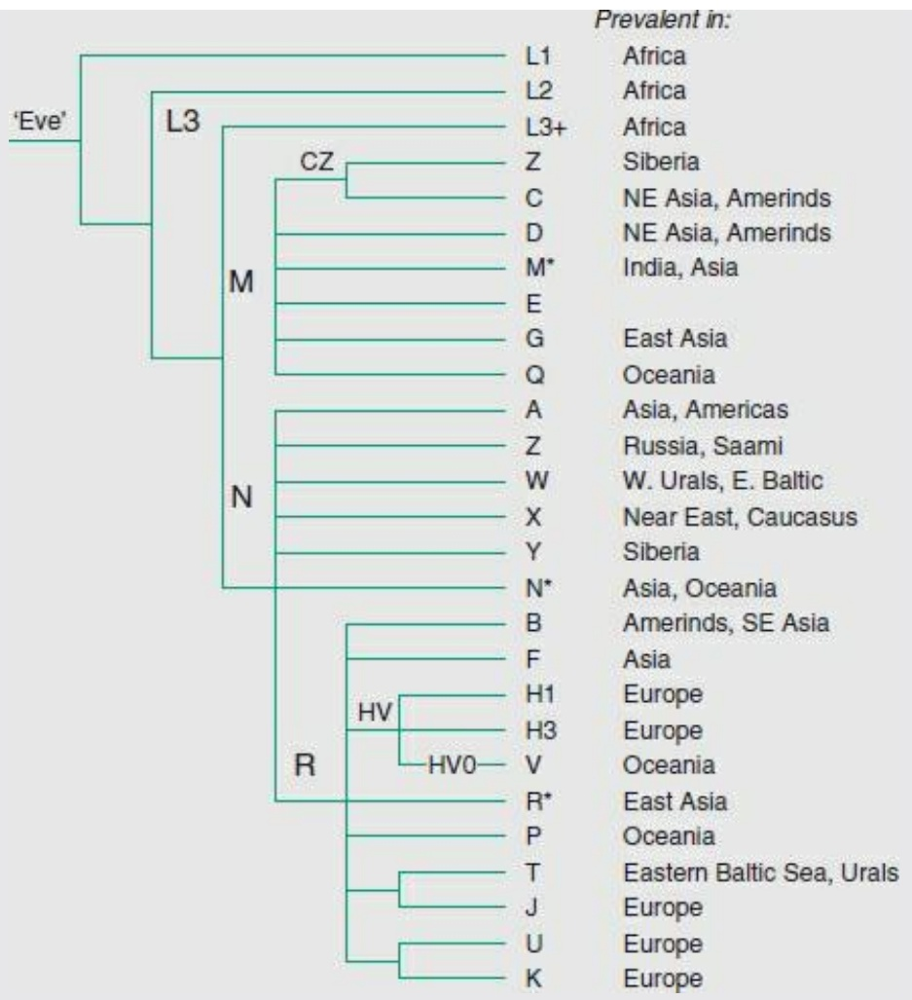

| Cell fate | 273 |
| --- | --- |
| Development (systemic) | 69 |
| Biogenesis of cellular components | 862 |
| Cell-type differentiation | 452 |
| Total functionally classified proteins | 4778 |
| Functionally unclassified proteins | 1394 |

Yeast is a testbed for development of methods to assign functions to gene products. The search for homologues has been exhaustive and continues. Collections of mutants exist that contain a knockout of every gene. (A unique sequence ‘bar code’ introduced into each mutant facilitates identification of the ones that grow under selected conditions.) Cellular localization and expression patterns are being investigated. Several types of measurement, including those based on activation of transcription by pairs of proteins that can form dimers, are producing catalogues of interprotein interactions.

## See Weblem 2.20

## The genome of Caenorhabditis elegans

The nematode worm C. elegans entered biological research in the 1960s, at the express invitation of Sydney Brenner. He recognized its potential as an organism sufficiently complex to be interesting yet simple enough to permit complete analysis, at the cellular level, of its genetics, development, and neural circuitry.

The C. elegans genome, completed in 1998, provided the first full DNA sequence of a multicellular organism. The C. elegans genome contains ≈97 Mbp of DNA distributed on paired chromosomes I, II, III, IV, V, and X (see Table 2.4). There is no Y chromosome. Different genders in C. elegans appear in the XX genotype, a self-fertilizing hermaphrodite, and the XO genotype, a male.

Table 2.4 Distribution of C. elegans genes

| Chromosome | Size (Mb) | Number of protein genes | Density of protein genes (kb/gene) | Number of tRNA genes |
| --- | --- | --- | --- | --- |
| I | 7.9 | 2803 | 5.06 | 13 |
| II | 8.5 | 3259 | 3.65 | 6 |
| III | 7.6 | 2508 | 5.40 | 9 |
| IV | 9.2 | 3094 | 5.17 | 7 |
| V | 9.8 | 4082 | 4.15 | 5 |
| X | 10.1 | 2631 | 6.54 | 3 |

The C. elegans genome is about eight times larger than that of yeast, and its 19 099 predicted genes are approximately three times the number in yeast. The gene density is relatively low for a eukaryote, with ≈1 gene/5 kb of DNA. Exons cover ≈27% of the genome; the genes contain an average of five introns each. Approximately 25% of the genes are in clusters of related genes.

Many C. elegans proteins have homologues common to other life forms. Others are apparently specific to nematodes: 42% of proteins have homologues outside the phylum, 34% are homologous to proteins of other nematodes, and 24% have no known homologues outside C. elegans itself. Many of the proteins have been classified according to structure and function (see Table 2.5).

Table 2.5 C. elegans: 20 commonest protein domains

| Type of domain | Number |
| --- | --- |
| Seven-transmembrane spanning chemoreceptor | 650 |
| Eukaryotic protein kinase domain | 410 |
| Two domain, C4 type zinc finger | 240 |
| Collagen | 170 |
| Seven-transmembrane spanning receptor (rhodopsin-family) | 140 |
| C2H2-type zinc finger | 130 |
| C-type lectin | 120 |
| RNA-recognition motif | 100 |
| C3HC4-type (RING finger) zinc fingers | 90 |
| Protein tyrosine phosphatase | 90 |
| Ankyrin repeat | 90 |
| WD domain G-β repeat | 90 |
| Homeobox domain | 80 |
| Neurotransmitter-gated ion channel | 80 |
| Cytochrome P450 | 80 |
| Conserved C-terminal helicase | 80 |
| Short-chain and alcohol dehydrogenases | 80 |
| UDP-glucoronosyl and UDP-glucosyl transferases | 70 |
| EGF-like domain | 70 |
| Immunoglobulin superfamily | 70 |

From the C. elegans genome consortium paper in Science volume 282, dated 11 December 1998.

Several kinds of RNA genes have been identified. The C. elegans genome contains 659 genes for tRNA, almost half of them (44%) on the X chromosome. Spliceosomal RNAs appear in dispersed copies, often identical. (Spliceosomes are the organelles that convert pre-mRNA transcripts to mature mRNA by excising introns and stitching the exons together.) rRNAs appear in a long tandem array at the end of chromosome I. 5S RNAs appear in a tandem array on chromosome V. Some RNA genes appear in introns of protein-coding genes.

The C. elegans genome contains many repeat sequences. Approximately 2.6% of the genome consists of tandem repeats. Approximately 3.6% of the genome contains inverted repeats; these appear preferentially within introns, rather than between genes. Repeats of the hexamer sequence TTAGGC appear in many places. There are also simple duplications, involving hundreds to tens of thousands of kilobases.

## The genome of Drosophila melanogaster

D. melanogaster, the fruit fly, has been the subject of detailed studies of genetics and development for almost a century. Its genome sequence, the product of a collaboration between Celera Genomics and the Berkeley Drosophila Genome Project, was announced in 1999.

The chromosomes of D. melanogaster are nucleoprotein complexes, with variation in their structure along their lengths. Approximately one-third of the genome is contained in heterochromatin, highly coiled and compact (and therefore densely staining) regions flanking the centromeres. The other two-thirds is euchromatin, a relatively uncoiled, less compact form. Most of the active genes are in the euchromatin. The heterochromatin in D. melanogaster contains many tandem repeats of the sequence AATAACATAG, and relatively few genes.

The total chromosomal DNA of D. melanogaster contains about ≈180 Mbp. The sequence released in 1999 consists of the euchromatic portion, about 120 Mbp. In 2007 an additional ≈15 Mbp of heterochromatin sequence was assembled.

The genome is distributed over five chromosomes: three large autosomes, a Y chromosome, and a fifth tiny chromosome containing only ≈1 Mbp of euchromatin. The fly’s 13 601 genes are approximately double the number in yeast, but are fewer than in C. elegans, perhaps a surprise. The average density of genes in the euchromatin sequence is 1 gene/9 kb, much lower than the typical 1 gene/kb densities of prokaryotic genomes.

The heterochromatin contains at least ≈250 protein-coding genes. They differ from typical euchromatic protein-coding genes by containing longer introns. Most of the intron sequences are repetitive, predominantly fragmented transposable elements.

Despite the fact that insects are not very closely related to mammals, the fly genome is useful in the study of human disease. It contains homologues of 289 human genes implicated in various diseases, including cancer and cardiovascular, neurological, endocrinological, renal, metabolic, and haematological diseases. Some of these homologues have different functions in humans and flies. Other human disease-associated genes can be introduced into, and studied in, the fly. For instance, the gene for human spinocerebellar ataxia type 3, when expressed in the fly, produces similar neuronal cell degeneration. There are now fly models for Parkinson’s disease and malaria.

The noncoding regions of the D. melanogaster genome must contain regions controlling spatiotemporal patterns of development. The developmental biology of the fly has been studied very intensively. It is therefore an organism in which the study of the genomics of development should prove extremely informative.

## The genome of Arabidopsis thaliana

As a flowering plant A. thaliana is a very distant relative of most other higher eukaryotic organisms for which genome sequences are available. It invites comparative analysis to identify common and specialized features. A. thaliana has a relatively small genome—146 Mb—distributed over five chromosomes. The maize genome is almost 20 times larger. The compact genome was one reason for the adoption of Arabidopsis as a research species. A. thaliana is called ‘the fruit fly of botany’

The Arabidopsis Genome Initiative reported 115.4 Mbp of genomic DNA sequence in 2000. There are five pairs of chromosomes, containing 25 498 predicted genes (see Table 2.6). The genome is relatively compact, with 1 gene/4.6 kb on average. This figure is intermediate between prokaryotes and Drosophila, and roughly similar to C. elegans. The genes of Arabidopsis are relatively small. Exons are typically 250 bp long, and introns relatively small, with a mean length 170 bp. Typical of plant genes is an enrichment of coding regions in GC content.

Table 2.6 The A. thaliana genome

<table><tr><td></td><td colspan="5">Chromosome</td><td>Total</td></tr><tr><td></td><td>1</td><td>2</td><td>3</td><td>4</td><td>5</td><td></td></tr><tr><td>Length (bp)</td><td>29 105 111</td><td>19 646 945</td><td>23 172 617</td><td>17 549 867</td><td>25 353 409</td><td>115 409 949</td></tr><tr><td>Number of genes</td><td>6543</td><td>4036</td><td>5220</td><td>3825</td><td>5874</td><td>25 498</td></tr><tr><td>Density (kb/gene)</td><td>4.0</td><td>4.9</td><td>4.5</td><td>4.6</td><td>4.4</td><td></td></tr><tr><td>Mean gene length (kb)</td><td>2078</td><td>1949</td><td>1925</td><td>2138</td><td>1974</td><td></td></tr></table>

Most Arabidopsis proteins have homologues in animals, but some systems are unique, among higher organisms, to plants. These include cell wall production and photosynthesis. It might be expected that these need special proteins that might not be shared with animals. Many proteins shared with animals have diverged widely since the last common ancestor. Typical of another difference between plants and animals, 25% of the nuclear genes have signal sequences governing their transport into organelles—mitochondria and chloroplasts—compared to 5% of mitochondrion-

targeted nuclear genes in animals.

## See Weblem 2.21

The Arabidopsis nuclear genome is relatively compact. Protein-coding genes contain an average of 5.4 exons and have an average length 276 bp, separated by relatively short introns of about 165 bp long. The intergenic spacing is also short, about 4.6 kb. A feature of plant genes is that the G + C content of exons (44%) is higher than that of introns (32%).

The structure of the A. thaliana genome reveals both local and genome-wide duplications. There were at least three polyploidizations, estimates for the dates of which vary widely. The ranges 225–300 million years ago for the first, 150–170 million years ago for the second, and 25–40 million years ago for the most recent have been suggested. In addition, local duplications have affected ≈17% of genes. Close relatives, such as cabbage and cauliflower, have undergone additional polyploidizations during the 12 million years since they diverged from Arabidopsis.

Higher plants must integrate the effects of three genomes: nuclear, chloroplast, and mitochondrial. The organelle genomes are much smaller (see Table 2.7).

Table 2.7 Gene distribution in A. thaliana between nucleus and organelles

|  | Nucleus | Chloroplast | Mitochondrion |
| --- | --- | --- | --- |
| Size (kb) | 125 100 | 154 | 367 |
| Protein genes | 25 498 | 79 | 58 |
| Density (kb/protein gene) | 4.5 | 1.2 | 6.25 |

Many genes for proteins synthesized by nuclear genes and transported to organelles appear to have originated in the organelles and been transferred to the nucleus.

Genome analysis must address questions of divisions of labour. Relative to animal cells, organelles in plant cells bear a greater metabolic burden, if only because of the activities of chloroplasts. Chloroplast genomes are relatively gene-dense, with preserved gene order. In plant mitochondria, genes are more widely spaced, and recombination is more common. Mitochondrial and chloroplast genes contain fewer introns, as shown here.

| Genome | Nucleus | Chloroplast | Mitochondrion |
| --- | --- | --- | --- |
| Genes containing introns | 80% | 18.4% | 12% |

The Arabidopsis proteome contains many genes specific to plants, including those involved in photosynthesis, and metabolism of cell wall components.

Plants have many special metabolic pathways, for photosynthesis and for metabolism of cell wall components, alkaloids, and growth regulators such as auxins and gibberelins. Complex metabolism requires the genome to encode a large and varied set of enzymes.
• Plants are threatened by pathogens and have evolved defence mechanisms dissimilar from our immune system. One weapon against pathogens involves production of reactive oxygen species. Plants synthesize some defence molecules against animals and others that attract pollinators. These have provided useful sources of flavours, fragrances, and drugs, encompassing traditional ‘herbal medicine’ and modern pharmacology.
• In keeping with the essential role of light in plant life, Arabidopsis has many light sensors, that regulate development and circadian responses.

• Arabidopsis is rich in genes that encode water-transporting channels, peptide hormone transporters, metabolic and biosynthetic enzymes, and proteins involved in defence, detoxification, and environmental sensing.

Comparing the proteins encoded in the nuclear genome of Arabidopsis with human proteins, the fraction of homologues observed varies with functional category. For protein synthesis, 60% of nuclear-encoded Arabidopsis genes have human homologues. For transcription regulation, the figure is only 30%. It is not that transcription is poorly represented in plant genomes; it’s just that plants do it differently. In fact, plants have several times as many transcription factors as the fruit fly. Although many components of the signal transduction pathways familiar from animals are absent in plants, plants have developed specific transcription factor families unknown in animals.

Many Arabidopsis genes are homologous to human genes implicated in disease. For instance, plants and animals have similar DNA-repair systems, and Arabidopsis has a homologue of BRCA2. For some human-disease-associated genes, the plant homologue is more similar to the human protein than those from fruit fly or C. elegans. Study of the function of the plant homologues will be illuminating, even though it is unlikely that Arabidopsis will be suitable for clinical trials of drugs intended for human use!

## The genome of Homo sapiens (the human genome)

## NOTICE

Persons attempting to find a motive in this narrative will be prosecuted; persons attempting to find a moral in it will be banished; persons attempting to find a plot in it will be shot.

Mark Twain, Preface to The Adventures of Huckleberry Finn

In February 2001 the International Human Genome Sequencing Consortium and Celera Genomics published, separately, drafts of the human genome. On 14 April 2003 the finishing of the genome was announced, with reduced error rate and closure of most gaps. This date was within a few days of the fiftieth anniversary of the publication of the Watson–Crick model for the structure for DNA.

The sequence amounts to about $3 . 2 \times 1 0 ^ { 9 }$ bp, 30 times larger than the genomes of C. elegans or D. melanogaster. One reason for this disparity in size is that coding sequences form less than 5% of the human genome and repeat sequences over 50%. Perhaps the most surprising feature was the small number of genes identified. The finding of only about 20 000–25 000 genes suggests that alternative splicing patterns make a very significant contribution to our protein repertoire. It is estimated that ≈35% of human genes have alternative splicing patterns.

The human genome is distributed over 22 chromosome pairs plus the X and Y chromosomes. The DNA contents of the autosomes range from 279 down to 48 Mbp. The X chromosome contains 163 Mbp and the Y chromosome only 51 Mbp.

The exons of human protein-coding genes are relatively small compared to those in other known eukaryotic genomes. The introns are relatively long. As a result many protein-coding genes span long stretches of DNA. For instance, the dystrophin gene, coding for a 3685 amino acid protein, is more than 2.4 Mbp long.

## Protein-coding genes

Analysis of the human protein repertoire implied by the genome sequence has proved difficult because of the problems in detecting genes reliably, and because of alternative splicing patterns. Of the estimated 20 000–25 000 genes, the top categories in a functional classification are in Table 2.8.

Table 2.8 Functional classification of human gene products

| Function | Number | % of genome |
| --- | --- | --- |
| Nucleic acid binding | 2207 | 14.0% |
| DNA binding | 1656 | 10.5% |
| DNA-repair protein | 45 | 0.2% |
| DNA replication factor | 7 | 0.0% |
| Transcription factor | 986 | 6.2% |
| RNA binding | 380 | 2.4% |
| Structural protein of ribosome | 137 | 0.8% |
| Translation factor | 44 | 0.2% |
| Transcription factor binding | 6 | 0.0% |
| Cell-cycle regulator | 75 | 0.4% |
| Chaperone | 154 | 0.9% |
| Motor | 85 | 0.5% |
| Actin binding | 129 | 0.8% |
| Defence/immunity protein | 603 | 3.8% |
| Enzyme | 3242 | 20.6% |
| Peptidase | 457 | 2.9% |
| Endopeptidase | 403 | 2.5% |
| Protein kinase | 839 | 5.3% |
| Protein phosphatase | 295 | 1.8% |
| Enzyme activator | 3 | 0.0% |
| Enzyme inhibitor | 132 | 0.8% |
| Apoptosis inhibitor | 28 | 0.1% |
| Signal transduction | 1790 | 11.4% |
| Receptor | 1318 | 8.4% |
| Transmembrane receptor | 1202 | 7.6% |
| G-protein linked receptor | 489 | 3.1% |
| Olfactory receptor | 71 | 0.4% |
| Storage protein | 7 | 0.0% |
| Cell adhesion | 189 | 1.2% |
| Structural protein | 714 | 4.5% |
| Cytoskeletal structural protein | 145 | 0.9% |
| Transporter | 682 | 4.3% |
| Ion channel | 269 | 1.7% |
| Neurotransmitter transporter | 19 | 0.1% |
| Ligand binding or carrier | 1536 | 9.7% |
| Electron transfer | 33 | 0.2% |
| Cytochrome P450 | 50 | 0.3% |
| Tumour suppressor | 5 | 0.0% |
| Unclassified | 4813 | 30.6% |
| Total | 15 683 | 100.0% |

A classification based on structure revealed the most common types of protein (Table 2.9).

Table 2.9 Most common types of protein

| Protein | Number |
| --- | --- |
| Immunoglobulin and major histocompatibility complex domain | 591 |
| Zinc finger, C2H2 type | 499 |
| Eukaryotic protein kinase | 459 |
| Rhodopsin-like GPCR superfamily | 346 |
| Serine/threonine protein kinase family active site | 285 |
| EGF-like domain | 259 |
| RNA-binding region RNP-1 (RNA recognition motif) | 214 |
| G-protein β WD-40 repeats | 196 |
| Src homology 3 (SH3) domain | 194 |
| Pleckstrin homology (PH) domain | 188 |
| EF-hand family | 185 |
| Homeobox domain | 179 |
| Tyrosine kinase catalytic domain | 173 |
| Immunoglobulin V-type | 163 |
| RING finger | 159 |
| Proline-rich extensin | 156 |
| Fibronectin type III domain | 151 |
| Ankyrin-repeat | 135 |
| KRAB box | 133 |
| Immunoglobulin subtype | 128 |
| Cadherin domain | 118 |
| PDZ domain (also known as DHR or GLGF) | 117 |
| Leucine-rich repeat | 113 |
| Serine proteases, trypsin family | 108 |
| Ras GTPase superfamily | 103 |
| Src homology 2 (SH2) domain | 100 |
| BTB/POZ domain | 99 |
| TPR repeat | 92 |
| AAA ATPase superfamily | 92 |
| Aspartic acid and asparagine hydroxylation site | 91 |

DHR, Dig-homologous region; GLGF, glycine-leucine-glycine-phenylalanine domain; GPCR, G-protein-coupled receptor. From [http://www.ebi.ac.uk/proteome/](http://www.ebi.ac.uk/proteome/).

## Repeat sequences

Repeat sequences comprise over 50% of the genome:

• transposable elements, or interspersed repeats: almost half the entire genome! These include the LINEs and SINEs (see Table 2.10);
• retroposed pseudogenes;
simple ‘stutters’: repeats of short oligomers. These include the minisatellites and microsatellites. Trinucleotide repeats such as CAG, corresponding to glutamine repeats in the corresponding protein, are implicated in numerous diseases;
segmental duplications, in blocks of ≈10–300 kb: interchromosomal duplications appear on nonhomologous chromosomes, sometimes at multiple sites. Some intrachromosomal duplications include closely spaced duplicated regions many kilobases long of very similar sequence implicated in genetic diseases; for example, Charcot–Marie–Tooth syndrome type 1A, a progressive peripheral neuropathy resulting from duplication of a region containing the gene for peripheral myelin protein 22;
• blocks of tandem repeats, including gene families.

Table 2.10 Types of transposable element in the human genome

| Element | Size (bp) | Copy number | Fraction of genome |
| --- | --- | --- | --- |
| Short interspersed nuclear elements (SINEs) | 100–300 | 1 500 000 | 13% |
| Long interspersed nuclear elements (LINEs) | 6000–8000 | 850 000 | 21% |
| Long terminal repeats | 15 000–110 000 | 450 000 | 8% |
| DNA transposon fossils | 80–3000 | 300 000 | 3% |

## RNA

RNA genes in the human genome include:

497 tRNA genes: one large cluster contains 140 tRNA genes in a 4 Mbp region on chromosome 6;
genes for 28S and 5.8S rRNAs appear in a 44 kb tandem repeat unit of 150–200 copies; 5S RNA genes also appear in tandem arrays containing 200–300 genes, the largest of which is on chromosome 1;
• small nuclear RNAs (snRNAs) include two families of molecules that cleave and process rRNAs;
• spliceosomal snRNAs, including the U1, U2, U4, U5, and U6 snRNAs, many of which appear in clusters of tandem repeats of nearly identical sequences, or inverted repeats;
• other noncoding RNAs are distributed around the genome. These include siRNAs, miRNAs, and piRNAs active in control of gene expression.

## Single-nucleotide polymorphisms and haplotypes

All people, except identical siblings, have a unique DNA sequences in almost all cells.3 Comparisons between unrelated individuals reveal overall differences between whole-genome sequences of ≈0.1%. Many of the differences between individuals have the form of single-nucleotide polymorphisms, or SNPs. There are also many short deletions.

A SNP (pronounced ‘snip’) is a genetic variation between individuals, limited to a single base pair that can be substituted, inserted, or deleted. Sickle-cell anaemia is an example of a disease caused by a specific SNP: an A → T mutation in the β globin gene changes a Glu to a Val, creating a sticky surface on the haemoglobin molecule that leads to polymerization of the deoxy form.

Not all SNPs are linked to diseases. Many are not within functional regions (although the density of SNPs is higher than the average in regions containing genes). Some SNPs that occur within exons are mutations to synonymous codons, or cause substitutions that do not significantly affect protein function. Other types of SNP can cause more than local perturbation to a protein: (1) a mutation from a sense codon to a stop codon, or vice versa, will cause either premature truncation of protein synthesis or ‘read through’ and (2) a deletion or insertion may cause a phase shift in translation.

## See Weblem 2.22

The A, B, and O alleles of the genes for blood groups illustrate these possibilities. A and B alleles differ by four SNP substitutions. They code for related proteins that add different saccharide units to an antigen on the surface of red blood cells.

| Allele | Sequence | Saccharide |
| --- | --- | --- |
| A | ...gctggtgacccctt... | N-Acetylgalactosamine |
| B | ...gctcgtcaccgcta... | Galactose |
| O | ...cgtggt-acccctt... | — |

The O allele has undergone a mutation causing a phase shift, and produces no active enzyme. The red blood cells of type O individuals contain neither the A nor the B antigen. This is why people with type O blood are universal donors in blood transfusions. The loss of activity of the protein does not seem to carry any adverse consequences. Indeed, individuals of blood types B and O have greater resistance to smallpox.

Strong correlation of a disease with a specific SNP is advantageous in clinical work because it is relatively easy to test for affected people or carriers. But if a disease arises from dysfunction of a specific protein there ought to be many sites of mutations that could cause inactivation. However, a particular site may predominate if (1) all bearers of the gene are descendants of a single individual in whom the mutation occurred, and/or (2) the disease results from a gain rather than loss of a specific property, such as in the ability of sickle-cell haemoglobin to polymerize, and/or (3) the mutation rate at a particular site is unusually high, as in the $^ { 3 8 0 } \mathrm { G l y }   \rightarrow   \mathrm { A r g }$ mutation in the fibroblast growth receptor gene FGFR3, associated with achondroplasia (a syndrome including short stature).

In contrast, many independent mutations have been detected in the BRCA1 and BRCA2 genes, loci associated with increased disposition to early-onset breast and ovarian cancer. The normal gene products function as tumour suppressors. Insertion or deletion mutants causing phase shifts generally produce a missing or inactive protein. But it cannot be deduced a priori whether a novel substitution mutant in BRCA1 or BRCA2 confers increased risk or not.

Treatments of diseases caused by defective or absent proteins include the following.

1. Providing normal protein. We have mentioned insulin for diabetes, and Factor VIII in the most common type of haemophilia. Another example is the administration of human growth hormone in patients with an absence or severe reduction in normal levels. Use of recombinant proteins eliminates the risk of transmission of AIDS through blood transfusions or of Creutzfeld–Jakob disease from growth hormone isolated from crude pituitary extracts.
2. Lifestyle adjustments that make the function unnecessary. Phenylketonuria (PKU) is a genetic disease caused by deficiency in phenylalanine hydroxylase, the enzyme that converts phenylalanine to tyrosine. Accumulation of high levels of phenylalanine causes developmental defects, including mental retardation. The symptoms can be avoided by a phenylalanine-free diet. Screening of newborns for high blood phenylalanine levels is legally required in the USA and many other countries.
3. Gene therapy to replace absent proteins is an active field of research.

## See Weblem 2.23 and 2.24

Other clinical applications of SNPs reflect correlations between genotype and reaction to therapy (pharmacogenomics). For example, a SNP in the gene for N-acetyltransferase (NAT-2) is correlated with peripheral neuropathy—weakness, numbness, and pain in the arms, legs, hands, or feet—as a side effect of treatment with isoniazid (isonicotinic acid hydrazide), a common treatment for tuberculosis. Patients who test positive for this SNP are given alternative treatment.

SNPs are distributed throughout the genome, occurring on the average every 2000 bp. Although they arose by mutation, many positions containing SNPs have low mutation rates, and provide stable markers for mapping genes.

Each of us bears an accumulated collection of SNPs reflecting mutations that occurred in our ancestors. Some constellations of SNPs are co-inherited as blocks. Others are not: mutations in dif erent DNA molecules of diploid chromosomes become separated within a single generation, by assortment. Mutations on the same chromosome become separated more slowly, by recombination. Haploid sequences, such as the most of the human Y chromosome or mitochondrial DNA, are not subject to recombination. Mutations in these sequences remain together.

Mutations in the same DNA molecule in diploid chromosomes will become unlinked by recombination events that occur between their loci. The greater the separation between two sites, the greater the frequency of recombination. However, recombination rates vary widely along the genome, by several orders of magnitude. SNPs on opposite sides of recombinational ‘hot spots’ are more likely to be separated in any generation. SNPs lying within recombination-poor (‘cold’) regions will tend to stay together.

Haplotypes are local combinations of genetic polymorphisms that tend to be co-inherited. In humans, many 100 kb regions tend to remain intact. They show the expected number of SNPs, but relatively few of the possible combinations. An average SNP density of 0.1%, or 1 SNP/kb, suggests ≈100 SNPs per 100 kb. The genome of any individual may possess, or may lack, each of them, giving a very large number $( 2 ^ { 1 0 0 } )$ of possible combinations. However, many 100 kb regions show fewer than five combinations of SNPs. These discrete combinations of SNPs in recombination-poor regions define an individual’s ‘haploid genotype’ or haplotype (see Box 2.10).

Haplotypes provide a very economical characterization of entire genomes. They simplify the search for genes responsible for diseases, or any other phenotype–genotype correlations. For field biologists, including anthropologists, haplotypes permit detection of migratory and interbreeding patterns in populations.

In looking for genes responsible for diseases or other phenotypic traits, haplotypes provide a magnifying glass. The goal is to correlate phenotype with genetic sequence. The target may be to identify one base out of $3   \times   1 0 ^ { 9 }$ . By correlating phenotype with haplotype, much less sequencing data must be collected to localize the site to within the typical length of a haplotype block, perhaps ≈100 kb, containing only a few genes. Another way to look at it is to regard boundaries between haplotype blocks as like the grooves in a bar of chocolate that permit it to be broken easily into bitesize fragments.

## Systematic measurements and collections of single-nucleotide polymorphisms

Variations in human genomes are the subject of several large-scale projects. NCBI’s dbSNP collects human SNPs. Its database currently contains ${ \approx } 1 0 ^ { 8 }$ entries. The International HapMap project has collected and curated haplotype distributions from 1184

## Box 2.10 Haplotype distributions

Our individual genomes are characterized by a distribution of genetic markers. SNPs are convenient features to observe and to study within and across populations. Although the overall density of SNPs in our genomes is ≈1 SNP/5 kb, many 100 kb regions show only a few (typically two to four) of the possible combinations of SNPs, suggesting that recombination is rare within the region. These segments, which remain intact, are separated by intervals in which recombination is more frequent.

The few discrete combinations of SNPs define the haplotype of an individual. The International HapMap project collects and curates haplotype distributions from several human populations.

Haplotypes are difficult to measure because it is essential to determine which SNPs appear in the same DNA strand. Clearly, study of mixed samples from several individuals can determine the frequencies of individual SNPs but not their correlation into haplotypes. Even a sample containing both chromosomes from a diploid cell mixes the contributions of both copies of the region. However, mass spectral studies of amplified single-copy DNA molecules, produced by dilution, can identify the combination of SNPs appearing together on the same reference individuals from 11 geographically diverse human populations (see Box 2.11). It measures SNPs and copy-number polymorphisms.

The work of the International HapMap Consortium, together with other studies, shows that:

• most of the variations appear in all populations sampled. Some of the interpopulation differences reflect different relative amounts of the same SNPs;
however, a very few SNPs are unique to particular populations. For example, out of over 1 million SNPs, only 11 are consistently different between all individuals of European origin in the sample studied, and all individuals of Chinese or Japanese origin in the sample studied;
• the genomes of individuals from Japan and China are very similar, suggesting more recent common ancestry than other pairs of populations in the study;
• the X chromosome varies more between different populations than other chromosomes. This may arise from the fact that males have only

Box 2.11 Origin of samples for the International HapMap project\*

| Population origin | Location | Number of individuals | Relationships |
| --- | --- | --- | --- |
| Yoruba | Ibadan, Nigeria | 90 | 30 parent/offspring trios |
| Northern and western European descent | Utah, USA | 90 | 30 parent/offspring trios |
| Han Chinese | Beijing, China | 45 |  |
| Japanese | Tokyo, Japan | 45 |  |

Why the choice of parent/offspring combinations? When determining haplotypes in heterozygous regions of diploid chromosomes a difficulty is how to determine which SNPs lie in the same DNA molecule. Comparison of parental and child sequences can sort the observed SNPs into haploid contributions.

\* The International HapMap Consortium (2005). A haplotype map of the human genome. Nature, **437**, 1299–1320.

one X chromosome, the genes on which are therefore subject to stronger selective pressure. Recombinations of X chromosomes can occur, but only in females;

lengths of haplotype blocks vary among the different sources of samples. They tend to be shorter among populations from Africa, consistent with the idea of African origin of the human species.

The International HapMap Consortium paid due attention to ethical, legal and social issues. Informed consent of the donors preceded collection of samples. The procedure for informed consent involved not only individual agreement, but also community engagement, including interactive explanation of the project. Samples were labelled anonymously. In fact, more samples were collected than used (similar in some ways to the principle of issuing blank cartridges to a firing squad). Nevertheless, the characteristics of a population constitute personal information, the release of which may affect all individuals in the population, including those who were never asked to contribute a sample, and even those who refused. For this reason the HapMap Consortium did not collect medical information about the sample contributors, even under the protections of consent and anonymity.

## Ethical, legal, and social issues

Knowledge creates power. Power requires control. Control requires decisions. Advances in genomics have created problems that individuals and societies must face. In setting up the Human Genome Project, the US Department of Energy and National Institutes of Health recognized the importance of ethical, legal, and social issues by allocating 3–5% of the funding to them.

There is considerable discussion both within the scientific community and among governments about how to set rules that balance the interests of society as a whole, and the privacy rights of individuals.

There are four general sources of human sequence information:

1. research efforts, such as the 1000 Genomes project (now containing sequence information for 1092 individuals) and the International HapMap project;
2. sequencing of patients in clinical contexts;
3. sequencing by law-enforcement agencies. (On 3 June 2013, in a split decision, the US Supreme Court voted to allow taking DNA samples from people arrested—though not tried and convicted — for serious crimes.);
4. popular genealogy companies, which will provide limited sequence information to individuals.

Provided DNA sequence information is kept as private as normal medical records, sequencing can benefit individuals in a clinical setting. More controversial questions arise in allowing the sequence information to be collected into a generally accessible data bank. Most people recognize that extensive data on genome sequences, in a form that can be correlated with clinical records, would be an extremely valuable resource for medical research. Most people would accept a scheme that would assist in capturing criminals, especially those who are likely to repeat their offences. Most people would have no problem accepting a scheme that would make it easier to identify victims of death on a battlefield or after a terrorist attack.

Questions have been raised, however, over privacy issues:

• Should inclusion of genomic information in a data bank require the individual’s consent?
What data should be included? Should the data be limited to the minimum required for standard identification procedures, or be more extensive? (For instance, should sufficient additional data be kept to identify physical features or ethnic characteristics?)
• Who should have access to the information?

In the UK and USA at least, legislation is moving in the direction of greater protection for the privacy of DNA sequence information. Belief in this protection, which may well be illusory, could lead to increased genetic testing, both in medical practice and by private companies. But (1) as with mailing lists, testing companies may sell genetic information to outside parties, (2) given the increased degree of international sharing of identification information, individuals need to be concerned not with the countries with the most secure databases, but those with the least secure ones, and (3) experience has shown that much private information in fact becomes disseminated, through either accident or design.

Indeed, many researchers have thought that adequate protection would be afforded by construction of a database correlating clinical information with genome sequences, keeping both sets of data anonymous. However, it has recently emerged that by combining the putatively anonymous data from the 1000 Genomes project with sequence information available from ‘pop’ genealogy sites, the

## Genetic diversity in anthropology

SNP data are of great utility in anthropology, giving clues to historical variations in population size, and migration patterns. Degrees of genetic diversity are interpretable in terms of the size of the founding population. Founders are the original set of individuals from whom an entire population is descended. Founders can be either original colonists, such as the Polynesians who first settled New Zealand, or merely the survivors of a near-extinction. Cheetahs show the effects of a population bottleneck estimated to have occurred 10 000 years ago. All living cheetahs are as closely related to one another as siblings. Extrapolations of mitochondrial DNA variation in contemporary humans suggest a single maternal ancestor who lived 140 000–200 000 years ago. Calling her Eve suggests that she was the first woman. But fossil evidence for human-like ancestors reaches back much longer. Mitochondrial Eve was the founder of a surviving population following a near-extinction.

There is now consensus that our species, H. sapiens, arose in Africa approximately 100 000–150 000 years ago. The evidence for human origins in Africa is that contemporary genetic diversity is highest there. The mitochondrial DNA haplogroup L1 (see Box 2.12), believed to be the oldest haplotype that

## Box 2.12 Human mitochondrial DNA haplogroups

Human mitochondrial DNA is a double-stranded closed circular molecule 16 569 bp long. It is inherited almost exclusively through maternal lines. A fertilized egg contains the mother’s mitochondria. Although sperm contain mitochondria—essential to provide energy for their motility—the few paternal mitochondria that enter the egg are selectively eliminated. As a haploid entity, mitochondrial DNA is therefore not subject to recombination, and changes only by mutation.

Mitochondrial DNA is estimated to adopt one mutation every 25 000 years. This gives a reasonable rate of divergence to trace human migration patterns. (Nuclear DNA mutates approximately 10 times more slowly than mitochondrial DNA because (1) histones protect it, (2) active repair mechanisms edit out some mutations, and (3) the activity of mitochondria in respiration exposes the DNA to mutagenic oxygen radicals.)

Human mitochondrial DNA contains genes for 22 tRNAs, two rRNAs, and 13 proteins. The major noncoding region is the control region, or D-loop, involved in regulation and initiation of replication. This region is about 1 kb long. It shows a higher rate of substitution than the rest of the mitochondrial genome, by a factor of about 4.

Different mitochondrial DNA sequences are associated with different populations. Mutations are referred to the first human mitochondrial DNA sequence determined, called the Cambridge Reference Sequence. Groups of related sequences are called haplogroups. (The distribution of the number of sequence differences between different individuals has peaks at ≈70 for Africans and ≈30 for non-Africans.) The original classification of sequence variants depended on changes in restriction sites (see Fig. 2.3). This was followed by explicit sequencing of the control region, focusing on its two highly polymorphic segments. For finest resolution, contemporary studies are now more frequently determining full mitochondrial DNA sequences, except in cases of ancient DNA where the best recoverable material may be fragmentary.

Several databases focus on human mitochondrial genomes, including MITOMAP ([http://www.mitomap.org](http://www.mitomap.org))and mtDB ([http://www.genpat.uu.se/mtDB](http://www.genpat.uu.se/mtDB)).

dendrogram

| Group | Subgroup | Prevalent in |
| --- | --- | --- |
| L3 | L1 | Africa |
| L3 | L2 | Africa |
| L3 | L3+ | Africa |
| M | CZ | Siberia |
| M | C | NE Asia, Amerinds |
| M | D | NE Asia, Amerinds |
| M | M* | India, Asia |
| M | E | — |
| M | G | East Asia |
| M | Q | Oceania |
| N | A | Asia, Americas |
| N | Z | Russia, Saami |
| N | W | W. Urals, E. Baltic |
| N | X | Near East, Caucasus |
| N | Y | Siberia |
| N | N* | Asia, Oceania |
| N | B | Amerinds, SE Asia |
| N | F | Asia |
| N | H1 | Europe |
| N | H3 | Europe |
| N | V | Oceania |
| N | R* | East Asia |
| N | P | Oceania |
| N | T | Eastern Baltic Sea, Urals |
| N | J | Europe |
| N | U | Europe |
| N | K | Europe |

Figure 2.3 Phylogenetic tree of major mitochondrial haplogroups. The nomenclature began with a study of Native Americans, or Amerinds, and the letters A, B, C, and D were assigned to them. Other letters were introduced, and (as more detailed sequencing data appeared) were subdivided as needed (HV0 was formerly called pre-V).

survives, is found in the KhoiSan of the Kalahari Desert in southern Africa, and in the Biaka pygmies of the central African rainforest.

Migrations beginning approximately 60 000 years ago took our ancestors around the world, and continue to do so. Unlike modern population flows documented in historical records we depend on archaeological relics, contemporary genomics, and linguistics to infer the timing, routes, numbers of individuals, and even perhaps motivation of ancient migrations. (See Introduction to Genomics, chapter 3.)

Population-specific SNPs are informative about migrations. Mitochondrial sequences provide information about female ancestors and Y chromosome sequences provide information about male ancestors. For example, it has been suggested that the population of Iceland—first inhabited about 1100 years ago—is descended from Scandinavian males and from females from both Scandinavia and the British Isles. Mediaeval Icelandic writings refer to raids on settlements in the British Isles.

Other crucial transitions in human social organization, such as turning from hunting to agriculture, can be seen in domestications of other species such as maize and dog. Genomic data are joining classical archaeological evidence to illuminate times and places of domestications (see Box 2.13).

## DNA sequences and languages

A fascinating relationship between human DNA sequences and language families has been investigated by L.L. Cavalli-Sforza and colleagues. These

Animal resources are an integral and essential aspect of human culture. Analysis of DNA sequences sheds light on their historical development and on the genetic variety characterizing modern breeding populations.

Contemporary domestic cattle include those familiar in Western Europe and North America, Bos taurus, and the zebu of Africa and India, Bos indicus. The most obvious difference in external appearance is the humped back of the zebu. It has been widely believed that the domestication of cattle occurred once, about 8000–10 000 years ago, and that the two species subsequently diverged.

Analysis of mitochondrial DNA sequences from European, African, and Asian cattle suggest, however, that (1) all European and African breeds are more closely related to each other than either is to Indian breeds and (2) the two groups diverged about 200 000 years ago, implying recent independent domestications of different species. The similarity in physical appearance of the African and Indian zebu (and other similarities at the molecular level; for instance, VNTR markers in nuclear DNA) must then be attributable to importation of male cattle from India to East Africa.

studies have proved useful in working out interrelationships among American Indian languages. They confirm that the Basques, known to be a linguistically isolated population, have been genetically isolated also.

## See Weblem 2.25

With the study of isolated populations, anthropological genetics provides data useful in medicine, for mapping disease genes is easier if the background variation is low. Genetically isolated populations in Europe include, in addition to the Basques, the Finns, Icelanders, Welsh, and Lapps.

## Genetic diversity and personal identification

Variations in our DNA sequences give us individual fingerprints, useful for identification and for establishment of relationships, including but not limited to questions of paternity. The use of DNA analysis as evidence in criminal trials is now well established.

Genetic fingerprinting techniques were originally based on patterns of VNTRs, but have been extended to include analysis of other features including mitochondrial DNA sequences.

For most of us, all our mitochondria are genetically identical, a condition called homoplasmy. However, some individuals contain mitochondria with different DNA sequences, called heteroplasmy. Such sequence variation in a disease gene can complicate the observed inheritance pattern of the disease.

The most famous case of heteroplasmy involved Tsar Nicholas II of Russia. After the revolution in 1917 the Tsar and his family were taken to exile in Yekaterinburg in Central Russia. During the night of 16–17 July 1918, the Tsar, Tsarina Alexandra, at least three of their five children, plus their physician and three servants who had accompanied the family, were killed, and their bodies buried in a secret grave. When the remains were rediscovered, assembly of the bones and examination of the dental work suggested—and sequence analysis confirmed—that the remains included an expected family group. The identity of the remains of the Tsarina were proved by matching the mitochondrial DNA sequence with that of a maternal relative, Prince Philip, Chancellor of the University of Cambridge, Duke of Edinburgh, and grandnephew of the Tsarina.

However, comparisons of mitochondrial DNA sequences of the putative remains of Nicholas II with those of two maternal relatives revealed a difference at base 16 169: the Tsar had a C and the relatives a T. Extreme political and even religious sensitivities mandated that no doubts were tolerable. Further tests showed that the Tsar was heteroplasmic; T was a minor component of his mitochondrial DNA at position 16 169. To confirm the identity beyond any reasonable question, the body of Grand Duke Georgij, brother of the Tsar, was exhumed, and was shown to have the same rare heteroplasmy.

Continuing the royal theme, Richard III was the last Plantagenet King of England, reigning from 1483 until 1485. (He is best known as the title role in a play by Shakespeare.) King Richard died at Bosworth Field on 22 August 1485, during the crucial battle in the Wars of the Roses.

In 2012, an archaeological excavation of a city council car park in Leicester, UK, turned up remains that were thought to be those of Richard III. Consistent with historical records, the skeleton showed a scoliosis 4 and bore the effects of wounds consistent with reports of the battle. Matching mitochondrial DNA from the skeleton to living descendants of Richard’s sister, Anne of York, showed a rare shared mitochondrial DNA haplotype.

There is the possibility of also matching Y chromosome sequences, provided nuclear DNA can be recovered intact from the skeleton. Richard’s ancestor, John of Gaunt, has four traceable living maleline descendants. (John of Gaunt also appears in Shakespeare, in Richard II. His most famous line, ‘This other Eden, demi-paradise…’, now appears somewhat ironic given that the garden in which his great-great-grandson was buried became paved over for a car park.)

## Evolution of genomes

The availability of complete information about genomic sequences has redirected research. A general challenge in analysis of genomes is to identify ‘interesting events’. A background mutation rate in coding sequences is reflected in synonymous nucleotide substitutions: changes in codons that do not alter the amino acid. With this as a baseline one can search for instances in which there are significantly higher rates of nonsynonymous nucleotide substitutions: changes in codons that cause mutations in the corresponding protein. (Note, however, that synonymous changes are not necessarily selectively neutral.)

Given two aligned gene sequences, we can calculate $K _ { s } ,$ the number of synonyous substitutions, and $K _ { a } ,$ or the number of nonsynonymous substitutions. (The calculation involves more than simple counting because of the need to estimate and correct for possible multiple changes.) A high ratio of $K _ { \mathrm { s } } / K _ { \mathrm { a } }$ identifies pairs of sequences apparently showing positive selection, possibly even functional changes.

The new field of comparative genomics treats questions that can only now be addressed, such as:

• What genes do different phyla share? What genes are unique to different phyla? Do the arrangements of these genes in the genome vary from phylum to phylum?
What homologous proteins do different phyla share? What proteins are unique to different phyla? Does the integration of the activities of these proteins vary from phylum to phylum? Do the mechanisms of control of expression patterns of these proteins vary from phylum to phylum?
What biochemical functions do different phyla share? What biochemical functions are unique to different phyla? Does the integration of these biochemical functions vary from phylum to phylum? If two phyla share a function, and the protein that carries out this function in one phylum has a homologue in the other, does the homologous protein carry out the same function?

The same questions could be asked about different species in each phylum.

M.A. Andrade, C. Ouzounis, C. Sander, J. Tamames, and A. Valencia compared the protein