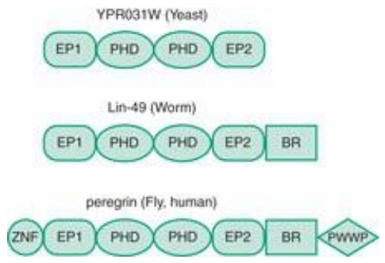
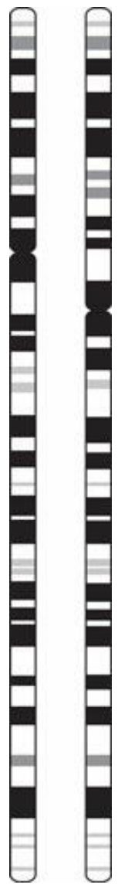
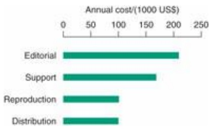

repertoire of species from the three major domains of life: Haemophilus influenzae represented the bacteria, M. jannaschii the archaea, and S. cerevisiae (yeast) the eukarya. Their classification of protein functions contained as major categories processes involving energy, information, and communication (see Box 2.14).

## Box 2.14 General functional classes

• Energy
0 Biosynthesis of cofactors, amino acids
Central and intermediary metabolism
0 Energy metabolism
0 Fatty acids and phospholipids
0 Nucleotide biosynthesis
0 Transport
• Information
0 Replication
0 Transcription
Translation
• Communication
0 Regulatory functions
Cell envelope/cell wall
Cellular processes

The numbers of genes in the three species, known at the time of the study, are:

| Species | Number of genes |
| --- | --- |
| H. influenzae | 1680 |
| M. jannaschii | 1735 |
| S. cerevisiae | 6278 |

Are there, among these, shared proteins for shared functions? In the category of energy, proteins are shared across the three domains. In the category of communication, proteins are unique to each domain. In the categories of information, archaea share some proteins with bacteria and others with eukarya.

Analysis of shared functions among all domains of life has led people to ask whether it might be possible to define a minimal organism; that is, an organism with the smallest gene complement consistent with independent life based on the central DNA → RNA → protein dogma (i.e. excluding protein-free life forms based solely on RNA). The minimal organism must have the ability to reproduce, but not be required to compete in growth and reproductive rate with other organisms. One may reasonably assume a generous nutrient medium, relieving the organism of biosynthetic responsibility, and dispensing with stress-reponse functions including DNA repair.

The smallest known independent organism is M. genitalium, with 468 predicted protein sequences. In 1996, A.R. Mushegian and E.V. Koonin compared the genomes of M. genitalium and H. influenzae. (At the time, these were the only completely sequenced bacterial genomes.) The last common ancestor of these widely diverged bacteria lived about 2 billion years ago. Of 1703 proteincoding genes of H. influenzae, 240 are homologues of proteins in M. genitalium. Mushegian and

Koonin reasoned that all of these must be essential, but might not be sufficient for autonomous life, for some essential functions might be carried out by unrelated proteins in the two organisms. For instance, the common set of 240 proteins left gaps in essential pathways, which could be filled by adding 22 enzymes from M. genitalium. Finally, removing functional redundancy and parasitespecific genes gave a list of 256 genes as the proposed necessary and sufficient minimal set.

What is in the proposed minimal genome? Functional classes included:

• translation, including protein synthesis,
DNA replication,
recombination and repair: a second function of essential proteins involved in DNA replication,
• transcription apparatus,
• chaperone-like proteins,
• intermediary metabolism: the glycolytic pathway,
• no nucleotide, amino acid, or fatty acid biosynthesis,
protein-export machinery,
• limited repertoire of metabolite transport proteins.

It should be emphasized that the viability of an organism with these proteins has not been proven. Moreover, even if experiments proved that some minimal gene content—the proposed set or some other set—is necessary and sufficient, this does not answer the related question of identifying the gene complement of the common ancestor of M. genitalium and H. influenzae, or of the earliest cellular forms of life. For only 71% of the proposed set of 256 proteins have recognizable homologues among eukaryotic or archaeal proteins.

Nevertheless, identification of functions necessarily common to all forms of life allows us to investigate the extent to which different forms of life accomplish these functions in the same ways. Are similar reactions catalysed in different species by homologous proteins? Genome analysis has revealed families of proteins with homologues in archaea, bacteria, and eukarya. The assumption is that these have evolved from an individual ancestral gene through a series of speciation and duplication events, although some may be the effects of horizontal transfer. The challenge is to map common functions and common proteins.

Several thousand protein families have been identified with homologues in archaea, bacteria, and eukarya. Different species contain different amounts of these common families: in bacteria, the range is from Aquifex aeolicus, 83% of the proteins of which have archaeal and eukaryotic homologues, to Borrelia burgdorferi, in which only 52% of the proteins have archaeal and eukaryotic homologues. Archaeal genomes have somewhat higher percentages (62–71%) of proteins with bacterial and eukaryotic homologues. But only 35% of the proteins of yeast have bacterial and archaeal homologues.

Does the common set of proteins carry out the common set of functions? Among the proteins of the minimal set identified from M. genitalium, only ≈30% have homologues in all known genomes. Other essential functions must be carried out by unrelated proteins, or possibly by unrecognized homologues. The protein families for which homologues carry out common functions in archaea, bacteria, and eukarya are enriched in those involved in translation and biosynthesis (see Table 2.11).

Table 2.11 Functional classification of proteins common to many species

| Protein functional class | Number of families appearing in all known genomes |
| --- | --- |
| Translation, including ribosome structure | 53 |
| Transcription | 4 |
| Replication, recombination, repair | 5 |
| Metabolism | 9 |
| Cellular processes (chaperones, secretion, cell division, cell wall biosynthesis) | 9 |

The picture is emerging that evolution has explored the vast potential of proteins to different extents for different types of functions. It has been most conservative in the area of protein synthesis.

## Please pass the genes: horizontal gene transfer

Learning that Streptomyces griseus trypsin is more closely related to bovine trypsin than to other microbial proteinases, Brian Hartley commented in 1970 that, ’… the bacterium must have been infected by a cow’. It was a clear case of lateral or horizontal gene transfer: a bacterium picking up a gene from the soil in which it was growing, which an organism of another species had deposited there. The classic experiments on pneumococcal transformation by O. Avery, C. MacLeod, and M. McCarthy that identified DNA as the genetic material are another example. In general, horizontal gene transfer is the acquisition of genetic material by one organism from another, by natural rather than laboratory procedures, through some means other than descent from a parent during replication or mating. Several mechanisms of horizontal gene transfer are known, including direct uptake, as in the pneumococcal transformation experiments, or via a viral carrier.

Analysis of genome sequences has shown that horizontal gene transfer is not a rare event, but has affected most genes in microorganisms. It requires a change in our thinking from ordinary ‘clonal’ or parental models of heredity. Evidence for horizontal transfer includes (1) discrepancies among evolutionary trees constructed from different genes and (2) direct sequence comparisons between genes from different species.

In E. coli, 755 ORFs (a total of 547.8 kb, ≈18% of the genome) appear to have entered the genome by horizontal transfer after divergence from the Salmonella lineage 100 million years ago.
In microbial evolution, horizontal gene transfer is more prevalent among operational genes—those responsible for ‘housekeeping’ activities such as biosynthesis—than among informational genes, or those responsible for organizational activities such as transcription and translation. For example, Bradyrhizobium japonicum, a nitrogen-fixing bacterium symbiotic with higher plants, has two glutamine synthetase genes. One is similar to those of its bacterial relatives and the other is 50% identical to those of higher plants. Rubisco (ribulose-1,5-bisphosphate carboxylase/oxygenase), the enzyme that first fixes carbon dioxide at the entry to the Calvin cycle of photosynthesis, has been passed around between bacteria, mitochondria, and algal plastids, as well as undergoing gene duplication. Many phage genes appearing in the E. coli genome provide further examples and point to a mechanism of transfer.

Nor is the phenomenon of horizontal gene transfer limited to prokaryotes. Both eukarya and prokaryotes are chimaeras. Eukarya derive their informational genes primarily from an organism related to Methanococcus, and their operational genes primarily from proteobacteria with some contributions from cyanobacteria and methanogens. Almost all informational genes from Methanococcus itself are similar to those in yeast. Nor is gene transfer limited to ancient ancestors. The human genome has revealed hundreds of bacterial proteins among our genes. Conversely, at least eight human genes appeared in the M. tuberculosis genome.

The observations hint at the model of a ‘global organism’, a genetic common market, or even a worldwide DNA web’ from which organisms download genes at will! How can this be reconciled with the fact that the discreteness of species has been maintained? The conventional explanation is that the living world contains ecological ‘niches’ to which individual species are adapted. It is the discreteness of niches that explains the discreteness of species. But this explanation depends on the stability of normal heredity to maintain the fitness of the species. Why would not the global organism break down the lines of demarcation between species, just as global access to popular culture threatens to break down lines of demarcation between national and ethnic cultural heritages? Perhaps the answer is that it is the informational genes, which appear to be less subject to horizontal transfer, that determine the identity of the species.

It is interesting that although evidence for the importance of horizontal gene transfer is overwhelming, it was dismissed for a long time as rare and unimportant. The source of the intellectual discomfort is clear: parent-to-child transmission of genes is at the heart of the Darwinian model of biological evolution whereby selection (differential reproduction) of parental phenotypes alters gene frequencies in the next generation. For offspring to gain genes from somewhere other than their parents smacks of Lamarck and other discredited alternatives to the paradigm. The evolutionary tree as an organizing principle of biological relationship is a deeply ingrained concept: scientists display an environmentalist-like fervour in their commitment to trees, even when trees are not an appropriate model of a network of relationships (See Chapter 5). Perhaps it is well to recall that Darwin knew nothing of genes, and the mechanism that generated the variation on which selection could operate was a mystery to him. Maybe he would have accepted horizontal gene transfer more easily than his followers!

## Comparative genomics of eukarya

A comparison of the genomes of yeast, fly, worm, and human has revealed 1308 groups of proteins that appear in all four genomes. These form a conserved core of proteins for basic functions, including metabolism, DNA replication and repair, and translation.

These proteins are made up of individual protein domains, including single-domain proteins, oligomeric proteins, and modular proteins containing many domains (the biggest, the muscle protein titin, contains 250–300 domains). The proteins of the worm and fly are built from a structural repertoire containing about three times as many domains as the proteins of yeast. Human proteins are built from about twice as many as those of the worm and fly. Most of these domains appear also in bacteria and archaea, but some are specific to (probably, invented by) vertebrates.

Distribution of probable homologues of predicted human proteins

| Vertebrates only | 22% |
| --- | --- |
| Vertebrates and other animals | 24% |
| Animals and other eukarya | 32% |
| Eukarya and prokaryotes | 21% |
| No homologues in animals | 1% |
| Prokaryotes only | 1% |

These include proteins that mediate activities unique to vertebrates, such as defence and immunity proteins, and proteins in the nervous system; only one of them is an enzyme, a ribonuclease.

To create new proteins, inventing new domains is an unusual event. It is far more common to create different combinations of existing domains in increasingly complex ways. A common mechanism is by accretion of domains at the ends of modular proteins (see Fig. 2.4). This process can occur independently, and take different courses, in different phyla.



<details>
<summary>flowchart</summary>

```mermaid
graph LR
  subgraph YPR031W (Yeast)
  A["EP1"] --> B["PHD"]
  B --> C["PHD"]
  C --> D["EP2"]
  end

  subgraph Lin_49_Worm["Lin-49 (Worm)"]
  E["EP1"] --> F["PHD"]
  F --> G["PHD"]
  G --> H["EP2"]
  H --> I["BR"]
  end

  subgraph peregrin (Fly, human)
  J["ZNF"] --> K["EP1"]
  K --> L["PHD"]
  L --> M["PHD"]
  M --> N["EP2"]
  N --> O["BR"]
  O --> P["PWWP"]
  end
```
</details>

Figure 2.4 Evolution by accretion of domains, of molecules related to perigrin, a human protein that probably functions in transcription regulation. The C. elegans homologue, lin-49, is essential for normal development of the worm. The function of the yeast homologue is unknown. The proteins contain these domains: ZNF, C2H2-type zinc finger (not to be confused with acetylene; C and H stand for cysteine and histidine); EP1 and EP2, enhancer of polycomb 1 and 2; PHD, plant homeodomain, a repressor domain containing the $\mathrm { C } _ { 4 } \mathrm { H } _ { 3 } \mathrm { C } _ { 3 }$ type of zinc finger; BR, bromo domain; PWWP, domain containing sequence motif Pro-Trp-Trp-Pro.

Gene duplication followed by divergence is a mechanism for creating protein families. For instance, there are 906 genes + pseudogenes for olfactory receptors in the human genome. These are estimated to bind ≈10 000 odour molecules. Homologues have been demonstrated in yeast and other fungi (some comparisons are odorous), but it is the need of vertebrates for a highly developed sense of smell that multiplied and specialized the family to such a great extent. Eighty per cent of the human olfactory receptor genes are in clusters. Compare this with the small size of the globin gene cluster (see Box 2.9), which did not require such great variety.

## RECOMMENDED READING

- Ashburner, M. (2006). Won for All: How the Drosophila Genome Was Sequenced. Cold Spring Harbor Laboratory Press, Cold Spring Harbor. A personal description—a ‘blow-by-blow’ account—of the fly genome project.
- Bentley, D.R. (2004). Genomes for medicine. Nature, 429, 440–445. Summary and discussion of the results of genomic sequencing and their applications.
- C. elegans Sequencing Consortium (1999). How the worm was won. The C. elegans genome sequencing project. Trends Genet., 15, 51–58. Description of the project in which high-throughput DNA sequencing was originally developed, and the results: the first metazoan genome to be sequenced.
- Doolittle, W.F. (1999). Lateral genomics. Trends Cell Biol., 9, M5–M8. How the discovery of horizontal gene transfer has upset traditional views of evolution.
- Dubcovsky, J. and Dvorak, J. (2007). Genome plasticity a key factor in the success of polyploid wheat under domestication. Science, 316, 1862–1866.
- Koonin, E.V. (2000). How many genes can make a cell: the minimal-gene-set concept. Annu. Rev. Genomics Hum. Genet., 1, 99–116. A summary of work on comparative genomics.
- Kwok, P.-Y. and Gu, Z. (1999). SNP libraries: why and how are we building them? Mol. Med. Today, 5, 538–543. Progress and rationale for databases of SNPs.
- Lesk, A.M. (2011). Introduction to Genomics, 2nd edn. Oxford University Press, Oxford.
- Southan, C. (2004). Has the yo-yo stopped? An assessment of human protein-coding gene number. Proteomics, 4, 1712–1726. How many genes are there in the human genome? Estimates have been changing.
- Ureta-Vidal, A., Ettwiller, L., and Birney, E. (2003). Comparative genomics: genomewide analysis in metazoan eukarya. Nat. Rev. Genet., 4, 251–262. Introduction to the repertoire of solved genomes and how genomes from different species illuminate one another.
- Zhang, R. and Zhang, C.-T. (2006). The impact of comparative genomics on infectious disease research. Microbes Infect., 8, 1613–1622. How comparative genomics of prokaryotes is elucidating infectious disease, including

identification of virulence determinants, drug targets, candidate vaccines, and diagnostic markers.

Publications of the drafts of the human genome sequences appeared in special issues of Nature, 15 February 2001, containing the results of the publicly supported Human Genome Project, and Science, 16 February 2001, containing the results produced by Celera Genomics. These are landmark issues.

The May 2001 issue of Genome Research, volume 11, number 5, is devoted to the human genome.

The completion of the human genome in 2003 was announced in various press releases, and described in issues of Nature and Science.

Altenhoff, A.M. and Dessimoz, C. (2012). Inferring orthology and paralogy. Methods Mol. Biol., **855**, 259–279.

Collins, F.S., Green, E.D., Guttmacher, A.E., and Guyer, M.S. (2003). A vision for the future of genomics research. Nature, **422**, 835–847.

Building on the DNA revolution. Special section. Science, **300**.

Two papers discussing the current status and conceptual problems of coming to terms with metagenomics.

Eisen, J.A. (2007). Environmental shotgun sequencing: its potential and challenges for studying the hidden world of microbes. PLoS Biol., 5, e82.

Xu, J. (2006). Microbial ecology in the age of genomics and metagenomics: concepts, tools and recent advances. Mol. Ecol., **15**, 1713–1731.

## EXERCISES AND PROBLEMS

**Exercise 2.1** The overall base composition of the E. coli genome is A = T = 49.2% and G = C = 50.8%. In a random sequence of 4 639 221 nucleotides with these proportions, what is the expected number of occurrences of the sequence CTAG?

**Exercise 2.2** The E. coli genome contains a number of pairs of enzymes that catalyse the same reaction. How would this affect the use of knockout experiments (deletion or inactivation of individual genes) to try to discern function?

**Exercise 2.3** Which of the categories used to classify the functions of yeast proteins (see Table 2.3) would be appropriate for classifying proteins from a prokaryotic genome?

**Exercise 2.4** Which occurred first, a man landing on the moon or the discovery of deep-sea hydrothermal vents? Guess first, then look it up.

**Exercise 2.5** Gardner syndrome is a condition in which large numbers of polyps develop in the lower gastrointestinal tract, leading inevitably to cancer if untreated. In every observed case, one of the parents is also a sufferer. What is the mode of the inheritance of this condition?

**Exercise 2.6** The gene for retinoblastoma is transmitted along with a gene for esterase D to which it is closely linked. However, either of the two alleles for esterase D can be transmitted with either allele for retinoblastoma. How do you know that retinoblastoma is not the direct effect of the esterase D genotype?

**Exercise 2.7** If all somatic cells of an organism have the same DNA sequence, why is it necessary to have cDNA libraries from different tissues?

**Exercise 2.8** Suppose you are trying to identify a gene causing a human disease. You find a genetic marker 0.75 cM from the disease gene. To within approximately how many bp have you localized the gene you are looking for? Approximately how many genes is this region likely to contain?

**Exercise 2.9** Leber hereditary optic neuropathy (LHON) is an inherited condition that can cause loss of central vision, resulting from mutations in mitochondrial DNA. You are asked to counsel a woman who has normal mitochondrial DNA and a man with LHON, who are contemplating marriage. What advice would you give them about the risk to their offspring of developing LHON?

**Exercise 2.10** Glucose-6-phosphate dehydrogenase deficiency is a single-gene recessive X-linked genetic defect affecting hundreds of millions of people. Clinical consequences include haemolytic anaemia and persistent neonatal jaundice. The gene has not been eliminated from the population because it confers resistance to malaria. In this case, general knowledge of metabolic pathways identified the protein causing the defect. Given the amino acid sequence of the protein, how would you determine the chromosomal location(s) of the corresponding gene?

**Exercise 2.11** Before DNA was recognized as the genetic material, the nature of a gene—in detailed biochemical terms—was obscure. In the 1940s, G. Beadle and E. Tatum observed that single mutations could knock out individual steps in biochemical pathways. On this basis they proposed the one gene, one enzyme hypothesis. On a photocopy of Figure 2.1, draw lines linking genes in the figure to numbered steps in the sequence of reactions in the pathway. To what extent do the genes of the trp operon satisfy the one gene, one enzyme hypothesis and to what extent do they present exceptions?

**Exercise 2.12** The figure here shows human chromosome 5 (left) and the matching chromosome from a chimpanzee. On a photocopy of this figure indicate which regions show an inversion of the banding pattern.



<details>
<summary>natural_image</summary>

Two vertical chromosome pairs showing black and white bands (no text or labels)
</details>

**Exercise 2.13** Describe in general terms how the FISH picture in Plate III would appear if the affected region of chromosome 20 were not deleted but translocated to another chromosome.

**Exercise 2.14** The surface area of the human gut is approximately 200 $\mathbf { m } ^ { 2 }$ (for comparison, the area of a singles tennis court is $1 9 6 \: \mathrm { m } ^ { 2 } )$ . The diameter of a standard Petri dish is 100 mm. How many Petri dishes are equivalent in surface area to the human gut?

**Exercise 2.15** A total of 755 ORFs entered the E. coli genome by horizontal transfer in the 14.4 million years since divergence from Salmonella. What is the average rate of horizontal transfer in kb/year? To how many typical proteins (≈300 amino acids) would this correspond? What percentage of known genes entered the E. coli genome via horizontal transfer?

**Exercise 2.16** To what extent is a living genome like a database? Which of the following properties are shared by living genomes and computer databases? Which are properties of living genomes but not databases? Which are properties of databases but not living genomes? (a) Serve as repositories of information. (b) Are self-interpreting. (c) Different copies are not identical. (d) Scientists can detect errors. (e) Scientists can correct errors. (f) There is planned and organized responsibility for assembling and disseminating the information.

**Problem 2.1** Summarize the experimental evidence that shows that the genetic linkage map on any single chromosome is linearly ordered.

**Problem 2.2** For M. genitalium and H. influenzae, what are the values of (a) gene density in genes/kb, (b) average gene size in base pairs, and (c) number of genes? Which factor contributes most highly to the reduction of genome size in M. genitalium relative to H. influenzae?

**Problem 2.3** It is estimated that the human immune system can produce $1 0 ^ { 1 5 }$ antibodies. Would it be feasible for such a large number of proteins each to be encoded entirely by a separate gene, the diversity arising from gene duplication and divergence? A typical gene for an IgG molecule is about 2000 bp long.

1 Stothard, P., Van Domselaar, G., Shrivastava, S., Guo, A., O’Neill, B. et al. (2005). BacMap: an interactive picture atlas of annotated bacterial genomes. Nucl. Acids Res., 33, D317–D320.
2 Yooseph, S. et al. (2007). The Sorcerer II Global Ocean Sampling Expedition: expanding the universe of protein families. PLoS Biol., 13, e16; Rusch, D.B. et al. (2007). The Sorcerer II Global Ocean Sampling Expedition: Northwest Atlantic through Eastern Tropical Pacific. PLoS Biol., 13, e77.
3 Exceptions include sperm and egg cells, erythrocytes, cells of the immune system, and the effects of other, sporadic, somatic mutations and polyploidization, that accumulate as we age.
4 See [http://www.theguardian.com/science/blog/2013/feb/04/richard-iii-skeleton-last-plantagenet-king-live](http://www.theguardian.com/science/blog/2013/feb/04/richard-iii-skeleton-last-plantagenet-king-live)

# Scientific publications and archives: media, content, and access

## LEARNING GOALS

• To understand the trajectory of the development of the scientific literature, and how it has affected the practice of science.
• To be familiar with the differences in accessibility and convenience between paper and computer access to scientific journals; to appreciate the differences between traditional and digital libraries.
• To appreciate how economic trends are affecting the scientific publishing industry.
• To be expert in identifying articles relevant to any subject of interest.
• To understand the rights and responsibilities associated with open access.
• To come to terms with the explosion of scientific information, and to find modes of keeping track of what you need to know.
• To be aware of large-scale efforts at digitization of library materials and how the results will be made available.
• To be knowledgeable and active in use of various avenues of dissemination of novel scientific results, including social media.
• To understand some of the general problems associated with curating and distributing information in a high-quality scientific database.
• To understand the problems of organizing questions that must be directed to multiple databases.
• To understand the principles of machine learning and what problems can be usefully addressed with these techniques.
• To be able to distinguish different types of computer languages, to understand their relative strengths, and to know how to decide which to use for different purposes.
• To appreciate the power and limitations of natural language processing by computer.

## The scientific literature

Scientific publication began as interpersonal communication. Schools—known as far back as Pythagoras—and lectures, seminars, and discussions all involve oral communication, often supplemented by demonstrations (see box about Robert Hooke) or audiovisual material. (J.R. Oppenheimer once said: ‘The best way to send information is to wrap it up in a person’.) Only now is this changing: computers are

## Robert Hooke at The Royal Society

In 1662 Robert Hooke became Curator of Experiments at the newly formed Royal Society of London. His duties included a demonstration of novel experimental results every week at the Society's regular meetings. He fulfilled this responsibility for 41 years! Hooke had very wide-ranging interests; his achievements included the discovery of the cell, in April 1683.

becoming ever more important mediators of human-to-human communication. Of course, computerto-computer communication is also playing an essential role in research, and in society as a whole.

Formal written articles or books, sometimes based on transcriptions of talks, constitute the conventional scientific literature. Classically, scientists presented their major results as full-length books. Euclid, Copernicus, and Newton are well-known examples. The first scientific journal, the Proceedings of the Royal Society, began publication in 1800, as a collection of abstracts of longer publications. A few scientists continued to present their results as books, notably Darwin's On the Origin of Species by Means of Natural Selection, and Freud's The Interpretation of Dreams. However, monographs and articles became the preferred form of publication of scientific results.

Today, in addition to journals, formats of scientific publication include presentations at meetings, books, or chapters contributed to books, material on the web, films, radio or television programmes, and podcasts.

The web provides an alternative to paper as a mechanism of distribution of the regular scientific literature. It has created novel media and forms of publication. These include bulletin boards, blogs, course notes, presentations from scientific meetings or courses, use of social-networking routes, and compendia such as the Wikipedia.

Web-based publications uninhibited by peer review are of highly variable quality. In addition, websites are volatile. Anyone who browses will encounter many pointers to vanished links. Indeed, the mean lifetime of a URL is ≈3 months. (So the mean lifetime of a website is comparable to the mean lifetime of a human erythrocyte.) On the one hand, we lose some valuable material through this volatility. On the other hand, many sites persist long after they cease to be adequately up-to-date. Unlike the organic world, the web has no efficient mechanism for decay and turnover of dead matter. A specific handicap to effective use of the web for research is the lack of a standard indicator of when any site was last modified. Google searches allow restriction of results to recently modified sites. However, some irrelevant modifications, such as adding an advertisement, may give a site the spurious appearance of currency.

Formal academic publications must pass the test of ‘peer review’. This is an imperfect but nevertheless valuable criterion of quality. Before the internet, the scientific literature appeared on paper, primarily in the form of journals. Today, journals appear electronically as well as on paper. Many scientists with adequate internet access now only rarely visit a library to read journals. Indeed, the major reason for the survival of paper copies at all is the need of publishers and subscribers to work out a mutually satisfactory and secure economic model to charge for access (see section ‘Economic factors governing access to scholarly publications’). The emergence of digital libraries has (at least) two important implications:

1. the delivery of the literature is delocalized, changing from a repository of paper copies at one or more fixed sites, to any point with web access and suitable authorization, such as a personal or institutional password;
2. computational methods of information retrieval help to identify relevant articles from the vast amount of information available. Searching has replaced browsing. Does this bid goodbye to serendipity? The standard retort, ‘Why should you have to buy a full bottle of wine if all you want is a glass?’, seems to me to miss the point that the difference between searching and browsing is not merely one of quantity, but of variety, and the magic of the unexpected intellectual connection. The website BananaSLUG (the mascot of the University of California at Santa Cruz) throws in a random word to a set of search terms, with the goal of rounding up more than the usual suspects (see [http://www.bananaslug.com/](http://www.bananaslug.com/)). Readers can experiment with it and

## Economic factors governing access to scholarly publications

In the traditional economic model of scientific journals, a scientific organization or a commercial publisher produces, and distributes at regular intervals, a paperbound ‘issue’ containing one or more articles. Many journals include ancillary material such as book reviews or meeting announcements.

Costs of production include (see Fig. 3.1):

• activities of an editorial office: receiving submissions, organizing peer review, deciding on acceptance, revision, or rejection (sometimes a long and tortuous process);
• preparation of accepted manuscripts: copy-editing, layout, etc.;
printing and distribution of the journal issue as a physical object.



<details>
<summary>bar</summary>

| Category | Annual cost (1000 US$) |
| --- | --- |
| Editorial | ~210 |
| Support | ~175 |
| Reproduction | ~100 |
| Distribution | ~100 |
</details>

Figure 3.1 Estimates of annual costs of production and distribution of a typical scientific journal. Assumptions of average journal characteristics: 8.3 issues per volume; 123 articles per issue, selected from 205 manuscripts submitted; per volume: 1439 article pages, 260 special graphics pages, 1728 total pages; 5800 subscriptions. Editorial costs include manuscript handling, identification and communication with referees, copy-editing and formatting, indexing, and preparation of table of contents. Reproduction costs include printing, collating, binding, and preparation of offprints. Distribution costs of paper versions include wrapping, labelling, mailing, and maintenance of subscription lists. Support costs include marketing, questions involving rights and permissions, administration, and financial management. A few journals earn considerably more from commercial advertising than from subscriptions, but these are exceptions.

Data from King, D.W. and Tenopir, C. (2004). Scholarly journal and digital database pricing: threat or opportunity? [http://web.utk.edu/\~tenopir/eprints/database\_pricing.pdf](http://web.utk.edu/~tenopir/eprints/database_pricing.pdf)

## Journals’ sources of support include:

• sales, mostly by institutional subscription;
• in many cases, page charges to authors;
• donation of time by editorial boards and referees, who are usually employees of universities, research institutes, or related industrial installations, and not paid by the publisher;
• fees for permissions to reproduce material (a minor component);
• for some journals, subsidies from scientific societies, or from foundations;
a few journals publish commercial advertisements.

Until relatively recently, demand was fairly inelastic. Academic libraries accepted the responsibility of taking virtually all reputable journals in the teaching and research fields of their faculty. Often a university would buy several copies of a journal, for a central library and one or more specialized departmental libraries. No longer! Large increases in costs have broken the budgets of academic libraries, leading to cutbacks in subscriptions.

Several trends have buffeted the system, as follows.

More papers are being published. As a result, many existing journals are publishing more pages each year: larger issues and/or higher publication frequency. This is one of the factors driving up costs. Some journals have given up by publishing electronically in a timely fashion and allowing a long backlog to build up before the printed publication appears.
The larger volume of publications puts libraries under financial pressure to pay the increased costs of purchasing greater volumes of material, to bind it, and to provide space—in principle in perpetuity—to house the purchased journals and make them available. Ultimately the material will require conservation and repair. To save money, libraries reduce purchases, leading to lower print runs and higher prices per copy, a vicious cycle.
Electronic facilities reduce the costs of paper, printing, and distribution, and also editorial costs. For instance, electronic typesetting and desktop publishing programs greatly reduce the cost of including equations and graphics in a technical article.
• Electronic distribution extends the potential format of journal articles, which may more liberally include colour, movies, sound clips, and web links.
Nevertheless, for libraries journal costs, even for journals distributed electronically, are increasing. Mergers of publishing companies present libraries with monolithic suppliers, at liberty to increase fees. In defence, libraries are joining to gain collective strength. OhioLINK, a consortium of college and university libraries, and the State Library, in Ohio (central USA) was a pioneer. The combined library system of the University of California can get into the ring with even the largest publishers. (See [https://chronicle.com/article/U-of-California-Tries-Just/65823/](https://chronicle.com/article/U-of-California-Tries-Just/65823/).)Some professional groups have organized boycotts of specific publishers.
• Much of the user community supports open access (see the subsection on Open access).

The main tension between readers and publishers is economic. However, scientists depend crucially on journals in another, purely academic, respect: peer review. Today, any research group might simply post their results on the web. What the journals provide, through the review process, is a (putative) guarantee of trustworthiness and quality in the articles published. Despite a few wellpublicized exceptions, and many more unpublicized ones, the system works fairly well. A European Commission report notes that: ‘Scientific journals fulfill a double role of certification and dissemination of knowledge’.<sup>1</sup>

The peer-review process also acts as an (again, putative) guarantee and ranking of the quality of scientists. A major component of judging and comparing scientists, for career milestones of hiring and promotion, depends on the record of peer-reviewed publication. This too works well—not without exceptions—but it is a very expensive solution of the problem, and there does not seem to be any logical link between the quality of a scientist's achievements and the medium in which they are reported. A cynic has quipped: ‘The day Harvard or Stanford gives tenure to someone for web postings, 90% of scientific journals will disappear overnight.’

## Open access

Open access is a redefinition of the author/publisher/reader relationship. Open access retains the peer-review process as the criterion for publication. Then:

• Accepted articles are placed on the web, with free access, immediately upon publication. (Many commercial journals impose a delay—typically 6 months—between paper publication and electronic posting.) <sup>2</sup>

Authors retain copyright, rather than assigning it to the publisher as most journals require. However, not only are articles accessible, the content is freely usable by readers, subject to giving proper credit to authors. For example, it is permissible to reproduce and distribute articles in a set of teaching materials, or to import pictures into presentations. Such use, of material not subject to open access, would require consent of the author or publisher as copyright holder or, in the case of older material, expiration of copyright protection.
• Payments for publication are transferred from readers to authors.

Open access has wide popular appeal in the scientific community. Supporters include both individual scientists in their dual roles of producers and consumers of the literature, and funding agencies. The US National Institutes of Health, and the several research councils and the Wellcome Trust in the UK, require open access to publications reporting work that they have supported. The European Commission intends to institute analogous requirements on research it supports, and urges member states to follow its lead. Several universities have imposed requirements on faculty for open-access publication.

The US congress considered, in several sessions, but did not pass, the Federal Research Public Access Act. Passage and presidential approval of this act would go beyond the National Institutes of Health guidelines by requiring public availability via the internet of all journal articles resulting from work supported by funding from US Government agencies involved in large-scale research support. A successor proposal, the Fair Access to Science and Technology Research (FASTR) bill, was introduced on 13 February 2013 in the Senate by John Cornyn and Ron Wyden and in the House of Representatives by Mike Doyle, Zoe Lofgren, and Kevin Yoder.


## See Weblems 3.1 and 3.2

## The Public Library of Science

The Public Library of Science was started in October 2000 by H.E. Varmus, P.O. Brown, and M.B. Eisen to put the principles of open access into practice. It is a non-profit organization of professional scientists, not commercial publishers. Its goals include:

• to make available public access to the scientific literature;
• to organize the scientific literature so that it is computer-searchable;
• to encourage developments of innovative approaches to information retrieval from the scientific literature.

With funding from the Gordon and Betty Moore Foundation and other sources, the Public Library of Science has launched a series of journals, which will permit exploration of different relationships— including but not limited to economic ones—between authors, publishers, and readers.

## Rights and responsibilities of open access

Guidelines for usage of material from Public Library of Science (PLoS) journals appear in the Creative Commons Attribution License (see [http://www.plos.org/publications/journals/](http://www.plos.org/publications/journals/) or [http://creativecommons.org/licenses/by/2.5/](http://creativecommons.org/licenses/by/2.5/) for summaries, or [http://creativecommons.org/licenses/by/2.5/legalcode](http://creativecommons.org/licenses/by/2.5/legalcode) for the full details).

## Traditional and digital libraries

On most university campuses a large, fortress-like building occupies a prominent and central site. Functions of the traditional library include:

• archiving, cataloguing, and curating printed material;
providing to readers facilities for convenient access to the literature;
• helping readers find what they need. This involves help in both identification of suitable sources of information and gaining access to them;
organizing the reservation, borrowing, and return, and photocopying, of material. To enforce security, primarily against loss, theft, or damage. Regular surveillance for misshelved books is essential: a misshelved book is worse than a stolen one, because it continues to occupy space (somewhere);
providing a place to read, study, meet, and communicate;
• to interact with other libraries to enhance user services; for instance, organizing interlibrary loans;
• providing facilities for disabled readers; for instance, scanning and/or audio transcription of books and articles for the blind;
to speak up for readers’ rights. For instance, the American Library Association organized opposition to the loss of readers’ rights to privacy imposed by the US Patriot Act of 2001. Of course, librarians also mediate between readers and publishers in areas such as open access and in negotiating subscription prices.

In a digital library, in contrast:

the archives are in electronic form, not on paper;
provision of access is at a computer screen, rather than off a shelf. This detaches the point of access from the point of repository. The archives can be anywhere. The access point can be anywhere. Many cities, on all continents except Antarctica, have established a complete saturation of wireless access over their entire areas;
• even librarian assistance to readers can be done by e-mail or Skype or their equivalents, not requiring a person stationed at the access point;
• security concerns more typically take the form of password control rather than protection against physical theft or damage. Damage to a library computer is damage to library facilities, not to library contents;
the digital analogue of the place to study, meet, and communicate is perhaps the computer café, which may well be within the library. Some libraries offer computer-equipped conference rooms. Or perhaps collaborative study, meeting, and communication will all be entirely online. Physical proximity may be unnecessary for intellectual intercourse;
representing readers’ interests, and developing enhanced user services, including assistive technology for the disabled, remain responsibilities and commitments.

The detachment of archive and access points raises the question of whether the central library building is necessary. At urban universities in particular the footprint of the building occludes a large chunk of prime real estate. Why not go out in the country somewhere—many miles away if necessary—dig a big hole, install computer equipment and connections—keeping at most a skeleton staff—and establish high-speed electronic links to the user community? Then replace the central library with a sports and recreation facility. The most important loss in such a scenario is the provision of quiet, distraction-free rooms in which to concentrate. Some people can find such a place in a home or office. Many people can't, and some of them realize what they are missing.

## How to populate a digital library

Many publishers distribute material in electronic form. Although there are no real technical obstacles, many economic questions involving the renegotiation of traditional financial relationships among authors, publishers, subscribers, and readers remain unsolved. Older publications that exist only on paper can be scanned in and redistributed electronically. Scanning initially produces a page image, readable by a human but not easily intelligible to a computer. At this stage it is not easy to search the material. Optical character recognition can convert the page images to searchable form, at least as far as the text is concerned.

An obstacle to creating large-scale digital libraries by scanning is the restriction imposed by copyright. In the UK, copyright law began in 1709 during the reign of Queen Anne, shortly after the unification of England and Scotland which prompted legal reconciliations of certain aspects of the disparate systems. Under current UK law, printed material remains under copyright for 70 years from the end of the calendar year of the death of the last surviving author.


## See Weblem 3.3

Legal impediments notwithstanding, the Google Books Library project has organized the large-scale scanning of material from approximately two dozen academic libraries, including those of Harvard, Princeton, and Stanford Universities, the Universities of Michigan and California, and the New York Public Library in the USA, and the Oxford University Library in the UK. Different libraries have adopted different stances with respect to material remaining in copyright. For instance, the agreement between Google and Princeton envisages digitizing only material in the public domain, a selection of about 1 million books, out of a total university collection of 6 million printed works and 5 million manuscripts. In contrast, the agreement between Google and the University of Michigan Library involves comprehensive scanning, but limited release of the product. All results will be searchable. However, in the case of material restricted by copyright only a small amount of material will be accessible, amounting to a few sentences around the search term. (For an example see the document ‘Project Overview’ at [http://www.lib.umich.edu/mdp/](http://www.lib.umich.edu/mdp/))

## The information explosion

Recalling The Sorcerer's Apprentice, efficient delivery can be a mixed blessing. The growth in number of practising scientists has led to an increase in the quantity of publications, by expansion of existing journals and proliferation of new ones. The literature has passed a threshold beyond which it is impossible for anyone to read all the literature in any given field. PubMed lists over a million articles with a 2012 publication date. Assuming an average length of 10 pages, a ‘back-of-the-envelope’ calculation suggests that during 2012 the scientific literature grew by over 1000 pages per hour. Assuming it takes 30 minutes to read a paper, it would take 2 months to read all the papers published in a single day.

It is extremely difficult to command comprehensive knowledge of even a relatively narrow specialty. Outside one's own particular field, it is impossible. This has stimulated the growth of secondary journals aimed at non-specialists, containing reviews or tutorial presentations. These journals have titles such as Reviews of …, Trends in …, or Current Opinion in …, etc.

Of course, in addition to these formal publications, the web contains many other sources of information, of which Wikipedia is the best known. More specialized versions also exist; for instance Proteopedia (for proteins), organized by E. Hodis, E. Martz, J.L. Sussman, J. Prilusky, and D. Canner ([http://www.proteopedia.org](http://www.proteopedia.org)). In addition to stand-alone articles, the site includes molecular graphics links to journal articles in its Interactive 3D Complements in Proteopedia. (Complements being a general term, not referring to any component of the immune system.)

The conclusion is that a reader must be selective. Search engines play an essential role in helping to pick out journal articles and other information sources, on the basis of combinations of keywords, that match a specific topic. From one relevant publication, links to ‘related articles’ can identify others. Specialized blogs help also. But even the most reasonable procedures threaten to produce reading lists with more material than one can assimilate, except with the narrowest possible focus.

## The web: higher dimensions

The web does more than provide a convenient channel for distribution of information. Hypertext, by supporting links among different sites, changes fundamentally the dimensionality of our access to information.

The presentation of material in a typical traditional book or article is linear: you are intended to read successive lines on successive pages. Footnotes are an exception. In some cases footnotes contain lengthy commentary on or extension of the main text—British historian Edward Gibbon was famous for this—but often they are merely citations. And most people tend to skip sections of technical detail, at least on a first reading.

Hypertext makes a difference. Websites contain embedded links. Internal links take you to other portions of the text of a current document, or to associated images, movies, or sounds. External links take you, in the first instance, to sites containing related or supplementary information. Following links from those sites will take you everywhere, without limit.

Even the traditional scientific literature formed a network of interrelated ideas and data. Hypertext facilitates fluid navigation of this network. A few readers may remember days in which one read a journal in the library of a biology department, found a reference to a journal located in the chemistry department library, crossed campus to read the cited article, found there a reference to an article in the mathematics library

## New media: video, sound

The internet allows the extension of media of presentation from the traditional text with interspersed pictures to incorporation of material in many other formats. Extensive sets of coloured pictures, movies, or audio are in many cases the best way to present scientific results. For instance, it is very difficult to capture the important details of a complex macromolecular structure as a ‘still’ picture; a movie affords a much better perception of three dimensions. This is the motivation for the Interactive 3D Complements component of Proteopedia.

The intrinsic importance of sound in some fields—musicology for example—is obvious. In biology, the study of songs of birds, and of whales, are equally obviously based on sounds. But there are applications in biomedicine also: the University of Pennsylvania Medical School has distributed sound clips of healthy and abnormal cardiac activity as mp3 files that physicians in training can