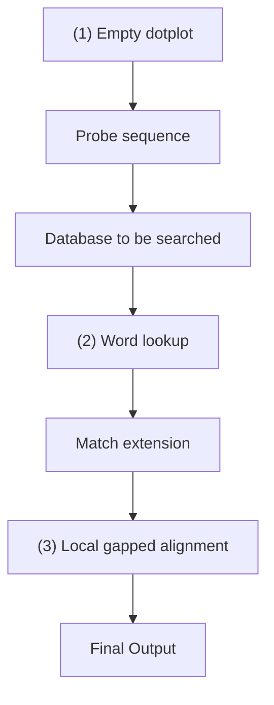

differences. Or, the deletion of a succession of contiguous bases or amino acids is a more probable event than the independent deletion of the same number of bases or amino acids at noncontiguous positions in the sequences. Therefore, we may wish to assign variable weights to different edit operations. A computer program can then determine not just minimal edit distances but optimal alignments. It can score each path by adding up the scores of the individual steps. For substitutions, it adds the score of the mutation, depending on the pair of residues involved. For horizontal and vertical moves, it adds a suitable gap penalty.

## Scoring schemes

A scoring system must account for residue substitutions, and insertions or deletions. Deletions, or gaps in a sequence, will have scores that depend on their lengths.

Hamming and Levenshtein distances measure the dissimilarity of two sequences: similar sequences give small distances and dissimilar sequences give large distances. It is common in molecular biology to define scores as measures of sequence similarity. Then similar sequences give high scores and dissimilar sequences give low scores. These are equivalent formulations. Algorithms for optimal alignment can seek either to minimize a dissimilarity measure or to maximize a scoring function.

For nucleic acid sequences, it is common to use a simple scheme for substitutions: +1 for a match, −1 for a mismatch, or a more complicated scheme based on a higher frequency of transition mutations than transversion mutations. (See Example 5.4.)

For proteins, a variety of scoring schemes have been proposed. We might group the amino acids into classes of similar physicochemical type, and score +1 for a match within residue class and –1 for residues in different classes. We might try to devise a more precise substitution score from a combination of properties of the amino acids. Alternatively, we might try to let the proteins teach us an appropriate scoring scheme. M.O. Dayhoff did this first by collecting statistics on substitution frequencies in the protein sequences then known. Her results were used for many years to score alignments. They have been superseded by

## Example 5.4 Substitution matrix reflecting greater frequency of transition mutations than transversion mutations

Transition mutations (purine↔purine and pyrimidine↔pyrimidine, i.e. a↔g and t↔c) are more common than transversions [purine↔pyrimidine, i.e. (a, g)↔(t, c)]. Suggest a substitution matrix that reflects this. (The higher the value in the matrix, the more favourable the contribution to the alignment score.)

One possibility is:

|  | a | g | t | c |
| --- | --- | --- | --- | --- |
| a | 20 | 10 | 5 | 5 |
| g | 10 | 20 | 5 | 5 |
| t | 5 | 5 | 20 | 10 |
| c | 5 | 5 | 10 | 20 |

newer matrices based on the very much larger set of sequences that has subsequently become available.

## Derivation of substitution matrices: PAM and BLOSUM matrices

As sequences diverge, mutations accumulate. To measure the relative probability of any particular substitution, for instance serine→threonine, we can count the number of serine→threonine changes in pairs of aligned homologous sequences. We could use the relative frequencies of such changes to form a scoring matrix for substitutions. A common change should score higher than a rare one. But, what if there have been multiple substitutions at certain sites? This will bias the statistics. We can avoid this problem by restricting our samples to sequences that are sufficiently similar that we can assume that no position has changed more than once.

A measure of sequence divergence is the PAM, where 1 PAM = 1 per cent accepted mutation. Thus, two sequences 1 PAM apart have 99% identical residues. For pairs of sequences within the 1 PAM level of divergence, it is likely that there has been no more than one change at any position. Collecting statistics from pairs of sequences as closely related as this, and correcting for different amino acid abundances, produces the 1 PAM substitution matrix.

To produce a matrix appropriate for more widely divergent sequences, we can take powers of this matrix. The PAM250 level, corresponding to ${ \approx } 2 0 \%$ overall sequence identity, is the lowest sequence similarity for which we can hope to produce a correct alignment by simple pairwise sequence comparison alone. It is therefore the appropriate level to choose for practical work. (Several authors have derived substitution matrices appropriate in different ranges of overall sequence similarity.)

The occurrence of reversions, either directly or via one or more other changes, produces an apparent slowdown in mutation rates as sequences progressively diverge. The relationship between PAM score and percentage sequence identity is:

| PAM | 0 | 30 | 80 | 110 | 200 | 250 |
| --- | --- | --- | --- | --- | --- | --- |
| % Identity | 100 | 75 | 50 | 60 | 25 | 20 |

The PAM250 matrix of M.O. Dayhoff is shown in Box 5.2. It expresses scores as log-odds values:

$$
\begin{array}{l} \text {Score of mutation $i \leftrightarrow j =$} \\ \log_ {1 0} \frac {\text {observed $i \leftrightarrow j$ mutation rate}}{\text {mutation rate expected from amino}} \\ \text {acid frequencies} \end{array}
$$

## Box 5.2 Substitution matrices used for scoring amino acid sequence similarity

The entries are in alphabetical order of the three-letter amino acid names. Only the lower triangles of the matrices are shown, as the substitution probabilities are taken as symmetric. (This is not because we are sure that the rate of any substitution is the same as the rate of its reverse, but because we cannot determine the differences between the two rates.)

The Dayhoff PAM250 matrix (MDM78):

| Ala (A) | 2 |  |  |  |  |  |  |  |  |  |  |  |  |  |  |  |  |  |  |
| --- | --- | --- | --- | --- | --- | --- | --- | --- | --- | --- | --- | --- | --- | --- | --- | --- | --- | --- | --- |
| Arg (R) | -2 | 6 |  |  |  |  |  |  |  |  |  |  |  |  |  |  |  |  |  |
| Asn (N) | 0 | 0 | 2 |  |  |  |  |  |  |  |  |  |  |  |  |  |  |  |  |
| Asp (D) | 0 | -1 | 2 | 4 |  |  |  |  |  |  |  |  |  |  |  |  |  |  |  |
| Cys (C) | -2 | -4 | -4 | -5 | 12 |  |  |  |  |  |  |  |  |  |  |  |  |  |  |
| Gln (Q) | 0 | 1 | 1 | 2 | -5 | 4 |  |  |  |  |  |  |  |  |  |  |  |  |  |
| Glu (E) | 0 | -1 | 1 | 3 | -5 | 2 | 4 |  |  |  |  |  |  |  |  |  |  |  |  |
| Gly (G) | 1 | -3 | 0 | 1 | -3 | -1 | 0 | 5 |  |  |  |  |  |  |  |  |  |  |  |
| His (H) | -1 | 2 | 2 | 1 | -3 | 3 | 1 | -2 | 6 |  |  |  |  |  |  |  |  |  |  |
| Ile (I) | -1 | -2 | -2 | -2 | -2 | -2 | -2 | -3 | -2 | -5 |  |  |  |  |  |  |  |  |  |
| Leu (L) | -2 | -3 | -3 | -4 | -6 | -2 | -3 | -4 | -2 | 2 | 6 |  |  |  |  |  |  |  |  |
| Lys (K) | -1 | 3 | 1 | 0 | -5 | 1 | 0 | -2 | 0 | -2 | -3 | 5 |  |  |  |  |  |  |  |
| Met (M) | -1 | 0 | -2 | -3 | -5 | -1 | -2 | -3 | -2 | 2 | 4 | 0 | 6 |  |  |  |  |  |  |
| Phe (F) | -3 | -4 | -3 | -6 | -4 | -5 | -5 | -5 | -2 | 1 | 2 | -5 | 0 | 9 |  |  |  |  |  |
| Pro (P) | 1 | 0 | 0 | -1 | -3 | 0 | -1 | 0 | 0 | -2 | -3 | -1 | -2 | -5 | 6 |  |  |  |  |
| Ser (S) | 1 | 0 | 1 | 0 | 0 | -1 | 0 | 1 | -1 | -1 | -3 | 0 | -2 | -3 | 1 | 2 |  |  |  |
| Thr (T) | 1 | -2 | 0 | 0 | -2 | -1 | 0 | 0 | -1 | 0 | -2 | 0 | -1 | -3 | 0 | 1 | 3 |  |  |
| Trp (W) | -6 | 2 | -4 | -7 | -8 | -5 | -7 | -7 | -3 | -5 | -2 | -3 | -4 | 0 | -6 | -2 | -5 | 17 |  |
| Tyr (Y) | -3 | -4 | -2 | -4 | 0 | -4 | -4 | -5 | 0 | -1 | -1 | -4 | -2 | 7 | -5 | -3 | -3 | 0 | 10 |
| Val (V) | 0 | -2 | -2 | -2 | -2 | -2 | -2 | -1 | -2 | 4 | 2 | -2 | 2 | -1 | -1 | -1 | 0 | -6 | -2 |
|  | A | R | N | D | C | Q | E | G | H | I | L | K | M | F | P | S | T | W | Y |

The BLOSUM62 matrix:

| Ala (A) | 4 |  |  |  |  |  |  |  |  |  |  |  |  |  |  |  |  |  |
| --- | --- | --- | --- | --- | --- | --- | --- | --- | --- | --- | --- | --- | --- | --- | --- | --- | --- | --- |
| Arg (R) | -1 | 5 |  |  |  |  |  |  |  |  |  |  |  |  |  |  |  |  |
| Asn (N) | -2 | 0 | 6 |  |  |  |  |  |  |  |  |  |  |  |  |  |  |  |
| Asp (D) | -2 | -2 | 1 | 6 |  |  |  |  |  |  |  |  |  |  |  |  |  |  |
| Cys (C) | 0 | -3 | -3 | -3 | 9 |  |  |  |  |  |  |  |  |  |  |  |  |  |
| Gln (Q) | -1 | 1 | 0 | 0 | -3 | 5 |  |  |  |  |  |  |  |  |  |  |  |  |
| Glu (E) | -1 | 0 | 0 | 2 | -4 | 2 | 5 |  |  |  |  |  |  |  |  |  |  |  |
| Gly (G) | 0 | -2 | 0 | -1 | -3 | -2 | -2 | 6 |  |  |  |  |  |  |  |  |  |  |
| His (H) | -2 | 0 | 1 | -1 | -3 | 0 | 0 | -2 | 8 |  |  |  |  |  |  |  |  |  |
| Ile (I) | -1 | -3 | -3 | -3 | -1 | -3 | -3 | -4 | -3 | 4 |  |  |  |  |  |  |  |  |
| Leu (L) | -1 | -2 | -3 | -4 | -1 | -2 | -3 | -4 | -3 | 2 | 4 |  |  |  |  |  |  |  |
| Lys (K) | -1 | 2 | 0 | -1 | -3 | 1 | 1 | -2 | -1 | -3 | -2 | 5 |  |  |  |  |  |  |
| Met (M) | -1 | -1 | -2 | -3 | -1 | 0 | -2 | -3 | -2 | 1 | 2 | -1 | 5 |  |  |  |  |  |
| Phe (F) | -2 | -3 | -3 | -3 | -2 | -3 | -3 | -3 | -1 | 0 | 0 | -3 | 0 | 6 |  |  |  |  |
| Pro (P) | -1 | -2 | -2 | -1 | -3 | -1 | -1 | -2 | -2 | -3 | -3 | -1 | -2 | -4 | 7 |  |  |  |
| Ser (S) | 1 | -1 | 1 | 0 | -1 | 0 | 0 | 0 | -1 | -2 | -2 | 0 | -1 | -2 | -1 | 4 |  |  |
| Thr (T) | 0 | -1 | 0 | -1 | -1 | -1 | -1 | -2 | -2 | -1 | -1 | -1 | -1 | -2 | -1 | 1 | 5 |  |
| Trp (W) | -3 | -3 | -4 | -4 | -2 | -2 | -3 | -2 | -2 | -3 | -2 | -3 | -1 | 1 | -4 | -3 | -2 | 11 |
| Tyr (Y) | -2 | -2 | -2 | -3 | -2 | -1 | -2 | -3 | 2 | -1 | -1 | -2 | -1 | 3 | -3 | -2 | -2 | 2 |
| Val (V) | 0 | -3 | -3 | -3 | -1 | -2 | -2 | -3 | -3 | 3 | 1 | -2 | 1 | -1 | -2 | -2 | 0 | -3 |
|  | A | R | N | D | C | Q | E | G | H | I | L | K | M | F | P | S | T | W |

The numbers are multiplied by 10, simply to avoid decimal points. The matrix entries reflect the probabilities of mutational events. A value of +2—for instance, C↔S—implies that in related sequences the mutation would be expected to occur 1.6 times more frequently than random. The calculation is as follows: the matrix entry 2 corresponds to the actual value 0.2 because of the scaling. The value 0.2 is $\log _ { 1 0 }$ of the relative expectation value of the mutation. Therefore, this

expectation value is $1 0 ^ { 0 . 2 }   { = }   1 . 6 .$

The probability of two independent mutational events is the product of their probabilities. By using logs we have scores that we can add up rather than multiply, a computational convenience.

## The BLOSUM matrices

S. Henikoff and J.G. Henikoff developed the family of BLOSUM matrices for scoring substitutions in amino acid sequence comparisons. Their goal was to replace the Dayhoff matrix with one that would perform best in identifying distant relationships, making use of the much larger amount of sequence data that had become available since Dayhoff’s work.

The BLOSUM matrices are based on the BLOCKS database of aligned protein sequences; hence the name BLOcks SUbstitution Matrix. From regions of closely related proteins alignable without gaps, Henikoff and Henikoff calculated the ratio of the number of observed pairs of amino acids at any position to the number of pairs expected from the overall amino acid frequencies. Like the Dayhoff matrix, the results are expressed as log-odds. In order to avoid overweighting closely related sequences, the Henikoffs replaced groups of proteins that have sequence identities higher than a threshold by either a single representative or a weighted average. The threshold 62% produces the commonly used BLOSUM62 substitution matrix (see Box 5.2). This is offered by all programs as an option, and is the default in most. BLOSUM matrices have superseded the Dayhoff matrix.

## Scoring insertions/deletions, or ‘gap weighting

To form a complete scoring scheme for alignments, we need, in addition to the substitution matrix, a way of scoring gaps. How important are insertions and deletions relative to substitutions? Distinguish gap initiation:

aaagaaa

aaa–aaa

from gap extension:

aaaggggaaa

aaa––––aaa

For aligning DNA sequences, CLUSTAL-W recommends use of the identity matrix for substitution (+1 for a match, 0 for a mismatch) and gap penalties of 10 for gap initiation and 0.1 for gap extension by one residue. For aligning protein sequences, the recommendations are to use the BLOSUM62 matrix for substitutions, and gap penalties of 11 for gap initiation and 1 for gap extension by one residue.

## Computing the alignment of two sequences

Now that we have a scoring scheme, we can apply it to finding optimal alignments: we seek the alignment that maximizes the score. A famous algorithm to determine the global optimal alignments of two sequences is based on a mathematical technique called dynamic programming. (Details appear in the next section.) This algorithm has been extremely important in molecular biology. Some noteworthy features are as follows.

The good news is that the method is guaranteed to give an optimal global alignment. It will find the best alignment score, given the choice of parameters—substitution matrix and gap penalty—

with no approximation.

The bad news is that many alignments may give the same optimal score, and none of these need correspond to the biologically correct alignment. For instance, in comparing the α- and β-chains of chicken haemoglobin, W. Fitch and T. Smith found 17 alignments, all of which give the same optimal score and one of which is correct (on the basis of the structures, the court of last resort). There are 1317 alignments with scores within 5% of the optimum.
Another item of bad news is technical: the time required to align two sequences of lengths n and m is proportional to $n \times m ,$ , because this is the size of the edit matrix that must be filled in. This means that the dynamic-programming method is not convenient to use for searching in an entire sequence database for a match to a probe sequence, and even less convenient for ‘all-against-all’ alignments. The database search problem is in effect the problem of matching a probe sequence to a region of a very long sequence, the length of the entire database.

## Variations and generalizations

Variations of the dynamic-programming method apply to three related alignment questions: entire sequence against entire sequence, region of one sequence against entire other sequence, and region of one sequence against region of other sequence (see Box 1.8). The global alignment algorithm was first applied to biological sequence alignment by S.B. Needleman and C.D. Wunsch. T. Smith and M. Waterman modified it to identify local matches.

Box 5.3 BLAST programs come in several flavours

| Program | Type of query sequence | Search in database of: |
| --- | --- | --- |
| BLASTP | Amino acid sequence | Protein sequences |
| BLASTX | Translated nucleotide sequence | Protein sequences |
| TBLASTN | Amino acid sequence | Translated nucleotide sequences |
| TBLASTX | Translated nucleotide sequence | Translated nucleotide sequences |
| PSI-BLAST | Amino acid sequence | Protein sequence database |

All these programs compare amino acid sequences with amino acid sequences, using by default the BLOSUM62 matrix. Searches involving nucleotide sequences, either as query sequence or in the database searched, are carried out by translating nucleotide sequences to amino acid sequences in all six possible reading frames. BLASTN compares nucleic acid query sequences with nucleic acid data banks directly.

## Approximate methods for quick screening of databases

It is routine to screen genes from a new genome against the databases, for similarity to other sequences. Approximate methods can detect close relationships well and quickly but are inferior to the exact ones in picking up very distant relationships. In practice they give satisfactory performance in the many cases in which the probe sequence is fairly similar to one or more sequences in the data bank. They are therefore worth trying first. (We have already seen an example of PSI-BLAST in Chapter 1.)

A typical approximation approach would take a small integer k, and determine all instances of each k-tuple of residues in the probe sequence that occur in any sequence in the database. A candidate sequence is a sequence in the data bank containing a large number of matching k-tuples, with equivalent spacing in probe and candidate sequences.

There are several variations on this theme, including the original BLAST program and its variants (see Box 5.3). For a selected set of candidate sequences, approximate optimal alignment calculations are then carried out, with the time- and space-saving restriction that the paths through the matrix that can be considered are restricted to bands around the diagonals containing the many matching ktuples. It is clearest to show the procedure in terms of a dotplot (see Fig. 5.3).

flowchart

Figure 5.3 The mechanism of a BLAST search shown as a schematic. BLAST solves the problem of finding matches of a probe sequence in a full genome or a full database that is much longer than the probe sequence.

1. The ‘playing field’ of the algorithm is the outline of a dotplot, just as if the problem were going to be solved by application of an exact alignment method.
2. BLAST first divides the probe sequence into fixed-length words of length k; here, k = 4. It then identifies all exact occurrences of these words in the full database: no mismatches, no gaps. Note that the same four-letter word may occur several times in the probe sequence (shown here in green), and of course each four-letter word may match many times within the database. It is possible to do this step quickly after pre-processing the database to record the sites of appearance of all four-letter words.
3. Starting with each match, BLAST tries to extend the match in both directions. Still no mismatches, no gaps allowed.
4. Given the extended matches, BLAST tries to put them together by doing alignments allowing mismatches and gaps, but only within limited regions containing the preliminary matches (grey areas). The result of this step is to add to the matches the positions shown as ★. This produces longer matching regions.

It is the restriction of the more complex matching procedure to relatively small regions, rather than applying it to the entire matrix, that gives the method its speed. The price to pay is that if a combined match lies outside the grey area, the method will miss it. In the example illustrated, the matching regions at the right of the matrix, will not be combined, but reported as separate hits.

## The dynamic-programming algorithm for optimal pairwise sequence alignment1

A chart implicitly containing all possible alignments can be constructed as a matrix similar to that used in drawing the dotplot. The residues of one sequence index the rows, the residues from the other sequence index the columns. Any path through the matrix from upper left to lower right corresponds to an alignment. The task is to find the path that has the lowest cost, and the difficulty is that there are a very large number of paths to consider.

As an illustration, suppose you wanted to drive from Malmö in southern Sweden to Tromsø in northern Norway. Your route will consist of a number of segments, taking you through a succession of intermediate cities (see Fig. 5.4). There are many choices of different combinations of segments to produce a complete, continuous path.

text_image

TROMSO
UPPSALA
STOCKHOLM
MALMO

Figure 5.4 Possible routes from Malmö to Tromsø. How can you determine an optimal route?

© Collins Bartholemew Ltd. 1980.

The computational approach to finding the optimal path begins by assigning a numerical measure of the ‘cost’ to each of the possible individual segments of the journey. This ‘cost’ is not simply the financial outlay, but a more general estimate of your relative preferences for different portions of the route. The distance travelled will clearly be an important component of the cost, but other factors such as the quality of the roads and the opportunities for sightseeing may also contribute. For any route selected, the overall cost of the trip is the sum of the costs of the individual segments. Clearly it is inefficient to repeat any leg of the journey, or to visit any city twice, so we will agree that every intermediate stop will be north of the previous one. This formalism is expressed in terms of minimizing a cost rather than maximizing a score; for our purposes the two approaches are equivalent. An algorithm can explore the possible combinations to determine an optimal overall route.

Here is an abstract version of the problem, which illuminates the essential idea of dynamic programming.

text_image

Start
A
Finish

Consider first: how many paths from Start to Finish pass through A? There are six paths from Start to A. (Write them all down.) Therefore, by symmetry, there are six paths from A to Finish, and a total of 36 paths from Start to Finish passing through A. (Why?) Assuming that we have assigned costs to the individual steps, do we have to check all 36 paths to find the path of minimum cost that goes from Start to Finish, passing through A? No. Here is the crucial observation: the choice of the best path from A to Finish is independent of the choice of path from the Start to A. If we determine the best of the six paths from Start to A, and we determine the best of the six paths from A to Finish, the best path from Start to Finish passing through A is the best path from Start to A followed by the best path from A to Finish. No more than 12 of the paths through A need be considered.

Even greater simplification is possible by systematically re-subdividing the problem. The dynamic-programming method for finding the optimal path through the matrix is based on this idea.

A statement of the optimal alignment problem and the dynamic-programming solution are as follows. Given two character strings, possibly of unequal length— ${ \mathcal { A } } = a _ { 1 } a _ { 2 } { \cdots } a _ { n }$ and $B = b _ { 1 } b _ { 2 } . . . b _ { m } \mathrm { {  —  } }$ where each $a _ { i }$ and $b _ { j }$ is a member of an alphabet set $\mathcal { A } _ { 1 }$ , consider sequences of edit operations that convert A and B to a common sequence. Individual edit operations include:

Substitution of $b _ { j }$ for $a _ { i }$ is represented by $(a_{i},b_{j})$

Deletion of $a _ { i }$ from sequence A is represented by $(a_{i}, \phi)$

Deletion of $b_{j}$ from sequence B is represented by $( \phi , b _ { j } )$

If we extend the alphabet set to include the null character $\Phi : \mathcal { A } ^ { + } = \mathcal { A } \cup \{ \phi \}$ , a sequence of edit operations is a set of ordered pairs $( x , y )$ , with $x , y \in \mathcal { A }$

A cost function, $d ,$ is defined on edit operations:

which position i of sequence A corresponds to position $j$ of sequence $B _{ z }$ and the mutation

Define the minimum weighted distance between sequences A and B as:

$$
D (A, B) = \min _ {A \to B} \Sigma d (x, y)
$$

where $x , y \in \mathcal { A }$ and the minimum is taken over all sequences of edit operations that convert A and B into a common sequence.

The problem is to find $D ( A , B )$ and one or more of the alignments that correspond to it.

An algorithm that solves this problem, requiring execution time proportional to the product of the lengths of the two sequences, creates a matrix $\mathcal { D } ( i , j ) , i = 0 , \ldots n ; j = 0 , \ldots m ,$ such that $\mathcal { D } \left( i , j \right)$ is the minimal distance between the strings that consist of the first i characters of A and the first j characters of B. Then $\mathcal { D } ( n , m )$ will be the required minimal distance $D ( A , B )$

The algorithm computes $\varpi ( i , j )$ by recursion. The value of $\varpi ( i , j )$ corresponds to the conversion of the initial subsequences ${ \mathcal { A } } _ { i }   =   a _ { 1 } a _ { 2 } { \cdots } a _ { i }$ and $B _ { j }   =   b _ { 1 } b _ { 2 } . . . b _ { j }$ into a common sequence by L edit operations $S _ { k } , k = 1 , \ldots L ,$ , which can be considered to be applied in increasing order of position in the strings. Consider undoing the last of these edit operations. The resulting truncated sequence of edit operations, $S _ { k } ,   k = 1 ,   \ldots   L ^ { - 1 }$ , is a sequence of edit operations for converting a substring of $A _ { i }$ and a substring of $B _ { j }$ into a common result. What is more, it must be an optimal sequence of edit operations for these substrings, for if some other sequence $\vec { S } _ { \vec { k } } ^ { \prime }$ were a lower-cost sequence of operations for these substrings, then followed by $S _ { L }$ would be a lower-cost sequence of operations than $S _ { k }$ for converting $A _ { i }$ to $B _ { j }$ . Therefore, there should be a recursive method for calculating the $\varpi ( i , j )$

Recognize the correspondence of steps between adjacent squares in the matrix, and individual edit operations (see Fig. 5.1):

$$
\begin{array}{l} \begin{array}{l} (i - 1, j - 1) \to (i, j) \text {corresponds to the} \\ \text {substitution} a _ {i} \to b _ {j} \end{array} \\ \begin{array}{l l} (i - 1, j) \to (i, j) & \text {corresponds to the} \\ & \text {deletion of a_{i} from A} \end{array} \\ \begin{array}{l l}(i, j - 1) \rightarrow (i, j)&\text {corresponds to the insertion}\\&\text {of b_{j} into A at position i}\end{array} \\ \end{array}
$$

Sequences of edit operations correspond to stepwise paths through the matrix:

$$
(i _ {0}, j _ {0}) = (0, 0) \rightarrow (i _ {1}, j _ {1}) \rightarrow \dots (n, m)
$$

where $0 \leq i _ { k + 1 } { - } i _ { k } \leq 1$ (for $0 \leq k \leq n { - } 1 )$ , $0 \leq j _ { k + 1 } - j _ { k } \leq 1$ (for $0 \leq k \leq m { - } 1 )$ . Considering the possible sequences of edit operations and the corresponding paths through the matrix, the predecessor of an optimal string of edit operations leading from $( 0 , \; 0 )$ to $( i , j )$ , where $i , j \geq 0$ , must be an optimal sequence of edit operations leading to one of the cells $( i { - } 1 , \; j ) , \; ( i { - } 1 , \; j { - } 1 )$ , or $( i ,   j { - } 1 )$ ; and, correspondingly, $\mathcal { D } ( i , j )$ must depend only on the values of $\scriptstyle { \mathcal { D } } ( i - 1 ,   j ) , \; { \mathcal { D } } ( i - 1 ,   j - 1 )$ , and $\mathcal { D } ( i , j { - } 1 )$ , together, of course, with the parameterization specified by the cost function d.

The algorithm is then as follows.

Compute the $( m + 1 ) \times ( n + 1 )$ matrix D by applying:

1. the initialization conditions on the top row and left column:

$$
\begin{array}{l} \mathcal {D} (i, 0) = \sum_ {k = 0} ^ {i} d (a _ {k}, \phi) \\ \mathcal {D} (0, j) = \sum_ {k = 0} ^ {j} d (\phi , b _ {k}) \\ \end{array}
$$

These values impose the gap penalty on unmatched residues at the beginning of either sequence.

And then:

2. the recurrence relationships:

$$
\begin{array}{l} \mathcal {D} (i, j) = \min \left\{\mathcal {D} (i - 1, j) + d (a _ {i}, \phi), \mathcal {D} (i - 1, j - 1) + \right. \\ d (a _ {i}, b _ {j}), \mathcal {D} (i, j - 1) + d (\phi , b _ {j}) \bigg \} \\ \end{array}
$$

for $i = 1 \ldots n ; j = 1 , \ldots m$ . This means, consider all three possible steps to $\varpi ( i , j )$

| Operation | Cumulative cost |
| --- | --- |
| Insert a gap in sequence A | $\mathcal{D}(i-1,j) + d(a_i, \phi)$ |
| Substitute $a_i \leftrightarrow b_j$ | $\mathcal{D}(i-1,j-1) + d(a_i, b_j)$ |
| Insert a gap in sequence B | $\mathcal{D}(i,j-1) + d(\phi, b_j)$ |

From these, choose the minimal value of the cumulative cost. For each cell, record not only the value $\mathcal { D } ( i , j )$ but a pointer back to (one or more of) the cell(s) $( i – 1 , j ) , ( i , – 1 , j – 1 )$ , or $( i , j { - } 1 )$ selected by the minimization operation. Note that more than one predecessor may give the same value.

When the calculations are complete, $\mathcal { D } ( n , ~ m )$ is the optimal distance $D ( A ,   B )$ . An alignment corresponding to the sequence of edit operations recorded by the pointers can be recovered by tracing a path back through the matrix from $( n ,   m )$ to (0, 0). This alignment, corresponding to the minimal distance $D ( A , B ) = \mathcal { D } ( n , m )$ , may well not be unique. (See Example 5.5.)

## Example 5.5 Dynamic-programming algorithm for sequence alignment

Align the strings $A = g g a a t g g$ and $B = a t g$ according to the simple scoring scheme of match = 0, mismatch = 20, and insertion or deletion = 25.

Here is the state of play after the top row and leftmost column have been initialized (italic), and the element in the second row and second column has been entered as **20** (boldface):

|  | $\phi$ | a | t | g |
| --- | --- | --- | --- | --- |
| $\phi$ | 0 | 25 | 50 | 75 |
| g | 25 | 20 |  |  |
| g | 50 |  |  |  |
| a | 75 |  |  |  |
| a | 100 |  |  |  |
| t | 125 |  |  |  |
| g | 150 |  |  |  |
| g | 175 |  |  |  |

The value of **20** was chosen as the minimum of $2 5 \pm 2 5$ (horizontal move, or insert gap into string atg), 0 + 20 (substitution $\alpha { \leftrightarrow } g ) ,$ , and $2 5 \pm 2 5$ (vertical move, or insert gap into string ggaatgg). Because the substitution (the diagonal move) provided the minimal value, the cell containing 0 in the upper left-hand corner of the matrix is the predecessor of the cell in which we have just entered the 20. For traceback purposes, we would also draw an arrow from the value of 20 just entered, back to the 0 at the upper left. (If two or even three of the possible moves produce the same value, the resulting cell has multiple predecessors.)

Here is the matrix after completion of the calculation:

text_image

φ a t g
0 ←25 ←50 ←75
↑ ↘ ↘ ↘
g 25 20 ←45 50
↑ ↘ ↘ ↘
g 50 45 40 45
↑ ↘ ↘ ↘
a 75 50 65 60
↑ ↘ ↘ ↘ ↘
a 100 75 70 85
↑ ↑ ↘ ↘
t 125 100 75 90
↑ ↑ ↑ ↘
g 150 125 100 75
↑ ↑ ↑ ↘ ↗
g 175 150 125 100

It includes the traceback information in the form of arrows pointing from each cell to its predecessor(s). For some applications we may need only the value of D(A, B) but not an alignment; if so, it is unnecessary to save the pointers. Boldface arrows delineate the paths of optimal alignment retracing a trail of predecessors from lower right, back to upper left. In some cases, one cell may show two predecessors. These correspond to alternative alignments with the same score.

There are two cells at which the traceback path branches. This gives a total of four optimal alignments with equal score:

| ggaatgg | ggaatgg | ggaatgg | ggaatgg |
| --- | --- | --- | --- |
| ---atg- | ---at-g | --a-tg- | --a-t-g |

With a gap-weighting scheme that assigned a smaller penalty to gap extension than to gap initiation the first two of these would score better than the others, because they contain the smallest number of gaps, irrespective of the length of the individual gaps. However, more sophisticated gap-weighting schemes require more complicated recurrence formulas for filling the matrix.

This algorithm determines the optimal global alignment of two sequences. It is inappropriate for detection of local regions of high similarity within two sequences, or for probing a long sequence with a short fragment, because it imposes gap penalties outside the similar regions. The method of T. Smith and M. Waterman solves this problem. Their modifications of the basic dynamic-programming algorithm find optimal local alignments; that is, they select the substrings from both sequences that are most similar to each other. Their changes affect the following aspects.

Initialization of the matrix: setting the values of the top row and left column. In the Smith–Waterman method, the top row and left column are set to 0. As a result, either sequence can slide along the other before alignment starts, without incurring any gap penalty against the residues it passes by.
2. Filling in the matrix: in global alignment, at each step a choice is forced among match, insertion, or deletion, even if none of these choices is attractive and even if a succession of unattractive choices degrades the score along a path containing a well-fitting local region. The Smith–Waterman method adds the fourth option: end the region being aligned.
3. Scoring and traceback: the score of a global alignment is the number in the matrix element at the lower right. In the Smith–Waterman method it is the optimal value encountered, wherever in the matrix it appears. For global alignment, traceback to determine the actual alignment starts at the lower-right cell. In the Smith– Waterman method it starts at the cell containing the optimal value and continues back only as far as the region of local similarity continues.

The Smith–Waterman method would report a unique global optimum for our example:

Note that no gaps appear outside the region matched.

## Significance of alignments

Suppose alignment reveals an intriguing similarity between two sequences. Is the similarity significant or could it have arisen by chance? (We raised this question in Chapter 1.) For some simple phenomena—tossing a coin or rolling dice—it is possible to calculate exactly the expected distribution of results, and the likelihood of any particular result. For sequences it is not trivial to define the population from which the alignment is selected. For instance, to take random strings of nucleotides or amino acids as controls ignores the bias arising from nonrandom composition.

A practical approach to the problem is as follows: if the score of the alignment observed is no better than might be expected from the corresponding alignment of a random permutation of the sequence, then it is likely to have arisen by chance. We may randomize one of the sequences many times, realign each result to the second sequence (held fixed) and collect the distribution of resulting scores. Figure 5.5 shows a typical result. For database searches we would use the population of results returned from the entire database as the population with which to measure the statistics.

violin

| Optimal local alignment score | Number of pairs of sequences |
| --- | --- |
| Low | ~0.1 |
| Peak | ~0.9 |
| High | ~0.1 |

Figure 5.5 Optimal local alignment scores for pairs of random amino acid sequences of the same length follow an extreme value distribution. For any score x the probability of observing a score ≥ x is:

$$
P (\text {Score} \geq x) = 1 - \exp (- K e ^ {- \lambda x})
$$

where K and λ are parameters related to the position of the maximum and the width of the distribution. Note the long tail at the right. This means that a score several standard deviations above the mean has a higher probability of arising by chance (i.e. it is less significant) than if the scores followed a normal distribution.

Clearly, if the randomized sequences score as well as the original one then the alignment is unlikely to be significant. We can measure the mean and standard deviation of the scores of the alignments of randomized sequences and ask whether the score of original sequence is unusually high. The Z score reflects the extent to which the original result is an outlier from the population:

$$
Z \text { score } = \frac {\text { score - mean }}{\text { standard   deviation }}
$$

A Z score of 0 means that the observed similarity is no better than the average of random permutations of the sequence, and might well have arisen by chance. Other values used as measures of significance are P, or the probability that the observed match could have happened by chance, and, for database searching, E, which is the number of matches as good as the observed one that would be expected to appear by chance in a database of the size probed (see Box 5.4).

Many ‘rules of thumb’ are expressed in terms of percentage of identical residues in the optimal alignment. If two proteins have more than 45% identical residues in their optimal alignment they will have very similar structures and are very likely to have a common or at least a similar function. If two proteins have greater than 25% identical residues they are likely to have a similar general folding pattern. On the other hand, observations of a lower degree of sequence similarity cannot rule out homology. Recall R.F. Doolittle’s definition of the region of 18–25% sequence identity as the ‘twilight zone’ in which the suggestion of homology is tantalizing but dangerous. Below the twilight zone is a region where pairwise sequence alignments tell very little. Lack of significant sequence similarity does not preclude genuine homology.

Although the twilight zone is a treacherous region, we are not entirely helpless. In deciding whether there is a genuine relationship, the ‘texture’ of the alignment is important: are the similar residues isolated

## Box 5.4 How to play with matches but not get burned

Pairwise alignments and database searches often show tenuous but tantalizing sequence similarities. How can we decide whether we are seeing a true relationship? Statistics cannot answer biological questions directly, but can tell us the likelihood that a similarity as good as the one observed would appear, just by chance, among unrelated sequences. To do this we want to compare our result with alignments of the same sequences to a large population. This ‘control’ population should be similar in general features to our aligned sequences, but should contain few sequences related to them. Only if the observed match stands out from the population can we regard it as significant.

To what population of sequences should we compare our alignment? For pairwise alignments we can pick one of the two sequences, make many scrambled copies of it using a random-number generator, and align each permuted copy to the second sequence. For probing a database the entire database provides a comparison population.

Aligning our sequence to each member of the control population generates a large set of scores. How does the score of our original alignment rate? Several statistical parameters have been used to evaluate the significance of alignments, as follows.

The Z score is a measure of how unusual our original match is, in terms of the mean and standard deviation of the population scores. If the original alignment has score S,

$$
\text {Z score of } S = \frac {S - \text {mean}}{\text {standard deviation}}
$$

A Z score of 0 means that the observed similarity is no better than the average of the control population, and might well have arisen by chance. The higher the Z score, the greater the probability that the observed alignment has not arisen simply by chance. Experience suggests that Z scores ≥5 are significant.

Many programs report P, the probability that the alignment is better than random. The relationship between Z and P depends on the distribution of the scores from the control population, which do not follow the normal distribution.

A rough guide to interpreting P values:

| P≤10-100 | Exact match |
| --- | --- |
| P in range 10-100-10-50 | Sequences very nearly identical, e.g. alleles or SNPs |
| P in range 10-50-10-10 | Closely related sequences, homology certain |
| P in range 10-5-10-1 | Usually, distant relatives |
| P>10-1 | Match probably insignificant |

• For database searches, some programs (including PSI-BLAST) report E-values. The E value of an alignment is the expected number of sequences that give the same Z score or better if the database is probed with a random sequence. E is found by multiplying the value of P by the size of the database probed. Note that E but not P depends on the size of the database. Values of P are between 0 and 1.0. Values of E are between 0 and the number of sequences in the database searched.

• A rough guide to interpreting E values:

| E ≤ 0.02 | Sequences probably homologous |
| --- | --- |
| E between 0.02 and 1 | Homology unproven but cannot be ruled out |
| E > 1 | You would have to expect this good a match just by chance |

Statistics are a useful guide, but not a substitute for thinking carefully about the results, and further analysis of ones that look promising!

and scattered throughout the sequence, or are there ‘icebergs’? Are there local regions of high similarity (another term of Doolittle’s) that may correspond to a shared active site? We may need to rely on other information, about shared ligands or function. Of course, if the structures are known we could examine them directly.

Some illustrative examples are listed here.

Sperm whale myoglobin and lupin leghaemoglobin have 15% identical residues in optimal alignment. This is even below Doolittle’s definition of the twilight zone. But we also know that both molecules have similar three-dimensional structures, and that both contain a haem group and both bind oxygen. They are indeed distantly related homologues.
The sequences of the N- and C- terminal halves of rhodanese have 11% identical residues in optimal alignment. If these appeared in independent proteins one could not conclude from the sequences alone that they were related. However, their appearance in the same protein suggests that they arose via gene duplication and divergence. The striking similarity of their structures confirms their relationship.
As a cautionary note, consider the proteinases chymotrypsin and subtilisin. They have 12% identical residues in optimal alignment. These enzymes have a common function and a common catalytic triad (see Fig. 8.5). However, they have dissimilar folding patterns, and are not related. Their common function and mechanism is an example of convergent evolution. This case serves as a warning against special pleading for relationships between proteins with dissimilar sequences on the basis of similarities of function and mechanism!

## Multiple sequence alignment

‘One amino acid sequence plays coy; a pair of homologous sequences whisper; many aligned sequences shout out loud.’ In nature, even a single sequence contains all the information necessary to dictate the fold of the protein. How does a multiple sequence alignment make that information more intelligible and useful? Alignment tables expose patterns of amino acid conservation, from which distant relationships may be more reliably detected. Structure-prediction tools also give more reliable results when based on multiple sequence alignments than on single sequences.

Visual examination of multiple sequence alignment tables is one of the most profitable activities that a molecular biologist can undertake away from the laboratory bench. Don’t even think about not displaying them with different colours for amino acids of different physiochemical type. A reasonable colour scheme (not the only possible one) is shown in Table 5.1.

Table 5.1 Distinguishing amino acids of different physico-chemical types in multiple sequence alignments

| Colour | Residue type | Amino acids |
| --- | --- | --- |
| Yellow | Small nonpolar | Gly, Ala, Ser, Thr |
| Green | Hydrophobic | Cys, Val, Ile, Leu, Pro, Phe, Tyr, Met, Trp |
| Magenta | Polar | Asn, Gln, His |
| Red | Negatively charged | Asp, Glu |
| Blue | Positively charged | Lys, Arg |

To be informative, a multiple alignment should contain a distribution of closely and distantly related sequences. If all the sequences are very closely related, the information they contain is largely redundant, and few inferences can be drawn. If all the sequences are very distantly related, it will be difficult to construct an accurate alignment (unless all the structures are available), and in such cases the quality of the results, and the inferences they might suggest, are questionable. Ideally, one has a complete range of similarities, including distantly related examples linked through chains of close relationships. (See Case Study 5.2.)

## CASE STUDY 5.2 Structural inferences from multiple sequence alignments of thioredoxins

Thioredoxins are enzymes found in all cells. They participate in a broad range of biological processes, including cell proliferation, blood clotting, seed germination, insulin degradation, repair of oxidative damage, and enzyme regulation. The common mechanism of these activities is the reduction of protein disulphide bonds.

Plate VI shows a multiple sequence alignment of 16 thioredoxins. The structure of E. coli thioredoxin contains a central five-stranded β sheet flanked on either side by α helices; these helices and strands are indicated by the symbols α and β. Other thioredoxins are expected to share most but not all of the secondary structure of the E. coli enzyme. The plate also shows a summary of the alignment as a sequence logo, in which letters of different sizes indicate different proportions of amino acids. (T. Schneider and M. Stephens designed sequence logos; this example was produced using the web server at [http://weblogo.berkeley.edu/logo.cgi](http://weblogo.berkeley.edu/logo.cgi)).

(a) Alignment of thioredoxins

(b) Thioredoxin

text_image

1
2
3
4
5
6
7
8
9
10
11
12
13
14
15
16
17
18
19
20
21
22
23
24
25
26
27
28
29
30
31
32
33
34
35
36
37
38
39
40
41
42
43
44
45
46
47
48
49
50
51
52
53
54
55
56
57
58
59
60
K Y D P C F E F K V V D W C P K M L P E F E F L E X E Y F Y F Y F Y F Y F Y F Y F Y F Y F Y F Y F Y F Y F Y F Y F Y F Y F Y F Y F Y F Y F Y F Y F Y F Y F Y F Y F Y F Y F Y F Y F Y F Y F Y F Y F Y F Y F Y F Y F Y F Y F Y F Y F Y F Y F Y F Y F Y F Y F Y F YF E E E E E E E E E E E E E E E E E E E E E E E E E E E E E E E E E E E E E E E E E E E E E E E E E E E E E E E E E E E E E E E E E E E E E E E E E E E E E E E E E E E E E E E E E E E E E E E E E E E EE A B C D D

chemical

Protein secondary structure diagram showing helices and labeled amino acid residues (N, C)

chemical

Protein secondary structure diagram with labeled amino acid residues and helices

Plate VI (a) Alignment of amino acid sequences of E. coli thioredoxin and homologues. Some of the sequences have been trimmed at their termini. Residue numbers in this table corresponds to positions in the E. coli sequence (top line). Helix α and strand β assignments for E. coli thioredoxin are from PDB entry 2TRX. (b) Sequence logo derived from this multiple-sequence alignment. (c) The structure of E. coli thioredoxin [2TRX] contains a central five-stranded β sheet flanked on either side by α helices. Residue numbers correspond to those in the multiple sequence alignment table. The N- and C-termini are also marked. Spheres indicate positions of the Cα atoms of every tenth residue. The reactive disulphide bridge between $^ { 3 2 } \mathrm { C y s }$ and $^ { 3 5 } \mathrm { C y s }$ appears in yellow (see Case Study 5.2).

Structural and functional features of thioredoxins that we might hope to identify from the multiple sequence alignment include the following (see Fig. 5.6 and Plate VI).

• The most highly conserved regions probably correspond to the active site. The disulphide bridge between residues 32 and 35 in E. coli thioredoxin is part of a WCGPC[K or R] motif conserved in the family. Other regions conserved in the sequences, including the PT at residues 75–77 and the GA at residues 92–93, are involved in substrate binding.
Regions rich in insertions and deletions probably correspond to surface loops. A position containing a conserved Gly or Pro probably corresponds to a turn. Turns correlated with insertions and deletions occur at positions 9, 20, 60, and 95. The conserved glycine at position 92 in E. coli thioredoxin is indeed part of a turn. It is in an unusual mainchain conformation, one that is easily accessible only to glycine (See Chapter 6). The conserved proline at position 76 in E. coli thioredoxin is also associated with a turn. It is in another unusual mainchain conformation, this one easily accessible only to proline.
• A conserved pattern of hydrophobicity with spacing 2 (i.e. every other residue)—with the intervening residues more variable and including hydrophilic residues—suggests a $\beta$ strand on the surface. This pattern is observable in the β strand between residues 50 and 60.
• A conserved pattern of hydrophobicity with spacing ≈4 suggests a helix. This pattern is observable in the region of helix between residues 40 and 49.